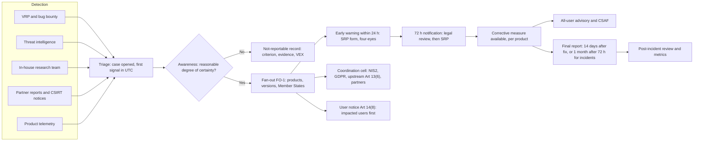

# Article 14 at volume: reporting operations for a hyperscale manufacturer

Aldermoor should plan for about 33 reportable cases a year (31 actively exploited vulnerabilities and 2 severe incidents, base estimate; range 16 to 58). Under the conservative one-record-per-product rule this pack recommends, that becomes about 92 Single Reporting Platform (SRP) records, 413 manual web-form submissions and 275 user notices a year. Grouping products into one record would cut this to 33 records and 146 submissions. The workload is modest, about 1.9 FTE in the base case and 6.9 FTE in the high case. Headcount is set by coverage: a filing seat staffed every hour of the year needs 5.5 FTE. The recommended increment is therefore about 6 FTE (9 FTE high case), plus a 24/7 awareness duty-officer rota of 5.5 FTE-equivalent absorbed into the existing PSIRT. Three design choices matter most. First, awareness is declared by the PSIRT duty chain alone, with no approval step. Second, each affected product gets its own SRP record until Ireland's coordinator CSIRT confirms that grouping is acceptable. Third, one internal case file drives filing, user notices and evidence, because the SRP has no API and keeps drafts in one person's account. All Aldermoor figures are estimates; public counts are calibration benchmarks, not Aldermoor data.

## Aldermoor should expect about 90 SRP records a year, and the 24/7 filing seat, not the workload, sets the headcount

The model (`volume_model.py`, inputs in `volume_model.csv`) builds volume bottom-up by product family. Each input carries a low, base and high value and a source label. The browser family uses the brief's history of about 10 in-the-wild exploited vulnerabilities a year. That is consistent with public benchmarks: at least eight exploited Chrome zero-days were patched in 2025, and browsers made up under 10% of the 90 zero-days Google's threat intelligence group tracked that year. Mobile operating systems saw 15 zero-days in 2025, 9 in 2024 and 17 in 2023 across all vendors. CISA added 245 entries to its Known Exploited Vulnerabilities catalogue in 2025 and 185 in 2024.

These benchmarks undercount and overcount at once. An Art 14 "actively exploited vulnerability" is not limited to zero-days: n-day exploitation of unpatched devices also counts once there is reliable evidence (Art 3(42)). Conversely, a benchmark entry for an upstream component is reportable only where the vulnerable code is present, reachable and exploited in the product (guidance para 218; Commission FAQ 5.4). The model's Aldermoor values are estimates within these bounds.

Exhibit 1. Annual volume and staffing (estimates)

| Measure | Low | Base | High |
|---|---|---|---|
| Actively exploited vulnerability cases a year | 15 | 30.5 | 53 |
| Severe incident cases a year | 1 | 2 | 5 |
| SRP records a year, per-product rule FO-1 | 31 | 92 | 221 |
| SRP records a year, grouped | 16 | 33 | 58 |
| SRP submissions a year, FO-1 (early warning, 72 h, final, updates) | 124 | 413 | 1,326 |
| User notices a year | 62 | 275 | 884 |
| Reporting cell hours a year (triage, coordination, filing, upstream, drills) | 787 | 3,012 | 11,096 |
| Cell FTE from workload | 0.5 | 1.9 | 6.9 |
| Cell FTE floor for one 24/7 filing seat | 5.5 | 5.5 | 5.5 |
| Legal FTE (72 h and final review only) | 0.03 | 0.11 | 0.41 |
| Communications FTE (user notices, excluding translation) | 0.06 | 0.34 | 1.7 |
| Incremental FTE, total | 5.6 | 5.9 | 9.0 |
| Awareness duty-officer rota, FTE-equivalent (existing PSIRT) | 5.5 | 5.5 | 5.5 |
| Probability another case starts within 72 h of any case | 12% | 23% | 38% |

Source: `volume_model_output.csv`. One seat staffed every hour is 8,760 hours; at 1,600 productive hours per FTE that is 5.5 FTE (assumption).

The overlap figure matters as much as the totals. In the base case almost one case in four will run in parallel with another. The rota must therefore assume two live cases, not one.

The peak scenario is a single Lumen Engine bug, exploited in Lumen Browser and reachable in five other products sold across all 27 Member States. The product list follows the module E3 register: Lumen WebView is its own Class I product (F13), and Halo OS on Arc devices sits inside the Arc phone's boundary (F05).

Exhibit 2. Peak load in the first 72 hours (estimates)

| Peak: one engine bug, 6 products, 27 Member States | Per product (FO-1) | Grouped |
|---|---|---|
| SRP records | 6 | 1 |
| Submissions in the first 72 h | 12 | 2 |
| Assigned Representative hours to file early warnings | 6.0 | 1.0 |
| Assigned Representative hours to 72 h, cumulative | 21.0 | 3.5 |
| Legal hours at 72 h | 6.0 | 1.0 |
| User notices (impacted users and all users) | 12 | 12 |
| Localised notice variants if notices go out in 24 languages | 288 | 288 |
| Assigned Representative pairs to file all early warnings within 4 h | 2 | 1 |

Localisation is a pack assumption, not a KB rule. The KB names no language requirement for Art 14(8) notices. The SRP itself is English only.

## The clocks are short and fixed, and awareness is a recorded decision rather than a feeling

Art 14 has applied since 11 Sep 2026 to every in-scope product, including products already on the market (Art 69(3); Art 71(2)). The clocks below were checked against the Official Journal text of the Regulation (module E6, claims register).

Exhibit 3. Article 14 clocks as implemented in the case engine

| Stage | Actively exploited vulnerability | Severe incident | Engine rule |
|---|---|---|---|
| Early warning | 24 h from awareness, Art 14(2)(a) | 24 h from awareness, Art 14(4)(a) | `aware_at + 24 h` |
| Notification | 72 h from awareness, Art 14(2)(b) | 72 h from awareness, Art 14(4)(b) | `aware_at + 72 h`; both clocks run from awareness, not consecutively |
| Final report | No later than 14 days after a corrective or mitigating measure is available, Art 14(2)(c) | Within one month after submission of the 72 h notification, Art 14(4)(c) | AEV: `fix_at + 14 days`; SI: actual 72 h submission time plus one calendar month |
| Intermediate update | On coordinator CSIRT request, Art 14(6) | Same | Tracked as a statutory item with the CSIRT's response time |
| User information | No fixed deadline; users must be informed "in a timely manner", failing which the coordinator CSIRT may inform them, Art 14(8) | Same | Pack targets: impacted users by T+72 h; all users within 24 h of a fix |

The engine computes every deadline on exact UTC instants. It applies no business-day, weekend or holiday adjustment. A month is the same day and time in the next month, clamped to the month's last day, so a notification filed on 31 January gives a final report due on 28 or 29 February. These are the earliest defensible readings. A general EU rule on computing periods might extend day or month periods that end on a weekend; it is not in the KB, it is unverified here and the engine does not rely on it.

Awareness is the trigger. Guidance C(2026) 5252 para 213 says the manufacturer "should assess the suspicious event immediately" and is aware once it has "a reasonable degree of certainty". Suspicion starts triage, not the clock (KB 09-reporting.md). The guidance remains an approved draft; no formal adoption had been found by 30 Oct 2026 (verification.md, claim 15).

Not everything is reportable. Good-faith research and bug-bounty findings without exploitation evidence are not, nor are component vulnerabilities that are not exploitable or not exploited in the product (FAQ 5.2 and 5.4; guidance paras 217-218). Exploitation known before 11 Sep 2026 is not reported retroactively. The engine makes each of these a named criterion for a logged "not reportable" decision.

Two platform quirks need handling. The SRP's 72-hour counter currently shows a due time 48 hours after the early warning (ENISA SRP FAQ 26). Ireland's NCSC describes the detailed notification as due "within 48 hours of the Early Warning submission" (NCSC CRA page; the National CRA Guidelines say "within 48hrs of the EW submission"). The statute's 72 hours from awareness governs (KB 09-reporting.md). Because Aldermoor reports to Ireland, the pack sets an internal target of the earlier of T+72 h and early warning plus 48 h. The engine prints the counter time beside the statutory deadline so staff are not misled either way.

## One engine bug becomes six SRP records under a conservative per-product rule until Ireland's CSIRT says otherwise

The KB is silent on how many notifications a shared-engine vulnerability needs. It gives four relevant facts. ENISA's FAQ says "Only one notification is required for any given actively exploited vulnerability (AEV) or severe incident (SI)", but in the context of a manufacturer with several EU branches (FAQ 8, page updated 15 Oct 2026). The glossary has a single "Product name and version" field. The AEV final report is due 14 days after a measure is available, and each product's fix ships on its own train. And the record freezes once the final report is submitted (KB 09-reporting.md).

Pack rule FO-1 (conservative design, labelled as such in `case_engine/fanout.py`):

| Tier | Test | Treatment |
|---|---|---|
| A, exploited | Reliable evidence of exploitation in this product | Reportable |
| B, reachable | Same vulnerable Aldermoor code, reachable by the same exploit path, no product-specific evidence yet | Treated as reportable. The exploitation evidence is evidence about the vulnerability in Aldermoor's own code |
| C, not reachable | Code absent or unreachable | Not reportable; record a VEX "not_affected" justification (FAQ 5.4; para 218) |

In the default per-product mode each Tier A or B product gets its own SRP record. Each record carries the shared case identifier in its title and summary, its own Member State list from the distribution map, and its own final-report clock. Grouped mode puts all products in one record; the engine then sets the final report 14 days after the earliest product's fix. Grouped mode should be switched on only after the Irish coordinator CSIRT confirms in writing that it accepts grouped notifications for a shared engine. A notification sent to the wrong coordinator "may be invalidated" (FAQ 18), and a mis-structured record could draw the same objection.

The cost of caution is visible in Exhibit 2: 12 submissions instead of 2 in the first 72 hours. The cost is affordable. Two Assigned Representative pairs file six early warnings inside four hours.

## The operating model runs one case file from detection to final report, with filing decoupled from approval



Exhibit 4. Steps, owners and targets

| Step | Owner role | Target | Basis |
|---|---|---|---|
| Case opened | PSIRT intake, any hub | Within 1 h of signal | Application guide 10 |
| Awareness decision | PSIRT duty officer, lead or deputy | Immediately; hours, not days | Guidance para 213 |
| Product data pack confirmed | Release engineering, product management | Within 4 h of awareness | Application guide 10 |
| Early warnings filed | Assigned Representative on shift, with checker | T+12 h target; T+24 h statutory | Art 14(2)(a), (4)(a) |
| Impacted-user notice | Communications with PSIRT lead | T+72 h target | Art 14(8); guidance paras 219-221 |
| Upstream report and fix share | Open-source programme office | T+72 h target | Art 13(6); guidance 9.2.1 |
| 72 h notification | Assigned Representative after legal review | Earlier of T+72 h and early warning + 48 h | Art 14(2)(b), (4)(b); Irish guidelines |
| All-user advisory and CSAF | Communications, PSIRT | Fix + 24 h target | Art 14(8) "where appropriate, all users" |
| Final report | Assigned Representative after legal review | Fix + 14 days (AEV); 72 h submission + 1 month (SI) | Art 14(2)(c), (4)(c) |
| Post-incident review | PSIRT lead | Within 2 weeks of final report | Application guide 10 |

The coordinator CSIRT is derived, not chosen case by case. The engine applies Art 14(7) in order: main establishment where product cybersecurity decisions are predominantly taken, then the EU establishment with most employees; only a manufacturer with no EU main establishment falls back to the authorised representative, importer, distributor and most users. For Aldermoor the result is Ireland, because Aldermoor Ireland Ltd in Dublin takes those decisions. The coordinator is Ireland's NCSC, whose fallback address is usable only once ENISA declares an outage (KB 09-reporting.md).

## Decision rights put awareness with the PSIRT duty chain and keep legal off the 24-hour path

The 24-hour clock cannot wait for a committee. The corporate guide places legal review on the 72-hour notification and the final report, never on the early warning, which carries only factual fields (07-reporting-governance.md). The engine enforces this: only the awareness-authority roles can declare awareness or "not reportable", and the 72-hour and final tabs cannot be recorded as filed without a logged legal review.

Exhibit 5. Decision rights (R responsible, A accountable, C consulted, I informed)

| Decision | PSIRT duty officer | PSIRT lead | Assigned Representative | Legal | Communications | CISO |
|---|---|---|---|---|---|---|
| Declare awareness or not reportable | R | A | I | I | I | I |
| Apply fan-out FO-1 tiers | R | A | C | C | I | I |
| File early warning | C | A | R | I | I | I |
| Approve 72 h and final content | C | A | R | R (review) | C | I |
| PEC request on the AEV 72 h tab | C | R | I | A | I | C |
| Impacted-user and all-user notices | C | A | I | C (wording) | R | I |
| Switch to grouped mode | I | R | I | A | I | C |
| Trigger NIS2 or GDPR assessment | R | A | I | C | I | I |

No one above the PSIRT lead approves an early warning. The CISO is informed, not consulted, on the 24-hour path. That is deliberate.

## CRA user notices and 90-day disclosure norms can coexist if embargoes cover technical detail, not the fact of exploitation

Coordinated disclosure norms and the CRA answer different questions. A common research norm gives vendors 90 days to fix before details are published. Project Zero's own policy shortens this to 7 days for bugs "being actively exploited in-the-wild against users". Every Art 14 vulnerability case is, by definition, in that second category.

The CRA does not require public technical disclosure on day one. Guidance paras 219-221 make Art 14(8) risk-based: detail may go first to affected customers, with broader disclosure once mitigated. The SRP notification is not public either. It goes to the coordinator CSIRT and ENISA, the CSIRT disseminates it to the Member States listed, and dissemination can be delayed under Art 14(9), Art 16(2) and Delegated Regulation (EU) 2026/881 (KB 09-reporting.md; verification.md, claim 7). The "particularly exceptional circumstances" toggle on the AEV 72-hour tab further limits what ENISA receives.

The pack's rules for Aldermoor are therefore:

1. An embargo never delays an SRP filing. The filing and the CSIRT's handling are the confidential channel.
2. Impacted users learn that a vulnerability is being exploited and what to do, without exploit detail, by T+72 h. Enterprise administrators and Halo OS partner manufacturers get this first.
3. The public advisory, release notes and CSAF document go out when each product's fix ships. The engine tracks this per product.
4. Third-party manufacturers that embed Lumen Engine get an embargoed notice through the project's security tracker. They carry their own Art 14 duty if the bug is exploited in their product. Aldermoor's own duty to report upstream to a maintainer under Art 13(6) is met internally when Aldermoor leads the project. Steward duties under Art 24(3) apply from 11 Dec 2027 (KB 09-reporting.md).

Aldermoor Cloud raises a second interplay. NIS2 regulates entities; the CRA regulates products, and cloud services matter to the CRA only as remote data processing for a product (KB 13-interplay.md). A cloud incident that compromises the sync client's update channel could be both a CRA severe incident and a NIS2 significant incident. Today these are separate filings with separate clocks, and nothing lets one filing discharge another (KB 09-reporting.md). The engine raises a "multi-regime cell" task on every severe incident touching a product with remote data processing on Aldermoor Cloud.

The Digital Omnibus proposal COM(2025) 837 would add NIS2 Art 23(12), deeming a CRA severe-incident report with the NIS2 content to satisfy NIS2. The Commission proposed an ENISA single entry point. The Council mandate of 21 Oct 2026 (ST 14756/26) replaces it with national entry points and an ENISA information point that cannot receive notifications, and keeps the deeming rule. Parliament has not voted, and application would follow 18 to 30 months after adoption (KB 13-interplay.md; verification.md, claim 20). The KB's conclusion holds: nothing changes in Art 14 before 2028. Aldermoor should build one fact base now and file twice.

## With no SRP API, the tooling job is a disciplined form-fill workflow with four-eyes checks and evidence capture

The SRP is a web form. ENISA's FAQ, updated 15 Oct 2026, still says "no Application Programming Interface (API) will be provided at the initial release of the SRP", that API functionality "may be considered in a future phase", and that "Since its launch, the platform is available in English only". A Cloud Security Alliance note of 18 Sep 2026 reports API support as planned with "no committed date". The same note says nine EU languages were added after launch; that conflicts with ENISA's own FAQ, so the pack treats the platform as English only. Pack fact F05 and the KB remain correct as at 1 Nov 2026.

Exhibit 6. Tooling requirements

| Requirement | Why | How the case engine meets it |
|---|---|---|
| Copy-ready field sheet per record and stage | Manual entry under time pressure; field limits (title 255, summary 4,000, malicious actor 100 characters) | `pack` command renders fields in glossary order with level, value, character count, gaps and errors |
| Four-eyes check | Transcription errors cannot be recalled; the record freezes after the final report | Submission refused unless filer and checker are different named people |
| Evidence capture | The internal file is the authoritative record; SRP drafts are visible only to their creator | Submission stores an evidence reference; checklist requires a screenshot or PDF of each submitted tab |
| SRP ID and UTC time recorded at once | Links case, VEX, CSAF and user notices | Early warning cannot be recorded without the SRP ID |
| Personal accounts, capped roster | One Primary and up to 20 Secondary Assigned Representatives; personal EU Login with MFA | Registry of filer roles; roster sized well under 21 for three hubs |
| Throughput and rate limits | None published by ENISA as at 15 Oct 2026; up to 20 notifications before CSIRT verification | Peak plan assumes two filer pairs; verification must be complete before any live case |
| Future API | ENISA may add one | JSON export in an internal schema (`aldermoor.cra.srp-submission/0.1`) ready for mapping; not an ENISA format |
| No sandbox | Synthetic reports must never go to the live SRP | Drills run in the engine only |

## The case engine already runs, and a worked case shows the timeline

`case_engine/` is standard-library Python. It holds the case model, the state machine (triage, aware, early warning filed, notification filed, final filed, closed, or not reportable), the clocks, Art 14(7) routing, fan-out rule FO-1, user-notice and upstream tasks, the multi-regime trigger, the SRP pack generator and a command line. The 31 unit tests pass (`python3 -m unittest discover -s case_engine/tests -t .`, run from `art14-operations/`).

The sample below is produced by `run_sample_case.py`. A partner report arrives late on a Friday. The duty officer in Dublin declares awareness at 01:10 UTC on Saturday. Six early warnings are filed by 07:30 UTC, and fixes ship on different days for each product. Repeated lines are abridged.

```text
Created ART14-2611-001 (aev), state triage. Rule FO-1 per_product: 6 reportable product(s) -> 6 SRP notification(s); not reportable: none. Coordinator CSIRT: IE.

$ python -m case_engine timeline --case ART14-2611-001
2026-11-06 21:40 UTC  case_opened                  intake                   First signal via partner_report; triage started
2026-11-07 01:10 UTC  awareness_declared           psirt_duty_officer       Partner exploit sample reproduced against shipped stable build ... Fan-out rule FO-1 (per_product): 6 SRP notification(s) for 6 product(s); coordinator CSIRT IE.
2026-11-07 07:30 UTC  srp_early_warning_submitted  assigned_representative  N1 (lumen-browser-desktop) SRP SRP-N1; checked by Assigned Representative B
   ... N2 to N6 at the same time
2026-11-07 09:00 UTC  upstream_reported            ospo                     Reported to component maintainer and shared fix (Art 13(6))
2026-11-08 12:00 UTC  user_notice                  communications           lumen-browser-desktop: affected_users via targeted advisory (Art 14(8))
   ... five further products
2026-11-08 18:00 UTC  measure_available            remediation_lead         lumen-browser-desktop: Stable channel security update (AEV final report due 14 days after; Art 14(2)(c))
2026-11-08 20:00 UTC  legal_review                 product_counsel          N1 to N6 notification content reviewed
2026-11-08 22:00 UTC  measure_available            remediation_lead         lumen-browser-mobile: App-store security update
2026-11-09 06:30 UTC  srp_notification_submitted   assigned_representative  N1 to N6; checked by Assigned Representative C
2026-11-09 10:00 UTC  user_notice                  communications           lumen-browser-desktop and -mobile: all_users via public advisory, release notes and CSAF
2026-11-10 10:00 UTC  measure_available            remediation_lead         drive-sync-client: Client update with patched webview
2026-11-10 17:00 UTC  measure_available            remediation_lead         lumen-os: Lumen OS out-of-cycle update
2026-11-12 08:00 UTC  measure_available            remediation_lead         lumen-webview: Lumen WebView update via app store
2026-11-17 08:00 UTC  measure_available            remediation_lead         hearth-hub-display: Hearth Hub firmware

$ python -m case_engine due --now 2026-11-13T09:00Z
STATUS          DUE (UTC)             CASE            REC  ITEM
past-target     2026-11-11 10:00 UTC  ART14-2611-001  N6    User notice, all users and CSAF: Aldermoor Drive desktop sync client
past-target     2026-11-11 17:00 UTC  ART14-2611-001  N3    User notice, all users and CSAF: Lumen OS (laptop operating system)
past-target     2026-11-13 08:00 UTC  ART14-2611-001  N4    User notice, all users and CSAF: Lumen WebView (system embedded browser for Halo devices)
open            2026-11-18 08:00 UTC  ART14-2611-001  N5    User notice, all users and CSAF: Hearth Hub smart display
open            2026-11-22 18:00 UTC  ART14-2611-001  N1   *SRP final report
open            2026-11-22 22:00 UTC  ART14-2611-001  N2   *SRP final report
open            2026-11-24 10:00 UTC  ART14-2611-001  N6   *SRP final report
open            2026-11-24 17:00 UTC  ART14-2611-001  N3   *SRP final report
open            2026-11-26 08:00 UTC  ART14-2611-001  N4   *SRP final report
open            2026-12-01 08:00 UTC  ART14-2611-001  N5   *SRP final report
   ... legal-review targets omitted
* statutory deadline; other times are pack targets
```

The output shows why per-product records help. The six final reports fall due across nine days, from 22 Nov to 1 Dec, because each fix shipped separately. It also shows the engine catching three overdue all-user advisories, which are internal targets rather than legal deadlines.

## Drills and metrics show whether the clocks are being met before a regulator asks

The KB asks for two tabletop drills a year (corporate guide 07). At Aldermoor's volume the pack recommends four, one per quarter, each run in the case engine and never on the live SRP. At least one drill a year should be the six-product peak at a weekend, with a deputy declaring awareness and a Secondary Assigned Representative filing.

Exhibit 7. Metrics

| Metric | Definition | Target (pack) |
|---|---|---|
| Time to awareness | First signal to awareness decision, median and 90th percentile | Median under 6 h; 90th percentile under 24 h |
| Time to file early warning | Awareness to SRP early warning | 100% within 24 h; 90% within 12 h |
| 72 h on time | Notifications filed within 72 h of awareness | 100% |
| Final report on time | AEV within fix + 14 days; SI within one month of the 72 h submission | 100% |
| Not-reportable quality | Share of not-reportable decisions with criterion, evidence and VEX on file | 100% on quarterly sample |
| Distribution-map accuracy | Records later updated to add Member States | Under 5% of records |
| Transcription defects | Four-eyes corrections and post-submission updates for errors | Trending down each quarter |
| User notice timeliness | Impacted-user notice within 72 h; all-user advisory within 24 h of fix | 95% |

## Decisions for the executive team

1. Adopt fan-out rule FO-1 now and write to Ireland's NCSC asking whether it accepts one grouped notification for a shared-engine vulnerability. Owner: General Counsel with the PSIRT lead. Timing: letter by 30 Nov 2026; switch modes only on a written answer.
2. Sign the awareness-authority order: PSIRT lead, named deputies and duty officers in three hubs declare awareness without approval; legal reviews only the 72-hour and final content. Owner: CISO. Timing: immediately.
3. Fund the reporting cell at about 6 FTE (9 FTE high case): one follow-the-sun filing seat plus analyst capacity, a legal duty-counsel rota and communications support. Owner: CISO with the CFO. Timing: in post by end Q1 2027; interim on-call cover now.
4. Make the per-product distribution map an output of the release pipeline, with an accuracy check at every release. Owner: VP Engineering with product management, linked to module E1. Timing: Q1 2027.
5. Amend the coordinated vulnerability disclosure policy so in-the-wild bugs follow the CRA path: SRP filing is never embargoed, impacted users are told by T+72 h and advisories ship with each fix. Owner: PSIRT lead with General Counsel. Timing: December 2026.
6. Stand up the multi-regime cell for Aldermoor Cloud so one fact base feeds CRA and NIS2 filings, and plan for two filings until the Omnibus is adopted. Owner: CISO with the NIS2 compliance owner and DPO. Timing: Q1 2027.

## Risks and open questions

- **Over-reporting against under-reporting.** FO-1 and Tier B inclusion may look like duplication to the CSIRT. Under-reporting is worse: fines reach EUR 15m or 2.5% of worldwide turnover, whichever is higher (Art 64(2)); at Aldermoor's EUR 285bn revenue the cap is about EUR 7.1bn. Enforcement machinery applies from 11 Dec 2027.
- **Distribution-map accuracy.** "Member States where product available" is required at early warning and drives dissemination. A stale map is the most common blocker to a 24-hour filing (application guide 10).
- **Wrong coordinator.** A wrong choice may invalidate a notification (FAQ 18). The Ireland decision should be signed off and reviewed on any restructuring.
- **Platform dependency.** Personal accounts, a 21-filer cap, drafts held in one person's account, no sandbox, English only and outages that require waiting (FAQ 25). The SRP counter quirk and the Irish "48 hours after the early warning" wording could flag Aldermoor as late when it is not.
- **Open-source upstream.** Lumen Engine and Halo Open Source Project carry downstream embedders with their own Art 14 duties. Art 13(6) applies to Aldermoor as a consumer of third-party components; steward duties under Art 24(3) apply from 11 Dec 2027.
- **Guidance status.** C(2026) 5252 is an approved draft. The awareness test could shift on formal adoption.
- **Period computation.** The engine uses earliest-deadline arithmetic. Whether a general EU rule on periods extends day or month deadlines that end on a weekend is unverified and not relied on.
- **Benchmark mismatch.** Public counts measure zero-days or catalogue entries, not CRA cases. Aldermoor should replace every estimate with a year of its own case data by Q4 2027.
- **Open question.** Whether one SRP record can carry several distinct products is not addressed in the KB or in ENISA's FAQ as at 15 Oct 2026.

## Sources

- KB: reports/sections/09-reporting.md (triggers, timeline, SRP, routing, user notification, multiple regimes); reports/sections/13-interplay.md (NIS2, Digital Omnibus, Council mandate); reports/sections/08-annex1-part2.md (Art 13(6), guidance 9.2.1); reports/verification.md (claims 7, 15, 17, 20); reports/guides/application/10-reporting-runbook.md; reports/guides/corporate/07-reporting-governance.md; research_notes/EU CRA engineering compliance/reporting_obligations.md (SRP glossary fields, FAQ 8 and 18); pack/data/pack_data.json facts F04, F05, F06.
- [Regulation (EU) 2024/2847, Official Journal](https://eur-lex.europa.eu/eli/reg/2024/2847/oj)
- [ENISA SRP frequently asked questions (updated 15 Oct 2026; FAQ 8, 15, 24, 26)](https://www.enisa.europa.eu/topics/product-security/single-reporting-platform-srp/frequently-asked-questions)
- [Cloud Security Alliance research note on the ENISA CRA reporting platform, 18 Sep 2026](https://labs.cloudsecurityalliance.org/research/csa-research-note-enisa-cra-reporting-platform-20260918-csa/)
- [Commission guidance C(2026) 5252, annex](https://ec.europa.eu/newsroom/dae/redirection/document/131456)
- [Ireland NCSC CRA page](https://www.ncsc.gov.ie/cra/)
- [Council mandate ST 14756/26](https://data.consilium.europa.eu/doc/document/ST-14756-2026-INIT/en/pdf)
- Benchmark: [Google Threat Intelligence Group, 2025 zero-day review, 5 Mar 2026](https://cloud.google.com/blog/topics/threat-intelligence/2025-zero-day-review/) (90 zero-days in 2025, 78 in 2024, 100 in 2023; mobile OS 15, 9 and 17; browsers under 10% in 2025)
- Benchmark: [CyberInsider, 11 Dec 2025](https://cyberinsider.com/google-fixes-eighth-actively-exploited-chrome-zero-day-of-2025/) (eighth Chrome zero-day patched in 2025)
- Benchmark: [SecurityWeek on the CISA KEV catalogue in 2025](https://www.securityweek.com/cisa-kev-catalog-expanded-20-in-2025-topping-1480-entries/) (245 added in 2025, 185 in 2024)
- [Project Zero, Policy and Disclosure: 2021 Edition](https://projectzero.google/2021/04/policy-and-disclosure-2021-edition.html) (90+30 and 7+30 deadlines)
- Module files: `case_engine/` (engine, tests, `data/aldermoor_registry.json` with module additions, `data/srp_fields.json`), `volume_model.csv`, `volume_model.py`, `volume_model_output.csv`, `run_sample_case.py`.
