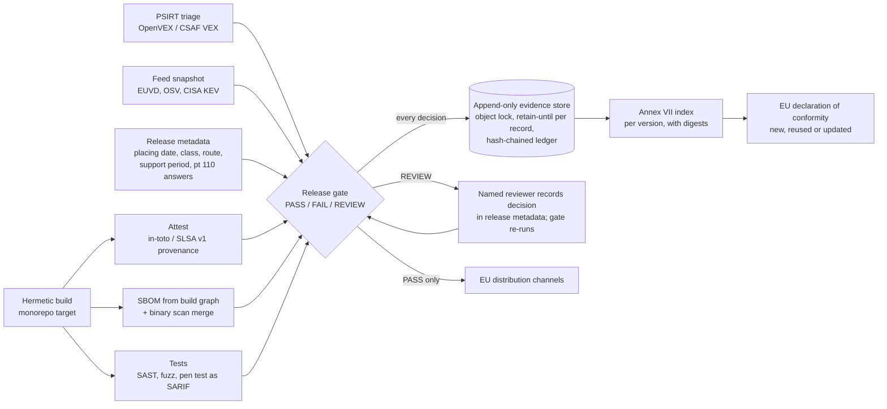

# CRA evidence generated by the pipeline: one signed record per version, produced where the version is built

**Executive answer.** At thousands of releases a week, Aldermoor cannot write CRA technical documentation by hand. Under the Commission's draft guidance (not the Regulation's text), placing on the market is judged per version for standalone software. Every placing needs an Annex VII file, a declaration link and a substantial-modification decision. Every file must be kept for at least 10 years. The answer is to have the build pipeline emit one machine-readable evidence record per version. The record binds the SBOM, build provenance, VEX status, test results, risk-assessment and Annex II references, support period, substantial-modification answers and declaration to the shipped artefact by digest. A release gate decides PASS, FAIL or REVIEW before any EU channel accepts the version. The record then goes to an append-only, object-locked store with a computed retain-until date. This module ships a versioned JSON Schema, a working Python reference implementation (58 tests passing) and CI examples. Storage is not the cost driver: about 2.6 TB a year in the central case (estimate), a few hundred US dollars a year at archive-tier prices. The real costs are onboarding about 200 product lines and running human review for functionality releases. That is roughly 24-40 FTE-years in 2027 (estimate), with review load falling from about 12 FTE to about 2 FTE if the four-question test moves to feature launch review.

## Document-based compliance breaks at Aldermoor's release cadence because every version is a placing with its own decade-long file

Three rules in the knowledge base (KB) turn the CRA into a per-version obligation.

| Rule | What it says | Effect at Aldermoor's cadence |
|---|---|---|
| Placing per version | Commission guidance, not the Regulation's text: placing on the market is judged per unit, and for standalone software per version. All copies of a version are deemed placed at its first commercial offering. Non-substantial updates do not reset that date (guidance paras 13-15 and Example 2; reports/sections/03-scope.md) | Each new Lumen Browser, Lumen OS or app version is its own placing event with a date that must be provable. At about 2,000 EU-relevant versions a week (estimate), that is about 104,000 placing records a year |
| Substantial modification | Guidance pt 110 sets four questions: new threat vectors, new attack scenarios, changed likelihood, changed impact. All negative means not substantial (pts 111-112). Security updates are "generally not" substantial (pt 108). Changes of intended purpose or material boundary or dependency changes are (pt 109). A substantial modification is a new placing (pt 116) (reports/sections/10-conformity.md) | Every functionality release needs a recorded answer to four questions against the previous version. A new placing needs a new or updated declaration (Art 28(2); FAQ 6.8) |
| Retention | Technical documentation and the declaration are kept 10 years after placing or for the support period, whichever is longer (Art 13(13); reports/sections/10-conformity.md). Annex II information follows the same rule (Art 13(18); reports/sections/05-roles.md) | More than a million version records held at steady state, each retrievable for a market surveillance authority on reasoned request (Art 13(22)) |

Document-based compliance fails for three reasons. It cannot keep up: a technical file written per version at even one hour each would need about 55 FTE (estimate). It drifts: a document describes the build someone thinks they shipped, not the artefact that shipped. The SBOM guide makes the same point for SBOMs generated from manifests (reports/guides/application/06-sbom.md). It cannot prove its own history: a shared drive cannot show that the file for version 141.0.7390.65 was complete before 10 Feb 2028 and unchanged since. The corporate evidence guide requires immutable, pipeline-fed, exportable records for this reason (reports/guides/corporate/08-evidence.md).

## The target architecture makes the pipeline the author of the technical file and humans the authors of decisions

The build already knows the artefact digest, its dependencies, who built it and what tests ran. The pipeline should therefore write those facts, and people should record only the judgements the law asks for: the risk assessment, the pt 110 answers, the support-period rationale and the declaration.



Two design choices matter most. First, the gate stores every decision, including FAIL and REVIEW, because the trail of blocked releases is the evidence that the control operates. This is what a Module H quality-system audit looks for (Annex VIII Module H pts 3-4; reports/sections/10-conformity.md). Second, records are never edited. A REVIEW is cleared by recording the human decision in the release metadata and re-running the gate. That writes a new record beside the old one.

## The evidence record is a versioned JSON Schema in which every field cites its legal basis

`spec/cra-evidence-record.v1.0.0.schema.json` (JSON Schema 2020-12) defines one record per version. Each property carries an `x-cra-basis` annotation citing the KB section. The table summarises the fields.

| Field group | Content | Legal basis (KB) |
|---|---|---|
| `product`, `version` | Product id, name, manufacturer, type, family and variants; version, release date, previous version, artefact digest | Annex V pt 1; Annex VII pt 1; Annex II pt 3; guidance paras 174-177 (reports/sections/10-conformity.md; reports/guides/application/11-documentation-set.md) |
| `placing_on_market` | Date, event type (first placing, new version, substantial-modification placing, update to placed product), Member States | Art 3(21); guidance paras 13-15 and Example 2 (reports/sections/03-scope.md); pt 116 |
| `classification` | Class, Annex III/IV category, route, standards applied in full, notified body, certificate | Art 32(1)-(5); Annex VIII (reports/sections/06-classification.md; reports/sections/10-conformity.md) |
| `evidence.sbom` | CycloneDX or SPDX, spec version, component count, top-level dependencies, completeness flag, SHA-256 and SHA-512 | Annex I Part II(1); Annex VII pts 2(b) and 8; Art 13(24)-(25) (reports/sections/08-annex1-part2.md; reports/guides/application/06-sbom.md) |
| `evidence.provenance` | Predicate type, builder id, build type, invocation id, subject-digest match | Annex VII pt 2(c); Art 13(14) (reports/guides/application/11-documentation-set.md part 7). The format is a design choice |
| `evidence.vulnerability_status` | OpenVEX or CSAF VEX statements; known-vulnerability matches with KEV flag; feeds used | Annex I Part I(2)(a); guidance paras 233-234 (reports/sections/07-annex1-part1.md); para 218 (reports/guides/application/06-sbom.md) |
| `evidence.tests` | SAST, DAST, fuzz, pen test, update-mechanism tests: format, tool, counts | Annex I Part II(3); Annex VII pt 6 (reports/sections/08-annex1-part2.md) |
| `evidence.risk_assessment`, `evidence.applicability_matrix` | Reference and digest; Part I items covered and not applied | Art 13(2)-(4); Annex VII pt 3 (reports/sections/07-annex1-part1.md) |
| `evidence.annex_ii_user_information`, `update_design_note`, `cvd_policy` | Versioned URL and digest | Annex II; Art 13(18); Annex VII pts 1(d), 2(b) (reports/guides/application/07-updates.md; 11-documentation-set.md) |
| `support_period` | End date, years, justification, Art 13(10) latest-version flag | Art 13(8), 13(10), 13(19); guidance paras 125-128; Annex VII pt 4 (reports/sections/08-annex1-part2.md) |
| `substantial_modification` | Change type (pt 108/109 classes), the four pt 110 answers, bundling justification, assessor, decision, conformity-assessment reference | Guidance pts 104-112, 116, 122-123; Annex I Part II(2) (reports/sections/10-conformity.md; reports/sections/03-scope.md) |
| `declaration` | Declaration id, status (new, reused, updated, pending), source version, URL, signatory function | Art 13(12), 13(20), 28; Annex V; FAQ 6.8 (reports/sections/10-conformity.md) |
| `signer` | Pipeline identity, accountable role, signature reference | Design field supporting Art 13(22) |
| `retention` | Retain-until date, rule, store URI, object-lock mode | Art 13(13) (reports/sections/10-conformity.md) |
| `gate` | Decision, policy id, reasons with code, severity and basis | Release gate record (reports/guides/application/05-sdlc.md) |

The schema is semantically versioned. Optional additions are minor versions. Changes to required fields or enumerations are major versions, and old records keep validating against the version they declare.

## Ten control points turn legal duties into machine decisions with named reasons

`cra_evidence/gate.py` implements the controls below. Every reason carries a code, a severity and its basis. A FAIL reason blocks the release. A REVIEW reason routes it to a named role. INFO reasons are kept for the audit trail.

| Control | FAIL when | REVIEW when |
|---|---|---|
| SBOM | Missing; no dependency edges from the root; a direct dependency in the build graph is absent; root hash does not match the artefact | Root carries no hash |
| Provenance | Missing; predicate not SLSA v1; builder not on the trusted list; no subject matches the artefact digest | None |
| Known vulnerabilities | A KEV-listed match lacks VEX `not_affected` or `fixed`; VEX says `affected` with no mitigation; untriaged critical or high; `not_affected` without justification | `affected` with a documented mitigation; untriaged medium or low |
| Tests | Required test type missing (pen test on first placing or substantial modification); unsuppressed SARIF errors; open critical or high pen-test findings | Pen test absent while the substantial-modification decision is pending |
| Risk assessment | No reference; matrix lacks any Part I item; item not applied without justification; Part I point (1) not applied | None |
| Annex II | No reference | None |
| Support period | Missing; under 5 years without justification | Under 5 years with justification (counsel confirms that expected use is shorter) |
| Substantial modification | Decision "substantial" not recorded as a new placing | Any pt 110 answer yes or unanswered; functionality change without a recorded human assessment; pt 109 change type; security fix bundled without justification |
| Route and declaration | Class I on Module A without a cited harmonised standard applied in full (policy list; Art 32(2) also allows a common specification or a 'substantial' EU certification scheme, to be added to policy when one exists); Class II or critical on Module A; Module B+C or H without a certificate reference; no declaration; declaration reused after a substantial modification | Declaration reuse depends on a pending review |
| Retention | Retain-until earlier than max(placing + 10 years, support end); not computable | Store not in compliance-mode lock |

A functionality release whose four answers are all "no", with a named assessor on record, passes with an INFO reason. The REVIEW has already happened, at the point where the person answered the questions. This is how the gate keeps review volume manageable (see the rollout section).

## The reference implementation runs end to end on four Aldermoor sample versions

The package uses only the standard library. It uses `jsonschema` when it is installed and falls back to a built-in validator otherwise; both paths are tested. Collectors ingest real formats: CycloneDX 1.5 JSON, SPDX 2.3 JSON, in-toto Statement v1 with [SLSA Provenance v1](https://slsa.dev/provenance/v1) (bare or in a DSSE envelope), [OpenVEX v0.2.0](https://raw.githubusercontent.com/openvex/spec/main/OPENVEX-SPEC.md), CSAF 2.0 `csaf_vex`, [SARIF 2.1.0](https://www.oasis-open.org/?p=5122), OSV records and the CISA KEV catalogue format. The four sample releases exercise each gate path.

| Sample | Formats | Expected path | Result |
|---|---|---|---|
| Hearth Lock 3 firmware 4.2.0 (Class I, Module H) | CycloneDX 1.5, SLSA v1, OpenVEX, SARIF | Security update; zlib CVE-2022-37434 matched but VEX `not_affected` (not in execute path) | PASS |
| Hearth Lock 3 firmware 4.3.0 | As above plus pen-test summary | Adds voice-assistant unlock through the cloud; pt 110 Q1 and Q2 yes | REVIEW |
| Lumen Browser 141.0.7390.54 (Class I, Module H) | SPDX 2.3, DSSE-wrapped SLSA v1, CSAF VEX, SARIF | KEV-listed libwebp CVE-2023-4863 under investigation; harfbuzz missing from SBOM; open fuzz crash | FAIL |
| Lumen Browser 141.0.7390.65 | As above | libwebp updated; CSAF `fixed`; SBOM complete | PASS |

Component versions, digests and signatures are synthetic. The CVE identifiers are real public identifiers placed on synthetic versions for illustration. Actual output from the module root on 1 Nov 2026:

```text
$ python -m cra_evidence gate examples/releases/<each> --policy examples/policy/aldermoor-gate-policy.json --feeds examples/feeds
hearth-lock-3 4.2.0 -> PASS  (policy aldermoor-cra-gate/1.0.0)
hearth-lock-3 4.3.0 -> REVIEW  (policy aldermoor-cra-gate/1.0.0)
  [REVIEW] SM_REVIEW_REQUIRED: pt 110 answered yes for: new_threat_vectors, new_attack_scenarios
  [REVIEW] DECLARATION_DEPENDS_ON_REVIEW: declaration reuse valid only if the change is confirmed not substantial
lumen-browser 141.0.7390.54 -> FAIL  (policy aldermoor-cra-gate/1.0.0)
  [FAIL] SBOM_MISSING_TOP_LEVEL_DEPENDENCIES: direct dependencies in the build graph absent from SBOM: harfbuzz
  [FAIL] KNOWN_EXPLOITED_UNRESOLVED: CVE-2023-4863 in libwebp@1.3.1 is in the known-exploited catalogue and VEX status is under_investigation
  [FAIL] TEST_FINDINGS_OPEN: fuzz: 1 unsuppressed error-level results
lumen-browser 141.0.7390.65 -> PASS  (policy aldermoor-cra-gate/1.0.0)
(exit codes 0, 3, 1, 0)

$ python -m cra_evidence validate examples/out/records/hearth-lock-3_4.2.0.record.json
VALID (jsonschema): urn:aldermoor:cra-evidence:hearth-lock-3:4.2.0
$ python -m cra_evidence validate --fallback examples/out/records/hearth-lock-3_4.2.0.record.json
VALID (built-in validator): urn:aldermoor:cra-evidence:hearth-lock-3:4.2.0

$ python -m cra_evidence retention --placing 2028-01-18 --support-end 2039-12-31
{"placing_plus_10y": "2038-01-18", "retain_until": "2039-12-31", "driver": "support period end", ...}

$ python -m cra_evidence verify-store --store examples/out/store
OK

$ python -m pytest -q tests
58 passed in 0.28s
$ python tests/run_all.py            # standalone, and again with jsonschema blocked
Ran 58 tests ... OK
```

The Annex VII index for Hearth Lock 3 4.2.0 (excerpt from `examples/out/index/`):

| Annex VII point | Evidence | SHA-256 (first 16) |
|---|---|---|
| 2(b) | SBOM (CycloneDX 1.5) | `68d7e52c7ca4768e` |
| 2(b) | VEX (OpenVEX) | `3268316e7e2e05ae` |
| 2(c) | Build provenance (SLSA v1; builder hermetic/v2); gate PASS | `a308ae66c1d11084` |
| 6 | sast (CodeQL; error 0, warning 1, note 1, suppressed 1) | `d7cdbfff79d49a8a` |
| 2(a) | Maintained outside the pipeline in the product technical file | - |

The index shows the gaps as well as the items. Architecture drawings (point 2(a)) and the production-process description stay as human-maintained documents, and the index says so.

**Working code versus design.** Working and tested: the schema, the collectors, the gate, the Annex VII index, the retention calculator, the CLI (`record`, `gate`, `index`, `validate`, `retention`, `store`, `verify-store`) and a local append-only store with a hash-chained ledger. Design only: the GitHub Actions workflow and Bazel rule in `examples/ci/`, object-lock storage, signature verification (delegated to cosign or equivalent), the release metadata service and the PSIRT VEX export.

## For Aldermoor the build system already holds most of the evidence

| Aldermoor asset | Use in the evidence pipeline | Gap to close |
|---|---|---|
| Monorepo with hermetic build | The SBOM comes from the build graph, which sees vendored third-party code that manifest scanners miss. The gate compares the graph's direct dependencies with the SBOM's top-level list | Prebuilt binaries and vendor blobs (modem, GPU and secure-element firmware) need binary scanning plus supplier SBOMs (reports/guides/application/06-sbom.md) |
| Signed provenance for internal artefacts | Extend the same attestation to external release artefacts; publish the trusted builder ids in gate policy | Subjects must be the shipped, signed artefact, not an intermediate |
| Release calendars and launch reviews | Supply placing dates, Member States, change type and the four pt 110 answers at feature launch | Decision rights for "not substantial" (Decision 3) |
| PSIRT (module E2 case engine) | Exports OpenVEX or CSAF per version; the same `not_affected` statement is evidence that no Art 14 report was due (guidance para 218) | VEX signing and two-person review |
| Portfolio classification (module E3) | Supplies class, route and certificate reference per product | Module H approval depends on a notified body. None was designated at 8 Sep 2026 (reports/sections/10-conformity.md) |
| Versioned security pages | Annex II at `/security/<product>/<version>/`, kept online for the retention period (reports/guides/application/11-documentation-set.md) | Retention of web pages for 10+ years |

## Authorities and notified bodies will ask ten questions, and the store answers each by query

| Question | How the store answers |
|---|---|
| Show the technical documentation for version X as placed on date Y (Art 13(22)) | Retrieve the record by `record_id`; export the Annex VII index and its digested items as one package |
| Which versions were on the market on date D, and what was their status for CVE-Z? | Query records by placing date and support end; read VEX statements and the matches against the stored feed snapshot |
| Prove the file has not changed since placing | Object-lock retention per object; ledger chain hash; digests in the record; transparency-log entry for the signature |
| How complete is the SBOM? | `top_level_complete` flag, build-graph comparison, component count, BSI-style completeness properties |
| Why was 4.3.0 (not) a substantial modification? | Four pt 110 answers, change type, assessor, rationale and conformity-assessment reference |
| Is the gate enforced, and how are exceptions controlled? (Module H audit) | Ledger of every decision, including FAIL and REVIEW; policy version per record; override log |
| Show test reports against Annex I Parts I and II | SARIF and pen-test summaries indexed under Annex VII point 6 |
| What support period applies, and why? | `support_period` block with justification and the Art 13(10) flag |
| Which declaration covers this version? | Declaration id, status, the version it was reused from, and its public URL |
| How long will you keep this? | `retain_until` per record, computed under Art 13(13) and enforced by the lock |

## Roll out through two contrasting pilots, then three waves, before 11 December 2027

Annex I Part II and the documentation duties apply from 11 Dec 2027; Art 14 reporting has applied since 11 Sep 2026 (reports/sections/08-annex1-part2.md). The plan leaves six weeks of contingency.

| Wave | Dates | Scope | Exit criterion |
|---|---|---|---|
| 0 Pilot | Dec 2026 to Mar 2027 | Hearth Lock 3 firmware (hardware, slow cadence) and Lumen Browser (software, 4-weekly majors and weekly security updates); gate in shadow mode | Record for 100% of pilot versions; false-FAIL rate under 2% (target) |
| 1 Important products | Apr to Jun 2027 | Gate enforced on pilots; all Annex III and IV products as classified in module E3 | No EU release of an important product without a PASS record |
| 2 Default products | Jul to Sep 2027 | Apps, SDKs, CLI, desktop clients, wearables, accessories | Same, all product lines |
| 3 Readiness | Oct 2027 | Mock Art 13(22) request drill: export the files for 20 random versions within 5 working days (target) | Drill passed; policy v1 frozen |

The effort estimate follows. All figures are estimates.

| Workstream | Effort (FTE-years, 2027) | Basis of estimate |
|---|---|---|
| Platform: schema, collectors, gate service, store, index, export | 6 | 8 engineers for 9 months |
| Build-rule and CI integration in the monorepo | 2 | 4 engineers for 6 months |
| Product onboarding | 8-20 | About 200 product lines at 2-5 engineer-weeks each |
| PSIRT VEX operations uplift | 5-8 | Justified statement for every match across all supported versions |
| Compliance, legal and review operations | 3-4 | Policy ownership, pt 110 reviews, drills |
| **Total** | **24-40** | About USD 6-14m at a loaded USD 250,000-350,000 per FTE-year |

Review load is the main operating cost. Assume 30% of the 2,000 weekly versions carry functionality changes and each REVIEW takes 45 minutes. Release-level review would then need about 450 hours a week, or about 12 FTE. If the four questions are answered once per feature at launch review, and releases only aggregate those answers, release-level REVIEW falls to about 5% of versions, or about 2 FTE (all estimates).

Storage sizing follows. All figures are estimates.

| Case | Evidence per version (compressed, excluding binaries) | Per year at 104,000 versions | Held at steady state (about 11-year window) | Archive-tier cost per year |
|---|---|---|---|---|
| Low | 5 MB | 0.5 TB | 5.7 TB | about USD 70 |
| Central | 25 MB | 2.6 TB | 29 TB | about USD 340 |
| High (large SARIF, OS-scale SBOMs, fuzz logs) | 150 MB | 15.6 TB | 172 TB | about USD 2,100 |

The cost column uses the archive price AWS announced for S3 Glacier Deep Archive, about USD 1 per TB-month ([AWS, 2019](https://aws.amazon.com/ru/about-aws/whats-new/2019/03/S3-glacier-deep-archive/)); current list prices were not checked. Even at 25 times that price for a warmer tier, the high case stays near USD 50,000 a year. Release binaries are excluded. Art 13(9) already requires each security update to stay available for at least 10 years or the rest of the support period, whichever is longer, so the distribution system holds those; functionality-release binaries need their own retention decision (reports/sections/08-annex1-part2.md). Archive tiers charge per object, so bundle each version into one archive object plus a small hot index. Compliance-mode object lock prevents deletion or overwrite of a locked version "by any user, including the root user", and its retention period cannot be shortened ([AWS S3 Object Lock](https://docs.aws.amazon.com/AmazonS3/latest/userguide/object-lock.md)). The store choice is a design suggestion; any WORM store with equivalent guarantees serves.

## Decisions for the executive team

1. **Make the per-version evidence record the system of record for CRA technical documentation.** No EU distribution channel accepts a version without a PASS record. Owner: CTO, with VP Engineering (developer infrastructure). Decide by Dec 2026; enforce for important products by Jun 2027 and all products by Oct 2027.
2. **Fund the platform and onboarding at 24-40 FTE-years for 2027 (estimate).** Owner: CTO and CFO. Approve in Q1 2027 planning.
3. **Move the pt 110 test to feature launch review and set decision rights.** Name who may record "not substantial" and who escalates to General Counsel. Owner: CISO with General Counsel. Decide by Feb 2027.
4. **Give gate policy to the product security office and restrict overrides.** No override of `KNOWN_EXPLOITED_UNRESOLVED` or `ROUTE_NOT_PERMITTED` without the CISO and General Counsel; every override is recorded. Owner: CISO. Decide by Feb 2027.
5. **Approve an EU-region evidence store with compliance-mode lock and a 15-year verification plan** covering signing-key rotation, timestamping and format migration. Owner: VP Infrastructure. Decide by Apr 2027.
6. **Open notified-body engagement for Module H now**, because Class I products can use Module A only by applying in full a harmonised standard, common specification or EU certification scheme at 'substantial' level (Art 32(2)), and none exists yet (module E3 dependency). Owner: General Counsel with CISO. Start Q1 2027.

## Risks and open questions

- **SBOM completeness for binaries.** The build graph cannot see inside prebuilt vendor blobs, and a top-level-only SBOM misses vendored code. Mitigation: binary scanning merged into the SBOM, supplier SBOM clauses, and a "known unknowns" field. "Top-level" is not interpreted by the FAQ or guidance (reports/sections/08-annex1-part2.md).
- **VEX trust.** A `not_affected` statement is self-issued and can clear a KEV-listed vulnerability at the gate. Under guidance para 218 it is also evidence that no Art 14 report was due. Require reachability evidence, PSIRT signing, two-person review for KEV items and sampled re-audit.
- **Point-in-time gate.** Feeds change daily. The record stores which snapshot was used, so the decision is reproducible, but post-release monitoring of every supported version remains a separate duty (reports/guides/application/06-sbom.md "Continuous monitoring").
- **Interpretation of per-version placing.** Guidance paras 13-14 make each software version a placing, while non-substantial updates "do not reset" the placing date (reports/sections/03-scope.md). Whether every security point release is a new placing is not settled. Recording every version is the conservative choice and costs little.
- **Status of the guidance.** Commission guidance C(2026) 5252 was approved on 27 Jul 2026 but had not been formally adopted by 30 Oct 2026 (reports/sections/03-scope.md). Paragraph numbers could move.
- **Notified-body capacity.** No CRA notified body was in NANDO at the last check on 8 Sep 2026 (reports/sections/10-conformity.md). The gate's route check will block Class I products if no approval exists by Dec 2027.
- **Long-term verifiability.** Signatures must stay verifiable after keys expire. Formats age: BSI TR-03183-2 (non-binding) already asks for CycloneDX 1.6+ or SPDX 3.0.1+, while the samples use 1.5 and 2.3 (reports/guides/application/06-sbom.md). Plan format migration as a re-indexing, never an edit.
- **Personal data in evidence.** Provenance and SARIF can carry engineer identities that would be held for 10+ years. Use role and service identities in records.
- **Alert fatigue.** If REVIEW volume stays high, reviewers will rubber-stamp. Track REVIEW rate and time to decision per product as gate health metrics.

## Sources

Knowledge base (CRA knowledge base, facts verified to 30 Oct 2026):
- reports/sections/03-scope.md: placing per version (guidance paras 13-14); substantial-modification test (paras 104-112); guidance status.
- reports/sections/05-roles.md: retention table for documentation and user information.
- reports/sections/06-classification.md: Annex III Class I categories 2 (browsers) and 17 (smart door locks).
- reports/sections/07-annex1-part1.md: known exploitable vulnerabilities; guidance paras 233-234; Art 13(3)-(4) applicability.
- reports/sections/08-annex1-part2.md: Part II(1) SBOM; support period; Art 13 lifecycle table including 13(9), 13(10), 13(13), 13(18).
- reports/sections/10-conformity.md: routes by class; Annex VII points; Art 13(12)-(13); pts 108-110, 116, 122-123; notified-body status at 8 Sep 2026.
- reports/guides/application/05-sdlc.md: release gate and CI evidence capture.
- reports/guides/application/06-sbom.md: SBOM pipeline, BSI TR-03183-2 fields, VEX separation, guidance para 218.
- reports/guides/application/07-updates.md: update design note, separation of security and functionality updates.
- reports/guides/application/11-documentation-set.md: Annex VII file structure, versioning and retention per placing.
- reports/guides/corporate/08-evidence.md: system-of-record properties.

External (opened 1 Nov 2026):
- SLSA, [Provenance v1](https://slsa.dev/provenance/v1): predicate type, buildDefinition and runDetails fields.
- OpenVEX, [specification](https://raw.githubusercontent.com/openvex/spec/main/OPENVEX-SPEC.md): v0.2.0 context, statuses and justifications.
- OASIS, [SARIF 2.1.0](https://www.oasis-open.org/?p=5122).
- CycloneDX, [1.5 JSON schema](https://cyclonedx.org/schema/bom-1.5.schema.json).
- SPDX, [2.3.1 relationships](https://spdx.github.io/spdx-spec/v2.3.1/relationships-between-SPDX-elements/).
- OWASP dep-scan, [VEX and CSAF guide](https://depscan.readthedocs.io/output/vex-csaf-guide) (secondary source for the CSAF `csaf_vex` profile fields).
- AWS, [S3 Object Lock](https://docs.aws.amazon.com/AmazonS3/latest/userguide/object-lock.md) and [S3 Glacier Deep Archive announcement](https://aws.amazon.com/ru/about-aws/whats-new/2019/03/S3-glacier-deep-archive/).
