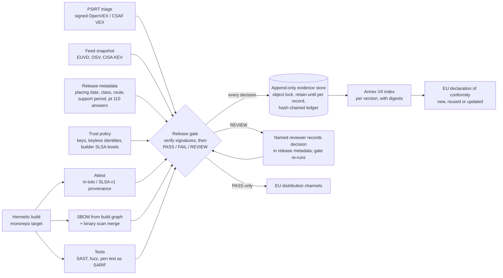

# CRA evidence generated by the pipeline: one signed record per version, produced where the version is built

**Executive answer.** At thousands of releases a week, Aldermoor cannot write CRA technical documentation by hand. Under the Commission's draft guidance (not the Regulation's text), placing on the market is judged per version for standalone software. Every placing needs an Annex VII file, a declaration link and a substantial-modification decision, and every file must be kept for at least 10 years. The answer is for the build pipeline to emit one machine-readable evidence record per version, bound to the shipped artefact by digest, and for a release gate to decide PASS, FAIL or REVIEW before any EU channel accepts the version. The gate verifies evidence cryptographically and fails closed: DSSE signatures on SLSA v1 provenance and VEX (ECDSA P-256 or Ed25519 keys, or Sigstore keyless certificates with Rekor inclusion proofs), subject digest against the artefact, builder identity against a trust policy, and SLSA Build level as the verifier's own assessment. We ran it on a real public release: the sigstore-js 5.0.0 npm package, whose provenance, registry signature and transparency-log entries all verified offline. The gate returned REVIEW because two moderate advisories published on 30 Oct 2026 hit its dependency tree. On 10,000 synthetic signed versions with 200-2,000-component SBOMs, the gate handled about 50 versions a second per core (18 ms median, 76 ms at the 99th percentile), with every signature verified. Aldermoor's estimated 2,000 EU versions a week therefore need under a minute of gate CPU time, plus hashing of large binaries at about 370 MiB a second per core. Core evidence measured 126 KiB per version compressed, so storage is not the cost driver. The real costs are onboarding about 200 product lines and human review of functionality releases: roughly 24-40 FTE-years in 2027 (estimate). The module ships a versioned JSON Schema, a Python implementation with 114 passing tests, a pinned GitHub Actions workflow and a trust model that a notified body can check independently.

## Document-based compliance breaks at Aldermoor's release cadence because every version is a placing with its own decade-long file

Three rules in the knowledge base (KB) turn the CRA into a per-version obligation.

| Rule | What it says | Effect at Aldermoor's cadence |
|---|---|---|
| Placing per version | Commission guidance, not the Regulation's text: placing on the market is judged per unit, and for standalone software per version. All copies of a version are deemed placed at its first commercial offering. Non-substantial updates do not reset that date (guidance paras 13-15 and Example 2; reports/sections/03-scope.md) | Each new Lumen Browser, Lumen OS or app version is its own placing event with a date that must be provable. At about 2,000 EU-relevant versions a week (estimate), that is about 104,000 placing records a year |
| Substantial modification | Guidance pt 110 sets four questions: new threat vectors, new attack scenarios, changed likelihood, changed impact. All negative means not substantial (pts 111-112). Security updates are "generally not" substantial (pt 108). Changes of intended purpose or material boundary or dependency changes are (pt 109). A substantial modification is a new placing (pt 116) (reports/sections/10-conformity.md) | Every functionality release needs a recorded answer to four questions against the previous version. A new placing needs a new or updated declaration (Art 28(2); FAQ 6.8) |
| Retention | Technical documentation and the declaration are kept 10 years after placing or for the support period, whichever is longer (Art 13(13); reports/sections/10-conformity.md). Annex II information follows the same rule (Art 13(18); reports/sections/05-roles.md) | More than a million version records held at steady state, each retrievable for a market surveillance authority on reasoned request (Art 13(22)) |

Document-based compliance fails for three reasons. It cannot keep up: a technical file written per version at even one hour each would need about 55 FTE (estimate). It drifts: a document describes the build someone thinks they shipped, not the artefact that shipped. The SBOM guide makes the same point for SBOMs generated from manifests (reports/guides/application/06-sbom.md). It cannot prove its own history: a shared drive cannot show that the file for version 141.0.7390.65 was complete before 10 Feb 2028 and unchanged since. The corporate evidence guide requires immutable, pipeline-fed, exportable records for this reason (reports/guides/corporate/08-evidence.md).

## The target architecture makes the pipeline the author of the technical file and humans the authors of decisions

The build already knows the artefact digest, its dependencies, who built it and what tests ran. The pipeline should therefore write those facts, and people should record only the judgements the law asks for: the risk assessment, the pt 110 answers, the support-period rationale and the declaration.



Two design choices matter most. First, the gate stores every decision, including FAIL and REVIEW, because the trail of blocked releases is the evidence that the control operates. This is what a Module H quality-system audit looks for (Annex VIII Module H pts 3-4; reports/sections/10-conformity.md). Second, records are never edited. A REVIEW is cleared by recording the human decision in the release metadata and re-running the gate. That writes a new record beside the old one. Third, no claim in an attestation counts until its signature has verified against the trust policy; the gate reads builder id, subject and VEX status only from verified bytes.

## The evidence record is a versioned JSON Schema in which every field cites its legal basis

`spec/cra-evidence-record.v1.0.0.schema.json` (JSON Schema 2020-12) defines one record per version. Each property carries an `x-cra-basis` annotation citing the KB section. The table summarises the fields.

| Field group | Content | Legal basis (KB) |
|---|---|---|
| `product`, `version` | Product id, name, manufacturer, type, family and variants; version, release date, previous version, artefact digest | Annex V pt 1; Annex VII pt 1; Annex II pt 3; guidance paras 174-177 (reports/sections/10-conformity.md; reports/guides/application/11-documentation-set.md) |
| `placing_on_market` | Date, event type (first placing, new version, substantial-modification placing, update to placed product), Member States | Art 3(21); guidance paras 13-15 and Example 2 (reports/sections/03-scope.md); pt 116 |
| `classification` | Class, Annex III/IV category, route, standards applied in full, notified body, certificate | Art 32(1)-(5); Annex VIII (reports/sections/06-classification.md; reports/sections/10-conformity.md) |
| `evidence.sbom` | CycloneDX or SPDX, spec version, component count, top-level dependencies, completeness flag, SHA-256 and SHA-512 | Annex I Part II(1); Annex VII pts 2(b) and 8; Art 13(24)-(25) (reports/sections/08-annex1-part2.md; reports/guides/application/06-sbom.md) |
| `evidence.provenance` | Predicate type, builder id, build type, invocation id, subject-digest match, and (1.1.0) a `verification` block: method, signer key or certificate identity, Rekor entry, SLSA Build level, trust-policy id | Annex VII pt 2(c); Art 13(14) (reports/guides/application/11-documentation-set.md part 7). The format is a design choice |
| `evidence.vulnerability_status` | OpenVEX or CSAF VEX statements; known-vulnerability matches with KEV flag; feeds used; (1.1.0) the signed VEX attestation and its `verification` block | Annex I Part I(2)(a); guidance paras 233-234 (reports/sections/07-annex1-part1.md); para 218 (reports/guides/application/06-sbom.md) |
| `evidence.tests` | SAST, DAST, fuzz, pen test, update-mechanism tests: format, tool, counts | Annex I Part II(3); Annex VII pt 6 (reports/sections/08-annex1-part2.md) |
| `evidence.risk_assessment`, `evidence.applicability_matrix` | Reference and digest; Part I items covered and not applied | Art 13(2)-(4); Annex VII pt 3 (reports/sections/07-annex1-part1.md) |
| `evidence.annex_ii_user_information`, `update_design_note`, `cvd_policy` | Versioned URL and digest | Annex II; Art 13(18); Annex VII pts 1(d), 2(b) (reports/guides/application/07-updates.md; 11-documentation-set.md) |
| `support_period` | End date, years, justification, Art 13(10) latest-version flag | Art 13(8), 13(10), 13(19); guidance paras 125-128; Annex VII pt 4 (reports/sections/08-annex1-part2.md) |
| `substantial_modification` | Change type (pt 108/109 classes), the four pt 110 answers, bundling justification, assessor, decision, conformity-assessment reference | Guidance pts 104-112, 116, 122-123; Annex I Part II(2) (reports/sections/10-conformity.md; reports/sections/03-scope.md) |
| `declaration` | Declaration id, status (new, reused, updated, pending), source version, URL, signatory function | Art 13(12), 13(20), 28; Annex V; FAQ 6.8 (reports/sections/10-conformity.md) |
| `signer` | Pipeline identity, accountable role, signature reference | Design field supporting Art 13(22) |
| `retention` | Retain-until date, rule, store URI, object-lock mode | Art 13(13) (reports/sections/10-conformity.md) |
| `gate` | Decision, policy id, reasons with code, severity and basis | Release gate record (reports/guides/application/05-sdlc.md) |

The schema is semantically versioned. Optional additions are minor versions. Changes to required fields or enumerations are major versions, and old records keep validating against the version they declare. Version 1.1.0 adds the optional verification results; the 1.0.0 records already in the sample store still validate against 1.0.0.

## Ten control points turn legal duties into machine decisions with named reasons

`cra_evidence/gate.py` implements the controls below. Every reason carries a code, a severity and its basis. A FAIL reason blocks the release. A REVIEW reason routes it to a named role. INFO reasons are kept for the audit trail.

| Control | FAIL when | REVIEW when |
|---|---|---|
| SBOM | Missing; no dependency edges from the root; a direct dependency in the build graph is absent; root hash does not match the artefact | Root carries no hash |
| Provenance signature | Unsigned; signature invalid; signer unknown, not authorised for this product or purpose, revoked, expired or not yet valid; keyless identity mismatch; transparency-log entry missing (where required) or failing offline verification | Unsigned, only where policy sets `require_signed_provenance: false` (shadow mode) |
| Provenance claims (from verified bytes only) | Predicate not SLSA v1; no subject matches the artefact SHA-256 or SHA-512; builder not trusted for the product; signer not bound to that builder; SLSA Build level below the product minimum; unexpected `buildType` or `externalParameters`; keyless identity differs from the workflow the provenance names | None |
| VEX origin | No signed VEX attestation; signature or signer fails as above; subject is not this artefact; signed predicate differs from the VEX document the gate used | Unsigned, only where policy allows |
| Known vulnerabilities | A KEV-listed match lacks VEX `not_affected` or `fixed`; VEX says `affected` with no mitigation; untriaged critical or high; `not_affected` without justification | `affected` with a documented mitigation; untriaged medium or low |
| Tests | Required test type missing (pen test on first placing or substantial modification); unsuppressed SARIF errors; open critical or high pen-test findings | Pen test absent while the substantial-modification decision is pending |
| Risk assessment | No reference; matrix lacks any Part I item; item not applied without justification; Part I point (1) not applied | None |
| Annex II | No reference | None |
| Support period | Missing; under 5 years without justification | Under 5 years with justification (counsel confirms that expected use is shorter) |
| Substantial modification | Decision "substantial" not recorded as a new placing | Any pt 110 answer yes or unanswered; functionality change without a recorded human assessment; pt 109 change type; security fix bundled without justification |
| Route and declaration | For units placed from 11 Dec 2027 only (Art 69(2), Art 71(2); reports/sections/04-exclusions.md): Class I on Module A without a cited harmonised standard applied in full (policy list; Art 32(2) also allows a common specification or a 'substantial' EU certification scheme, to be added to policy when one exists); Class II or critical on Module A; Module B+C or H without a certificate reference. Any date: no declaration; declaration reused after a substantial modification | Declaration reuse depends on a pending review. Route and certificate gaps on units placed before 11 Dec 2027 are INFO (`*_PRE_APPLICATION`), so the gate tracks readiness without blocking 2027 releases while no notified body can yet certify |
| Retention | Retain-until earlier than max(placing + 10 years, support end); not computable | Store not in compliance-mode lock |

A functionality release whose four answers are all "no", with a named assessor on record, passes with an INFO reason. The REVIEW has already happened, at the point where the person answered the questions. This is how the gate keeps review volume manageable (see the rollout section).

## The implementation runs end to end on four signed Aldermoor sample versions

The package needs `cryptography` for signature, key and transparency-log checks. It uses `sigstore` (sigstore-python 4.5.1 tested) for keyless bundles, and a keyless bundle fails closed if that package is absent. It uses `jsonschema` when installed and a built-in validator otherwise; both paths are tested. Collectors ingest real formats: CycloneDX 1.5 JSON, SPDX 2.3 JSON, in-toto Statement v1 with [SLSA Provenance v1](https://slsa.dev/provenance/v1) (bare, in a DSSE envelope, in a Sigstore bundle or as JSON Lines), [OpenVEX v0.2.0](https://raw.githubusercontent.com/openvex/spec/main/OPENVEX-SPEC.md), CSAF 2.0 `csaf_vex`, [SARIF 2.1.0](https://www.oasis-open.org/?p=5122), OSV records and the CISA KEV catalogue format. The four sample releases exercise each gate path.

| Sample | Formats | Expected path | Result |
|---|---|---|---|
| Hearth Lock 3 firmware 4.2.0 (Class I, Module H) | CycloneDX 1.5, SLSA v1, OpenVEX, SARIF | Security update; zlib CVE-2022-37434 matched but VEX `not_affected` (not in execute path) | PASS |
| Hearth Lock 3 firmware 4.3.0 | As above plus pen-test summary | Adds voice-assistant unlock through the cloud; pt 110 Q1 and Q2 yes | REVIEW |
| Lumen Browser 141.0.7390.54 (Class I, Module H) | SPDX 2.3, DSSE-wrapped SLSA v1, CSAF VEX, SARIF | KEV-listed libwebp CVE-2023-4863 under investigation; harfbuzz missing from SBOM; open fuzz crash | FAIL |
| Lumen Browser 141.0.7390.65 | As above | libwebp updated; CSAF `fixed`; SBOM complete | PASS |

Component versions and digests are synthetic. The signatures are real: provenance is signed with a demonstration ECDSA P-256 build key and VEX with a demonstration Ed25519 PSIRT key, both generated by `examples/make_examples.py` (private keys committed under `examples/keys/` for reproducibility only). The CVE identifiers are real public identifiers placed on synthetic versions for illustration. Actual output from the module root on 1 Nov 2026:

```text
$ python -m cra_evidence gate examples/releases/<each> --policy examples/policy/aldermoor-gate-policy.json --feeds examples/feeds
hearth-lock-3 4.2.0 -> PASS  (policy aldermoor-cra-gate/1.1.0)
hearth-lock-3 4.3.0 -> REVIEW  (policy aldermoor-cra-gate/1.1.0)
  [REVIEW] SM_REVIEW_REQUIRED: pt 110 answered yes for: new_threat_vectors, new_attack_scenarios
  [REVIEW] DECLARATION_DEPENDS_ON_REVIEW: declaration reuse valid only if the change is confirmed not substantial
lumen-browser 141.0.7390.54 -> FAIL  (policy aldermoor-cra-gate/1.1.0)
  [FAIL] SBOM_MISSING_TOP_LEVEL_DEPENDENCIES: direct dependencies in the build graph absent from SBOM: harfbuzz
  [FAIL] KNOWN_EXPLOITED_UNRESOLVED: CVE-2023-4863 in libwebp@1.3.1 is in the known-exploited catalogue and VEX status is under_investigation
  [FAIL] TEST_FINDINGS_OPEN: fuzz: 1 unsuppressed error-level results
lumen-browser 141.0.7390.65 -> PASS  (policy aldermoor-cra-gate/1.1.0)
(exit codes 0, 3, 1, 0)

$ python -m cra_evidence validate examples/out/records/hearth-lock-3_4.2.0.record.json   # and --fallback
VALID (jsonschema): urn:aldermoor:cra-evidence:hearth-lock-3:4.2.0
$ python -m cra_evidence verify-store --store examples/out/store
OK
$ python -m pytest -q tests
114 passed in 1.30s
$ python tests/run_all.py            # standalone, and again with jsonschema blocked
Ran 114 tests ... OK
```

The Annex VII index for Hearth Lock 3 4.2.0 (excerpt from `examples/out/index/`):

| Annex VII point | Evidence | SHA-256 (first 16) |
|---|---|---|
| 2(b) | SBOM (CycloneDX 1.5) | `68d7e52c7ca4768e` |
| 2(b) | Signed VEX attestation (verified key by aldermoor-psirt-vex-2027) | `8ba9461850367fda` |
| 2(c) | Build provenance (SLSA v1; builder hermetic/v2; verified key by aldermoor-build-provenance-2027; SLSA Build L3); gate PASS | `801b9404d0b14459` |
| 2(a) | Maintained outside the pipeline in the product technical file | - |

The index also lists what the pipeline cannot generate, such as architecture drawings (point 2(a)).

**Working code versus design.** Working and tested: the schema, the collectors, signature verification (DSSE key-based, Sigstore keyless, offline Rekor proofs), the trust policy, the gate, the Annex VII index, the retention calculator, the CLI (`record`, `gate`, `index`, `validate`, `retention`, `store`, `verify-store`, `verify-attestation`) and a local append-only store with a hash-chained ledger. Valid and pinned but not run on GitHub: the Actions workflow. Sketch only: the Bazel rule. Design only: object-lock storage at scale, the release-metadata service, the PSIRT VEX export and KMS key custody.

## The gate verifies every signature before it believes any claim, and fails closed

`cra_evidence/attest.py` and `cra_evidence/transparency.py` implement verification. The gate calls them before it evaluates any provenance or VEX content, and it reads builder id, subjects and VEX statements only from payload bytes whose signature verified. Anything else yields a FAIL reason with a machine-readable code.

| Step | What is checked | Failure codes (prefixed `PROVENANCE_` or `VEX_`) |
|---|---|---|
| 1 Envelope | DSSE envelope, Sigstore bundle (v0.2/v0.3) or JSON Lines; `payloadType` is `application/vnd.in-toto+json`; signature computed over the DSSE pre-authentication encoding `PAE(type, body)` ([DSSE protocol](https://github.com/secure-systems-lab/dsse/blob/master/protocol.md)) | `UNSIGNED`, `PAYLOAD_TYPE_UNSUPPORTED`, `BUNDLE_INVALID` |
| 2a Key mode | ECDSA P-256/SHA-256 or Ed25519 key listed in the trust policy for this product and purpose; key status and validity window at signing time; signing time from the Rekor integrated time when an entry is present, otherwise gate time | `NO_TRUSTED_SIGNER`, `SIGNATURE_INVALID`, `SIGNER_NOT_AUTHORISED`, `KEY_REVOKED`, `KEY_EXPIRED`, `KEY_NOT_YET_VALID` |
| 2b Keyless mode | sigstore-python verifies the Fulcio chain, the signed certificate timestamp, the certificate's validity at log time and the Rekor entry against a pinned trusted root. The identity policy then requires the OIDC issuer, the subject alternative name and named Fulcio extensions (for example source repository and runner environment) | `IDENTITY_MISMATCH`, `SIGNATURE_INVALID`, `SIGSTORE_UNAVAILABLE` |
| 3 Transparency log | This module's own offline check of each Rekor v1 entry: RFC 9162 inclusion proof to the root hash, signed checkpoint, signed entry timestamp, and that the logged payload hash, signature and verifier match the envelope. In keyless mode it runs as a second, independent check | `TLOG_MISSING`, `TLOG_INVALID` |
| 4 Subject | A verified subject's SHA-256 or SHA-512 equals the artefact's | `SUBJECT_MISMATCH` |
| 5 Builder and level | `builder.id` on the organisation list and the product list; the signer is one the policy binds to that builder; the SLSA Build level comes from the trust policy, defaulting to L1, never from the provenance | `UNTRUSTED_BUILDER`, `BUILDER_SIGNER_MISMATCH`, `BUILD_LEVEL_INSUFFICIENT` |
| 6 Expectations | Expected `buildType`; each expected `externalParameters` value (exact or pattern); unrecognised parameters rejected; for GitHub workflows, the certificate identity equals the workflow the provenance names | `BUILD_TYPE_UNEXPECTED`, `EXTERNAL_PARAMETERS_UNEXPECTED`, `IDENTITY_CLAIM_MISMATCH` |
| 7 VEX binding | Signed VEX names the artefact digest as subject; its predicate equals the VEX document the gate evaluated | `VEX_SUBJECT_MISMATCH`, `VEX_ATTESTATION_MISMATCH` |

Steps 4 to 6 follow the verification procedure in SLSA v1.0 ([Verifying artifacts](https://slsa.dev/spec/v1.0/verifying-artifacts)). SLSA v1.0 defines the Build track as follows ([Security levels](https://slsa.dev/spec/v1.0/levels)). Build levels are not a property the producer can claim. The verifier maps (signer, `builder.id`) to the highest level it trusts that builder for.

| SLSA v1.0 level | Requirement (paraphrased from the specification) | Threat addressed | Gate policy |
|---|---|---|---|
| Build L0 | None | None | Never accepted |
| Build L1 | Provenance exists, generated by the build platform; may be unsigned and incomplete; "trivial to bypass or forge" | Mistakes, documentation | Not enough on its own: signature required |
| Build L2 | Hosted build platform generates and signs the provenance; consumers validate its authenticity | Tampering after the build | Minimum for third-party components built on GitHub-hosted runners (GitHub states artifact attestations alone give Build L2) |
| Build L3 | Hardened platform: runs cannot influence one another, and signing secrets are inaccessible to user-defined build steps | Tampering during the build | Required for every Aldermoor product (policy `min_slsa_build_level: 3`), granted only to a builder the trust policy records as assessed |

SLSA v1.0 does not cover hermetic or reproducible builds; those sat at level 4 of the earlier v0.1 scheme. L3 also does not protect against a compromised build platform or malicious insider, which is why the builder entry in the trust policy carries an assessment reference.

## Trust model: who signs what, and what the gate trusts

| Evidence | Signer | Mechanism | Key or identity custody | What the gate requires |
|---|---|---|---|---|
| Build provenance, Aldermoor builds | Hermetic builder's signing service | DSSE, ECDSA P-256 | Non-exportable KMS or HSM key, unreachable from build steps (an L3 requirement) | Key authorised for this product and `provenance`, valid at signing time, bound to `hermetic/v2` at L3 |
| Build provenance, open-source builds on GitHub | Release workflow's OIDC identity | Sigstore keyless: 10-minute Fulcio certificate plus Rekor entry | No long-lived key; identity is issuer + workflow path + ref + repository | Exact identity and extensions in the trust policy; inclusion proof verified offline |
| VEX (OpenVEX or CSAF) | PSIRT publishing service | DSSE, Ed25519 | PSIRT KMS key, release after two-person review for KEV items (process control) | Key authorised for `vex` only; subject is this artefact; signed predicate equals the evaluated VEX |
| npm and other registry metadata | Registry | Registry key (npm: ECDSA P-256, published at the registry) | Registry operator | Optional check with `verify-attestation` |
| Evidence record and ledger | Release pipeline identity | SHA-256 hash chain, object lock | Store account | Ledger verifies; record signing is a remaining gap |

The gate trusts four things only: the trust policy, the pinned Sigstore trusted root, the cryptographic library and the clock. The trust policy is versioned in the policy repository and changed by two-person review. It holds each key with key id, algorithm, purposes, owner, validity window and status; each keyless identity; and each builder with its assessed level and bound signers. The Sigstore root is pinned as a file, `trust/sigstore-public-good.trusted_root.json` (SHA-256 `6494e21e...0b66`), and its digest is written into every keyless verification result. The gate does not trust file names, `keyid` hints (DSSE defines them as unauthenticated), a provenance's claimed builder or level, or any field read before verification.

Key management follows four rules. Signing keys live in KMS or HSM and never in a repository; the demonstration keys in `examples/keys/` are the only exception and are labelled. Keys rotate yearly with overlapping validity windows. Revocation is a policy change (`status: revoked` or an entry in `revoked_keyids`), after which every new release signed with that key fails. Records already stored are not edited. After a key compromise, the response re-verifies records signed after the compromise time, using the logged signing time. Keyless identities have no key to revoke, so removing or narrowing the identity in the policy is the equivalent.

A notified body or market surveillance authority can check most of this without Aldermoor's tools:

| Check | Independent? | How |
|---|---|---|
| Evidence unchanged since the decision | Yes | Recompute SHA-256 of each stored object and compare with the record; verify the ledger chain; read object-lock retention |
| Provenance and VEX signatures | Yes | Verify DSSE with Aldermoor's published public keys, or verify Sigstore bundles with cosign or sigstore-python against the public-good root, and look the entries up in the public Rekor log |
| Gate decision | Yes, given the stored inputs and the gate source | Re-run the gate (Aldermoor supplies its source) with the policy version and feed snapshot named in the record |
| Builder really meets Build L3 | No | Needs an audit of the build platform. This belongs in the Module H quality-system audit |
| Key custody and two-person VEX release | No | Process audit |
| A `not_affected` VEX statement is true | No | Needs reachability evidence and sampled re-analysis |

## A real public release passes every cryptographic check and stops at REVIEW for real advisories

We ran the gate end to end on a real artefact: the npm package `sigstore` 5.0.0 (sigstore-js), downloaded from registry.npmjs.org on 1 Nov 2026. It is a well-known project whose releases carry Sigstore-signed SLSA v1 provenance. No GitHub release with Sigstore bundles was reachable from the build environment, because github.com release downloads were blocked while package registries were not. `examples/real/build_real_release.py` rebuilds the release directory, and `sources.json` records the URL, retrieval time and SHA-256 of every input.

| Input | Status | Detail |
|---|---|---|
| `sigstore-5.0.0.tgz` | Real, unmodified | 10,322 bytes; SHA-256 `3718e9a7...f465` |
| SLSA v1 provenance | Real, unmodified | Sigstore bundle v0.3, keyless. Certificate SAN `https://github.com/sigstore/sigstore-js/.github/workflows/release.yml@refs/heads/main`, issuer `https://token.actions.githubusercontent.com`, source commit `7d2900ec...`, runner `github-hosted`. Rekor log index 1697019812, integrated 1 Jun 2026 21:02:50 UTC. Subject digest is SHA-512 |
| npm publish attestation | Real, unmodified | Signed by the npm registry key `SHA256:DhQ8wR5A...` (ECDSA P-256); Rekor log index 1697020151 |
| OSV records | Real, unmodified | api.osv.dev returned GHSA-3g3m-2fjr-6pw4 (CVE-2026-118773, glob 13.0.6) and GHSA-g3hv-75wg-m249 (CVE-2026-118764, minimatch 10.2.6), both moderate and published 30 Oct 2026 |
| SBOM | Generated by us from real inputs | `npm sbom` (CycloneDX 1.5) over the package's real runtime dependencies: 51 components, 6 top-level. The project publishes no SBOM |
| SAST | Generated by us from the real artefact | ESLint 9.39.5 with eslint-plugin-security over the package's `dist/*.js`: 5 warnings (`detect-object-injection`), no errors |
| VEX | Synthetic | Authored by us (both advisories `under_investigation`) and signed with the demonstration PSIRT key |
| CRA metadata | Synthetic | Placing date, class, support period and declaration in `release.json` |

```text
$ python -m cra_evidence gate examples/real/releases/npm-sigstore_5.0.0 \
    --policy examples/real/policy/real-artefact-gate-policy.json --feeds .../feeds -v
npm-sigstore 5.0.0 -> REVIEW  (policy aldermoor-cra-gate/1.1.0+real-artefact)
  [INFO] SBOM_OK: CycloneDX 1.5, 51 components, 6 top-level
  [INFO] PROVENANCE_VERIFIED: sigstore-keyless signature verified (https://github.com/sigstore/sigstore-js/
         .github/workflows/release.yml@refs/heads/main); builder https://github.com/actions/runner/github-hosted
         at SLSA Build L2 per trust policy ...; subject bound by sha512
  [INFO] VEX_VERIFIED: VEX signature verified (aldermoor-psirt-vex-2027)
  [REVIEW] VULN_UNTRIAGED: CVE-2026-118773 in glob@13.0.6 (moderate) has no final VEX decision (status under_investigation)
  [REVIEW] VULN_UNTRIAGED: CVE-2026-118764 in minimatch@10.2.6 (moderate) has no final VEX decision (status under_investigation)
(exit 3)

```

`verify-attestation` separately verified the registry's publish attestation: npm key, inclusion proof, checkpoint and signed entry timestamp, with the subject's SHA-512 matching the tarball. All of this ran offline against the pinned trusted root. As a separate online check, both Rekor entries fetched live from rekor.sigstore.dev matched the bundles' logged bodies and times. A live TUF refresh of the Sigstore root returned the same Rekor log ids and Fulcio authorities as the pinned copy. Three negative runs on the same real inputs behaved as designed:

| Change | Result |
|---|---|
| One byte appended to the tarball | FAIL: `SBOM_SUBJECT_MISMATCH`, `PROVENANCE_SUBJECT_MISMATCH`, `VEX_SUBJECT_MISMATCH` |
| Policy expects the workflow at a release tag (`@refs/tags/v5.0.0`) | FAIL: `PROVENANCE_IDENTITY_MISMATCH`. The real package was published from a push to `main`, which a tag-only release policy would reject |
| Policy requires SLSA Build L3 | FAIL: `PROVENANCE_BUILD_LEVEL_INSUFFICIENT`. GitHub-hosted provenance without a reusable workflow is L2 by GitHub's own description |

What this proves: the gate verifies real Sigstore keyless and key-based signatures, Rekor proofs and digest bindings, and applies identity and level policy to them. What it does not prove: that Aldermoor's own builds, keys or PSIRT will produce such evidence. The CRA metadata, VEX and documents here are synthetic.

## The gate runs at about 50 versions a second per core on synthetic SBOMs of 200-2,000 components

`bench/bench_scale.py` generated 10,000 versions. Each had a CycloneDX SBOM (mean 1,100 components), signed provenance, signed VEX, two SARIF files, a matrix and document stubs. Every version was run through record build, signature verification, OSV matching against a 50,000-record synthetic feed, the gate, schema validation and the Annex VII index. The run used two worker processes on a 2-vCPU x86-64 host with Python 3.13 on 1 Nov 2026; results are in `bench/results/bench-10000.json`.

| Measure | Result |
|---|---|
| Decisions | 9,353 PASS, 470 REVIEW, 177 FAIL (injected: 2% SBOMs missing a direct dependency, 5% with one untriaged medium advisory) |
| Signatures | 20,000 verified; 0 failures |
| Gate CPU time | 201 s for 10,000 versions: 49.7 versions a second per core |
| Latency per version | Median 18 ms; 95th percentile 33 ms; 99th percentile 76 ms; maximum 371 ms (includes one-off feed indexing) |
| Keyless Sigstore verification (real bundle, warm) | 8.5 ms each |
| Artefact hashing (SHA-256 plus SHA-512) | 370 MiB a second per core: about 2.8 s for a 1 GiB image |
| Core evidence per version | 864 KiB raw, 126 KiB gzip |

Extrapolation (estimate): one core gates about 30 million versions a week at this rate. Aldermoor's estimated 2,000 EU versions a week need about 40 CPU-seconds, plus hashing. If each version carried a 1 GiB image, hashing would add about 1.6 CPU-hours a week. A tenfold release peak, or 20,000 versions in one 8-hour window, still fits on one core. Throughput is not a constraint. Feed freshness, review queues and SBOM quality are. Limits of the benchmark: inputs are synthetic and uniform, real OSV data is denser for popular packages, object-store latency is not included, and keyless verification was timed on a single real bundle.

## The CI workflow is pinned, least-privilege and runs the gate on every tag

`examples/ci/github-actions-cra-release-gate.yml` parses as valid YAML in the test suite. Every action is pinned to a full commit SHA resolved on 1 Nov 2026 (checkout v7.0.1, attest-build-provenance v4.2.2, upload-artifact v7.0.2, download-artifact v8.0.2, setup-python v7.1.0, configure-aws-credentials v6.3.0). Permissions are denied by default. The build job gets `id-token: write` and `attestations: write` for keyless provenance, and the gate job gets `id-token: write` only to assume the evidence-store role. The gate step writes the record and decision. The record is uploaded as a workflow artefact and to the object-locked store even when the gate fails, and promotion runs only on PASS through a protected environment. It has not been run on GitHub. Steps calling `./tools/*` stand for Aldermoor's own tooling. Private repositories sign with GitHub's Sigstore instance, which has no public transparency log ([GitHub, artifact attestations](https://docs.github.com/en/actions/concepts/security/artifact-attestations)), so their trust policy must point at GitHub's trusted root; that path is untested here. The Bazel file remains a sketch.

## For Aldermoor the build system already holds most of the evidence

| Aldermoor asset | Use in the evidence pipeline | Gap to close |
|---|---|---|
| Monorepo with hermetic build | The SBOM comes from the build graph, which sees vendored third-party code that manifest scanners miss. The gate compares the graph's direct dependencies with the SBOM's top-level list | Prebuilt binaries and vendor blobs (modem, GPU and secure-element firmware) need binary scanning plus supplier SBOMs (reports/guides/application/06-sbom.md) |
| Signed provenance for internal artefacts | Extend the same attestation to external release artefacts; register the builder, its signing key and its assessed SLSA level in the trust policy | Subjects must be the shipped, signed artefact, not an intermediate; an L3 assessment of the builder |
| Release calendars and launch reviews | Supply placing dates, Member States, change type and the four pt 110 answers at feature launch | Decision rights for "not substantial" (Decision 3) |
| PSIRT (module E2 case engine) | Exports OpenVEX or CSAF per version; the same `not_affected` statement is evidence that no Art 14 report was due (guidance para 218) | PSIRT KMS signing key and two-person release for KEV items (the gate already rejects unsigned VEX) |
| Portfolio classification (module E3) | Supplies class, route and certificate reference per product | Module H approval depends on a notified body. None was designated at 8 Sep 2026 (reports/sections/10-conformity.md) |
| Versioned security pages | Annex II at `/security/<product>/<version>/`, kept online for the retention period (reports/guides/application/11-documentation-set.md) | Retention of web pages for 10+ years |

## Authorities and notified bodies will ask predictable questions, and the store answers each by query

| Question | How the store answers |
|---|---|
| Show the technical documentation for version X as placed on date Y (Art 13(22)) | Retrieve the record by `record_id`; export the Annex VII index and its digested items as one package |
| Which versions were on the market on date D, and what was their status for CVE-Z? | Query records by placing date and support end; read VEX statements and the matches against the stored feed snapshot |
| Prove the file has not changed since placing | Object-lock retention per object; ledger chain hash; digests in the record; DSSE signatures and Rekor entries the authority can verify itself (see the trust model) |
| Who built and signed this version, and on what platform? | `verification` blocks: signer key or certificate identity, Rekor index and time, builder id and the SLSA level the trust policy assigned |
| Why was 4.3.0 (not) a substantial modification? | Four pt 110 answers, change type, assessor, rationale and conformity-assessment reference |
| Is the gate enforced, and how are exceptions controlled? (Module H audit) | Ledger of every decision, including FAIL and REVIEW; policy version per record; override log |
| Which declaration covers this version? | Declaration id, status, the version it was reused from, and its public URL |

## Roll out through two contrasting pilots, then three waves, before 11 December 2027

Annex I Part II and the documentation duties apply from 11 Dec 2027; Art 14 reporting has applied since 11 Sep 2026 (reports/sections/08-annex1-part2.md). The plan leaves six weeks of contingency. Route and certificate gaps on units placed before 11 Dec 2027 are recorded as INFO, so enforcing the gate during 2027 does not block releases that cannot yet hold a notified-body certificate.

| Wave | Dates | Scope | Exit criterion |
|---|---|---|---|
| 0 Pilot | Dec 2026 to Mar 2027 | Hearth Lock 3 firmware (hardware, slow cadence) and Lumen Browser (software, 4-weekly majors and weekly security updates); gate in shadow mode | Record for 100% of pilot versions; false-FAIL rate under 2% (target) |
| 1 Important products | Apr to Jun 2027 | Gate enforced on pilots; all Annex III and IV products as classified in module E3 | No EU release of an important product without a PASS record |
| 2 Default products | Jul to Sep 2027 | Apps, SDKs, CLI, desktop clients, wearables, accessories | Same, all product lines |
| 3 Readiness | Oct 2027 | Mock Art 13(22) request drill: export the files for 20 random versions within 5 working days (target) | Drill passed; policy v1 frozen |

The effort estimate follows. All figures are estimates.

| Workstream | Effort (FTE-years, 2027) | Basis of estimate |
|---|---|---|
| Platform: schema, collectors, gate service, store, index, export | 6 | 8 engineers for 9 months |
| Build-rule and CI integration in the monorepo | 2 | 4 engineers for 6 months |
| Product onboarding | 8-20 | About 200 product lines at 2-5 engineer-weeks each |
| PSIRT VEX operations uplift | 5-8 | Justified statement for every match across all supported versions |
| Compliance, legal and review operations | 3-4 | Policy ownership, pt 110 reviews, drills |
| **Total** | **24-40** | About USD 6-14m at a loaded USD 250,000-350,000 per FTE-year |

Review load is the main operating cost. Assume 30% of the 2,000 weekly versions carry functionality changes and each REVIEW takes 45 minutes. Release-level review would then need about 450 hours a week, or about 12 FTE. If the four questions are answered once per feature at launch review, and releases only aggregate those answers, release-level REVIEW falls to about 5% of versions, or about 2 FTE (all estimates).

Storage sizing follows. The benchmark measured the machine evidence itself: SBOM, signed provenance and VEX, small SARIF files, record and index came to 126 KiB per version compressed (mean 1,100 SBOM components), or 0.013 TB a year at 104,000 versions. The cases below are therefore driven almost entirely by what else is retained: full SARIF, fuzz logs and crash corpora, pen-test reports and OS-scale SBOMs. The earlier per-version figures were unanchored, so they are now labelled as retention choices. The arithmetic is unchanged. All figures except the measured row are estimates.

| Case | Evidence per version (compressed, excluding binaries) | Per year at 104,000 versions | Held at steady state (about 11-year window) | Archive-tier cost per year |
|---|---|---|---|---|
| Measured core evidence (benchmark) | 0.13 MB | 0.013 TB | 0.15 TB | under USD 2 |
| Low (core plus full SARIF) | 5 MB | 0.5 TB | 5.7 TB | about USD 70 |
| Central (plus fuzz and pen-test reports) | 25 MB | 2.6 TB | 29 TB | about USD 340 |
| High (large SARIF, OS-scale SBOMs, fuzz logs) | 150 MB | 15.6 TB | 172 TB | about USD 2,100 |

The cost column uses the archive price AWS announced for S3 Glacier Deep Archive, about USD 1 per TB-month ([AWS, 2019](https://aws.amazon.com/ru/about-aws/whats-new/2019/03/S3-glacier-deep-archive/)); current list prices were not checked. Even at 25 times that price for a warmer tier, the high case stays near USD 50,000 a year. Release binaries are excluded. Art 13(9) already requires each security update to stay available for at least 10 years or the rest of the support period, whichever is longer, so the distribution system holds those; functionality-release binaries need their own retention decision (reports/sections/08-annex1-part2.md). Archive tiers charge per object, so bundle each version into one archive object plus a small hot index. Compliance-mode object lock prevents deletion or overwrite of a locked version "by any user, including the root user", and its retention period cannot be shortened ([AWS S3 Object Lock](https://docs.aws.amazon.com/AmazonS3/latest/userguide/object-lock.md)). The store choice is a design suggestion; any WORM store with equivalent guarantees serves.

## Decisions for the executive team

1. **Make the per-version evidence record the system of record for CRA technical documentation.** No EU distribution channel accepts a version without a PASS record. Owner: CTO, with VP Engineering (developer infrastructure). Decide by Dec 2026; enforce for important products by Jun 2027 and all products by Oct 2027.
2. **Fund the platform and onboarding at 24-40 FTE-years for 2027 (estimate).** Owner: CTO and CFO. Approve in Q1 2027 planning.
3. **Move the pt 110 test to feature launch review and set decision rights.** Name who may record "not substantial" and who escalates to General Counsel. Owner: CISO with General Counsel. Decide by Feb 2027.
4. **Give gate policy to the product security office and restrict overrides.** No override of `KNOWN_EXPLOITED_UNRESOLVED` or `ROUTE_NOT_PERMITTED` without the CISO and General Counsel; every override is recorded. Owner: CISO. Decide by Feb 2027.
5. **Approve an EU-region evidence store with compliance-mode lock, and the signing and trust plan behind it.** That means KMS-held provenance and VEX keys, yearly rotation, a trust policy under two-person change control, archived Sigstore trusted roots, and a 15-year verification plan covering timestamping and format migration. Owner: VP Infrastructure with CISO. Decide by Apr 2027.
6. **Source notified bodies for Module H on module E3's timetable.** Class I products can use Module A only by applying in full a harmonised standard, common specification or EU certification scheme at 'substantial' level (Art 32(2)), and none exists yet. Shortlist two bodies by Dec 2026 and contract within about 30 days of designation, targeting no later than Q2 2027 (module E3, Decision 2). Until 11 Dec 2027 the gate records a missing certificate as INFO, not FAIL. Owner: CISO with Procurement and General Counsel.

## Risks and open questions

- **SBOM completeness for binaries.** The build graph cannot see inside prebuilt vendor blobs, and a top-level-only SBOM misses vendored code. Mitigation: binary scanning merged into the SBOM, supplier SBOM clauses, and a "known unknowns" field. "Top-level" is not interpreted by the FAQ or guidance (reports/sections/08-annex1-part2.md).
- **VEX trust.** A `not_affected` statement is self-issued and can clear a KEV-listed vulnerability at the gate. Under guidance para 218 it is also evidence that no Art 14 report was due. Require reachability evidence, PSIRT signing, two-person review for KEV items and sampled re-audit.
- **Point-in-time gate.** Feeds change daily. The record stores which snapshot was used, so the decision is reproducible, but post-release monitoring of every supported version remains a separate duty (reports/guides/application/06-sbom.md "Continuous monitoring").
- **Interpretation of per-version placing.** Guidance paras 13-14 make each software version a placing, while non-substantial updates "do not reset" the placing date (reports/sections/03-scope.md). Whether every security point release is a new placing is not settled. Recording every version is the conservative choice and costs little.
- **Status of the guidance.** Commission guidance C(2026) 5252 was approved on 27 Jul 2026 but had not been formally adopted by 30 Oct 2026 (reports/sections/03-scope.md). Paragraph numbers could move.
- **Notified-body capacity.** No CRA notified body was in NANDO at the last check on 8 Sep 2026 (reports/sections/10-conformity.md). Route and certificate checks bind only units placed from 11 Dec 2027; from that date the gate will block Class I and II products that have no approval.
- **Remaining verification gaps.** (1) The evidence record itself is hash-chained and object-locked but not yet signed; sign it with the pipeline key and log it. (2) Key-mode signatures without a log entry take the gate's clock as signing time; add RFC 3161 timestamps or a private transparency log. (3) Checkpoints are verified but not witnessed, so a split-view log is not detected offline. (4) GitHub private-repository attestations (GitHub's Sigstore instance, no Rekor) are untested. (5) The Aldermoor builder's L3 rating is an illustrative assessment, not an audit. (6) CSAF VEX has no standard in-toto predicate type, so the module uses an Aldermoor convention. (7) The CI workflow has not run on GitHub.
- **Ten-year verifiability.** The pinned trusted root and the public keys must be archived with the records, and the record stores the root's digest. ECDSA P-256 and Ed25519 are not post-quantum. Plan algorithm migration as re-attestation of stored digests, never as an edit.
- **Long-term verifiability.** Signatures must stay verifiable after keys expire. Formats age: BSI TR-03183-2 (non-binding) already asks for CycloneDX 1.6+ or SPDX 3.0.1+, while the samples use 1.5 and 2.3 (reports/guides/application/06-sbom.md). Plan format migration as a re-indexing, never an edit.
- **Personal data in evidence.** Provenance and SARIF can carry engineer identities that would be held for 10+ years. Use role and service identities in records.
- **Alert fatigue.** If REVIEW volume stays high, reviewers will rubber-stamp. Track REVIEW rate and time to decision per product as gate health metrics.

## Sources

Knowledge base (CRA knowledge base, facts verified to 30 Oct 2026):
- reports/sections/03-scope.md: placing per version (guidance paras 13-14); substantial-modification test (paras 104-112); guidance status.
- reports/sections/05-roles.md: retention table for documentation and user information.
- reports/sections/06-classification.md: Annex III Class I categories 2 (browsers) and 17 (smart door locks).
- reports/sections/07-annex1-part1.md: known exploitable vulnerabilities; guidance paras 233-234; Art 13(3)-(4) applicability.
- reports/sections/08-annex1-part2.md: Part II(1) SBOM; support period; Art 13 lifecycle table including 13(9), 13(10), 13(13), 13(18).
- reports/sections/10-conformity.md: routes by class; Annex VII points; Art 13(12)-(13); pts 108-110, 116, 122-123; notified-body status at 8 Sep 2026.
- reports/guides/application/05-sdlc.md: release gate and CI evidence capture.
- reports/guides/application/06-sbom.md: SBOM pipeline, BSI TR-03183-2 fields, VEX separation, guidance para 218.
- reports/guides/application/07-updates.md: update design note, separation of security and functionality updates.
- reports/guides/application/11-documentation-set.md: Annex VII file structure, versioning and retention per placing.
- reports/guides/corporate/08-evidence.md: system-of-record properties.

External (opened 1 Nov 2026):
- SLSA, [Provenance v1](https://slsa.dev/provenance/v1): predicate type, buildDefinition and runDetails fields.
- OpenVEX, [specification](https://raw.githubusercontent.com/openvex/spec/main/OPENVEX-SPEC.md): v0.2.0 context, statuses and justifications.
- OASIS, [SARIF 2.1.0](https://www.oasis-open.org/?p=5122).
- CycloneDX, [1.5 JSON schema](https://cyclonedx.org/schema/bom-1.5.schema.json).
- SPDX, [2.3.1 relationships](https://spdx.github.io/spdx-spec/v2.3.1/relationships-between-SPDX-elements/).
- OWASP dep-scan, [VEX and CSAF guide](https://depscan.readthedocs.io/output/vex-csaf-guide) (secondary source for the CSAF `csaf_vex` profile fields).
- SLSA, [v1.0 Security levels](https://slsa.dev/spec/v1.0/levels) and [v1.0 Verifying artifacts](https://slsa.dev/spec/v1.0/verifying-artifacts): text read from the specification repository at tag v1.0.0 (github.com/slsa-framework/slsa).
- Secure Systems Lab, [DSSE protocol](https://github.com/secure-systems-lab/dsse/blob/master/protocol.md): PAE definition; KEYID as an unauthenticated hint.
- GitHub Docs, [Artifact attestations](https://docs.github.com/en/actions/concepts/security/artifact-attestations) ("Artifact attestations by itself provides SLSA v1.0 Build Level 2"; private repositories use GitHub's Sigstore instance without a transparency log) and [reusable workflows for Build Level 3](https://docs.github.com/actions/security-guides/using-artifact-attestations-and-reusable-workflows-to-achieve-slsa-v1-build-level-3) (permissions `attestations: write`, `contents: read`, `id-token: write`).
- npm Docs, [Generating provenance statements](https://docs.npmjs.com/generating-provenance-statements): provenance "signed by Sigstore public good servers and logged in a public transparency ledger"; publish attestations generated by the registry.
- Real-artefact inputs (retrieved 1 Nov 2026; digests in `examples/real/releases/npm-sigstore_5.0.0/sources.json`): [sigstore-5.0.0.tgz](https://registry.npmjs.org/sigstore/-/sigstore-5.0.0.tgz), [npm attestations for sigstore@5.0.0](https://registry.npmjs.org/-/npm/v1/attestations/sigstore@5.0.0), [npm registry keys](https://registry.npmjs.org/-/npm/v1/keys), OSV [GHSA-3g3m-2fjr-6pw4](https://osv.dev/vulnerability/GHSA-3g3m-2fjr-6pw4) and [GHSA-g3hv-75wg-m249](https://osv.dev/vulnerability/GHSA-g3hv-75wg-m249).
- sigstore-python 4.5.1 (PyPI), whose bundled public-good trusted root is pinned in `trust/`.
- AWS, [S3 Object Lock](https://docs.aws.amazon.com/AmazonS3/latest/userguide/object-lock.md) and [S3 Glacier Deep Archive announcement](https://aws.amazon.com/ru/about-aws/whats-new/2019/03/S3-glacier-deep-archive/).
