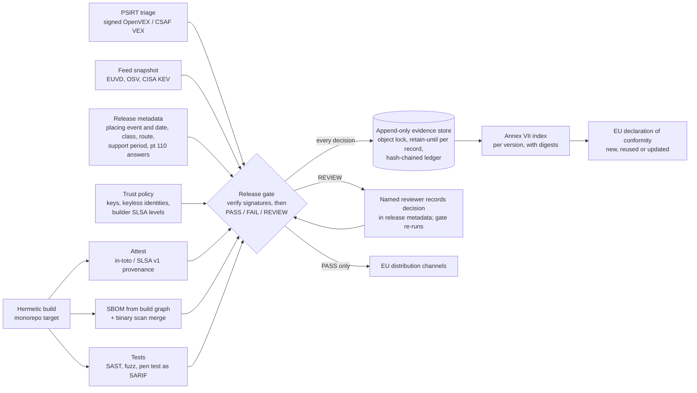

# CRA evidence generated by the pipeline: one signed record per version, produced where the version is built

**Executive answer.** At thousands of releases a week, Aldermoor cannot write CRA technical documentation by hand. Under the Commission's draft guidance (not the Regulation's text), a standalone software version is placed on the market at its first offering, and later versions keep that date unless they substantially modify the product; separate builds for different platforms are separate products (paras 13-15, Example 2). Every version still needs an up-to-date Annex VII file, a declaration link and a recorded substantial-modification decision, and every file must be kept for at least 10 years. The answer is for the build pipeline to emit one machine-readable evidence record per version, bound to the shipped artefact by digest, and for a release gate to decide PASS, FAIL or REVIEW before any EU channel accepts the version. The gate verifies evidence cryptographically and fails closed: DSSE signatures on SLSA v1 provenance and VEX (ECDSA P-256 or Ed25519 keys, or Sigstore keyless certificates with Rekor inclusion proofs), subject digest against the artefact, builder identity against a trust policy, and SLSA Build level as the verifier's own assessment. We ran it on a real public release: the sigstore-js 5.0.0 npm package, whose provenance, registry signature and transparency-log entries all verified offline. The gate returned REVIEW because two moderate advisories published on 30 Oct 2026 hit its dependency tree. On 10,000 synthetic signed versions with 200-2,000-component SBOMs, the gate handled about 50 versions a second per core (18 ms median, 76 ms at the 99th percentile). Aldermoor's estimated 2,000 EU versions a week therefore need under a minute of gate CPU time. Core evidence measured 126 KiB per version compressed, so storage is not the cost driver. The real costs are onboarding about 200 product lines and human review of functionality releases: roughly 24-40 FTE-years in 2027 (estimate). The module ships a versioned JSON Schema, a Python implementation with 121 passing tests, a pinned GitHub Actions workflow and a trust model that a notified body can check independently.

## Document-based compliance breaks at Aldermoor's release cadence because every version needs its own record, kept for a decade

Three rules in the knowledge base (KB) make CRA documentation a per-version duty.

| Rule | What it says | Effect at Aldermoor's cadence |
|---|---|---|
| Placing date for software versions | Commission guidance, not the Regulation's text: placing is judged per unit. For standalone software all copies of a version are placed at its first offering. Later versions keep that date unless they are a substantial modification; builds for different platforms are distinct products (guidance paras 13-15 and Example 2; reports/sections/03-scope.md) | Each new version needs a record that shows whether it is a new placing (substantial modification or new variant) or an update to a placed product, with the placing date it inherits. At about 2,000 EU-relevant versions a week (estimate), that is about 104,000 version records a year |
| Substantial modification | Guidance pt 110 sets four questions: new threat vectors, new attack scenarios, changed likelihood, changed impact. All negative indicates the update is likely not substantial, provided the risk-assessment assumptions still hold (pt 111). Security updates are "generally not" substantial (pt 108). Changes of intended purpose, or boundary or dependency changes not foreseen in the risk assessment, may be (pt 109). A substantial modification is a new placing (pt 116) (reports/sections/10-conformity.md) | Every functionality release needs a recorded answer to four questions against the previous version. A new placing needs a new or updated declaration (Art 28(2); FAQ 6.8) |
| Retention | Technical documentation and the declaration are kept 10 years after placing or for the support period, whichever is longer (Art 13(13); reports/sections/10-conformity.md). Annex II information follows the same rule (Art 13(18); reports/sections/05-roles.md) | More than a million version records held at steady state, each retrievable for a market surveillance authority on reasoned request (Art 13(22)). The clock runs from the inherited placing date where it is earlier than the version date |

Document-based compliance fails for three reasons. It cannot keep up: a technical file written per version at even one hour each would need about 55 FTE (estimate). It drifts: a document describes the build someone thinks they shipped, not the artefact that shipped (reports/guides/application/06-sbom.md). It cannot prove its own history: a shared drive cannot show that the file for version 141.0.7390.65 was complete before 10 Feb 2028 and unchanged since. The corporate evidence guide requires immutable, pipeline-fed, exportable records for this reason (reports/guides/corporate/08-evidence.md).

## The target architecture makes the pipeline the author of the technical file and humans the authors of decisions

The build already knows the artefact digest, its dependencies, who built it and what tests ran. The pipeline should write those facts. People should record only the judgements the law asks for: the risk assessment, the pt 110 answers, the support-period rationale and the declaration.

Three design choices matter most. First, the gate stores every decision, including FAIL and REVIEW, because the trail of blocked releases is the evidence that the control operates. This is what a Module H quality-system audit looks for (Annex VIII Module H pts 3-4; reports/sections/10-conformity.md). Second, records are never edited. A REVIEW is cleared by recording the human decision in the release metadata and re-running the gate, which writes a new record beside the old one. Third, no claim in an attestation counts until its signature has verified against the trust policy.

`spec/cra-evidence-record.v1.1.0.schema.json` (JSON Schema 2020-12) defines the record. Each property carries an `x-cra-basis` annotation citing the KB. The placing block records the version date, the event (first placing, new variant, substantial-modification placing or update to a placed product) and, for an update, the inherited placing date and the version it comes from. [Appendix C](appendix-schema-and-operations.md) lists every field with its legal basis.

## Ten control points turn legal duties into machine decisions with named reasons

`cra_evidence/gate.py` implements the controls below. Every reason carries a code, a severity and its basis. A FAIL reason blocks the release. A REVIEW reason routes it to a named role. INFO reasons are kept for the audit trail.

| Control | FAIL when | REVIEW when |
|---|---|---|
| SBOM | Missing; no dependency edges from the root; a direct dependency in the build graph is absent; root hash does not match the artefact | Root carries no hash |
| Provenance signature | Unsigned; signature invalid; signer unknown, not authorised for this product or purpose, revoked, expired or not yet valid; keyless identity mismatch; transparency-log entry missing (where required) or failing offline verification | Unsigned, only where policy sets `require_signed_provenance: false` (shadow mode) |
| Provenance claims (from verified bytes only) | Predicate not SLSA v1; no subject matches the artefact digest; builder not trusted for the product or not bound to the signer; SLSA Build level below the product minimum; unexpected `buildType` or `externalParameters`; keyless identity differs from the workflow named | None |
| VEX origin | No signed VEX attestation; signature or signer fails as above; subject is not this artefact; signed predicate differs from the VEX document the gate used | Unsigned, only where policy allows |
| Known vulnerabilities | A KEV-listed match lacks VEX `not_affected` or `fixed`; VEX says `affected` with no mitigation; untriaged critical or high; `not_affected` without justification | `affected` with a documented mitigation; untriaged medium or low |
| Tests | Required test type missing (pen test on first placing or substantial modification); unsuppressed SARIF errors; open critical or high pen-test findings | Pen test absent while the substantial-modification decision is pending |
| Risk assessment and Annex II | No reference; matrix lacks any Part I item; item not applied without justification; Part I point (1) not applied; no Annex II reference | None |
| Support period | Missing; under 5 years without justification | Under 5 years with justification (counsel confirms that expected use is shorter) |
| Substantial modification and placing | Decision "substantial" not recorded as a new placing; inherited placing date later than the version date | Any pt 110 answer yes or unanswered; functionality change without a recorded human assessment; pt 109 change type; security fix bundled without justification; a new placing that also claims an inherited date |
| Route and declaration | For products placed from 11 Dec 2027 only (Art 69(2), Art 71(2); reports/sections/04-exclusions.md): Class I on Module A without a cited harmonised standard applied in full; Class II or critical on Module A; Module B+C or H without a certificate reference. Any date: no declaration; declaration reused after a substantial modification | Declaration reuse depends on a pending review. Route and certificate gaps are INFO (`*_PRE_APPLICATION`) where the effective placing date, inherited or not, is before 11 Dec 2027 |
| Retention | Retain-until earlier than max(effective placing date + 10 years, support end); not computable | Store not in compliance-mode lock |

Two rules follow from the corrected reading of the guidance. The retention check uses the inherited placing date where it is earlier than the version date, which is the legal minimum. The route check uses the same effective date, so a product placed before 11 Dec 2027 can keep receiving non-substantial and security updates without a certificate, while its next substantially modified version cannot. A functionality release whose four answers are all "no", with a named assessor on record, passes with an INFO reason. The review has already happened, at the point where the person answered the questions.

## The implementation runs end to end on four signed Aldermoor sample versions

The package needs `cryptography` for signature, key and transparency-log checks, and `sigstore` (sigstore-python 4.5.1 tested) for keyless bundles; a keyless bundle fails closed if that package is absent. Collectors ingest CycloneDX 1.5, SPDX 2.3, in-toto Statement v1 with [SLSA Provenance v1](https://slsa.dev/provenance/v1), [OpenVEX v0.2.0](https://raw.githubusercontent.com/openvex/spec/main/OPENVEX-SPEC.md), CSAF 2.0 `csaf_vex`, [SARIF 2.1.0](https://www.oasis-open.org/?p=5122), OSV records and the CISA KEV catalogue format.

| Sample | Formats | Expected path | Result |
|---|---|---|---|
| Hearth Lock 3 firmware 4.2.0 (Class I, Module H) | CycloneDX 1.5, SLSA v1, OpenVEX, SARIF | Security update; zlib CVE-2022-37434 matched but VEX `not_affected` (not in execute path) | PASS |
| Hearth Lock 3 firmware 4.3.0 | As above plus pen-test summary | Adds voice-assistant unlock through the cloud; pt 110 Q1 and Q2 yes | REVIEW |
| Lumen Browser 141.0.7390.54 (Class I, Module H) | SPDX 2.3, DSSE-wrapped SLSA v1, CSAF VEX, SARIF | Security update keeping the 6 Jan 2028 placing date of 141.0.7390.40; KEV-listed libwebp CVE-2023-4863 under investigation; harfbuzz missing from SBOM; open fuzz crash | FAIL |
| Lumen Browser 141.0.7390.65 | As above | Security update, same inherited placing date; libwebp updated; CSAF `fixed`; SBOM complete; retain until 6 Jan 2038 | PASS |

Component versions and digests are synthetic; the signatures are real, made with labelled demonstration keys. The full output, the Annex VII index excerpt and the store verification are in [Appendix B](appendix-validation.md).

**Working code versus design.** Working and tested: the schema, the collectors, signature verification (DSSE key-based, Sigstore keyless, offline Rekor proofs), the trust policy, the gate, the Annex VII index, the retention calculator (with inherited placing dates), the CLI and a local append-only store with a hash-chained ledger. Valid and pinned but not run on GitHub: the Actions workflow. Sketch only: the Bazel rule. Design only: object-lock storage at scale, the release-metadata service, the PSIRT VEX export and KMS key custody.

## The gate verifies every signature before it believes any claim, and a notified body can check most of it independently

The gate reads builder id, subjects and VEX statements only from payload bytes whose signature verified against the trust policy. It checks the envelope, the key or keyless identity, the Rekor inclusion proof offline, the subject digest, the builder and its SLSA Build level, and the expected build parameters, following the SLSA v1.0 verification procedure. Build level comes from the trust policy, never from the provenance. Every Aldermoor product requires Build L3; third-party components built on GitHub-hosted runners are accepted at L2.

| Evidence | Signer and mechanism | What the gate requires |
|---|---|---|
| Build provenance, Aldermoor builds | Hermetic builder's signing service; DSSE, ECDSA P-256; non-exportable KMS or HSM key | Key authorised for this product, valid at signing time, bound to `hermetic/v2` at L3 |
| Build provenance, open-source builds on GitHub | Release workflow's OIDC identity; Sigstore keyless with Rekor entry | Exact identity in the trust policy; inclusion proof verified offline |
| VEX (OpenVEX or CSAF) | PSIRT publishing service; DSSE, Ed25519; two-person release for KEV items | Key authorised for `vex` only; subject is this artefact; signed predicate equals the evaluated VEX |
| Evidence record and ledger | Release pipeline identity; SHA-256 hash chain, object lock | Ledger verifies; record signing is a remaining gap |

An authority can recompute digests, verify signatures with Aldermoor's public keys or the public Sigstore root, and re-run the gate from the stored inputs. It cannot check from the record alone that the builder really meets L3, that key custody works, or that a `not_affected` statement is true; those need audit. [Appendix A](appendix-trust-model.md) has the step-by-step checks, failure codes, key management rules and the independent-check table.

## A real public release and a 10,000-version benchmark show the gate works and is not a bottleneck

On the real sigstore-js 5.0.0 package, the gate verified the keyless provenance, the npm publish attestation and both Rekor proofs offline, then stopped at REVIEW for two real moderate advisories. Three negative runs failed as designed: a one-byte change to the tarball, a policy expecting a release tag, and a policy requiring Build L3. The CRA metadata and VEX in that run are synthetic.

| Measure (10,000 synthetic versions, 2 vCPU, 1 Nov 2026) | Result |
|---|---|
| Decisions | 9,353 PASS, 470 REVIEW, 177 FAIL (injected defects) |
| Signatures | 20,000 verified; 0 failures |
| Throughput | 49.7 versions a second per core; median 18 ms, 99th percentile 76 ms |
| Artefact hashing | 370 MiB a second per core |
| Core evidence per version | 126 KiB compressed |

Throughput is not a constraint; feed freshness, review queues and SBOM quality are. The CI workflow pins every action to a commit SHA, denies permissions by default and uploads the record even when the gate fails. Inputs, the full benchmark and the CI detail are in [Appendix B](appendix-validation.md).

## For Aldermoor the build system already holds most of the evidence

| Aldermoor asset | Use in the evidence pipeline | Gap to close |
|---|---|---|
| Monorepo with hermetic build | The SBOM comes from the build graph, which sees vendored third-party code that manifest scanners miss | Prebuilt binaries and vendor blobs (modem, GPU and secure-element firmware) need binary scanning plus supplier SBOMs (reports/guides/application/06-sbom.md) |
| Signed provenance for internal artefacts | Extend the same attestation to external release artefacts; register the builder, key and assessed SLSA level in the trust policy | Subjects must be the shipped, signed artefact; an L3 assessment of the builder |
| Release calendars and launch reviews | Supply version dates, placing events and inherited dates, Member States, change type and the four pt 110 answers | Decision rights for "not substantial" (Decision 3) |
| PSIRT (module E2 case engine) | Exports OpenVEX or CSAF per version; the same `not_affected` statement is evidence that no Art 14 report was due (guidance para 218) | PSIRT KMS signing key and two-person release for KEV items |
| Portfolio classification (module E3) | Supplies class, route and certificate reference per product | Module H approval depends on a notified body. None was designated at 8 Sep 2026 (reports/sections/10-conformity.md) |
| Versioned security pages | Annex II at `/security/<product>/<version>/`, kept online for the retention period (reports/guides/application/11-documentation-set.md) | Retention of web pages for 10+ years |

The store answers the predictable questions from authorities and notified bodies by query: the file for version X, which versions were on the market on a date, why a version was or was not a new placing, and whether the gate is enforced. [Appendix C](appendix-schema-and-operations.md) maps each question to the record fields.

## Roll out through two contrasting pilots, then three waves, before 11 December 2027

Annex I Part II and the documentation duties apply from 11 Dec 2027; Art 14 reporting has applied since 11 Sep 2026 (reports/sections/08-annex1-part2.md). The plan leaves six weeks of contingency.

| Wave | Dates | Scope | Exit criterion |
|---|---|---|---|
| 0 Pilot | Dec 2026 to Mar 2027 | Hearth Lock 3 firmware (hardware, slow cadence) and Lumen Browser (software, 4-weekly majors and weekly security updates); gate in shadow mode | Record for 100% of pilot versions; false-FAIL rate under 2% (target) |
| 1 Important products | Apr to Jun 2027 | Gate enforced on pilots; all Annex III and IV products as classified in module E3 | No EU release of an important product without a PASS record |
| 2 Default products | Jul to Sep 2027 | Apps, SDKs, CLI, desktop clients, wearables, accessories | Same, all product lines |
| 3 Readiness | Oct 2027 | Mock Art 13(22) request drill: export the files for 20 random versions within 5 working days (target) | Drill passed; policy v1 frozen |

| Workstream (all estimates) | Effort (FTE-years, 2027) | Basis of estimate |
|---|---|---|
| Platform: schema, collectors, gate service, store, index, export | 6 | 8 engineers for 9 months |
| Build-rule and CI integration in the monorepo | 2 | 4 engineers for 6 months |
| Product onboarding | 8-20 | About 200 product lines at 2-5 engineer-weeks each |
| PSIRT VEX operations uplift | 5-8 | Justified statement for every match across all supported versions |
| Compliance, legal and review operations | 3-4 | Policy ownership, pt 110 reviews, drills |
| **Total** | **24-40** | About USD 6-14m at a loaded USD 250,000-350,000 per FTE-year |

Review load is the main operating cost. Assume 30% of the 2,000 weekly versions carry functionality changes and each review takes 45 minutes: release-level review would need about 450 hours a week, or about 12 FTE. If the four questions are answered once per feature at launch review, and releases only aggregate those answers, release-level REVIEW falls to about 5% of versions, or about 2 FTE (all estimates).

Storage is cheap. At 104,000 versions a year, measured core evidence is 0.013 TB a year. Even the high retention case (150 MB a version with full SARIF, fuzz logs and OS-scale SBOMs) holds about 172 TB at steady state, at about USD 2,100 a year on an archive tier (estimate). Release binaries are excluded because Art 13(9) already keeps security updates available (reports/sections/08-annex1-part2.md). Sizing and the price basis are in [Appendix C](appendix-schema-and-operations.md).

## Decisions for the executive team

1. **Make the per-version evidence record the system of record for CRA technical documentation.** No EU distribution channel accepts a version without a PASS record. Owner: CTO, with VP Engineering (developer infrastructure). Decide by Dec 2026; enforce for important products by Jun 2027 and all products by Oct 2027.
2. **Fund the platform and onboarding at 24-40 FTE-years for 2027 (estimate).** Owner: CTO and CFO. Approve in Q1 2027 planning.
3. **Move the pt 110 test to feature launch review and set decision rights.** Name who may record "not substantial", and so whether a version is a new placing, and who escalates to General Counsel. Owner: CISO with General Counsel. Decide by Feb 2027.
4. **Give gate policy to the product security office and restrict overrides.** No override of `KNOWN_EXPLOITED_UNRESOLVED` or `ROUTE_NOT_PERMITTED` without the CISO and General Counsel; every override is recorded. Owner: CISO. Decide by Feb 2027.
5. **Approve an EU-region evidence store with compliance-mode lock, and the signing and trust plan behind it.** That means KMS-held provenance and VEX keys, yearly rotation, a trust policy under two-person change control, archived Sigstore trusted roots, and a 15-year verification plan covering timestamping and format migration. Owner: VP Infrastructure with CISO. Decide by Apr 2027.
6. **Source notified bodies for Module H on module E3's timetable.** Class I products can use Module A only by applying in full a harmonised standard, common specification or EU certification scheme at 'substantial' level (Art 32(2)), and none exists yet. Shortlist two bodies by Dec 2026 and contract within about 30 days of designation, targeting no later than Q2 2027 (module E3, Decision 2). Owner: CISO with Procurement and General Counsel.

## Risks and open questions

- **SBOM completeness for binaries.** The build graph cannot see inside prebuilt vendor blobs, and a top-level-only SBOM misses vendored code. Mitigation: binary scanning merged into the SBOM, supplier SBOM clauses, and a "known unknowns" field. "Top-level" is not interpreted by the FAQ or guidance (reports/sections/08-annex1-part2.md).
- **VEX trust.** A `not_affected` statement is self-issued and can clear a KEV-listed vulnerability at the gate. Under guidance para 218 it is also evidence that no Art 14 report was due. Require reachability evidence, PSIRT signing, two-person review for KEV items and sampled re-audit.
- **Point-in-time gate.** Feeds change daily. The record stores which snapshot was used, so the decision is reproducible, but post-release monitoring of every supported version remains a separate duty (reports/guides/application/06-sbom.md "Continuous monitoring").
- **Placing date for software versions.** Guidance paras 13-15 and Example 2 fix the placing date at the first offering of a version and keep it for later versions that are not substantially modified; only substantially modified versions and distinct variants are new placings. A security point release is normally not a new placing (para 108). Recording every version is still required for documentation and costs little. See legal-positions question B (module E6).
- **Status of the guidance.** Commission guidance C(2026) 5252 was approved on 27 Jul 2026 but had not been formally adopted by 30 Oct 2026 (reports/sections/03-scope.md). Paragraph numbers could move. If the adopted text or an authority treated every version as a placing, the retention check would need the version date again; the version date is already in every record.
- **Notified-body capacity.** No CRA notified body was in NANDO at the last check on 8 Sep 2026 (reports/sections/10-conformity.md). From 11 Dec 2027 the gate will block a Class I or II product's next new placing if it has no approval.
- **Verification gaps and ten-year verifiability.** The record itself is not yet signed, key-mode signatures without a log entry rely on the gate's clock, checkpoints are not witnessed, private-repository attestations and the CI workflow are untested, and the builder's L3 rating is illustrative. Archive trusted roots and public keys with the records, and plan algorithm and format migration as re-attestation, never as an edit ([Appendix A](appendix-trust-model.md)).
- **Personal data in evidence.** Provenance and SARIF can carry engineer identities that would be held for 10+ years. Use role and service identities in records.
- **Alert fatigue.** If REVIEW volume stays high, reviewers will rubber-stamp. Track REVIEW rate and time to decision per product as gate health metrics.

## Sources

Knowledge base (CRA knowledge base, facts verified to 30 Oct 2026):
- reports/sections/03-scope.md: placing date for software versions (guidance paras 13-15, Example 2); substantial-modification test (paras 104-112); guidance status.
- reports/sections/05-roles.md: retention table for documentation and user information.
- reports/sections/06-classification.md: Annex III Class I categories 2 (browsers) and 17 (smart door locks).
- reports/sections/07-annex1-part1.md: known exploitable vulnerabilities; guidance paras 233-234; Art 13(3)-(4) applicability.
- reports/sections/08-annex1-part2.md: Part II(1) SBOM; support period; Art 13 lifecycle table including 13(9), 13(10), 13(13), 13(18).
- reports/sections/10-conformity.md: routes by class; Annex VII points; Art 13(12)-(13); pts 108-111, 116, 122-123; notified-body status at 8 Sep 2026.
- reports/guides/application/05-sdlc.md: release gate and CI evidence capture.
- reports/guides/application/06-sbom.md: SBOM pipeline, BSI TR-03183-2 fields, VEX separation, guidance para 218.
- reports/guides/application/07-updates.md: update design note, separation of security and functionality updates.
- reports/guides/application/11-documentation-set.md: Annex VII file structure, versioning and retention per placing.
- reports/guides/corporate/08-evidence.md: system-of-record properties.
- Module E6, oj-verification/corrections_enterprise.md (C-01, C-02, C-05) and legal-positions/positions.md question B.

External (opened 1 Nov 2026):
- SLSA, [Provenance v1](https://slsa.dev/provenance/v1): predicate type, buildDefinition and runDetails fields.
- OpenVEX, [specification](https://raw.githubusercontent.com/openvex/spec/main/OPENVEX-SPEC.md): v0.2.0 context, statuses and justifications.
- OASIS, [SARIF 2.1.0](https://www.oasis-open.org/?p=5122).
- CycloneDX, [1.5 JSON schema](https://cyclonedx.org/schema/bom-1.5.schema.json).
- SPDX, [2.3.1 relationships](https://spdx.github.io/spdx-spec/v2.3.1/relationships-between-SPDX-elements/).
- OWASP dep-scan, [VEX and CSAF guide](https://depscan.readthedocs.io/output/vex-csaf-guide) (secondary source for the CSAF `csaf_vex` profile fields).
- SLSA, [v1.0 Security levels](https://slsa.dev/spec/v1.0/levels) and [v1.0 Verifying artifacts](https://slsa.dev/spec/v1.0/verifying-artifacts).
- Secure Systems Lab, [DSSE protocol](https://github.com/secure-systems-lab/dsse/blob/master/protocol.md).
- GitHub Docs, [Artifact attestations](https://docs.github.com/en/actions/concepts/security/artifact-attestations) and [reusable workflows for Build Level 3](https://docs.github.com/actions/security-guides/using-artifact-attestations-and-reusable-workflows-to-achieve-slsa-v1-build-level-3).
- npm Docs, [Generating provenance statements](https://docs.npmjs.com/generating-provenance-statements); real-artefact inputs listed in [Appendix B](appendix-validation.md).
- AWS, [S3 Object Lock](https://docs.aws.amazon.com/AmazonS3/latest/userguide/object-lock.md) and [S3 Glacier Deep Archive announcement](https://aws.amazon.com/ru/about-aws/whats-new/2019/03/S3-glacier-deep-archive/).

Appendices: [A. Signature verification and trust model](appendix-trust-model.md); [B. Sample runs, real-release test, benchmark and CI workflow](appendix-validation.md); [C. Record fields, authority queries and storage sizing](appendix-schema-and-operations.md).
