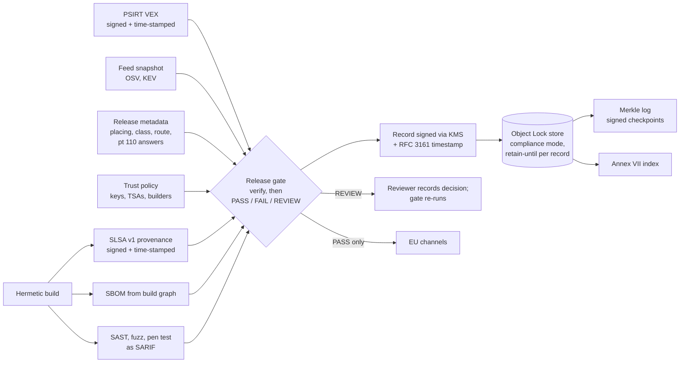

# CRA evidence generated by the pipeline: one signed record per version, produced where the version is built

**Executive answer.** At thousands of releases a week, Aldermoor cannot write CRA technical documentation by hand. Under the Commission's draft guidance (not the Regulation's text), a standalone software version is placed on the market at its first offering, and later versions keep that date unless they substantially modify the product (paras 13-15, Example 2). Every version still needs an up-to-date Annex VII file, a declaration link and a recorded substantial-modification decision, kept for at least 10 years. The answer is for the build pipeline to emit one evidence record per version, bound to the shipped artefact by digest, and for a release gate to decide PASS, FAIL or REVIEW before any EU channel accepts it. The gate verifies every signature before it believes any claim and fails closed. Each record is now itself a signed in-toto attestation with an RFC 3161 timestamp, written to compliance-mode Object Lock storage and entered in a Merkle log whose signed checkpoints make tampering detectable whatever the storage did. Keys sit behind one interface with AWS KMS, Google Cloud KMS and HSM adapters. We piloted the pipeline on a real product line: ten released versions of the open-source requests library, rebuilt from source without network access. All ten rebuilds were bit-identical, and their code matched the published wheels file for file. The gate passed 3 versions and failed 7 on a real SAST finding, and 6.9 seconds a version covered build to locked storage. Signing, time-stamping, verification and locked storage cost about 280 ms a version on one thread over 1,000 versions, or about 8 thread-hours a year at Aldermoor's estimated 104,000 EU versions. The real costs are onboarding about 200 product lines and reviewing functionality releases: roughly 24-40 FTE-years in 2027 (estimate).

## Document-based compliance breaks at Aldermoor's release cadence because every version needs its own record, kept for a decade

Three rules in the knowledge base (KB) make CRA documentation a per-version duty.

| Rule | What it says | Effect at Aldermoor's cadence |
|---|---|---|
| Placing date for software versions | Commission guidance, not the Regulation's text: all copies of a standalone software version are placed at its first offering; later versions keep that date unless substantially modified; builds for different platforms are distinct products (guidance paras 13-15, Example 2; reports/sections/03-scope.md) | Each version needs a record showing whether it is a new placing or an update, with the placing date it inherits. At about 2,000 EU-relevant versions a week (estimate), that is about 104,000 records a year |
| Substantial modification | Guidance pt 110 sets four questions: new threat vectors, new attack scenarios, changed likelihood, changed impact. Security updates are "generally not" substantial (pt 108); purpose, boundary or dependency changes not foreseen may be (pt 109); a substantial modification is a new placing (pt 116) (reports/sections/10-conformity.md) | Every functionality release needs recorded answers against the previous version. A new placing needs a new or updated declaration (Art 28(2); FAQ 6.8) |
| Retention | Technical documentation and the declaration are kept 10 years after placing or for the support period, whichever is longer (Art 13(13)); Annex II information likewise (Art 13(18)) (reports/sections/10-conformity.md; 05-roles.md) | More than a million records at steady state, each retrievable on reasoned request (Art 13(22)). The clock runs from the inherited placing date where earlier |

Documents fail for three reasons. They cannot keep up: one hour per version would need about 55 FTE (estimate). They drift from the artefact that shipped (reports/guides/application/06-sbom.md). And a shared drive cannot prove that a file was complete before placing and unchanged since. The corporate evidence guide requires immutable, pipeline-fed, exportable records for this reason (reports/guides/corporate/08-evidence.md).

## The target architecture makes the pipeline the author of the technical file and humans the authors of decisions

The build already knows the artefact digest, its dependencies, who built it and what tests ran. The pipeline should write those facts. People should record only the judgements the law asks for: the risk assessment, the pt 110 answers, the support-period rationale and the declaration.

Three design choices matter most. The gate stores every decision, including FAIL and REVIEW, because the trail of blocked releases shows the control operates, which is what a Module H audit looks for (Annex VIII Module H pts 3-4; reports/sections/10-conformity.md). Records are never edited: a REVIEW is cleared by recording the human decision and re-running the gate, which writes a new record. And no claim counts until its signature has verified against the trust policy. `spec/cra-evidence-record.v1.1.0.schema.json` defines the record, each field annotated with its KB basis ([Appendix C](appendix-schema-and-operations.md)).

## Eleven control points turn legal duties into machine decisions with named reasons

`cra_evidence/gate.py` checks the SBOM, provenance signature and claims, VEX origin, known vulnerabilities, tests, risk assessment and Annex II, support period, substantial modification and placing, route and declaration, and retention. Every reason carries a code, a severity and its basis. A FAIL blocks the release, a REVIEW routes it to a named role, and INFO is kept for the audit trail. Typical FAILs: a direct build dependency missing from the SBOM; any signature or subject digest that does not verify; a known-exploited vulnerability without a VEX `not_affected` or `fixed`; unsuppressed SARIF errors; a substantial modification not recorded as a new placing; a retain-until date short of the legal minimum. Route and certificate gaps apply only to products placed from 11 Dec 2027 (Art 69(2), Art 71(2)), judged on the effective placing date, inherited or not. The full table is in [Appendix C](appendix-schema-and-operations.md).

## The trust model is now built end to end: signed inputs, signed records, independent time and locked storage

The gate reads builder, subjects and VEX statements only from payload bytes whose signature verified, following the SLSA v1.0 verification procedure. Build level comes from the trust policy, never from the provenance: Aldermoor products require Build L3; third-party components built on GitHub-hosted runners are accepted at L2.

| Evidence | Signer and mechanism | What the verifier requires |
|---|---|---|
| Build provenance, Aldermoor builds | Builder signing service; DSSE, ECDSA P-256; KMS or HSM key; RFC 3161 timestamp | Key authorised for this product, valid at the time-stamped signing time; builder bound to the key at L3 |
| Build provenance, open-source builds on GitHub | Workflow OIDC identity; Sigstore keyless with Rekor entry | Exact identity in the trust policy; inclusion proof verified offline |
| VEX | PSIRT service; DSSE, Ed25519; timestamp; two-person release for KEV items | Key authorised for `vex` only; subject is this artefact |
| Evidence record (new) | Release pipeline; in-toto statement whose subject is the artefact and predicate the record; DSSE in a Sigstore v0.3 bundle with an RFC 3161 timestamp | Key authorised for `evidence_record`; digest equals the log entry; verified on every read |
| Log checkpoint (new) | Evidence store; signed, time-stamped tree head over an RFC 9162 Merkle tree | Root recomputed from stored entries; copies held outside Aldermoor |

This closes the two gaps a reviewer raised. The record is signed. Key-based signatures now carry an independent time: the verifier takes signing time from a log entry, else a verified timestamp, else its own clock, and records which. A key that expired in June still verifies a signature time-stamped in March; without the timestamp it fails. Two independent implementations, OpenSSL and rfc3161-client, accept the module's tokens. Signing goes through a `KeyProvider` interface with adapters for AWS KMS, Google Cloud KMS and PKCS#11 HSMs. The storage interface has a local backend and an S3 Object Lock backend that writes in compliance mode with the record's retain-until date, refuses overwrites and reads the lock back.

An authority can now check, without Aldermoor's tools, that a record is unchanged and signed, when it was signed, and that it is in the log a checkpoint it holds commits to. It still cannot check from the record alone that the builder meets L3, that key custody works, or that a `not_affected` statement is true; those need audit ([Appendix A](appendix-trust-model.md); [Appendix D](appendix-signing-storage-pilot.md)).

## A pilot on ten real releases of one product line showed the pipeline working on real builds and real advisories

We chose requests, a widely used Python library, because it has a real build, a real dependency tree and a public security history. Its maintainers had no involvement; it stands in for an Aldermoor product line, and every CRA judgement in the pilot is authored and labelled. For each of ten versions from 2.31.0 (May 2023) to 2.34.2 (May 2026), the pilot downloaded the source from PyPI, built the wheel twice in an isolated environment with no network and a digest-pinned build backend, generated a CycloneDX SBOM with dependencies as at the release date, ran bandit, signed and time-stamped SLSA provenance for this local builder (rated Build L1, not L3), ran the gate against real OSV and KEV data as at release, and stored everything under Object Lock.

| Result (1 Nov 2026) | Value |
|---|---|
| Rebuilds bit-identical; code identical to the published wheel | 10 of 10; 10 of 10 |
| Gate at release | 3 PASS; 7 FAIL on bandit B324 (MD5 and SHA-1 in Digest authentication), cleared when 2.34.0 marked those hashes not for security; the first placing also lacked a pen test |
| Gate with today's feed | 10 FAIL: high and critical advisories in urllib3 and certifi published after release |
| Placing (authored) | 1 first placing, 1 substantial modification, 8 updates keeping 21 May 2024; retained to 2034 |
| Store | 133 objects, all compliance mode; delete and overwrite refused; full verification clean |
| Time per version | 6.9 s mean, of which signing, time-stamping, verification and storage about 0.3 s |

The pilot paid for itself before any number was measured. On real OSV data the matcher flagged every version as vulnerable to issues fixed years earlier, because it read commit-hash ranges as versions, and it counted aliased advisories twice. Both are fixed and tested; synthetic feeds could not have shown them. Object Lock ran against moto's S3 server, which enforces delete and overwrite denial but not the ban on shortening retention, so that AWS guarantee is untested ([pilot README](examples/pilot/README.md)).

## Benchmarks show the gate and the trust layer are cheap, and storage calls dominate

| Measure (2 vCPU, 1 Nov 2026) | Result |
|---|---|
| Gate only, 10,000 signed versions, 200-2,000-component SBOMs | 49.7 versions a second per core; median 18 ms |
| Full trust path, 1,000 versions: producer sign and time-stamp, gate with verification, record sign and time-stamp, Object Lock PUTs, Merkle log, checkpoint | 279 ms mean, 312 ms p95, single thread; 196 ms of it is 17 PUTs with lock read-back |
| Audit verification of the whole store | 25 ms a version |
| Core evidence per version | 126 KiB compressed |

At 104,000 versions a year the trust path needs about 8 thread-hours (estimate). Against real cloud services each version makes 42 remote calls; at an assumed 50 ms each, about 2.4 seconds if run in sequence, and versions parallelise. Throughput is not the constraint. KMS and TSA quotas, feed freshness, review queues and SBOM quality are ([Appendix B](appendix-validation.md); [Appendix D](appendix-signing-storage-pilot.md)).

## What is built, and what remains design

The four signed Aldermoor samples (two PASS, one REVIEW, one FAIL, each for the designed reason) and the real sigstore-js 5.0.0 npm release, whose keyless provenance and Rekor proofs verify offline, remain the regression set ([Appendix B](appendix-validation.md)).

| Status | Components |
|---|---|
| Built and tested (171 tests, pytest and standalone) | Schema; collectors; signature verification (DSSE, Sigstore keyless, offline Rekor proofs); trust policy; gate; record signing and verify-on-read; RFC 3161 request, verification and a test TSA; KeyProvider with local, AWS KMS, Google Cloud KMS and PKCS#11 adapters (cloud and HSM adapters against mocks); local and S3 Object Lock backends; Merkle log with signed checkpoints and proofs; Annex VII index; CLI; pilot; benchmarks |
| Validated, not run on GitHub | Release-gate and pilot workflows (actionlint and the workflow schema pass) |
| Design only | Hermetic-build integration in Aldermoor's monorepo and an L3 builder assessment; KMS key ceremonies and quotas; contracted TSAs; production Object Lock accounts and replication; checkpoint distribution or public logging; the release-metadata service; PSIRT VEX export |

## Roll out through a real Aldermoor pilot, then three waves, before 11 December 2027

Annex I Part II and the documentation duties apply from 11 Dec 2027; Art 14 reporting has applied since 11 Sep 2026 (reports/sections/08-annex1-part2.md). The requests pilot proves the mechanics; Wave 0 must repeat it on Aldermoor's own build system, keys and storage.

| Wave | Dates | Scope | Exit criterion |
|---|---|---|---|
| 0 Pilot | Dec 2026 to Mar 2027 | Lumen Browser on the hermetic builder, KMS keys, a contracted TSA and an EU Object Lock bucket; gate in shadow mode | Record for 100% of versions; false-FAIL rate under 2% (target); builder assessed at L3 |
| 1 Important products | Apr to Jun 2027 | Gate enforced on Annex III and IV products (module E3) | No EU release of an important product without a PASS record |
| 2 Default products | Jul to Sep 2027 | Apps, SDKs, desktop clients, wearables, accessories | Same, all product lines |
| 3 Readiness | Oct 2027 | Drill: export and independently verify 20 random versions' files within 5 working days (target) | Drill passed; policy v1 frozen |

| Workstream (all estimates) | FTE-years, 2027 | Basis |
|---|---|---|
| Platform: gate service, signing, store, index, export | 6 | 8 engineers for 9 months |
| Build-rule and CI integration | 2 | 4 engineers for 6 months |
| Product onboarding | 8-20 | About 200 product lines at 2-5 engineer-weeks each |
| PSIRT VEX operations | 5-8 | Justified statement for every match on all supported versions |
| Compliance, legal and review | 3-4 | Policy ownership, pt 110 reviews, drills |
| **Total** | **24-40** | About USD 6-14m at USD 250,000-350,000 per FTE-year |

Review load is the main operating cost. If 30% of the 2,000 weekly versions carry functionality changes at 45 minutes each, release-level review needs about 12 FTE; answering the four questions once per feature at launch review cuts that to about 2 FTE (estimates). Storage is cheap: even the high case of 150 MB a version holds about 172 TB at steady state, about USD 2,100 a year on an archive tier (estimate; [Appendix C](appendix-schema-and-operations.md)).

## Decisions for the executive team

1. **Make the per-version signed record the system of record for CRA technical documentation.** No EU channel accepts a version without a PASS record. Owner: CTO, with VP Engineering. Decide by Dec 2026; enforce for important products by Jun 2027 and all products by Oct 2027.
2. **Fund the platform and onboarding at 24-40 FTE-years for 2027 (estimate).** Owner: CTO and CFO. Approve in Q1 2027 planning.
3. **Move the pt 110 test to feature launch review and set decision rights.** Name who may record "not substantial" and who escalates to General Counsel. Owner: CISO with General Counsel. Decide by Feb 2027.
4. **Give gate policy to the product security office and restrict overrides.** No override of `KNOWN_EXPLOITED_UNRESOLVED` or `ROUTE_NOT_PERMITTED` without the CISO and General Counsel; every override recorded. Owner: CISO. Decide by Feb 2027.
5. **Approve the custody and storage plan behind the signatures.** KMS or HSM keys for builder, PSIRT, record and log; two contracted TSAs; an EU Object Lock account with replication; quarterly checkpoints sent to internal audit and the notified body; archived roots and a 15-year re-attestation plan. Owner: VP Infrastructure with CISO. Decide by Apr 2027.
6. **Source notified bodies for Module H on the programme case's timetable.** Class I products can use Module A only by applying in full a harmonised standard, common specification or EU certification scheme (Art 32(2)), and none exists yet. Contract at least two bodies, with a third pre-contracted (programme case, Decision 2; module E3, Decision 2). Owner: CISO with Procurement and General Counsel. Shortlist by Dec 2026.

## Risks and open questions

- **SBOM completeness for binaries.** The build graph cannot see inside vendor blobs. Mitigation: binary scanning, supplier SBOM clauses and a "known unknowns" field. "Top-level" is not interpreted by the FAQ or guidance (reports/sections/08-annex1-part2.md).
- **VEX trust.** A self-issued `not_affected` can clear a KEV-listed vulnerability and, under guidance para 218, evidence that no Art 14 report was due. Require reachability evidence, two-person review for KEV items and sampled re-audit.
- **Point-in-time gate.** The pilot shows the gap: three versions passed at release and all fail on today's feed. Records keep the snapshot used; post-market monitoring of every supported version remains a separate duty.
- **Status of the guidance.** Commission guidance C(2026) 5252 was approved on 27 Jul 2026 but not formally adopted by 30 Oct 2026 (reports/sections/03-scope.md); paragraph numbers could move. The version date is in every record if the placing rule changes.
- **Notified-body capacity.** No CRA notified body was in NANDO at 8 Sep 2026 (reports/sections/10-conformity.md). From 11 Dec 2027 the gate will block a Class I or II product's next new placing without an approval.
- **Residual verification gaps.** Test TSA and demonstration keys only; cloud and HSM adapters tested against mocks; AWS Object Lock behaviour untested; checkpoints unwitnessed until distributed; workflows not run on GitHub; the L3 rating illustrative. Plan algorithm and format migration as re-attestation, never as an edit ([Appendix A](appendix-trust-model.md)).
- **Personal data in evidence.** Provenance and SARIF can carry engineer identities for 10+ years. Use role and service identities.
- **Alert fatigue.** Track REVIEW rate and time to decision per product as gate health metrics.

## Sources

Knowledge base (facts verified to 30 Oct 2026): reports/sections/03-scope.md (placing date, guidance paras 13-15 and Example 2, paras 104-112, guidance status); 05-roles.md (retention); 06-classification.md; 07-annex1-part1.md; 08-annex1-part2.md (SBOM, support period, Art 13 lifecycle); 10-conformity.md (routes, Annex VII, Art 13(12)-(13), pts 108-111 and 116, notified bodies); reports/guides/application/05-sdlc.md, 06-sbom.md, 07-updates.md, 11-documentation-set.md; reports/guides/corporate/08-evidence.md; module E6 corrections C-01, C-02, C-05 and legal-positions question B.

External (opened 1 Nov 2026):
- SLSA, [Provenance v1](https://slsa.dev/provenance/v1), [v1.0 levels](https://slsa.dev/spec/v1.0/levels) and [verifying artifacts](https://slsa.dev/spec/v1.0/verifying-artifacts).
- Secure Systems Lab, [DSSE protocol](https://github.com/secure-systems-lab/dsse/blob/master/protocol.md); Sigstore, [bundle format](https://docs.sigstore.dev/about/bundle).
- IETF, [RFC 3161](https://datatracker.ietf.org/doc/html/rfc3161) time-stamp protocol.
- OpenVEX, [specification](https://raw.githubusercontent.com/openvex/spec/main/OPENVEX-SPEC.md); OASIS, [SARIF 2.1.0](https://www.oasis-open.org/?p=5122); CycloneDX, [1.5 schema](https://cyclonedx.org/schema/bom-1.5.schema.json); SPDX, [2.3.1 relationships](https://spdx.github.io/spdx-spec/v2.3.1/relationships-between-SPDX-elements/).
- GitHub Docs, [artifact attestations](https://docs.github.com/en/actions/concepts/security/artifact-attestations); npm Docs, [provenance](https://docs.npmjs.com/generating-provenance-statements).
- AWS, [S3 Object Lock](https://docs.aws.amazon.com/AmazonS3/latest/userguide/object-lock.md) and [kms sign](https://docs.aws.amazon.com/cli/latest/reference/kms/sign.html); Google Cloud, [AsymmetricSignResponse](https://docs.cloud.google.com/python/docs/reference/cloudkms/latest/google.cloud.kms_v1.types.AsymmetricSignResponse).
- Pilot inputs: [requests on PyPI](https://pypi.org/project/requests/), [OSV](https://osv.dev), [cisagov/kev-data](https://github.com/cisagov/kev-data); further sources in the appendices.

Appendices: [A. Signature verification and trust model](appendix-trust-model.md); [B. Sample runs, real-release test, gate benchmark and CI](appendix-validation.md); [C. Record fields, controls, authority queries and storage sizing](appendix-schema-and-operations.md); [D. Record signing, timestamps, locked storage, pilot and end-to-end benchmark](appendix-signing-storage-pilot.md).
