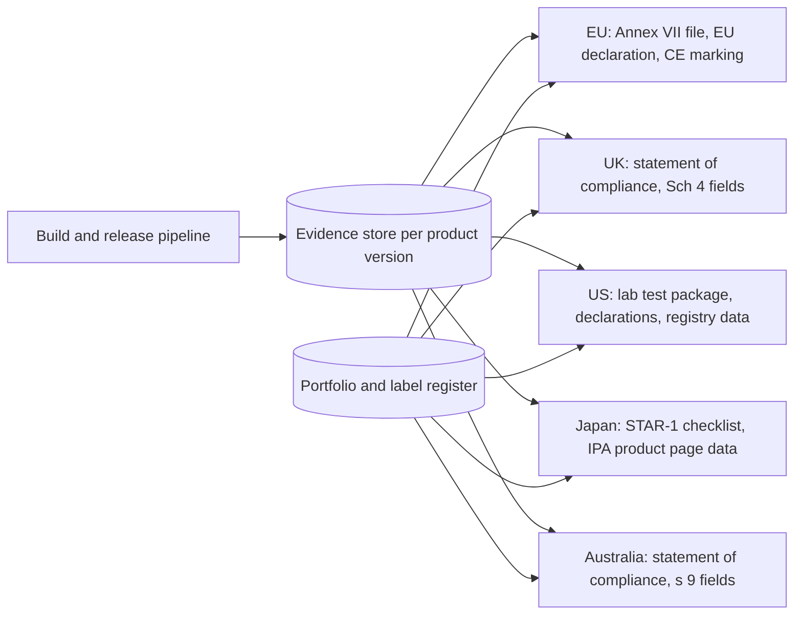

# One product security control set for the EU, UK, US and Japan

**Executive answer.** A global manufacturer can meet the EU Cyber Resilience Act (CRA), the UK PSTI regime, the US Cyber Trust Mark and Japan's JC-STAR with one set of 43 controls and one evidence store. The CRA already requires 41 of the 43 (39 strongly, 2 partly). Only two controls exist because of other regimes: national-security supply-chain screening for the US label, and the operation of security labels and public registries for the US and Japanese schemes. Six controls are required by all four regimes: scoping, default passwords, the published support period, the vulnerability disclosure policy, a declaration, and corrective action. Everything else the other regimes add is format, not engineering: the UK statement of compliance, support information beside the price, a password-length rule in Japan, and third-party lab testing for every US-labelled product. Two of the four are mandatory and live (UK since 29 Apr 2024; CRA reporting since 11 Sep 2026, full application 11 Dec 2027). The US label has no labelled products and no final technical requirements as at 28 Oct 2026. JC-STAR has labelled more than 1,500 product models. Recommendation: build once to the CRA, add the two non-CRA controls, and generate each regime's declaration from the same evidence.

## Forty-one of the 43 controls are already required by the CRA

The control set is built bottom-up from the CRA's Annex I Part I (13 product properties and the risk-based design duty), Annex I Part II (8 lifecycle duties), and Articles 13 and 14. Each control was then mapped clause by clause to the other regimes. Coverage uses four levels: strong (the regime requires essentially this control), partial (part of it, or disclosure only), weak (indirectly, or only at a higher voluntary label tier) and none.

Exhibit 1: how much of the control set each regime requires

| Regime | Legal form | Strong | Partial | Weak | None | Required (strong + partial) |
|---|---|---|---|---|---|---|
| EU CRA | Mandatory regulation | 39 | 2 | 1 | 1 | 41 of 43 |
| UK PSTI | Mandatory statute and regulations | 8 | 1 | 9 | 25 | 9 of 43 |
| US Cyber Trust Mark | Voluntary FCC label | 15 | 15 | 7 | 6 | 30 of 43 |
| Japan JC-STAR (rated at STAR-1) | Voluntary IPA label | 15 | 12 | 10 | 6 | 27 of 43 |
| Singapore CLS(IoT) (optional; Levels 1-2) | Voluntary CSA label | 6 | 17 | 10 | 10 | 23 of 43 |
| Australia smart-device standard (optional) | Mandatory statute and rules | 8 | 1 | 8 | 26 | 9 of 43 |

Source: controls.json in this module. Ratings are indicative judgements for programme design, not a statement of conformity.

The two controls the CRA does not require are UCS-05 (supply-chain eligibility screening) and UCS-36 (security label and public registry listing). The CRA's CE marking signals conformity but is not a security label, so UCS-36 is rated weak for the CRA.

## The regimes differ more in legal form than in technical content

Exhibit 2: regime comparison (facts as at 1 Nov 2026)

| Attribute | EU CRA | UK PSTI | US Cyber Trust Mark | Japan JC-STAR |
|---|---|---|---|---|
| Instrument | Regulation (EU) 2024/2847 | PSTI Act 2022 Part 1; SI 2023/1007, amended by SI 2025/211 and SI 2025/1267 | FCC Report and Order FCC 24-26, PS Docket 23-239 (89 FR 61242); criteria based on NIST IR 8425 | IPA scheme; STAR-1 criteria JST-CR-01-01-2024 |
| Scope | All products with digital elements with a data connection, B2B and B2C | UK consumer connectable products | Consumer wireless IoT products, including companion apps and the cloud they need | IoT products that communicate over IP |
| Notable exclusions | Products under certain sectoral law; non-commercial open source | Desktops, laptops, non-cellular tablets, EV charge points, medical devices, smart meters, certain vehicles (Sch 3) | FDA medical devices, motor vehicles, wired-only, enterprise and industrial products, Covered List equipment | Level-specific; STAR-2 to STAR-4 cover only some product types |
| Technical requirements | 13 properties plus risk-based design; 8 lifecycle duties | 3: passwords, how to report security issues, support period (Sch 1) | 10 IR 8425 capabilities; final FCC technical standards pending | 16 STAR-1 requirements (S1.1-01 to S1.1-16); STAR-3 adds 46 for communication equipment |
| Conformity route | Self-assessment by default; notified body for Class I unless a harmonised standard, common specification or EU certification scheme at "substantial" is applied in full (Art 32(2)), and for Class II unless an Art 27(9) scheme is used (Art 32(3)); FOSS may self-assess with a public technical file (Art 32(5)) | Self-declared; deemed compliance via ETSI EN 303 645 or ISO/IEC 29147 provisions, or a valid JC-STAR STAR-1 or CLS label | Accredited lab test, then certification by a Cybersecurity Label Administrator (ISO/IEC 17065) | STAR-1 and STAR-2 self-declaration; STAR-3 and STAR-4 by an IPA-approved evaluation body |
| Labelling and declaration | CE marking and EU declaration of conformity | No label; statement of compliance must accompany the product | FCC IoT Label (Cyber Trust Mark plus QR code to a public registry); declaration under penalty of perjury | Label with QR code to the IPA product page; valid 2 years, extendable |
| Authority reporting | Exploited vulnerabilities 24 h / 72 h / 14 days after a fix; severe incidents 24 h / 72 h / 1 month after the incident notification | None | None | None |
| Penalties | Up to EUR 15m or 2.5% of worldwide turnover, whichever is higher | Greater of GBP 10m or 4% of qualifying worldwide revenue; GBP 20,000 a day | Loss of authorisation; other FCC enforcement | Label withdrawal or revocation |
| Key dates | In force 10 Dec 2024; reporting 11 Sep 2026; full 11 Dec 2027 | In force 29 Apr 2024; vehicles excepted 25 Feb 2025 | Rules effective 29 Aug 2024; launched 7 Jan 2025; no labelled products at 28 Oct 2026 | Operating 25 Mar 2025; first labels May 2025 |

The optional regimes follow the same pattern. Australia's standard, in force for products manufactured on or after 4 Mar 2026, copies the UK's three requirements and statement of compliance. It excepts smartphones and tablets, which the UK covers, and requires only 5 years' retention of the statement (Rules s 10). Singapore's CLS(IoT) has four levels. Level 1 is treated as equivalent to the UK three. Level 2 adds the ETSI EN 303 645 mandatory provisions. Levels 3 and 4 add lab binary analysis and black-box penetration testing.

## Two regimes are live, one label has stalled and one is scaling

The CRA's reporting duty has applied since 11 Sep 2026 to every in-scope product, including products already on the market. The rest applies from 11 Dec 2027. The UK regime has applied since 29 Apr 2024.

The US Cyber Trust Mark is behind its original plan. The FCC adopted the rules on 14 Mar 2024, and they took effect on 29 Aug 2024, with some sections awaiting Paperwork Reduction Act approval. The White House launched the programme on 7 Jan 2025, and the FCC has conditionally approved 11 label administrators. UL Solutions, the first Lead Administrator, withdrew with effect from 19 Dec 2025. The FCC reopened applications for administrators from 27 Jan to 24 Feb 2026 (DA 26-75) and selected the ioXt Alliance as Lead Administrator on 13 Apr 2026. On 28 Oct 2026 the commissioner overseeing the programme said she hoped labelled products would reach shoppers "within the next year". The FCC still has to seek comment on technical requirements and test procedures, and opened a separate proceeding on label design, renewal and post-market checks. No administrator may certify products until it holds ISO/IEC 17065 accreditation for the final scope.

JC-STAR is scaling. IPA opened STAR-1 applications on 25 Mar 2025. By 31 Mar 2026, 80 companies had filed 199 applications covering more than 1,500 product models. IPA published STAR-3 requirements for communication equipment in 2026 (announced 6 Feb 2026; document v1.0 dated June 2026). STAR-2 intake for network cameras and communication equipment was planned from Jan 2026; this module could not confirm that it opened.

Recognition is joining the Asian and UK schemes but not the CRA. From 1 Jan 2026, the UK treats its three requirements as equivalent to JC-STAR STAR-1 (memorandum signed 5 Nov 2025) and to CLS Level 1 (memorandum of 22 Oct 2025). SI 2025/1267 gives these labels deemed compliance with both the security requirements and the statement of compliance. Its commencement date was not confirmed. Japan and Singapore recognise STAR-1 and CLS Level 1 from 1 Jun 2026. No scheme gives presumption of conformity with the CRA, which comes only from harmonised standards, common specifications or EU certification schemes.

## The unified control set has 43 controls in ten groups

Exhibit 3: the control set and which of the four core regimes require each control (strong or partial)

| Group | Controls | Required by all four | Required by the CRA only (of the four) |
|---|---|---|---|
| Governance | UCS-01 SDL and accountability; 02 risk assessment; 03 scope and classification register; 04 component due diligence; 05 supply-chain eligibility screening | 03 | 01, 02, 04 |
| Secure design | 06 secure default and reset; 07 no universal default passwords; 08 attack-surface minimisation; 09 exploit mitigation; 10 no known exploitable vulnerabilities at release | 07 | 09 |
| Identity and access | 11 authentication on every interface; 12 credential management and brute-force resistance; 13 product identification and asset inventory | none | none |
| Data protection | 14 confidentiality; 15 integrity and secure boot; 16 data minimisation; 17 secure deletion and transfer | none | 16 |
| Updates and support | 18 secure update mechanism; 19 automatic updates by default; 20 timely free security updates; 21 defined support period; 22 update archive | 21 | 22 |
| Vulnerability management | 23 SBOM; 24 vulnerability disclosure policy; 25 PSIRT triage and remediation; 26 security testing; 27 public advisories; 28 upstream reporting | 24 | 23, 28 |
| Logging and resilience | 29 security logging; 30 availability and resilience; 31 limit impact on other networks | none | 31 |
| Reporting | 32 report exploited vulnerabilities and severe incidents; 33 inform users | none | 32 |
| Transparency and labelling | 34 user security information; 35 support end date at point of sale; 36 security label and registry; 37 manufacturer identification and contact | none | none |
| Conformity and documentation | 38 technical documentation and evidence store; 39 declaration or statement; 40 conformity route and third-party testing; 41 record retention; 42 change control and label renewal; 43 corrective action | 39, 43 | none |

Each control carries one evidence artefact designed to prove it in every regime. Examples: a build-generated SBOM per release (UCS-23), a release-gate scan correlated with the CISA KEV catalogue (UCS-10), and a public support-period page with version history (UCS-21). The interactive page shows, for any choice of markets, which regime sets the strictest test for each control.

## Six places where another regime is stricter than the CRA or adds a unique duty

The CRA is the superset for engineering. It is not the superset for wording, placement or administration. Exhibit 4 lists every point where a team building only to the CRA would fail another regime.

Exhibit 4: duties beyond the CRA

| Control | Regime | What it adds | Design response |
|---|---|---|---|
| UCS-07 default passwords | UK PSTI; JC-STAR | PSTI bans passwords based on incremental counters, public information or unencrypted identifiers (Sch 1 para 1(3)). STAR-1 requires unique passwords of at least 6 characters, or a forced change at first use to at least 8 (S1.1-02). The CRA states neither test. | Adopt both tests as the global rule. |
| UCS-24 disclosure policy | UK PSTI; Australia | Publish when reporters will get acknowledgement and status updates, in English, free, with no personal data required (Sch 1 para 2). | One global policy page meeting the PSTI wording and the CRA's human-channel rule (Art 13(17)). |
| UCS-35 support end date at point of sale | UK PSTI; Australia | The CRA asks for month and year at purchase (Art 13(19)). PSTI requires the information alongside, or as prominent as, the price on the manufacturer's own website (Sch 1 para 3(5)). | Show the end date beside the price in every owned channel. |
| UCS-39 declarations | All | Six formats: EU declaration with CE marking; UK statement of compliance with seven content items (Sch 4); US declaration under penalty of perjury; JC-STAR checklist; CLS declaration; Australian statement (Rules s 9). | Generate all from one evidence store (next section). |
| UCS-05 supply-chain eligibility | US Cyber Trust Mark | Declare that the applicant, its affiliates and the product's components are not on the FCC Covered List, the Entity List, the DoD Chinese Military Companies list or federal debarment lists (FCC 24-26 para 27). | Screen in procurement, not at label time. A product can conform to the CRA and still be ineligible for the US label. |
| UCS-36, UCS-40, UCS-42 labels and testing | US Cyber Trust Mark; JC-STAR; CLS | Label and QR registry entries that must stay accurate; accredited lab testing for every US-labelled product; 2-year JC-STAR validity with renewal. | A label operations function with an expiry calendar and registry data owned by product management. |

Three tensions need explicit decisions:

- **Support length versus label cycles.** The CRA sets a support period of at least 5 years unless the product is expected to be in use for less (Art 13(8)). JC-STAR labels expire after 2 years. A product supported for 7 years needs at least three JC-STAR renewals. Budget for renewal, not a one-off application.
- **One global SKU versus US eligibility.** The US national-security declarations depend on component origin, which the CRA does not test. Where a component supplier is listed, the choice is a US-specific bill of materials or no US label.
- **Northern Ireland.** If the CRA is added to Annex 2 of the Windsor Framework, NI supplies move from PSTI to the CRA under SI 2023/1007 Sch 3 para 1 (knowledge base, Interplay section). The control set already covers both, so only the declaration routing changes.

Among the four core regimes, 10 controls are required by the CRA alone. The heaviest are 24-hour authority reporting (UCS-32), the SBOM (UCS-23), the 10-year update archive (UCS-22) and the 5-year minimum support period (UCS-21).

## Run one evidence store and generate a declaration per regime

The design principle is that evidence is produced once, by the build and release pipeline, and each regime's declaration is a view over it. Module E1 specifies the per-version evidence bundle; this module adds the regime packagers.

Exhibit 5: evidence that serves several regimes

| Artefact (control) | Serves |
|---|---|
| Credential-provisioning design and production-sample test (UCS-07) | CRA Annex I (2)(b) and (d); PSTI Sch 1 para 1; IR 8425 Interface Access Control; STAR-1 S1.1-02; CLS Level 1; Australia Sch 1 cl 2 |
| Public CVD policy, security.txt and PSIRT procedure (UCS-24, UCS-25) | CRA Annex I Part II (5)-(6); PSTI Sch 1 para 2; IR 8425 Information and Query Reception; STAR-1 S1.1-05; CLS Level 1; Australia Sch 1 cl 3 |
| Support-period rationale and public page (UCS-21) | CRA Art 13(8); PSTI Sch 1 para 3; US registry support end date; STAR-1 S1.1-16; Australia Sch 1 cl 4; every statement of compliance |
| Update design note with signature and rollback tests (UCS-18) | CRA Annex I (2)(c) and Part II (7); IR 8425 Software Update; STAR-1 S1.1-06 and S1.1-08 |
| Release-gate vulnerability scan (UCS-10) | CRA Annex I (2)(a); STAR-1 S1.1-13; US declaration on critical vulnerabilities |
| Interface inventory and port scan (UCS-08) | CRA Annex I (2)(j); STAR-1 S1.1-13; IR 8425 Interface Access Control |
| Portfolio applicability register (UCS-03) | Every regime's scope test, the CRA class and route, and the choice of label |

Three operating rules keep this working:

1. **One master record per product version.** Declarations reference the evidence store by version. They never hold copies that drift.
2. **The strictest wording wins globally.** Where regimes word the same duty differently (passwords, disclosure policy, support period), write the public text once to the strictest test and reuse it in every market.
3. **Labels are opt-in per market and product.** A label is a commercial decision taken against the portfolio register. Its renewal date sits in the same calendar as support-period end dates.

## What this means for Aldermoor's portfolio

Aldermoor Platforms is the fictional reference client. Exhibit 6 gives preliminary scope calls; the detailed CRA classification is in module E3.

Exhibit 6: regime applicability by product line (preliminary)

| Product line | EU CRA | UK PSTI | US Cyber Trust Mark | JC-STAR |
|---|---|---|---|---|
| Arc phones (Halo OS) | In scope | In scope (smartphones are not excepted) | Eligibility to confirm with an administrator | Eligibility to confirm with IPA |
| Tablets | In scope | Cellular in scope; Wi-Fi-only excepted | Eligibility to confirm | Eligibility to confirm |
| Lumen OS laptops | In scope | Excepted | Not targeted | Not targeted |
| Hearth smart home | In scope; cameras, video doorbells and locks (Class I item 17), assistant speakers and displays (item 16) and routers (item 12) are Class I; thermostats and smoke alarms are default (E3) | In scope | Priority candidate | Priority candidate; STAR-3 for cameras and routers sold to government buyers |
| Pulse wearables | In scope; health-monitoring wearables Class I | In scope | Priority candidate (fitness trackers are named) | Candidate |
| Earbuds | In scope | In scope if connectable | Candidate | To confirm |
| Keystone security keys | In scope | To confirm (NFC and Bluetooth variants) | Not targeted | Not targeted |
| Browser, apps, SDKs | In scope; browsers Class I | Not as standalone software | Companion apps assessed with the device | Not targeted |

For Aldermoor the CRA programme already funds 41 of 43 controls. Our estimate is that the marginal work for the UK, US and Japan is under 10% of total programme effort. It sits in four places: the declaration generator, a label operations team, US supply-chain screening, and point-of-sale changes. This estimate assumes the E1 evidence pipeline exists. It excludes US lab-testing fees, which cannot be estimated until the FCC finalises test procedures.

## Decisions for the executive team

1. **Adopt the 43-control set as the single product-security standard across all product lines.** Owner: CISO, with VP Engineering. Timing: approve by end Q4 2026 so the CRA build (deadline 11 Dec 2027) is the global build.
2. **Make the strictest public wording global.** Apply the PSTI and STAR-1 password tests, the PSTI disclosure-policy wording and support dates beside the price everywhere. Owner: General Counsel with product management. Timing: Q1 2027.
3. **Fund the declaration generator on top of the E1 evidence store.** It should produce the EU declaration, UK and Australian statements, the JC-STAR checklist and US registry data. Owner: VP Engineering. Timing: first release Q2 2027.
4. **Choose a label portfolio.** Apply for JC-STAR STAR-1 on Hearth and Pulse now. This also gives UK deemed compliance once SI 2025/1267 is in force, and Singapore recognition. Prepare for, but do not file, the US Cyber Trust Mark until the FCC publishes final test procedures. Owner: Chief Product Officer. Timing: JC-STAR in H1 2027; review the US decision when the FCC rules on technical requirements.
5. **Move US eligibility screening into procurement.** Screen component suppliers against the four US lists at sourcing, and flag any SKU that would need a US-specific bill of materials. Owner: Chief Procurement Officer with trade compliance. Timing: Q1 2027.

## Risks and open questions

- **US programme uncertainty.** Technical standards, test procedures, label design and renewal rules are all still open, and the programme has slipped once. Mappings to the US label rest on NIST IR 8425 capabilities and may tighten.
- **Unconfirmed commencement of SI 2025/1267.** Until its in-force date is confirmed, treat JC-STAR and CLS labels as supporting evidence for PSTI, not deemed compliance.
- **JC-STAR scope for phones and tablets.** This module did not find an IPA statement on whether general-purpose devices are eligible. Confirm with IPA before planning labels for them.
- **Label renewal load.** Two-year JC-STAR validity across many models creates recurring work, which grows with SKU count.
- **Divergence after 2027.** The UK Budget of 28 Oct 2026 commits to a 2027 consultation on insecure technology at source (knowledge base, Interplay section). Australia, Japan and the US may add requirements. The control set will need an annual regulatory refresh.
- **Not verified for this module.** The full US registry data list and 47 CFR Part 8 section headings (eCFR could not be reached); the IR 8425 deletion sub-outcome; JC-STAR STAR-2 intake; Australian civil penalty amounts; CLS label validity.

## Sources

EU CRA (knowledge base):
- Annex I Part I: reports/sections/07-annex1-part1.md
- Annex I Part II and Art 13: reports/sections/08-annex1-part2.md
- Art 14 reporting: reports/sections/09-reporting.md
- Conformity routes and declarations: reports/sections/10-conformity.md
- UK interplay and Northern Ireland: reports/sections/13-interplay.md
- Penalties: reports/sections/14-enforcement.md
- Verification of Art 71 dates, Art 64 tiers, Art 13 paragraphs, Art 32 routes and PSTI s.38: reports/verification.md, items 1, 3, 8, 9 and 25
- CRA crosswalk: pack/data/crosswalk.json

UK PSTI:
- [PSTI Act 2022, contents](https://www.legislation.gov.uk/ukpga/2022/46/contents/enacted)
- [SI 2023/1007 as made](https://www.legislation.gov.uk/uksi/2023/1007/made): regs 1, 6-9; Schs 2-4
- [SI 2023/1007 Schedule 1](https://legislation.gov.uk/uksi/2023/1007/schedule/1)
- [SI 2025/211](https://www.legislation.gov.uk/uksi/2025/211/made): made 24 Feb 2025, in force 25 Feb 2025
- [SI 2025/1267, contents](https://www.legislation.gov.uk/uksi/2025/1267/contents/made)
- [Lords Grand Committee debate on SI 2025/1267, 19 Nov 2025 (ministerial extracts)](https://www.parallelparliament.co.uk/debate/2025-11-19/lords/grand-committee/product-security-and-telecommunications-infrastructure-security-requirements-for-relevant-connectable-products-amendment-no-2-regulations-2025/ministerial-extracts)
- [DSIT guidance, Regulations: consumer connectable product security](https://www.gov.uk/guidance/regulations-consumer-connectable-product-security)

US Cyber Trust Mark:
- [FCC 24-26, Federal Register, 89 FR 61242, 30 Jul 2024](https://www.govinfo.gov/content/pkg/FR-2024-07-30/html/2024-14148.htm): paras 27-28, 36, 48, 55, 78
- [FCC Public Notice DA 26-75, 26 Jan 2026](https://docs.fcc.gov/public/attachments/DA-26-75A1.pdf)
- [NIST IR 8425, Sep 2022](https://nvlpubs.nist.gov/nistpubs/ir/2022/NIST.IR.8425.pdf): s.2.2.1 and s.2.2.2
- [NIST CSRC page for IR 8425](https://csrc.nist.gov/pubs/ir/8425/final)
- [The Hacker News, launch, 8 Jan 2025](https://thehackernews.com/2025/01/fcc-launches-cyber-trust-mark-for-iot.html)
- [Cooley, 22 Mar 2024](https://www.cooley.com/news/insight/2024/2024-03-25-fcc-issues-framework-for-consumer-internet-of-things-cybersecurity-program)
- [Cybersecurity Dive, 14 Apr 2026](https://www.cybersecuritydive.com/news/fcc-cyber-trust-mark-new-lead-administrator/817437/)
- [ExecutiveGov, 15 Apr 2026](https://www.executivegov.com/articles/fcc-ioxt-lead-cyber-trust-mark-program)
- [Nextgov, 28 Oct 2026](https://www.nextgov.com/cybersecurity/2026/10/fcc-commissioner-hopes-cyber-trust-mark-products-reach-shoppers-within-year/416878/)

Japan JC-STAR:
- [IPA press release, 25 Mar 2025](https://www.ipa.go.jp/pressrelease/2024/press20250325.html)
- [STAR-1 criteria JST-CR-01-01-2024](https://www.ipa.go.jp/security/jc-star/tekigou-kizyun-guide/label1/begoj90000004zgc-att/star1_requirements.pdf)
- [STAR-3 requirements for communication equipment, JST-SR-03-01-2026](https://www.ipa.go.jp/security/jc-star/tekigou-kizyun-guide/label3/begoj90000004zyz-att/JST-SR-03-01-2026_NWDevice_SecurityRequirements_v1.0.pdf)
- [ScanNetSecurity, 17 Feb 2026](https://scan.netsecurity.ne.jp/article/2026/02/17/54637.html)
- [EnterpriseZine, 26 Mar 2025 (STAR-2 plans)](https://enterprisezine.jp/news/detail/21710)
- [IPA presentation via Open Charge Alliance, Jun 2026 (statistics to 31 Mar 2026)](https://openchargealliance.org/wp-content/uploads/2026/04/Introduction-to-Japan-Cybersecurity-Labeling-scheme-JC-STAR-for-IoT-products.pdf)
- [IPA list of JC-STAR products with PSTI certification](https://www.ipa.go.jp/en/security/jc-star/list/PSTI/index.html)
- [METI, Japan-UK memorandum, 6 Nov 2025](https://www.meti.go.jp/english/press/2025/1106_002.html)
- [METI, Japan-Singapore memorandum, 18 Mar 2026](https://www.meti.go.jp/english/press/2026/0318_002.html)

Singapore CLS(IoT) (optional):
- [CSA CLS(IoT) page](https://www.csa.gov.sg/our-programmes/certification-and-labelling-schemes/cybersecurity-labelling-scheme/about/)
- [CCC SP-151-2 Scheme Specifications v1.4, Apr 2025](https://isomer-user-content.by.gov.sg/36/186ab950-9b72-4856-9d62-172dae018777/CCC%20SP-151-2%20CLS%28IoT%29%20Scheme%20Specifications%20v1.4.pdf)
- [CSA, UK memorandum, 22 Oct 2025](https://www.csa.gov.sg/news-events/press-releases/singapore-signs-mou-with-the-united-kingdom-on-cooperation-on-mutual-recognition-of-consumer-internet-of-things-cyber-security-regimes/)

Australia (optional):
- [Cyber Security (Security Standards for Smart Devices) Rules 2025, F2025L00276](https://legislation.gov.au/F2025L00276/asmade/2025-03-04/text/original/epub/OEBPS/document_1/document_1.html): ss 2, 8-10; Sch 1 cl 2-4
- [Cyber Security Act 2024, as made](https://www.legislation.gov.au/C2024A00098/asmade/text): Part 2, ss 12-24
- [Home Affairs, security standards for smart devices](https://www.homeaffairs.gov.au/cyber-security-subsite/Pages/security-standards-for-smart-devices.aspx)
