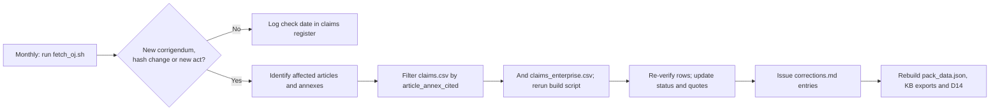

# Appendix A to E6: sources, method and maintenance

This appendix holds the method detail behind the main paper ([paper.md](paper.md)): how the authentic texts were obtained, how claims were graded and checked, and how the registers are kept current.

## The authentic text was obtained from the Publications Office, not from EUR-Lex pages or mirrors

The knowledge base had relied on mirror sites because EUR-Lex served only recitals to automated tools (reports/verification.md). EUR-Lex HTML and PDF were refused by the fetch tool, its ELI pages returned a JavaScript shell, and the Council's PE-CONS 100/23 could be read only to recital (102). The Publications Office content-negotiation endpoint worked: CELEX 32024R2847 in English resolved to the 81-page PDF/A-2a edition of 14 Nov 2024 and the XHTML of the same OJ act. Every quotation was matched by script against both, and they agree. The PDF carries no embedded signature, so its authenticity rests on its origin in the Publications Office repository.

**Exhibit A1. OJ sources attempted and used**

| Route | Result | Used for |
|---|---|---|
| EUR-Lex HTML and PDF; data.europa.eu ELI | Refused by the fetch tool's permission system | Nothing |
| EUR-Lex ELI pages (whole act and per article) | JavaScript shell, about 3,600 characters, no text | Nothing |
| Council PE-CONS 100/23 (25 Sep 2024) | Readable to recital (102) only | Nothing |
| Publications Office cellar, CELEX 32024R2847, English, PDF/A-2a and XHTML | Full act, 71 articles and 8 annexes; sha256 of PDF e3ecaabd…, of XHTML fe0cca4a… | Every CRA claim |
| Cellar, corrigenda 32024R2847R(01)-R(08) | 8 corrigenda found; 3 change the English text | Art 64(10), Art 67 and title |
| Cellar, German and French OJ versions | Full text | Annex V point 3 cross-language check |
| Cellar, Implementing Reg. (EU) 2025/2392, Delegated Regs. (EU) 2026/339 and 2026/881, Directive (EU) 2024/2853 | Full texts | Facts F09, F14 (2026/881 basis), F15, F18 |
| reports/verification.md (30 Oct 2026) | Not re-checked | National acts, Digital Omnibus, EUCC register (outside the OJ) |

No mirror text was used for any status in the register. Where a claim depends on something outside the CRA text, the register says so and marks it "Could not verify".

## Guidance and related sources for the Enterprise register

The knowledge base had read the guidance through the ORC WG and StreamLex mirrors. The Enterprise extension obtained the Commission's own documents directly from its document service.

**Exhibit A2. Guidance and related sources obtained on 1 Nov 2026**

| Document | Origin | What was obtained | Used for |
|---|---|---|---|
| C(2026) 5252 final, Annex: Commission guidance on the application of the CRA, EN | Commission document 131456 | 84-page PDF created 27 Jul 2026; points 1-257 and Examples 1-67; sha256 fe209c25… | Every guidance status |
| C(2026) 5252 final, Communication to the Commission | Commission document 131455 | 2 pages: content approved; guidance applies "only from that moment" it is formally adopted in all languages | Status of the guidance |
| Commission news page of 27 Jul 2026 | digital-strategy.ec.europa.eu | Lists the same two downloads; no adoption notice at 1 Nov 2026 | Adoption status |
| Commission FAQ on the CRA, v1.4 (4 Sep 2026) | Commission documents 123307 (Markdown) and 122331 (PDF, 66 pages) | Full text; section numbers from its contents list | FAQ citations |
| ENISA SRP FAQ, updated 15 Oct 2026 | enisa.europa.eu | 35 questions | SRP facts in E2 and G |
| NCSC Ireland CRA page (11 Sep 2026) and National CRA Guidelines v1 (31 Aug 2026) | ncsc.gov.ie | Page and 9-page PDF | Irish wording; NCSC remit |
| Implementing Regulation (EU) 2025/2392; Directive (EU) 2024/2853 | Publications Office cellar | EN XHTML | Secure-element and liability claims |
| ENISA SRP glossary | Not obtained | | One row "Could not verify" |

`guidance_index.py` splits the guidance into its numbered points and Examples, with page and section. `build_claims_enterprise.py` then checks each quotation inside the point or Example the paper cites, not anywhere in the document, and refuses to write the register if any quotation fails. All files, origins and hashes are in `source/guidance/MANIFEST.csv`; `fetch_oj.sh` re-fetches the four Commission documents and prints their hashes.

## Register scope and status definitions

The base register (`claims.csv`) covers every article, annex and recital reference used in pack facts F01-F20, the fine tiers, the Compliance Templates Kit (D14), and knowledge-base sections 03, 07, 08, 09 and 10. It also covers related claims in sections 05, 13, 14 and 16 and two implementation guides. Each row records the claim as the pack states it, where it is used, the provision cited, a short exact quotation from the OJ, the source and a status. `claims_enterprise.csv` uses the same columns and statuses for the six Enterprise papers and the programme case. It records each claim as the paper stated it on 1 Nov 2026, before the corrections; the papers' current text is in the module folders.

- **Verified**: the cited provision says what the pack says; quotations are exact.
- **Verified with wording difference**: right provision and broadly right substance, but a quotation, paraphrase or scope is imprecise enough to fix.
- **Wrong article/point**: the content exists, but under a different article, point or recital.
- **Not found**: the cited provision does not contain what the pack asserts, or contradicts it.
- **Could not verify**: the claim is not a matter of CRA text, or the needed source was not obtained.

The Enterprise register holds 180 claims: 65 rest on the guidance (100 quotations from 69 distinct points and Examples), 99 on the OJ text, 9 on the Commission FAQ, 9 on the ENISA FAQ, 2 on NCSC material, 3 on Implementing Regulation 2025/2392 and 4 on the Product Liability Directive (some rows cite several). The 9 rows marked "Could not verify" rest on instruments or facts outside the E6 source set: UK, US, Japanese, Australian and Singapore rules in E5, the Digital Omnibus in E2, standards and notified-body status in E3 and the programme case, and the SRP glossary in G.

## Keeping the register true needs a monthly corrigenda check and an event-driven re-verification

The CRA text will keep moving through corrigenda, delegated acts that amend annexes (Art 7(3) for Annex III, Art 8(2) for Annex IV, Arts 28(5) and 31(5) for Annexes V and VII) and implementing acts that fill gaps the pack currently describes as empty. The maintenance process is built so that any change triggers a re-check of the affected rows, not a full re-read.

**Exhibit A3. Re-verification triggers**

| Trigger (watch: `fetch_oj.sh`, OJ L series) | Affected claim rows | Owner role |
|---|---|---|
| New corrigendum R(09) or later, or a change in the OJ text hash | Rows citing the corrected provision (all rows on a hash change) | Knowledge-base maintainer |
| Art 27(9) delegated act on EUCC (Commission plans Q4 2026) | F07, F19, K01, K03, T07 | Regulatory counsel |
| Art 14(10) implementing act on notification format | R04-R12; D14 Template 8 | PSIRT lead |
| Art 13(24) SBOM implementing act | B26, F13; D14 Templates 4 and 9 | Product security lead |
| Delegated acts under Art 7(3), 8(1), 8(2) or 2(5) (annex lists, certification, scope) | F09, K04, S15, T03-T05, T08 | Regulatory counsel |
| Delegated or implementing acts under Arts 13(8), 28(5), 30(6), 31(5) or 33(5) | F11a, B15, K15, K18-K20, K27, T19; D14 Templates 3-5 | Compliance lead |
| Formal adoption of guidance C(2026) 5252, or a new FAQ version (hash change in `fetch_oj.sh`) | The 65 guidance rows and 9 FAQ rows in `claims_enterprise.csv`: rebuild the index with `guidance_index.py`, rerun `build_claims_enterprise.py` and `check_positions.py` | Regulatory counsel |
| Reply from NCSC, designation of an Irish market surveillance authority, or a counsel opinion | `legal-positions/` questions A-H and the claims they support | General Counsel |

Three rules keep the register honest. The source column names the exact OJ edition or corrigendum, and mirror text is never recorded as OJ text. Any quotation added to the pack must pass the script check against `source/oj_L_2024_2847_EN.txt`, and any guidance quotation must sit inside the point or Example it cites. After a corrigendum, the corrigendum reference must appear wherever the pack states the corrected rule.

## Sources

As listed in the main paper's Sources section; local copies and hashes in `source/` and `source/guidance/MANIFEST.csv`.
