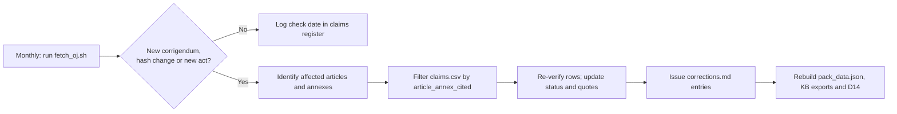

# The pack's CRA legal claims checked against the Official Journal text

**Executive answer.** We obtained the Official Journal text of Regulation (EU) 2024/2847 (OJ L, 2024/2847, 20.11.2024) directly from the EU Publications Office repository, in both the PDF/A edition and the XHTML version, and checked 184 legal claims the pack relies on against it. 148 claims (80%) match the text exactly. 26 (14%) cite the right provision but quote or paraphrase it imprecisely. 7 (4%) are wrong: 2 cite the wrong point or recital and 5 state something the cited text does not say. 3 (2%) could not be verified because they are not matters of CRA text. No deadline, fine amount, application date, product-category count or Annex point number in the pack is wrong. Five corrections change what a client would do: a product covered by several EU acts needs one single declaration of conformity, not a "dossier" (Art 28(3)); technical documentation is not "any language" when a notified body is involved (Art 31(4)); the fines exemption for micro and small enterprises and for open-source stewards works only because of a corrigendum of 2 Jul 2025, which the pack should cite; Art 14(8) contains no "without undue delay" for user notices; and Art 32(2) opens Module A for Class I products through certification schemes "as referred to in Article 27", not only through an Art 27(9) act. All five open questions the knowledge base flagged are now resolved. Annex V point 3 really does say "provider".

## The authentic text was obtained from the Publications Office, not from EUR-Lex pages or mirrors

The knowledge base had to rely on mirror sites because EUR-Lex served only recitals to automated tools (reports/verification.md). This module tried every official route and recorded the result (Exhibit 1). The EUR-Lex pages failed: the HTML and PDF URLs were refused by the fetch tool's permission system, and the ELI pages returned a 3,600-character JavaScript shell with no text. The Council's final adopted text, PE-CONS 100/23 of 25 Sep 2024, could be read only up to recital (102) before the tool's limit.

The Publications Office content-negotiation endpoint worked. A request for CELEX 32024R2847 in English redirected to the OJ manifestations held in the cellar. These were the 81-page PDF/A-2a edition produced by the Publications Office on 14 Nov 2024 and the XHTML version of the same OJ act (file L_202402847EN.000101.fmx.xml). Every quotation in the claims register was matched by script against both versions, and they agree. The PDF copy carries no embedded electronic signature, so its authenticity rests on its origin in the Publications Office repository, not on signature validation.

**Exhibit 1. Sources attempted and used**

| Route | Result | Used for |
|---|---|---|
| EUR-Lex HTML and PDF; data.europa.eu ELI | Refused by the fetch tool's permission system | Nothing |
| EUR-Lex ELI pages (whole act and per article) | JavaScript shell, about 3,600 characters, no text | Nothing |
| Council PE-CONS 100/23 (25 Sep 2024) | Readable to recital (102) only | Nothing |
| Publications Office cellar, CELEX 32024R2847, English, PDF/A-2a and XHTML | Full act, 71 articles and 8 annexes; sha256 of PDF e3ecaabd…, of XHTML fe0cca4a… | Every CRA claim |
| Cellar, corrigenda 32024R2847R(01)-R(08) | 8 corrigenda found; 3 change the English text | Art 64(10), Art 67 and title |
| Cellar, German and French OJ versions | Full text | Annex V point 3 cross-language check |
| Cellar, Implementing Reg. (EU) 2025/2392, Delegated Regs. (EU) 2026/339 and 2026/881, Directive (EU) 2024/2853 | Full texts | Facts F09, F14 (2026/881 basis), F15, F18 |
| reports/verification.md (30 Oct 2026) | Not re-checked | National acts, Digital Omnibus, EUCC register (outside the OJ) |

No mirror text was used for any status in the register. Where a claim depends on something outside the CRA text, the register says so and marks it "Could not verify".

## Four in five claims are exact, and none of the numbers is wrong

The register (`claims.csv`) covers every article, annex and recital reference used in pack facts F01-F20, the fine tiers, the Compliance Templates Kit (D14), and knowledge-base sections 03, 07, 08, 09 and 10. It also covers related claims in sections 05, 13, 14 and 16 and two implementation guides. Each row records the claim as the pack states it, where it is used, the provision cited, a short exact quotation from the OJ, the source and a status.

Status definitions:

- **Verified**: the cited provision says what the pack says; quotations are exact.
- **Verified with wording difference**: right provision and broadly right substance, but a quotation, paraphrase or scope is imprecise enough to fix.
- **Wrong article/point**: the content exists, but under a different article, point or recital.
- **Not found**: the cited provision does not contain what the pack asserts, or contradicts it.
- **Could not verify**: the claim is not a matter of CRA text, or the needed source was not obtained.

**Exhibit 2. Claims by source and status**

| Pack source | Claims | Verified | Wording difference | Wrong article/point | Not found | Could not verify |
|---|---|---|---|---|---|---|
| pack_data.json facts F01-F20 and fine tiers | 27 | 18 | 7 | 0 | 0 | 2 |
| 03 Scope (Art 2, Art 3 definitions) | 16 | 15 | 1 | 0 | 0 | 0 |
| 07 Annex I Part I | 22 | 20 | 2 | 0 | 0 | 0 |
| 08 Annex I Part II and Art 13 | 32 | 30 | 2 | 0 | 0 | 0 |
| 09 Reporting (Art 14) | 20 | 16 | 4 | 0 | 0 | 0 |
| 10 Conformity (Arts 28-33, Annexes V-VIII) | 28 | 21 | 4 | 0 | 2 | 1 |
| Compliance Templates Kit (D14) | 31 | 21 | 6 | 2 | 2 | 0 |
| Other KB sections and guides | 8 | 7 | 0 | 0 | 1 | 0 |
| **Total** | **184** | **148 (80%)** | **26 (14%)** | **2 (1%)** | **5 (3%)** | **3 (2%)** |

The core numbers all hold. Art 14 runs on 24 hours, 72 hours and 14 days for actively exploited vulnerabilities, and on 24 hours, 72 hours and one month for severe incidents. Art 64 sets fines of EUR 15m or 2.5%, EUR 10m or 2%, and EUR 5m or 1%. Art 71 gives 11 Jun 2026, 11 Sep 2026 and 11 Dec 2027, and Art 69 gives 11 Jun 2028. Annex III lists 19 Class I and 4 Class II categories and Annex IV lists 3 critical ones, with the item wording as quoted. Annex II has points 1-9, Annex V points 1-8 and Annex VII points 1-8. All 13 quotations from Annex I Part I points (2)(a)-(m) and all 8 Part II points are exact. The Art 3 definitions used in the pack, points (1), (2), (4)-(6), (8)-(10), (13), (20)-(24), (30), (42) and (48), are accurately paraphrased.

## Seven claims are wrong and five corrections change client behaviour

Exhibit 3 lists every claim that is not Verified, with the correction. The full old and new text for each file is in `corrections.md`, which lists 63 edits in three priorities.

**Exhibit 3. Non-verified claims and corrections**

| ID | Pack claim (abridged) | Cited | Status | Correction |
|---|---|---|---|---|
| T17 | Kit: "One declaration, or a dossier of declarations, may cover all applicable acts" | Art 28(3) | Not found | Art 28(3): "a single EU declaration of conformity shall be drawn up" for all acts, each identified with its OJ reference |
| K17 | KB: one declaration "may" cover several acts | Art 28(3) | Wording difference | It is mandatory ("shall") |
| K14 | Technical documentation "may be written in any language" | Art 31(4); 13(22) | Not found | For notified-body procedures the language must be an official language of the body's Member State or one it accepts (Art 31(4)) |
| K11, O08 | Module H pt 4 "unexpected visits" disputed between mirrors | Annex VIII Part IV pt 4 | Not found | Point 4 has only 4.1-4.3: site access, periodic audits, audit report. No unexpected-visit clause |
| T10 | Component inventory basis "recital 58" | Recital 58 | Wrong point | Component due diligence is recital 34 |
| T11 | Guides: recital 58 asks manufacturers to list high-risk supplier dependencies in the risk assessment | Recital 58 | Not found | Recital 58 asks the Commission and market surveillance authorities to weigh non-technical risk factors |
| T15 | Kit: "the regulation numbers [Annex VII] point 1 as one item"; 1(a)-(d) is kit lettering | Annex VII pt 1 | Wrong point | The OJ letters point 1 as (a)-(d); the kit rows already match it |
| R12 | Users informed "without undue delay" | Art 14(8) | Wording difference | No such words; the test is "in a timely manner", failing which CSIRTs may inform users |
| K01, F07 | Module A for Class I only with a cited standard, common specification or "Art 27(9) scheme" | Art 32(2) | Wording difference | Text: schemes "at assurance level at least 'substantial' as referred to in Article 27"; the Art 27(9) reading is interpretation |
| F04b, R10 | Severe-incident final report "1 month after the 72h notification" | Art 14(4)(c) | Wording difference | "within one month after the submission of the incident notification under point (b)"; runs from actual submission |
| R06, T24 | AEV final report: "severity and impact; actor; details and date" | Art 14(2)(c) | Wording difference | Point (i) is "a description of the vulnerability, including its severity and impact"; the date is an SRP field |
| F06, PD-T2 | Tier 2 "other obligations (e.g. Arts 18-23, 28, 30-33)" | Art 64(3) | Wording difference | Closed list: Arts 18-23, 28, 30(1)-(4), 31(1)-(4), 32(1)-(3), 33(5), 39, 41, 47, 49, 53; tier 3 is information "in reply to a request" |
| R17 | Stewards under Art 14(1), (3), (8) "to the extent involved in development" | Art 24(3) | Wording difference | Two limbs: 14(1) to the extent involved; 14(3) and (8) only for incidents on steward development infrastructure |
| F19 | Art 27(9) act would let EUCC replace third-party assessment | Art 27(9) | Wording difference | Only certificates at "substantial" or above, and only for the requirements covered |
| F20c | Integrating FOSS "never transfers" the manufacturer's duty | Art 13(5) | Wording difference | Text imposes due diligence; "never transfers" is inference |
| F15 | PLD "applies from 9 Dec 2026" | PLD Art 2(1) | Wording difference | Applies to products placed on the market or put into service after 9 Dec 2026 |
| B02 | Part II points are not risk-qualified | Annex I Part II | Wording difference | No risk chapeau, but point 2 is "in relation to the risks posed" and points 2 and 7 carry qualifiers |
| K16 | One declaration "per product" (Art 28) | Art 28; Annex VIII | Wording difference | Annex VIII: per product (Module A), per product model (Modules C and H) |
| K08 | Module B certificate "stating its own validity" | Annex VIII Part II pt 6 | Wording difference | Certificate states "the conditions (if any) for its validity" |
| T18 | Art 69(1) keeps RED certificates valid "for RED purposes only" | Art 69(1) | Wording difference | Text says valid until 11 Jun 2028 and is silent on purpose |
| T14 | Support-period evidence mapped to "reasonable user expectations" and "feasibility" | Art 13(8) | Wording difference | These are the OJ's optional factors (similar products; integrated components; operating environment) |
| T25 | Supplier clauses based on Annex VIII Module B pts 7-8 | Annex VIII Part II | Wording difference | Those points bind the manufacturer and its notified body; cite as support only |
| T12 | Module B "adequate risk analysis" | Annex VIII Part II pt 3.3 | Wording difference | "an adequate analysis and assessment of the risks" |
| B32, T21 | Art 13(18) "at minimum" | Annex II; Art 13(18) | Wording difference | "At minimum" is the Annex II chapeau |
| A16 | Recital 38 "all available security patches" | Recital 38 | Wording difference | "all security patches or updates available to address relevant security issues" |
| A21 | Recital 9 "network sockets or APIs" | Recital 9 | Wording difference | "network sockets, pipes, files, application programming interfaces or any other types of software interface" |
| S16 | One corrigendum (17 Oct 2025), content not reviewed | Corrigenda | Wording difference | Three English corrigenda (Exhibit 5) |
| K25 | Accreditation against ISO/IEC 17065 and 17021-1 | None | Could not verify | Not in the CRA text; label as accreditation practice |
| F16, F17 | National acts; Digital Omnibus | None | Could not verify | Outside the OJ text; rely on verification.md #20 and #24 |

Two claims are marked Verified but still need an edit, because they are true only as corrected by a corrigendum. As published, Art 64(10) exempted micro and small enterprises (point a) and open-source stewards (point b) from fines under "paragraphs 3 to 9". That left the Art 64(2) tier, which covers Art 14, untouched, and so made point (a) ineffective. The corrigendum in OJ L, 2025/90555 of 2 Jul 2025 reads "paragraphs 2 to 9". The pack's statements (PD-N1, F20b) are right today, but they should cite the corrigendum. Anyone reading the original OJ PDF will otherwise see the opposite.

## Every open question the knowledge base flagged is now closed

**Exhibit 4. Resolution of known open questions**

| Question | OJ text | Resolution |
|---|---|---|
| Annex V point 3: "provider" or "manufacturer"? | "A statement that the EU declaration of conformity is issued under the sole responsibility of the provider" | "Provider" is the authentic English text. German ("Anbieter") and French ("fournisseur") match, and no corrigendum changes it. Keep the word verbatim in declarations; adding the manufacturer's legal name after it is acceptable. Art 28(4) still makes the manufacturer responsible. Remove the "confirm the OJ wording" caveats in D14 Template 5. |
| Art 13 numbering for support-period display and end date | Art 13(8): six subparagraphs. Art 13(19): end date "including at least the month and the year … at the time of purchase"; second subparagraph: end-of-support notification "where technically feasible" | Setting the period and the five-year floor: Art 13(8), second and third subparagraphs. Information for the technical file: Art 13(8), fifth subparagraph, and Annex VII point 4. End date at purchase: Art 13(19), first subparagraph. In-product end-of-support notice: Art 13(19), second subparagraph. User information: Annex II point 7. Importers and distributors check 13(19) under Arts 19(2)(d) and 20(2)(b). The pack's numbering is correct. The factor order in Template 3 matches the OJ. |
| Annex VII point 1 lettering | "1. a general description … including: (a) its intended purpose; (b) versions of software …; (c) … photographs or illustrations …; (d) user information and instructions as set out in Annex II" | The OJ letters point 1 as (a)-(d). Template 4's rows are right; its note saying otherwise is wrong (T15). |
| Art 14 final-report clocks | 14(2)(c): "no later than 14 days after a corrective or mitigating measure is available". 14(4)(c): "within one month after the submission of the incident notification under point (b)" | Both clocks are as the pack states. The incident clock runs from actual submission of the 72-hour-stage notification, so an early filing starts it early. Both final reports, and the 72-hour notifications, are owed "unless the relevant information has already been provided". |
| Art 3(30) wording | "a change to the product with digital elements following its placing on the market, which affects the compliance … with the essential cybersecurity requirements set out in Part I of Annex I or which results in a modification to the intended purpose for which the product … has been assessed" | The pack's paraphrase is accurate. Template 10 can quote it (corrections.md, priority 3). |
| Module H unexpected visits (16-watchlist) | Annex VIII Part IV point 4 has 4.1-4.3 only | No unexpected-visit clause. Close the watchlist item. |
| Art 53 and source code (14-enforcement; 16-watchlist) | Art 53 is a single paragraph: access to "the data … required to assess the design, development, production and vulnerability handling … including related internal documentation" | No source-code wording. Source code appears only in the Art 63(1)(a) confidentiality duty. Whether design data includes source code remains interpretation. |
| Art 66 point number (13-interplay) | "In Annex I to Regulation (EU) 2019/1020, the following point is added: '72." | Point 72. Art 67 also adds point 72 to Annex I of Directive 2020/1828, as corrected on 17 Oct 2025. |

## Eight corrigenda exist, and three change the English text

Corrigenda apply only to the language versions they name. Five of the eight correct other languages and leave the English text unchanged. They matter to a multinational only where a local-language version is relied on, for example in a declaration translated under Art 28(2).

**Exhibit 5. Corrigenda to Regulation (EU) 2024/2847 found on 1 Nov 2026**

| No. | OJ reference and date | Language | What it corrects |
|---|---|---|---|
| R(01) | OJ L, 2024/90780, 5.12.2024 | English | Title: "(EU) No 2019/1020" becomes "(EU) 2019/1020" |
| R(02) | OJ L, 2025/90555, 2.7.2025 | English | Art 64(10): derogation from "paragraphs 2 to 9", not "3 to 9" |
| R(03) | OJ L, 2025/90768, 3.10.2025 | French | Annex I Part I (2)(c) grammar |
| R(04) | OJ L, 2025/90828, 17.10.2025 | English | Art 67: the CRA is point "72.", not "69.", of Annex I to Directive 2020/1828 |
| R(05) | OJ L, 2026/90148, 23.2.2026 | Slovak | Art 14(6) and other points |
| R(06) | OJ L, 2026/90243, 25.3.2026 | French | Annex III Class I point 6: "systèmes de gestion de réseau" |
| R(07) | OJ L, 2026/90667, 6.8.2026 | German | Art 7(2)(b) and other points |
| R(08) | OJ L, 2026/90847, 9.10.2026 | Slovenian | Art 3(17), Art 14(7) third subparagraph (c) and other points |

The knowledge base recorded only R(04), and its watchlist listed R(08) as unverified from a vendor feed. Both are now confirmed.

## Keeping the register true needs a monthly corrigenda check and an event-driven re-verification

The CRA text will keep moving through corrigenda, delegated acts that amend annexes (Art 7(3) for Annex III, Art 8(2) for Annex IV, Arts 28(5) and 31(5) for Annexes V and VII) and implementing acts that fill gaps the pack currently describes as empty. The maintenance process is built so that any change triggers a re-check of the affected rows, not a full re-read.

**Exhibit 6. Re-verification triggers**

| Trigger (watch: `fetch_oj.sh`, OJ L series) | Affected claim rows | Owner role |
|---|---|---|
| New corrigendum R(09) or later, or a change in the OJ text hash | Rows citing the corrected provision (all rows on a hash change) | Knowledge-base maintainer |
| Art 27(9) delegated act on EUCC (Commission plans Q4 2026) | F07, F19, K01, K03, T07 | Regulatory counsel |
| Art 14(10) implementing act on notification format | R04-R12; D14 Template 8 | PSIRT lead |
| Art 13(24) SBOM implementing act | B26, F13; D14 Templates 4 and 9 | Product security lead |
| Delegated acts under Art 7(3), 8(1), 8(2) or 2(5) (annex lists, certification, scope) | F09, K04, S15, T03-T05, T08 | Regulatory counsel |
| Delegated or implementing acts under Arts 13(8), 28(5), 30(6), 31(5) or 33(5) | F11a, B15, K15, K18-K20, K27, T19; D14 Templates 3-5 | Compliance lead |
| Formal adoption of guidance C(2026) 5252 (OJ C) | Rows citing guidance paragraphs | Regulatory counsel |

Three rules keep the register honest. The source column names the exact OJ edition or corrigendum, and mirror text is never recorded as OJ text. Any quotation added to the pack must pass the script check against `source/oj_L_2024_2847_EN.txt`. After a corrigendum, the corrigendum reference must appear wherever the pack states the corrected rule.

## Decisions for the executive team

1. **Approve the 16 Priority 1 corrections before any further client issue of the Templates Kit or knowledge base.** Owner: General Counsel (or the content's legal reviewer). Timing: by 8 Nov 2026.
2. **Adopt the Publications Office OJ text in this module as the single legal source of record, pinned by hash, and retire mirror sites as sources for quotations.** Owner: knowledge-base maintainer. Timing: immediately.
3. **Take a counsel position on the Art 32(2) certification-scheme limb.** The question is whether a full-scope EUCC certificate at "substantial", recognised under Art 27(8) before any Art 27(9) act, can open Module A for a Class I product. The pack currently assumes not. Owner: General Counsel with external counsel. Timing: by 30 Nov 2026, before the Art 27(9) act lands.
4. **Keep the statutory Annex V wording verbatim in every client declaration.** "Provider" stays, the manufacturer's legal name may follow it, and one single declaration covers all applicable EU acts. Owner: compliance lead. Timing: from the next declaration issued.
5. **Run the monthly corrigenda and implementing-act check in Exhibit 6 and record each run in the register.** Owner: regulatory watch lead. Timing: monthly from 1 Dec 2026.

## Risks and open questions

- **Art 32(2) interpretation.** The text refers to schemes "as referred to in Article 27" without naming paragraph 9. EUCC is a Common Criteria scheme and does not by itself cover the Annex I Part II process requirements, so applying it "in full" across Annex I is unlikely in practice. The question is still open, and guidance C(2026) 5252 point 149 was not re-read for this module.
- **Electronic signature.** The PDF obtained has no embedded signature. Its authenticity rests on retrieval from the Publications Office cellar. A signed copy should be obtained through EUR-Lex in a browser if a filing ever depends on it.
- **Coverage.** Sections 04, 05, 06, 11 to 16 and the guides were searched for known error strings, not read sentence by sentence. A repository-wide search for out-of-range article or paragraph numbers found none.
- **Non-English versions.** Statuses are for the English text. Translated declarations and user information should be checked against the corrected language version.
- **Facts outside the OJ.** National acts, the Digital Omnibus, ENISA platform facts, EUCC counts and notified-body status rest on reports/verification.md (30 Oct 2026).
- **Art 14(8) timing and Art 53 scope.** An internal user-notice target is good practice but not law. Whether Art 53 reaches source code is interpretation, with Art 63(1)(a) confidentiality as the counterweight.

## Sources

- Regulation (EU) 2024/2847, OJ L, 2024/2847, 20.11.2024, ELI [http://data.europa.eu/eli/reg/2024/2847/oj](http://data.europa.eu/eli/reg/2024/2847/oj); text obtained from the Publications Office cellar via [https://publications.europa.eu/resource/celex/32024R2847](https://publications.europa.eu/resource/celex/32024R2847) (English PDF/A-2a and XHTML; German and French XHTML), retrieved 1 Nov 2026. Local copies: `source/oj_L_202402847EN.pdf`, `source/oj_L_2024_2847_EN.txt`.
- Corrigenda: [OJ L, 2024/90780](http://data.europa.eu/eli/reg/2024/2847/corrigendum/2024-12-05/oj); [OJ L, 2025/90555](http://data.europa.eu/eli/reg/2024/2847/corrigendum/2025-07-02/oj); [OJ L, 2025/90768](http://data.europa.eu/eli/reg/2024/2847/corrigendum/2025-10-03/oj); [OJ L, 2025/90828](http://data.europa.eu/eli/reg/2024/2847/corrigendum/2025-10-17/oj); [OJ L, 2026/90243](http://data.europa.eu/eli/reg/2024/2847/corrigendum/2026-03-25/oj); OJ L, 2026/90148 (SK), 2026/90667 (DE) and 2026/90847 (SL), retrieved from the cellar as CELEX 32024R2847R(05), R(07) and R(08). Local copies of the English corrigenda: `source/corrigendum_R0*_EN_*.txt`.
- [Commission Implementing Regulation (EU) 2025/2392](https://eur-lex.europa.eu/eli/reg_impl/2025/2392/oj/eng), OJ L 1.12.2025; [Commission Delegated Regulation (EU) 2026/339](https://eur-lex.europa.eu/eli/reg_del/2026/339/oj/eng), OJ L 29.4.2026; [Commission Delegated Regulation (EU) 2026/881](https://eur-lex.europa.eu/eli/reg_del/2026/881/oj), OJ L 20.4.2026; [Directive (EU) 2024/2853](https://eur-lex.europa.eu/legal-content/EN/TXT/HTML/?uri=CELEX:32024L2853), OJ L 18.11.2024. All texts were read from the cellar.
- [Council PE-CONS 100/23](https://data.consilium.europa.eu/doc/document/PE-100-2023-INIT/en/pdf), 25 Sep 2024 (attempted; recitals only).
- Knowledge base: reports/sections/03-scope.md, 05-roles.md, 07-annex1-part1.md, 08-annex1-part2.md, 09-reporting.md, 10-conformity.md, 13-interplay.md, 14-enforcement.md, 16-watchlist.md, 17-sources.md; reports/verification.md (claims #15, #17, #20, #23, #24, #28 for facts outside the OJ); reports/guides/application/03, 09, 10, 11; reports/guides/corporate/08-evidence.md.
- Pack: pack/data/pack_data.json (facts F01-F20, exposure tiers); pack/engine/build.py; pack/out/hosted/D14-compliance-templates-kit/md/00-10.
- Module files: `claims.csv` (184-claim register), `corrections.md` (63 edits), `fetch_oj.sh` and `h2t.py` (reproducible fetch and text conversion), `check_quotes.py` (quotation check against the OJ text).
