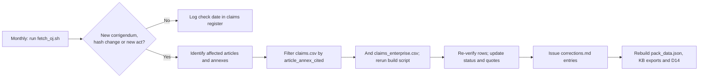

# The pack's CRA legal claims checked against the Official Journal and the Commission guidance

**Executive answer.** We obtained the authentic texts the pack relies on and checked its legal citations against them by script: the Official Journal text of Regulation (EU) 2024/2847 from the EU Publications Office, and the Commission's own PDF of guidance C(2026) 5252 (27 Jul 2026; 257 points, 67 Examples) with the Commission FAQ v1.4, the ENISA SRP FAQ and Ireland's NCSC guidelines. The base register checks 184 claims in the base pack: 148 (80%) are exact, 26 imprecise, 7 wrong and 3 outside the OJ. No deadline, fine, application date or Annex point number is wrong, but five corrections change what a client would do (single declaration under Art 28(3), notified-body language under Art 31(4), the 2025 fines corrigendum, Art 14(8) timing, and the Art 32(2) scheme limb). The Enterprise register checks 170 claims in the six Enterprise papers, including 97 quotations from 69 guidance points and Examples: 145 (85%) are exact, 10 imprecise, 3 cite the wrong point, 4 state what the source does not say, and 8 rest on non-EU instruments outside our sources. The main Enterprise error runs through three papers and the knowledge base: the guidance does not make every software version a placing on the market, because versions that are not substantial modifications keep the original placing date (para 15, Example 2). We fixed nine wrong citations in four papers and propose ten substantive corrections to their owners. Eight open questions the programme depends on are now set out in a legal positions pack, with a letter to Ireland's NCSC and instructions to counsel. One narrowed: the guidance reads the Art 32(2) scheme limb as needing an Art 27(9) act, so Module A through EUCC is not open to Class I products today.

## The authentic text was obtained from the Publications Office, not from EUR-Lex pages or mirrors

The knowledge base had relied on mirror sites because EUR-Lex served only recitals to automated tools (reports/verification.md). EUR-Lex HTML and PDF were refused by the fetch tool, its ELI pages returned a JavaScript shell, and the Council's PE-CONS 100/23 could be read only to recital (102). The Publications Office content-negotiation endpoint worked: CELEX 32024R2847 in English resolved to the 81-page PDF/A-2a edition of 14 Nov 2024 and the XHTML of the same OJ act. Every quotation was matched by script against both, and they agree. The PDF carries no embedded signature, so its authenticity rests on its origin in the Publications Office repository (Exhibit 1).

**Exhibit 1. Sources attempted and used**

| Route | Result | Used for |
|---|---|---|
| EUR-Lex HTML and PDF; data.europa.eu ELI | Refused by the fetch tool's permission system | Nothing |
| EUR-Lex ELI pages (whole act and per article) | JavaScript shell, about 3,600 characters, no text | Nothing |
| Council PE-CONS 100/23 (25 Sep 2024) | Readable to recital (102) only | Nothing |
| Publications Office cellar, CELEX 32024R2847, English, PDF/A-2a and XHTML | Full act, 71 articles and 8 annexes; sha256 of PDF e3ecaabd…, of XHTML fe0cca4a… | Every CRA claim |
| Cellar, corrigenda 32024R2847R(01)-R(08) | 8 corrigenda found; 3 change the English text | Art 64(10), Art 67 and title |
| Cellar, German and French OJ versions | Full text | Annex V point 3 cross-language check |
| Cellar, Implementing Reg. (EU) 2025/2392, Delegated Regs. (EU) 2026/339 and 2026/881, Directive (EU) 2024/2853 | Full texts | Facts F09, F14 (2026/881 basis), F15, F18 |
| reports/verification.md (30 Oct 2026) | Not re-checked | National acts, Digital Omnibus, EUCC register (outside the OJ) |

No mirror text was used for any status in the register. Where a claim depends on something outside the CRA text, the register says so and marks it "Could not verify".

## Four in five claims are exact, and none of the numbers is wrong

The register (`claims.csv`) covers every article, annex and recital reference used in pack facts F01-F20, the fine tiers, the Compliance Templates Kit (D14), and knowledge-base sections 03, 07, 08, 09 and 10. It also covers related claims in sections 05, 13, 14 and 16 and two implementation guides. Each row records the claim as the pack states it, where it is used, the provision cited, a short exact quotation from the OJ, the source and a status.

Status definitions:

- **Verified**: the cited provision says what the pack says; quotations are exact.
- **Verified with wording difference**: right provision and broadly right substance, but a quotation, paraphrase or scope is imprecise enough to fix.
- **Wrong article/point**: the content exists, but under a different article, point or recital.
- **Not found**: the cited provision does not contain what the pack asserts, or contradicts it.
- **Could not verify**: the claim is not a matter of CRA text, or the needed source was not obtained.

**Exhibit 2. Claims by source and status**

| Pack source | Claims | Verified | Wording difference | Wrong article/point | Not found | Could not verify |
|---|---|---|---|---|---|---|
| pack_data.json facts F01-F20 and fine tiers | 27 | 18 | 7 | 0 | 0 | 2 |
| 03 Scope (Art 2, Art 3 definitions) | 16 | 15 | 1 | 0 | 0 | 0 |
| 07 Annex I Part I | 22 | 20 | 2 | 0 | 0 | 0 |
| 08 Annex I Part II and Art 13 | 32 | 30 | 2 | 0 | 0 | 0 |
| 09 Reporting (Art 14) | 20 | 16 | 4 | 0 | 0 | 0 |
| 10 Conformity (Arts 28-33, Annexes V-VIII) | 28 | 21 | 4 | 0 | 2 | 1 |
| Compliance Templates Kit (D14) | 31 | 21 | 6 | 2 | 2 | 0 |
| Other KB sections and guides | 8 | 7 | 0 | 0 | 1 | 0 |
| **Total** | **184** | **148 (80%)** | **26 (14%)** | **2 (1%)** | **5 (3%)** | **3 (2%)** |

The core numbers all hold. Art 14 runs on 24 hours, 72 hours and 14 days for actively exploited vulnerabilities, and on 24 hours, 72 hours and one month for severe incidents. Art 64 sets fines of EUR 15m or 2.5%, EUR 10m or 2%, and EUR 5m or 1%. Art 71 gives 11 Jun 2026, 11 Sep 2026 and 11 Dec 2027, and Art 69 gives 11 Jun 2028. Annex III lists 19 Class I and 4 Class II categories and Annex IV lists 3 critical ones, with the item wording as quoted. Annex II has points 1-9, Annex V points 1-8 and Annex VII points 1-8. All 13 quotations from Annex I Part I points (2)(a)-(m) and all 8 Part II points are exact. The Art 3 definitions used in the pack, points (1), (2), (4)-(6), (8)-(10), (13), (20)-(24), (30), (42) and (48), are accurately paraphrased.

## Seven claims are wrong and five corrections change client behaviour

Exhibit 3 lists every claim that is not Verified, with the correction; eleven minor quotation fixes are grouped in one row. The full old and new text for each file is in `corrections.md`, which lists 63 edits in three priorities.

**Exhibit 3. Non-verified claims and corrections**

| ID | Pack claim (abridged) | Cited | Status | Correction |
|---|---|---|---|---|
| T17 | Kit: "One declaration, or a dossier of declarations, may cover all applicable acts" | Art 28(3) | Not found | Art 28(3): "a single EU declaration of conformity shall be drawn up" for all acts, each identified with its OJ reference; FAQ 6.8 accepts a dossier format for that single declaration |
| K17 | KB: one declaration "may" cover several acts | Art 28(3) | Wording difference | It is mandatory ("shall") |
| K14 | Technical documentation "may be written in any language" | Art 31(4); 13(22) | Not found | For notified-body procedures the language must be an official language of the body's Member State or one it accepts (Art 31(4)) |
| K11, O08 | Module H pt 4 "unexpected visits" disputed between mirrors | Annex VIII Part IV pt 4 | Not found | Point 4 has only 4.1-4.3: site access, periodic audits, audit report. No unexpected-visit clause |
| T10 | Component inventory basis "recital 58" | Recital 58 | Wrong point | Component due diligence is recital 34 |
| T11 | Guides: recital 58 asks manufacturers to list high-risk supplier dependencies in the risk assessment | Recital 58 | Not found | Recital 58 asks the Commission and market surveillance authorities to weigh non-technical risk factors |
| T15 | Kit: "the regulation numbers [Annex VII] point 1 as one item"; 1(a)-(d) is kit lettering | Annex VII pt 1 | Wrong point | The OJ letters point 1 as (a)-(d); the kit rows already match it |
| R12 | Users informed "without undue delay" | Art 14(8) | Wording difference | No such words; the test is "in a timely manner", failing which CSIRTs may inform users |
| K01, F07 | Module A for Class I only with a cited standard, common specification or "Art 27(9) scheme" | Art 32(2) | Wording difference | Text: schemes "at assurance level at least 'substantial' as referred to in Article 27"; the Art 27(9) reading is interpretation, but it is the guidance's reading (footnote 25 to para 148) |
| F04b, R10 | Severe-incident final report "1 month after the 72h notification" | Art 14(4)(c) | Wording difference | "within one month after the submission of the incident notification under point (b)"; runs from actual submission |
| R06, T24 | AEV final report: "severity and impact; actor; details and date" | Art 14(2)(c) | Wording difference | Point (i) is "a description of the vulnerability, including its severity and impact"; the date is an SRP field |
| F06, PD-T2 | Tier 2 "other obligations (e.g. Arts 18-23, 28, 30-33)" | Art 64(3) | Wording difference | Closed list: Arts 18-23, 28, 30(1)-(4), 31(1)-(4), 32(1)-(3), 33(5), 39, 41, 47, 49, 53; tier 3 is information "in reply to a request" |
| R17 | Stewards under Art 14(1), (3), (8) "to the extent involved in development" | Art 24(3) | Wording difference | Two limbs: 14(1) to the extent involved; 14(3) and (8) only for incidents on steward development infrastructure |
| F19 | Art 27(9) act would let EUCC replace third-party assessment | Art 27(9) | Wording difference | Only certificates at "substantial" or above, and only for the requirements covered |
| F20c | Integrating FOSS "never transfers" the manufacturer's duty | Art 13(5) | Wording difference | Text imposes due diligence; "never transfers" is inference |
| T14 | Support-period evidence mapped to "reasonable user expectations" and "feasibility" | Art 13(8) | Wording difference | These are the OJ's optional factors (similar products; integrated components; operating environment) |
| F15, B02, K16, K08, T18, T25, T12, B32, T21, A16, A21, S16 | Eleven quotations or scope statements that are slightly loose (recital wording, Annex VIII point wording, PLD and Art 69(1) scope, Annex VIII model level, corrigendum count) | Various | Wording difference | Exact text in `claims.csv`; edits in `corrections.md` priorities 2-3 |
| K25 | Accreditation against ISO/IEC 17065 and 17021-1 | None | Could not verify | Not in the CRA text; label as accreditation practice |
| F16, F17 | National acts; Digital Omnibus | None | Could not verify | Outside the OJ text; rely on verification.md #20 and #24 |

Two claims are marked Verified but still need an edit, because they are true only as corrected by a corrigendum. As published, Art 64(10) exempted micro and small enterprises (point a) and open-source stewards (point b) from fines under "paragraphs 3 to 9". That left the Art 64(2) tier, which covers Art 14, untouched, and so made point (a) ineffective. The corrigendum in OJ L, 2025/90555 of 2 Jul 2025 reads "paragraphs 2 to 9". The pack's statements (PD-N1, F20b) are right today, but they should cite the corrigendum. Anyone reading the original OJ PDF will otherwise see the opposite.

## Every open question the knowledge base flagged is now closed

**Exhibit 4. Resolution of known open questions**

| Question | OJ text | Resolution |
|---|---|---|
| Annex V point 3: "provider" or "manufacturer"? | "A statement that the EU declaration of conformity is issued under the sole responsibility of the provider" | "Provider" is the authentic English text. German ("Anbieter") and French ("fournisseur") match, and no corrigendum changes it. Keep the word verbatim in declarations; adding the manufacturer's legal name after it is acceptable. Art 28(4) still makes the manufacturer responsible. Remove the "confirm the OJ wording" caveats in D14 Template 5. |
| Art 13 numbering for support-period display and end date | Art 13(8): six subparagraphs. Art 13(19): end date "including at least the month and the year … at the time of purchase"; second subparagraph: end-of-support notification "where technically feasible" | The pack's numbering is correct: period and five-year floor, Art 13(8) second and third subparagraphs; technical file, fifth subparagraph and Annex VII point 4; end date at purchase and in-product notice, Art 13(19) first and second subparagraphs; user information, Annex II point 7. |
| Annex VII point 1 lettering | "1. a general description … including: (a) its intended purpose; (b) versions of software …; (c) … photographs or illustrations …; (d) user information and instructions as set out in Annex II" | The OJ letters point 1 as (a)-(d). Template 4's rows are right; its note saying otherwise is wrong (T15). |
| Art 14 final-report clocks | 14(2)(c): "no later than 14 days after a corrective or mitigating measure is available". 14(4)(c): "within one month after the submission of the incident notification under point (b)" | Both clocks are as the pack states. The incident clock runs from actual submission of the 72-hour-stage notification, so an early filing starts it early. Both final reports, and the 72-hour notifications, are owed "unless the relevant information has already been provided". |
| Art 3(30) wording | "a change to the product with digital elements following its placing on the market, which affects the compliance … with the essential cybersecurity requirements set out in Part I of Annex I or which results in a modification to the intended purpose for which the product … has been assessed" | The pack's paraphrase is accurate. Template 10 can quote it (corrections.md, priority 3). |
| Module H unexpected visits (16-watchlist) | Annex VIII Part IV point 4 has 4.1-4.3 only | No unexpected-visit clause. Close the watchlist item. |
| Art 53 and source code (14-enforcement; 16-watchlist) | Art 53 is a single paragraph: access to "the data … required to assess the design, development, production and vulnerability handling … including related internal documentation" | No source-code wording. Source code appears only in the Art 63(1)(a) confidentiality duty. Whether design data includes source code remains interpretation. |
| Art 66 point number (13-interplay) | "In Annex I to Regulation (EU) 2019/1020, the following point is added: '72." | Point 72. Art 67 also adds point 72 to Annex I of Directive 2020/1828, as corrected on 17 Oct 2025. |

## Eight corrigenda exist, and three change the English text

Corrigenda apply only to the language versions they name. Five of the eight correct other languages and leave the English text unchanged. They matter to a multinational only where a local-language version is relied on, for example in a declaration translated under Art 28(2).

**Exhibit 5. Corrigenda to Regulation (EU) 2024/2847 found on 1 Nov 2026**

| No. | OJ reference and date | Language | What it corrects |
|---|---|---|---|
| R(01) | OJ L, 2024/90780, 5.12.2024 | English | Title: "(EU) No 2019/1020" becomes "(EU) 2019/1020" |
| R(02) | OJ L, 2025/90555, 2.7.2025 | English | Art 64(10): derogation from "paragraphs 2 to 9", not "3 to 9" |
| R(03) | OJ L, 2025/90768, 3.10.2025 | French | Annex I Part I (2)(c) grammar |
| R(04) | OJ L, 2025/90828, 17.10.2025 | English | Art 67: the CRA is point "72.", not "69.", of Annex I to Directive 2020/1828 |
| R(05) | OJ L, 2026/90148, 23.2.2026 | Slovak | Art 14(6) and other points |
| R(06) | OJ L, 2026/90243, 25.3.2026 | French | Annex III Class I point 6: "systèmes de gestion de réseau" |
| R(07) | OJ L, 2026/90667, 6.8.2026 | German | Art 7(2)(b) and other points |
| R(08) | OJ L, 2026/90847, 9.10.2026 | Slovenian | Art 3(17), Art 14(7) third subparagraph (c) and other points |

The knowledge base recorded only R(04), and its watchlist listed R(08) as unverified from a vendor feed. Both are now confirmed.

## The Enterprise papers were checked against the Commission's own guidance text, not a mirror

A review of this module found that it covered only the base pack. The Enterprise papers cite about 40 guidance points and Examples and many Articles, and none was registered. The knowledge base had read the guidance through the ORC WG and StreamLex mirrors. This extension obtained the Commission's own documents directly from its document service and checked every legal or guidance citation in the six Enterprise papers against them (Exhibit 6). No programme-case paper existed on 1 Nov 2026.

**Exhibit 6. Guidance and related sources obtained on 1 Nov 2026**

| Document | Origin | What was obtained | Used for |
|---|---|---|---|
| C(2026) 5252 final, Annex: Commission guidance on the application of the CRA, EN | Commission document 131456 | 84-page PDF created 27 Jul 2026; points 1-257 and Examples 1-67; sha256 fe209c25… | Every guidance status |
| C(2026) 5252 final, Communication to the Commission | Commission document 131455 | 2 pages: content approved; guidance applies "only from that moment" it is formally adopted in all languages | Status of the guidance |
| Commission news page of 27 Jul 2026 | digital-strategy.ec.europa.eu | Lists the same two downloads; no adoption notice at 1 Nov 2026 | Adoption status |
| Commission FAQ on the CRA, v1.4 (4 Sep 2026) | Commission documents 123307 (Markdown) and 122331 (PDF, 66 pages) | Full text; section numbers from its contents list | FAQ citations |
| ENISA SRP FAQ, updated 15 Oct 2026 | enisa.europa.eu | 35 questions | SRP facts in E2 and G |
| NCSC Ireland CRA page (11 Sep 2026) and National CRA Guidelines v1 (31 Aug 2026) | ncsc.gov.ie | Page and 9-page PDF | Irish wording; NCSC remit |
| Implementing Regulation (EU) 2025/2392; Directive (EU) 2024/2853 | Publications Office cellar | EN XHTML | Secure-element and liability claims |
| ENISA SRP glossary | Not obtained | | One row "Could not verify" |

`guidance_index.py` splits the guidance into its numbered points and Examples, with page and section. `build_claims_enterprise.py` then checks each quotation inside the point or Example the paper cites, not anywhere in the document, and refuses to write the register if any quotation fails. All files, origins and hashes are in `source/guidance/MANIFEST.csv`; `fetch_oj.sh` now re-fetches the four Commission documents and prints their hashes.

## The Enterprise register holds 170 claims; 85% are exact, and one error runs through three papers

`claims_enterprise.csv` uses the same columns and statuses as `claims.csv`. It holds 170 claims: 63 rest on the guidance (97 quotations from 69 distinct points and Examples), 91 on the OJ text, 9 on the Commission FAQ, 9 on the ENISA FAQ, 2 on NCSC material, 3 on Implementing Regulation 2025/2392 and 4 on the Product Liability Directive (some rows cite several). Because the guidance text was obtained, no row is "Could not verify" for want of it. The 8 rows marked so rest on instruments outside the E6 source set: UK, US, Japanese, Australian and Singapore rules in E5, the Digital Omnibus in E2, standards and notified-body status in E3, and the SRP glossary in G.

**Exhibit 7. Enterprise claims by paper and status**

| Paper | Claims | Verified | Wording difference | Wrong article/point | Not found | Could not verify |
|---|---|---|---|---|---|---|
| E1 evidence-as-code | 34 | 27 | 4 | 1 | 2 | 0 |
| E2 art14-operations | 30 | 27 | 2 | 0 | 0 | 1 |
| E3 portfolio-classification | 38 | 32 | 2 | 1 | 1 | 2 |
| E4 open-source-strategy | 33 | 32 | 1 | 0 | 0 | 0 |
| E5 global-control-set | 16 | 12 | 0 | 0 | 0 | 4 |
| G google-outside-in | 19 | 15 | 1 | 1 | 1 | 1 |
| **Total** | **170** | **145 (85%)** | **10 (6%)** | **3 (2%)** | **4 (2%)** | **8 (5%)** |

The four "Not found" rows are one error. E1, E3 and G, following knowledge-base section 03, say the guidance makes every software version a placing on the market. It does not. Para 15 says iterations that are not substantial modifications "do not modify that software's date of placement on the market", and in Example 2 versions 1.0.0 and 1.0.1 "are considered to be placed on the market on 1 January 2028". New placings come from substantial modifications (paras 15, 116, 122) and from distinct variants such as builds for another operating system (para 14). E1's evidence design survives, because its schema already distinguishes "update to placed product", but its "104,000 placing records a year" are version records, and E3's register counts 65 placings a year for each browser family where far fewer are placings.

**Exhibit 8. Non-verified Enterprise claims and what was done**

| Group | Claims | Status | Correction | Done |
|---|---|---|---|---|
| Every software version is a placing | EAC-04, EAC-31, PC-20, GOI-14 | Not found | Non-substantial versions keep the original placing date (para 15, Example 2); platform variants are distinct products (para 14) | Proposed to owners (C-01 to C-04; C-10 for the knowledge base) |
| Wrong point or provision cited | EAC-03 (paras 13-14 for para 15), PC-25 (Example 8 for para 141), GOI-12 (Art 13(6) for Annex I Part II(4)) | Wrong article/point | Citation replaced | Fixed in papers |
| Misquoted or incomplete citation | EAC-10, EAC-15, A14-14, A14-16, PC-05, PC-12 | Wording difference | Wording or citation aligned with the source (PC-12 now cites guidance footnote 25 on Art 32(2)) | Fixed in papers |
| Overstated guidance | EAC-06 (pt 111 says "likely"), EAC-08 (pt 109 says "may qualify"), OSS-09 (pts 60-62 cover donations, not membership), GOI-17 (FAQ 4.5.3 and 7.2 point to a per-unit support floor) | Wording difference | Softer wording or added source | Proposed to owners (C-05, C-06, C-08) |

E6 edited other papers only to fix citations: nine edits in E1, E2, E3 and G, each logged with old and new text in `corrections_enterprise.md` Part A. Substantive corrections are proposed to the module owners in Part B, not applied. The guidance pass also changed one base finding: Commission FAQ 6.8 says the single declaration "may be a dossier made up of relevant individual Declarations of conformity", so base claim T17 keeps its OJ status but its correction is softened (`claims.csv`, `corrections.md` 1.5).

## Eight open questions are set out as legal positions, with a letter to Ireland's NCSC and a brief to counsel

Several conclusions in the Enterprise papers rest on draft guidance or on questions no authority has answered. `legal-positions/positions.md` takes each in turn: the question, why it matters in the modules' own figures, the OJ and guidance text, the readings available, a recommended position and a conservative fallback, the evidence to hold, and who can confirm. Every quotation in the pack is checked by `check_positions.py` (107 matched; 4 from web pages read but not saved).

**Exhibit 9. Positions and who should confirm them**

| Question | Recommended position | Confirm with |
|---|---|---|
| A. One Art 14 notification per product or per vulnerability | One notification may list several products, but operate per product (FO-1) until confirmed | NCSC |
| B. Per-version placing; continuous delivery | Placing per substantially modified version and per platform variant; record every version | Commission; Irish MSA; counsel |
| C. Art 32(2) scheme limb | Only Art 27(9)-specified schemes, as the guidance says; plan Module H | Commission; counsel |
| D. Steward and manufacturer double filing | Two duties; file both from 11 Dec 2027, cross-referenced, unless NCSC accepts one | NCSC; Commission |
| E. OS in own device versus OS supplied to OEMs | Default for own devices; keep OEM supply to free public source plus a licensed services package | Irish MSA; counsel |
| F. Support-period floor per unit or per type | Per unit, applied as per-cohort end dates | Irish MSA; ADCO; counsel |
| G. FIDO key with a secure element | Annex IV item 3 where the secure element is AVA_VAN.4 or higher and is the key's substance | Commission; Irish MSA; notified body |
| H. Remote data processing boundary | Consoles out; RDPS is what installed clients call directly | Commission; Irish MSA; counsel |

Ireland's NCSC (CSIRT-IE) is the coordinator CSIRT for Aldermoor, but its Guidelines say it "does not provide assistance or guidance in determining product scope or general regulatory applicability". The letter (`legal-positions/letter-to-ncsc.md`) therefore asks only questions A and D and coordinator confirmation for steward filings. No Irish market surveillance authority had been designated on the evidence found to 8 Oct 2026, so the scope and classification questions go to external counsel now (`legal-positions/counsel-brief.md`, opinions due 30 Nov 2026 to 31 Jan 2027) and to the authority once designated.

## Keeping the register true needs a monthly corrigenda check and an event-driven re-verification

The CRA text will keep moving through corrigenda, delegated acts that amend annexes (Art 7(3) for Annex III, Art 8(2) for Annex IV, Arts 28(5) and 31(5) for Annexes V and VII) and implementing acts that fill gaps the pack currently describes as empty. The maintenance process is built so that any change triggers a re-check of the affected rows, not a full re-read.

**Exhibit 10. Re-verification triggers**

| Trigger (watch: `fetch_oj.sh`, OJ L series) | Affected claim rows | Owner role |
|---|---|---|
| New corrigendum R(09) or later, or a change in the OJ text hash | Rows citing the corrected provision (all rows on a hash change) | Knowledge-base maintainer |
| Art 27(9) delegated act on EUCC (Commission plans Q4 2026) | F07, F19, K01, K03, T07 | Regulatory counsel |
| Art 14(10) implementing act on notification format | R04-R12; D14 Template 8 | PSIRT lead |
| Art 13(24) SBOM implementing act | B26, F13; D14 Templates 4 and 9 | Product security lead |
| Delegated acts under Art 7(3), 8(1), 8(2) or 2(5) (annex lists, certification, scope) | F09, K04, S15, T03-T05, T08 | Regulatory counsel |
| Delegated or implementing acts under Arts 13(8), 28(5), 30(6), 31(5) or 33(5) | F11a, B15, K15, K18-K20, K27, T19; D14 Templates 3-5 | Compliance lead |
| Formal adoption of guidance C(2026) 5252, or a new FAQ version (hash change in `fetch_oj.sh`) | The 63 guidance rows and 9 FAQ rows in `claims_enterprise.csv`: rebuild the index with `guidance_index.py`, rerun `build_claims_enterprise.py` and `check_positions.py` | Regulatory counsel |
| Reply from NCSC, designation of an Irish market surveillance authority, or a counsel opinion | `legal-positions/` questions A-H and the claims they support | General Counsel |

Three rules keep the register honest. The source column names the exact OJ edition or corrigendum, and mirror text is never recorded as OJ text. Any quotation added to the pack must pass the script check against `source/oj_L_2024_2847_EN.txt`, and any guidance quotation must sit inside the point or Example it cites. After a corrigendum, the corrigendum reference must appear wherever the pack states the corrected rule.

## Decisions for the executive team

1. **Approve the 16 Priority 1 corrections before any further client issue of the Templates Kit or knowledge base.** Owner: General Counsel (or the content's legal reviewer). Timing: by 8 Nov 2026.
2. **Adopt the Publications Office OJ text in this module as the single legal source of record, pinned by hash, and retire mirror sites as sources for quotations.** Owner: knowledge-base maintainer. Timing: immediately.
3. **Take a counsel position on the Art 32(2) certification-scheme limb.** The question is whether a full-scope EUCC certificate at "substantial", recognised under Art 27(8) before any Art 27(9) act, can open Module A for a Class I product. The pack assumes not, and the Commission guidance agrees (footnote 25 to para 148; para 153). Owner: General Counsel with external counsel (counsel brief, question C). Timing: by 30 Nov 2026, before the Art 27(9) act lands.
4. **Keep the statutory Annex V wording verbatim in every client declaration.** "Provider" stays, the manufacturer's legal name may follow it, and one single declaration covers all applicable EU acts. Owner: compliance lead. Timing: from the next declaration issued.
5. **Run the monthly corrigenda, guidance and implementing-act check in Exhibit 10 and record each run in the register.** Owner: regulatory watch lead. Timing: monthly from 1 Dec 2026.
6. **Correct the per-version placing error and send the positions pack out.** Approve corrections C-01 to C-04 and C-10 in E1, E3, G and the knowledge base; send the NCSC letter; instruct counsel on the eight questions. Owner: General Counsel with the module owners. Timing: corrections by 30 Nov 2026; letter by 30 Nov 2026; counsel opinions 30 Nov 2026 to 31 Jan 2027.

## Risks and open questions

- **Art 32(2) interpretation.** The text refers to schemes "as referred to in Article 27" without naming paragraph 9, and Annex VII point 5 mentions Art 27(8) schemes. The guidance, now read in full, applies the scheme limb only to schemes specified by an Art 27(9) act (footnote 25 to para 148; para 153). EUCC does not by itself cover the Annex I Part II process requirements, so the practical outcome is the same. Still open in law; see legal-positions question C.
- **Guidance status.** C(2026) 5252 applies only once formally adopted in all languages; point numbers could move. The register cites the 27 Jul 2026 PDF by hash.
- **No Irish market surveillance authority.** None had been designated on the evidence found to 8 Oct 2026. Answers to the scope questions in the positions pack stay informal until one is.
- **Electronic signature.** The PDF obtained has no embedded signature. Its authenticity rests on retrieval from the Publications Office cellar. A signed copy should be obtained through EUR-Lex in a browser if a filing ever depends on it.
- **Coverage.** Sections 04, 05, 06, 11 to 16 and the guides were searched for known error strings, not read sentence by sentence. A repository-wide search for out-of-range article or paragraph numbers found none.
- **Non-English versions.** Statuses are for the English text. Translated declarations and user information should be checked against the corrected language version.
- **Facts outside the OJ.** National acts, the Digital Omnibus, EUCC counts and notified-body status rest on reports/verification.md (30 Oct 2026). ENISA platform facts were re-checked against the ENISA SRP FAQ of 15 Oct 2026. Non-EU instruments in E5 were not re-checked.
- **Art 14(8) timing and Art 53 scope.** An internal user-notice target is good practice but not law. Whether Art 53 reaches source code is interpretation, with Art 63(1)(a) confidentiality as the counterweight.

## Sources

- Regulation (EU) 2024/2847, OJ L, 2024/2847, 20.11.2024, ELI [http://data.europa.eu/eli/reg/2024/2847/oj](http://data.europa.eu/eli/reg/2024/2847/oj); text obtained from the Publications Office cellar via [https://publications.europa.eu/resource/celex/32024R2847](https://publications.europa.eu/resource/celex/32024R2847) (English PDF/A-2a and XHTML; German and French XHTML), retrieved 1 Nov 2026. Local copies: `source/oj_L_202402847EN.pdf`, `source/oj_L_2024_2847_EN.txt`.
- Corrigenda: [OJ L, 2024/90780](http://data.europa.eu/eli/reg/2024/2847/corrigendum/2024-12-05/oj); [OJ L, 2025/90555](http://data.europa.eu/eli/reg/2024/2847/corrigendum/2025-07-02/oj); [OJ L, 2025/90768](http://data.europa.eu/eli/reg/2024/2847/corrigendum/2025-10-03/oj); [OJ L, 2025/90828](http://data.europa.eu/eli/reg/2024/2847/corrigendum/2025-10-17/oj); [OJ L, 2026/90243](http://data.europa.eu/eli/reg/2024/2847/corrigendum/2026-03-25/oj); OJ L, 2026/90148 (SK), 2026/90667 (DE) and 2026/90847 (SL), retrieved from the cellar as CELEX 32024R2847R(05), R(07) and R(08). Local copies of the English corrigenda: `source/corrigendum_R0*_EN_*.txt`.
- [Commission Implementing Regulation (EU) 2025/2392](https://eur-lex.europa.eu/eli/reg_impl/2025/2392/oj/eng), OJ L 1.12.2025; [Commission Delegated Regulation (EU) 2026/339](https://eur-lex.europa.eu/eli/reg_del/2026/339/oj/eng), OJ L 29.4.2026; [Commission Delegated Regulation (EU) 2026/881](https://eur-lex.europa.eu/eli/reg_del/2026/881/oj), OJ L 20.4.2026; [Directive (EU) 2024/2853](https://eur-lex.europa.eu/legal-content/EN/TXT/HTML/?uri=CELEX:32024L2853), OJ L 18.11.2024. All texts were read from the cellar.
- [Council PE-CONS 100/23](https://data.consilium.europa.eu/doc/document/PE-100-2023-INIT/en/pdf), 25 Sep 2024 (attempted; recitals only).
- Knowledge base: reports/sections/03-scope.md, 05-roles.md, 07-annex1-part1.md, 08-annex1-part2.md, 09-reporting.md, 10-conformity.md, 13-interplay.md, 14-enforcement.md, 16-watchlist.md, 17-sources.md; reports/verification.md (claims #15, #17, #20, #23, #24, #28 for facts outside the OJ); reports/guides/application/03, 09, 10, 11; reports/guides/corporate/08-evidence.md.
- Pack: pack/data/pack_data.json (facts F01-F20, exposure tiers); pack/engine/build.py; pack/out/hosted/D14-compliance-templates-kit/md/00-10.
- Commission guidance C(2026) 5252 final, [Annex](https://ec.europa.eu/newsroom/dae/redirection/document/131456) and [Communication](https://ec.europa.eu/newsroom/dae/redirection/document/131455), 27 Jul 2026; [Commission news page](https://digital-strategy.ec.europa.eu/en/library/commission-publishes-new-guidance-support-timely-cyber-resilience-act-implementation). Commission FAQ on the CRA v1.4, 4 Sep 2026, [Markdown](https://ec.europa.eu/newsroom/dae/redirection/document/123307) and [PDF](https://ec.europa.eu/newsroom/dae/redirection/document/122331). All retrieved 1 Nov 2026; local copies and hashes in `source/guidance/`.
- [ENISA SRP FAQ](https://www.enisa.europa.eu/topics/product-security/single-reporting-platform-srp/frequently-asked-questions), updated 15 Oct 2026; [NCSC Ireland CRA page](https://www.ncsc.gov.ie/cra/), 11 Sep 2026; [NCSC National CRA Guidelines v1](https://www.ncsc.gov.ie/pdfs/National_CRA_Guidelines_v1.pdf), 31 Aug 2026.
- Irish designation status: [Government of Ireland press release, 11 Sep 2026](https://www.gov.ie/en/department-of-justice-home-affairs-and-migration/press-releases/cyber-resilience-act-guidelines-published-as-reporting-obligations-come-into-effect/); [Arthur Cox, 8 Oct 2026](https://www.arthurcox.com/knowledge/countdown-to-compliance-the-cyber-resilience-act-reporting-deadline-has-arrived/); [Presencis tracker, 4 Oct 2026](https://cdn.presencis.com/regulations/cra/national/) (secondary, unconfirmed).
- Enterprise papers checked: `../evidence-as-code/paper.md`, `../art14-operations/paper.md`, `../portfolio-classification/paper.md`, `../open-source-strategy/paper.md`, `../global-control-set/paper.md`, `../google-outside-in/paper.md`.
- Module files: `claims.csv` (184-claim base register), `corrections.md` (63 edits), `claims_enterprise.csv` (170-claim Enterprise register) built and checked by `build_claims_enterprise.py`, `corrections_enterprise.md` (nine citation edits made, ten substantive corrections proposed), `guidance_index.py` and `source/guidance/C_2026_5252_index.json` (guidance by point and Example), `source/guidance/MANIFEST.csv`, `legal-positions/` (`positions.md`, `letter-to-ncsc.md`, `counsel-brief.md`) checked by `check_positions.py`, `fetch_oj.sh` and `h2t.py` (reproducible fetch and text conversion), `check_quotes.py` (quotation check against the OJ text).
