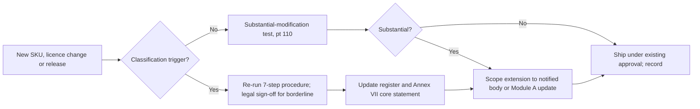

# Portfolio classification and conformity routes for Aldermoor Platforms

**Executive answer.** We classified Aldermoor's EU portfolio at product-family level: 40 families across nine business lines. On today's facts, seventeen families would need a notified body for units placed from 11 Dec 2027: 16 are important Class I (15 Class I and 1 critical if Keystone is Annex IV) and one is Class II. Keystone security keys are Class I item 1 (identity and authentication) by default, and Annex IV item 3 if the key is a secure element or smartcard-like device designed to AVA_VAN.4 or higher (legal position G). The Bastion secure element is not critical, because it is integrated and never sold on its own. Fourteen families are default and may self-assess under Module A. Nine are not separate products or are not placed on the market: three sit inside another product's boundary, two are browser-only consoles or hosted services, and four are open-source projects Aldermoor stewards without monetising. The notified-body families carry about EUR 12.6bn of illustrative EU revenue: 34% of EU product revenue and 16% of total EU revenue. Lumen Browser's search-enabled revenue is 62% of that figure. We recommend Module H (full quality assurance) in all four organisations that hold notified-body products. Our estimate is 720-1,460 notified-body days for the first certification wave and 270-930 days a year after that, against 880-2,540 and 640-1,820 days for type examination. That is EUR 3.2m-9.3m over five years against EUR 6.2m-17.7m. The binding constraint is not money. No CRA notified body had been designated at the last verified check (8 Sep 2026), and in a thin market Aldermoor alone could absorb 10-20% of EU capacity. Contract at least two bodies early, with a third pre-contracted as the capacity hedge, and keep the borderline calls below under change control.

All revenue figures, type counts and cadences are illustrative estimates for a fictional client. Legal rules come from the knowledge base (KB) and are cited by section. Notified-body costs rest on vendor commentary that the KB marks unverified.

## Seventeen of 40 families need third-party assessment, and Lumen Browser dominates the revenue exposure

The register in `classification.csv` applies the KB rules to every family in `portfolio.yaml`. Exhibit 1 gives the counts.

**Exhibit 1: Families by CRA status (40 families)**

| Status | Families | Illustrative EU revenue (EUR m) | Notified body today |
|---|---|---|---|
| Important Class I (Annex III) | 16 | 12,025 | Yes |
| Important Class II (Annex III) | 1 | 350 | Yes |
| Critical (Annex IV) | 0 | 0 | n/a |
| Default | 14 | 24,320 | No (Module A) |
| Within another product's boundary (Halo OS on Arc devices, Hearth app, Bastion) | 3 | 180 | Via host certificates for the Hearth app |
| Out of scope as a product (browser-only consoles, hosted services) | 2 | 9,000 (services, not product revenue) | No |
| Not placed on the market (Aldermoor is steward) | 4 | 0 | No |

Keystone (F25) is counted at its default, Class I item 1. If its secure element is designed to AVA_VAN.4 or higher, the key is Annex IV item 3 and the 16 Class I families become 15 Class I and 1 critical; the notified-body total and revenue do not change (Exhibit 6, rank 4; legal position G).

Notified-body revenue is EUR 12,555m including the Hearth Aware subscription inside Hearth device certificates. That is 34.0% of the EUR 36,875m attributed to in-scope products (including software inside another product's boundary) and 16.3% of Aldermoor's EUR 77bn EU revenue. Without the browser's search-enabled revenue the notified-body exposure is about EUR 4.8bn, mostly hardware.

**Exhibit 2: Class by business line (number of families)**

| Business line | Default | Class I | Class II | Within another product | Out | Not placed |
|---|---|---|---|---|---|---|
| Arc devices | 4 | 0 | 0 | 0 | 0 | 0 |
| Halo | 1 | 1 (Halo Wear OS, I.11) | 0 | 1 | 0 | 0 |
| Lumen | 0 | 4 (browser x2, WebView: I.2; Lumen OS: I.11) | 0 | 0 | 0 | 0 |
| Hearth | 2 | 5 (I.16, I.17 x3, I.12) | 0 | 1 | 0 | 0 |
| Pulse | 0 | 2 (I.19) | 0 | 0 | 0 | 0 |
| Keystone and Bastion | 0 | 1 (I.1) | 0 | 1 | 0 | 0 |
| Consumer apps | 1 | 2 (Authenticator: I.1; One VPN: I.5) | 0 | 0 | 0 | 0 |
| Cloud and enterprise | 4 | 1 (VPN gateway: I.5) | 1 (Edge: II.1) | 0 | 2 | 0 |
| Open source | 2 | 0 | 0 | 0 | 0 | 4 |
| **Total** | **14** | **16** | **1** | **3** | **2** | **4** |

The pattern is clear. Every Lumen product, every Pulse product and most of Hearth need a notified body. No Arc device does. Arc phones are Aldermoor's largest product line by revenue at EUR 9.5bn, and they are default because a smartphone integrating an operating system is not an operating system (guidance Example 58; 06-classification.md).

## Five rules decide almost every call

The script applies five KB rules on top of a recorded core-functionality statement for each family.

1. **Scope first.** Browser-only software is not a product, so the Aldermoor Cloud consoles are out (guidance paras 20-21, Examples 5-6; 03-scope.md). Hosted services fall to NIS2 unless an installed product needs them, when they become that product's remote data processing (recital 12; Art 3(2)).
2. **One core functionality.** Each product has exactly one core functionality for classification (guidance pt 144). It is read objectively from instructions, marketing and technical documentation, and inconsistency between them is an indicator of misrepresentation (pts 139, 142-143; 06-classification.md).
3. **Integration does not reclassify; ancillary functions do not declassify.** Embedding an important or critical component leaves the host's class unchanged (Art 7(1); Example 58). A router with a firewall stays a router (IR 2025/2392 recitals; guidance pt 152, Example 63).
4. **Separately sold modules are separate products.** A module sold or licensed separately takes its own class (guidance pt 145, Example 61). This is why Halo Services, Aldermoor One VPN and the planned Edge Firewall add-on are assessed on their own.
5. **Monetisation decides FOSS status, not the licence.** The Cloud SDKs are open source but are used to monetise cloud services, so Aldermoor is their manufacturer (guidance pt 54). Tensile LTS builds offered only to paying customers are placed on the market (pt 57, Example 17). If LTS source code is shared only with paying customers, the LTS build is not FOSS at all (guidance para 46), so the Art 32(5) route would not be open to it. Unmonetised projects make Aldermoor a steward at most (12-open-source.md).

A keyword check in `classify.py` flags any family whose description also matches another category. In every flagged case the register records why that function was treated as ancillary or integrated. Examples are the browser in a phone, the firewall in a router and the border router in a smart speaker.

## Route strategy: Module H in four organisations, with Module A for Class I only after standards are cited

Today a Class I product cannot self-assess. Art 32(2) allows Module A only where harmonised standards, common specifications or European cybersecurity certification schemes at assurance level at least "substantial" "as referred to in Article 27" are applied in full. No CRA standard or common specification exists at 30 Oct 2026, and whether a scheme can serve before an Art 27(9) act is an open interpretation (module E6; the Commission guidance reads the scheme limb as needing an Art 27(9) act, guidance para 148 footnote 25). The third-party routes are blocked too, because no notified body is designated (10-conformity.md; verification.md claims 9, 21, 23).

**Exhibit 3: Route strategy by organisation**

| Organisation | Notified-body families (categories) | Route today | Route from 2028 if conditions are met | Why |
|---|---|---|---|---|
| Lumen | Browser desktop and mobile, WebView (I.2) | Module H | Module A for families where a cited I.2 vertical standard is applied in full and covers core-functionality risks (guidance pt 149) | 65 versions a year; three substantial modifications a year assumed (AI-agent features); Module H handles change inside one approved system |
| Platforms | Lumen OS, Halo Wear OS (I.11) | Module H, or join the Lumen quality system | As Lumen | Same engineering system as Lumen; modest cost advantage, large change-handling advantage |
| Devices | Hearth cameras, doorbells, locks, assistants, routers (I.16, I.17, I.12); Pulse (I.19); Keystone (I.1) | Module H | Module A per category as verticals are cited; Keystone stays third-party if reclassified to Annex IV | 32 hardware types live, about 14 new a year; one shared Hearth app sits inside about 21 device certificates |
| Cloud and apps | Authenticator (I.1), One VPN and VPN gateway (I.5), Edge (II.1) | Module H | Class I families may move to Module A; Edge stays third-party or EUCC "substantial" once the Art 27(9) act exists | Mixed portfolio; Edge is Class II and never qualifies for Module A unless FOSS |

Module H fits a portfolio with frequent substantial modifications because new variants extend the approved system (FAQ 6.3; 10-conformity.md). Under Module H the notified body's number follows the CE marking on each product (Art 30(4)). For software the CE marking goes on the EU declaration or the accompanying website (Art 30(1)), so the change for Lumen is small. For Hearth, Pulse and Keystone it is a labelling change to plan.

The Art 32(5) FOSS route is not available as products ship today. It applies only to products that qualify as free and open-source software and requires the Annex VII technical documentation to be public at placing (10-conformity.md; 12-open-source.md). Lumen Browser and Halo builds contain proprietary code. A fully open-source Lumen Browser build could in principle self-assess under Art 32(5). Two points argue against it: the KB does not say whether proprietary remote data processing defeats FOSS status, and publishing the risk assessment of the most attacked client in the portfolio is a security cost. We treat it as a fallback to study, not a plan.

## Notified-body demand is small in money and large in calendar risk

`nb_demand.py` models each notified-body family under both routes. Type examination (Module B+C) needs one examination per live type, focused re-assessment for each substantial modification (guidance pts 116, 122-123), change notices (Annex VIII Module B pt 7) and periodic audits of vulnerability handling (pt 8). Module H needs one quality-system approval per organisation, one model's technical documentation per product category (pts 3.1(b), 3.3), surveillance audits (pt 4) and scope extensions for new or substantially modified products. Cost anchors are EUR 20,000-60,000 per Module B examination and EUR 80,000-150,000 for a first Module H engagement. These are vendor estimates, unverified (10-conformity.md). Complexity factors, day rate (EUR 1,800), audit days and surveillance shares are our assumptions and are listed in the script.

**Exhibit 4: Notified-body demand by organisation (estimates; body-days)**

| Organisation | B+C first wave | B+C per year after | H first wave | H per year after | 5-year cost B+C (EUR m) | 5-year cost H (EUR m) |
|---|---|---|---|---|---|---|
| Lumen | 146-429 | 130-382 | 194-383 | 83-282 | 1.20-3.52 | 0.95-2.72 |
| Platforms | 130-385 | 88-258 | 156-317 | 55-190 | 0.87-2.55 | 0.68-1.94 |
| Devices | 462-1,323 | 337-948 | 209-428 | 82-281 | 3.26-9.20 | 0.97-2.79 |
| Cloud and apps | 141-406 | 83-232 | 160-330 | 50-176 | 0.85-2.40 | 0.65-1.86 |
| **Total** | **879-2,542** | **638-1,820** | **719-1,458** | **270-928** | **6.17-17.68** | **3.24-9.31** |

Module H wins in every organisation over five years. In Devices it costs about a third as much, because B+C would mean 32 separate type examinations by Dec 2027 and every Hearth app change would touch about 21 certificates. In Lumen, Platforms and Cloud and apps the cost gap is narrow, and Module H earns its place by absorbing 4-weekly change without re-opening type certificates.

Version discipline matters more than the route. Under Commission guidance (paras 13-15 and Example 2; guidance, not the Regulation's text), a software version that is not a substantial modification keeps the original placing date, and security updates are "generally not" substantial modifications (pt 108). If every 4-weekly Lumen major were treated as a new type, examination cost for the three I.2 families would reach about EUR 33m a year at the high estimate. The four-question substantial-modification test (pt 110), run and recorded per release, is what keeps the real figure under EUR 1m.

**Exhibit 5: Aldermoor's share of EU notified-body capacity (hypothetical scenarios)**

| Scenario (not data) | Assumed capacity | Aldermoor first wave, Module H | Aldermoor per year after, Module H | Aldermoor first wave, all B+C |
|---|---|---|---|---|
| Thin, late 2027: 5 bodies x 8 CRA assessors | 7,200 body-days a year | 10.0-20.3% | 3.8-12.9% | 12.2-35.3% |
| Moderate, 2028: 15 bodies x 12 assessors | 32,400 | 2.2-4.5% | 0.8-2.9% | 2.7-7.8% |
| Mature, 2029 onwards: 30 bodies x 20 assessors | 108,000 | 0.7-1.4% | 0.3-0.9% | 0.8-2.4% |

What is unknown matters more than these percentages. Nobody knows how many bodies will be designated, for which modules, or how many CRA-competent assessors they will have. The KB holds no official estimate. Zero bodies were listed at the last verified check (8 Sep 2026). Art 35(2) only asks Member States to "strive" for sufficient bodies by 11 Dec 2026. Brightsight holds ISO/IEC 17065 accreditation for Module B pending Dutch notification, and Applus+ is "progressing through" accreditation; both are vendor statements (10-conformity.md). Module H bodies need ISO/IEC 17021-1 accreditation, and the KB records no Module H body further along than an application. Total market demand from other manufacturers is also unknown.

Two conclusions survive the uncertainty. First, one new body with eight assessors offers about 1,440 days a year, so Aldermoor's first wave alone would take half to all of it. Aldermoor therefore needs at least two bodies: one for the software organisations (Lumen and Platforms) and one with hardware labs for Devices, each able to back up the other. A third, pre-contracted as the capacity hedge, takes Cloud and apps off the hardware body (programme case, lever L3). This changes contracting, not demand: the body-days above are unchanged. Second, the bodies must be independent of Aldermoor under Art 39, so any candidate body that sells Aldermoor consultancy is conflicted. Check this before shortlisting.

## The most consequential borderline calls

**Exhibit 6: Borderline calls ranked by consequence**

| Rank | Call | Our position | Alternative | If we are wrong | What keeps it right |
|---|---|---|---|---|---|
| 1 | Halo Services package (F06) and Halo OS on Arc (F05) | Services package is default; Halo OS is not placed separately by Aldermoor; the OEM building from HOSP is its own manufacturer | Annex III I.11 if Aldermoor supplies a complete OS image (as it does for Halo Wear, F07) | EUR 6.8bn of enabled revenue moves to the notified-body route; I.11 assessment for every OEM build | Supply model, contracts and documentation must match: OEMs build the OS, Aldermoor supplies a package (pts 142-145) |
| 2 | Arc phones, tablets and laptops (F01, F02, F04) | Default (Example 58; FAQ s.3; guidance para 141) | None credible if documents are consistent | EUR 12.3bn of device revenue would need third-party assessment | Never market a phone as "the Halo OS device"; keep the Annex VII core-functionality statement explicit |
| 3 | Lumen WebView (F13) | Class I.2 embedded browser, because it is supplied and updated separately to third-party Halo devices | Integrated component with no class | Under-classification of a component used by every Halo app | Counsel to confirm; if WebView ships only on Arc devices, it becomes integrated |
| 4 | Keystone security keys (F25) | Conditional on the secure element's designed assurance level: Class I item 1 (identity and authentication) by default; Annex IV item 3 if the key is a secure element or smartcard-like device designed to AVA_VAN.4 or higher (legal position G). Counted here as 16 Class I (15 Class I and 1 critical if Keystone is Annex IV) | Class I item 1 in every case, treating the secure element as an integrated component (guidance para 152) | Critical class; an Art 8(1) act could later mandate EUCC certification (at least 6 months' transition) | Record the chip's AVA_VAN target; plan EUCC evidence anyway |
| 5 | Hearth smoke and CO alarms (F20) | Default: safety, not physical security | I.17 "alarm systems" | Two types move to the notified-body route; low revenue | Record reasoning; cheap to reverse inside the Devices Module H system |
| 6 | Cloud Connect directory connector (F31) | Default: copies identity objects, does not authenticate | I.1 if pass-through authentication or federation is added | A feature release silently changes class | Treat authentication features as classification triggers |
| 7 | Aldermoor Edge (F33) | Class II.1: the customer buys virtualised execution | Default, as an orchestration platform | Low; we chose the stricter reading | Keep the Edge Firewall add-on bundled, or classify it Class II.2 when sold separately (Example 61) |
| 8 | Bastion secure element (F26) | Integrated; host not reclassified (Art 7(1); FAQ laptop example) | Annex IV item 3 the day it is sold to another manufacturer | A critical product created by a commercial deal | Any external sale requires classification sign-off |

The first three calls carry most of the exposure. Halo and the Arc devices together hold about EUR 19bn of illustrative revenue on a default classification. That position is sound in law, but it depends on documentation and supply models staying consistent. WebView is the call most likely to be challenged on the facts.

## Keeping classification current at SKU and version level

Packaging and licensing decisions change classification, so the register must live at SKU and version level (06-classification.md). We recommend five controls.

1. **Register of record.** One row per SKU and per separately licensed software module, holding the fields in `classification.csv`. It also holds the core-functionality statement that goes into Annex VII item 1(a). Product families may share one risk assessment and technical file where architecture, security design, intended purpose and risks are the same (guidance pts 174-177; 03-scope.md).
2. **Classification triggers.** Re-run the seven-step procedure in 06-classification.md on any new SKU, separate sale or licence of a module, new distribution channel (for example WebView to third-party devices), external sale of a component (Bastion), change of marketing claims, or new feature touching a category function (authentication, VPN, password storage, assistant, camera).
3. **Release gate in the build pipeline.** Each EU release carries a classification record and a substantial-modification determination generated with the E1 evidence-as-code pipeline. A release without both is blocked from EU distribution. For Module H organisations the same record drives notices to the notified body of intended changes to the approved quality system (Annex VIII Module H pt 3.5) and any scope extension for new product categories (pt 3.1(b)).
4. **Marketing consistency check.** Product marketing and documentation for notified-body and borderline families are reviewed against the recorded core functionality before launch, because inconsistency is an indicator of misrepresentation (pt 143).
5. **Regulatory watch.** Re-classify quarterly against new Art 7(3) or Art 8 delegated acts (none adopted or consulted), OJ citations of harmonised standards (none yet) and the Art 27(9) EUCC act (planned Q4 2026, not adopted). Wrong-route choices can attract fines under Art 64(3) (guidance pt 146).

## Decisions for the executive team

1. **Adopt Module H as the conformity route for Lumen, Platforms, Devices, and Cloud and apps.** Consider one combined system for Lumen and Platforms. Owner: VP Engineering with the Head of Product Compliance. Timing: decision by Jan 2027; quality-system gap assessment against Annex VIII Module H pt 3.2 by Mar 2027.
2. **Contract at least two notified bodies, pre-contract a third as the capacity hedge, and start pre-assessment now.** One body covers software and one covers hardware, each as backup to the other; the third takes Cloud and apps. Check Art 39 independence before shortlisting. Owner: CISO with Procurement. Timing: shortlist by Dec 2026; letters of intent before designation, so that each contract completes within about 14 days of designation (programme case, Decision 2). The demand model and Exhibits 4 and 5 are unchanged.
3. **Ratify the eight borderline positions in Exhibit 6 and record them in the register.** Owner: General Counsel. Timing: by end Jan 2027.
4. **Put supply-model changes under classification control.** This covers external sale of Bastion, complete Halo OS images, WebView distribution and separate sale of Edge Firewall. No such deal or launch proceeds without a register entry. Owner: General Counsel with business-line heads. Timing: immediate.
5. **Make the classification and substantial-modification record a release gate for EU distribution.** Owner: VP Engineering. Timing: in pipeline by Q3 2027, before 11 Dec 2027.
6. **Keep the Art 32(5) route for a fully open-source Lumen Browser as a studied fallback only.** Revisit if no Module H body is contracted by Q3 2027. Owner: CTO. Timing: review Q3 2027.

## Risks and open questions

- **No notified body yet.** Zero designated at the last verified check (8 Sep 2026). Module H scopes may arrive later than Module B. The fallback is B+C for the first wave in Devices, at about three times the cost.
- **Standards timing.** No harmonised standard is cited. EN 40000-1-1 and -1-2 ratification dates rest on secondary trackers (verification.md claim 22). Vertical standards for browsers, operating systems and smart-home products are drafts, so Module A for Class I is 2027 at the earliest.
- **Guidance status.** C(2026) 5252 is an approved draft awaiting formal adoption (verification.md claim 15). Example numbers used here could shift.
- **Cost and capacity numbers.** The cost anchors are vendor commentary. Complexity factors, day rates and capacity scenarios are our assumptions. Total market capacity and competing demand are unknown.
- **Art 32(5) with proprietary remote data processing.** The KB does not settle whether a FOSS client with a proprietary backend qualifies.
- **Substantial-modification calls on AI features.** AI-agent features in Lumen and the Hearth assistants are the likeliest triggers. Each one costs a scope extension and needs a recorded test result.
- **Module H surveillance.** Resolved against the OJ text (module E6): Annex VIII Part IV pt 4 provides site access and periodic audits with an audit report (pts 4.1-4.3) and no unexpected-visit clause. Budget for periodic audits only, unless the body's contract adds visits.
- **Medical-device boundary.** Any Pulse feature certified under Regulation (EU) 2017/745 takes that model out of CRA scope. Mixed models need counsel.
- **Free closed-source apps.** Placement of Aldermoor Authenticator rests on the commercial-ecosystem argument. Free, unmonetised, non-FOSS company apps are a grey area (guidance pts 40-41).

## Sources

- Knowledge base: reports/sections/03-scope.md (scope, browser-only software, remote data processing, placing date for software versions, product families); 05-roles.md (manufacturer definition); 06-classification.md (26 categories, core-functionality rules, self-classification procedure); 10-conformity.md (Art 32 routes, Annex VIII modules, notified-body status and vendor estimates); 12-open-source.md (monetisation and steward rules); reports/verification.md (claims 9, 10, 11, 15, 21, 22, 23).
- Research notes: research_notes/EU CRA engineering compliance/classification_and_conformity.md (KQ1 core-functionality points 139-146, KQ4 Annex VIII, KQ7 notified bodies).
- [Regulation (EU) 2024/2847](https://eur-lex.europa.eu/eli/reg/2024/2847/oj) (Arts 3, 7, 8, 30, 32, 35, 39, 64; Annexes III, IV, VIII).
- [Commission Implementing Regulation (EU) 2025/2392](https://eur-lex.europa.eu/legal-content/EN/TXT/HTML/?uri=CELEX:32025R2392) (technical descriptions).
- [Commission guidance C(2026) 5252](https://ec.europa.eu/newsroom/dae/redirection/document/131456) (pts 13-14, 20-21, 25, 40-41, 54, 57, 108-123, 137-152, 174-177; Examples 5-9, 17, 58-63).
- [Commission CRA FAQ v1.4](https://ec.europa.eu/newsroom/dae/redirection/document/123307) (s.3, s.6.1-6.3).
- [Commission CRA conformity-assessment page](https://digital-strategy.ec.europa.eu/en/policies/cra-conformity-assessment) and [implementation factpage](https://digital-strategy.ec.europa.eu/en/factpages/cyber-resilience-act-implementation).
- [CRA Decoded, notified-body capacity](https://cra-decoded.com/blog/posts/cra-notified-body-capacity-crisis/) (commentary; cost and lead-time estimates, unverified).
- [Brightsight](https://www.brightsight.com/cra-notified-body-services) and [Applus+](https://www.appluslaboratories.com/global/en/what-we-do/service-sheet/cyber-resilience-act-notified-body) (vendor statements on accreditation).
- Data and code in this module: `portfolio.yaml`, `classify.py`, `classification.csv`, `classification_summary.json`, `nb_demand.py`, `nb_demand.csv`, `nb_demand_summary.json`.
