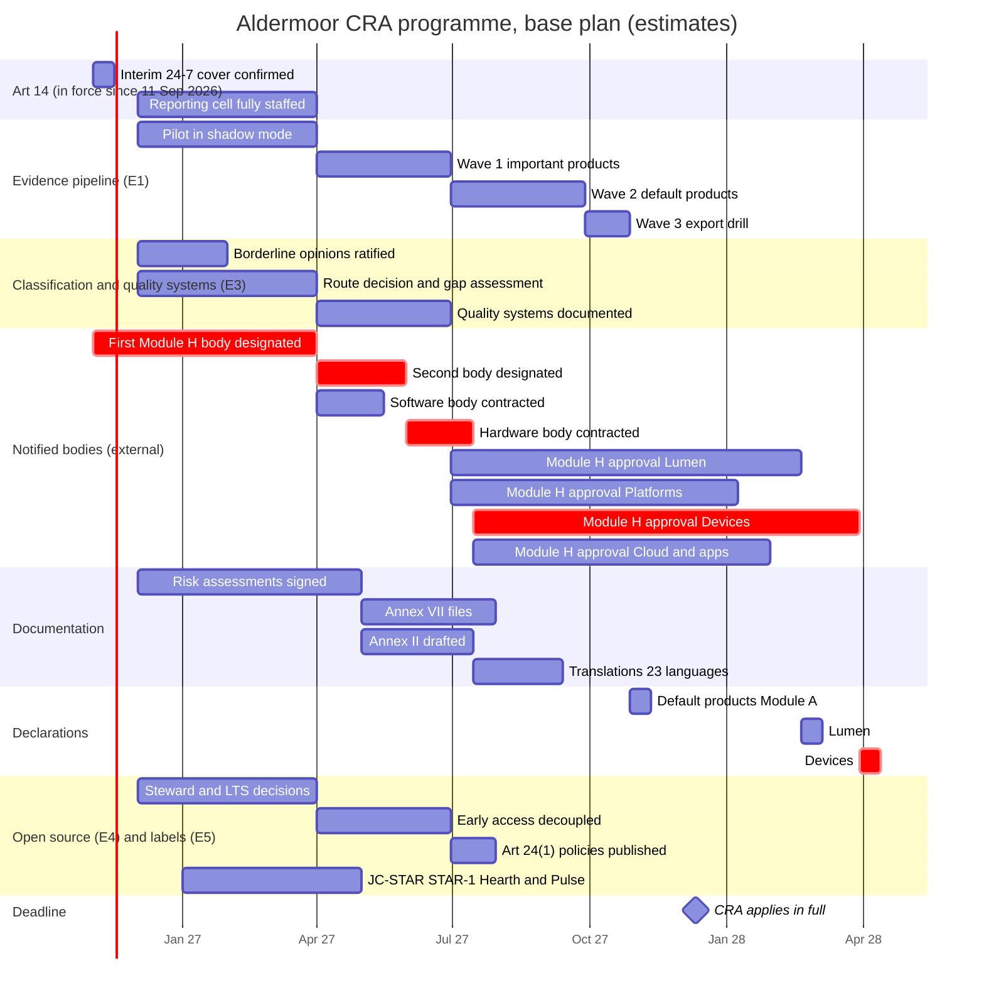

# One CRA programme for Aldermoor: budget, critical path and the odds of being ready on 11 December 2027

**Executive answer.** Aldermoor's CRA programme, including the product remediation that version 1 left out, costs about EUR 107m one-off (range EUR 43m to EUR 283m) and about EUR 36m a year to run from 2028 (range EUR 16m to EUR 90m). The run figure includes EUR 11m a year accrued for extending support periods to the five-year floor, which is paid from about 2030. Spend from Nov 2026 to Dec 2028 is about EUR 152m. Remediation of Annex I gaps across 34 product families is the largest line, at about 200 FTE-years (EUR 56m), and takes headcount to a peak of about 410 FTE in Q2 2027, of which about 270 sit in product teams. A correlated simulation, with shared factors for wage inflation, a market-wide notified-body shortage, legal-position outcomes and common estimating error, puts the P90 at EUR 139m one-off and EUR 44m a year to run. Fund to that. Money is still not the constraint; notified-body capacity is. On version 1's capacity assumptions, five decisions lift the chance that every product line is ready on 11 Dec 2027 from near zero to about 43% (47% if inputs are treated as independent), and to about 78% if a Module H body is designated by 31 Jan 2027. Those figures are conditional: public evidence at 1 Nov 2026 shows no CRA body in NANDO and only one named body accredited, for Module B. On an evidence-based view of Module H capacity, no notified-body line is likely to be ready on time even with every lever, and about EUR 1.6bn of EU revenue is at risk in expectation (EUR 3.4bn without the levers). The levers are worth far more than they cost: pre-contracting and reserving assessor capacity (L1) costs about EUR 3m and cuts expected revenue at risk by about EUR 1bn. All Aldermoor figures are estimates for a fictional client.

## The programme costs about EUR 107m one-off and EUR 36m a year, and remediation is half of it

The model (`model.py`, inputs in `assumptions.yaml` and `families.csv`) adds up every workstream the modules describe. Where a module publishes a figure, the model reads it from that module's output file. Where a module is silent, the input is labelled "assumption" with a low, base and high value. E1 gives effort in USD; the model converts at 0.919, the ratio in the brief. The budget shown is the recommended plan, with decisions L1 to L5 taken, because their costs are real.

**Exhibit 1: Budget by workstream, recommended plan (EUR m; estimates)**

| Workstream | One-off, low | One-off, base | One-off, high | Run 2028, low | Run 2028, base | Run 2028, high |
|---|---|---|---|---|---|---|
| 1 Evidence platform (E1) | 3.7 | 6.1 | 9.7 | 3.2 | 5.1 | 11.5 |
| 2 Art 14 operations (E2) | 0.5 | 0.8 | 1.6 | 1.4 | 2.8 | 9.4 |
| 3 Notified body and quality system (E3), incl. levers L1 and L3 | 4.4 | 8.0 | 13.9 | 1.3 | 2.5 | 3.8 |
| 4 Classification and legal (E3) | 0.9 | 1.6 | 3.1 | 0.2 | 0.4 | 0.8 |
| 5 Open-source programme (E4) | 1.0 | 1.6 | 2.9 | 3.2 | 6.3 | 10.3 |
| 6 Multi-jurisdiction labelling (E5) | 0.8 | 1.6 | 4.3 | 0.7 | 1.4 | 2.7 |
| 7 Documentation, Annex II and translations | 3.1 | 9.9 | 24.0 | 0.6 | 1.7 | 5.8 |
| 8 Training | 1.0 | 2.0 | 4.3 | 0.3 | 0.6 | 2.0 |
| 9 Programme office | 3.1 | 5.7 | 10.5 | 0.7 | 1.1 | 1.9 |
| 10 Product remediation and support periods (new in v2) | 20.4 | 55.8 | 152.3 | 3.8 | 11.0 | 30.2 |
| 11 Contingency (one-off 10/15/25%; run 5/10/15%) | 3.9 | 14.0 | 56.7 | 0.8 | 3.3 | 11.8 |
| **Total** | **42.6** | **107.0** | **283.3** | **16.2** | **36.1** | **90.2** |

Source: `outputs/budget.csv`. Run cost between Nov 2026 and Dec 2027 adds EUR 9.2m (base), mostly the Art 14 desk and E1's VEX operations, which start now. Total spend from Nov 2026 to Dec 2028 is EUR 64m, EUR 152m and EUR 399m in the low, base and high cases. Without the levers the one-off is EUR 104m: the levers add EUR 2.85m net, after the EUR 0.4m fee saving from L4.

Version 1 said the programme cost EUR 40m one-off and EUR 24m a year. That was the cost of the compliance machinery only. It left out the engineering to make products meet Annex I, and the cost of supporting them for the period the CRA requires. With those, the one-off is about two and a half times larger. Cash run cost in 2028, excluding the support-period accrual, is still EUR 24m.

Five points stand out.

- **Remediation is the biggest line and the most uncertain.** About 202 FTE-years (EUR 56m; range EUR 20m to EUR 152m). It is mostly engineering capacity redirected inside product teams, so it is an opportunity cost on roadmaps as much as a cash cost.
- **Documentation is the biggest compliance line.** About 200 product lines (E1) need human-written Annex VII parts, Annex II user information and translations into the languages each Member State requires for the declaration (Art 28(2)) and that users there easily understand (Art 13(18)); the model assumes all 23 non-English official languages. That is EUR 9.9m base, of which EUR 2.8m is translation.
- **Open-source funding is the biggest cash run line, and it is a policy choice.** E4's foundation and LTS recommendations cost EUR 5.5m a year at assumed contributions. None of it is a CRA duty.
- **The Art 14 desk is small but already overdue.** E2's model gives about 5.9 incremental FTE; Art 14 has applied since 11 Sep 2026.
- **Notified-body fees and reserved capacity are small.** Module H year-1 fees are EUR 1.3m to EUR 2.6m (E3). Reserving capacity under L1 costs about EUR 2.7m (corrected; see below).

A memo item sits outside the budget. Training 15,000 staff for 6 hours and every other engineer for 30 minutes takes about 120,000 hours of staff time, worth about EUR 21m at the E1 loaded rate.

## Remediation and support-period economics: about 200 FTE-years now and EUR 11m a year later

Version 1 had no line for bringing products up to Annex I. Version 2 costs it per family. The base pack's client cost model gives remediation effort of 1.2, 2.5 and 4.0 FTE-years per default, Class I and Class II family for a mid-size industrial group (`pack/clients/example-group/client.yaml`). Version 2 uses those rates as the calibration and scales each Aldermoor family by E3's complexity factor, by the square root of its product types (models share code), by an Aldermoor scale factor of 1.0 to 2.5 (base 1.5), and by a gap-severity factor for its business line. The severity factors are assumptions, set from what the brief and E3 say about each line's maturity.

**Exhibit 2: Remediation by business line (base; estimates)**

| Business line | Severity (low / base / high) | Main gaps assumed | FTE-years, base (low-high) | EUR m, base |
|---|---|---|---|---|
| Hearth smart home | 0.8 / 1.2 / 1.6 | Local interfaces, legacy default credentials, twice-yearly alarm firmware, security logging | 60 (27-133) | 16.5 |
| Cloud and enterprise (installed) | 0.5 / 0.8 / 1.1 | On-prem connectors, VPN gateway, Edge (Class II) hardening | 36 (15-81) | 9.8 |
| Lumen browser and WebView | 0.3 / 0.5 / 0.8 | Evidence of Annex I Part I properties; sandboxing and weekly fixes exist | 33 (14-84) | 9.1 |
| Pulse wearables | 0.9 / 1.3 / 1.8 | Bluetooth pairing, companion-app data, update cadence | 20 (9-47) | 5.6 |
| Keystone and Bastion | 1.0 / 1.5 / 2.0 | Key firmware is not field-updatable: redesign or a justified replacement policy | 17 (7-37) | 4.6 |
| Halo and Lumen OS | 0.5 / 0.7 / 1.0 | Attack-surface evidence, logging, OEM image hardening | 15 (7-37) | 4.2 |
| Arc devices | 0.4 / 0.6 / 0.9 | SBOM per version, earbud update path, secure-default review | 11 (5-26) | 2.9 |
| Consumer apps | 0.3 / 0.5 / 0.8 | Data-minimisation evidence, component due diligence | 8 (3-21) | 2.2 |
| Paid open-source distributions | 0.4 / 0.7 / 1.0 | Mooring Enterprise, Tensile LTS | 3 (1-8) | 0.9 |
| **Total, 34 families** | | | **202 (89-474)** | **55.8** |

Source: `outputs/remediation.csv` (per family). By class: Class I families take 130 FTE-years, default families 37, the Class II Edge platform 20 and integrated components (Halo OS, Bastion, the Hearth app) 15. Severity is 1.0 for the base pack's typical client, so Aldermoor's software lines are assumed better than that client and its smart-home and wearable lines worse.

Support periods are the second gap. The CRA requires a support period of at least five years unless the product is expected to be in use for less (Art 13(8)). The Commission FAQ (4.5.3, 7.2) points to a per-unit reading: a unit placed late in a model's sales life needs its own period (Appendix G; E6 legal-positions question F). A policy anchored to launch therefore has to cover the floor plus the sales life. Appendix G found two- and three-year policies for comparable wearables. Version 2 gives Aldermoor's families illustrative policies on the same pattern (recorded in `families.csv`) and costs the gap at 0.6 FTE of sustaining security engineering per model per extra year at E3 complexity 1 (range 0.3 to 1.2).

**Exhibit 3: Families below the floor under the per-unit reading (base; 2.5-year sales life; estimates)**

| Family | Policy assumed | Extra years needed | FTE a year (steady state) | EUR m a year |
|---|---|---|---|---|
| Halo Wear OS images | 3 years per release | 4.5 | 8.1 | 2.2 |
| Pulse smartwatches | 3 years from launch | 4.5 | 6.5 | 1.8 |
| Hearth smart speakers and displays | 5 years from launch | 2.5 | 5.9 | 1.6 |
| Hearth security cameras | 5 years from launch | 2.5 | 4.5 | 1.2 |
| Pulse fitness trackers | 2 years after last sold | 3.0 | 2.7 | 0.7 |
| Arc earbuds | 2 years from launch | 5.5 | 2.3 | 0.6 |
| Arc tablets | 5 years from launch | 2.5 | 2.0 | 0.5 |
| Other Hearth (doorbells, routers, locks, thermostats) | 5 years from launch | 2.5 | 5.8 | 1.6 |
| Arc phones | 7 years from launch | 0.5 | 1.4 | 0.4 |
| **Total** | | | **40 (17-94)** | **11.0 (3.8-30.2)** |

Source: `outputs/support_periods.csv`. Arc Book, Lumen OS and smoke alarms already meet the floor. Evergreen software (browser, apps, connectors) meets it while the product is maintained; versioned enterprise software (Edge, VPN gateway) meets it only if security fixes reach every customer through a free upgrade path, which is a legal position to confirm. Keystone keys cannot be updated, so they sit in remediation, not here.

The money falls late. Each year's placings create a commitment that is paid when those models reach their old end dates, from about 2030. The budget accrues it from 2028 as a run line, so the run figure carries the liability when it is incurred. The cheaper route for earbuds and trackers is to evidence a shorter expected use time, which Art 13(8) allows; the guidance treats five years as a safeguard, not a default (reports/sections/08-annex1-part2.md), so this needs product evidence, not a policy choice.

## Headcount peaks at about 410 FTE in Q2 2027; the programme itself is about 140

**Exhibit 4: Headcount by function, base case (FTE)**

| Function | Q4 26 | Q1 27 | Q2 27 | Q3 27 | Q4 27 | 2028 per quarter |
|---|---|---|---|---|---|---|
| Product remediation engineering (in product teams; new in v2) | 0 | 134.9 | 269.8 | 269.8 | 134.9 | 0 |
| Documentation and technical writing | 0 | 0 | 40.6 | 40.6 | 23.2 | 3.0 |
| Product onboarding engineering (E1) | 0 | 0 | 18.7 | 18.7 | 18.7 | 3.0 |
| Evidence platform engineering (E1) | 0 | 12.0 | 12.0 | 8.0 | 4.0 | 4.0 |
| Conformity and quality system (E3) | 0 | 12.0 | 12.0 | 12.0 | 12.0 | 6.0 |
| Programme office | 6.0 | 12.0 | 12.0 | 12.0 | 12.0 | 4.0 |
| Labelling and declarations (E5) | 0 | 8.8 | 11.8 | 9.8 | 4.5 | 4.5 |
| PSIRT VEX operations (E1) | 0 | 6.5 | 6.5 | 6.5 | 6.5 | 6.5 |
| Art 14 reporting cell (E2) | 3.0 | 4.6 | 5.9 | 5.9 | 5.9 | 5.9 |
| Open-source programme office (E4) | 0 | 4.0 | 4.0 | 7.0 | 7.0 | 3.0 |
| Art 14 tooling engineering (E2) | 3.0 | 4.5 | 4.5 | 0 | 0 | 0 |
| Release compliance and pt 110 review (E1) | 0 | 3.5 | 3.5 | 3.5 | 3.5 | 3.5 |
| Legal and classification (E3) | 2.0 | 3.0 | 3.0 | 3.0 | 3.0 | 1.5 |
| Training | 0 | 3.0 | 3.0 | 3.0 | 3.0 | 1.0 |
| **Total, base** | **14** | **209** | **407** | **400** | **238** | **46** |
| Total, low | 10 | 115 | 204 | 198 | 123 | 35 |
| Total, high | 22 | 431 | 856 | 843 | 483 | 77 |

Source: `outputs/headcount.csv`. Q4 2026 covers Nov and Dec only. Without remediation the programme peaks at 137 FTE, as in version 1. The support-period extension adds about 40 FTE of sustaining engineering from about 2030, outside this window.

E1's own estimate of 24 to 40 FTE-years in 2027 reconciles: the model gives 24 and 32 at low and base. The high case gives 52, because it includes E1's warning that substantial-modification review at release level would need about 12 FTE instead of 2.

## Notified-body capacity, not internal engineering, sets the date

The modules each assume a Module H approval arrives in time. None tests it. E3 frames Aldermoor's first wave as 10% to 20% of a thin EU market's annual capacity. That is true over a year, but the work cannot spread over a year. Internal readiness for an audit comes on 30 Jun 2027 in the base plan, leaving 5.5 months to 11 Dec 2027.

**Exhibit 5: Notified-body days by quarter, needed against capacity (body-days; estimates)**

| Quarter | Needed, low | Needed, base | Needed, high | Capacity, base plan | Backlog, base plan | Capacity, constrained | Backlog, constrained | Capacity, with levers L1-L3 | Base need as share of a thin EU market |
|---|---|---|---|---|---|---|---|---|---|
| Q2 2027 | 4 | 7 | 9 | 113 | 0 | 0 | 7 | 371 | 0% |
| Q3 2027 | 403 | 611 | 818 | 419 | 191 | 0 | 617 | 919 | 34% |
| Q4 2027 | 327 | 506 | 685 | 454 | 243 | 0 | 1,123 | 1,089 | 28% |
| Q1 2028 | 67 | 149 | 231 | 449 | 0 | 98 | 1,175 | 1,077 | 8% |
| Q2-Q4 2028, each | 67-68 | 149-151 | 231-234 | 449-454 | 0 | 135-272 | 981-1,189 | 1,077-1,089 | 8% |

Source: `outputs/nb_schedule.csv`. "Needed" spreads E3's Module H first-wave days (719 to 1,458; base 1,089) from 30 Jun to 11 Dec 2027, then E3's steady-state days. Base capacity is two bodies with 5 CRA assessors each working for Aldermoor (assumption). Constrained is the high-case designation and contracting dates with 3 assessors. With levers is three bodies with 8 reserved assessors each. In the base plan the first wave clears in Q1 2028; in the constrained case not in 2028; with the levers in Q4 2027.

## On the plan as written, no notified-body product line is ready on 11 December 2027

The critical-path model links 48 activities from all modules, plus an end node. Each has a low, base and high duration. Module H approval time is computed: the organisation's E3 body-days divided by the assessor capacity it gets, with a 60-day floor.

**Exhibit 6: Base-plan schedule (critical chain marked crit)**

**Exhibit 7: Base-plan ready dates and driving chains**

| Product line | Ready (base) | Slack to target | Driving chain |
|---|---|---|---|
| Lumen (browser, WebView) | 5 Mar 2028 | -84 days | Mobilise > gap assessment > QS documented > Module H approval (234 days) > declarations |
| Platforms (Lumen OS, Halo Wear OS) | 22 Jan 2028 | -42 days | As Lumen; approval 192 days |
| Devices Class I (Hearth, Pulse, Keystone) | 13 Apr 2028 | -123 days | First designation > second designation > contract > Module H approval (258 days) > declarations. This is the project critical path |
| Cloud and apps Class I and II | 13 Feb 2028 | -64 days | First designation > second designation > contract > approval (199 days) |
| Default-class products (Module A) | 11 Nov 2027 | 30 days | Mobilise > E1 pilot > wave 1 > wave 2 > wave 3 > declarations |
| Open-source stewardship | 30 Jul 2027 | 134 days | Decisions > early access decoupled > policies published |
| Art 14 desk at full strength (target 31 Mar 2027) | 1 Apr 2027 | -1 day | Mobilise > hiring |
| JC-STAR labels (target 30 Jun 2027) | 1 May 2027 | 60 days | Control set adopted > STAR-1 self-declarations |

Source: `outputs/critical_path.csv` (ES, EF, LS, LF and float for every activity).

The approvals take 192 to 258 days because two organisations share each body's assessors. Lumen alone needs about 290 body-days (E3). Five assessors working for Aldermoor deliver about 2.5 body-days per calendar day per body, so half a body takes about 234 days.

The default products are on time in the base plan, but by only 30 days. Their chain is E1's four sequential waves. E1 says its plan leaves six weeks of contingency; the model agrees that this is thin.

## Five decisions lift the all-lines probability to about 43%, but only on the stated capacity assumptions

The Monte Carlo runs the network 5,000 times, drawing each duration from a PERT distribution over its low, base and high values. Each lever set uses the same random draws, so differences come from the decisions, not from noise. Exhibit 8 is scenario A: version 1's capacity assumptions (a Module H body designated between Jan and Oct 2027, base Apr 2027; 5 assessors per body working for Aldermoor, 8 if reserved). Those assumptions have no market evidence behind them (see the market evidence section), so every probability in this exhibit is conditional on them.

**Exhibit 8: Probability of being ready by the target date, scenario A (conditional on stated capacity assumptions; 5,000 runs)**

| Product line | Base plan | L1 pre-contract | L2 sequence | L3 third body | L4 joint QS | L5 parallel E1 | L1-L3 | L1-L5 | Early designation only | L1-L5 and early designation |
|---|---|---|---|---|---|---|---|---|---|---|
| Lumen | 0% | 20% | 48% | 0% | 32% | 0% | 91% | 86% | 1% | 86% |
| Platforms | 5% | 49% | 1% | 5% | 31% | 5% | 21% | 86% | 6% | 87% |
| Devices Class I | 0% | 6% | 20% | 20% | 0% | 0% | 72% | 72% | 0% | 88% |
| Cloud and apps Class I and II | 2% | 30% | 0% | 19% | 2% | 2% | 56% | 56% | 4% | 92% |
| Default-class products | 58% | 58% | 58% | 58% | 58% | 94% | 58% | 94% | 58% | 94% |
| Open-source stewardship | 100% | 100% | 100% | 100% | 100% | 100% | 100% | 100% | 100% | 100% |
| Art 14 desk by 31 Mar 2027 | 40% | 40% | 40% | 40% | 40% | 40% | 40% | 40% | 40% | 40% |
| JC-STAR labels by 30 Jun 2027 | 98% | 98% | 98% | 98% | 98% | 98% | 98% | 98% | 98% | 98% |
| **All CRA product lines, inputs independent** | **0%** | **3%** | **0%** | **0%** | **0%** | **0%** | **11%** | **47%** | **0%** | **81%** |
| **All CRA product lines, correlated** | **0%** | **3%** | **0%** | **0%** | **0%** | **0%** | **14%** | **43%** | **0%** | **78%** |

Source: `outputs/readiness_probability.csv` (independent, version 1 draws) and `outputs/readiness_scenarios.csv` (correlated). Early designation means a Module H body designated by 31 Jan 2027, which no public evidence supports.

The levers work as follows.

- **L1 pre-contract and reserve capacity.** Letters of intent before designation cut contracting from about 45 days to about 14, and reserve 8 assessors per body instead of 5. Reserved capacity is paid for whether used or not. Version 1 costed this at about EUR 1m, for 3 extra assessors at two bodies. That understated it: the modelled lever set is three bodies (with L3) with 8 reserved assessors each. Version 2 costs the reservation as 3 bodies x 8 assessors x 180 days a year x 6 months = 2,160 body-days; Aldermoor's own Module H work uses about 896 of them (already in E3's fees), so it pays for about 1,264 unused days at E3's EUR 1,800 day rate plus a 10% premium on all reserved days. That is EUR 2.7m (range EUR 1.3m to EUR 5.9m), now in the budget. With two bodies only, it is EUR 0.9m.
- **L2 sequence.** Each body finishes one organisation before the next: Lumen first on the software body, Devices first on the hardware body. Under the Commission's draft guidance only substantially modified versions are new placings (paras 15, 108, Example 2), so a version placed before 11 Dec 2027 can keep receiving non-substantial and security updates without a certificate (Art 69(2)). Hardware units placed before 11 Dec 2027 stay lawful, with only Art 14 applying to them (reports/sections/15-programme.md).
- **L3 third body for Cloud and apps.** This takes the lowest-revenue organisation off the hardware body. It costs about EUR 0.16m to onboard, and raises the L1 reservation.
- **L4 Platforms inside the Lumen quality system.** One I.11 model review (about 45 body-days) instead of its own approval (about 237). This saves about EUR 0.35m in fees. It applies only to Module H.
- **L5 parallel evidence onboarding.** Default-product onboarding alongside wave 1 moves default readiness from 58% to 94%. It costs no extra FTE-years, but raises the Q2 2027 peak.

## Cost of delay: each week a notified-body line cannot place new units puts about EUR 68m of EU revenue at risk

A late certificate does not stop Aldermoor selling what it has already placed. Units placed before 11 Dec 2027 may continue to be made available, and versions placed before then keep receiving security updates (Art 69(2); guidance paras 15, 108). What it blocks is new placings: new hardware units, new licences of paid software where each copy is a placing, and new substantially modified versions of free clients. The model therefore applies a different exposure to each kind of revenue, using E3's illustrative EU revenue per family.

**Exhibit 9: EU revenue exposed per week of lateness (base exposure; illustrative revenue; estimates)**

| Line | EU revenue a year (EUR m) | Kind of revenue | Share lost while blocked (low / base / high) | Revenue at risk per week, base (EUR m) |
|---|---|---|---|---|
| Lumen | 7,800 | Enabled search and services revenue | 1% / 3% / 10% (feature freeze; current users kept) | 4.5 |
| Platforms (Lumen OS, Halo Wear) | 1,050 | Licence fees | 10% / 40% / 80% | 8.1 |
| Devices Class I (Hearth, Pulse, Keystone) | 3,175 | Device sales (plus EUR 180m Hearth subscriptions) | 70% / 90% / 100% after 8 / 4 / 0 weeks of channel stock | 51.9 |
| Cloud and apps Class I and II | 530 | Product revenue (Edge, VPN gateway) and subscriptions | as Platforms and Lumen | 3.2 |
| **Notified-body lines together** | **12,555** | | | **67.7 (about EUR 290m a month)** |
| Default-class products (Module A) | 24,320 | Arc devices, Halo Services, apps | as above | 235.9 |

Source: `outputs/cost_of_delay.csv`; revenue from portfolio-classification/classification.csv; mapping in `families.csv`. The weekly figure for Devices applies after channel stock runs out. At an assumed 35% contribution margin, a month's delay on the notified-body lines is worth about EUR 100m of contribution.

The Monte Carlo applies these exposures to every run's lateness, capped at the end of 2028.

**Exhibit 10: Expected EU revenue at risk by scenario and lever set (correlated simulation; EUR m; estimates)**

| Line | A, base plan | A, L1-L5 | B, base plan | B, L1-L5 | C, base plan | C, L1-L5 without L4 |
|---|---|---|---|---|---|---|
| Lumen | 97 | 3 | 288 | 85 | 206 | 11 |
| Platforms | 93 | 4 | 370 | 124 | 259 | 116 |
| Devices Class I | 1,101 | 41 | 2,573 | 1,238 | 2,599 | 1,736 |
| Cloud and apps | 58 | 13 | 176 | 107 | 138 | 31 |
| Default-class products | 35 | 19 | 35 | 19 | 35 | 19 |
| **All lines** | **1,384** | **79** | **3,441** | **1,573** | **3,237** | **1,913** |

Source: `outputs/cost_of_delay.csv`. Scenarios are defined in the market evidence section. Devices dominates because its revenue is hardware and its Module H effort is the largest. Default products carry a small expected loss but a large weekly exposure, so L5 is cheap insurance on EUR 236m a week.

**Exhibit 11: Expected value of each lever (correlated; budget cost against expected revenue at risk avoided x 35% margin; EUR m)**

| Lever | Budget cost, alone | EV alone, A | EV alone, B (evidence) | EV alone, C | Budget cost, in the L1-L5 set | EV in set, B | EV in set, C |
|---|---|---|---|---|---|---|---|
| L1 pre-contract and reserve | 1.0 | 348 | 298 | 129 | 3.1 | 360 | 391 |
| L2 sequence | 0 | 313 | 234 | 50 | 0 | 0 | 0 |
| L3 third body | 0.2 | 306 | 212 | 43 | 1.8 | 10 | 45 |
| L4 joint quality system | -0.4 | 48 | 74 | -3 | 0 | 28 | -24 |
| L5 parallel E1 onboarding | 0 | 6 | 6 | 6 | 0 | 6 | 6 |
| **L1-L5 together** | **2.9** | **454** | **651** | **437** | **2.9** | **651** | **437** |

Source: `outputs/lever_value.csv`. "Alone" compares the lever with the base plan; "in set" removes it from L1-L5. L1 is the most valuable lever in every scenario: about EUR 3m buys about EUR 1bn of avoided revenue at risk on the evidence-based view. L2 has no value once L3 and L4 are in place, because each body then serves one organisation. L4 should be dropped if only Module B bodies exist, because it queues Platforms behind Lumen. The EUR 1m question in version 1 is answered: the reservation is worth buying at several times its corrected cost.

## Correlated risk and funding level: fund to EUR 139m one-off and EUR 44m a year

Version 1 sampled every input independently, which lets errors cancel and makes the range too narrow. Version 2 runs one joint simulation of cost and schedule in which inputs share latent factors. Each input's normal score is a weighted sum of the factors plus its own noise, mapped to its PERT distribution. The loadings are assumptions, listed with reasons in `assumptions.yaml` (section corr) and the workbook's Correlation sheet.

**Exhibit 12: Shared factors and what they move**

| Factor | Inputs it moves (loading) | Why |
|---|---|---|
| Wage and market inflation | Loaded FTE cost (0.8); advisory, counsel and translation rates (0.4-0.5); notified-body fees and day rates (0.3-0.4); time to staff the Art 14 desk (0.4) | One labour market prices all people costs |
| Market-wide notified-body shortage | Designation dates (0.6-0.8); assessors per body, reserved or not (0.7); contracting time (0.5); fees, day rate, reservation length and premium (0.5-0.6) | A thin market is late, small and expensive at once |
| Legal-position outcome | Module H body-days and fees for Platforms (0.6), Lumen (0.5), Devices and Cloud (0.3); counsel effort; product lines to document (0.4); model sales life for the per-unit support reading (0.5); classification opinions (0.5) | A failed Halo Services or WebView call widens scope everywhere |
| Delivery (E7 addition) | Every effort estimate, remediation severity and scale (0.3-0.5); internal durations such as quality-system documentation and E1 waves (0.4) | Estimates made by the same organisation err together |

**Exhibit 13: Cost of the recommended plan, independent against correlated (5,000 runs; EUR m)**

| Measure | Independent P50 | Independent P90 | Three market factors P90 | Four factors P50 | Four factors P80 | Four factors P90 |
|---|---|---|---|---|---|---|
| One-off | 112.6 | 134.1 | 133.5 | 112.1 | 129.5 | 139.3 |
| Run 2028 (incl. support accrual) | 38.3 | 44.3 | 44.3 | 38.3 | 42.2 | 44.3 |
| Total Nov 2026 to Dec 2028 | 161.4 | 184.8 | 185.0 | 160.7 | 180.3 | 191.3 |

Source: `outputs/correlated_mc.csv`. The three market factors barely widen the cost range, because one input (the loaded FTE rate) already carries wage risk in both runs and notified-body costs are small. Common estimating error is what widens it: the four-factor P90 is EUR 5m higher one-off and EUR 6.5m higher in total than the independent P90. The P50 sits above the base case because remediation risk is skewed upwards.

On schedule, correlation matters more. On scenario A the all-lines probability with L1-L5 falls from 47% (independent) to 43%, and with early designation from 81% to 78%, because a shortage now delays designation and cuts capacity in the same runs.

The funding recommendation is the four-factor P90: **EUR 139m one-off and EUR 44m a year to run** (of which EUR 12m is the support-period accrual, paid from about 2030). That is EUR 32m above the base one-off. Hold the difference centrally, release it against the remediation gap assessments in Mar 2027, and re-run the simulation then.

## Market evidence on notified-body capacity: no CRA body in NANDO and no Module H accreditation announced

**Exhibit 14: What is publicly known about candidate CRA notified bodies (pages opened 1 Nov 2026)**

| Organisation or register | Status found | Modules | Date | Source type |
|---|---|---|---|---|
| NANDO register | Zero bodies notified under Regulation (EU) 2024/2847; 13 of 27 Member States had a notifying authority | n/a | 12 Sep 2026 | Independent check (S5) |
| NANDO register | No CRA body designated | n/a | 8 Sep 2026 | Independent check (S6) |
| Brightsight (SGS group), Netherlands | Accredited by RvA (ISO/IEC 17065) for Module B; pilot assessment and notification through RDI still to come; Module H accreditation in progress | B accredited; H in progress | 26 Aug 2026 | Vendor statement (S7, S8) |
| UL International (Netherlands) B.V. | Service terms describe it as a CRA notified body with NANDO number 2821, offering Module B and Module H | B, H | 31 Jul 2026 | Vendor statement; conflicts with register checks of 8 and 12 Sep 2026, so treated as intent (S9) |
| DAkkS with BSI, Germany | Accreditation opened: Module B under ISO/IEC 17065, Module H under ISO/IEC 17021-1, with BSI; applications accepted; no applicants named | B, H | 28 Jul and 25 Sep 2026 | Authority statement (S10); trade press summary (S11) |
| DEKRA | "Will be" a CRA notified body; no application, accreditation or module scope stated | not stated | undated | Vendor statement (S12) |
| Applus+ Laboratories | Progressing through accreditation and notification; offers Module B and C pre-assessment; aims to offer Module H, but said Module H schemes were not yet established by accreditation bodies | B+C; H intended | undated; Jun 2026 | Vendor statements (S13, S14) |
| TÜV SÜD, TÜV Rheinland, BSI Group | No CRA application or accreditation found in the pages opened; listed only as accredited labs | not found | 30 Aug 2026 | Third-party listing (S15) |
| Traficom, Finland | Accreditation by FINAS, then notification by Traficom; national act in force 1 Jun 2026 | B+C, H | 17 Aug 2026 | Authority statement (S16) |

Source: `market_evidence.csv`. This module could not open NANDO directly; the latest register check found is 12 Sep 2026. Objection windows after notification are two weeks with accreditation and two months without (E6 claim K24).

Three conclusions follow. First, Module B is ahead of Module H: one body is accredited for Module B, and none for Module H. Second, Module H accreditation only opened in Germany in late Jul 2026, and commentary puts accreditation plus notification at 12 to 18 months (reports/sections/15-programme.md), which points to late 2027 for the first Module H bodies, not Apr 2027. Third, no body has published CRA assessor numbers, so version 1's 5 to 8 assessors per body working for Aldermoor is unsupported; a new body serving many clients is more likely to offer 2 to 5.

Version 2 therefore runs two further scenarios.

- **Scenario B, evidence-based Module H.** First Module H body designated between Apr 2027 and Apr 2028 (base end Sep 2027); second and third bodies 90 and 150 days later (base); 3 assessors per body working for Aldermoor (2 to 5), 5 if reserved.
- **Scenario C, Module B and C only through 2027.** No Module H body before 2028. Aldermoor uses EU-type examination for every type, with E3's Module B+C body-days (879 to 2,542 in year 1, against 719 to 1,458 for Module H). First Module B body designated between Jan and Jun 2027 (base Mar 2027), on Brightsight's path. Year-1 fees rise by about EUR 0.3m to EUR 2.0m (E3).

**Exhibit 15: Probability of being ready by 11 Dec 2027 under each scenario (correlated; 5,000 runs)**

| Product line | A, L1-L5 | A, L1-L5 and early designation | B, base plan | B, L1-L5 | C, base plan | C, L1-L5 without L4 |
|---|---|---|---|---|---|---|
| Lumen | 82% | 83% | 0% | 3% | 0% | 57% |
| Platforms | 83% | 83% | 0% | 3% | 0% | 3% |
| Devices Class I | 65% | 85% | 0% | 0% | 0% | 0% |
| Cloud and apps | 51% | 87% | 0% | 0% | 0% | 15% |
| Default-class products | 90% | 90% | 57% | 90% | 57% | 90% |
| **All CRA product lines** | **43%** | **78%** | **0%** | **0%** | **0%** | **0%** |
| All lines, P50 ready date | 20 Dec 2027 | 18 Nov 2027 | 22 May 2029 | 1 Aug 2028 | 12 Dec 2030 | 4 Sep 2028 |

Source: `outputs/readiness_scenarios.csv`. On the evidence, the question is no longer whether every line will be ready on 11 Dec 2027 but how late each will be and what that costs. With L1-L5 on scenario B, Lumen's P50 date is 21 Mar 2028 and Devices' 24 Jun 2028. Scenario C shows that a Module B fallback rescues Lumen (four product types, 57%) and part of Cloud and apps, but not Devices, whose 30-odd types need far more examination days than a Module H approval.

## Assessor capacity and the designation date move the date most; remediation moves the budget most

The tornado moves one driver from low to high with everything else at base. "End date" is the project critical path in the base plan (scenario A); cost is the recommended plan.

**Exhibit 16a: Schedule drivers (base plan)**

| Driver | End date, low | End date, high | Swing (days) | Lumen swing (days) | Default products swing (days) |
|---|---|---|---|---|---|
| Assessors per body working for Aldermoor (8 to 3) | 7 Jan 2028 | 2 Oct 2028 | 269 | 244 | 0 |
| Module H body designation date (Jan to Oct 2027) | 29 Mar 2028 | 10 Oct 2028 | 195 | 135 | 0 |
| Module H effort, E3 body-days (719 to 1,458) | 15 Jan 2028 | 11 Jul 2028 | 178 | 153 | 0 |
| Second body designation lag (0 to 180 days) | 29 Mar 2028 | 11 Aug 2028 | 135 | 0 | 0 |
| Quality-system gap assessment and documentation | 13 Apr 2028 | 27 Jul 2028 | 105 | 120 | 0 |
| Evidence pipeline waves (E1) | 13 Apr 2028 | 27 Jul 2028 | 105 | 120 | 255 |
| Contracting time after designation (14 to 120 days) | 29 Mar 2028 | 27 Jun 2028 | 90 | 30 | 0 |

**Exhibit 16b: Cost drivers (total spend Nov 2026 to Dec 2028, recommended plan, EUR m; base EUR 152.4m)**

| Driver | Low | High | Swing |
|---|---|---|---|
| Remediation scale, Aldermoor family against base-pack family (1.0 to 2.5) | 131.0 | 195.2 | 64.2 |
| Remediation gap severity, all business lines | 130.5 | 178.3 | 47.8 |
| Loaded cost per FTE-year (USD 250,000 to 350,000; E1) | 131.4 | 173.4 | 42.1 |
| Support-period extension (sales life, sustaining effort) | 145.3 | 168.8 | 23.5 |
| Contingency rates | 145.7 | 163.8 | 18.1 |
| Translation volume and price | 149.8 | 159.6 | 9.8 |
| Documentation effort per product line | 148.0 | 157.1 | 9.2 |
| Art 14 volume scenario (E2 low to high) | 150.4 | 159.4 | 9.0 |
| L1 reservation terms (months, premium, day rate) | 150.3 | 156.9 | 6.6 |

Source: `outputs/sensitivity.csv` (36 drivers). The remediation gap assessments due in Mar 2027 are the single most valuable piece of information for the budget: they settle the two largest drivers.

## Where the modules disagree, the case picks one reading and says why

| Issue | Modules | What the case uses | Reason |
|---|---|---|---|
| Whether the E1 gate blocks Module H products without a certificate reference from Jun 2027 | E1 against E3 | Route and certificate checks apply only to units placed from 11 Dec 2027 | E1's gate keys these checks to the effective placing date |
| Notified-body share of the market | E3: 10% to 20% of a thin market a year | 34% of a thin market in Q3 2027 | The work must fit between 30 Jun and 11 Dec 2027 |
| When to contract a body | KB: contract by Q1 2027; E1 and E3 earlier said within 30 days of designation | At least two bodies, a third pre-contracted; letters of intent before designation (L1, L3) | A contract needs a designated body; none existed at the last register check (12 Sep 2026) |
| Notified-body capacity | v1 assumed 5 to 8 assessors per body and a Module H body from Jan 2027 | Kept as scenario A, labelled conditional; scenarios B and C from public evidence | No evidence supported v1's values |
| Unit of the portfolio | E1: about 200 product lines; E3: 40 families | E1 for onboarding and documentation; E3 for classification, Module H, remediation and support periods | They count different things |
| Support periods | No module sets Aldermoor policies; Appendix G shows 2-3 year wearable policies at a comparable company | Illustrative policies in `families.csv`, costed under the per-unit reading | Needed to cost Art 13(8) |
| Currency | E1 in USD; E3 in EUR | EUR at 0.919 per USD | Ratio in the brief |
| Notice localisation | E2 assumes 24-language notices but excludes translation | EUR 0.95m a year added (assumption) | Cost not carried elsewhere |
| E5's claim that UK, US and Japan add under 10% | E5 | 2.7% of total spend | Confirms E5 |

## Every figure reconciles to its source module

**Exhibit 17: Reconciliation**

| Figure | Value used (low / base / high) | Module value | Source file |
|---|---|---|---|
| E1 evidence effort, 2027 (FTE-years) | 24 / 32 / 52 | 24-40 | evidence-as-code/paper.md (high adds release-level review) |
| E1 evidence cost, 2027 (EUR m) | 5.5 / 8.8 / 16.7 | USD 6-14m = EUR 5.5-12.9m | evidence-as-code/paper.md; BRIEF.md |
| EU product lines to onboard | 200 (150-250) | about 200 | evidence-as-code/aldermoor-additions.json |
| Incremental Art 14 FTE | 5.56 / 5.93 / 9.01 | 5.56 / 5.93 / 9.01 | art14-operations/volume_model_output.csv |
| Art 14 user notices a year | 62 / 275 / 884 | 62 / 275 / 884 | art14-operations/volume_model_output.csv |
| Module H year-1 fees (EUR m) | 1.29 / 1.96 / 2.62 | 1.29-2.62 | portfolio-classification/nb_demand_summary.json |
| Module H run fees (EUR m a year) | 0.49 / 1.08 / 1.67 | 0.49-1.67 | portfolio-classification/nb_demand_summary.json |
| Module H year-1 body-days | 719 / 1,089 / 1,458 | 719-1,458 | portfolio-classification/nb_demand_summary.json |
| Module B+C year-1 body-days (scenario C) | 879-2,542 in total | 879-2,542 | portfolio-classification/nb_demand_summary.json |
| Notified-body route families | 17 | 17 | portfolio-classification/classification_summary.json |
| Families in the remediation scope | 34 | 40 less 2 out of scope and 4 not placed | portfolio-classification/classification_summary.json |
| Remediation rate per family (FTE-years) | 1.2 / 2.5 / 4.0 by class, scaled | 1.2 / 2.5 / 4.0 | pack/clients/example-group/client.yaml (cost_model) |
| EU product revenue for cost of delay (EUR m a year) | 36,875 | 36,875 | portfolio-classification/classification_summary.json |
| Notified-body route revenue (EUR m a year) | 12,555 | 12,555 | portfolio-classification/classification_summary.json |
| Support-period floor | 5 years | at least five years unless expected use is shorter | oj-verification/claims.csv (B15) |
| Comparable wearable policies | Pulse 3 years; trackers 2 years after last sold (assumed) | 3 years; 2 years after last sold | google-outside-in/paper.md (Exhibit 5) |
| L1 reserved capacity | 2,160 body-days reserved, 896 used; EUR 2.66m (1.28-5.90) | v1: about EUR 1m | E7 v1 (corrected) |
| Platforms inside the Lumen QS (body-days) | 22 / 44 / 67 | from E3 parameters | portfolio-classification/nb_demand_summary.json; nb_demand.csv |
| Projects Aldermoor leads | 5 | 5 | open-source-strategy/projects.yaml |
| Controls in the global set | 43 | 43 | global-control-set/controls.json |
| Art 14 applies from 11 Sep 2026; full application 11 Dec 2027 | Verified | Verified (F02, F03) | oj-verification/claims.csv |
| Loaded cost per FTE-year (EUR) | 229,750 / 275,700 / 321,650 | USD 250,000-350,000 | evidence-as-code/paper.md |
| JC-STAR STAR-1 fee | JPY 198,000 per application | JPY 198,000 incl. tax | IPA application page |

Source: `outputs/reconciliation.csv`; every other input is listed with its source in `outputs/inputs_resolved.csv`. The workbook `Aldermoor CRA Integrated Programme Case.xlsx` rebuilds the budget (including per-family remediation and support periods, and the lever costs), headcount, critical path and weekly revenue at risk as live formulas with a scenario switch and the five lever switches. It was recalculated in LibreOffice with no formula errors (2,346 formulas), and its totals and critical-path dates match `model.py` in all three scenarios, with levers all off and all on.

## Decisions for the executive team

1. **Approve a funding envelope of EUR 139m one-off and EUR 44m a year to run (the correlated P90), with EUR 107m and EUR 36m as the base plan.** Hold the difference centrally and release it against the remediation gap assessments. Owner: CFO with the CTO. Timing: Dec 2026; re-run the simulation in Mar 2027.
2. **Pre-contract three notified bodies now and reserve 8 CRA assessors at each (L1, L3); budget EUR 2.7m for it.** One software body, one hardware body, one for Cloud and apps. Start with the bodies that have public progress (Brightsight for Module B; candidates in the German Module H pipeline), check Art 39 independence first, and ask each for named assessor capacity in writing. Owner: CISO with Procurement and General Counsel. Timing: shortlist by Dec 2026; letters of intent by Feb 2027.
3. **Prepare a Module B and C fallback for Lumen and Cloud and apps, and keep Module H for Devices.** Decide by 31 Mar 2027 on the evidence of designations by then. Drop L4 if the fallback is used. Owner: VP Engineering with the Head of Product Compliance. Timing: fallback route files by Jun 2027.
4. **Plan Devices for a late certificate.** Place channel stock before 11 Dec 2027 where lawful, align launch dates so no new model depends on a 2027 certificate, and sequence Devices first on its body (L2). Each week of Devices delay puts about EUR 52m of revenue at risk. Owner: Head of Devices with the CFO. Timing: launch calendar decision by Mar 2027.
5. **Run per-family remediation gap assessments and fix the support-period policies.** Start with Hearth, Pulse and Keystone, where severity is highest, and set declared EU end dates per unit for wearables, earbuds and Halo Wear, or evidence a shorter expected use. Owner: VP Engineering with product line leads and General Counsel. Timing: assessments by Mar 2027; policies by Jun 2027.
6. **Staff the Art 14 desk to about 6 FTE now, and decide the open-source funding line explicitly (EUR 5.5m a year).** Owner: CISO and CTO. Timing: offers by Jan 2027; funding with E4's decisions in Mar 2027.

## Risks and open questions

- **Designation is outside Aldermoor's control, and the evidence is thin.** No CRA body was in NANDO at the last register check found (12 Sep 2026); this module could not open NANDO itself. Vendor statements are intent, not designation. Re-check monthly.
- **The headline probabilities are conditional.** Scenario A's 43% and 78% rest on capacity assumptions with no market evidence. Scenario B is the planning case.
- **Remediation is estimated, not assessed.** The rates come from a mid-size client and are scaled by assumption. The gap assessments could move the one-off by EUR 50m either way.
- **Cost of delay rests on illustrative revenue and assumed exposure.** The largest uncertainty is whether each copy of paid software is a new placing (high case) and how much channel stock Devices can place before 11 Dec 2027. Lateness is capped at the end of 2028, so scenario B and C losses are understated.
- **Correlation loadings are judgements.** They are listed per input; the delivery factor is E7's addition and drives most of the widening.
- **Placing of software versions.** The guidance treats security releases as updates, not new placings (paras 15, 108); if the adopted guidance or an authority took the opposite view, a late certificate would stop EU releases, not just launches.
- **Support-period reading.** The per-unit reading comes from the FAQ, not the Regulation's text (E6 question F). Under a model-level reading the EUR 11m a year falls sharply.
- **Translation scope and the US Cyber Trust Mark** remain as in version 1: limiting translations to Member States of sale would save part of EUR 2.8m; US lab fees would add about EUR 0.6m once the FCC finalises test procedures.

## Sources

Enterprise Edition modules (pack/enterprise/):
- E1 `evidence-as-code/paper.md` and `aldermoor-additions.json`.
- E2 `art14-operations/volume_model_output.csv`, `volume_model.csv` and `paper.md`.
- E3 `portfolio-classification/nb_demand_summary.json` (Module H and B+C days and fees), `nb_demand.csv`, `classification_summary.json`, `classification.csv` (class and illustrative EU revenue per family), `portfolio.yaml` (types, complexity, cadence) and `paper.md`.
- E4 `open-source-strategy/paper.md` and `projects.yaml`. E5 `global-control-set/paper.md` and `controls.json`.
- E6 `oj-verification/claims.csv` (F02, F03, B15, K23, K24, T26).
- Appendix G `google-outside-in/paper.md` (Exhibit 5, published support policies).
- Base pack `pack/clients/example-group/client.yaml` (cost_model remediation rates; calibration only).

Knowledge base: reports/sections/08-annex1-part2.md (Art 13(8) floor; guidance paras 125-128); reports/sections/10-conformity.md; reports/sections/05-roles.md; reports/sections/15-programme.md (contracting and accreditation durations, commentary; legacy units and Art 69); reports/guides/corporate/11-programme-budget.md.

External (opened 1 Nov 2026; full list in `market_evidence.csv`):
- S5 [StandardOS, "The EU's own CRA machinery, on the day the duty started"](https://getstandardos.com/articles/the-eu-s-own-cra-machinery-on-the-day-the-duty-started) (independent register check, 12 Sep 2026).
- S6 [cyberresilienceact.eu, "CRA notified bodies: rules apply from 11 June 2026"](https://www.cyberresilienceact.eu/news/cra-notified-bodies-rules-apply-11-june-2026.html) (independent site; check to 8 Sep 2026).
- S7 [Brightsight, "Brightsight achieves ISO/IEC 17065 accreditation for CRA Module B"](https://www.brightsight.com/news/post/brightsight-achieves-iso-iec-17065-accreditation-for-cra-module-b) (vendor, 26 Aug 2026).
- S8 [Brightsight, "Brightsight advances to become a CRA Notified Body"](https://www.brightsight.com/news/post/brightsight-advances-to-become-a-cra-notified-body) (vendor).
- S9 [UL Solutions, Cyber Resilience Act service terms](https://www.ul.com/sites/default/files/2026-08/CYBER%20RESILIENCE%20ACT_SERVICE%20TERMS.pdf) (vendor, 31 Jul 2026).
- S10 [DAkkS, "DAkkS starts accreditation process under the Cyber Resilience Act"](https://www.dakks.de/en/pressrelease/dakks-starts-accreditation-process-under-the-cyber-resilience-act.html) (authority, 28 Jul 2026).
- S11 [Nexvyra, "BSI und DAkkS vereinbaren Prüfkompetenz für CRA-Konformitätsbewertungsstellen"](https://nexvyra.de/news/2026-09-27-bsi-dakks-cra-pruefkompetenz-konformitaetsbewertung.html) (trade press, 27 Sep 2026).
- S12 [DEKRA, Cyber Resilience Act](https://www.dekra.com/en/cyberresilienceact/) (vendor).
- S13 [Applus+ Laboratories, Cyber Resilience Act notified body](https://www.appluslaboratories.com/global/en/what-we-do/service-sheet/cyber-resilience-act-notified-body) (vendor).
- S14 [Applus+ Laboratories, CRA Module H roadmap](https://www.appluslaboratories.com/global/en/news/cra-module-h-roadmap) (vendor).
- S15 [CVD Portal, CRA notified bodies and testing labs](https://cvdportal.com/standards/notified-bodies) (third-party listing, as of 30 Aug 2026).
- S16 [NCSC-FI, Business opportunities for notified bodies under the CRA](https://www.kyberturvallisuuskeskus.fi/en/our-activities/regulation-and-supervision/cyber-resilience-act-cra/business-opportunities-notified-bodies-under-cra) (authority, 17 Aug 2026).
- [European Commission, CRA conformity assessment](https://digital-strategy.ec.europa.eu/en/policies/cra-conformity-assessment) (31 Jul 2026).
- [IPA, JC-STAR application page](https://www.ipa.go.jp/security/jc-star/shinsei/index.html); [Regulation (EU) 2024/2847](https://eur-lex.europa.eu/eli/reg/2024/2847/oj).

Module files: `model.py`, `assumptions.yaml`, `families.csv`, `market_evidence.csv`, `build_workbook.py`, `Aldermoor CRA Integrated Programme Case.xlsx`, `outputs/` (budget, headcount, nb_schedule, critical_path, readiness_probability, readiness_scenarios, sensitivity, remediation, support_periods, correlated_mc, cost_of_delay, lever_value, reconciliation, inputs_resolved, summary).
