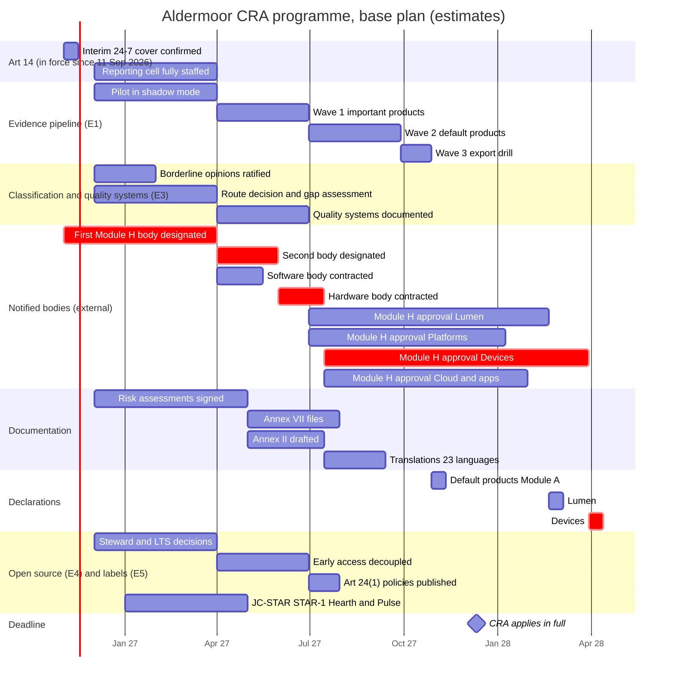

# One CRA programme for Aldermoor: budget, critical path and the odds of being ready on 11 December 2027

**Executive answer.** Added up across the six Enterprise Edition modules, Aldermoor's CRA programme costs about EUR 40m one-off (range EUR 19m to EUR 86m; Monte Carlo P10 to P90 EUR 37m to EUR 46m) and about EUR 24m a year to run from 2028 (range EUR 12m to EUR 55m). From Nov 2026 to the end of 2028 that is about EUR 73m. People are about two-thirds of it. Headcount peaks at about 140 FTE in Q2 2027 (85 to 224) and settles at about 46 FTE. Money is not the constraint. On the plan as the modules set it out, the probability that every product line is ready on 11 Dec 2027 is close to zero. Default-class products have a 58% chance. Each of the four notified-body organisations has 5% or less, because a Module H approval needs 720 to 1,460 notified-body days that can only start once a body is designated and contracted. Five decisions lift the all-lines probability to about 47%: pre-contract and reserve assessor capacity, sequence Lumen and Devices first, add a third body for Cloud and apps, put Platforms inside the Lumen quality system, and onboard default products to the evidence pipeline in parallel. With those decisions and a Module H body designated by 31 Jan 2027, it rises to about 81%. What moves the date most is assessor capacity per body (269 days of swing), the designation date (195 days) and the size of the Module H effort (178 days). What moves the budget most is the loaded cost per FTE (EUR 17m), translation volume (EUR 10m) and documentation effort (EUR 9m). All Aldermoor figures are estimates for a fictional client.

## The programme costs about EUR 40m one-off and EUR 24m a year, and two-thirds of it is people

The model (`model.py`, inputs in `assumptions.yaml`) adds up every workstream the modules describe. Where a module publishes a figure, the model reads it from that module's output file. Where a module is silent, the input is labelled "assumption" with a low, base and high value. E1 gives effort in USD; the model converts at 0.919, the ratio in the brief.

**Exhibit 1: Budget by workstream (EUR m; estimates)**

| Workstream | One-off, low | One-off, base | One-off, high | Run 2028, low | Run 2028, base | Run 2028, high |
|---|---|---|---|---|---|---|
| 1 Evidence platform (E1) | 3.7 | 6.1 | 9.7 | 3.2 | 5.1 | 11.5 |
| 2 Art 14 operations (E2) | 0.5 | 0.8 | 1.6 | 1.4 | 2.8 | 9.4 |
| 3 Notified body and quality system (E3) | 3.2 | 5.5 | 8.2 | 1.3 | 2.5 | 3.8 |
| 4 Classification and legal (E3) | 0.9 | 1.6 | 3.1 | 0.2 | 0.4 | 0.8 |
| 5 Open-source programme (E4) | 1.0 | 1.6 | 2.9 | 3.2 | 6.3 | 10.3 |
| 6 Multi-jurisdiction labelling (E5) | 0.8 | 1.6 | 4.3 | 0.7 | 1.4 | 2.7 |
| 7 Documentation, Annex II and translations | 3.1 | 9.9 | 24.0 | 0.6 | 1.7 | 5.8 |
| 8 Training | 1.0 | 2.0 | 4.3 | 0.3 | 0.6 | 2.0 |
| 9 Programme office | 3.1 | 5.7 | 10.5 | 0.7 | 1.1 | 1.9 |
| 10 Contingency (one-off 10/15/25%; run 5/10/15%) | 1.7 | 5.2 | 17.1 | 0.6 | 2.2 | 7.2 |
| **Total** | **18.9** | **40.0** | **85.7** | **12.2** | **24.0** | **55.4** |

Source: `outputs/budget.csv`. Run cost between Nov 2026 and Dec 2027 adds EUR 9.2m (base), mostly the Art 14 desk and E1's VEX operations, which start now. Total spend from Nov 2026 to Dec 2028 is EUR 36m, EUR 73m and EUR 167m in the low, base and high cases.

The low and high columns set every input to its low or high value at once. That is a stress test, not a forecast. Sampling each input independently gives a P10 to P90 range of EUR 37m to EUR 46m one-off, EUR 23m to EUR 28m a year to run, and EUR 71m to EUR 83m in total. The truth lies between the two views, because some inputs move together (wage rates, portfolio size). Fund to the P90 and hold the difference to base as central contingency.

Four points stand out.

- **Documentation is the biggest one-off line, and no module costed it.** About 200 product lines (E1) need human-written Annex VII parts, Annex II user information and translations into 23 languages (Art 28; Art 13(18)). That is EUR 9.9m base, of which EUR 2.8m is translation.
- **Open-source funding is the biggest run line, and it is a policy choice.** E4 recommends foundations for Kite and Mooring and a member-funded Lumen Engine LTS body. E4 gives no budget. At assumed contributions this is EUR 5.5m a year of the EUR 6.3m line. None of it is a CRA duty; it is the price of staying a steward rather than becoming a manufacturer.
- **The Art 14 desk is small but already overdue.** E2's model gives about 5.9 incremental FTE. Art 14 has applied since 11 Sep 2026, so this is a running cost now, not a project. Localising user notices into 24 languages, which E2 labels an assumption, adds EUR 0.95m a year that E2 did not cost.
- **Notified-body fees are small.** Module H year-1 fees are EUR 1.3m to EUR 2.6m (E3). Internal quality-system staff cost more than the fees.

A memo item sits outside the budget. Training 15,000 staff for 6 hours and every other engineer for 30 minutes takes about 120,000 hours of staff time, worth about EUR 21m at the E1 loaded rate.

## Headcount peaks at about 140 FTE in Q2 2027 and settles at about 46 FTE

**Exhibit 2: Headcount by function, base case (FTE)**

| Function | Q4 26 | Q1 27 | Q2 27 | Q3 27 | Q4 27 | 2028 per quarter |
|---|---|---|---|---|---|---|
| Documentation and technical writing | 0 | 0 | 40.6 | 40.6 | 23.2 | 3.0 |
| Product onboarding engineering (E1) | 0 | 0 | 18.7 | 18.7 | 18.7 | 3.0 |
| Evidence platform engineering (E1) | 0 | 12.0 | 12.0 | 8.0 | 4.0 | 4.0 |
| Conformity and quality system (E3) | 0 | 12.0 | 12.0 | 12.0 | 12.0 | 6.0 |
| Programme office | 6.0 | 12.0 | 12.0 | 12.0 | 12.0 | 4.0 |
| Labelling and declarations (E5) | 0 | 8.8 | 11.8 | 9.8 | 4.5 | 4.5 |
| PSIRT VEX operations (E1) | 0 | 6.5 | 6.5 | 6.5 | 6.5 | 6.5 |
| Art 14 reporting cell (E2) | 3.0 | 4.6 | 5.9 | 5.9 | 5.9 | 5.9 |
| Open-source programme office (E4) | 0 | 4.0 | 4.0 | 7.0 | 7.0 | 3.0 |
| Art 14 tooling engineering (E2) | 3.0 | 4.5 | 4.5 | 0 | 0 | 0 |
| Release compliance and pt 110 review (E1) | 0 | 3.5 | 3.5 | 3.5 | 3.5 | 3.5 |
| Legal and classification (E3) | 2.0 | 3.0 | 3.0 | 3.0 | 3.0 | 1.5 |
| Training | 0 | 3.0 | 3.0 | 3.0 | 3.0 | 1.0 |
| **Total, base** | **14** | **74** | **137** | **130** | **103** | **46** |
| Total, low | 10 | 56 | 85 | 79 | 64 | 35 |
| Total, high | 22 | 115 | 224 | 212 | 167 | 77 |

Source: `outputs/headcount.csv`. Q4 2026 covers Nov and Dec only.

E1's own estimate of 24 to 40 FTE-years in 2027 reconciles: the model gives 24 and 32 at low and base. The high case gives 52, because it includes E1's warning that substantial-modification review at release level, rather than at feature launch, would need about 12 FTE instead of 2. That single choice is worth EUR 6m over the period.

## Notified-body capacity, not internal engineering, sets the date

The modules each assume a Module H approval arrives in time. None tests it. E3 frames Aldermoor's first wave as 10% to 20% of a thin EU market's annual capacity. That is true over a year, but the work cannot spread over a year. Internal readiness for an audit (quality systems documented, the evidence gate enforced for important products, risk assessments signed) comes on 30 Jun 2027 in the base plan. That leaves 5.5 months to 11 Dec 2027.

**Exhibit 3: Notified-body days by quarter, needed against capacity (body-days; estimates)**

| Quarter | Needed, low | Needed, base | Needed, high | Capacity, base plan | Backlog, base plan | Capacity, constrained | Backlog, constrained | Capacity, with levers L1-L3 | Base need as share of a thin EU market |
|---|---|---|---|---|---|---|---|---|---|
| Q2 2027 | 4 | 7 | 9 | 113 | 0 | 0 | 7 | 371 | 0% |
| Q3 2027 | 403 | 611 | 818 | 419 | 191 | 0 | 617 | 919 | 34% |
| Q4 2027 | 327 | 506 | 685 | 454 | 243 | 0 | 1,123 | 1,089 | 28% |
| Q1 2028 | 67 | 149 | 231 | 449 | 0 | 98 | 1,175 | 1,077 | 8% |
| Q2-Q4 2028, each | 67-68 | 149-151 | 231-234 | 449-454 | 0 | 135-272 | 981-1,189 | 1,077-1,089 | 8% |

Source: `outputs/nb_schedule.csv`. "Needed" spreads E3's Module H first-wave days (719 to 1,458; base 1,089) from 30 Jun to 11 Dec 2027, then E3's steady-state days. Base capacity is two bodies from their base contract dates, each with 5 CRA assessors working for Aldermoor (assumption). Constrained is the high-case designation and contracting dates with 3 assessors. With levers is three bodies with 8 reserved assessors each. A thin market is E3's hypothetical 7,200 body-days a year.

In the base plan the first wave clears in Q1 2028. In the constrained case it does not clear in 2028. With the levers it clears in Q4 2027. At its peak, Aldermoor alone would need a third of a thin market's quarterly capacity, not the 10% to 20% the annual view suggests.

## On the plan as written, no notified-body product line is ready on 11 December 2027

The critical-path model links 48 activities from all modules, plus an end node: the Art 14 desk, the E1 evidence waves, classification opinions and quality-system work (E3), notified-body designation and contracting, Module H approvals, documentation and translation, open-source decisions (E4) and labels (E5). Each has a low, base and high duration. Module H approval time is computed, not assumed: the organisation's E3 body-days divided by the assessor capacity it gets, with a 60-day floor.

**Exhibit 4: Base-plan schedule (critical chain marked crit)**

**Exhibit 5: Base-plan ready dates and driving chains**

| Product line | Ready (base) | Slack to target | Driving chain |
|---|---|---|---|
| Lumen (browser, WebView) | 5 Mar 2028 | -84 days | Mobilise > gap assessment > QS documented > Module H approval (234 days) > declarations |
| Platforms (Lumen OS, Halo Wear OS) | 22 Jan 2028 | -42 days | As Lumen; approval 192 days |
| Devices Class I (Hearth, Pulse, Keystone) | 13 Apr 2028 | -123 days | First designation > second designation > contract > Module H approval (258 days) > declarations. This is the project critical path |
| Cloud and apps Class I and II | 13 Feb 2028 | -64 days | First designation > second designation > contract > approval (199 days) |
| Default-class products (Module A) | 11 Nov 2027 | 30 days | Mobilise > E1 pilot > wave 1 > wave 2 > wave 3 > declarations |
| Open-source stewardship | 30 Jul 2027 | 134 days | Decisions > early access decoupled > policies published |
| Art 14 desk at full strength (target 31 Mar 2027) | 1 Apr 2027 | -1 day | Mobilise > hiring |
| JC-STAR labels (target 30 Jun 2027) | 1 May 2027 | 60 days | Control set adopted > STAR-1 self-declarations |

Source: `outputs/critical_path.csv` (ES, EF, LS, LF and float for every activity).

The approvals take 192 to 258 days because two organisations share each body's assessors. Lumen alone needs about 290 body-days (E3). Five assessors working for Aldermoor deliver about 2.5 body-days per calendar day per body, so half a body takes about 234 days.

The default products are on time in the base plan, but by only 30 days. Their chain is E1's four sequential waves. E1 says its plan leaves six weeks of contingency; the model agrees that this is thin.

## Five decisions lift the all-lines probability from near zero to about 47%

The Monte Carlo runs the network 5,000 times. Each duration is drawn from a PERT distribution over its low, base and high values. Each lever set uses the same random draws, so differences come from the decisions, not from noise.

**Exhibit 6: Probability of being ready by the target date (Monte Carlo, 5,000 runs)**

| Product line | Base plan | L1 pre-contract | L2 sequence | L3 third body | L4 joint QS | L5 parallel E1 | L1-L3 | L1-L5 | Early designation only | L1-L5 and early designation |
|---|---|---|---|---|---|---|---|---|---|---|
| Lumen | 0% | 20% | 48% | 0% | 32% | 0% | 91% | 86% | 1% | 86% |
| Platforms | 5% | 49% | 1% | 5% | 31% | 5% | 21% | 86% | 6% | 87% |
| Devices Class I | 0% | 6% | 20% | 20% | 0% | 0% | 72% | 72% | 0% | 88% |
| Cloud and apps Class I and II | 2% | 30% | 0% | 19% | 2% | 2% | 56% | 56% | 4% | 92% |
| Default-class products | 58% | 58% | 58% | 58% | 58% | 94% | 58% | 94% | 58% | 94% |
| Open-source stewardship | 100% | 100% | 100% | 100% | 100% | 100% | 100% | 100% | 100% | 100% |
| Art 14 desk by 31 Mar 2027 | 40% | 40% | 40% | 40% | 40% | 40% | 40% | 40% | 40% | 40% |
| JC-STAR labels by 30 Jun 2027 | 98% | 98% | 98% | 98% | 98% | 98% | 98% | 98% | 98% | 98% |
| **All CRA product lines** | **0%** | **3%** | **0%** | **0%** | **0%** | **0%** | **11%** | **47%** | **0%** | **81%** |

Source: `outputs/readiness_probability.csv` (lever sets S0 to S9, with P50 and P80 dates). Early designation means a Module H body designated by 31 Jan 2027.

The levers work as follows.

- **L1 pre-contract and reserve capacity.** Letters of intent with two candidate bodies before designation cut contracting from about 45 days to about 14, and reserve 8 assessors per body instead of 5. Reserved capacity probably has to be paid for whether used or not. At E3's day rate of EUR 1,800, reserving 3 extra assessors at two bodies for two quarters is about 540 days, or about EUR 1m (estimate, not in the budget).
- **L2 sequence.** Each body finishes one organisation before the next. Lumen goes first on the software body and Devices first on the hardware body. Lumen carries 62% of notified-body revenue (E3) and, as software, cannot bridge the deadline with stock: each new version after 11 Dec 2027 is a new placing under the Commission's draft guidance (E1). Hardware units placed before 11 Dec 2027 stay lawful, with only Art 14 applying to them (reports/sections/15-programme.md).
- **L3 third body for Cloud and apps.** This takes the lowest-revenue organisation off the hardware body.
- **L4 Platforms inside the Lumen quality system.** E3 already suggests one combined system. Platforms then needs one I.11 model review (about 45 body-days from E3's parameters) instead of its own approval (about 237). This also saves about EUR 0.35m in fees.
- **L5 parallel evidence onboarding.** Start default-product onboarding alongside wave 1 instead of after it. This moves default-product readiness from 58% to 94%. It costs no extra FTE-years, but raises the Q2 2027 peak.

Two results matter for the executive team. First, early designation alone changes almost nothing (0% to 0% for all lines), because capacity, not the start date, is binding. Second, even with every lever, Cloud and apps reaches only 56% unless a body is designated early. That is the line to accept risk on, because it carries the least revenue.

## Assessor capacity and the designation date move the date most; people cost and translation move the budget most

The tornado moves one driver from low to high with everything else at base. "End date" is the project critical path (the last product line ready) in the base plan.

**Exhibit 7a: Schedule drivers (base plan)**

| Driver | End date, low | End date, high | Swing (days) | Lumen swing (days) | Default products swing (days) |
|---|---|---|---|---|---|
| Assessors per body working for Aldermoor (8 to 3) | 7 Jan 2028 | 2 Oct 2028 | 269 | 244 | 0 |
| Module H body designation date (Jan to Oct 2027) | 29 Mar 2028 | 10 Oct 2028 | 195 | 135 | 0 |
| Module H effort, E3 body-days (719 to 1,458) | 15 Jan 2028 | 11 Jul 2028 | 178 | 153 | 0 |
| Second body designation lag (0 to 180 days) | 29 Mar 2028 | 11 Aug 2028 | 135 | 0 | 0 |
| Quality-system gap assessment and documentation | 13 Apr 2028 | 27 Jul 2028 | 105 | 120 | 0 |
| Evidence pipeline waves (E1) | 13 Apr 2028 | 27 Jul 2028 | 105 | 120 | 255 |
| Contracting time after designation (14 to 120 days) | 29 Mar 2028 | 27 Jun 2028 | 90 | 30 | 0 |
| Mobilisation and funding decision (14 to 60 days) | 13 Apr 2028 | 28 Apr 2028 | 15 | 46 | 46 |

**Exhibit 7b: Cost drivers (total spend Nov 2026 to Dec 2028, EUR m; base EUR 73.3m)**

| Driver | Low | High | Swing |
|---|---|---|---|
| Loaded cost per FTE-year (USD 250,000 to 350,000; E1) | 64.9 | 81.6 | 16.7 |
| Translation volume and price | 70.7 | 80.4 | 9.8 |
| Documentation effort per product line | 68.8 | 78.0 | 9.2 |
| Art 14 volume scenario (E2 low to high) | 71.3 | 80.3 | 9.0 |
| Contingency rates | 70.0 | 78.3 | 8.2 |
| Foundation and LTS funding (E4) | 69.7 | 78.0 | 8.2 |
| Programme office and advisory | 70.4 | 78.3 | 7.9 |
| Portfolio size (150 to 250 product lines) | 70.2 | 76.4 | 6.2 |
| pt 110 review at release level instead of feature launch (E1) | 73.3 | 79.3 | 6.1 |
| Training | 71.9 | 77.2 | 5.3 |

Source: `outputs/sensitivity.csv` (32 drivers). No cost driver moves the date, and the only schedule driver with a cost effect is the Module H effort (EUR 2.5m swing).

The top three readiness drivers are all about notified bodies, and two of them (assessors per body and contracting time) are partly in Aldermoor's control through L1. The internal drivers that matter are the quality-system documentation and the E1 waves, each worth about 105 days at the end date and 120 days for Lumen.

## Where the modules disagree, the case picks one reading and says why

| Issue | Modules | What the case uses | Reason |
|---|---|---|---|
| The E1 gate fails any Module H product without a certificate reference, and E1 enforces it for important products from Jun 2027 | E1 (control table; wave 1 exit criterion) against E3 (no certificate before late 2027 at best) | Enforce evidence checks (SBOM, provenance, VEX, tests) from Jun 2027; key the route and certificate check to placings from 11 Dec 2027 | As written, the gate would block every EU release of Lumen, Hearth and Pulse from Jun 2027, before the conformity duties apply |
| Notified-body share of the market | E3: 10% to 20% of a thin market a year | 34% of a thin market in Q3 2027 | Same E3 body-days; the work must fit between 30 Jun and 11 Dec 2027 |
| When to contract a body | E1: start Q1 2027; KB: contract by Q1 2027; E3: within 30 days of designation, no later than Q2 2027 | E3, with pre-contracting as lever L1 | A contract needs a designated body; none existed at the last verified check (8 Sep 2026) |
| Unit of the portfolio | E1: about 200 product lines; E3: 40 families | E1 for onboarding and documentation; E3 for classification and Module H | They count different things; both are kept |
| Currency | E1 in USD; E3 in EUR | EUR at 0.919 per USD | Ratio in the brief |
| Upstream reporting in the Art 14 workload | E2 counts Art 13(6) upstream hours now; E6 verifies Art 13(6) applies from 11 Dec 2027 | E2's hours kept (about 73 hours a year) | Good practice and immaterial; it is not a legal duty before Dec 2027 |
| Notice localisation | E2 assumes 24-language notices but excludes translation from its FTE | EUR 0.95m a year added (assumption; low case English only) | Cost not carried anywhere else |
| Costs absent from modules | E4 (no costs), E5 (US lab fees excluded), documentation and training (no module) | Labelled assumptions | Needed for a complete envelope |
| E5's claim that UK, US and Japan add under 10% | E5 | 5.4% of total spend | Confirms E5 |

## Every figure reconciles to its source module

**Exhibit 8: Reconciliation**

| Figure | Value used (low / base / high) | Module value | Source file |
|---|---|---|---|
| E1 evidence effort, 2027 (FTE-years) | 24 / 32 / 52 | 24-40 | evidence-as-code/paper.md (effort table; high adds release-level review) |
| E1 evidence cost, 2027 (EUR m) | 5.5 / 8.8 / 16.7 | USD 6-14m = EUR 5.5-12.9m | evidence-as-code/paper.md; BRIEF.md |
| EU product lines to onboard | 200 (150-250) | about 200 | evidence-as-code/aldermoor-additions.json |
| Evidence storage, central | USD 340 a year x 5 tier multiple | about USD 340 | evidence-as-code/paper.md |
| Incremental Art 14 FTE | 5.56 / 5.92 / 9.00 | 5.56 / 5.93 / 9.01 | art14-operations/volume_model_output.csv |
| Art 14 user notices a year | 62 / 275 / 884 | 62 / 275 / 884 | art14-operations/volume_model_output.csv |
| Existing duty-officer rota | not budgeted | 5.47 FTE-equivalent, absorbed in PSIRT | art14-operations/volume_model_output.csv |
| Module H year-1 fees (EUR m) | 1.29 / 1.96 / 2.62 | 1.29-2.62 | portfolio-classification/nb_demand_summary.json |
| Module H run fees (EUR m a year) | 0.49 / 1.08 / 1.67 | 0.49-1.67 | portfolio-classification/nb_demand_summary.json |
| Module H year-1 body-days | 719 / 1,089 / 1,458 | 719-1,458 | portfolio-classification/nb_demand_summary.json |
| Steady-state body-days a year | 270 / 599 / 928 | 270-928 | portfolio-classification/nb_demand_summary.json |
| Notified-body route families | 17 | 17 | portfolio-classification/classification_summary.json |
| Hearth and Pulse models for JC-STAR | 28 (13 new a year) | initial and new types for I.12, I.16, I.17, I.19 | portfolio-classification/nb_demand.csv |
| Platforms inside the Lumen QS (body-days) | 22 / 44 / 67 | from E3 parameters (0.5 x complexity 4 x EUR 20,000-60,000 / EUR 1,800) | portfolio-classification/nb_demand_summary.json; nb_demand.csv |
| Projects Aldermoor leads | 5 | 5 | open-source-strategy/projects.yaml |
| Controls in the global set | 43 | 43 | global-control-set/controls.json |
| Art 14 applies from 11 Sep 2026 | Verified | Verified (F02) | oj-verification/claims.csv |
| Full application 11 Dec 2027 | Verified | Verified (F03) | oj-verification/claims.csv |
| Member States to "strive" for bodies by 11 Dec 2026 | Verified | Verified (K23) | oj-verification/claims.csv |
| Loaded cost per FTE-year (EUR) | 229,750 / 275,700 / 321,650 | USD 250,000-350,000 | evidence-as-code/paper.md |
| JC-STAR STAR-1 fee | JPY 198,000 per application | JPY 198,000 incl. tax | IPA application page |

Source: `outputs/reconciliation.csv`; every other input is listed with its source in `outputs/inputs_resolved.csv`. The workbook `Aldermoor CRA Integrated Programme Case.xlsx` rebuilds the budget, headcount and critical path as live formulas with a scenario switch and the five lever switches. It was recalculated in LibreOffice with no formula errors (1,924 formulas), and its totals and critical-path dates match `model.py` in all three scenarios.

## Decisions for the executive team

1. **Approve a funding envelope of EUR 46m one-off and EUR 28m a year to run (the P90), with EUR 40m and EUR 24m as the base plan.** Hold the difference centrally. Owner: CFO with the CTO. Timing: Dec 2026. Mobilisation sits on Lumen's chain: each week of delay moves Lumen by a week.
2. **Pre-contract three notified bodies now and reserve at least 8 CRA assessors at each (L1, L3).** One software body (Lumen and Platforms), one hardware body (Devices), one for Cloud and apps. Check Art 39 independence before any letter of intent. Budget about EUR 1m for reserved capacity. Owner: CISO with Procurement and General Counsel. Timing: shortlist by Dec 2026 (E3); letters of intent by Feb 2027; contracts within 14 days of each designation.
3. **De-risk Lumen and Devices first, and put Platforms inside the Lumen quality system (L2, L4).** Accept residual risk on Cloud and apps, with a written fallback: units and versions placed before 11 Dec 2027 where lawful, and launch dates that do not depend on a certificate. Owner: VP Engineering with the Head of Product Compliance. Timing: with the Module H route decision, Jan 2027.
4. **Staff the Art 14 desk to about 6 FTE now (9 FTE in the high case).** The duty has applied since 11 Sep 2026, and the plan has only a 40% chance of full strength by 31 Mar 2027. Use contractors for the 24/7 filing seat until hires land. Owner: CISO with the CFO. Timing: offers out by Jan 2027.
5. **Onboard default products to the evidence pipeline in parallel with wave 1 (L5), and date-key the gate's route and certificate checks to placings from 11 Dec 2027.** Owner: CTO with the VP Engineering for developer infrastructure. Timing: Dec 2026, before the E1 pilot starts.
6. **Decide the open-source funding line explicitly.** EUR 5.5m a year for the Kite Foundation, Mooring membership and a Lumen Engine LTS body is the price of E4's steward strategy, not a CRA requirement. Owner: CTO with the Head of the Open Source Programme Office. Timing: Mar 2027, with E4's LTS and steward decisions.

## Risks and open questions

- **Designation is outside Aldermoor's control.** No CRA notified body was listed in NANDO at the last verified check (8 Sep 2026). This module did not find a newer check. The designation distribution (Jan to Oct 2027, base Apr 2027) is an assumption.
- **Correlated risk.** The Monte Carlo draws each input independently. A market-wide shortage would delay designation and cut assessor availability at the same time. The lever probabilities are therefore best read as an upper bound.
- **Body-days rest on vendor commentary.** E3's cost anchors are unverified commentary. If Lumen's year-1 days are at E3's high end, Lumen's ready date moves by about 2.5 months in the base plan (5 Mar to 20 May 2028).
- **Budget profile and levers.** The budget does not change with the levers, apart from L4 in the workbook. L1's reservation cost (about EUR 1m) is outside the budget, and L5 raises the Q2 2027 peak.
- **Cost range.** The independent-sampling P10 to P90 range (EUR 71m to EUR 83m in total) is narrow because errors cancel. The all-high case (EUR 167m) is the stress test.
- **Classification moves families.** If the Halo Services call (E3 rank 1) fails, EUR 6.8bn of revenue moves to the notified-body route and Platforms' Module H effort grows. WebView (F13) is the call most likely to be challenged.
- **Per-version placing for software.** The Commission guidance is an approved draft. If every Lumen security release is a new placing after 11 Dec 2027, a late certificate stops EU releases, not just launches.
- **Translation scope.** Translating every product line into 23 languages is the conservative reading. Limiting it to the Member States where each product is sold would save part of the EUR 2.8m.
- **US Cyber Trust Mark.** Excluded from the base case. Lab fees for 28 models would add about EUR 0.6m in the base price case, once the FCC finalises test procedures.
- **Two-month quarter.** Q4 2026 covers Nov and Dec; profiles approximate it.

## Sources

Enterprise Edition modules (pack/enterprise/):
- E1 `evidence-as-code/paper.md` (effort table, review load, storage, wave plan, gate controls) and `aldermoor-additions.json` (about 200 product lines; 2,000 versions a week).
- E2 `art14-operations/volume_model_output.csv`, `volume_model.csv` and `paper.md` (FTE, notices, Decision 3).
- E3 `portfolio-classification/nb_demand_summary.json`, `nb_demand.csv`, `classification_summary.json` and `paper.md` (Module H days and fees, capacity scenarios, route and contracting decisions, borderline calls).
- E4 `open-source-strategy/paper.md` and `projects.yaml` (decisions and timing; no costs).
- E5 `global-control-set/paper.md` and `controls.json` (decisions; under-10% claim).
- E6 `oj-verification/claims.csv` (F02, F03, K23, T26).

Knowledge base: reports/sections/10-conformity.md (notified-body status at 8 Sep 2026; Art 28 declaration languages); reports/sections/05-roles.md (Art 13(18)); reports/sections/15-programme.md (phase durations; contracting 2-4 months and accreditation plus notification 12-18 months, commentary; legacy units and Art 69); reports/guides/corporate/11-programme-budget.md (budget lines; documentation starts at risk-assessment sign-off).

External:
- [IPA, JC-STAR application page](https://www.ipa.go.jp/security/jc-star/shinsei/index.html) (STAR-1 fee JPY 198,000 including tax; label valid two years).
- [cyberresilienceact.eu, "CRA notified bodies: rules apply from 11 June 2026"](https://www.cyberresilienceact.eu/news/cra-notified-bodies-rules-apply-11-june-2026.html) (independent site; no CRA body in NANDO at its 8 Sep 2026 check).
- [Regulation (EU) 2024/2847](https://eur-lex.europa.eu/eli/reg/2024/2847/oj).

Module files: `model.py`, `assumptions.yaml`, `build_workbook.py`, `Aldermoor CRA Integrated Programme Case.xlsx`, `outputs/` (budget, headcount, nb_schedule, critical_path, readiness_probability, sensitivity, reconciliation, inputs_resolved, summary).
