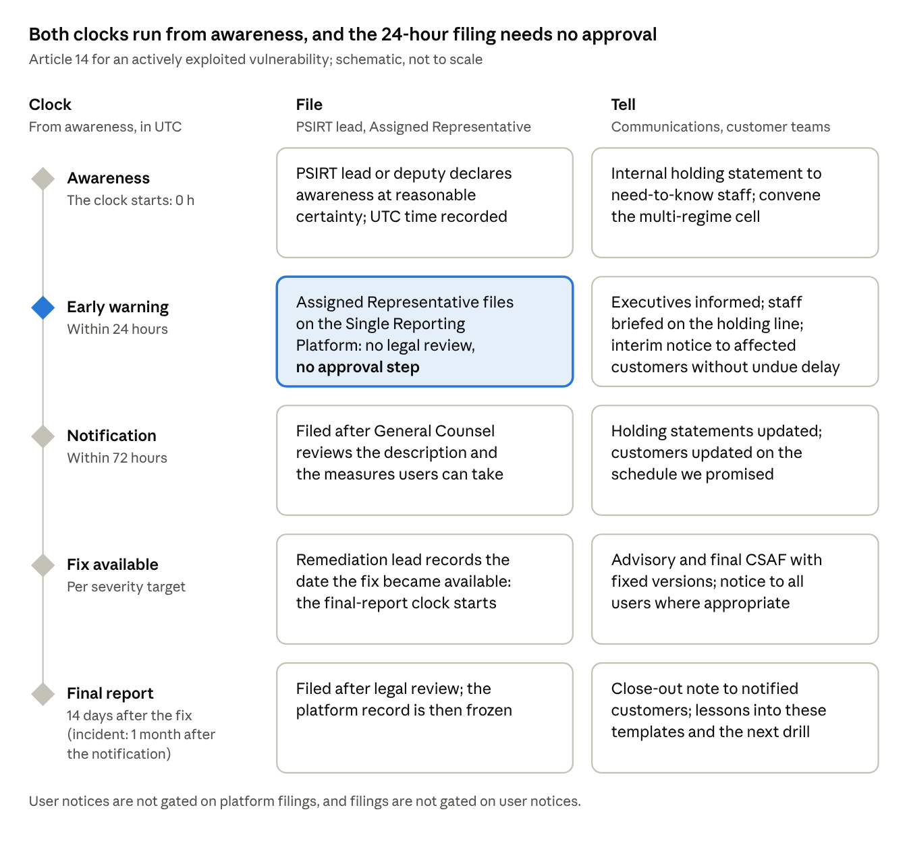

# Project Rampart — CRA Communication Pack

Oct 31, 2026 · Prepared by \[Advisor\]

Example Group (illustrative) runs every Project Rampart message from this pack: one message house, a dated calendar to 11 Dec 2027, 13 ready-to-send drafts, reporting templates and the Article 14 incident playbook. Regulatory facts as at 30 Oct 2026.

## How to use this pack

**Run every Project Rampart message from this pack and draft nothing from scratch.** It serves three users: the executive sponsor (decisions and executive messages), internal communications (calendar, drafts, measurement) and BU leaders (cascades and customer conversations).

*Exhibit 1: What each tab is for*

| Tab | Use it to | Main users | Update cadence |
| --- | --- | --- | --- |
| 2. Stakeholder map | Decide who hears what, from whom and how often, across 22 stakeholder groups | Programme director, internal communications | Monthly, after SteerCo |
| 3. Message house | Keep every message consistent: governing message, three pillars, audience lines, say / don’t say, glossary | Everyone who writes | When a fact changes |
| 4. Communications calendar | Plan sends against milestones M3 to M14; track the first 12 weeks week by week | Internal communications | Weekly |
| 5. Ready-to-send drafts | Send 13 drafts once \[placeholders\] are filled and the approval is recorded | Senders and approvers | Per send |
| 6. Management reporting | Issue the weekly flash, the monthly SteerCo narrative and the quarterly board update | PMO, programme director | Weekly, monthly, quarterly |
| 7. Incident communications (Art 14) | Speak within hours when a vulnerability is exploited or a severe incident occurs | PSIRT lead, communications, General Counsel | Rehearsed at every drill |
| 8. FAQs | Answer staff (20) and customer (15) questions in approved words | All staff; sales and support | Monthly |
| 9. Measurement | Check that messages land: pulse, reach, training, deflection, supplier response | Internal communications, programme director | Monthly |

Source: Project Rampart Communication Pack v1.0; Illustrative

To send a message:

1. Take the draft from tab 5, or the holding statement from tab 7.
2. Fill every \[placeholder\] and delete any \[Optional: …\] text you do not use. Change no number: each comes from the programme data as at 30 Oct 2026, and a newer figure must come from the latest SteerCo pack.
3. Check the wording against the say / don’t say table in tab 3.
4. Obtain the approval shown in Exhibit 2 and record it in the approvals log \[link\].
5. Send in the window shown, then set the calendar entry in tab 4 to Sent.

Related deliverables: Board briefing deck (D01), Steering Committee #1 pack (D02), CRA for engineers and product teams (D03), CRA on a page (D04), Survey and Interview Instruments (D07), CRA Readiness Diagnostic (D08), Programme dashboard (D09), Business case and cost model (D10), Obligations register and programme tracker (D11) and the Engineering Compliance Knowledge Base.

## Approval matrix

**General Counsel approves anything external or anything about compliance status; the PSIRT lead approves every incident message; the executive sponsor approves the rest.**

*Exhibit 2: Who drafts, reviews and approves each type of message*

| Message type | Drafts | Reviews | Approves | Turnaround |
| --- | --- | --- | --- | --- |
| Internal programme updates (intranet, Teams/Slack, newsletters) | Internal communications | Programme director (facts) | Executive sponsor | 2 working days |
| Executive notes to staff (CEO; CTO and CISO) | Internal communications | Programme director; General Counsel where the note states compliance status | Sender and executive sponsor | 3 working days |
| Board and ExCo papers | Programme director | CFO (numbers); General Counsel (legal statements) | Executive sponsor; company secretary issues | Board calendar |
| Anything external: customers, channel partners, suppliers, notified bodies, open-source maintainers, insurers, media | Message owner named in tab 2 | Communications (tone); compliance lead (facts) | General Counsel and executive sponsor | 5 working days |
| Any statement about compliance status, internal or external | Any author | Compliance lead | General Counsel | 2 working days |
| Works council communications | HR business partner | General Counsel (employment law) | Executive sponsor | Consultation timetable |
| Incident messages: holding statements, user notifications, advisories | Communications (wording) with PSIRT | General Counsel reviews the 72-hour and final reports and user-facing wording | PSIRT lead (content and timing) | Hours, not days (tab 7) |
| Regulator correspondence (coordinator CSIRT, market surveillance) | PSIRT lead or compliance lead | Programme director | General Counsel | Legal deadline |

Source: Corporate guide 02 (governance) and 07 (reporting governance); Project Rampart stakeholder register; Illustrative

Two rules override the matrix. The 24-hour early warning is filed by the PSIRT lead’s chain with no approval step, because waiting for sign-off is how deadlines are missed. Holding statements pre-approved in tab 7 may be issued on the PSIRT lead’s decision alone.

## Principles and version control

**Six rules apply to every message, in every channel.**

1. **Accurate.** Every number comes from the programme data or the latest SteerCo pack; every legal statement comes from the knowledge base as at 30 Oct 2026 and carries its status (law, guidance or proposal).
2. **Consistent.** Use the message house in tab 3: one governing message, three pillars and the glossary’s words.
3. **Never over-claim compliance.** No ‘CRA certified’ (no such certificate exists), no ‘fully compliant’ and no ‘CRA-ready’ before declarations of conformity are signed. Say what we do and by when.
4. **Never disclose an unfixed vulnerability.** No exploit detail, affected component or attack path before a fix or mitigation is available, in any channel (tab 7).
5. **No blame, no speculation.** Not on suppliers, researchers, customers or colleagues; no guesses about causes, attackers or impact.
6. **Calm and specific.** Dates, numbers and owners; no hype, no fear, no exclamation marks.

*Exhibit 3: Version history*

| Version | Date | Change | Owner |
| --- | --- | --- | --- |
| 1.0 | 31 Oct 2026 | First issue after SteerCo #1 (30 Oct 2026) | Internal communications with the programme director |
| \[1.1\] | \[date\] | \[After the board on 19 Nov 2026: confirm decisions BD1 to BD5 in drafts (a), (c), (d), (f) and (h) and in the FAQs\] | \[Owner\] |

Review the pack monthly after each SteerCo, and at once when a watched fact changes: a CRA notified body is designated, a harmonised standard is cited, guidance C(2026) 5252 is formally adopted, or Germany’s implementation law is promulgated.

Prepared by \[Advisor\] for Example Group (illustrative). Illustrative engagement: fictional client data; regulatory facts verified to 30 Oct 2026.

*Project Rampart · Communication Pack (D05) · Illustrative · v1.0 · 31 Oct 2026*

---

# Stakeholder map

**Twenty-two stakeholder groups, six to manage closely; the BU presidents are the swing group, and the works council sits on the critical path for 24/7 on-call.**

## Stakeholder register

*Exhibit 4: Stakeholder register, ST01 to ST22 (power and interest scored 1 to 5)*

| Stakeholder | Power / interest | Now → target | Key concern | Key message | Channel | Owner | Frequency |
| --- | --- | --- | --- | --- | --- | --- | --- |
| ST01 Board of directors | 5 / 3 | Aware → Committed | Liability, fines, market access, cost | A funded 14-month programme protects EUR 468m of EU revenue; five decisions now. | Board paper and briefing | Executive sponsor | Quarterly |
| ST02 CEO and executive committee | 5 / 4 | Supportive → Committed | Revenue at risk, roadmap impact | Reporting is live; market access is the constraint; build once, apply per product. | ExCo agenda item; monthly dashboard | Executive sponsor | Monthly |
| ST03 CTO (accountable executive) | 5 / 5 | Committed → Leading | Engineering capacity, release gates | You own the release gate and the evidence; the programme gives you shared tooling. | SteerCo; 1:1 | Programme director | Fortnightly |
| ST04 General Counsel | 4 / 4 | Supportive → Committed | DoC liability, PLD disclosure, classification calls | Decision records and the signing instrument limit personal and corporate exposure. | SteerCo; legal working group | Compliance lead | Fortnightly |
| ST05 CISO | 4 / 5 | Committed → Leading | PSIRT vs CSIRT split, NIS2/GDPR overlap | Product PSIRT is separate from the infrastructure CSIRT; one coordination cell for multi-regime incidents. | SteerCo; incident cell | PSIRT lead | Weekly |
| ST06 BU presidents (HBS, IC, S&S) | 5 / 4 | Mixed → Committed | Margin, roadmap, legacy lines | Your EU revenue depends on notified-body slots we must book now. | BU reviews; SteerCo | Executive sponsor | Monthly |
| ST07 Engineering leads and developers | 3 / 4 | Unaware to aware → Practising | Extra process, release friction | Evidence comes from the pipeline, not from paperwork; the gate checks what you already test. | Engineering all-hands; training; Slack | Product security officer | Fortnightly |
| ST08 Product management | 3 / 4 | Aware → Committed | Support periods, roadmap trade-offs | Support period and Annex II content are product decisions with legal weight. | PM forum; briefing pack | Compliance lead | Monthly |
| ST09 PSIRT and on-call staff | 2 / 5 | Committed → Committed | Workload, 24/7 on-call, authority to file | You may file an early warning without prior approval; legal reviews the 72-hour report. | Runbook; drills | PSIRT lead | Weekly |
| ST10 Quality & regulatory (CE/RED team) | 3 / 5 | Supportive → Leading | Notified-body capacity, RED transition | Your CE experience runs conformity; the RED delegated act ends 11 Dec 2027. | Workstream meetings | Programme director | Weekly |
| ST11 Procurement | 3 / 3 | Aware → Committed | Supplier pushback, contract renegotiation | Clause pack and questionnaire; refusals go to the intake gate as high risk. | Procurement council | Head of procurement | Monthly |
| ST12 Sales, key accounts and customer support | 2 / 3 | Unaware → Informed | Customer questions, competitive positioning | Say what we do, not ‘CRA certified’; use the FAQ; route vulnerability reports to PSIRT within the hour. | Briefing; FAQ; LMS module | Head of customer operations | At launch, then quarterly |
| ST13 Works council | 4 / 3 | Neutral → Supportive | On-call arrangements, training time, monitoring | On-call is voluntary-rota based with allowances; training is in working time. | Formal consultation | HR business partner | As required |
| ST14 All employees | 1 / 2 | Unaware → Informed | What it means for me | Security is now part of what we sell; know where to report a vulnerability. | Intranet; town hall | Internal communications | Quarterly |
| ST15 B2B customers and integrators | 4 / 4 | Asking → Confident | Supply-chain evidence for their own NIS2/CRA duties | Support periods, CVD contact, SBOM on request and declarations on a published timetable. | Account letters; customer FAQ; trust page | Head of customer operations | Quarterly |
| ST16 Consumers (via retail and app) | 2 / 2 | Unaware → Informed | Updates, privacy, support length | Automatic security updates by default and a clear support end date at purchase. | Product pages; app notices | Marketing | At launch |
| ST17 Distributors, importers and retail partners | 3 / 3 | Asking → Confident | Their Art 19-20 checks, labelling, stock after 11 Dec 2027 | We will supply DoCs, Annex II information and CE marking per product before 11 Dec 2027. | Channel letter; partner portal | Head of channel | Quarterly |
| ST18 Suppliers (chipsets, modules, ODMs, software) | 3 / 3 | Mixed → Cooperative | Contract changes, SBOM effort | We need vulnerability notification, SBOMs and support commitments; here is the clause pack. | Supplier letter; questionnaire | Head of procurement | Quarterly |
| ST19 Notified bodies (candidates) | 5 / 3 | Engaged → Contracted | Capacity, designation timing | We are assessment-ready early and want a slot with conversion options. | Pre-assessment meetings | Head of quality & regulatory | Monthly |
| ST20 Coordinator CSIRT and market surveillance (Germany) | 5 / 3 | Neutral → Trusting | Timely, accurate reporting | We report on time with complete data and answer reasoned requests within 10 working days. | SRP; formal correspondence | PSIRT lead; compliance lead | As required |
| ST21 Open-source communities and maintainers | 2 / 3 | Neutral → Collaborative | Burden shifted to unpaid maintainers | We report upstream through your CVD channel and share fixes; we do not demand compliance from you. | OSPO; upstream channels | OSPO lead | As required |
| ST22 Insurers (product liability, cyber) | 3 / 2 | Unaware → Informed | PLD exposure from 9 Dec 2026 | Our evidence system lowers defect and disclosure risk. | Broker briefing | CFO office | At renewal |

Source: Project Rampart stakeholder register, SteerCo #1 (30 Oct 2026); Illustrative

## Power / interest grid

**Six groups need close management: four already support the programme, B2B customers are asking, and the BU presidents are the swing group.**

*Exhibit 5: Power / interest grid (a score of 4 or 5 counts as higher)*

| Power ↓ · Interest → | Lower interest (1 to 3) | Higher interest (4 to 5) |
| --- | --- | --- |
| **Higher power (4 to 5)** | **Keep satisfied** (4): ST01 Board of directors; ST13 Works council; ST19 Notified bodies (candidates); ST20 Coordinator CSIRT and market surveillance (Germany) | **Manage closely** (6): ST02 CEO and executive committee; ST03 CTO; ST04 General Counsel; ST05 CISO; ST06 BU presidents; ST15 B2B customers and integrators |
| **Lower power (1 to 3)** | **Monitor** (8): ST11 Procurement; ST12 Sales, key accounts and support; ST14 All employees; ST16 Consumers; ST17 Distributors, importers and retail partners; ST18 Suppliers; ST21 Open-source communities; ST22 Insurers | **Keep informed** (4): ST07 Engineering leads and developers; ST08 Product management; ST09 PSIRT and on-call staff; ST10 Quality & regulatory |

Source: Exhibit 4 scores; Illustrative

The grid sets how much bespoke engagement a group gets, not whether it hears from us: every Monitor group still receives its scheduled letter, briefing or FAQ in tab 4.

What the map tells us:

- **BU presidents are the swing group.** They hold power 5 with a Mixed stance, and the cost lands on their margin and roadmap while their EU revenue depends on notified-body slots: EUR 129.5m in HBS (V1, L2), EUR 306.9m in IC (IR-500, IS-300, SG-900, SecureLink) and EUR 31.9m in S&S (FleetView). The executive sponsor pre-wires each one before the board pre-read on 12 Nov 2026.
- **The works council is on the critical path.** 24/7 PSIRT on-call needs its agreement by 18 Dec 2026, and risk R08 (two people hold most PSIRT knowledge) stays open until then. Lead with a voluntary rota, allowances and training in working time.
- **The widest gap sits at the customer edge.** B2B customers are already asking while sales and support are unaware; the briefing and the customer FAQ must land by 11 Dec 2026, before improvised answers create exposure.
- **Authorities reward competence, not persuasion.** Notified bodies and Germany’s coordinator CSIRT and market surveillance authority have power 5 and interest 3: be assessment-ready early, report on time and answer reasoned requests completely.

*Project Rampart · Communication Pack (D05) · Illustrative · v1.0 · 31 Oct 2026*

---

# Message house

**Every Project Rampart message rests on one governing message and three pillars: reporting is already law, market access is the binding constraint, and compliance is an evidence system.**

## Governing message and pillars

**Governing message (leaders and the board).** The CRA turns product cybersecurity into a licence to sell in the EU. Example Group can be ready by 11 Dec 2027, but only if it secures third-party assessment capacity and builds shared compliance infrastructure in the next two quarters.

**The answer (Project Rampart).** A 14-month, three-wave programme: build shared capabilities once (PSIRT, SBOM, secure updates, evidence system), apply them product by product, and lock in notified-body capacity by Q1 2027. About EUR 9.3m to Dec 2027 and EUR 1.8m a year to run.

**Staff version.** Security is now part of what we sell: report a suspected vulnerability within the hour, and build the evidence as you build the product.

**External version (customers, partners, public).** Security is part of what we sell. We are registered to report actively exploited vulnerabilities and severe incidents to EU authorities within 24 hours, as the Cyber Resilience Act has required since 11 Sep 2026, and we are preparing every product family to meet the Act in full by 11 Dec 2027.

*Exhibit 6: The three pillars and their proof points*

| Pillar | Message | Proof from the law (as at 30 Oct 2026) | Proof from Example Group (illustrative) |
| --- | --- | --- | --- |
| 1. Reporting is already law | Every in-scope product, legacy included, is on a 24-hour reporting clock today. | Article 14 has applied since 11 Sep 2026 to every in-scope product, including those already on the market (Art 69(3)). Early warning in 24 hours, notification in 72 hours, final report 14 days after a fix (vulnerability) or one month after the notification (incident). Reports go through ENISA’s Single Reporting Platform to Germany’s coordinator CSIRT. | Platform registration and CSIRT decision done on 10 Sep 2026; 3 Assigned Representatives registered; first drill filed an early warning in 9h 40m (22 Oct 2026); 4 cases assessed, none reportable. Art 14 reporting is our strongest domain at 72% readiness. Legacy fleets stay reportable: T100 (1.1m units), HomeHub H2 (420k), V0 (260k). |
| 2. Market access is the binding constraint | EUR 468m of annual EU revenue sits in Class I and II products that need a notified body, and none was verifiably designated at checks to 8 Sep 2026. | No harmonised standard is cited, so Class I products cannot self-assess under Module A. No CRA notified body was verifiably designated at checks to 8 Sep 2026; Member States must only ‘strive’ for enough bodies by 11 Dec 2026 (Art 35(2)). Commentary puts designation at 12 to 18 months (unverified). | Seven of 13 families; 39% of group revenue. Conformity and market access is our weakest domain at 16%. Three candidate bodies shortlisted, one proposal received. Pre-assessments due 29 Jan 2027 and formal contracts 31 Mar 2027, both At risk. Module H endorsed for five IC and S&S families (SD1). |
| 3. Compliance is an evidence system, not a project | Build once, apply per product version, sustain for ten years. | An Annex VII technical file per product version; documentation and declaration kept for 10 years or the support period, whichever is longer (Art 13(13)). The Product Liability Directive applies from 9 Dec 2026: software is a product and records can be disclosed in court. | Documentation readiness 24%. Signed SBOMs on 38% of releases (target 100% by 31 Mar 2027). System of record to be selected by 18 Dec 2026. Running cost EUR 1.8m a year from 2028. |

Source: Project Rampart storyline and programme data, SteerCo #1 (30 Oct 2026); knowledge base, Reporting obligations, Conformity, Enforcement; RD12 is commentary; Illustrative

**Foundation: how we speak.** Accurate, calm and specific. We say what we do and by when. We never over-claim compliance, never disclose an unfixed vulnerability and never speculate during an incident.

## Audience translations

**Each audience hears the same message in its own terms, with one proof point and one ask.**

*Exhibit 7: The governing message, translated by audience*

| Audience | What it means for you | Proof point to use | Our ask | Avoid |
| --- | --- | --- | --- | --- |
| Board | A funded 14-month programme protects EUR 468m of EU revenue; five decisions on 19 Nov 2026. | 387 days from the board to 11 Dec 2027; EUR 9.3m one-off is 0.77% of one year’s revenue; readiness 44% today. | Take decisions BD1 to BD5; hold management to the notified-body milestones (29 Jan and 31 Mar 2027). | Legal detail; certainty about when notified bodies will exist. |
| Engineers and product teams | Evidence comes from the pipeline, not from paperwork; the release gate checks what you already test. | Signed SBOMs on 38% of releases today, 100% by 31 Mar 2027; release gate enforced on the T200 and IR-500 trains by 22 Jan 2027. | Report suspected exploitation to PSIRT within the hour; complete your training; generate the SBOM from the build. | ‘Compliance paperwork’; security as the reason for delay. |
| Sales and support | Say what we do and when; never ‘CRA certified’; route vulnerability reports to PSIRT within the hour. | CVD policy and security.txt live for HBS and S&S by 4 Dec 2026; customer FAQ live 8 Dec 2026; declarations per product before 11 Dec 2027. | Answer from the FAQ; send anything it does not cover to \[CRA questions mailbox\]. | Improvised legal answers; product-specific dates not yet published. |
| B2B customers and integrators | You will have the evidence your own NIS2 and CRA duties need: support periods, a vulnerability contact, SBOM on request and declarations on a published timetable. | We registered for Art 14 reporting on 10 Sep 2026 and tested it in a drill on 22 Oct 2026; advisories in human-readable and machine-readable (CSAF) form. | Use the FAQ and trust page; send questionnaires to \[address\]. | ‘Compliant today’; ‘certified’. |
| Consumers | Automatic security updates by default and a clear support end date at purchase. | From 11 Dec 2027 the end of support is shown as month and year at purchase; security updates are free of charge. | Keep automatic updates switched on. | Regulatory jargon; fear. |
| Suppliers | We need vulnerability notification, SBOMs and support commitments; here is the clause pack. | The CRA makes us answerable for every component we ship (Art 13(5)); 6 of 41 in-scope suppliers are on CRA clauses today. | Sign the clause pack (top 15 by Jan 2027, all by Jun 2027); answer the questionnaire. | Threats; implying a supplier becomes ‘CRA certified’ by signing. |
| Channel partners (distributors, importers, retail) | We will supply DoCs, Annex II information and CE marking per product before 11 Dec 2027; your own checks are short and defined. | Declarations, CE marking and Annex II information due by 3 Dec 2027 (M13); partner portal page per product. | Forward vulnerability reports to PSIRT without undue delay; do not modify or rebrand products without talking to us. | Legal advice on their obligations beyond the text of Arts 19 and 20. |
| Regulators (Germany’s coordinator CSIRT and market surveillance authority) | We report on time with complete data and answer reasoned requests within 10 working days. | Three registered Assigned Representatives; UTC case records; drill results. | None: answer what is asked, completely. | Argument, speculation, opinion beyond the facts. |
| Notified bodies (candidates) | We are assessment-ready early and want a slot with conversion options. | IEC 62443-4-1 certified development process (IC, 2024) as the Module H base; EN 18031-1 assessments (HBS, 2025); complete Module A records. | A pre-assessment proposal by \[date\]. | Pressure on designation timing; requests for commitments a body cannot yet give. |

Source: Project Rampart stakeholder register and programme data; knowledge base, Annex I Part II and Economic operators and roles; Illustrative

## Say / don’t say

**Say what we do and by when; never claim a status we have not yet earned.**

*Exhibit 8: Approved and prohibited phrasing*

| Topic | Say | Don’t say | Why |
| --- | --- | --- | --- |
| Our status | ‘We are preparing every product family to meet the CRA by 11 Dec 2027.’ | ‘Our products are CRA compliant’ or ‘fully compliant’. | Product requirements apply from 11 Dec 2027, and compliance is declared per product in a signed declaration of conformity; none is signed yet. |
| Certification | ‘From 11 Dec 2027 our products will carry CE marking under the CRA, backed by an EU declaration of conformity; for some categories an independent notified body assesses them first.’ | ‘CRA certified’, ‘CRA approved’, ‘CRA-ready’. | There is no general CRA certificate. The manufacturer declares conformity; a notified body is involved only for certain categories. |
| Existing certificates | ‘Our IEC 62443-4-1 certified process and EN 18031 assessments give us a head start.’ | ‘Our certificates mean we already meet the CRA.’ | No harmonised standard is cited for the CRA; RED evidence shows RED conformity, not CRA conformity. |
| Reporting | ‘We report actively exploited vulnerabilities and severe incidents to the authorities within 24 hours, as the law has required since 11 Sep 2026.’ | ‘We have never had a reportable incident’; ‘we report every vulnerability’. | The first is a point-in-time fact that invites challenge; the second is wrong, because only actively exploited vulnerabilities and severe incidents are mandatory. |
| Incidents and vulnerabilities | ‘We are investigating and will update you by \[time\].’ ‘Version \[x\] fixes the issue; please install it.’ | Causes, attackers, impact or affected components before they are confirmed; any exploit detail before a fix; any blame on a supplier, researcher or customer. | No speculation, no blame and no disclosure that helps attackers (tab 7). |
| Notified bodies | ‘We have engaged candidate notified bodies early to secure assessment capacity.’ | ‘\[Body\] is certifying our products’; ‘\[Body\] has approved us’. | No CRA notified body was verifiably designated at checks to 8 Sep 2026; a pre-assessment is not a conformity assessment. |
| SBOM | ‘We keep an SBOM for every release; B2B customers can request it under \[terms\].’ | ‘Our SBOMs are public’; ‘the law requires us to give you our SBOM’. | The SBOM is part of the technical documentation and need not be made public (Recital 77). |
| Support period | ‘Security updates for \[product\] until \[month year\].’ | ‘Lifetime support’; any support period not yet confirmed by product management. | The support period is a declared commitment with legal weight (Art 13(8), (19)). |
| Timeline | ‘Reporting has applied since 11 Sep 2026; everything else applies from 11 Dec 2027.’ | ‘The CRA starts in 2027’; ‘the Digital Omnibus will delay it’. | Reporting is already live; the Digital Omnibus proposal does not amend the CRA and is not adopted. |
| Penalties | Internal only: ‘Fines can reach EUR 15m or 2.5% of worldwide turnover, whichever is higher.’ | ‘We face a EUR 30m fine’ in any external or all-staff message. | Fear does not change behaviour. Fines and most market-surveillance enforcement apply from 11 Dec 2027; Finland can already enforce Article 14 breaches (since 11 Sep 2026). |
| Open source | ‘We take responsibility for the open-source components in our products and report vulnerabilities upstream.’ | ‘Open-source projects must now comply with the CRA’; ‘maintainers must give us SBOMs’. | Integrating open source leaves the manufacturer’s due-diligence duty in place (Art 13(5)); stewards have a light-touch regime (Art 24). |
| Products already sold | ‘Products already in the field are covered by our reporting duty and supported on their stated terms.’ | ‘Old products are out of scope.’ | Art 14 reporting applies to products placed on the market before 11 Dec 2027 (Art 69(3)). |

Source: knowledge base (Executive summary, Reporting obligations, Conformity, Standards, Open-source software), facts as at 30 Oct 2026; Illustrative

## Approved glossary

**Use these 15 terms, in these words, in every message; define any other term on first use or leave it out.**

*Exhibit 9: Fifteen CRA terms in plain English*

| Term | Plain-English meaning | Basis |
| --- | --- | --- |
| Product with digital elements | Any hardware or software product that connects to a device or network, together with the cloud services we build that it needs to work (‘remote data processing’). For us: 13 families, their apps and backends. | Art 3(1)-(2) |
| Important product (Class I, Class II) | A product in a category the CRA lists as higher risk: 19 Class I and 4 Class II categories. Seven of our families are important: six Class I and one Class II (SG-900). | Art 7; Annex III |
| Actively exploited vulnerability | A weakness for which there is reliable evidence that an attacker has used it against a system without permission. A proof of concept or a scanner finding alone is not enough. | Art 3(42) |
| Severe incident | An incident that harms, or could harm, a product’s ability to protect sensitive data or functions, or that leads to malicious code running in the product or in users’ systems. | Art 14(5) |
| Early warning | The first report to the authorities, due within 24 hours of becoming aware; a fuller notification follows at 72 hours, then a final report. We file on ENISA’s Single Reporting Platform to Germany’s coordinator CSIRT. | Art 14(2), (4), (7) |
| PSIRT | Our product security incident response team. It receives vulnerability reports, decides when we are ‘aware’ and files Article 14 reports. It is separate from the team that protects our own IT. | Corporate guide 07 |
| Coordinated vulnerability disclosure (CVD) | Our published rules for how anyone can report a vulnerability to us, how we respond, and when we publish fixes and advisories. | Annex I Part II(5)-(6) |
| Software bill of materials (SBOM) | A machine-readable list of the software components in a product release. It is part of our technical documentation and is not public by law. | Annex I Part II(1); Recital 77 |
| Support period | The time during which we handle vulnerabilities and provide security updates: at least five years unless the product is expected to be used for less. From 11 Dec 2027 its end date is shown at purchase. | Art 13(8), (19) |
| Annex II user information | The security information that travels with each product: our contact details, the vulnerability contact, how to install updates, the support end date and where to find the declaration. | Art 13(18); Annex II |
| Conformity assessment | The procedure that shows a product meets the CRA: self-assessment (Module A), type examination plus production control (Module B+C), or approval of the whole quality system (Module H). | Art 32; Annex VIII |
| Notified body | An independent assessment organisation designated by a Member State to run Module B+C or Module H. None was verifiably designated for the CRA at checks to 8 Sep 2026. | Arts 35-51 |
| Harmonised standard | A European standard cited in the Official Journal that gives a presumption of conformity. None is cited for the CRA as at 30 Oct 2026. | Art 27(1) |
| Technical documentation | The evidence file kept for each product version: description, risk assessment, support-period information, standards applied, test reports and SBOM. Kept for at least 10 years. | Art 13(13); Annex VII |
| EU declaration of conformity and CE marking | Our signed statement that a product meets the CRA, and the mark that shows it. Both come only after a positive conformity assessment. | Arts 28, 30 |

Source: knowledge base (Scope, Classification, Reporting obligations, Annex I Part II, Conformity, Standards); Illustrative

*Project Rampart · Communication Pack (D05) · Illustrative · v1.0 · 31 Oct 2026*

---

# Communications calendar

**Five communication phases cover the 406 days from this pack’s issue to full application on 11 Dec 2027 (M14), tracking every milestone from the board on 19 Nov 2026 (M3); the first six weeks carry the heaviest load.**

## Phased plan, Nov 2026 to Dec 2027

*Exhibit 10: Communication phases aligned to milestones M3 to M14*

| Phase and window | Programme milestones | Communication objective | Key moments and audiences | Lead owner |
| --- | --- | --- | --- | --- |
| A. Decide and launch (Nov to Dec 2026) | M3 19 Nov 2026 board decisions; M4 18 Dec 2026 scope and classification register baselined | Secure the five decisions; launch inside the company; send the first external letters; agree 24/7 on-call | works council sign-off for pulse #1 (6 Nov); BU pre-wires (9 to 13 Nov); board pre-read (12 Nov); board (19 Nov); CEO note (20 Nov); CTO and CISO note (23 Nov); supplier letter wave 1 (24 Nov); engineering all-hands (26 Nov); pulse #1 (23 Nov to 4 Dec); sales and support briefings (1 to 3 Dec); customer FAQ live (8 Dec); channel letter (10 Dec); B2B letter on the ‘one year to go’ date (11 Dec); works council agreement (18 Dec) | Executive sponsor; internal communications |
| B. Lock in capacity (Jan to Mar 2027) | M5 29 Jan 2027 notified-body pre-assessments contracted (At risk); M6 26 Feb 2027 Wave 1 risk assessments signed; M7 31 Mar 2027 formal notified-body engagements (At risk); M8 31 Mar 2027 SBOM pipeline live on Wave 1 trains (At risk) | Turn decisions into behaviour: release gate, SBOM, supplier clauses; keep BU presidents committed through roadmap trade-offs | Release gate on T200 and IR-500 (22 Jan); supplier clause pack signed by top 15 (29 Jan); supplier wave 2 to the remaining 26 (from Feb); Q4 2026 board update; internal note when notified-body contracts are signed; ‘every release has an SBOM’ milestone (31 Mar); 60% of engineers trained (Mar); pulse #2 \[Mar 2027\] | Programme director; product security officer; Head of procurement |
| C. Prove and rehearse (Apr to Jun 2027) | M9 16 Apr 2027 second Art 14 drill (weekend severe incident); M10 30 Jun 2027 update infrastructure hardened | Show that the evidence system works; rehearse incident communications with the real templates | Drill with holding-statement rehearsal (16 Apr); lessons-learned post; Q1 2027 board update; support-period table and declaration timetable on the trust page \[Jun 2027\]; quarterly customer, channel and supplier updates | PSIRT lead; internal communications; Head of customer operations |
| D. Document and assess (Jul to Sep 2027) | M11 30 Sep 2027 Wave 1 technical files complete; notified-body assessments under way (Apr to Nov 2027) | Prepare the market for go-live without claiming it early | Channel letter #2 on labelling, declaration links and stock planning \[Sep 2027\]; Annex II content signed off by product management; consumer product pages drafted with support end dates; Q2 2027 board update | Head of channel; product management; marketing |
| E. Declare and go live (Oct to Dec 2027) | M12 30 Nov 2027 Module H approval and Module B certificates; M13 3 Dec 2027 declarations signed, CE marking, Annex II published; M14 11 Dec 2027 full application | Publish what we have done, product by product, and nothing before it is true | Declarations published on the trust page as each is signed; customer and channel notices with links; pulse #3 \[Oct 2027\]; CEO all-staff note on 13 Dec 2027, the first working day after 11 Dec; IR-300 and IS-200 EU end of sale complete (subject to BD5); Q3 2027 board update | Executive sponsor; General Counsel approves every status statement |
| Continuous | Weekly flash; monthly SteerCo; quarterly board update; two Art 14 drills a year | Keep governance informed from one fact base | Flash every Friday; SteerCo narrative monthly; board update quarterly; customer, channel and supplier updates quarterly; pack review after each SteerCo | PMO; programme director |

Source: Project Rampart milestones M3 to M14, mobilisation plan T01 to T30 and stakeholder register, 30 Oct 2026; dates in \[brackets\] are proposals; Illustrative

## First 12 weeks, 2 Nov 2026 to 22 Jan 2027

**Decisions first, then staff, then suppliers, customers and partners: no customer, supplier or channel letter goes out before the board decides, and the customer FAQ is live on 8 Dec 2026, before any customer letter.**

*Exhibit 11: Week-by-week communications plan (status as at 31 Oct 2026)*

| Wk | Date | Audience | Message | Channel and draft | Owner | Status |
| --- | --- | --- | --- | --- | --- | --- |
| 1 | Mon 2 Nov | Works council (ST13) | Information note on 24/7 PSIRT on-call and training; consultation timetable to agreement by 18 Dec; staff pulse #1 (D07) submitted for sign-off by 6 Nov | Consultation meeting and written note, draft (i) | HR business partner | In preparation |
| 1 | Tue 3 Nov | Candidate notified bodies (ST19) | Request for pre-assessment proposals from the two candidates yet to propose; proposals due \[4 Dec\] | Email and call, draft (l) | Head of quality & regulatory | In preparation |
| 1 | Fri 6 Nov | SteerCo members | Weekly programme flash, then every Friday | Email, tab 6 template | PMO | Planned |
| 2 | Mon 9 to Fri 13 Nov | BU presidents (ST06) | Pre-wire before the pre-read: EU revenue at risk per BU, roadmap trade-offs, IR-300 and IS-200 | 1:1 meetings, talking points in draft (d) | Executive sponsor | Planned |
| 2 | Tue 10 Nov | Product management (ST08) | Support periods, Annex II content and the distribution map refresh due 20 Nov | PM forum, draft (e) | Compliance lead | Planned |
| 2 | Thu 12 Nov | Board (ST01) | Board pre-read: cover memo and Board briefing deck (D01) | Board portal, draft (c) | Programme director for the executive sponsor | In preparation |
| 3 | Tue 17 Nov | CEO and ExCo (ST02) | Read-through of the board decisions and the post-board cascade plan | ExCo agenda item; this calendar | Executive sponsor | Planned |
| 3 | Thu 19 Nov | Board (ST01) | Decisions BD1 to BD5 (M3) | Board meeting | Executive sponsor | Planned |
| 3 | Fri 20 Nov | All employees (ST14) | CEO note after board approval, intranet article and post 1; send only if the decisions are taken | Email, intranet, Teams/Slack, drafts (a), (j), (k) | Internal communications for the CEO | Planned |
| 3 | Fri 20 Nov | BU leadership teams | BU cascade pack for cascades in the week of 23 Nov | Email and BU leadership meetings, draft (d) | BU presidents | Planned |
| 4 | Mon 23 Nov | Engineering leads, developers and product teams (ST07, ST08) | What changes in how we build and ship | Email from the CTO and CISO, draft (b) | CTO; CISO | Planned |
| 4 | Mon 23 Nov to Fri 4 Dec | All employees | Staff awareness pulse survey #1, about 6 minutes | Survey link by email and Teams/Slack; instrument in D07; launches only after works council sign-off (6 Nov) | Head of engineering enablement | Planned |
| 4 | Tue 24 Nov | Top 15 security-relevant suppliers (ST18) | Formal letter with the CRA clause pack; signature by 29 Jan 2027 | Letter and account call, draft (g) | Head of procurement | Planned |
| 4 | Tue 24 Nov | All 41 in-scope suppliers (ST18) | Supplier questionnaire cover email | Email with survey link, draft (g) | Head of procurement | Planned |
| 4 | Thu 26 Nov | Engineering (ST07) | All-hands: release gate, SBOM, how to report suspected exploitation; post 2 | Live and recorded, deck D03, draft (k) | CTO; product security officer | Planned |
| 4 | Fri 27 Nov | HBS and IC leadership; product managers for EG-700 and HomeHub H3 | Outcome of the legal opinion on EG-700 and HomeHub H3 and what changes for planning | Note from the compliance lead; BU review | General Counsel; compliance lead | Planned |
| 5 | Tue 1 to Thu 3 Dec | Sales, key accounts and customer support (ST12) | Briefing, script and consumer holding line; LMS module opens | Live sessions and LMS, draft (f) | Head of customer operations | Planned |
| 5 | Fri 4 Dec | Security researchers and customers (public) | CVD policy and security.txt live for HBS and S&S | Website | PSIRT lead | Planned |
| 6 | Tue 8 Dec | B2B customers and consumers (ST15, ST16) | Customer FAQ live, three days before the B2B letter that links to it | Trust page and support knowledge base, tab 8 | Head of customer operations | Planned |
| 6 | Wed 9 Dec, or at renewal | Insurers (ST22) | The Product Liability Directive applies from 9 Dec 2026; how our evidence system lowers defect and disclosure risk | Broker briefing | CFO office | Planned |
| 6 | Thu 10 Dec | Distributors, importers and retail partners (ST17) | What you will receive and your own checks | Letter and partner portal, draft (h) | Head of channel | Planned |
| 6 | Fri 11 Dec | B2B customers and integrators (ST15) | One year to go: our approach to the CRA and what you will receive | Letter from the account owner; trust page, draft (f) | Head of customer operations | Planned |
| 6 | Fri 11 Dec | All employees | One year to go: report within the hour; post 3 | Teams/Slack and intranet banner, draft (k) | Internal communications | Planned |
| 7 | Fri 18 Dec | Works council; PSIRT and on-call staff (ST13, ST09) | On-call agreement concluded; rota and allowances confirmed | Formal agreement; runbook update | HR business partner; PSIRT lead | In preparation |
| 7 | Fri 18 Dec | All employees; SteerCo | Scope and classification register baselined (M4); year-end update | Intranet; SteerCo | Programme director | Planned |
| 8 | Mon 21 Dec | PSIRT and on-call staff (ST09) | Holiday on-call rota and escalation card; no external sends from 21 Dec to 1 Jan | Runbook; email | PSIRT lead | Planned |
| 9 | Mon 28 Dec to Fri 1 Jan | All | No planned sends; PSIRT on-call continues | None | None | Planned |
| 10 | Wed 6 Jan | All employees | Pulse #1 results: what you told us and what we are changing | Intranet; Teams/Slack | Internal communications | Planned |
| 10 | Thu 7 Jan | Top 15 suppliers (ST18) | Reminder and calls to non-responders; signature due 29 Jan | Email; account call | Head of procurement | Planned |
| 11 | Tue 12 Jan | IR-300 and IS-200 customers | Migration to IR-500 and IS-300, subject to BD5; account-led, no mass letter | Account meetings | BU president IC; key account managers | Planned |
| 11 | Thu 14 Jan | Maintainers of critical open-source dependencies (ST21) | How we will report upstream | OSPO web page; maintainers’ CVD channels, draft (m) | OSPO lead | Planned |
| 11 | Fri 15 Jan | HBS firmware teams | Binary SCA live on HBS firmware builds | Teams/Slack; engineering newsletter | Head of platform engineering | Planned |
| 12 | Tue 19 Jan | Product management (ST08) | PM forum #2: support periods confirmed; Annex II template, T200 first | PM forum | Compliance lead | Planned |
| 12 | Fri 22 Jan | Engineering and release managers (ST07) | Release gate enforced on the T200 and IR-500 trains | Email; Teams/Slack | Product security officer | Planned |
| 12 | Fri 22 Jan | SteerCo | Look-ahead: notified-body pre-assessment contracts due 29 Jan (M5, At risk) | Weekly flash | PMO | Planned |

Source: Project Rampart mobilisation plan T01 to T30, milestones and stakeholder register, 30 Oct 2026; Illustrative

Recurring items not listed week by week: the weekly flash every Friday, the monthly SteerCo \[dates\], monthly BU reviews and the weekly PSIRT review. Move a status to At risk as soon as a date will slip unless someone acts, and name that person in the weekly flash.

*Project Rampart · Communication Pack (D05) · Illustrative · v1.0 · 31 Oct 2026*

---

# Ready-to-send drafts

**Thirteen drafts cover every planned send to 22 Jan 2027; each is ready once its \[placeholders\] are filled and the named approver signs it off.**

## Draft index

*Exhibit 12: Drafts, senders, approvers and send windows*

| Draft | Audience | Sender | Approver | Send window | Length |
| --- | --- | --- | --- | --- | --- |
| (a) CEO note after board approval | All employees | CEO | CEO and executive sponsor; General Counsel reviews | Fri 20 Nov 2026 | About 350 words |
| (b) CTO and CISO note | Engineering and product teams | CTO and CISO | Senders and executive sponsor; General Counsel reviews | Mon 23 Nov 2026 | About 650 words |
| (c) Board cover memo | Board of directors | Executive sponsor | Executive sponsor; CFO; General Counsel | Thu 12 Nov 2026, with the pre-read | One page |
| (d) BU cascade talking points and Q&A | BU leadership teams | BU presidents | Executive sponsor; General Counsel reviews the Q&A | Pre-wire 9 to 13 Nov; cascade from 23 Nov 2026 | One page plus five Q&As |
| (e) Product-management briefing | Product managers | Compliance lead | Compliance lead; General Counsel reviews | Mon 9 Nov 2026 (pre-read); PM forum Tue 10 Nov | About 500 words |
| (f) Sales and support briefing; B2B letter; consumer holding line | Sales and support; B2B customers; consumers | Head of customer operations; account owners | General Counsel and executive sponsor | 1 to 3 Dec; 11 Dec; from 1 Dec 2026 | 450, 400 and 80 words |
| (g) Supplier letter and questionnaire email | Top 15 suppliers; all 41 in-scope suppliers | Head of procurement | General Counsel and executive sponsor | Tue 24 Nov 2026 | 450 and 180 words |
| (h) Channel partner letter | Distributors, importers, retail partners | Head of channel | General Counsel and executive sponsor | Thu 10 Dec 2026 | About 500 words |
| (i) Works council information note | Works council | HR business partner for management | General Counsel (employment); executive sponsor | Mon 2 Nov 2026 | About 550 words |
| (j) Intranet article | All employees | Internal communications | Executive sponsor; General Counsel reviews | Fri 20 Nov 2026 | About 500 words |
| (k) Three Teams/Slack posts | All employees; engineering | Internal communications; product security officer | Executive sponsor | 20 Nov, 26 Nov, 11 Dec 2026 | Under 80 words each |
| (l) Notified-body outreach email | Candidate notified bodies | Head of quality & regulatory | General Counsel and executive sponsor | Tue 3 Nov 2026 | About 400 words |
| (m) OSPO note to maintainers | Open-source maintainers | OSPO lead | General Counsel and executive sponsor | Thu 14 Jan 2027 | About 400 words |

Source: Communications calendar (tab 4) and approval matrix (tab 1); Illustrative

Every number in these drafts is as at 30 Oct 2026. Before sending, check it against the latest weekly flash and change it only from that source.

## (a) CEO note to all staff after board approval

- **Subject:** Project Rampart: how we keep our EU market open
- **From / to:** \[CEO name\], Chief Executive Officer, to all employees
- **Length:** about 350 words; one screen
- **Approver:** CEO and executive sponsor; General Counsel reviews, because the note describes compliance status
- **Send window:** Fri 20 Nov 2026, 08:00 CET, only if BD1 to BD5 are approved as proposed. If not, replace the first paragraph with: ‘Yesterday the Board discussed Project Rampart and asked us to \[outcome\]. I will update you by \[date\].’
- **Guidance:** do not mention IR-300 and IS-200 until the affected customers have heard from their account managers (week 11). Keep the budget figure for management audiences.

**Draft**

Dear colleagues,

Yesterday the Board approved Project Rampart, our programme to meet the EU Cyber Resilience Act. I want you to hear from me what it means for Example Group and for you.

The Act makes cybersecurity a condition of selling connected products in the EU, where we earn 69% of our revenue. Two dates matter. Since 11 September 2026 we must report actively exploited vulnerabilities and severe incidents in our products to the authorities within 24 hours, including for products we no longer sell. From 11 December 2027, every product we place on the EU market must meet the Act’s security requirements, be backed by evidence and carry CE marking on that basis.

We start from solid ground. We registered for reporting before the duty began, and in our first drill we filed an early warning in 9 hours 40 minutes against a 24-hour limit. The harder part is market access. Seven of our thirteen product families, more than half of our EU revenue, need an independent assessment by a notified body before we can keep selling them, and those bodies are only now being set up. We will book that capacity early.

The Board approved four things that matter to all of us:

- a dedicated programme, funded to December 2027;
- our CTO, \[name\], as the executive accountable for product cybersecurity, and a rule that I sign each product’s EU declaration of conformity, or delegate in writing, only on documented evidence;
- early contracts with independent assessment bodies;
- a clear principle: cost alone is never a reason to leave a product security risk unaddressed.

What this means for you:

- **Everyone:** if you hear of a possible vulnerability or attack on one of our products, tell PSIRT within the hour at \[PSIRT contact\]. Nobody will be criticised for reporting something that turns out to be nothing.
- **Engineering and product teams:** \[CTO name\] and \[CISO name\] will write to you on Monday about the changes to how we build and ship.
- **Sales and support:** you will be briefed in early December. Until then, please do not describe any product as ‘CRA certified’; there is no such certificate.
- **Training** takes place in working time. Find your module at \[link\].

Security is now part of what we sell. Thank you for making it part of how we work.

&#91;CEO name\], Chief Executive Officer

## (b) CTO and CISO note to engineering and product teams

- **Subject:** What changes in how we build and ship: Project Rampart for engineering and product teams
- **From / to:** \[CTO name\] and \[CISO name\] to all engineers (920), product managers and release managers
- **Length:** about 650 words
- **Approver:** CTO and CISO; executive sponsor; General Counsel reviews
- **Send window:** Mon 23 Nov 2026, ahead of the engineering all-hands on Thu 26 Nov

**Draft**

Dear colleagues,

On Friday \[CEO name\] explained why the EU Cyber Resilience Act matters to Example Group. This note sets out what changes for engineering and product teams, and what stays the same.

**Why it matters to engineering.** From 11 December 2027 every product we place on the EU market must meet the Act’s security requirements, and we must prove it for each product version, with records kept for at least ten years. That proof has to come from how we already build: our pipelines, tests and release decisions. If it is not recorded, it did not happen.

**Five changes, in the order you will meet them**

1. **Reporting suspected exploitation: now.** Article 14 has applied since 11 September 2026. If you see evidence that someone is exploiting a vulnerability in one of our products, or an incident that touches product security such as our update service or signing keys, tell PSIRT within the hour on \[PSIRT phone\] or at \[PSIRT email\]. Give the product and version, what you saw, when (in UTC) and where the evidence is. Preserve logs, do not investigate alone, and do not discuss it outside PSIRT, including in tickets and public channels. PSIRT decides when we are ‘aware’, and the 24-hour clock runs from that decision.
2. **A signed SBOM for every release.** Each release carries a software bill of materials generated from the built artefact and signed. Today that is true for 38% of releases (9 of 24 in the last 30 days); the target is 100% by 31 March 2027. HBS firmware builds add binary analysis by 15 January 2027, because manifest-only SBOMs miss vendored code. SBOMs go into our technical documentation; we do not publish them.
3. **A risk assessment and threat model per product.** The T200 pilot assessment is in review. Threat-modelling sprints for the other seven Wave 1 families run from 30 November to 26 February 2027; your product security officer will book your team’s sessions.
4. **A security release gate.** By 22 January 2027 the gate is enforced on the T200 and IR-500 trains; it then rolls out to every Wave 1 train. It checks what you already produce: a signed SBOM, no open high-risk findings, an up-to-date risk assessment and a signed update. The product security officer can block a release. A disagreement goes to the executive sponsor within two working days, and the block stands until it is overturned in writing.
5. **Secure updates.** Update signing moves to a hardware security module and anti-rollback protection lands by 30 June 2027. Security fixes ship on a separate security train wherever that is technically feasible.

**What stays the same.** Much of the security work we already do counts. IC’s IEC 62443-4-1 certified development process and HBS’s EN 18031 assessments are our starting point, not something we discard.

**What we ask of you this month**

- Join the engineering all-hands on Thursday 26 November at \[time\] (\[link\]).
- Complete your CRA training. 140 of 920 engineers have done so; we aim for 60% by March 2027. Book at \[link\]; it takes place in working time.
- Save the PSIRT number in your phone: \[number\].

We know this adds work to a full 2027 roadmap. The programme funds the remediation time and builds the shared tooling, so that each team does each thing once. Send questions to \[Rampart engineering channel\] or to your product security officer.

&#91;CTO name\], Chief Technology Officer, and \[CISO name\], Chief Information Security Officer

## (c) Board paper cover memo for 19 Nov 2026

- **Subject:** Project Rampart: five decisions to keep our EU market open
- **From / to:** \[Executive sponsor name\], on behalf of the Executive Committee, to the Board of Directors
- **Length:** one page, plus the Board briefing deck (D01)
- **Approver:** executive sponsor; CFO (numbers); General Counsel (legal statements); the company secretary issues it
- **Send window:** Thu 12 Nov 2026, with the board pre-read

**Draft**

MEMORANDUM · BOARD CONFIDENTIAL

**To:** Board of Directors, Example Group

**From:** \[Executive sponsor name\], Executive Sponsor, Project Rampart

**Date:** 12 November 2026 · **Meeting:** Board, 19 November 2026, item \[x\]

**Decision requested.** Approve decisions BD1 to BD5 so that Example Group can keep selling in the EU after 11 December 2027, 387 days after this meeting.

**Why now**

- The EU Cyber Resilience Act (Regulation (EU) 2024/2847) makes product cybersecurity a condition of EU market access. Reporting of actively exploited vulnerabilities and severe incidents has applied since 11 September 2026 to every product we have sold; all other obligations apply from 11 December 2027.
- Seven of our 13 product families, EUR 468m of EU revenue and 39% of group revenue, need a notified body: Class I families could self-assess only against a cited harmonised standard, and SG-900 (Class II) always needs third-party assessment. No harmonised standard is cited (30 October 2026), and no CRA notified body was verifiably designated at checks to 8 September 2026. Assessment capacity will be scarce.
- Compliance must be evidenced for each product version and kept for ten years. From 9 December 2026 the Product Liability Directive makes such records disclosable in court.
- The maximum fine for the core obligations is EUR 30m for us (2.5% of EUR 1.2bn turnover). The larger exposure is losing EU market access for products that cannot be assessed in time.

**Where we stand.** Portfolio readiness is 44% (baseline 28 October 2026). Article 14 reporting is our strongest domain at 72%; our first drill filed an early warning in 9h 40m. Conformity and market access is the weakest at 16%, documentation 24%. Class I home products are least ready (L2 35%, V1 38%). Programme status is Amber: reporting on track; market access at risk on an external dependency.

| ID | Decision | What it commits | Why |
| --- | --- | --- | --- |
| BD1 | Approve the Project Rampart investment envelope | EUR 9.3m one-off to Dec 2027, including 15% contingency (EUR 1.42m in Q4 2026, EUR 7.83m in 2027), and EUR 1.8m a year to run from 2028 | 0.77% of one year’s revenue; scenarios range from EUR 7.9m to EUR 11.4m |
| BD2 | Appoint the accountable executive and execute the DoC signing instrument | CTO accountable; CEO signs declarations of conformity or delegates in writing; the compliance lead counter-signs the pre-signature checklist | The signatory assumes responsibility for each product’s compliance |
| BD3 | Authorise notified-body pre-contracting | Pre-assessments with three candidate bodies (up to EUR 60k); formal contracts by Q1 2027: Module H for IC and FleetView, Module B+C for V1 and L2 | Secures scarce capacity against our highest risk, R01 (score 20, rising) |
| BD4 | Adopt the product-risk acceptance rule | Cost, risk appetite and commercial strategy are not grounds to leave product risk unaddressed; appeals go to the executive sponsor | Commission guidance C(2026) 5252 (paras 156-163, non-binding) reads the law this way |
| BD5 | Withdraw IR-300 and IS-200 from EU sale before 11 Dec 2027 | Customers migrate to IR-500 and IS-300 | EUR 18m of declining EU revenue against about EUR 1.4m of remediation plus notified-body fees |

**If we do not decide on 19 November.** Pre-assessment contracts due 29 January 2027 and formal contracts due 31 March 2027 will slip, and both are already At risk. Without them, our seven Class I and II families cannot complete third-party assessment before 11 December 2027 and could not be placed on the EU market from that date.

**Attached.** Board briefing deck, Keeping our EU market open (D01); Business case and cost model (D10); Programme dashboard (D09).

**Next report.** Quarterly board update for Q4 2026, at the \[month\] 2027 meeting.

&#91;Executive sponsor name\], Executive Sponsor, Project Rampart

## (d) BU president cascade: talking points and likely questions

- **From / to:** BU presidents (HBS, IC, S&S) to their leadership teams; the executive sponsor uses the same page in the pre-wire 1:1s
- **Length:** one page of talking points, plus five questions and answers
- **Approver:** executive sponsor; General Counsel reviews the answers
- **Send window:** pre-wire 9 to 13 Nov 2026; cascade meetings from Mon 23 Nov 2026

**Talking points**

1. **What was decided.** On 19 November the Board approved Project Rampart: a 14-month programme to keep our EU market open under the Cyber Resilience Act, funded centrally to December 2027, with the CTO accountable.
2. **Why it matters to our BU.** Use your BU’s line:
   - **HBS:** V1 Video Doorbell and L2 Smart Lock are Class I, with EUR 129.5m of EU revenue, and need a notified body under Module B+C. They are our least-ready families (V1 38%, L2 35%). HomeHub H3 is planned as Class I until the legal opinion lands on 27 Nov 2026. T200 is the programme’s pilot.
   - **IC:** IR-500, IS-300 and SecureLink (Class I) and SG-900 (Class II) carry EUR 306.9m of EU revenue. Module H, built on our IEC 62443-4-1 process, covers them with one body. EG-700 is planned as Class I until the legal opinion lands. IR-300 and IS-200 leave EU sale before 11 Dec 2027 (BD5).
   - **S&S:** FleetView (Class I, EUR 31.9m of EU revenue) joins IC’s Module H route. ConfigStudio and the IoT SDK self-assess under Module A. Our cloud platform counts as part of the products that depend on it.
3. **Reporting is already live.** Every product we have sold, including discontinued lines, is on a 24-hour reporting clock. Our first drill filed in 9h 40m. Everyone in the BU should know how to reach PSIRT within the hour.
4. **The constraint is outside our control.** No CRA notified body was verifiably designated at checks to 8 Sep 2026, and no harmonised standard is cited. We are pre-contracting three candidates; slots will go to manufacturers who are ready early.
5. **What I need from you.** Ring-fence the remediation engineers in your 2027 plan; two roadmap features move to make room (\[features\]). Make support-period and Annex II decisions with product management on time. Protect training time: 60% of engineers trained by March 2027. Back the release gate: a block stands until it is overturned in writing.
6. **What to say to customers.** ‘We are preparing every product family to meet the CRA by 11 Dec 2027.’ Never ‘CRA certified’. The customer FAQ goes live on 8 Dec 2026.

**Five likely questions**

1. **Will this delay our 2027 roadmap?** In part. Remediation needs 26.2 FTE-years across the portfolio and competes with roadmap work for the same engineers. The plan ring-fences that capacity, defers two roadmap features and uses contractors for documentation and testing. Each BU review shows the trade-off.
2. **Why can’t we self-assess, as we do for CE marking today?** Four default families can, under Module A; EG-700 and HomeHub H3 join them only if the 27 Nov legal opinion confirms default class. A Class I product may self-assess only by applying in full a harmonised standard cited in the Official Journal, and none is cited as at 30 Oct 2026; a Class II product always needs a third party. Our seven important families therefore plan on a notified body and switch to Module A only if a standard is cited in time.
3. **What if no notified body is ready in time?** That is our highest risk (R01). We are pre-contracting three candidates with options to convert to formal engagements; one Module H approval covers five IC and S&S families; complete Module A records keep the fallback open; and we prioritise the highest-revenue SKUs. A Class I or II product that cannot be assessed cannot be placed on the EU market from 11 Dec 2027, and the Board sees this position every quarter.
4. **Does this affect products customers already have?** Reporting does: since 11 Sep 2026 it covers every product we have placed on the EU market, including the T100 thermostat with 1.1m units in the field. The new design requirements apply to units placed on the market from 11 Dec 2027, so units already sold need no retrofit unless we substantially modify them.
5. **Who pays?** The central envelope of EUR 9.3m to December 2027 includes EUR 3.14m for engineering remediation (26.2 FTE-years). The engineers are yours, so the capacity must be in your 2027 plan. Running costs from 2028 are EUR 1.8m a year; \[the CFO confirms the BU allocation\].

## (e) Product-management briefing

- **Subject:** CRA decisions that belong to product management
- **From / to:** \[Compliance lead name\] to all product managers, as the pre-read for the PM forum
- **Length:** about 500 words; a 15-minute forum slot
- **Approver:** compliance lead; General Counsel reviews
- **Send window:** Mon 9 Nov 2026 as a pre-read; discussed at the PM forum on Tue 10 Nov

**Draft**

**Your decisions now carry legal weight.** Under the Cyber Resilience Act, three product-management decisions become part of each product’s compliance record: the support period, the security information that ships with the product, and where we sell it.

**1. Support period: confirm by \[date\].** The support period is how long we handle vulnerabilities and provide security updates. The law sets it from the time the product is expected to be in use: at least five years, unless the product is expected to be used for less (Art 13(8)). Commission guidance treats five years as a floor, not a default (paras 125-128), and Recital 60 names routers and industrial control systems among products used for longer. From 11 December 2027 the end month and year must be shown at purchase (Art 13(19)). Confirm or change each planning assumption below with a written rationale.

| Family | Planned support period (years) |
| --- | --- |
| IR-500 Industrial Router; IS-300 Managed Switch | 12 |
| T200 Smart Thermostat; L2 Smart Lock; EG-700 Edge Gateway; SG-900 Industrial Firewall/IDS | 10 |
| S-Series Room Sensors | 8 |
| HomeHub H3; V1 Video Doorbell; SecureLink Remote Access | 7 |
| FleetView Device Manager; ConfigStudio; Example IoT SDK | 5 |

Source: Project Rampart product register, 30 Oct 2026; Illustrative

**2. Annex II user information: template by 18 December 2026, T200 first.** Every product ships with security information: our contact details, the vulnerability contact and disclosure policy, intended use and foreseeable misuse, the support end date, how to install updates and how to switch off automatic updates, secure decommissioning, and where to find the declaration of conformity. The technical writing lead drafts it; you own the content.

**3. Where we sell: refresh by 20 November 2026.** The early warning we file within 24 hours must list the Member States where the product is available. In our 22 October drill we could not complete that field for two products from current data. Refresh the distribution map for your products by 20 November and keep it current.

**4. What counts as the product.** Companion apps, and the backends we build that a product needs in order to work, are part of that product. Flag any new app, cloud function or version in the scope register when you plan it, not when you ship it.

**5. Trade-offs.** Remediation competes with the 2027 roadmap for the same engineers, and two roadmap features are being deferred (\[features\]). Subject to the board decision on 19 November, cost, risk appetite or commercial strategy will no longer justify leaving a product security risk unaddressed; the design or the feature may have to change instead.

**Legacy lines.** Reporting covers products we no longer sell, and after their support ends. Keep end-of-support statements accurate: HomeHub H2 security fixes end in December 2026, FleetView 4.x support ends in December 2026, and SecureLink 3.x support ends in June 2027.

**Your asks.** Confirm support periods by \[date\]. Refresh the distribution map by 20 November. Name a reviewer for your family’s Annex II draft by \[date\]. Attend PM forum #2 on 19 January 2027.

&#91;Compliance lead name\], Compliance Lead, Project Rampart

## (f) Sales and support briefing, B2B customer letter and consumer holding line

### (f1) Sales and support briefing note

- **From / to:** \[Head of customer operations\] to sales, key-account and customer-support staff
- **Length:** about 450 words; used in a 30-minute live session and the two-hour LMS module
- **Approver:** General Counsel and executive sponsor (describes compliance status)
- **Send window:** live sessions Tue 1 to Thu 3 Dec 2026

**Draft**

**What the CRA is.** An EU law that makes cybersecurity a condition of selling connected products in the EU. Reporting of actively exploited vulnerabilities and severe incidents has applied since 11 September 2026; everything else applies from 11 December 2027.

**What we are doing.** Project Rampart prepares every product family to meet the Act by 11 December 2027. We registered for reporting before the duty started and tested it in a drill on 22 October 2026.

**What customers will get, and when**

- A vulnerability contact and disclosure policy for every business unit (HBS and S&S from 4 December 2026).
- Security advisories in human-readable and machine-readable (CSAF) form.
- Support periods per product, published on the trust page by \[date\].
- An SBOM on request for B2B customers, under \[terms\].
- An EU declaration of conformity and CE marking for each product before 11 December 2027, on a published timetable.

**Say:** ‘We are preparing every product family to meet the CRA by 11 December 2027.’ **Don’t say:** ‘CRA certified’, ‘fully compliant’, or any product date not yet on the trust page. Tab 3 has the full list.

**Questionnaires.** Answer only from the customer FAQ and our published material. Send anything else to \[CRA questions mailbox\]; the programme replies within \[5\] working days. An improvised answer that later reaches an authority can itself become a compliance problem.

**If a customer reports a vulnerability or a possible attack.** Thank them; record the product, version, what they saw and when; pass it to PSIRT within the hour at \[PSIRT contact\]. Do not confirm, deny or speculate, and do not promise a fix date. PSIRT will contact the customer.

**During an incident.** Use only the holding statement PSIRT issues (tab 7), and log every customer contact in \[CRM field\].

**Training.** Complete the LMS module at \[link\] by \[date\].

### (f2) B2B customer letter

- **Subject:** Example Group and the EU Cyber Resilience Act: what you will receive from us, and when
- **From / to:** account owner, signed by \[Head of customer operations or BU president\], to each B2B customer and integrator
- **Length:** about 400 words; one page
- **Approver:** General Counsel and executive sponsor
- **Send window:** Fri 11 Dec 2026, three days after the customer FAQ goes live

**Draft**

Dear \[customer contact name\],

The EU Cyber Resilience Act (Regulation (EU) 2024/2847) applies in full one year from today, on 11 December 2027. Many of you have asked what it means for the Example Group products you buy and integrate, and for your own obligations under NIS2 and the Act. This letter answers that.

**What already applies.** Since 11 September 2026 manufacturers must report actively exploited vulnerabilities and severe incidents affecting their products to EU authorities within 24 hours. We registered on ENISA’s Single Reporting Platform before that date, and our product security incident response team (PSIRT) covers every product we have sold, including discontinued lines.

**What we are doing by 11 December 2027.** Through a dedicated programme we are preparing every product family to meet the Act in full: security built into design and development, a software bill of materials for every release, signed and secure updates, and documented evidence for each product version. Products in the categories the Act lists as important will be assessed by an independent notified body; we have engaged candidate bodies early.

**What you will receive**

- A vulnerability contact and disclosure policy at \[security page\], with security.txt on our websites.
- Security advisories in human-readable form and as machine-readable CSAF documents at \[advisory page\].
- The end date of security support for each product, published at \[trust page\] by \[date\].
- A software bill of materials on request, under \[terms\]. The Act does not require SBOMs to be public.
- An EU declaration of conformity and CE marking for each product before 11 December 2027, on a timetable published at \[trust page\].
- Answers to CRA and NIS2 supply-chain questionnaires from our published material: please send them to \[address\].

**What we ask of you.** Report any vulnerability you find in our products to \[PSIRT contact\]. Keep automatic security updates enabled where your operations allow, or tell us how you manage updates so that we can reach you quickly.

Our customer FAQ at \[link\] answers the most common questions, and \[account manager name\] is available to discuss your situation.

Yours sincerely,

&#91;Name\], \[Title\], Example Group

### (f3) Consumer holding line

- **Use:** customer support, social media replies and retail staff, when a consumer asks about the CRA or product security
- **Length:** about 80 words
- **Approver:** General Counsel and executive sponsor; marketing confirms the per-product facts
- **Window:** from Tue 1 Dec 2026

**Draft**

The EU Cyber Resilience Act sets security rules for connected products sold in the EU. We are preparing all our products to meet it by 11 December 2027, and we report serious security issues to EU authorities whenever the law requires. Your \[product\] receives security updates \[automatically / through the app\]; please keep automatic updates switched on. \[Security updates for this product are provided until \[month year\].\] To report a security problem, visit \[link\].

## (g) Supplier letter and questionnaire cover email

### (g1) Formal supplier letter (wave 1: top 15 security-relevant suppliers)

- **Subject:** CRA commitments for \[supply agreement reference\]
- **From / to:** \[Head of procurement name\], \[optional: co-signed by the CTO\], to the supplier’s \[contract owner\]
- **Length:** about 450 words, plus the enclosed clause pack
- **Approver:** General Counsel and executive sponsor
- **Send window:** Tue 24 Nov 2026; agreement in principle by \[18 Dec 2026\]; signed amendment by 29 Jan 2027
- **Guidance:** a supplier that refuses a clause is not threatened; procurement records the gap, and the component enters the intake gate as high risk with an exit plan.

**Draft**

Dear \[supplier contact name\],

Example Group manufactures connected products for the EU market, and the components you supply are part of them. Under the EU Cyber Resilience Act (Regulation (EU) 2024/2847), which applies in full from 11 December 2027, we are responsible for the cybersecurity of every component we ship, and we must evidence it for each product version for at least ten years. We can only do that with your help.

We are therefore asking our security-relevant suppliers, including you, to agree the commitments below through an amendment to our \[master agreement\]. The full clause pack is enclosed.

1. **Vulnerability notification.** Tell us without undue delay about vulnerabilities in what you supply, through \[named channel\], with the affected versions and any available fix. If a vulnerability is being actively exploited, tell us at once: our own deadline for reporting to EU authorities is 24 hours.
2. **Software bill of materials.** Provide a machine-readable SBOM with each delivered release, in CycloneDX 1.6 or later or SPDX 3.0.1 or later, with the fields set out in BSI TR-03183-2 and any known unknowns declared.
3. **Support period.** Declare the support period for each component version, give us at least \[12\] months’ notice before it ends, and provide security updates throughout it.
4. **Evidence on request.** Give us access, on request, to your declaration of conformity, relevant extracts of your technical documentation, test reports and risk assessment, including when an authority makes a reasoned request to us.

The pack also covers disclosure coordination, end-of-life notice, cooperation with authorities, traceability, fix sharing for open-source components and notice before ceasing operations.

**Next steps.** Please confirm agreement in principle by \[18 December 2026\] and return the signed amendment by 29 January 2027. \[Procurement contact name\] will call you in the next two weeks to walk through the clauses. If a clause does not fit your business, tell us why: we would rather adapt a clause than lose a good supplier, but we must record any gap in our own risk assessment.

You will also receive our supplier questionnaire, which helps us assess each component by its risk.

Yours sincerely,

&#91;Name\], Head of Procurement, Example Group

### (g2) Questionnaire cover email (all 41 in-scope suppliers)

- **Subject:** Example Group supplier questionnaire on the EU Cyber Resilience Act: please reply by \[date\]
- **From / to:** \[Head of procurement name\] to the named contact at each in-scope supplier
- **Length:** about 180 words
- **Approver:** General Counsel and executive sponsor
- **Send window:** Tue 24 Nov 2026; all 41 sent by 18 Dec 2026
- **Instrument:** Supplier CRA readiness questionnaire in Survey and Interview Instruments (D07)

**Draft**

Dear \[name\],

As part of our preparation for the EU Cyber Resilience Act, we ask every supplier of components in our products to complete a short questionnaire: \[link\].

- 31 questions in eight sections: identity and role, conformity, vulnerability handling, SBOM, support, secure development, incident and reporting posture, and evidence available on request.
- About 40 minutes. You can save your answers and finish later.
- Please reply by \[date\].

We assess each component by its risk, not against a fixed pass mark. There are no wrong answers, and ‘not yet’ is a useful answer when it comes with a date.

Questions to \[procurement contact\]. Thank you for your help.

&#91;Name\], Head of Procurement, Example Group

## (h) Distributor, importer and retail partner letter

- **Subject:** Selling Example Group products under the EU Cyber Resilience Act: what you will receive and what you need to check
- **From / to:** \[Head of channel name\] to distributors, importers and retail partners
- **Length:** about 500 words
- **Approver:** General Counsel and executive sponsor
- **Send window:** Thu 10 Dec 2026, with the partner portal page live
- **Guidance:** the IR-300 and IS-200 paragraph goes only to partners who sell those lines, and only after the affected customers have been told.

**Draft**

Dear \[partner name\],

From 11 December 2027 the EU Cyber Resilience Act (Regulation (EU) 2024/2847) applies in full to connected products sold in the EU, with defined duties for manufacturers, importers and distributors. This letter sets out what we will provide for every Example Group product and what the Act asks of you, so that you can plan.

**What you will receive from us.** For each product, as each family completes and by 3 December 2027 at the latest:

- the EU declaration of conformity, or a simplified declaration giving the web address of the full text;
- CE marking on the product, or on its packaging and documents where the product cannot carry it;
- the security information for users: our contact details, the vulnerability contact, the end date of security support (month and year), how to install security updates and how to use the product securely;
- our name, address and contact details, and type, batch or serial identification, on the product or its packaging;
- a compliance page per product on \[partner portal\] that holds all of the above.

**What the Act asks of you.** This is a summary; please take your own legal advice.

- **As a distributor** (Art 20), you act with due care. Before you make a product available, you check that it bears the CE marking and that we, and any importer, have supplied the required identification and user information. You do not supply a product you believe does not conform, and you tell us without undue delay about any vulnerability you learn of.
- **As an importer** (Art 19), where you place on the EU market a product made outside the EU, you also verify that the conformity assessment was carried out, that technical documentation exists, and that the declaration and user information accompany the product. You add your own name and contact details, and keep the declaration for ten years or the support period, whichever is longer.
- **If you rebrand or modify a product.** Placing a product on the market under your own name or trademark, or substantially modifying it, makes you its manufacturer, with all the manufacturer’s obligations (Art 21). Please talk to us first.

**Stock and timing.** Units we supply to you before 11 December 2027 are placed on the market before the Act’s product requirements apply, and you may continue to sell them after that date unless they are substantially modified. Our reporting duty covers them, and we continue to handle vulnerabilities for them.

&#91;Optional, subject to the board decision: IR-300 and IS-200 will not be supplied for EU sale after \[date\]. Your account manager will discuss migration to IR-500 and IS-300.\]

**What we ask of you now**

1. Send vulnerability reports about our products to \[PSIRT contact\] without undue delay; within one working day is our request.
2. Name a contact for CRA matters by \[date\] through \[partner portal form\].
3. Keep our documentation with each product you resell.

Our FAQ at \[link\] answers common questions. For anything else, contact \[channel contact\].

Yours sincerely,

&#91;Name\], Head of Channel, Example Group

## (i) Works council information note: PSIRT 24/7 on-call and training

- **Subject:** Information on 24/7 on-call for the product security incident response team (PSIRT) and on CRA training
- **From / to:** \[HR business partner name\], on behalf of management, to the \[works council body\]
- **Length:** about 550 words; formal written note
- **Approver:** General Counsel (employment law) and executive sponsor
- **Send window:** Mon 2 Nov 2026, with the first consultation meeting; agreement targeted for 18 Dec 2026
- **Guidance:** HR and legal insert the applicable consultation provisions. Figures in \[brackets\] are proposals for negotiation, not decisions.

**Draft**

Information note to the \[works council body\], \[2 November 2026\]

**Purpose.** Management informs the works council of two measures needed to meet the EU Cyber Resilience Act, and opens consultation on them \[under the applicable provisions\]: 24/7 on-call for the product security incident response team (PSIRT), and role-based CRA training.

**1. Why the measures are needed.** Since 11 September 2026 the Act has required Example Group to report any actively exploited vulnerability or severe incident affecting its products to EU authorities within 24 hours of becoming aware of it, on any day of the year. Today two people hold most of PSIRT’s knowledge. That is not sustainable for the business, and it is not fair on them.

**2. Proposed on-call arrangement**

- **Voluntary.** Places on the rota are filled by volunteers from PSIRT and from trained engineers; nobody is required to join.
- **Rota.** \[One week in n\], with at least \[n\] people, so that no one is on call for more than \[one week in four\].
- **What on-call means.** Reachable by phone within \[30\] minutes, with no obligation to be on site, and able to reach a registered reporting representative within one hour.
- **Pay and rest.** An on-call allowance of \[amount\] per \[week\]; time worked during a call-out \[paid as overtime or compensated with time off\]; rest periods after a call-out respected in line with \[working-time rules\].
- **Equipment.** A company phone, laptop and security key.
- **Authority and protection.** The PSIRT lead or a named deputy decides when the company is ‘aware’ and may file the 24-hour early warning without prior approval. Nobody is disciplined for a decision taken in good faith.

**3. Records and monitoring.** The law requires us to evidence the timeline of every case. Case records will therefore show who handled a case, when (in UTC) and what was decided, and will be kept for at least 10 years or the product’s support period, whichever is longer. Management proposes that on-call and case records are not used to assess individual performance or behaviour, that access is limited to PSIRT, compliance and legal, and that the data protection officer reviews the arrangement. \[Data protection notice: link.\]

**4. Training.** All CRA training takes place in working time and is role based.

| Role | Training |
| --- | --- |
| Executives and board | 90 minutes at programme start; annual refresh |
| Engineering leads, developers and product managers | Half a day; refreshers through the release gate and annually |
| PSIRT | One full day at appointment; two drills a year; monthly case review |
| Procurement and legal | Half a day |
| Sales and support | Two hours; refresher when incident templates change |

So far 140 of 920 engineers have completed training; the target is 60% by March 2027. Training records are kept as evidence of competence, which notified bodies may review.

**5. Timetable.** Consultation meeting on \[date\]; works council questions by \[date\]; management’s written response within \[5\] working days; agreement targeted for 18 December 2026.

**Contact.** \[HR business partner name\], \[phone\], \[email\].

## (j) Intranet article

- **Headline:** Project Rampart: keeping our EU market open
- **Length:** about 500 words; one image slot for the CRA on a page visual (D04)
- **Approver:** executive sponsor; General Counsel reviews
- **Publish:** Fri 20 Nov 2026, linked from the CEO note; refresh after each milestone

**Draft**

*The EU Cyber Resilience Act makes cybersecurity a condition of selling connected products in Europe. Here is what it means for Example Group, what the Board decided on 19 November, and what you need to do.*

**A law about products, not just IT.** The Cyber Resilience Act (Regulation (EU) 2024/2847) sets security rules for every connected product sold in the EU, from our thermostats and doorbells to our industrial routers, firewalls and software. It entered into force in December 2024 and applies in two steps.

**Step one is already live.** Since 11 September 2026 we must report any actively exploited vulnerability or severe incident affecting one of our products to EU authorities within 24 hours of becoming aware of it, with a fuller notification at 72 hours and a final report later. This covers every product we have sold, including lines we no longer make. Our product security incident response team (PSIRT) registered on the EU’s reporting platform before the deadline and, in a drill on 22 October, filed an early warning in 9 hours 40 minutes.

**Step two arrives on 11 December 2027.** From that date every product we place on the EU market must meet the Act’s security requirements: secure by design and by default, with free security updates for a declared support period of at least five years unless the product is expected to be used for less, a software bill of materials, and a technical file for each version. Each product then carries CE marking on the basis of an EU declaration of conformity.

**Why it matters so much to us.** About 69% of our revenue comes from the EU. Seven of our thirteen product families fall into categories the Act treats as ‘important’, and they need an independent assessment by a notified body before we can keep selling them after December 2027. Those bodies are only now being set up, so capacity will be tight.

**What the Board decided.** On 19 November the Board approved Project Rampart, a 14-month programme in three waves. It builds shared capabilities once, such as our SBOM pipeline, secure update infrastructure and evidence system, applies them product by product, and books assessment capacity early. The CTO is accountable, and the CEO signs each declaration of conformity, or delegates in writing, on documented evidence.

**What happens next.** By the end of 2026 we aim to have agreed 24/7 on-call arrangements for PSIRT with the works council, published our vulnerability disclosure policy across all business units and completed our product scope register. In 2027 product teams carry out risk assessments, close gaps and assemble technical files, so that declarations can be signed before 11 December 2027.

**What you need to do**

- If you hear of a possible vulnerability or attack on one of our products, tell PSIRT within the hour: \[PSIRT contact\].
- Complete the CRA training for your role at \[link\]; it takes place in working time.
- If a customer asks about the CRA, use the customer FAQ at \[link\], and never describe a product as ‘CRA certified’: there is no such certificate.

**Find out more:** the staff FAQ at \[link\], the Rampart channel at \[link\], or write to \[programme mailbox\].

## (k) Three Teams/Slack posts

- **Approver:** executive sponsor; the CTO also approves post 2
- **Length:** under 80 words each; one link per post, plus the PSIRT contact

**Post 1: launch.** Fri 20 Nov 2026, all-staff channel, from internal communications

Project Rampart is go. Yesterday the Board approved our programme to meet the EU Cyber Resilience Act. One thing everyone can do today: save the PSIRT contact, \[contact\]. If you hear of a possible vulnerability or attack on one of our products, tell PSIRT within the hour. Read \[CEO name\]’s note and the full story here: \[intranet link\]. Questions: \[channel\].

**Post 2: engineering all-hands.** Thu 26 Nov 2026, engineering channels, from the product security officer

Engineering all-hands today at \[time\]: what the CRA changes in how we build and ship. On the agenda: the release gate on the T200 and IR-500 trains by 22 Jan, a signed SBOM on every release by 31 Mar 2027 (38% today), and how to report suspected exploitation. Join: \[link\]. Slides and recording afterwards in \[channel\]. Book your CRA training: \[link\].

**Post 3: one year to go.** Fri 11 Dec 2026, all-staff channel, from internal communications

One year to go: on 11 Dec 2027 the EU Cyber Resilience Act applies in full. Reporting already applies, so if you hear of a possible vulnerability or attack on one of our products, tell PSIRT within the hour at \[contact\]. Our vulnerability disclosure policy is now live for every business unit: \[link\]. Customer asking about the CRA? Use the FAQ: \[link\].

## (l) Outreach email to a candidate notified body

- **Subject:** Request for a CRA pre-assessment proposal: Example Group (Module H and Module B+C)
- **From / to:** \[Head of quality & regulatory name\] to \[named contact\] at each candidate body
- **Length:** about 400 words, including the scope table
- **Approver:** General Counsel and executive sponsor
- **Send window:** Tue 3 Nov 2026 to the two candidates yet to propose; proposals by \[4 Dec 2026\]
- **Guidance:** sign a non-disclosure agreement before sharing technical documents. Do not mention our budget (BD3 caps pre-assessments at EUR 60k across three bodies).

**Draft**

Dear \[name\],

Thank you for \[our conversation on date / your presentation at event\]. Example Group, a German-headquartered manufacturer of connected home, building and industrial products, is preparing 13 product families for the Cyber Resilience Act (Regulation (EU) 2024/2847). Seven fall into Annex III categories, and we want to secure assessment capacity early.

We would welcome your proposal for a pre-assessment on the following scope.

| Route | Families | Annex III category | Starting point |
| --- | --- | --- | --- |
| Module H (full quality assurance) | IR-500 Industrial Router, IS-300 Managed Switch, SecureLink Remote Access, FleetView Device Manager (Class I); SG-900 Industrial Firewall/IDS (Class II) | Class I items 12, 5 and 6; Class II item 2 | Development process certified to IEC 62443-4-1 (2024) |
| Module B+C (type examination and production control) | V1 Video Doorbell; L2 Smart Lock (Class I) | Class I item 17 | EN 18031-1 assessments under the RED delegated act (2025) |

&#91;Optional: two further families, EG-700 Edge Gateway and HomeHub H3, may join this scope, depending on a classification opinion due on 27 Nov 2026.\]

Please cover in your proposal:

1. the accreditation you are seeking (EN ISO/IEC 17065, 17021-1 or both), your notifying authority and your expected notification date;
2. the Annex III categories you intend to cover;
3. the scope, method, duration and fees of a pre-assessment on one representative product per route;
4. an option to convert the pre-assessment into a formal Module H or Module B engagement once you are notified, with indicative lead times, surveillance terms and fees;
5. how you would handle substantial modifications, and how you treat draft standards as evidence;
6. transition terms if your notification is delayed, including return of documentation and release from exclusivity;
7. confidentiality terms and any subcontracted testing.

We understand that a pre-assessment is not a conformity assessment under Article 32, and we will record it as such.

We would be grateful for your proposal by \[4 December 2026\] and would welcome a call in the week of \[date\].

Kind regards,

&#91;Name\], Head of Quality & Regulatory, Example Group

## (m) OSPO note to open-source maintainers

- **Title:** How Example Group will report vulnerabilities upstream under the Cyber Resilience Act
- **From / to:** \[OSPO lead name\], published on \[open-source page\] and sent to the maintainers of \[critical dependencies\] through their preferred channels
- **Length:** about 400 words
- **Approver:** General Counsel and executive sponsor
- **Send window:** Thu 14 Jan 2027
- **Guidance:** never attach a questionnaire, contract or SBOM request to this note.

**Draft**

Dear maintainers,

Example Group builds connected products with open-source software, and we are grateful for the work behind it. The EU Cyber Resilience Act (CRA) places duties on manufacturers like us. This note explains what that means for how we work with you, and what it does not mean.

**The duties are ours, not yours.** As the manufacturer, we are responsible for the security of every component we ship, open source included (Art 13(5)). Using your project does not transfer that responsibility to you. We will not send you compliance questionnaires, ask you for attestations or SBOMs, or ask you to accept contract terms because of the CRA.

**How we will report vulnerabilities to you.** The CRA asks manufacturers to report vulnerabilities they find in components to the people who maintain them, and to share any fix (Art 13(6)). That duty applies from 11 December 2027; we are adopting the practice now.

1. We check first whether you already know about the issue (advisories, vulnerability databases, your issue tracker) and report only if you do not.
2. We report through your published channel, such as SECURITY.md, security.txt or private advisories, and never in a public issue while a vulnerability is unfixed.
3. We report for the version we integrate, with what we know: affected versions, reproduction details and our assessment.
4. If we develop a fix, we offer it in a form you can review, under your licence and following your contribution guidelines. Whether you accept it is your decision; any local patch remains our responsibility.
5. We follow your disclosure policy and embargoes. If a vulnerability is actively exploited in one of our products, we must report it to EU authorities within 24 hours; we will tell you promptly and agree with you what we disclose.

**What you can expect from us.** A named contact at \[OSPO email\], credit where you want it, and \[our contribution to your project’s security work, for example engineering time or funding\].

If you are considering your own position under the CRA, the Open Regulatory Compliance working group and the OpenSSF publish community guidance for maintainers and stewards: \[links\].

Thank you,

&#91;Name\], Open Source Program Office lead, Example Group

*Project Rampart · Communication Pack (D05) · Illustrative · v1.0 · 31 Oct 2026*

---

# Management reporting

**Three reports run the programme from one fact base: a weekly flash, a monthly SteerCo narrative and a quarterly board update. Each template below comes with a filled example as at 30 Oct 2026.**

## Weekly programme flash

*Exhibit 13: Weekly flash template (email, half a page, every Friday)*

| Section | What to write | Limit |
| --- | --- | --- |
| Subject | Project Rampart flash · w/e \[date\] · \[RAG\] | One line |
| Headline | The week’s so-what | 25 words |
| Overall RAG | Colour and the one driver behind it | One line |
| Done this week | Completed outputs, each with its milestone (M) or task (T) ID | Three bullets |
| Next week | Outputs due, with owner | Three bullets |
| KPIs that moved | Only KPIs that changed: value, target, trend | Four at most |
| Risks and issues | New or changed only: ID, score or due date, owner | Three at most |
| Decisions and asks | What we need, from whom, by when | Two at most |
| Spend | To date against plan, with variance | One line |

Source: corporate guide 11 (KPIs and board reporting); Illustrative

**Filled example: week ending 30 Oct 2026**

**Subject:** Project Rampart flash · w/e 30 Oct 2026 · Amber

**Headline.** Reporting works and market access is the risk: SteerCo #1 endorsed all four proposals, and the board pre-read goes out on 12 Nov.

**Overall: Amber.** Reporting capability is on track; market access is at risk because no CRA notified body was designated at checks to 8 Sep 2026 (external dependency).

**Done this week**

- SteerCo #1 held on 30 Oct (M2 complete). Endorsed: SD1 Module H for IC and FleetView; SD2 stricter reading for EG-700 and HomeHub H3 until 27 Nov; SD3 EUR 0.75m pre-approval spend; SD4 system-of-record selection criteria.
- Phase 0, reporting readiness, closed on 30 Oct.
- Drill of 22 Oct (M1) written up: early warning in 9h 40m. The ‘Member States where available’ field could not be completed for two products (issue I01, product management, due 20 Nov).

**Next week (from 2 Nov)**

- Works council information note and first consultation meeting on 24/7 on-call (T11, HR business partner).
- Pre-assessment proposal requests to the two remaining candidate bodies (T24, Head of quality & regulatory).
- Board paper and pre-read drafting for issue on 12 Nov (T01, programme director).

**KPIs that moved.** K07 signed SBOMs: 38% of releases (9 of 24), up from 21%, still Red against 100% by 31 Mar 2027. K10 engineers trained: 140 of 920 (15%), Amber. K12 notified-body candidates: three shortlisted, one proposal, Amber.

**Risks and issues.** R01, no notified-body capacity in time: score 20 and rising (Head of quality & regulatory). I02, legal opinion on EG-700 and HomeHub H3, due 27 Nov (General Counsel). I03, HBS firmware SBOM depth, due 15 Jan 2027 (Head of platform engineering).

**Decisions and asks.** No SteerCo decision needed this week. BU presidents: please hold 30 minutes for the executive sponsor’s pre-wire between 9 and 13 Nov.

**Spend.** EUR 0.41m to date against a plan of EUR 0.38m: 7% over, within the ±10% tolerance.

Workstreams: WS1 Governance Green · WS2 Classification Amber · WS3 Reporting Green · WS4 Secure engineering Amber · WS5 SBOM and supply chain Red · WS6 Documentation Amber · WS7 Conformity and market access Red · WS8 People and change Amber.

Source: Project Rampart programme data, SteerCo #1 (30 Oct 2026); Illustrative

## Monthly SteerCo narrative

*Exhibit 14: SteerCo narrative template (one page, issued two working days before each SteerCo)*

| Section | Content | Limit |
| --- | --- | --- |
| 1. Action title | The month’s so-what | 15 words |
| 2. Status | Overall RAG; RAG per workstream with a one-line reason | Eight lines |
| 3. Progress | Milestones achieved and outputs delivered since the last SteerCo | Four bullets |
| 4. KPIs | K01 to K12: value, target, RAG, trend | One table |
| 5. Next 60 days | Milestones and critical tasks, with dates and owners | Five bullets |
| 6. Risks and issues | Top risks by score; issues falling due | Five lines |
| 7. Decisions | Taken at this SteerCo; requested at the next | List |
| 8. Asks | Named member, action, date | Three at most |

**Filled example: SteerCo #1, 30 Oct 2026**

**1. Reporting works; book notified-body capacity now, because market access is the binding constraint.**

**2. Status: Amber.** Reporting on track; market access at risk on an external dependency.

- WS1 Governance and PMO, **Green**: sponsor named; programme board running; signing instrument drafted for board approval.
- WS2 Portfolio and classification, **Amber**: 11 of 13 families classified; EG-700 and HomeHub H3 need a legal opinion.
- WS3 Reporting and PSIRT, **Green**: platform live with 3 Assigned Representatives; drill early warning in 9h 40m.
- WS4 Secure engineering and SDLC, **Amber**: T200 pilot risk assessment in review; release gate designed, not yet enforced.
- WS5 SBOM and supply chain, **Red**: signed SBOMs on 38% of releases; HBS firmware builds lack binary analysis; 6 of 41 suppliers on CRA clauses.
- WS6 Documentation and evidence, **Amber**: system of record not yet selected; Annex VII outline agreed.
- WS7 Conformity and market access, **Red**: no CRA notified body designated at checks to 8 Sep 2026 (external); 3 candidates shortlisted; V1 and L2 route undecided.
- WS8 People and change, **Amber**: 140 of 920 engineers trained; works council consultation on on-call opened.

**3. Progress since kick-off on 5 Oct 2026**

- First Art 14 tabletop drill on 22 Oct (M1): early warning in 9h 40m against a 24-hour limit.
- Programme mobilised and SteerCo #1 held on 30 Oct (M2); Phase 0, reporting readiness, complete.
- Baseline diagnostic on 28 Oct: readiness index 44%. Art 14 reporting is best at 72%; documentation 24%; conformity and market access worst at 16%. L2 (35%) and V1 (38%) are least ready.
- Business case completed: EUR 9.25m one-off to Dec 2027 including 15% contingency, EUR 1.84m a year to run; scenarios EUR 7.93m to EUR 11.42m.

**4. KPIs as at 30 Oct 2026**

| KPI | Value | Target | RAG | Trend |
| --- | --- | --- | --- | --- |
| K01 Portfolio readiness index | 44% | 70% by Jun 2027; 90% by Nov 2027 | Amber | Baseline |
| K02 Families with final scope and class decision | 11 / 13 | 13 / 13 by 18 Dec 2026 | Amber | New |
| K03 Class I/II families with route and notified-body plan | 5 / 7 | 7 / 7 by 19 Nov 2026 | Amber | New |
| K04 SRP Assigned Representatives registered | 3 | At least 2 at all times | Green | Stable |
| K05 Art 14 drill: time to early warning | 9h 40m | Under 24h, weekends included | Green | First drill |
| K06 Art 14 cases assessed (reportable / not reportable) | 0 / 4 | 100% decided with UTC timeline | Green | Stable |
| K07 Releases with signed SBOM (last 30 days) | 38% (9 / 24) | 100% by 31 Mar 2027 | Red | Up from 21% |
| K08 Families with signed risk assessment | 0 / 13 (T200 in review) | Wave 1 (8) by 26 Feb 2027 | Green | On plan |
| K09 In-scope suppliers on CRA clauses | 6 / 41 (15%) | Top 15 by Jan 2027; all by Jun 2027 | Amber | New |
| K10 Engineers trained | 140 / 920 (15%) | 60% by Mar 2027 | Amber | Up |
| K11 Spend to date vs plan | EUR 0.41m vs EUR 0.38m | Within ±10% of plan | Green | Oct 2026 |
| K12 Notified-body candidates | 3 shortlisted; 1 proposal | 3 pre-assessments contracted by 29 Jan 2027 | Amber | New |

Source: Project Rampart KPI pack, SteerCo #1 (30 Oct 2026); Illustrative

**5. Next 60 days.** Board decisions BD1 to BD5 on 19 Nov (M3). DoC signing instrument executed by 4 Dec (T03). Proposals requested by \[4 Dec\]; all three in hand by 11 Dec (T24). Scope and classification register baselined on 18 Dec (M4). Works council agreement on 24/7 on-call and system-of-record decision, both by 18 Dec (T11, T05).

**6. Risks and issues.** R01 no notified-body capacity in time: 20, rising. R02 engineering capacity: 16, stable. R03 no harmonised standard cited for Class I, R04 SBOM and supplier transparency gaps and R05 legacy lines still sold after 11 Dec 2027: 12 each. Issues: I01 distribution map stale, due 20 Nov; I02 borderline classifications, due 27 Nov; I03 HBS firmware SBOM depth, due 15 Jan 2027.

**7. Decisions.** Taken today (illustrative): SD1 endorse Module H for IC and FleetView, five families, on the IEC 62443-4-1 process; SD2 apply the stricter reading to EG-700 and HomeHub H3 until the legal opinion on 27 Nov; SD3 release EUR 0.75m of pre-approval spend; SD4 approve system-of-record selection criteria. Requested of the board on 19 Nov: BD1 to BD5.

**8. Asks.** BU presidents: pre-wire with the executive sponsor, 9 to 13 Nov. CFO: confirm the BD1 phasing for the board paper by \[date\]. General Counsel: legal opinion on EG-700 and HomeHub H3 by 27 Nov. CTO: name the two roadmap features to defer by \[date\].

## Quarterly board update

**The board sees eight items every quarter, read from the KPIs; the Q4 2026 version below is filled to 30 Oct 2026 and completed at 31 Dec 2026.**

*Exhibit 15: Quarterly board update, template and Q4 2026 version*

| Item | What to report | Q4 2026 (as at 30 Oct 2026) | Complete at 31 Dec 2026 |
| --- | --- | --- | --- |
| 1. Portfolio status | Products in scope by class and wave; share with a decision record, signed risk assessment, complete file and DoC | 13 families, 55 SKUs: 6 default (2 provisional), 6 Class I, 1 Class II. Wave 1: 8 families; Wave 2: 5; Wave 3: 7 legacy lines. Scope and class decided for 11 of 13; signed risk assessments 0 of 13 (T200 in review); technical files and DoCs 0. Readiness index 44%. | \[Register baselined (M4, 18 Dec)? Readiness index at Dec 2026\] |
| 2. The constraint | Notified-body status for each Class I and II product; slot dates; fallback | No CRA notified body designated at checks to 8 Sep 2026. Three candidates shortlisted, one proposal. Module H for IR-500, IS-300, SG-900, SecureLink and FleetView (SD1); Module B+C for V1 and L2. Pre-assessments due 29 Jan 2027 (M5) and formal contracts 31 Mar 2027 (M7), both At risk. Fallback: complete Module A records; switch route if a standard is cited. | \[Proposals received; BD3 outcome; any designation in NANDO\] |
| 3. Reporting performance | Live cases and drills against the 24-hour and 72-hour targets; roster currency | 4 cases assessed, none reportable. First drill: early warning in 9h 40m (target under 24 hours, weekends included). 3 Assigned Representatives (minimum 2). Second drill 16 Apr 2027 (M9). | \[Q4 cases and outcomes; on-call agreement (18 Dec)\] |
| 4. Risk | Open high-risk findings; residual-risk acceptances; appeals the sponsor decided | Programme risks: R01 at 20 and rising; R02 at 16; R03, R04 and R05 at 12. | \[Product-risk acceptances: n; appeals: n, under the BD4 rule\] |
| 5. Exposure | Art 64 tiers; Member States with enforcement laws in force; Product Liability Directive | Maximum fines for Example Group from 11 Dec 2027: EUR 30m (Annex I, Arts 13 and 14), EUR 24m (other obligations), EUR 12m (misleading information). Enforcement acts adopted in Finland, Hungary and Malta; Germany’s law passed the Bundestag on 15 Oct 2026, promulgation pending; France has named ANSSI as notifying authority. Finland can already enforce Article 14 breaches (since 11 Sep 2026). The Product Liability Directive (EU) 2024/2853 applies to products placed on the market or put into service after 9 Dec 2026 (Art 2(1)). | \[Promulgation in Germany; new national acts\] |
| 6. Money | Spend against budget lines; re-forecast | EUR 0.41m to Oct 2026 against a plan of EUR 0.38m. Budget: Q4 2026 EUR 1.42m; 2027 EUR 7.83m. | \[Actual to 31 Dec 2026 against EUR 1.42m; re-forecast\] |
| 7. Changes in the authority stack | FAQ and guidance versions; OJ citations; designations; delegated and implementing acts | Commission FAQ v1.4 (4 Sep 2026). Guidance C(2026) 5252 content approved 27 Jul 2026; formal adoption pending. No harmonised standard cited. Digital Omnibus: Council mandate 21 Oct 2026; does not amend the CRA; not adopted. EUCC: 111 valid certificates from 9 certification bodies; the Art 27(9) act is planned, not adopted. | \[Changes from 31 Oct to 31 Dec 2026\] |
| 8. Decisions requested | Decisions for the board, with the written basis | BD1 to BD5 taken to the board on 19 Nov 2026. | \[Record outcomes; decisions for next quarter, if any\] |

Source: corporate guide 11 (board reporting, eight items); Project Rampart programme data and knowledge base, facts as at 30 Oct 2026; Illustrative

Remind the board each quarter that the authority stack is non-binding and moving: a programme approved on draft guidance must be re-checked when that guidance changes.

*Project Rampart · Communication Pack (D05) · Illustrative · v1.0 · 31 Oct 2026*

---

# Incident communications (Article 14)

**When a vulnerability is exploited or a severe incident hits, three roles own every message: the PSIRT lead decides, General Counsel reviews the 72-hour and final reports, and communications owns the wording. The 24-hour early warning waits for no one.**

## Roles

*Exhibit 16: Who owns what in an Article 14 case*

| Role | Owns | Never |
| --- | --- | --- |
| PSIRT lead, or a named deputy | The awareness decision and its UTC timestamp; reportable or not; timing of user notices; release of pre-approved holding statements; approval of every incident message | Waits for anyone’s approval before the early warning |
| Assigned Representative on call | Filing the early warning, 72-hour notification and final report on ENISA’s Single Reporting Platform; recording the notification ID in the case file | Submits test reports to the live platform |
| General Counsel | Review of the 72-hour notification, the final report and user-facing wording; the ‘particularly exceptional circumstances’ flag (72-hour tab for exploited vulnerabilities only) | Reviews or holds the 24-hour early warning |
| Communications | Wording of holding statements and notices; media handling; the message log | Speculates on cause, attacker or impact |
| Product management | Affected versions, Member States where available and support status, within 4 hours of awareness | Leaves the distribution map stale |
| Remediation lead | The fix or mitigation and the user action text | Promises a fix date it cannot keep |
| Head of customer operations | Who is told first (with the PSIRT lead); named-contact calls; the support script; the contact log | Lets staff improvise |
| CISO and data protection officer | NIS2 and GDPR assessments and filings in the multi-regime cell | Merge their filings with the CRA report |
| CTO, executive sponsor, CEO | Escalated decisions; a named executive voice if the media need one | Override the awareness decision |

Source: corporate guide 07 (reporting governance) and 02 (decision rights); application guide 10 (reporting runbook); Illustrative

## Timeline: from first signal to final report

[Chart: Article 14 clock at a glance · 5 stages, file and tell]

At a glance: both clocks start at awareness and run in parallel, and only the 72-hour and final reports wait for legal review. Exhibit 17 adds every step, owner and message.

*Exhibit 17: The clocks, and the communication due at each step*

| Step | Clock | Regulatory action (owner) | Communication action (owner) |
| --- | --- | --- | --- |
| 1. First signal | Within 1 hour of receipt | Case opened with UTC first-signal time (PSIRT on-call) | Reporter thanked; nothing confirmed or denied (whoever received it) |
| 2. Awareness | Immediate assessment: hours, not days | PSIRT lead declares awareness at ‘a reasonable degree of certainty’ and records the UTC time | Multi-regime cell convened; internal holding statement to need-to-know staff (communications) |
| 3. Facts confirmed | Within 4 hours of awareness | Product data pack checked: versions, configurations, Member States, support status (product management) | Holding statements tailored and ready for release (communications; PSIRT lead releases) |
| 4. Early warning | Within 24 hours of awareness | Filed on the platform with no legal review (Assigned Representative) | CTO, executive sponsor and General Counsel informed; customer-facing staff briefed with the holding line |
| 5. Interim user notice | Without undue delay | None required | Affected customers first: human-readable notice plus CSAF advisory with status ‘known affected’ or ‘under investigation’ (PSIRT lead; General Counsel reviews wording) |
| 6. Notification | Within 72 hours of awareness | Filed after legal review (Assigned Representative; General Counsel) | Holding statements updated; customer updates on the promised schedule |
| 7. Fix or mitigation | Per the severity target | Security update released; availability date recorded (remediation lead) | Advisory and final CSAF document with fixed versions; all-user notice where appropriate; in-product notices |
| 8. Final report | 14 days after the fix (vulnerability); 1 month after the notification (severe incident) | Filed after legal review | Close-out note to notified customers; internal summary |
| 9. Post-incident review | Within 2 weeks of the final report | Case closed; risk assessment updated | Lessons into these templates, the FAQs and the next drill |

Source: Art 14(2), (4), (8); guidance C(2026) 5252 paras 213, 219-221; application guide 10; Illustrative

The 24-hour and 72-hour clocks both run from awareness, in parallel, and remediation never pauses them. User notices are not gated on platform filings, and filings are not gated on user notices. If we are not timely, the notified CSIRTs may inform users themselves.

## Holding statements

**Six pre-approved statements let us speak within hours without saying more than we know.** General Counsel and the PSIRT lead approve them in advance on \[date\] and again after every drill. In a live case, communications fills the \[brackets\] and the PSIRT lead releases them. Say only what is confirmed, and give the time of the next update.

### A. Actively exploited vulnerability

**A1. Customer (B2B, direct).** We are aware of a security vulnerability affecting \[product and versions\] and of evidence that it is being exploited. Our product security team is investigating as a priority. Until a fix is available, we recommend that you \[interim measure\]. \[We have notified / We are notifying\] the relevant EU authorities, as the law requires. We will update you by \[date, time CET\], or sooner if we learn more. Please send any related observations to \[PSIRT contact\], and do not share details of the vulnerability publicly while we work on a fix.

**A2. Media.** Example Group is aware of a vulnerability affecting \[product\] and is working on a fix as a priority. \[We have informed / We are informing\] the relevant authorities and are contacting affected customers directly with steps they can take. Guidance for customers is at \[advisory page\]. We will not share technical details until customers have had the chance to protect themselves.

**A3. Internal (staff who need to know).** PSIRT is handling a security vulnerability affecting \[product\]. Do not discuss it outside the response team, on social media or with customers beyond the approved customer statement. If a customer asks, use the holding line from \[Head of customer operations\] and pass the contact to PSIRT at \[contact\]. If you hold relevant information, send it to PSIRT now. Next internal update: \[time\].

### B. Severe incident

**B1. Customer (B2B, direct).** We are responding to a security incident affecting \[product or service, for example our update service\]. \[State only what is confirmed: what is affected, and what is not yet known.\] As a precaution, we recommend that you \[action, for example postpone manual updates until we confirm\]. \[We have notified / We are notifying\] the relevant EU authorities, as the law requires. We will update you by \[date, time CET\]. Questions: \[contact\].

**B2. Media.** Example Group is responding to a security incident affecting \[product or service\]. We acted as soon as we became aware, have informed the relevant authorities and are working with \[external specialists, if engaged\]. We are contacting affected customers directly. We will share more when our investigation allows; until then we will not speculate on its cause or impact.

**B3. Internal (all staff).** We are responding to a security incident affecting \[product or service\], led by \[PSIRT lead\] with \[the CISO\]. Please do not speculate about it, internally or externally. For customer questions, use the approved customer statement and pass details to \[contact\]. Send media enquiries to \[press office\] without comment. If you notice anything unusual in \[systems\], report it to \[contact\] at once. Next update: \[time\].

## User notifications and the CSAF companion

**Every user notice has two forms carrying the same facts: a human-readable notice people act on, and a machine-readable CSAF advisory their tools ingest.** The CRA asks us to inform impacted users, and where appropriate all users, in a timely manner, in a machine-readable format where appropriate (Art 14(8)). Detail may go first to affected customers while no fix exists, and more widely once the issue is mitigated (guidance paras 219-221).

### Template 1: interim notice to affected customers (before a fix)

- **Subject:** Security notice \[advisory ID\]: action recommended for \[product\]
- **Channel:** named customer contacts by email; in-product or app notice where available

&#91;Product and affected versions\] \[contains a vulnerability that is being actively exploited / is affected by a security incident\].

- **What we know:** \[one sentence, with no exploit detail\].
- **What you should do now:** \[interim measure, for example restrict network exposure or disable remote access\].
- **What we are doing:** we are developing a security update and will confirm its date by \[date\].
- **Status:** affected: \[versions\]; under investigation: \[versions\]; not affected: \[versions\].
- **Advisory:** \[advisory URL\]. Machine-readable version (CSAF): \[CSAF URL\].
- **Contact:** \[PSIRT contact\]. Next update: \[date\].

### Template 2: security update available (all users)

- **Subject:** Security update \[version\] for \[product\]: please install
- **Channel:** email, in-product notice, advisory page, release notes

A security update for \[product\], version \[x\], is now available. It fixes \[vulnerability title\] (\[CVE ID\]; \[EUVD ID\]), \[which has been actively exploited\]. Severity: \[CVSS score and rating\].

**How to install:** \[automatic: installs by default / manual: steps\]. **If you cannot update now:** \[mitigation\]. The update is free of charge. Full advisory: \[URL\]; machine-readable CSAF: \[URL\]. \[We thank \[reporter\] for reporting this issue responsibly.\]

### Template 3: in-product or app notice (under 200 characters)

Security update for your \[product\]: it fixes a vulnerability that is being exploited. Install now. Details: \[link\]

### The machine-readable companion

We publish each advisory as a CSAF 2.0 document (ISO/IEC 20153:2025) through our CSAF provider at /.well-known/csaf/provider-metadata.json, referenced from security.txt. The CRA names no format; CSAF is the established one. Both forms are generated from the same PSIRT case record, so they never disagree.

*Exhibit 18: How the human-readable notice maps to the CSAF advisory*

| Element of the notice | CSAF 2.0 field | Rule |
| --- | --- | --- |
| Title and advisory ID | document.title; document.tracking.id | One ID across the notice, the advisory and the case file |
| Version and dates | document.tracking: version, initial and current release dates, revision history | Every update to the notice is a new revision |
| Affected, fixed and not-affected products | product\_tree; vulnerabilities: product\_status (known\_affected, under\_investigation, fixed, known\_not\_affected) | Interim notice: known\_affected or under\_investigation; after the fix: fixed |
| Identifiers | vulnerabilities: cve; ids (EUVD) | Added only once assigned |
| Severity | vulnerabilities: scores (CVSS) | The human text adds a plain-language rationale |
| What to do | vulnerabilities: remediations (vendor\_fix, mitigation, workaround) | The same action text as the human notice |
| Publisher | document.publisher (category vendor) | Example Group |

Source: application guide 08 (vulnerability handling) and 10 (reporting runbook); Illustrative

For a component vulnerability that does not affect the product, publish a VEX statement (known\_not\_affected, with its justification) instead of a notice: it is both the customer answer and the record that no report was due.

## Do and don’t

**Speak early, say only what is verified, and never help an attacker.**

| Do | Don’t |
| --- | --- |
| Confirm only what is verified, and say when the next update will come; keep that promise | Publish exploit details, proof-of-concept code, affected components or attack paths before a fix or mitigation exists |
| Give users an action they can take now | Blame suppliers, researchers, customers or colleagues |
| Tell affected customers first, then everyone once a fix or mitigation exists | Speculate about cause, attacker, data affected or the number of users |
| Use the glossary’s terms and label estimates as estimates | Say ‘no customer data was affected’ before the investigation confirms it |
| Log every message: who, when, channel and text | Delay the early warning for wording, approval or a fix |
| Credit researchers who reported in good faith, if they wish | Comment on another company’s incident or on the authorities’ actions |

## Escalation tree

**Anyone can start the chain; the on-call rota is designed so that the PSIRT lead or a deputy is reachable within the hour, every hour of the year.**

*Exhibit 19: Who is called, by whom, and how fast (targets)*

| Level | Trigger | Who is called | Within |
| --- | --- | --- | --- |
| 1 | Any signal of a possible vulnerability or exploitation: customer, partner, researcher, supplier, telemetry or staff | PSIRT on-call, \[number\] | 1 hour of receipt |
| 2 | On-call sees possible exploitation or an effect on product security | PSIRT lead, or a named deputy | Immediately |
| 3 | Awareness declared | Assigned Representative on call (files the early warning); multi-regime cell: CISO, data protection officer, General Counsel, communications, Head of customer operations, product management | 1 hour of awareness |
| 4 | Awareness declared | CTO (accountable executive), executive sponsor, president of the affected BU | 2 hours of awareness |
| 5 | Severe incident, media interest, more than \[n\] customers affected, any safety effect, or regulator contact beyond the filing | CEO and ExCo; the CEO informs the chair of the board | \[4\] hours of the trigger |

Source: corporate guide 07 (24/7 on-call and deputy chain); thresholds in \[brackets\] to be set by the executive sponsor; Illustrative

## Several regimes, several clocks

**One event can start up to four clocks with four recipients, and today each runs and is filed separately.**

*Exhibit 20: Reporting regimes that can run alongside the CRA*

| Regime | Trigger | Clock | Recipient | Owner |
| --- | --- | --- | --- | --- |
| CRA Art 14 | Actively exploited vulnerability or severe incident affecting product security | 24 hours; 72 hours; final report 14 days after the fix or 1 month after the notification | Germany’s coordinator CSIRT and ENISA, via the Single Reporting Platform | PSIRT lead |
| NIS2 Art 23 | Significant incident at an essential or important entity | 24 hours; 72 hours; 1 month | National CSIRT or competent authority | CISO, where NIS2 applies to Example Group as an entity |
| GDPR Art 33 | Personal data breach | 72 hours from awareness | Data protection authority | Data protection officer |
| DORA Art 19 | Major ICT-related incident at a financial entity | Initial, intermediate and final reports | Financial supervisor | Our financial-sector customers, not us: expect their requests for facts |

Source: knowledge base, Reporting obligations (Multiple regimes) and Interplay; corporate guide 07; facts as at 30 Oct 2026; Illustrative

The multi-regime cell shares one fact base and one UTC timeline, and each owner files separately. The Digital Omnibus proposal would let a CRA severe-incident report count for NIS2 and would move the GDPR deadline to 96 hours. As at 30 Oct 2026 it is a proposal, with a Council mandate agreed on 21 Oct 2026, not law: plan for separate filings.

*Project Rampart · Communication Pack (D05) · Illustrative · v1.0 · 31 Oct 2026*

---

# FAQs

**Thirty-five approved answers: 20 for staff and 15 for customers. Answer from these words; send anything they do not cover to \[CRA questions mailbox\].**

## Internal staff FAQ

- **Owner:** internal communications, with the compliance lead for accuracy
- **Approver:** executive sponsor; General Counsel reviews
- **Publish:** intranet, Fri 20 Nov 2026; reviewed monthly after SteerCo

### The law

1. **What is the Cyber Resilience Act?** An EU regulation (Regulation (EU) 2024/2847) that sets cybersecurity requirements for hardware and software products sold in the EU. It entered into force on 10 Dec 2024 and brings product cybersecurity under CE marking.
2. **When does it apply?** In stages. Reporting of actively exploited vulnerabilities and severe incidents has applied since 11 Sep 2026. The rules for notified bodies have applied since 11 Jun 2026. Everything else, including the product requirements, applies from 11 Dec 2027.
3. **Which of our products does it cover?** All of them: 13 product families and 55 SKUs, together with their companion apps and the cloud services we build that they need to work. Products we no longer sell are still covered by the reporting duty.
4. **Could the deadline move?** Plan on the dates in the law. The Digital Omnibus proposal now under discussion does not amend the CRA, and it has not been adopted (as at 30 Oct 2026).
5. **What happens if we get it wrong?** From 11 Dec 2027 authorities can order corrective action, withdrawal or recall, and fine up to EUR 15m or 2.5% of worldwide turnover, whichever is higher; Finland can already enforce Article 14 breaches. From 9 Dec 2026 the Product Liability Directive also treats software as a product and a vulnerability as a possible defect.

### Project Rampart

6. **What is Project Rampart?** Our 14-month programme to keep selling in the EU after 11 Dec 2027. It runs in three waves: it builds shared capabilities once (PSIRT, SBOM pipeline, secure updates, evidence system), applies them product by product, and books notified-body capacity by Q1 2027. The CTO is accountable.
7. **Why do some products need a notified body?** The CRA lists categories of important products. Seven of our families fall into them: V1, L2, IR-500, IS-300, SecureLink and FleetView (Class I) and SG-900 (Class II). A Class I product may self-assess only by applying in full a harmonised standard cited in the Official Journal, and none is cited as at 30 Oct 2026. A Class II product always needs a third party.
8. **Are any notified bodies ready?** Not yet. No CRA notified body was verifiably designated at checks to 8 Sep 2026, and Member States must only ‘strive’ for enough bodies by 11 Dec 2026. We have shortlisted three candidates and are arranging pre-assessments.
9. **Will our products be ‘CRA certified’?** No: there is no general CRA certificate. Each product will have an EU declaration of conformity, signed by us, and CE marking. For important products a notified body first assesses the product or our quality system, but conformity is still declared by us. Please never use the phrase ‘CRA certified’.

### Reporting and incidents

10. **What is an actively exploited vulnerability?** A weakness for which there is reliable evidence that an attacker has used it against a system without permission. A published exploit, a proof of concept or a researcher’s finding without evidence of exploitation is not enough on its own.
11. **What is a severe incident?** An incident that affects, or could affect, a product’s ability to protect sensitive data or functions, or that leads to malicious code running in the product or in users’ systems, such as a compromise of our update service or signing keys. A ransomware attack on our office IT counts only if it reaches product security.
12. **I think one of our products is being attacked. What do I do?** Tell PSIRT within the hour at \[PSIRT contact\], day or night. Say which product and version, what you saw, when (in UTC if you can) and where the evidence is. Preserve logs, do not investigate alone, and do not discuss it with customers, in tickets or on social media.
13. **Who decides whether we report, and does it need approval?** The PSIRT lead, or a named deputy, decides when we are ‘aware’ and whether a case is reportable. The 24-hour early warning needs no approval; General Counsel reviews the 72-hour notification and the final report.
14. **Do we report problems in products we no longer sell?** Yes. Reporting covers every product we have placed on the EU market, including discontinued lines such as the T100 thermostat (1.1m units in the field), HomeHub H2 and the V0 camera, and it continues after support ends.

### Products and engineering

15. **Does our SBOM have to be public?** No. The SBOM is part of our technical documentation, and the law says manufacturers should not be obliged to make it public. Authorities can ask for it, and B2B customers can request it under \[terms\].
16. **How long must we support our products?** For the support period we declare: at least five years, unless the product is expected to be used for less, and longer where customers reasonably expect it. Our planned periods run from 5 to 12 years by family. Each security update must stay available for at least 10 years, or for the rest of the support period if that is longer.
17. **What is the release gate, and will it slow us down?** A check before each release that the evidence exists: a signed SBOM, no open high-risk findings, an up-to-date risk assessment and a signed update. It is enforced on the T200 and IR-500 trains by 22 Jan 2027, then on every Wave 1 train. It checks what good teams already produce; the friction falls on releases without evidence.
18. **Do the open-source projects we use now have to comply?** No. We are responsible for every component we ship, open source included. From 11 Dec 2027 we must report vulnerabilities we find to the projects’ maintainers and share our fixes; we will not push compliance demands onto them.

### Talking about it

19. **What training do I need?** It depends on your role and takes place in working time, from two hours for sales and support to a full day for PSIRT. So far 140 of 920 engineers have completed it; the target is 60% by March 2027. Book at \[link\].
20. **What can I say to customers, friends or on social media?** Use the customer FAQ. Say ‘we are preparing every product family to meet the CRA by 11 Dec 2027’. Never say ‘CRA certified’ or ‘fully compliant’, never share details of an unfixed vulnerability, and pass any security report to PSIRT within the hour.

## Customer FAQ

- **Owner:** Head of customer operations, with the compliance lead for accuracy
- **Approver:** General Counsel and executive sponsor (external, and states compliance status)
- **Publish:** trust page and support knowledge base, Tue 8 Dec 2026; reviewed monthly and whenever a declaration is published

### The Act and our position

1. **What is the EU Cyber Resilience Act?** An EU regulation (Regulation (EU) 2024/2847) that sets cybersecurity requirements for hardware and software products sold in the EU and brings them under CE marking. It entered into force on 10 Dec 2024.
2. **When does it apply?** Reporting of actively exploited vulnerabilities and severe incidents has applied since 11 Sep 2026. All other requirements apply from 11 Dec 2027.
3. **Do Example Group products comply with the CRA?** The product requirements apply from 11 Dec 2027, and we are preparing every product family to meet them by then. Each product will carry an EU declaration of conformity and CE marking under the CRA, published at \[trust page\] on a timetable we will share. For the duty that already applies, we are registered to report to EU authorities as the law has required since 11 Sep 2026.
4. **Are your products ‘CRA certified’?** There is no general CRA certificate. Under the Act the manufacturer declares conformity in an EU declaration of conformity and affixes CE marking. For the product categories the Act lists as important, an independent notified body first assesses the product or the manufacturer’s quality system.
5. **Which of your products need a notified body?** Those in categories the Act lists as important, such as our industrial routers and switches, firewall, remote-access VPN, device-management software, smart lock and video doorbell. We engaged candidate notified bodies early; EU Member States are still designating them.

### Updates and support

6. **How long will you provide security updates for my product?** For the support period we declare for each product: at least five years unless the product is expected to be used for less, and longer where customers reasonably expect it. From 11 Dec 2027 the end month and year is shown at the time of purchase. Our planned support periods are published at \[trust page\].
7. **Will security updates be free?** Yes. From 11 Dec 2027 the CRA requires security updates to be free of charge, accompanied by advisory information, unless otherwise agreed for a tailor-made product.
8. **Will updates install automatically?** For consumer products, security updates install automatically by default \[from date or version\], and you can switch this off in \[settings\]. For business products, \[describe how customers schedule or approve updates\].
9. **Can I get a software bill of materials (SBOM)?** We keep an SBOM for every release in our technical documentation; the Act does not require it to be published. Business customers can request it under \[terms\] at \[address\].

### Vulnerabilities and incidents

10. **How do I report a vulnerability in your products?** Through \[security page\] or \[PSIRT email\]. Our coordinated vulnerability disclosure policy at \[link\] explains what happens next; we acknowledge reports within \[5\] working days.
11. **How will you tell me about vulnerabilities and incidents?** We notify affected customers directly and without undue delay, with the steps to take, and we publish advisories in human-readable form and as machine-readable CSAF documents at \[advisory page\]. While no fix exists, we may share details only with affected customers, and publish more widely once a fix or mitigation is available.
12. **Do you report vulnerabilities to the authorities?** Yes, whenever the law requires: actively exploited vulnerabilities and severe incidents go to Germany’s coordinator CSIRT and ENISA within 24 hours of our becoming aware. If your products are affected, we tell you directly.

### Evidence for your own obligations

13. **Will you provide EU declarations of conformity?** Yes: one for each product, before 11 Dec 2027, at \[trust page\]. Each names the product and the versions it covers.
14. **We are subject to NIS2 or DORA. What can you provide for our supply-chain assessment?** Our declared support periods, vulnerability disclosure policy and contact, security advisories (including CSAF), the SBOM on request, and declarations of conformity once signed. Send questionnaires to \[address\]; we answer from our published material.
15. **What about products I bought before 11 Dec 2027?** They remain supported on the terms stated for each product, and our reporting duty already covers them. The Act’s design requirements apply to products placed on the market from 11 Dec 2027, so products you already own do not need to be modified because of it.

Source: knowledge base (Executive summary, Reporting obligations, Annex I Part II, Conformity), facts as at 30 Oct 2026; Illustrative

*Project Rampart · Communication Pack (D05) · Illustrative · v1.0 · 31 Oct 2026*

---

# Measurement

**Twelve communication KPIs show whether messages land and change behaviour; three of them, training, supplier clauses and the one-hour routing of vulnerability reports, also feed the programme KPIs.**

## Communication KPIs and targets

*Exhibit 21: Communication KPIs (targets marked ‘proposed’ are for SteerCo approval)*

| ID | KPI | Definition and source | Baseline | Target | Cadence | Owner |
| --- | --- | --- | --- | --- | --- | --- |
| C01 | Knowledge index by role | Share of correct answers to the pulse survey’s knowledge items, by role (D07) | Pulse #1, 23 Nov to 4 Dec 2026 | Proposed (D07): Mar 2027 — PSIRT 90%, executives and quality & regulatory 75%, engineering / product management / procurement 70%, sales and support 60%, all other staff 50% | Each pulse | Head of engineering enablement |
| C02 | Knows how to report a vulnerability | Share of respondents who name the PSIRT route correctly (pulse survey) | Pulse #1 | Proposed: 90% of all staff by Mar 2027; 100% of customer-facing staff | Each pulse | Internal communications |
| C03 | Reach of launch messages | CEO note open rate; intranet article readers as a share of 3,800 employees; all-hands views as a share of 920 engineers, each within 10 working days | None yet | Proposed: open rate 70%; readers 50%; all-hands views 60% | After each send | Internal communications |
| C04 | Training completion (K10) | Engineers trained out of 920 (LMS) | 140 / 920 (15%) | 60% by Mar 2027 | Monthly | Head of engineering enablement |
| C05 | Customer-facing staff briefed | Sales and support staff who attended the briefing and completed the LMS module | 0% | Proposed: briefing 100% by 8 Dec 2026; module 100% by \[date\] | Weekly until met | Head of customer operations |
| C06 | Customer FAQ deflection | CRA customer queries resolved from the FAQ or at first line, without escalation to \[CRA questions mailbox\] | From 8 Dec 2026 | Proposed: 70% by Mar 2027 | Monthly | Head of customer operations |
| C07 | Questionnaire turnaround | Working days from receipt of a customer CRA or NIS2 questionnaire to the answer | None yet | Proposed: 90% within \[5\] working days | Monthly | Head of customer operations |
| C08 | Supplier response (K09) | Questionnaires returned out of 41; clause pack signed by the top 15, then by all | 6 / 41 on CRA clauses (15%) | Top 15 signed by Jan 2027; all 41 by Jun 2027; proposed: all questionnaires back by \[date\] | Weekly during each wave | Head of procurement |
| C09 | Channel partner acknowledgement | Partners who named a CRA contact and confirmed the vulnerability-forwarding route | 0 | Proposed: 100% of the top \[n\] partners by 31 Mar 2027 | Monthly | Head of channel |
| C10 | Vulnerability reports routed within the hour | Reports from staff, customers and partners that reach PSIRT within 1 hour of receipt (PSIRT case files) | None yet | 100% | Monthly | PSIRT lead |
| C11 | Over-claims | External statements found using prohibited phrases such as ‘CRA certified’ or ‘fully compliant’ (approvals log; web and social checks) | None yet | Zero; any found corrected within 2 working days | Monthly | General Counsel |
| C12 | Stakeholder stance | Stakeholder groups ST01 to ST22 at their target stance (programme director’s assessment) | \[n\] of 22 | Proposed: BU presidents Committed by 31 Jan 2027; all 22 by Nov 2027 | Quarterly | Programme director |

Source: Project Rampart KPI pack (K09, K10), stakeholder register and mobilisation plan (T30), 30 Oct 2026; Illustrative

## The staff awareness pulse survey

**The pulse survey is the measuring instrument for C01 and C02; it is specified in Survey and Interview Instruments (D07) and run three times before go-live.**

- **Instrument:** Staff awareness pulse survey in D07: 15 questions, about 6 minutes, covering role and BU, knowledge checks with marked correct answers, confidence and attitude items, and open text.
- **Waves:** pulse #1 from 23 Nov to 4 Dec 2026 (T30); pulse #2 \[Mar 2027\], against the Mar 2027 targets; pulse #3 \[Oct 2027\], before go-live.
- **Analysis:** knowledge index by role and BU; results to SteerCo within two weeks of close; a ‘what you told us’ article to staff within four weeks (pulse #1 results on 6 Jan 2027).
- **Benchmarks, as context rather than targets:** Bitkom found that 29% of German companies know what the CRA means for them (survey of 1,003 companies, Apr to Jun 2026), and 56% of CRA-aware respondents were unaware of penalties (Linux Foundation 2026; 404 CRA-aware respondents of 843 surveyed). Both measure organisations or individuals elsewhere, so they frame our results; they are not like-for-like comparisons.

## How we act on the numbers

| If | Then | Owner |
| --- | --- | --- |
| A role falls short of its C01 target | Targeted briefing for that role within four weeks, and a re-test in the next pulse | Head of engineering enablement |
| C06 deflection falls below 50% | Add the five most-escalated questions to the customer FAQ within two weeks | Head of customer operations |
| C08 is below 50% four weeks after a supplier wave | Executive call from the CTO or Head of procurement to each non-responder | Head of procurement |
| C10 misses a report by more than an hour | Case review at the weekly PSIRT review; refresher for the team involved | PSIRT lead |
| C11 finds any over-claim | Correction within two working days; briefing for the author’s team | General Counsel |

Report C04, C08 and C10 monthly in the SteerCo narrative (tab 6), and the full set quarterly to the executive sponsor.

*Project Rampart · Communication Pack (D05) · Illustrative · v1.0 · 31 Oct 2026*
