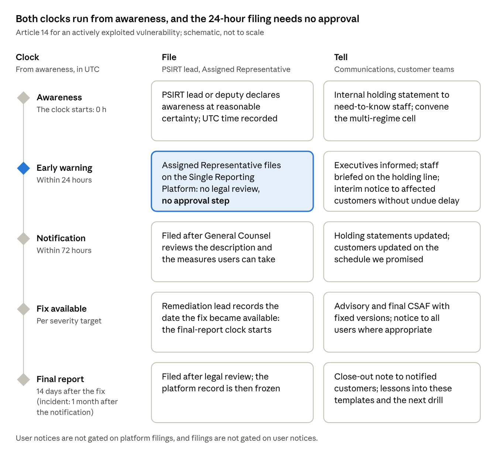

# Incident communications (Article 14)

**When a vulnerability is exploited or a severe incident hits, three roles own every message: the PSIRT lead decides, General Counsel reviews the 72-hour and final reports, and communications owns the wording. The 24-hour early warning waits for no one.**

## Roles

*Exhibit 16: Who owns what in an Article 14 case*

| Role | Owns | Never |
| --- | --- | --- |
| PSIRT lead, or a named deputy | The awareness decision and its UTC timestamp; reportable or not; timing of user notices; release of pre-approved holding statements; approval of every incident message | Waits for anyone’s approval before the early warning |
| Assigned Representative on call | Filing the early warning, 72-hour notification and final report on ENISA’s Single Reporting Platform; recording the notification ID in the case file | Submits test reports to the live platform |
| General Counsel | Review of the 72-hour notification, the final report and user-facing wording; the ‘particularly exceptional circumstances’ flag (72-hour tab for exploited vulnerabilities only) | Reviews or holds the 24-hour early warning |
| Communications | Wording of holding statements and notices; media handling; the message log | Speculates on cause, attacker or impact |
| Product management | Affected versions, Member States where available and support status, within 4 hours of awareness | Leaves the distribution map stale |
| Remediation lead | The fix or mitigation and the user action text | Promises a fix date it cannot keep |
| Head of customer operations | Who is told first (with the PSIRT lead); named-contact calls; the support script; the contact log | Lets staff improvise |
| CISO and data protection officer | NIS2 and GDPR assessments and filings in the multi-regime cell | Merge their filings with the CRA report |
| CTO, executive sponsor, CEO | Escalated decisions; a named executive voice if the media need one | Override the awareness decision |

Source: corporate guide 07 (reporting governance) and 02 (decision rights); application guide 10 (reporting runbook); Illustrative

## Timeline: from first signal to final report

[Chart: Article 14 clock at a glance · 5 stages, file and tell]

At a glance: both clocks start at awareness and run in parallel, and only the 72-hour and final reports wait for legal review. Exhibit 17 adds every step, owner and message.

*Exhibit 17: The clocks, and the communication due at each step*

| Step | Clock | Regulatory action (owner) | Communication action (owner) |
| --- | --- | --- | --- |
| 1. First signal | Within 1 hour of receipt | Case opened with UTC first-signal time (PSIRT on-call) | Reporter thanked; nothing confirmed or denied (whoever received it) |
| 2. Awareness | Immediate assessment: hours, not days | PSIRT lead declares awareness at ‘a reasonable degree of certainty’ and records the UTC time | Multi-regime cell convened; internal holding statement to need-to-know staff (communications) |
| 3. Facts confirmed | Within 4 hours of awareness | Product data pack checked: versions, configurations, Member States, support status (product management) | Holding statements tailored and ready for release (communications; PSIRT lead releases) |
| 4. Early warning | Within 24 hours of awareness | Filed on the platform with no legal review (Assigned Representative) | CTO, executive sponsor and General Counsel informed; customer-facing staff briefed with the holding line |
| 5. Interim user notice | Without undue delay | None required | Affected customers first: human-readable notice plus CSAF advisory with status ‘known affected’ or ‘under investigation’ (PSIRT lead; General Counsel reviews wording) |
| 6. Notification | Within 72 hours of awareness | Filed after legal review (Assigned Representative; General Counsel) | Holding statements updated; customer updates on the promised schedule |
| 7. Fix or mitigation | Per the severity target | Security update released; availability date recorded (remediation lead) | Advisory and final CSAF document with fixed versions; all-user notice where appropriate; in-product notices |
| 8. Final report | 14 days after the fix (vulnerability); 1 month after the notification (severe incident) | Filed after legal review | Close-out note to notified customers; internal summary |
| 9. Post-incident review | Within 2 weeks of the final report | Case closed; risk assessment updated | Lessons into these templates, the FAQs and the next drill |

Source: Art 14(2), (4), (8); guidance C(2026) 5252 paras 213, 219-221; application guide 10; Illustrative

The 24-hour and 72-hour clocks both run from awareness, in parallel, and remediation never pauses them. User notices are not gated on platform filings, and filings are not gated on user notices. If we are not timely, the notified CSIRTs may inform users themselves.

## Holding statements

**Six pre-approved statements let us speak within hours without saying more than we know.** General Counsel and the PSIRT lead approve them in advance on \[date\] and again after every drill. In a live case, communications fills the \[brackets\] and the PSIRT lead releases them. Say only what is confirmed, and give the time of the next update.

### A. Actively exploited vulnerability

**A1. Customer (B2B, direct).** We are aware of a security vulnerability affecting \[product and versions\] and of evidence that it is being exploited. Our product security team is investigating as a priority. Until a fix is available, we recommend that you \[interim measure\]. \[We have notified / We are notifying\] the relevant EU authorities, as the law requires. We will update you by \[date, time CET\], or sooner if we learn more. Please send any related observations to \[PSIRT contact\], and do not share details of the vulnerability publicly while we work on a fix.

**A2. Media.** Example Group is aware of a vulnerability affecting \[product\] and is working on a fix as a priority. \[We have informed / We are informing\] the relevant authorities and are contacting affected customers directly with steps they can take. Guidance for customers is at \[advisory page\]. We will not share technical details until customers have had the chance to protect themselves.

**A3. Internal (staff who need to know).** PSIRT is handling a security vulnerability affecting \[product\]. Do not discuss it outside the response team, on social media or with customers beyond the approved customer statement. If a customer asks, use the holding line from \[Head of customer operations\] and pass the contact to PSIRT at \[contact\]. If you hold relevant information, send it to PSIRT now. Next internal update: \[time\].

### B. Severe incident

**B1. Customer (B2B, direct).** We are responding to a security incident affecting \[product or service, for example our update service\]. \[State only what is confirmed: what is affected, and what is not yet known.\] As a precaution, we recommend that you \[action, for example postpone manual updates until we confirm\]. \[We have notified / We are notifying\] the relevant EU authorities, as the law requires. We will update you by \[date, time CET\]. Questions: \[contact\].

**B2. Media.** Example Group is responding to a security incident affecting \[product or service\]. We acted as soon as we became aware, have informed the relevant authorities and are working with \[external specialists, if engaged\]. We are contacting affected customers directly. We will share more when our investigation allows; until then we will not speculate on its cause or impact.

**B3. Internal (all staff).** We are responding to a security incident affecting \[product or service\], led by \[PSIRT lead\] with \[the CISO\]. Please do not speculate about it, internally or externally. For customer questions, use the approved customer statement and pass details to \[contact\]. Send media enquiries to \[press office\] without comment. If you notice anything unusual in \[systems\], report it to \[contact\] at once. Next update: \[time\].

## User notifications and the CSAF companion

**Every user notice has two forms carrying the same facts: a human-readable notice people act on, and a machine-readable CSAF advisory their tools ingest.** The CRA asks us to inform impacted users, and where appropriate all users, without undue delay, in a machine-readable format where appropriate (Art 14(8)). Detail may go first to affected customers while no fix exists, and more widely once the issue is mitigated (guidance paras 219-221).

### Template 1: interim notice to affected customers (before a fix)

- **Subject:** Security notice \[advisory ID\]: action recommended for \[product\]
- **Channel:** named customer contacts by email; in-product or app notice where available

&#91;Product and affected versions\] \[contains a vulnerability that is being actively exploited / is affected by a security incident\].

- **What we know:** \[one sentence, with no exploit detail\].
- **What you should do now:** \[interim measure, for example restrict network exposure or disable remote access\].
- **What we are doing:** we are developing a security update and will confirm its date by \[date\].
- **Status:** affected: \[versions\]; under investigation: \[versions\]; not affected: \[versions\].
- **Advisory:** \[advisory URL\]. Machine-readable version (CSAF): \[CSAF URL\].
- **Contact:** \[PSIRT contact\]. Next update: \[date\].

### Template 2: security update available (all users)

- **Subject:** Security update \[version\] for \[product\]: please install
- **Channel:** email, in-product notice, advisory page, release notes

A security update for \[product\], version \[x\], is now available. It fixes \[vulnerability title\] (\[CVE ID\]; \[EUVD ID\]), \[which has been actively exploited\]. Severity: \[CVSS score and rating\].

**How to install:** \[automatic: installs by default / manual: steps\]. **If you cannot update now:** \[mitigation\]. The update is free of charge. Full advisory: \[URL\]; machine-readable CSAF: \[URL\]. \[We thank \[reporter\] for reporting this issue responsibly.\]

### Template 3: in-product or app notice (under 200 characters)

Security update for your \[product\]: it fixes a vulnerability that is being exploited. Install now. Details: \[link\]

### The machine-readable companion

We publish each advisory as a CSAF 2.0 document (ISO/IEC 20153:2025) through our CSAF provider at /.well-known/csaf/provider-metadata.json, referenced from security.txt. The CRA names no format; CSAF is the established one. Both forms are generated from the same PSIRT case record, so they never disagree.

*Exhibit 18: How the human-readable notice maps to the CSAF advisory*

| Element of the notice | CSAF 2.0 field | Rule |
| --- | --- | --- |
| Title and advisory ID | document.title; document.tracking.id | One ID across the notice, the advisory and the case file |
| Version and dates | document.tracking: version, initial and current release dates, revision history | Every update to the notice is a new revision |
| Affected, fixed and not-affected products | product\_tree; vulnerabilities: product\_status (known\_affected, under\_investigation, fixed, known\_not\_affected) | Interim notice: known\_affected or under\_investigation; after the fix: fixed |
| Identifiers | vulnerabilities: cve; ids (EUVD) | Added only once assigned |
| Severity | vulnerabilities: scores (CVSS) | The human text adds a plain-language rationale |
| What to do | vulnerabilities: remediations (vendor\_fix, mitigation, workaround) | The same action text as the human notice |
| Publisher | document.publisher (category vendor) | Example Group |

Source: application guide 08 (vulnerability handling) and 10 (reporting runbook); Illustrative

For a component vulnerability that does not affect the product, publish a VEX statement (known\_not\_affected, with its justification) instead of a notice: it is both the customer answer and the record that no report was due.

## Do and don’t

**Speak early, say only what is verified, and never help an attacker.**

| Do | Don’t |
| --- | --- |
| Confirm only what is verified, and say when the next update will come; keep that promise | Publish exploit details, proof-of-concept code, affected components or attack paths before a fix or mitigation exists |
| Give users an action they can take now | Blame suppliers, researchers, customers or colleagues |
| Tell affected customers first, then everyone once a fix or mitigation exists | Speculate about cause, attacker, data affected or the number of users |
| Use the glossary’s terms and label estimates as estimates | Say ‘no customer data was affected’ before the investigation confirms it |
| Log every message: who, when, channel and text | Delay the early warning for wording, approval or a fix |
| Credit researchers who reported in good faith, if they wish | Comment on another company’s incident or on the authorities’ actions |

## Escalation tree

**Anyone can start the chain; the on-call rota is designed so that the PSIRT lead or a deputy is reachable within the hour, every hour of the year.**

*Exhibit 19: Who is called, by whom, and how fast (targets)*

| Level | Trigger | Who is called | Within |
| --- | --- | --- | --- |
| 1 | Any signal of a possible vulnerability or exploitation: customer, partner, researcher, supplier, telemetry or staff | PSIRT on-call, \[number\] | 1 hour of receipt |
| 2 | On-call sees possible exploitation or an effect on product security | PSIRT lead, or a named deputy | Immediately |
| 3 | Awareness declared | Assigned Representative on call (files the early warning); multi-regime cell: CISO, data protection officer, General Counsel, communications, Head of customer operations, product management | 1 hour of awareness |
| 4 | Awareness declared | CTO (accountable executive), executive sponsor, president of the affected BU | 2 hours of awareness |
| 5 | Severe incident, media interest, more than \[n\] customers affected, any safety effect, or regulator contact beyond the filing | CEO and ExCo; the CEO informs the chair of the board | \[4\] hours of the trigger |

Source: corporate guide 07 (24/7 on-call and deputy chain); thresholds in \[brackets\] to be set by the executive sponsor; Illustrative

## Several regimes, several clocks

**One event can start up to four clocks with four recipients, and today each runs and is filed separately.**

*Exhibit 20: Reporting regimes that can run alongside the CRA*

| Regime | Trigger | Clock | Recipient | Owner |
| --- | --- | --- | --- | --- |
| CRA Art 14 | Actively exploited vulnerability or severe incident affecting product security | 24 hours; 72 hours; final report 14 days after the fix or 1 month after the notification | Germany’s coordinator CSIRT and ENISA, via the Single Reporting Platform | PSIRT lead |
| NIS2 Art 23 | Significant incident at an essential or important entity | 24 hours; 72 hours; 1 month | National CSIRT or competent authority | CISO, where NIS2 applies to Example Group as an entity |
| GDPR Art 33 | Personal data breach | 72 hours from awareness | Data protection authority | Data protection officer |
| DORA Art 19 | Major ICT-related incident at a financial entity | Initial, intermediate and final reports | Financial supervisor | Our financial-sector customers, not us: expect their requests for facts |

Source: knowledge base, Reporting obligations (Multiple regimes) and Interplay; corporate guide 07; facts as at 30 Oct 2026; Illustrative

The multi-regime cell shares one fact base and one UTC timeline, and each owner files separately. The Digital Omnibus proposal would let a CRA severe-incident report count for NIS2 and would move the GDPR deadline to 96 hours. As at 30 Oct 2026 it is a proposal, with a Council mandate agreed on 21 Oct 2026, not law: plan for separate filings.

*Project Rampart · Communication Pack (D05) · Illustrative · v1.0 · 31 Oct 2026*
