# The State of CRA Readiness 2026 — Market Research Report

Oct 31, 2026 · Prepared by \[Advisor\]

Published on 31 Oct 2026, 406 days before the Cyber Resilience Act (CRA, Regulation (EU) 2024/2847) applies in full, this report finds a market that knows the law exists but has not yet built what it requires. Reporting under Art 14 has been mandatory since 11 Sep 2026. Yet only 41% of manufacturers expect to be compliant by 11 Dec 2027, and no CRA notified body had been designated at the last verified check on 8 Sep 2026. The binding constraint is no longer awareness: it is third-party assessment capacity, harmonised standards and the evidence systems that prove compliance for every product version.

*Secondary research only: no interviews and no primary survey. Facts as at 30 Oct 2026. Every statistic carries its source, sample, date and type, and vendor estimates are labelled as such.*

## 1. Executive summary

The CRA has moved from awareness to execution, and execution is running into capacity limits that no single manufacturer controls.

### Eight findings

1. **Reporting is already law.** Art 14 has applied since 11 Sep 2026 to every in-scope product, including those already on the market. Actively exploited vulnerabilities and severe incidents go to ENISA's Single Reporting Platform within 24 hours (section 5).
2. **Awareness is broad but shallow.** 67% of German companies have heard of the CRA but only 29% know what it means for them (Bitkom Research, n=1,003, Apr–Jun 2026). Only 13% of SMEs rate their grasp of documentation requirements as good (ENISA, n=194, Feb–Mar 2026).
3. **Most manufacturers do not expect to finish on time.** Only 41% expect full compliance by Dec 2027 and 39% do not know when they will comply (Linux Foundation Research, 194 manufacturers, early 2026).
4. **Market access is the binding constraint.** No CRA notified body was verifiably designated at checks to 8 Sep 2026 and no harmonised standard is cited, so Class I products cannot self-assess and Class II products have no available route today. Back-scheduling from 11 Dec 2027 with commentary estimates puts the latest contracting date between Feb and Jul 2027 (section 4).
5. **SBOMs are spreading faster than the evidence chain.** 74% of respondents have partly or fully automated SBOM generation, but only 39% have done so for its inclusion in technical documentation (ENISA, n=334, fieldwork end-2025).
6. **Open-source risk is managed by waiting.** 51% of manufacturers rely passively on upstream projects for security fixes and only 34% regularly assess component security (Linux Foundation, 2026). Private forks cost a large organisation 11,152 labour hours per release cycle (Linux Foundation ROI survey, n=236).
7. **Cost evidence is thin and mostly vendor-led.** The only public model puts three default-class products at EUR 78,300 one-off plus EUR 13,500 a year; Module B fee estimates span EUR 15,000 to EUR 80,000 across two unverified sources (section 7).
8. **Enforcement is arriving unevenly.** Three of 27 Member States have adopted enforcement laws and Germany's passed the Bundestag on 15 Oct 2026. Fines reach EUR 15m or 2.5% of worldwide turnover from 11 Dec 2027, and the Product Liability Directive treats vulnerabilities as potential defects for products placed on the market after 9 Dec 2026.

### What leaders do now

1. **Run reporting as a live operation, not a policy:** at least two registered platform users, written awareness criteria, 24/7 escalation and two drills a year.
2. **Secure notified-body capacity for Class I and II products by Q1 2027:** shortlist three candidate bodies and contract pre-assessments with options to convert.
3. **Build shared compliance infrastructure once** (PSIRT, build-time SBOMs, signed updates, a system of record) and apply it product by product.
4. **Treat compliance as an evidence system:** version-linked technical files kept for 10 years and written to withstand product-liability disclosure.
5. **Close supply-chain gaps:** CRA clauses in supplier contracts, active upstream engagement and binary analysis of third-party firmware.

## 2. The clock: reporting is live and 406 days remain

The CRA's dates are fixed in [Regulation (EU) 2024/2847](https://eur-lex.europa.eu/eli/reg/2024/2847/oj) and no pending proposal moves them: Art 14 reporting has applied since 11 Sep 2026, and every other obligation applies from 11 Dec 2027 (Art 71(2)).

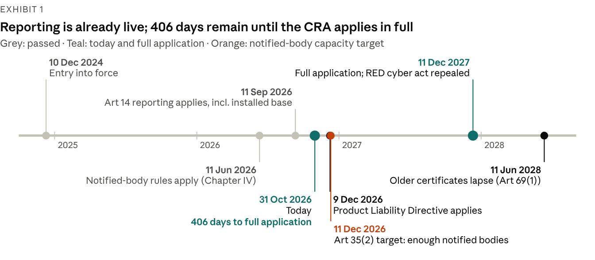

[Chart: Source: Regulation (EU) 2024/2847 Arts 35, 69 and 71; Directive (EU) 2024/2853; Delegated Regulation (EU) 2026/339; days counted from 31 Oct 2026. Official.]

Three transition rules shape the run-up:

- **Reporting covers the installed base.** Art 69(3) applies Art 14 to every in-scope product, including those placed on the market before 11 Dec 2027.
- **Older products escape the rest only while unchanged.** Products placed before 11 Dec 2027 fall under the full CRA only after a substantial modification (Art 69(2)); Commission guidance says security updates are generally not substantial modifications.
- **Certificates under other law are not CRA evidence.** EU type-examination certificates on cybersecurity issued under other Union law, chiefly the Radio Equipment Directive (RED), stay valid until 11 Jun 2028 (Art 69(1)), but they do not prove CRA conformity.

Two dates in the next six weeks raise the stakes. The Product Liability Directive (EU) 2024/2853 applies to products placed on the market after 9 Dec 2026, and 11 Dec 2026 is the date by which Member States must "strive" to have enough notified bodies (Art 35(2)).

**Exhibit 2: The legal text is settled; the instruments that would make compliance cheaper are not**

| Instrument | Status at 30 Oct 2026 | What it settles, or would settle |
| --- | --- | --- |
| Regulation (EU) 2024/2847 | In force since 10 Dec 2024; corrigendum 17 Oct 2025 | All obligations; application dates in Art 71 |
| Commission guidance C(2026) 5252 | Content approved 27 Jul 2026; non-binding; formal adoption awaits all language versions; no adoption or OJ publication found | Scope, remote data processing, open source, substantial modification, support periods, risk assessment (67 worked examples) |
| Commission FAQ | v1.4 of 4 Sep 2026; living document, not an official position | Worked answers on scope, classification, reporting and conformity |
| Implementing Regulation (EU) 2025/2392 | In force 21 Dec 2025 | Technical descriptions of the 19 Class I, 4 Class II and 3 critical categories |
| Delegated Regulation (EU) 2026/881 | In force 10 May 2026 | Grounds for CSIRTs to delay disseminating notifications (Art 14(9)) |
| Delegated Regulation (EU) 2026/339 | In force 19 May 2026 | Repeals the RED cybersecurity act 2022/30 from 11 Dec 2027 |
| Harmonised standards (Art 27(1)) | None cited in the Official Journal | Presumption of conformity; Module A for Class I |
| Common specifications (Art 27(2)) | None adopted or signalled | A fallback presumption |
| Art 27(9) delegated act on EUCC | Planned for Q4 2026; not adopted | Would let an EUCC certificate replace third-party assessment |
| Art 14(10) implementing act | None adopted or drafted | Legal format of Art 14 notifications |
| Art 13(24) implementing act | None adopted or drafted | SBOM format and elements |
| Art 33(5) implementing act | None adopted, drafted or scheduled | Simplified technical documentation for micro and small firms |

*Source: EUR-Lex; European Commission ([guidance C(2026) 5252](https://ec.europa.eu/newsroom/dae/redirection/document/131456), [FAQ](https://ec.europa.eu/newsroom/dae/redirection/document/122331), [implementation factpage](https://digital-strategy.ec.europa.eu/en/factpages/cyber-resilience-act-implementation)); engagement knowledge base, fact-checked 30 Oct 2026. Official.*

Plans should assume the missing instruments arrive late. The Commission's levers so far are a proposed two-month extension of the standardisation deadlines and a second standardisation request, not a change of date.

## 3. Awareness is broad but shallow

Two-thirds of firms have heard of the CRA, but fewer than a third know what it means for them, and most manufacturers cannot say when they will comply.

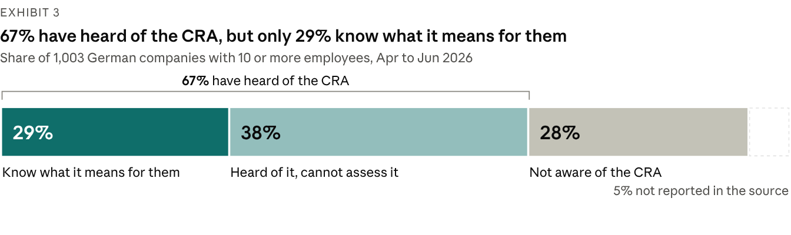

[Chart: Source: Bitkom Research survey of 1,003 German companies with 10 or more employees, Apr–Jun 2026, as reported by IT Finanzmagazin (11 Sep 2026); survey by an industry association; 5% not reported in the article.]

Bitkom's sample of 1,003 German companies is the largest among the surveys reviewed here, and it measures awareness rather than preparedness ([IT Finanzmagazin](https://www.it-finanzmagazin.de/cyber-resilience-act-cra-nur-jedes-dritte-unternehmen-vorbereitet-250594/)).

The global picture is weaker. In the [Linux Foundation's 2026 survey](https://www.linuxfoundation.org/hubfs/Research%20Reports/lfr_2026_cra_awareness_report_060826.pdf?hsLang=en) of 843 respondents, 66% were not at all or only slightly familiar with the CRA, up from 62% in 2025 (n=685); unfamiliarity reached 72% among US and Canadian respondents. Even among the 404 respondents aware of the CRA, 41% had not determined whether it applies to them, 46% were unsure of the deadlines (only 34% named 2027) and 56% did not know the penalties.

Official channels are not closing the gap: only 25% of those respondents learned about the CRA from EU or national authorities, against 48% from digital media and 39% from open-source foundations (Linux Foundation, n=404).

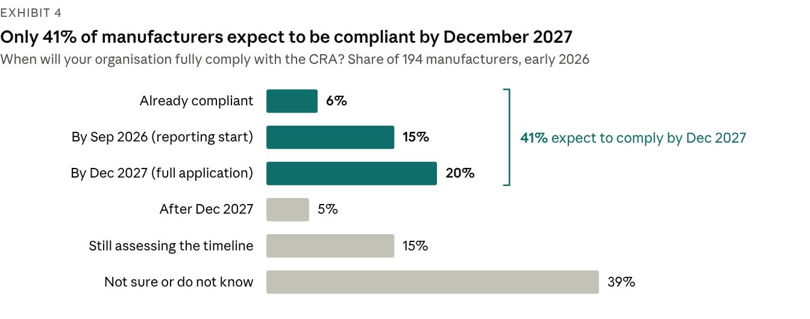

[Chart: Source: Linux Foundation Research, 2026 CRA Awareness and Readiness report (Jun 2026), Fig. 11; 194 manufacturers, fieldwork early 2026; survey, convenience sample of LF communities.]

Smaller firms show the same pattern in finer grain. [ENISA's SME survey](https://www.enisa.europa.eu/sites/default/files/2026-06/SME%20CRA%20survey%20report.pdf) (194 responses, Feb–Mar 2026, not representative) found 66% aware of the CRA but only 13% with a good grasp of documentation requirements and 14% of conformity assessment. Only 11% were confident they could build in security by design without difficulty; 47% expected problems.

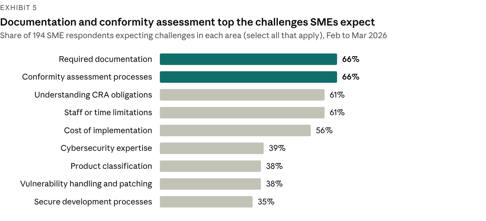

[Chart: Source: ENISA, SME CRA Survey Report (Jun 2026), Q4.1.a; 194 responses (174 in CRA scope), Feb–Mar 2026; official survey, voluntary and not representative; % of all 194 respondents.]

What SMEs ask for is telling: 73% want templates for technical documentation, 71% for secure development and 56% for vulnerability handling, and only 3 of 194 respondents needed none of the templates offered. The gap is practical tooling, not more explanation of the law.

Organisation is forming, but thinly. In [ONEKEY's vendor survey](https://www.onekey.com/press-release/onkey-iot-ot-cybersecurity-report-2026-half-of-all-companies-have-formed-cra-teams) of 200 German industrial firms, responsibility for the CRA sits mostly with IT security (50%), then product development (26%), compliance (15%) and legal (15%).

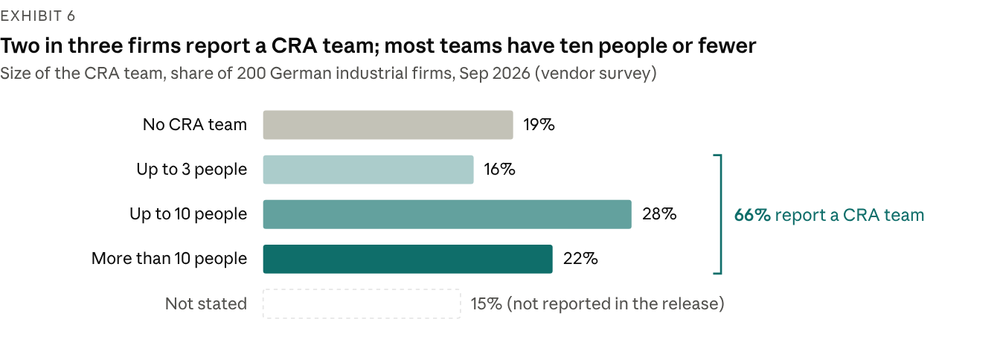

[Chart: Source: ONEKEY, IoT/OT Cybersecurity Report 2026 press release (9 Sep 2026); 200 German industrial firms; vendor survey, unverified; 15% not stated in the release.]

The same survey finds 61% have set aside or plan a CRA budget, only 18% expect to manage without external help, and more than 60% expect product development to take longer, 28% "significantly longer". ONEKEY's own headline ("half of all companies have formed CRA teams") does not match its distribution figures, so treat these numbers as indicative.

**What this means.** Awareness is no longer the bottleneck for firms already engaged; operational understanding is. The hardest steps are documentation and conformity assessment, which come last in a programme but take longest to evidence.

## 4. The capacity crunch: no notified bodies, no cited standards

Class I and II products face a double block at 30 Oct 2026: self-assessment needs a cited harmonised standard that does not exist, and third-party assessment needs a notified body that has not been designated.

**Exhibit 7: Every class above default needs something the market cannot yet supply**

| Class | Routes allowed (Art 32) | Needs a notified body today? | What would unlock it |
| --- | --- | --- | --- |
| Default | Module A (internal control); stricter routes optional | No | Nothing needed; a cited standard adds presumption of conformity |
| Important Class I | Module A only if a cited harmonised standard, common specification or EU certification scheme is applied in full; otherwise Module B+C or H | Yes, in practice; none designated | First OJ citations (2027 at the earliest, commentary) or a designated body |
| Important Class II | Module B+C, Module H, or an EU certificate at "substantial" level or higher (Art 32(3)) | Yes, or EUCC once the Art 27(9) act exists | A designated body; the Art 27(9) act (planned Q4 2026) |
| Critical (Annex IV) | A mandatory scheme under Art 8(1) if adopted; otherwise the Class II routes | Yes | No Art 8(1) act adopted or consulted on |
| Open-source product in Annex III | Any route, including Module A, if the technical documentation is public (Art 32(5)) | No | Nothing needed |

*Source: Regulation (EU) 2024/2847 Arts 8, 27 and 32; Commission guidance C(2026) 5252 paras 148–151; engagement knowledge base, fact-checked 30 Oct 2026. Official.*

### Notified bodies: none designated, a short pipeline

Chapter IV, which governs how bodies are notified, has applied since 11 Jun 2026, yet no CRA notified body appeared in NANDO or its successor, the Single Market Compliance Space, at the last verified checks on 8 Sep 2026. The Commission's [conformity-assessment page](https://digital-strategy.ec.europa.eu/en/policies/cra-conformity-assessment), updated 31 Jul 2026, still lists bodies only "once available".

Five notifying authorities are documented: BSI in Germany (with DAkkS accreditation), Traficom in Finland (with FINAS), MDIA in Malta, SZTFH in Hungary and ANSSI in France (Décret 2026-944 of 9 Oct 2026). ENISA published [competence requirements](https://www.enisa.europa.eu/publications/technical-competence-requirements-for-cra-notified-bodies) for CRA notified bodies on 4 Jun 2026.

The visible pipeline is short and vendor-reported. [Brightsight](https://www.brightsight.com/cra-notified-body-services) says it holds ISO/IEC 17065 accreditation for Module B from the Dutch Accreditation Council, pending notification; [Applus+](https://www.appluslaboratories.com/global/en/what-we-do/service-sheet/cyber-resilience-act-notified-body) says it is progressing through accreditation. Once an accredited body is notified, other Member States have two weeks to object (Art 43), so an accreditation date is the best leading indicator of new capacity.

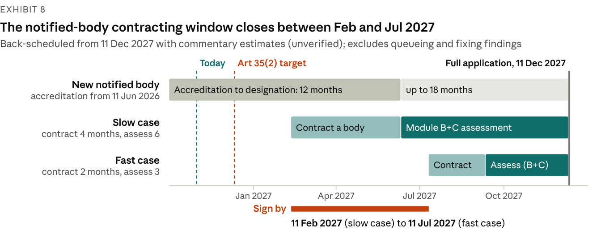

[Chart: Source: CRA Decoded, notified-body capacity analysis (19 Jul 2026), commentary, unverified; dates from Regulation (EU) 2024/2847 Arts 35 and 71. Back-scheduling is \[Advisor] arithmetic and excludes queueing and remediation.\]

The arithmetic is unforgiving. Commentary estimates of 2–4 months to contract a body and 3–6 months per Module B+C engagement mean a product that must comply on 11 Dec 2027 needs a signed contract by 11 Feb 2027 in the slow case, or by 11 Jul 2027 in the fast case. A body that began accreditation when Chapter IV applied would, at 12–18 months, be designated between Jun and Dec 2027: too late for the slow case. Early capacity therefore rests on the few bodies already in the pipeline and goes to the manufacturers who book first.

These ranges come from one commentary source ([CRA Decoded](https://cra-decoded.com/blog/posts/cra-notified-body-capacity-crisis/), 19 Jul 2026), not from observed lead times, because no body publishes them yet; a vendor source quotes 3–12 months for complex products. Queueing and the time to fix findings would pull the window earlier.

### Harmonised standards: none cited, first citations in 2027 at the earliest

**Exhibit 9: The standards that would restore self-assessment for Class I are still in drafting or enquiry**

| Deliverable | Scope | Stage at 30 Oct 2026 | Expected next step |
| --- | --- | --- | --- |
| EN 40000-1-1 and EN 40000-1-2 | Vocabulary; principles for cyber resilience | Formal vote passed; ratification 2 Nov 2026 per trackers; iTeh lists publication 17 Nov 2026 | Publication; CEN-CENELEC records "no citation expected" |
| prEN 40000-1-3 | Vulnerability handling (Annex I Part II) | Enquiry closed 15 Feb 2026; sent for pre-formal-vote HAS assessment 3 Aug 2026 | Publication end-2026 to Feb 2027; citation 2027 at the earliest (commentary) |
| prEN 40000-1-4 | Generic security requirements (Annex I Part I) | Drafting | Due 30 Oct 2027 under the standardisation request |
| ETSI EN 304 617–627 and 631–636 | 17 product standards for Class I and Class II categories | Public Enquiry opened 13 Aug 2026; windows close mid-Sep to mid-Nov 2026 | Vote and HAS assessment; adoption implies 2027 (commentary) |
| CEN-CENELEC hardware verticals | Chips, smartcards, identity management, security boxes | Most drafts past enquiry | Formal votes; the 30 Oct 2026 vertical deadline has passed |
| prEN 50770 series | OT profiles: firewalls, IDS/IPS, VPN, routers, switches, SIEM | Draft or preliminary work item, pending IEC 62443 amendments | Laggard track; the 31 Dec 2026 target is seen as uncertain |

*Source: CEN-CENELEC, ETSI and DKE records; trackers [panther.blue](https://panther.blue/en/insights/cra-harmonised-standards-status/) (26 Oct 2026), [craevidence](https://craevidence.com/cra-compliance/harmonised-standards-status) (17 Oct 2026), [Vulnir](https://www.vulnir.com/cra/en-40000/) and [CVD Portal](https://cvdportal.com/standards/en-40000); iTeh catalogue; knowledge-base fact-check, 30 Oct 2026. Dates marked "per trackers" or "commentary" are secondary and unverified.*

The standardisation request M/606 asked for 41 standards, 15 horizontal and 26 vertical. Its first deadlines (30 Aug 2026 and 30 Oct 2026) have passed; a draft amendment notified on 7 Jul 2026 would move them to 30 Oct 2026 and 31 Dec 2026 but had not been adopted at trackers dated to 26 Oct 2026. Neither set of dates changes when the CRA applies.

A cited standard helps only where it is applied in full and covers all of a product's core-functionality risks (guidance para 149). Until then, EN 18031, ETSI EN 303 645 and IEC 62443 are design baselines and evidence, not presumption.

### Certification: EUCC has capacity but no CRA status yet

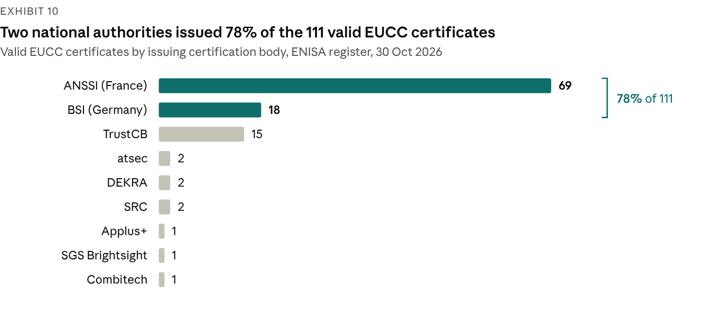

[Chart: Source: ENISA EUCC certificate register, read 30 Oct 2026 and fact-checked for this report; official register; 112 certificates listed, 1 withdrawn.]

EUCC is the only adopted EU cybersecurity certification scheme, with 111 valid certificates from 9 certification bodies on 30 Oct 2026, 18 of them at "substantial" level. It cannot yet replace CRA third-party assessment: the Art 27(9) delegated act that would allow this is planned for Q4 2026 and not adopted. ENISA's own [study](https://certification.enisa.europa.eu/publications/cyber-resilience-act-implementation-eucc-and-its-applicable-technical-elements_en) found that Common Criteria leaves CVD policy and free security updates uncovered and does not address remote data processing, so a certificate would still need a gap assessment.

**What this means for Class I and II products.** Plan them on a third-party route and switch to Module A only if a citation lands before assessment. Keep a complete Module A record either way: it is the fallback and the core of a notified body's application pack. UK Approved Bodies cannot help: CRA third-party assessment needs an EU notified body.

## 5. Reporting went live on 11 Sep 2026

Art 14 is the CRA's first live obligation: every manufacturer of an in-scope product, including products sold before the law applies in full, must notify actively exploited vulnerabilities and severe incidents within 24 hours of becoming aware of them.

**Exhibit 11: Two triggers, three deadlines each**

| Stage | Actively exploited vulnerability | Severe incident |
| --- | --- | --- |
| Early warning | 24 hours from awareness (Art 14(2)(a)) | 24 hours from awareness (Art 14(4)(a)) |
| Notification | 72 hours from awareness (Art 14(2)(b)) | 72 hours from awareness (Art 14(4)(b)) |
| Final report | 14 days after a corrective or mitigating measure is available (Art 14(2)(c)) | 1 month after submitting the 72-hour incident notification (Art 14(4)(c)) |
| Recipient | Coordinator CSIRT of the main-establishment Member State, with simultaneous access for ENISA, through the Single Reporting Platform (Art 14(7)) | Same |

*Source: [Regulation (EU) 2024/2847](https://eur-lex.europa.eu/eli/reg/2024/2847/oj) Art 14. Official.*

The clock starts at awareness, which Commission guidance (para 213) ties to a "reasonable degree of certainty" after an immediate initial assessment: suspicion starts triage, not the clock. Good-faith research findings without evidence of exploitation, and component vulnerabilities that are not exploitable in the product, are not mandatory reports (FAQ 5.2 and 5.4).

**Exhibit 12: The Single Reporting Platform is live, minimal and manual**

| Feature | Position at 30 Oct 2026 |
| --- | --- |
| Status | Live since 11 Sep 2026 as an "initial operating capability"; software v1.2.1 from 20 Oct 2026 |
| Interface | Web form only; no API and no test environment |
| Language | English only |
| Scope | Mandatory Art 14 notifications only; voluntary Art 15 reports not yet supported |
| Access | Personal EU Login with multi-factor authentication; one Primary and up to 20 Secondary Assigned Representatives per manufacturer |
| Validation | The coordinator CSIRT validates each registration (3 business days observed in Belgium); up to 20 notifications can be filed while validation is pending |
| Routing | Coordinator CSIRTs listed for all 27 Member States on 4 Sep 2026; choosing the wrong one "may invalidate" a notification (FAQ 18) |
| Known quirk | The 72-hour counter shows a due time 48 hours after the early warning (FAQ 26); the statutory 72 hours from awareness governs |
| Fallbacks | Ireland: email only after ENISA declares an outage; Germany: email to CERT-Bund, in English, while the platform is down |
| Statistics | None published; the one public first-hand account reports launch-day glitches fixed within hours |

*Source: [ENISA SRP hub](https://www.enisa.europa.eu/topics/product-security/single-reporting-platform-srp), [SRP FAQ](https://www.enisa.europa.eu/topics/product-security/single-reporting-platform-srp/frequently-asked-questions) and Assigned Representative manual v1.2 (21 Oct 2026); [NCSC Ireland](https://www.ncsc.gov.ie/cra/); BSI; Aikido account as reported by [cyberresilienceact.eu](https://www.cyberresilienceact.eu/news/aikido-security-first-account-using-enisa-srp-23-september-2026.html) (23 Sep 2026). Official, except the first-hand account (vendor, as reported).*

No implementing act fixes the notification format (Art 14(10)), so ENISA's glossary is the de facto field set. With no API, a person types every filing: manufacturers need trained deputies with authority to file, not just tooling.

**Exhibit 13: One compromised product can start four clocks with four recipients**

| Regime | Trigger | Clock | Recipient | Overlap |
| --- | --- | --- | --- | --- |
| CRA Art 14 | Actively exploited vulnerability or severe incident affecting product security | 24 h, 72 h, then 14 days or 1 month | Coordinator CSIRT and ENISA, via the platform | Manufacturers only |
| NIS2 Art 23 | Significant incident at an essential or important entity | 24 h, 72 h, 1 month | National CSIRT or competent authority | Same awareness test by design; separate filing |
| GDPR Art 33 | Personal data breach | 72 h | Data protection authority | Digital Omnibus would move this to 96 h; not adopted |
| DORA Art 19 | Major ICT-related incident at a financial entity | Initial, intermediate and final reports | Financial supervisor | No cross-reference to the CRA |
| Proposed NIS2 Art 23(12) | CRA severe-incident report containing the NIS2 content | Would count as the NIS2 report | As for the CRA | In the Commission proposal and the Council mandate; not adopted |

*Source: Regulation (EU) 2024/2847; Directive (EU) 2022/2555; Regulation (EU) 2016/679; Regulation (EU) 2022/2554; [COM(2025) 837](https://eur-lex.europa.eu/legal-content/EN/TXT/HTML/?uri=CELEX:52025PC0837); [Council ST 14756/26](https://data.consilium.europa.eu/doc/document/ST-14756-2026-INIT/en/pdf). Official.*

The Digital Omnibus (COM(2025) 837 of 19 Nov 2025) does not amend the CRA. The Council's mandate, agreed by Coreper on 21 Oct 2026, replaces the Commission's ENISA single entry point with national entry points plus an ENISA information point, keeps the deeming rule for CRA severe-incident reports and keeps the 96-hour GDPR deadline. Parliament's ITRE and LIBE committees have not voted on the more than 1,750 amendments tabled, and trilogues have not started. Nothing in either text changes CRA Art 14 timelines, content or recipients.

**What this means.** Reporting is the first part of CRA readiness that regulators can see: CSIRTs pass Art 14 information to market surveillance authorities (Art 16(3)), and Finland's enforcement law already covers Art 14 breaches.

## 6. Engineering practice: SBOMs spread, evidence chains lag

The CRA is accelerating SBOM adoption, but automation stops short of the technical file, and open-source dependence is still managed by waiting for upstream fixes.

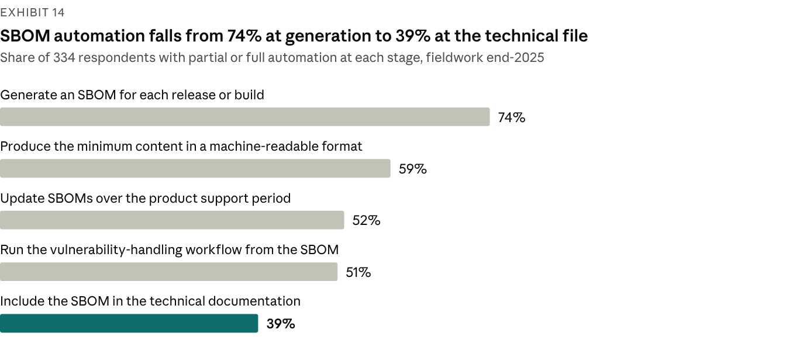

[Chart: Source: ENISA, SBOM Adoption State of Play 2026 (Jun 2026); 334 responses, fieldwork end-2025, about 65% EU-based; official survey; partial or full automation.]

ENISA's [SBOM State of Play](https://www.enisa.europa.eu/sites/default/files/2026-06/SBOM%20Adoption%20State%20of%20Play%202026.pdf) survey (334 responses, fieldwork end-2025, published Jun 2026) shows momentum: 78% have started adopting SBOMs and 43% say the CRA "significantly accelerated" their investment in SBOM tooling. Maturity is low: 44% are at pilot or limited adoption, 25% report broad adoption and only 9% are mature with full automation. Most generate at build time (39%), against 16% on delivery to a registry and 14% at deployment.

Quality, not generation, is the hard part. 62% rate a high degree of completeness "quite a lot" or "extremely" difficult, 58% say the same of vulnerability matching, and 57% of the quality of SBOMs supplied by vendors.

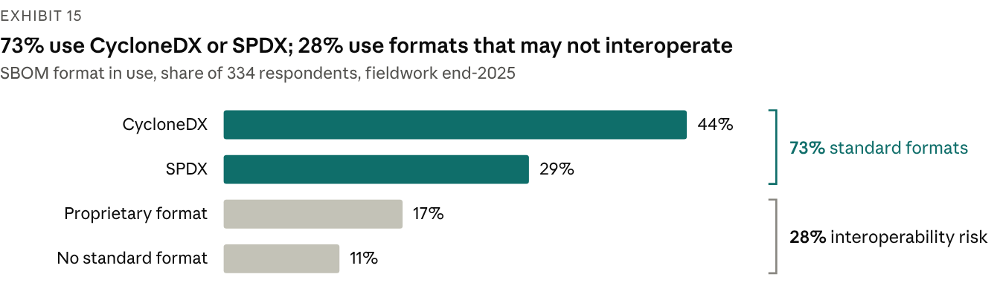

[Chart: Source: ENISA, SBOM Adoption State of Play 2026 (Jun 2026); 334 responses, fieldwork end-2025; official survey; shares as published, summing to 101% through rounding.]

Formats are converging on the two families that BSI's technical guideline TR-03183-2 accepts (CycloneDX 1.6 or later, SPDX 3.0.1 or later). That guideline and ENISA's SBOM technical advisory (v1.10, Oct 2026) are the de facto profiles, because the Commission has not used its Art 13(24) power to set a format. The legal minimum is a commonly used, machine-readable format covering at least top-level dependencies; the SBOM sits in the technical documentation and need not be published.

Manufacturer practice lags the tooling. Only 32% of manufacturers produce SBOMs for all of their products (Linux Foundation, n=194–219), and ENISA's SME survey finds SBOMs in use at 35% of SMEs and threat modelling at 24%.

### Open-source dependence

Manufacturers own the security of the open-source code they ship (Art 13(5)–(6)), yet 51% rely passively on upstream projects for security fixes and a further 23% patch components internally. Only 34% regularly assess the security practices of their components; 39% do not know whether they will contribute fixes upstream and 20% have decided against (Linux Foundation, manufacturers, n=194–219).

Dependence is highest where capacity is lowest: 62% of SMEs rely on open source for more than three-quarters of their products, against 35% of larger organisations (Linux Foundation, n=187).

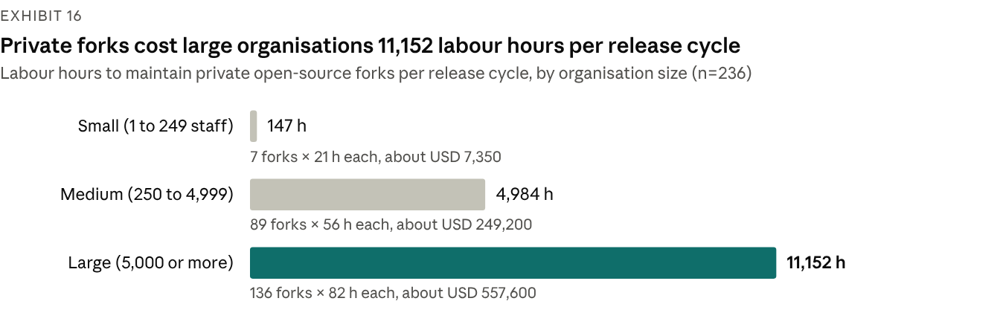

[Chart: Source: Linux Foundation Research, 2025 Open Source ROI survey (n=236), as cited in the 2026 CRA Awareness and Readiness report (Jun 2026); survey; USD at USD 50 an hour.]

Private forks are the costly alternative to working upstream. The average organisation in the Linux Foundation's 2025 ROI survey maintains 86 private forks at about 60 labour hours each per release cycle: 5,160 hours, or about USD 258,000 at USD 50 an hour.

### Vulnerability handling and updates

Lifecycle processes are the weakest area for small firms. ENISA's SME survey scores incident response and product lifecycle management lowest of five domains (2.61 out of 5), and 36% of microcompanies have no incident response plan. The load is rising: Linux Foundation analysis of more than 12,000 open-source projects found published CVEs up 394% year on year in Q1 2026 and high-severity findings up 811%, which the LF suggests may reflect better automated scanning, AI-based analysis or CRA-prompted audits.

Update guidance is still in draft. ENISA's technical advisory on secure update mechanisms (signing, anti-rollback, recovery) was published for consultation in May 2026, and no official source puts a number on "without delay".

**What this means.** The engineering building blocks exist; the gap is the chain that turns them into per-version evidence, and the discipline to manage open-source components actively.

## 7. Cost and effort: thin evidence, wide ranges

No authoritative cost benchmark exists: the figures in circulation come from one independent model, unverified vendor estimates and small or self-selected surveys, and they disagree.

**Exhibit 17: Cost and effort benchmarks, with their provenance**

| Benchmark | Figure | Source and date | Sample or basis | Type |
| --- | --- | --- | --- | --- |
| Three default-class products, medium readiness | EUR 78,300 one-off; EUR 13,500 a year | [cyberresilienceact.eu cost calculator](https://www.cyberresilienceact.eu/cra-compliance-cost-calculator/) (i46 s.r.o.), 2026 | Model at EUR 45 an hour; "illustrative and intended for planning only" | Independent model |
| Module B examination fee | EUR 20,000–60,000 | [CRA Decoded](https://cra-decoded.com/blog/posts/cra-notified-body-capacity-crisis/), 19 Jul 2026 | Not stated | Commentary, unverified |
| Module B examination fee | EUR 15,000–80,000 | [sota.io](https://sota.io/blog/cra-notified-bodies-developer-guide-conformity-assessment-2026), 2026 | Not stated | Vendor, unverified |
| First Module H engagement | EUR 80,000–150,000 | CRA Decoded, 19 Jul 2026 | Not stated | Commentary, unverified |
| Class I self-assessment, internal effort | EUR 10,000–40,000 | sota.io, 2026 | Not stated | Vendor, unverified |
| Notified-body designation; contracting; Module B+C engagement | 12–18 months; 2–4 months; 3–6 months | CRA Decoded, 19 Jul 2026 | Not stated | Commentary, unverified |
| Assessment of complex products | 3–12 months | sota.io, 2026 | Not stated | Vendor, unverified |
| Expected cost increase | 50% under 20%; 25% at 20–40%; 25% no impact | [KONE-authored industrial study](https://arxiv.org/pdf/2505.14325) (arXiv 2505.14325) | 12 companies, Jun–Aug 2024 | Survey, small sample |
| Expected development time | Over 60% expect longer; 28% "significantly longer" | [ONEKEY](https://www.onekey.com/press-release/onkey-iot-ot-cybersecurity-report-2026-half-of-all-companies-have-formed-cra-teams), 9 Sep 2026 | 200 German industrial firms | Vendor survey |
| Price pass-through, all manufacturers | 40% plan price rises; average rise 4% among those who have decided (6% in 2025); 21% expect no impact | [Linux Foundation Research](https://www.linuxfoundation.org/hubfs/Research%20Reports/lfr_2026_cra_awareness_report_060826.pdf?hsLang=en), Jun 2026 | 194 manufacturers | Survey |
| Price pass-through, SMEs | 47% plan price rises; 11% expect rises above 15% | Linux Foundation Research, Jun 2026 | 54 SME manufacturers | Survey, small sample |
| Private fork maintenance | 86 forks × about 60 hours = 5,160 hours (about USD 258,000) per release cycle | Linux Foundation 2025 Open Source ROI survey, cited Jun 2026 | 236 organisations | Survey |

*Source: as listed in each row. Vendor and commentary figures are unverified, and no notified body publishes fees or lead times.*

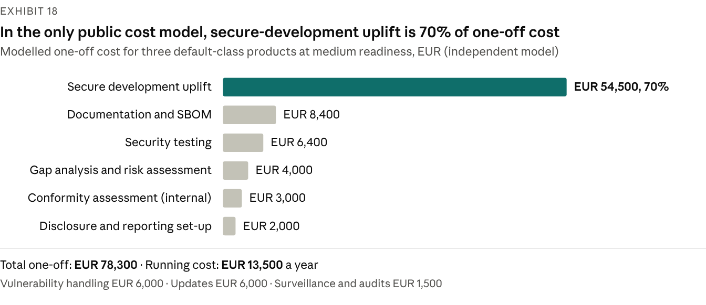

[Chart: Source: cyberresilienceact.eu CRA compliance cost calculator (i46 s.r.o.), accessed Oct 2026; independent model, "illustrative and intended for planning only"; three default-class products, medium readiness, EUR 45 an hour.]

In the model, engineering uplift, not conformity paperwork, drives one-off cost. Its conformity line (EUR 3,000 for three default products) covers internal control only; Class I and II products would add notified-body fees in the ranges above.

**Why the evidence is thin**

1. **No market prices yet.** No notified body is designated, so no fee or lead time has been published; every figure is an estimate.
2. **No representative industry survey.** No quantitative readiness survey from Orgalim, DIGITALEUROPE, ZVEI or techUK was found, and Bitkom's data cover awareness, not cost.
3. **Self-selected samples.** The Linux Foundation, ENISA and ONEKEY surveys recruit engaged audiences, and the cost signals rest on subgroups of 12, 54 and 194 respondents.
4. **Commercial interest.** The most specific estimates come from vendors that sell assessment services or tooling.
5. **Starting point dominates.** Cost depends on current maturity, the mix of product classes and the number of product versions in scope; averages hide that spread.

Figures attributed to the Commission's impact assessment circulate only second-hand in vendor material; we could not check them and do not use them.

**How to use these numbers.** Treat them as order-of-magnitude checks, not budgets. Build the estimate bottom-up from the product inventory, the class mix and a readiness diagnostic, then test it against these ranges.

## 8. Enforcement arrives unevenly

Market surveillance authorities enforce the CRA from 11 Dec 2027 with fines of up to EUR 15m or 2.5% of worldwide turnover, but national machinery is uneven 13 months out.

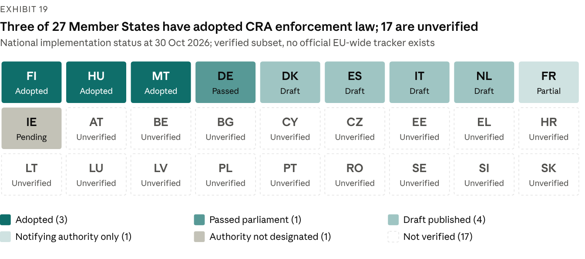

[Chart: Source: national gazettes and authorities; law-firm commentary (Hogan Lovells, Innovatech Legal, Legal 500); engagement knowledge base, fact-checked 30 Oct 2026. Seventeen Member States were not verified.]

**Exhibit 20: National implementation, verified subset**

| Member State | Authority | Instrument | Status at 30 Oct 2026 |
| --- | --- | --- | --- |
| Finland | Traficom (NCSC-FI): market surveillance and notifying authority | Act 439/2026 | Adopted; in force 1 Jun 2026; Art 14 breaches enforceable since 11 Sep 2026 |
| Hungary | SZTFH: both roles | Act CXXXV of 2025 | Adopted; follows the CRA timeline |
| Malta | Malta Digital Innovation Authority: both roles from 11 Dec 2027 | Legal Notice 238 of 2026 | Adopted 11 Sep 2026; own fine regime |
| Germany | BSI: market surveillance authority, notifying authority and CSIRT | CRA Implementation Act (new Part 8 of the BSI Act) | Passed the Bundestag plenary 15 Oct 2026 (committee 14 Oct); Bundesrat consent not required; promulgation pending; fines from 11 Dec 2027 |
| Netherlands | RDI: both roles | Draft implementation act | In the legislative process |
| Italy | ACN: both roles | Draft decree (Government Act No 447) | Sent to Parliament 9 Oct 2026 |
| Denmark | Danish Resilience Agency: both roles | Draft act | Consultation from 5 Oct 2026; entry into force planned 11 Dec 2027 |
| Spain | Telecommunications secretariat (surveillance); CCN (notifying); INCIBE (CSIRT) | Draft royal decree | Consulted Dec 2025; not adopted; no penalty regime published |
| France | ANSSI: notifying authority only | Décret 2026-944 of 9 Oct 2026 | Adopted for notified bodies; no surveillance or fine rules yet (confirmed through a secondary source) |
| Ireland | NCSC anticipated | None | Not formally designated at 14 Sep 2026 |

*Source: Finlex (Act 439/2026) and [Traficom](https://www.kyberturvallisuuskeskus.fi/en/our-activities/regulation-and-supervision/cyber-resilience-act-cra/business-opportunities-notified-bodies-under-cra); legislation.mt (LN 238/2026); Bundestag (hib 822/2026) and BSI (16 Oct 2026); [Hogan Lovells](https://www.hlc.com/en/publications/eu-cyber-resilience-act-germany-adopts-cra-implementation-act-as-national-enforcement-regimes) (Oct 2026); [Innovatech Legal](https://innovatech.legal/en/digital-regulation/cyber-resilience-act-penalties/) (7 Oct 2026); [Legal 500](https://www.legal500.com/intelligence/european-union/media-telecoms-it-entertainment/the-eu-cyber-resilience-act-reporting-obligations-take-effect) (14 Sep 2026); Lexis Veille (12 Oct 2026); knowledge-base fact-check, 30 Oct 2026. Official where a gazette or authority is cited; law-firm commentary otherwise.*

Because every Member State must notify its penalty rules (Art 64(1)), more national acts are likely in the first half of 2027. Malta has already departed from the CRA tiers: EUR 350,000 per infringement plus EUR 12,000 a day, rising to 5% of turnover where there is significant market effect (law-firm commentary).

**Exhibit 21: Penalty tiers under Art 64**

| Tier | Maximum, whichever is higher | Breaches covered |
| --- | --- | --- |
| Art 64(2) | EUR 15m or 2.5% of worldwide annual turnover | Annex I essential requirements; manufacturer obligations in Arts 13 and 14 |
| Art 64(3) | EUR 10m or 2% | Other operator duties, the declaration, CE marking, technical documentation, conformity assessment and access to data (Art 53) |
| Art 64(4) | EUR 5m or 1% | Incorrect, incomplete or misleading information to notified bodies or authorities |
| Exemptions | No fine | Micro and small manufacturers are not fined for missing 24-hour early warnings (Art 64(10)(a)); open-source stewards are never fined (Art 64(10)(b)) |

*Source: [Regulation (EU) 2024/2847](https://eur-lex.europa.eu/eli/reg/2024/2847/oj) Art 64. Official.*

The percentage cap overtakes EUR 15m only above about EUR 600m of turnover, so it matters most to large manufacturers. The powers matter as much as the fines:

- **Paperwork is enforceable on its own.** A missing or wrong CE marking, declaration or technical file is formal non-compliance (Art 58).
- **One finding can travel EU-wide.** A national measure not objected to within three months is "deemed justified" in every Member State (Art 54); disputes go to the Commission, which decides within nine months (Art 55).
- **Reports feed enforcement.** CSIRTs pass Art 14 information to market surveillance authorities (Art 16(3)), and coordinated sweeps may test products bought under a "cover identity" (Art 60).
- **Answers are evidence.** Authorities may demand design, development and vulnerability-handling data on reasoned request (Art 53), and a misleading answer is itself a fineable breach (Art 64(4)).

**Product liability raises the stakes from 9 Dec 2026.** The revised [Product Liability Directive](https://eur-lex.europa.eu/legal-content/EN/TXT/HTML/?uri=CELEX:32024L2853) treats software as a product and a cybersecurity vulnerability as a potential defect (recital 32). Breach of mandatory safety requirements raises a presumption of defectiveness (Art 10(2)(b)), a missing security update removes the later-defect defence (Art 11(2)(c)), and courts can order disclosure of evidence (Art 9), which brings technical files and update logs into play. Once the CRA applies in full, a breach of Annex I can support that presumption.

## 9. Open source: light-touch stewards, full duties for manufacturers

The CRA spares non-commercial open source and gives foundations a light regime, but it never shifts the manufacturer's duty for the open-source code it ships.

- **Unmonetised open source is out of scope** unless a steward publishes it; the carve-out works through "commercial activity" (Art 3(22), recitals 15–20, guidance section 3).
- **Stewards carry light duties from 11 Dec 2027.** A steward is a legal person that systematically supports open source intended for commercial use. It needs a documented cybersecurity policy, must cooperate with authorities and reports only to the extent it is involved in development (Art 24). It needs no CE marking, technical file or SBOM and cannot be fined (Art 64(10)(b)), although authorities can order corrective action (Art 52(3)).
- **Manufacturers keep the whole duty.** Art 13(5) requires due diligence on every third-party component, including open source never placed on the market, and Art 13(6) requires reporting vulnerabilities to maintainers and sharing fixes.
- **Monetisation flips the role.** Charging for binaries, updates or a supported version makes the publisher a manufacturer (guidance points 51–57); donations matter only when they gate access or updates (points 60–62).

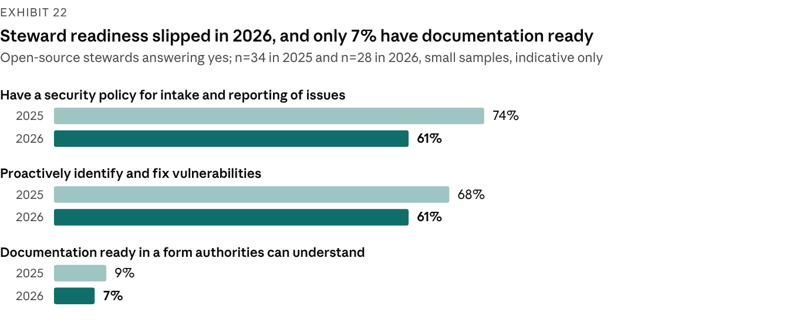

[Chart: Source: Linux Foundation Research, 2026 CRA Awareness and Readiness report, Appendix A15–A17 (Jun 2026); stewards n=34 (2025) and n=28 (2026); survey; small samples, indicative only.]

Stewards' own preparation has not improved. The Linux Foundation's steward samples are small (34 in 2025, 28 in 2026) and the LF itself calls the comparison indicative, but all three measures shown fell. Their stated needs lead with money: financial support was cited by 50% in both years, legal guidance by 47% in 2025 and 39% in 2026, and technical resources by 44% and then 25%. Contributors are uncertain too: 61% of non-commercial developers are unsure whether the CRA applies to them (n=109).

**Exhibit 23: Ecosystem resources help, but the key specifications are unfinished**

| Resource | Body | Status at 30 Oct 2026 | Use |
| --- | --- | --- | --- |
| [OSPS Baseline](https://openssf.org/wp-content/uploads/2026/01/OpenSSF-OSPS-Baseline.pdf) | OpenSSF | Jan 2026; 41 requirements, 3 maturity levels, 6 lifecycle stages | Project-level controls; OpenSSF puts coverage of manufacturer duties at about 35% |
| [Steward white paper V1.0](https://orcwg.org/files/cra/resources/white-paper-on-open-source-software-stewards-and-cra.pdf) | ORC WG (Eclipse Foundation) | Shipped Jan 2026; "not legal guidance" | Content and evidence for the Art 24(1) policy |
| Due-diligence white paper (D3.2); vulnerability-management specification (D4.1) | ORC WG | Work in progress (Sep 2026) | The manufacturer side of Art 13(5); future templates |
| Steward specifications (D4.2 to D4.4) | ORC WG | Not shipped; no status shown | None final |
| [Stewards Playbook](https://policy.openssf.org/CRA/stewards-playbook.html), One Pager, maintainer and manufacturer guides | Linux Foundation and OpenSSF | Living documents | Monetisation triggers, reporting clocks, plain-language duties |
| Art 25 voluntary attestation programmes | European Commission | No delegated act, draft or programme; only a study mentioned (Feb 2026) | Would ease due diligence once they exist |

*Source: OpenSSF; [ORC WG resources](https://orcwg.org/cra/resources/) (Sep 2026); Linux Foundation; Commission FOSDEM slides (1 Feb 2026); engagement knowledge base. Foundation material, except the Commission item (official).*

**What this means.** Manufacturers cannot outsource open-source compliance to the projects they depend on. Budget for component assessment and upstream fixes, and support the projects that matter most to the product.

## 10. Outlook: signposts for the next 12 months

The legal text is settled; what moves next is the infrastructure that makes compliance cheaper. Plan without it, watch these signposts, and re-plan when one moves.

**Exhibit 24: Signposts and what each would change**

| Signpost | Status at 30 Oct 2026 | Expected timing | If it moves |
| --- | --- | --- | --- |
| First CRA notified body in NANDO | None at checks to 8 Sep 2026; two candidates publicly in accreditation | Art 35(2) target: 11 Dec 2026 | Contract within weeks; early capacity goes to early bookers |
| EN 40000-1-1 and -1-2 published | Formal vote passed | Ratification 2 Nov 2026; publication 17 Nov 2026 (trackers) | Common vocabulary only; no presumption |
| prEN 40000-1-3 vote, publication and citation | Pre-formal-vote assessment since 3 Aug 2026 | Publication end-2026 to Feb 2027; citation 2027 at the earliest (commentary) | Presumption for vulnerability handling; re-map PSIRT evidence to it |
| ETSI EN 304 6xx product standards | Public Enquiry; last windows close mid-Nov 2026 | Adoption in 2027 (commentary) | Module A reopens for covered Class I products once cited |
| Amendment to the standardisation request M/606 | Draft of 7 Jul 2026, not adopted | Not announced | Confirms the standards slip; application dates unchanged |
| Art 27(9) EUCC delegated act | Planned | Q4 2026 (Commission plan) | EUCC certificates could replace third-party assessment for the requirements they cover |
| Formal adoption of guidance C(2026) 5252 | Approved draft | Not announced | Scope and support-period decisions rest on adopted text |
| Art 14(10) and Art 13(24) implementing acts | None drafted | Not announced | Fixed formats for notifications and SBOMs |
| Platform API, voluntary reporting and counter fix | Promised for future releases | Not announced | Filings can be integrated with PSIRT tooling |
| CRA–AI Act and CRA–DORA interplay guidance | In preparation | End-2026 (Commission target) | Sequencing of AI Act and CRA assessments; supplier evidence for financial entities |
| Digital Omnibus trilogue | Council mandate 21 Oct 2026; Parliament in committee | European Council asked for agreement by end-2026 | NIS2 reporting mechanics change; CRA Art 14 does not |
| National enforcement laws | 3 adopted; 1 passed by parliament | More expected in H1 2027 (our inference) | Which authority you face, fine mechanics, national add-ons |
| Product Liability Directive | Adopted | Applies from 9 Dec 2026 | Disclosure and defect exposure for products placed after that date |
| Cybersecurity Act revision (CSA2) and EUCS | CSA2 proposed 20 Jan 2026; EUCS not adopted | Not announced | Certification framework; no cloud certificate to plan on |

*Source: engagement knowledge base watchlist and fact-check, 30 Oct 2026; European Commission ([implementation factpage](https://digital-strategy.ec.europa.eu/en/factpages/cyber-resilience-act-implementation)); ENISA; CEN-CENELEC; ETSI; standards trackers (secondary). Timings marked commentary or inference are not official.*

Three signposts decide market access and deserve board attention: the first designation in NANDO, the first OJ citation for a product standard, and the Art 27(9) act. The CRA Expert Group's next meeting was pencilled for 18 Nov 2026.

## 11. What leading manufacturers do now

Leading manufacturers treat the CRA as a licence to sell with a fixed date: they build shared capabilities once, apply them per product and book external capacity early.

1. **Run reporting as an operation.** Register at least two platform users with EU Login and multi-factor authentication, write the awareness and severity criteria, staff a 24/7 escalation path and drill twice a year; keep end-of-support and legacy products in the reportable inventory.
2. **Inventory to the version level.** Include companion apps, the manufacturer's own backends that a product needs for a function (remote data processing) and legacy lines still on sale; early adopters report inventories growing five-fold or more once versions and variants are counted (consultancy commentary).
3. **Classify with reasons.** Map each product's core functionality to Implementing Regulation (EU) 2025/2392, record the reasoning and take legal opinions on borderline Class I calls early: the class decides the route, the budget and the timeline.
4. **Book notified-body capacity by Q1 2027.** Shortlist three candidates, contract pre-assessments with options to convert, and check NANDO at every programme board; consider Module H where one quality system can cover several product families. In the slow case, the contract must be signed by 11 Feb 2027.
5. **Keep a Module A record regardless of route.** It is the fallback if a standard is cited in time and the core of any notified body's application pack.
6. **Build shared platforms once.** Build-time SBOMs to the BSI TR-03183-2 fields, VEX and CSAF advisories, signed updates with anti-rollback, and one PSIRT case system across product lines.
7. **Automate the evidence chain.** Generate technical-file content from the release pipeline and link each version's SBOM, test reports and risk assessment to it; only 39% of respondents to ENISA's SBOM survey automate that link today.
8. **Put CRA clauses into supplier contracts.** Require vulnerability notification, SBOM delivery and support-period commitments, starting with security-relevant components, and analyse third-party firmware binaries rather than trusting manifests.
9. **Write records for disclosure.** From 9 Dec 2026, technical files and update logs can be disclosed in product-liability claims. Record risk acceptances on risk grounds: cost or commercial strategy alone cannot justify leaving risk unaddressed (guidance paras 156–163).
10. **Decide support periods and legacy lines deliberately.** Set support periods to the expected time in use, at least five years unless use is shorter (Art 13(8)), and withdraw or remediate lines that will still be sold after 11 Dec 2027.

> **Using this report with the CRA Readiness Diagnostic (D08).** The Diagnostic scores each product family from 0 to 4 on ten domains, from governance to conformity and market access. Read its scores against this report's market reference points: SBOM automation and open-source practice for the SBOM and supply-chain domain, SME documentation understanding for documentation and declarations, reporting practice for the Art 14 domain, and the notified-body arithmetic for conformity and market access. Treat the market figures as context, not targets: their samples differ from any one manufacturer's portfolio.

## 12. Methodology, sources and limitations

This report is desk research: it uses published secondary sources only, with no interviews, no primary survey and no client data. Regulatory facts come from the engagement's knowledge base and its independent fact-check, whose corrections take precedence; all facts are as at 30 Oct 2026.

**Source types.** *Official*: EU legislation, Commission documents, ENISA publications and registers, national authorities. *Official survey*: ENISA's SME CRA survey and SBOM State of Play, both voluntary samples. *Survey*: Bitkom Research (industry association), Linux Foundation Research (convenience sample of its communities) and a KONE-authored academic study. *Vendor survey*: ONEKEY. *Independent model*: the cyberresilienceact.eu calculator. *Commentary or vendor estimate*: CRA Decoded, sota.io, law firms and standards trackers, unverified unless stated.

**Exhibit 25: Survey and dataset register**

| Source | Publisher | Fieldwork or date | Sample | Type | Sections |
| --- | --- | --- | --- | --- | --- |
| [Bitkom Research CRA survey](https://www.it-finanzmagazin.de/cyber-resilience-act-cra-nur-jedes-dritte-unternehmen-vorbereitet-250594/) | Bitkom, reported by IT Finanzmagazin | Apr–Jun 2026; reported 11 Sep 2026 | 1,003 German companies with 10+ employees | Survey (industry association) | 1, 3 |
| [2026 CRA Awareness and Readiness](https://www.linuxfoundation.org/hubfs/Research%20Reports/lfr_2026_cra_awareness_report_060826.pdf?hsLang=en) | Linux Foundation Research | Early 2026; published Jun 2026 | 843 respondents; 404 CRA-aware; 194–219 manufacturers; 54 SME manufacturers; 28 stewards; 109 non-commercial developers | Survey (convenience sample) | 1, 3, 6, 7, 9 |
| [Unaware and Uncertain](https://www.linuxfoundation.org/blog/unaware-and-uncertain-is-the-open-source-community-prepared-for-the-new-regulatory-reality-of-the-cyber-resilience-act) | Linux Foundation Research | Published 27 Mar 2025 | 685 respondents; 34 stewards | Survey | 3, 9 |
| 2025 Open Source ROI survey, as cited in the 2026 report | Linux Foundation Research | 2025 | 236 organisations | Survey | 6, 7 |
| [SME CRA Survey Report](https://www.enisa.europa.eu/sites/default/files/2026-06/SME%20CRA%20survey%20report.pdf) | ENISA | Feb–Mar 2026; published Jun 2026 | 194 responses (174 in scope), 31 countries | Official survey, not representative | 1, 3, 6 |
| [SBOM Adoption State of Play 2026](https://www.enisa.europa.eu/sites/default/files/2026-06/SBOM%20Adoption%20State%20of%20Play%202026.pdf) | ENISA | End-2025; published Jun 2026 | 334 responses, about 65% EU-based | Official survey | 1, 6 |
| [IoT/OT Cybersecurity Report 2026](https://www.onekey.com/press-release/onkey-iot-ot-cybersecurity-report-2026-half-of-all-companies-have-formed-cra-teams) | ONEKEY | Published 9 Sep 2026 | 200 German industrial firms | Vendor survey | 3, 7 |
| [Industrial CRA readiness study](https://arxiv.org/pdf/2505.14325) | KONE-affiliated authors, arXiv 2505.14325 | Jun–Aug 2024 | 12 companies | Survey, small sample | 7 |
| [CRA compliance cost calculator](https://www.cyberresilienceact.eu/cra-compliance-cost-calculator/) | cyberresilienceact.eu (i46 s.r.o.) | Accessed Oct 2026 | Model | Independent model | 1, 7 |
| [Notified-body capacity analysis](https://cra-decoded.com/blog/posts/cra-notified-body-capacity-crisis/) | CRA Decoded | 19 Jul 2026 | Not stated | Commentary, unverified | 4, 7 |
| [Notified bodies developer guide](https://sota.io/blog/cra-notified-bodies-developer-guide-conformity-assessment-2026) | sota.io | 2026 | Unsourced estimates | Vendor, unverified | 4, 7 |
| [EUCC certificate register](https://certification.enisa.europa.eu/certificates_en) | ENISA | Read 30 Oct 2026 | 111 valid certificates | Official register | 4 |
| [Conformity-assessment page](https://digital-strategy.ec.europa.eu/en/policies/cra-conformity-assessment) and NANDO status | European Commission; secondary tracker | Page updated 31 Jul 2026; checks to 8 Sep 2026 | Register of bodies | Official, status via secondary tracker | 1, 4 |

**How we labelled the numbers**

- The Linux Foundation's awareness figures (41%, 46%, 34% and 56%) are based on its 404 CRA-aware respondents, not all 843, and are labelled that way.
- The 86-fork and 60-hour figures come from the Linux Foundation's 2025 ROI survey of 236 organisations, which its 2026 CRA report cites; they are not from the 843-respondent survey.
- The 47% of SME manufacturers planning price rises is a subgroup of 54. Steward needs of 50%, 47% and 44% come from the 2025 survey (34 stewards); the 2026 equivalents are 50%, 39% and 25% (28 stewards).
- ONEKEY's headline and its distribution figures disagree; we show the distribution and flag the conflict.
- Module B fee and assessment-time estimates differ between sources; we show both ranges rather than choose.

**Limitations**

- No primary research: findings inherit the samples, question wording and fieldwork dates of others, and most fieldwork predates the 11 Sep 2026 reporting start.
- Samples are self-selected and skew towards engaged audiences, and two (Bitkom, ONEKEY) are German only; none is representative of EU manufacturers.
- The notified-body count rests on a secondary tracker last checked on 8 Sep 2026, because NANDO's successor application could not be queried directly.
- Standards stages and dates come partly from secondary trackers; France's decree and Malta's authority were confirmed only through secondary sources.
- The CRA's operative articles were first read through verbatim legal mirrors and were checked against the authentic Official Journal text on 1 Nov 2026; the authentic text is [Regulation (EU) 2024/2847](https://eur-lex.europa.eu/eli/reg/2024/2847/oj) on EUR-Lex.
- Status changes quickly: re-check the signposts in section 10 at least quarterly.

**Other official sources cited:** Commission guidance C(2026) 5252 and FAQ v1.4; Implementing Regulation (EU) 2025/2392; Delegated Regulations (EU) 2026/881 and 2026/339; Directive (EU) 2024/2853; COM(2025) 837 and Council ST 14756/26; the ENISA Single Reporting Platform hub; the national sources listed under Exhibit 20. The full source list sits in the EU Cyber Resilience Act Engineering Compliance Knowledge Base that accompanies this report.
