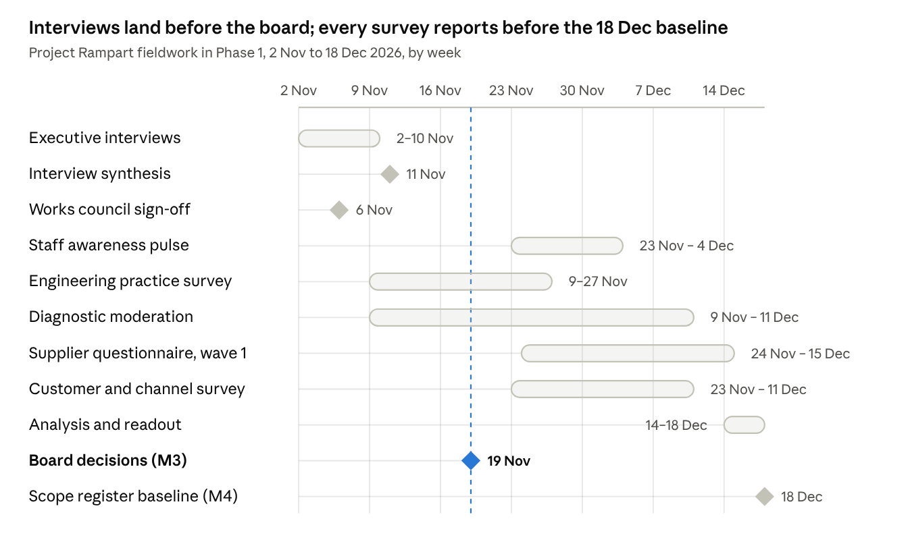

# Project Rampart — Survey and Interview Instruments

Oct 31, 2026 · Prepared by \[Advisor\]

Six instruments give Project Rampart measured evidence on product readiness, staff awareness, supplier exposure, executive priorities, customer expectations and engineering practice. Core fieldwork runs from 2 Nov to 18 Dec 2026, inside Phase 1, so the scope register baseline (M4, 18 Dec 2026) and the Wave 1 gap analysis rest on data rather than opinion. Each instrument tab is ready to paste into Microsoft Forms, Qualtrics or Google Forms, or to run as an interview; tab 8 shows how results roll up into the KPI pack.

## Objectives

Each instrument answers one research question that a programme decision depends on; no question is asked that no decision needs.

| ID | Objective | Research question | Decision or output it feeds | Instrument |
| --- | --- | --- | --- | --- |
| O1 | Baseline readiness | How far is each of the 13 product families from level 3 in each of the 10 domains, and what evidence exists? | K01 readiness index; Phase 2 gap analysis; Wave 1 risk assessments (M6); the 26.2 FTE-years remediation estimate | 2 · Readiness diagnostic |
| O2 | Awareness | Do staff know what the CRA asks of their role, starting with Article 14 reporting, which applies now? | WS8 training plan and K10; message timing in the Communication Pack (D05) | 3 · Staff awareness pulse |
| O3 | Supplier exposure | Which of the 41 in-scope suppliers can commit to vulnerability notification, SBOM delivery and support periods, and which components need an exit plan? | K09; order of clause-pack negotiations; intake-gate risk ratings; mitigation of R04 | 4 · Supplier questionnaire |
| O4 | Executive priorities | Where do executives agree and differ on product-risk appetite, roadmap trade-offs, notified bodies, legacy lines, reporting authority and budget? | Board decisions BD1 to BD5 on 19 Nov 2026; risks R01, R02 and R05 | 5 · Executive interviews |
| O5 | Customer expectations | Which CRA evidence will customers and channel partners request, by when, and how long do they keep our products in use? | Customer FAQ and trust page; Annex II content; support-period determinations; extended-support offer | 6 · Customer and channel survey |
| O6 | Engineering practice | Which SBOM, signing, update, testing and vulnerability-intake practices exist on each release train today? | Sizing of the shared-platform line (EUR 955k one-off, EUR 210k a year); plans for M8 and M10 | 7 · Engineering practice survey |

## Instrument map

Each instrument has a named owner, a fixed field window inside Phase 1 and a sample sized for the cuts reported in tab 8.

| ID | Instrument | Respondents | Sample | Mode | Length | Field window | Owner |
| --- | --- | --- | --- | --- | --- | --- | --- |
| DIA | Product readiness diagnostic | Product owner, lead engineer and PSIRT or quality contact for each family | Census: 13 families (55 SKUs), one moderated record each | Live CRA Readiness Diagnostic (D08) or the offline version, then a moderation workshop | 40 statements: 12–15 min to score, 60–90 min to moderate | 9 Nov – 11 Dec 2026 | Compliance lead, with the product security officer |
| PUL | Staff awareness pulse | All employees | Census of 3,800; at least 349 completes overall and 272 of the 920 engineers for ±5 points at 95% confidence | Anonymous online link, English and German | 15 questions, about 6 min | 23 Nov – 4 Dec 2026; baseline reported 11 Dec 2026; repeats \[Mar 2027\] and \[Oct 2027\] | Head of engineering enablement, with internal communications |
| SUP | Supplier questionnaire | Security or quality lead at each supplier | Census of the 41 in-scope suppliers: wave 1 the top 15 by component risk, wave 2 the other 26 | Online form, sent with the supplier letter (D05) | 31 questions, about 40 min | Wave 1 issued 24 Nov 2026; wave 2 to all 41 in-scope suppliers by 18 Dec 2026 (task T21) | Head of procurement |
| INT | Executive interviews | CTO, CFO, General Counsel, three BU presidents, CISO, Head of quality & regulatory, Head of procurement | 9 core interviews, 4 optional | Semi-structured, in person or by video, two interviewers | 45 min | 2–10 Nov 2026 | Programme director |
| CUS | Customer and channel survey | B2B customers, integrators, distributors, importers and retail partners | Key accounts covering 80% of each BU's EU B2B revenue, plus all EU channel partners; planning assumption about 80 invitations and 40 completes | Online, personal invitation from the account manager | 12 questions, about 8 min | 23 Nov – 11 Dec 2026 | Head of customer operations, with the Head of channel |
| ENG | Engineering practice survey | Engineering lead of each release train | Census of release trains, at least one per family | Online form | 15 questions, about 10 min | 9–27 Nov 2026 | Head of platform engineering, with the product security officer |

Every instrument is piloted with two or three respondents a week before launch, and question IDs stay fixed across waves so results can be trended. Sample sizes use the standard formula for a proportion at 50% with a finite-population correction: n = 384 / (1 + 383 / N).

## Fieldwork calendar



[Chart: Fieldwork calendar · 8 activities and 3 gates, 2 Nov to 18 Dec 2026]

The pulse launches only after works council sign-off on 6 Nov 2026 and reports its baseline on 11 Dec 2026. Supplier wave 2 takes the questionnaire to all 41 in-scope suppliers by 18 Dec 2026 (task T21), and the pulse repeats in \[Mar 2027\] and \[Oct 2027\] with the same question IDs.

## Data handling

Each instrument collects only what its analysis needs, staff answers are anonymous and reported in groups of ten or more, and raw data is deleted on a fixed schedule. The data protection officer confirms every line of the table below before launch.

- **Purpose limitation.** Results are used only to measure CRA readiness, plan training and communications, and assess supply-chain risk. No result is used to assess an individual's performance.
- **Minimisation.** The staff pulse asks for role group and business unit only; it stores no name, email address, IP address or device ID.
- **Pseudonymisation.** The survey tool assigns a random response token and the programme never holds the key. Cells under 10 responses are merged before reporting, and free text is screened for names before it is shared.
- **Works council.** The pulse goes to the works council for sign-off by 6 Nov 2026. Monitoring is its stated concern (ST13); anonymity and the no-performance-use rule answer it.
- **Confidential business data.** Supplier and customer answers stay with procurement and customer operations; the programme receives them in scored form.
- **No vulnerability details.** No instrument asks for details of unfixed vulnerabilities, and every introduction tells respondents not to enter them.

| Instrument | Personal data | Proposed lawful basis | Reported at | Retention |
| --- | --- | --- | --- | --- |
| DIA | Respondent roles; names optional | Legitimate interests (programme management) | Product family | In the system of record until programme close (Dec 2027), then archived with the evidence it cites; that evidence follows Art 13(13): 10 years after placing on the market or the support period, whichever is longer |
| PUL | Role group, business unit, free text | Legitimate interests; participation voluntary | Role group by BU, minimum 10 responses per cell | Raw responses deleted 24 months after each wave closes; aggregates kept |
| SUP | Supplier contact name, role and business email | Legitimate interests (supplier management) | Supplier and component | Kept as Art 13(5) due-diligence evidence with the technical documentation it supports (Art 13(13)) |
| INT | Name, role, notes, quotes | Legitimate interests; consent to notes and to each attributed quote | Role, never name | Notes deleted 6 months after the synthesis is accepted; synthesis kept |
| CUS | Contact name, business email, company | Legitimate interests (existing business relationship) | Segment; company only with consent | Raw responses deleted 24 months after close |
| ENG | Engineering lead name, release train | Legitimate interests | Release train | Kept with the platform sizing record until programme close |

The principles applied are purpose limitation, data minimisation and storage limitation in GDPR Art 5(1)(b), (c) and (e) ([Regulation (EU) 2016/679, Art 5, text as adopted](https://www.legislation.gov.uk/eur/2016/679/article/5/adopted/data.html)). Lawful bases and retention periods are proposals for the data protection officer, not legal advice.

## Analysis plan

Each instrument has one headline measure, defined before fieldwork so that results cannot be re-cut to fit a conclusion. The readiness index is the core measure:

```latex
\text{Readiness index} = \frac{1}{n}\sum_{i=1}^{n}\frac{\min(s_i,\,3)}{3}
```

Here s\_i is the moderated score (0 to 4) of statement i and n the number of statements: 40 for a family, 4 for a domain. Level 4 does not offset a gap elsewhere, and 100% means every statement at level 3 or above. Portfolio, BU and class indices are unweighted means of the family indices; the baseline is 44% (28 Oct 2026).

- **Heatmaps.** Families by domains, each cell the average level to two decimals, coloured on the 0–4 maturity scale with the number always printed (tab 8, output 2).
- **Cuts.** DIA by BU, class, wave and conformity route; PUL by role group and BU; SUP by component risk tier; INT by role; CUS by relationship type, Member State and NIS2 status; ENG by family, artefact type and CI system. No cut identifies a person.
- **Statistics.** Every figure carries its base (n). Pulse proportions carry a 95% confidence interval. Likert items are reported as % favourable (agree plus strongly agree), with "Don't know" outside the base and shown separately. Knowledge items count "Don't know" as not correct. No significance tests on bases under 30.
- **Benchmarks.** Published surveys give context, never targets: their populations, dates and methods differ from ours.

| ID | Benchmark | Value | Type | Compared with |
| --- | --- | --- | --- | --- |
| RD01 | [German companies that know what the CRA means for them](https://www.it-finanzmagazin.de/cyber-resilience-act-cra-nur-jedes-dritte-unternehmen-vorbereitet-250594/) (Bitkom Research, 1,003 companies with 10+ employees, Apr–Jun 2026) | 29% | Survey | PUL-03, % agree |
| RD02 | [CRA-aware respondents unaware of CRA penalties](https://www.linuxfoundation.org/hubfs/Research%20Reports/lfr_2026_cra_awareness_report_060826.pdf?hsLang=en) (Linux Foundation Research 2026: 404 CRA-aware respondents of 843 surveyed) | 56% | Survey | PUL-11, % not correct among PUL-03 agreers |
| RD03 | [Manufacturers relying passively on upstream projects for security fixes](https://www.linuxfoundation.org/hubfs/Research%20Reports/lfr_2026_cra_awareness_report_060826.pdf?hsLang=en) (LF 2026 manufacturer module, n=194–219) | 51% | Survey | DIA Q5.4, upstream reporting |
| RD04 | [SME manufacturers expecting to raise prices to cover compliance](https://www.linuxfoundation.org/hubfs/Research%20Reports/lfr_2026_cra_awareness_report_060826.pdf?hsLang=en) (Linux Foundation Research, 2026) | 47% | Survey (small subsample), 54 SME manufacturers | CUS-10, context only |
| RD05 | [SMEs asking for technical documentation templates](https://www.enisa.europa.eu/sites/default/files/2026-06/SME%20CRA%20survey%20report.pdf) (ENISA SME CRA survey, 194 responses, not representative, Jun 2026) | 73% | Survey (official) | DIA domain D9, documentation |
| RD06 | [Firms expecting longer product development under the CRA](https://www.onekey.com/press-release/onkey-iot-ot-cybersecurity-report-2026-half-of-all-companies-have-formed-cra-teams) (ONEKEY IoT/OT Cybersecurity Report, 200 German industrial firms, Sep 2026) | >60% | Vendor survey | INT question 5, roadmap |
| RD07 | [Respondents with partly or fully automated SBOM generation](https://www.enisa.europa.eu/sites/default/files/2026-06/SBOM%20Adoption%20State%20of%20Play%202026.pdf) (ENISA SBOM State of Play 2026: 74% of 334 respondents) | 74% | Survey (official) | ENG-05, SBOM generation |

## Reporting outputs

Seven outputs reach their owners between 11 Nov and 18 Dec 2026; the research readout to the programme board in the week of 14 Dec 2026 brings them together before the scope register is baselined.

| Output | Built from | Audience | Due | Feeds |
| --- | --- | --- | --- | --- |
| Interview synthesis: themes, stances, decisions implied, risks raised | INT | Executive sponsor, programme director | 11 Nov 2026 | Board pre-read; BD1 to BD5; risk register |
| Awareness baseline by role | PUL | Head of engineering enablement, internal communications | 11 Dec 2026 | WS8 training plan; measurement in the Communication Pack (D05) |
| Platform sizing note | ENG | Head of platform engineering, CTO | 4 Dec 2026 | Shared-platform line; M8 and M10 plans |
| Moderated readiness heatmap and family one-pagers | DIA | Programme board, product teams | 16 Dec 2026 | K01; Phase 2 gap analysis; Wave 1 risk assessments |
| Supplier risk register, wave 1 | SUP | Head of procurement, WS5 | 18 Dec 2026 | K09; clause-pack negotiations; intake gate |
| Customer evidence-demand brief | CUS | Head of customer operations, product management | 18 Dec 2026 | Customer FAQ; trust page; Annex II content; support-period records |
| Research readout, all instruments | All six | Programme board, then the next SteerCo | Week of 14 Dec 2026 | KPI pack; risk register; Phase 2 plan |

*Illustrative engagement: Example Group is a fictional client; regulatory facts verified to 30 Oct 2026. Project Rampart · Survey and Interview Instruments (D07) · v1.0 · 31 Oct 2026 · Prepared by \[Advisor\].*


---

# Product readiness diagnostic (offline version)

Forty statements in ten domains score each product family from 0 to 4. The target is level 3 on every statement by 11 Dec 2027, and on Article 14 reporting now; the moderated baseline on 28 Oct 2026 was 44%. Question IDs match the live CRA Readiness Diagnostic (D08), so offline scores load into it without mapping.

## How to run it

One record per product family is scored by the people who hold the evidence and moderated by the programme; only moderated scores enter the index.

1. **Self-score (12–15 minutes).** The product owner, lead engineer and PSIRT or quality contact score the 40 statements together and cite evidence for every level 3 or 4.
2. **Moderate (60–90 minutes).** The moderation panel tests each claim against its evidence and agrees the score; every change is logged with a reason.
3. **Load.** The moderated record goes into the live CRA Readiness Diagnostic (D08), which uses the same IDs, or into the system of record as an offline file.
4. **Act.** The five lowest-scoring statements become the family's priority actions, taken from the action column.

Where SKUs in a family differ in architecture or update mechanism, score the weakest SKU and note the difference.

| Record field | Format | Example (illustrative) |
| --- | --- | --- |
| Family | ID and name from the scope register | T200 Smart Thermostat |
| Business unit | HBS, IC or S&S | HBS |
| CRA class | Default, Class I, Class II or critical; flag provisional decisions | Default |
| Wave | Wave 1, 2 or 3 | Wave 1 (pilot) |
| Conformity route | Module A, B+C or H | Module A |
| Respondents | Roles; names optional | Product owner; lead engineer; PSIRT analyst |
| Moderators | Roles | Compliance lead; product security officer |
| Dates | Self-scored; moderated | \[date\]; \[date\] |
| Instrument version | Version and facts date | v1.0, facts as at 30 Oct 2026 |

Answer format, identical for all 40 statements:

- **Score:** single choice, required: 0 Not started, 1 Initial, 2 Defined, 3 Implemented, 4 Assured.
- **Evidence reference:** text or link, required at level 3 or 4, optional below.
- **Notes:** free text, optional.
- **No "not applicable" option.** Where a statement's condition cannot arise for the family, such as a pre-assessment (Q10.2) for a Module A family, a recorded and evidenced decision that it does not arise scores level 3.

Instruction to paste at the top of the form:

> Score what exists today for this product family, not what is planned. Without evidence you can show, score no higher than 2. Do not enter details of unfixed vulnerabilities.

## Scale

Level 3 is the target: practice applied consistently for this product, with evidence. Level 4 adds measurement and independent review, but scores above 3 do not raise the readiness index.

| Level | Name | Descriptor | Evidence the moderator expects |
| --- | --- | --- | --- |
| 0 | Not started | Nothing exists yet. | None |
| 1 | Initial | Ad hoc or individual effort; not documented. | A named person can describe the practice; no approved document |
| 2 | Defined | Documented and partly applied; gaps known. | An approved procedure or template, and a written list of known gaps |
| 3 | Implemented | Applied consistently for this product, with evidence. | Records for this product from the latest release or cycle, retrievable from the system of record |
| 4 | Assured | Measured, independently reviewed and audit-ready. | Level 3 records plus metrics and a review by the second line, internal audit or a third party within the last 12 months |

## Questions D1 to D5

Twenty statements cover how the product is governed, scoped, designed, built and supplied; SBOM and supply chain is the weakest of the five at 38%.

### D1 · Governance and accountability

Baseline 28 Oct 2026: average level 1.75, readiness 58%.

| ID | Statement | Legal basis | Evidence to attach | Action if below level 3 |
| --- | --- | --- | --- | --- |
| Q1.1 | A named executive is accountable for CRA compliance, with written authority to block a release and to sign EU declarations of conformity. | Art 13(1); Art 28(4) | Board or ExCo instrument naming the accountable executive and the DoC signatory | Execute a signing instrument naming the DoC signatory, alternate and scope; write release-blocking authority into the sponsor's mandate. |
| Q1.2 | The core CRA roles (compliance lead, product security officer, PSIRT lead) are filled by named people with deputies. | Art 13; BSI TR-03183-3 s4.3 | Role descriptions, appointments, deputy chain | Appoint named role holders and deputies; publish the RACI with one accountable person per decision. |
| Q1.3 | A written product-risk acceptance rule excludes cost, risk appetite and commercial strategy as reasons to leave risk unaddressed. | Annex I Part I(1); guidance C(2026) 5252 paras 156-163 | Risk policy section for the product-risk category; acceptance log | Add a product-risk category to the enterprise risk framework with its own acceptance authority and a non-cost appeal route. |
| Q1.4 | A programme board reviews CRA readiness monthly against KPIs drawn from a system of record. | Good practice; Annex VIII Module H pt 3.2 | Programme board minutes; KPI pack | Run a monthly programme board with a standing agenda and KPIs read from the system of record. |

### D2 · Scope, inventory and classification

Baseline 28 Oct 2026: average level 1.35, readiness 45%.

| ID | Statement | Legal basis | Evidence to attach | Action if below level 3 |
| --- | --- | --- | --- | --- |
| Q2.1 | Every product, version, variant, companion app and backend is in a register with a recorded scope decision. | Art 2(1); Art 3(1); guidance paras 11-16 | Scope register extract; decision records | Build the register from release, commercial and cloud systems, then record a dated scope decision per row. |
| Q2.2 | Remote data processing boundaries are mapped per product function using the three-element test. | Art 3(2); guidance paras 184-205 | Remote-function map per product | Map every remote function to its service, developer and fallback; classify each as RDPS, component or out of scope. |
| Q2.3 | Each product has a documented class (default, Class I, Class II or critical) with a core-functionality rationale. | Arts 7-8; Annexes III-IV; Implementing Regulation (EU) 2025/2392 | Classification decision record citing the technical description | Classify on core functionality against the Implementing Regulation's technical descriptions; take legal review on borderline cases. |
| Q2.4 | The economic-operator role per market and the legacy status of each product line are recorded. | Arts 18-22; Art 69(2)-(3) | Role-per-market table; legacy flags in the register | Record manufacturer, importer, distributor or representative per market; flag lines still sold after 11 Dec 2027. |

### D3 · Risk assessment and secure by design

Baseline 28 Oct 2026: average level 1.40, readiness 47%.

| ID | Statement | Legal basis | Evidence to attach | Action if below level 3 |
| --- | --- | --- | --- | --- |
| Q3.1 | A documented cybersecurity risk assessment exists for the product or family, covering intended purpose, foreseeable use and expected time in use. | Art 13(2)-(3); Annex VII point 3 | Signed risk assessment | Run a TR-03183-1-style assessment on the representative product and sign it off through the second line. |
| Q3.2 | The assessment states whether and how each Annex I Part I(2)(a)-(m) item applies, with a justification for every item marked not applicable. | Art 13(3)-(4); Recital 55 | Applicability matrix with justifications | Complete the 13-row applicability matrix; no row may be signed with a blank justification. |
| Q3.3 | Threat models and data-flow diagrams are maintained and updated on defined triggers, not on a calendar. | Art 13(3); Annex I Part II(3); guidance paras 238-240 | Threat model versions with change log | Wire update triggers (security-relevant release, new vulnerability, new threat) into the release and PSIRT processes. |
| Q3.4 | Secure-by-default configuration (no default credentials, minimal exposed services, reset to original state) is verified at every release. | Annex I Part I(2)(b), (j) | Default-configuration export; reset test record | Add a secure-default configuration check and a reset test to the release gate. |

### D4 · Secure development and testing

Baseline 28 Oct 2026: average level 1.67, readiness 56%.

| ID | Statement | Legal basis | Evidence to attach | Action if below level 3 |
| --- | --- | --- | --- | --- |
| Q4.1 | A documented secure development lifecycle with a release security gate applies to every release. | Annex I Part I(1); Annex VIII Module H pt 3.2 | SDLC procedure; release gate records | Define the release security gate and make its signed record a precondition for tagging a release. |
| Q4.2 | Every release is checked for known exploitable vulnerabilities against EUVD, NVD and the CISA KEV catalogue before it ships. | Annex I Part I(2)(a); guidance paras 230-237 | Scan reports and VEX tied to the release SBOM | Automate a known-exploitable check that blocks the release unless each finding is fixed or carries a VEX justification. |
| Q4.3 | Security testing (static analysis, fuzzing, dynamic testing, penetration tests) is risk-driven and evidenced per release. | Annex I Part II(3); Annex VII point 6 | Test plan with review log; test reports | Write a threat-driven test plan per product and keep a dated review log showing what was re-tested and why. |
| Q4.4 | Each release records a substantial-modification decision using the four-question test. | Art 3(30); guidance paras 103-124 | Security-delta assessment on the gate record | Add the four guidance questions to the release gate and route positive answers to a new declaration. |

### D5 · Supply chain, SBOM and open source

Baseline 28 Oct 2026: average level 1.13, readiness 38%.

| ID | Statement | Legal basis | Evidence to attach | Action if below level 3 |
| --- | --- | --- | --- | --- |
| Q5.1 | A machine-readable SBOM (CycloneDX 1.6+ or SPDX 3.0.1+) is generated from the shipped artefact for every release. | Annex I Part II(1); Annex VII point 2(b); BSI TR-03183-2 | Signed SBOM per release with quality score | Generate SBOMs at build from the artefact, enrich to TR-03183-2 fields, sign and store them with the release. |
| Q5.2 | Third-party and open-source components pass a documented due-diligence gate before use. | Art 13(5); Recital 34; guidance paras 167-173 | Component intake records | Run an intake gate on every new dependency recording need, maintenance signals, licence, vulnerability history and exit plan. |
| Q5.3 | Supplier contracts require vulnerability notification, SBOM delivery and support-period commitments. | Art 13(5), (8); Art 23 | Contract clause register | Add the CRA clause pack to master agreements, starting with suppliers of security-relevant components. |
| Q5.4 | Vulnerabilities found in components are reported upstream and fixes are shared with maintainers. | Art 13(6); guidance paras 222-229 | Upstream report log in PSIRT case files | Give PSIRT or the OSPO ownership of upstream reporting, with a duplicate check and legal pre-clearance for fix sharing. |

## Questions D6 to D10

Twenty statements cover how the product is maintained, reported, documented and brought to market; Article 14 reporting is the strongest domain at 72% and conformity and market access the weakest at 16%.

### D6 · Vulnerability handling and disclosure

Baseline 28 Oct 2026: average level 1.15, readiness 38%.

| ID | Statement | Legal basis | Evidence to attach | Action if below level 3 |
| --- | --- | --- | --- | --- |
| Q6.1 | A coordinated vulnerability disclosure policy, a security.txt file and a non-automated contact channel are published. | Annex I Part II(5)-(6); Art 13(17) | Published CVD policy URL; security.txt; intake monitoring log | Publish the CVD policy and security.txt, add an anonymous web form and a monitored human channel. |
| Q6.2 | A PSIRT triages every report and monitoring hit for severity, reachability and active exploitation. | Annex I Part II(2); Art 14(1) | PSIRT procedure; case files with UTC timestamps | Open a case for every report and hit; record reachability and the exploitation decision in UTC. |
| Q6.3 | Fixed vulnerabilities are disclosed in public advisories, machine-readable where appropriate, with VEX for non-affected findings. | Annex I Part II(4); BSI TR-03183-3 | Advisory index; CSAF documents; VEX files | Stand up an advisory page and a CSAF provider; publish VEX statements for findings that do not affect the product. |
| Q6.4 | Vulnerability case records are retained and response metrics are reported. | Art 13(7), (13) | Quarterly PSIRT metrics; retention rule | Report acknowledgement and fix times quarterly and retain case files for 10 years or the support period. |

### D7 · Updates and support period

Baseline 28 Oct 2026: average level 1.44, readiness 48%.

| ID | Statement | Legal basis | Evidence to attach | Action if below level 3 |
| --- | --- | --- | --- | --- |
| Q7.1 | Updates are signed, verified before install, protected against rollback and recoverable after a failed install. | Annex I Part I(2)(c), (f); Annex I Part II(7) | Update design note; acceptance tests | Move signing keys into an HSM, add anti-rollback counters and atomic install with recovery. |
| Q7.2 | Security updates install automatically by default where applicable, with user notification and a clear opt-out. | Annex I Part I(2)(c); Recital 56 | Default configuration export; Annex II point 8(e) text | Turn automatic security updates on by default, or record the Recital 56 carve-out in the risk assessment. |
| Q7.3 | Security fixes can ship separately from feature releases and remain available for at least 10 years. | Annex I Part II(2), (8); Art 13(9) | Maintenance branch policy; update repository retention | Run security-only maintenance branches and an immutable update repository retained for 10 years. |
| Q7.4 | A support period is set per product from expected time in use, and the end date is shown at purchase. | Art 13(8), (19); Annex II point 7 | Support-period determination record; product page | Determine the support period from expected use time (five years is a floor) and publish the end month and year. |

### D8 · Article 14 reporting readiness

Baseline 28 Oct 2026: average level 2.15, readiness 72%. Reporting has applied since 11 Sep 2026, so this domain's target is level 3 now.

| ID | Statement | Legal basis | Evidence to attach | Action if below level 3 |
| --- | --- | --- | --- | --- |
| Q8.1 | At least two Assigned Representatives are registered on the ENISA Single Reporting Platform with MFA, and the coordinator CSIRT is decided. | Art 14(7); ENISA SRP FAQ 9, 18 | SRP roster; coordinator CSIRT decision record | Register two or more personal EU Logins with MFA and record the main-establishment decision before any incident. |
| Q8.2 | Written awareness criteria and a 24/7 on-call chain allow an early warning to be filed within 24 hours, including at weekends. | Art 14(2)(a), (4)(a); guidance para 213 | PSIRT runbook; on-call rota; deputy chain | Write the awareness test into the runbook and give the PSIRT lead and deputies authority to file without prior approval. |
| Q8.3 | Templates for the 24-hour, 72-hour and final reports and for user notification exist and have been rehearsed. | Art 14(2)-(4), (8); ENISA SRP glossary | Templates; drill records | Draft templates on the SRP glossary fields and run two paper drills a year, one vulnerability and one incident. |
| Q8.4 | Legacy and end-of-support products are included in the reportable inventory. | Art 69(3); guidance para 210 | Reportable inventory including legacy lines | Add every in-scope product still in use to the reportable inventory, including lines no longer sold or supported. |

### D9 · Documentation, user information and declaration

Baseline 28 Oct 2026: average level 0.73, readiness 24%.

| ID | Statement | Legal basis | Evidence to attach | Action if below level 3 |
| --- | --- | --- | --- | --- |
| Q9.1 | An Annex VII technical file exists for each product version and is versioned with releases. | Art 31; Art 13(12)-(13); Annex VII | Technical file index per version | Adopt the 13-part file outline and generate version-linked contents from the release pipeline. |
| Q9.2 | Annex II user information, including the support end date and the vulnerability contact, is drafted and ready to publish. | Art 13(18)-(19); Annex II | Annex II document per product | Draft the Annex II document per product family and publish it at a stable, versioned URL. |
| Q9.3 | The EU declaration of conformity format, signing authority and CE marking placement are decided. | Arts 28-30; Annexes V-VI | DoC template; signing instrument; CE placement record | Agree the DoC template and languages, the signing instrument and where the CE marking sits for hardware and software. |
| Q9.4 | Evidence sits in a system of record with 10-year retention and can answer a reasoned request within 10 working days. | Art 13(13), (22); Art 64(4) | System of record; tested request export | Select a system of record, compute retention per version and test an end-to-end reasoned-request export. |

### D10 · Conformity assessment and market access

Baseline 28 Oct 2026: average level 0.48, readiness 16%.

| ID | Statement | Legal basis | Evidence to attach | Action if below level 3 |
| --- | --- | --- | --- | --- |
| Q10.1 | The conformity route for the product (Module A, B+C or H) is decided, with a fallback. | Art 32; Annex VIII | Route decision record | Decide the route per family; for Class I, plan third-party assessment until a cited harmonised standard, common specification or 'substantial' EU certification scheme can be applied in full (Art 32(2)). |
| Q10.2 | Candidate notified bodies are shortlisted and a pre-assessment is contracted where the route needs one. | Art 32(2)-(3); Arts 35-43 | Shortlist; pre-assessment contract | Shortlist three candidates, contract pre-assessments with conversion options, and check NANDO at every programme board. |
| Q10.3 | A complete Module A internal-control record is kept for the product, even where a notified body will be used. | Annex VIII Module A | Internal-control record with evidence index | Build the Module A record and evidence index now; it is the fallback and the body's application pack. |
| Q10.4 | EU representation, importer and distributor duties and marketplace arrangements are settled for each market. | Arts 18-20; Regulation (EU) 2019/1020 Art 4 | Representation decision per market; mandates | Confirm the role per market, appoint an authorised representative where useful and brief importers on their checks. |

## Scoring rules

The readiness index measures how much of the way to level 3 a family has come; scores above 3 are capped so that assurance in one area cannot hide a gap in another.

```latex
\text{RI} = \frac{1}{n}\sum_{i=1}^{n}\frac{\min(s_i,\,3)}{3}
```

- **Terms.** s\_i is the moderated score of statement i (0 to 4); n is 40 for a family and 4 for a domain.
- **Average level.** The plain mean of the raw scores, shown in heatmaps to two decimals; it is not capped.
- **Roll-ups.** Portfolio, BU and class indices are unweighted means of the family indices, so every family counts once whatever its revenue.
- **Rounding.** Indices are reported as whole percentages and average levels to two decimals; inputs are never rounded before computing.
- **Worked example.** T200 Smart Thermostat at baseline: its 40 capped scores sum to 55, and 55 ÷ (40 × 3) = 45.8%, reported as 46%.
- **Completeness.** A record enters the index only when all 40 statements are scored.
- **Self versus moderated.** Both scores are kept; only the moderated score enters the index and K01.

## Moderation

Self-scores are tested against evidence, not opinion: without evidence there is no level 3.

**Panel.** The compliance lead and the product security officer moderate every family; the PSIRT lead joins for D6 and D8, and the Head of quality & regulatory for D9 and D10. The same panel moderates all 13 families, starting with the T200 pilot to calibrate.

1. **Evidence for level 3.** A level 3 or 4 needs the evidence named in the "Evidence to attach" column, opened from the system of record during the session. Missing evidence caps the score at 2.
2. **Evidence for level 4.** Level 4 also needs metrics and an independent review (second line, internal audit or a third party) dated within the last 12 months.
3. **Group capabilities.** Capabilities run once for the group, such as governance (D1) and SRP registration (Q8.1), take one moderated score for every family unless a family deviates. This is why D1 sits at 1.75 for all 13 families in the baseline.
4. **Consistency with programme facts.** A score must agree with what the programme measures elsewhere. As at 30 Oct 2026:
   - Q5.1 at level 3 needs signed SBOMs on the family's releases; only 9 of 24 releases in the last 30 days had one (K07).
   - Q10.2 at level 3 needs a contracted pre-assessment; none is contracted yet, with 3 candidates shortlisted and 1 proposal received (K12).
   - Q8.1 at level 3 matches the 3 Assigned Representatives registered on the SRP (K04).
   - Q9.4 above level 1 needs a selected system of record; the selection is pending (WS6).
5. **Challenge questions.** "Show me the record for the last release." "Who does this when the owner is away, and where is that written down?" "What happened the last time this was tested, and what changed?" "Which SKUs in the family does this not yet cover?"
6. **Under-scoring check.** At least one statement per domain scored 0 to 2 is checked for evidence the team overlooked; Industrial Connectivity families with IEC 62443-4-1 records are the likeliest case.
7. **Disagreement.** The moderated score stands. The self-score and the reason for the change are logged, and the average gap between self and moderated scores is reported as a calibration measure.
8. **Time box.** 60 to 90 minutes per family; an open item gets an owner and a date, never a provisional score.

## Targets and cadence

Every family reaches level 3 on every statement by 11 Dec 2027, and on Article 14 reporting now, because reporting has applied since 11 Sep 2026.

| Measure | Baseline, 28 Oct 2026 | Target | By |
| --- | --- | --- | --- |
| Portfolio readiness index (K01) | 44% | 70% | Jun 2027 |
| Portfolio readiness index (K01) | 44% | 90% | Nov 2027 |
| Statements at level 3 or above, all families | 21 of 520 (4%) | 520 of 520 | 11 Dec 2027 |
| Art 14 reporting domain (D8) | 72% | 100% | Now |

- **Monthly.** Product teams update their record in the live CRA Readiness Diagnostic (D08) before each programme board; K01 reads from it.
- **Quarterly.** The panel re-moderates every family in Mar, Jun and Sep 2027, checking the evidence behind every level 3 and 4 claim.
- **On a trigger.** A new family, a substantial modification or a classification change re-opens the record; the legal opinion on EG-700 and HomeHub H3, due 27 Nov 2026, is the first such trigger.
- **Plan check.** Each month's index is compared with the plan trajectory in tab 8. The plan reaches 91% in Nov 2027 and 93% in Dec 2027, so any statement still below level 3 when declarations are signed (M13, 3 Dec 2027) needs a recorded decision before signature.

*Project Rampart · Survey and Interview Instruments (D07) · Illustrative · 31 Oct 2026*


---

# Staff awareness pulse survey

Fifteen questions in about six minutes test whether staff know the CRA duties that already apply, starting with Article 14 reporting, live since 11 Sep 2026. Knowledge items carry a marked answer key; results are cut by role and set against published benchmarks from Bitkom (29%) and the Linux Foundation (56%).

## Survey design

A census of all 3,800 employees, fielded 23 Nov – 4 Dec 2026 with results reported on 11 Dec 2026, sets the baseline that the \[Mar 2027\] and \[Oct 2027\] waves measure against.

| Item | Design |
| --- | --- |
| Purpose | Baseline what staff know and believe about the CRA duties that touch their role; repeat to measure whether training and communications land |
| Audience | All employees, reported by eight role groups and four business units |
| Sampling | Census. At least 349 completes overall and 272 of the 920 engineers give ±5 points at 95% confidence. Groups under 10 responses, such as PSIRT, are merged or reported as counts |
| Timing | Baseline fieldwork 23 Nov – 4 Dec 2026, results reported 11 Dec 2026; repeat waves in \[Mar 2027\] and \[Oct 2027\] with the same question IDs |
| Length | 15 questions, about 6 minutes; one question per screen on mobile |
| Languages | English and German; knowledge items back-translated before launch |
| Distribution | Anonymous link by email and intranet; reminders on days 4 and 8; managers see response rates by BU only |
| Data protection | No name, email address, IP address or device ID stored; reporting cells of 10 or more; works council sign-off before launch (tab 1, Data handling) |
| Answer key | Published on the intranet when each wave closes, so the pulse also teaches without leaking answers mid-wave |

## Survey text

Paste the introduction as the form description, then the questions in order. ✓ marks the correct answer: remove it before launch, or set it as the answer key in quiz mode. Show knowledge options in random order, with "Don't know" always last. Basis lines are for the answer key and trainers, not respondents.

**Introduction screen**

> **CRA awareness pulse: 6 minutes, anonymous.** The EU Cyber Resilience Act (CRA) sets security rules for products like ours, and some of them already apply. This short survey shows us what we need to explain better. It is anonymous: we do not record your name, email address or device, and we report only groups of 10 people or more. Results are never used to assess individuals. Please answer from what you know today, without looking anything up; "Don't know" is a useful answer. The answers will be published on the intranet when the survey closes on \[date\]. Questions: \[contact\].

### About you (required)

**PUL-01** Which best describes your role? *Single choice.*

- Executive or senior leader
- Engineering (software, firmware, hardware, test or DevOps)
- PSIRT or security operations
- Product management
- Quality and regulatory
- Procurement or legal
- Sales, key accounts or customer support
- Other role

**PUL-02** Which business unit do you work in? *Single choice.*

- Home & Building Solutions
- Industrial Connectivity
- Software & Services
- Group functions

### Your understanding (required)

Asked before the knowledge items so that the test does not colour the self-rating. Scale: Strongly disagree, Disagree, Neither agree nor disagree, Agree, Strongly agree, Don't know / not applicable.

**PUL-03** I know what the CRA means for my day-to-day work.

### What you know (required; single choice)

**PUL-04** Since when has Example Group had to report actively exploited vulnerabilities in its products under the CRA?

- Since 11 Sep 2026 ✓
- From 11 Dec 2027
- Only once a product carries CE marking under the CRA
- Don't know

*Basis: Art 14 applies from 11 Sep 2026, including to products placed on the market earlier (Art 71(2); Art 69(3)).*

**PUL-05** Under the CRA, when is a vulnerability "actively exploited"?

- When there is reliable evidence that an attacker has exploited it in a system without the owner's permission ✓
- When it has a severity score (CVSS) of 9.0 or higher
- When a security researcher reports it to us
- When proof-of-concept exploit code has been published
- Don't know

*Basis: Art 3(42). A good-faith research finding without evidence of exploitation is not reportable (Commission FAQ v1.4, 5.2 and 5.4).*

**PUL-06** When does the 24-hour deadline for the early warning start?

- When we become aware with a reasonable degree of certainty, after an immediate assessment ✓
- When the first report or alert arrives
- When a fix is available
- When the legal team approves the notification
- Don't know

*Basis: guidance C(2026) 5252 para 213; suspicion starts triage, not the clock.*

**PUL-07** Who decides that Example Group is aware of an actively exploited vulnerability, and files the early warning?

- The PSIRT lead or a named deputy, without prior approval ✓
- The General Counsel, after legal review
- The CISO
- The product's engineering lead
- Don't know

*Basis: Project Rampart PSIRT runbook rule; legal reviews the 72-hour and final reports, not the early warning.*

**PUL-08** A customer tells you they may have found a security flaw in one of our products. What should you do first?

- Pass it to PSIRT straight away through the published vulnerability contact ✓
- Log it in the product team's bug tracker
- Ask the customer for proof before passing it on
- Wait until the flaw is confirmed, then tell your manager
- Don't know

*Basis: Annex I Part II(5) and (6); support and sales route vulnerability reports to PSIRT within the hour.*

**PUL-09** Must Example Group publish the software bill of materials (SBOM) for its products?

- No; the SBOM belongs in the technical documentation and need not be public ✓
- Yes, on each product's web page
- Yes, but only for Class I and Class II products
- Don't know

*Basis: Annex I Part II(1); Recital 77; Annex II point 9 makes user access optional.*

**PUL-10** What is the minimum support period for a product under the CRA?

- Five years, unless the product is expected to be in use for less ✓
- Two years
- Ten years for every product
- There is no minimum
- Don't know

*Basis: Art 13(8). Five years is a floor, not a default; the period must reflect the expected time in use.*

**PUL-11** What is the highest fine for breaching the CRA's essential requirements or reporting obligations?

- EUR 15m or 2.5% of worldwide annual turnover, whichever is higher ✓
- EUR 20m or 4% of worldwide annual turnover, whichever is higher
- EUR 1m
- There are no fines, only product withdrawal
- Don't know

*Basis: Art 64(2). For Example Group the ceiling is EUR 30m (2.5% of EUR 1.2bn).*

### Your view (required)

Same scale as PUL-03.

**PUL-12** I would know what to do in the first hour if I suspected that a vulnerability in one of our products was being exploited.

**PUL-13** I have the time I need to apply CRA requirements in my work.

**PUL-14** In my area, product security work gets the same priority as feature work.

### Anything else (optional)

**PUL-15** What one thing would most help you meet CRA requirements in your role? *Open text, up to 500 characters. Helper text: "Please do not include names or details of unfixed vulnerabilities."*

**Completion screen**

> Thank you. The answers will be published on the intranet on \[date\]. To report a suspected vulnerability in one of our products now, use \[PSIRT contact\].

## Scoring

Tested knowledge is the headline measure, because self-ratings alone overstate readiness; the gap between the two is itself a finding.

| Measure | Definition | Benchmark or reference |
| --- | --- | --- |
| Knowledge index | Share of the eight knowledge items (PUL-04 to PUL-11) answered correctly, averaged across respondents; "Don't know" counts as not correct | Role targets below |
| Essentials score | Share of respondents answering both PUL-04 (reporting already applies) and PUL-08 (where to send a report) correctly | Role targets below |
| Confidence index | % favourable (agree or strongly agree) across PUL-03 and PUL-12 to PUL-14; "Don't know / not applicable" excluded from the base and shown separately | Trend between waves |
| Self-rated understanding | % agree or strongly agree on PUL-03 | Bitkom: 29% of German companies know what the CRA means for them (RD01) |
| Penalty awareness gap | % not answering PUL-11 correctly (wrong or "Don't know") among respondents who agree with PUL-03, the closest match to the Linux Foundation's CRA-aware base | Linux Foundation: 56% of CRA-aware respondents unaware of penalties (404 CRA-aware respondents of 843 surveyed; RD02) |
| Reporting readiness | % favourable on PUL-12, PSIRT and engineering respondents only | First drill filed the early warning in 9h 40m (K05) |
| Understanding gap | PUL-03 % agree minus the knowledge index, by role | A large positive gap flags overconfidence |

Bitkom surveyed companies (1,003 German firms with 10 or more employees, Apr–Jun 2026) and the Linux Foundation's 56% rests on 404 CRA-aware respondents out of 843 surveyed (2026); the pulse surveys individuals inside one company already running a CRA programme. Read each comparison as "are we ahead of the published baseline?", not as a statistical test.

- **Reporting.** By role group and BU, cells of 10 or more: knowledge index, essentials score, confidence index, % correct per knowledge item, and both benchmarks, each with its base and 95% confidence interval.
- **Item analysis.** Any knowledge item answered correctly by fewer than 50% of a role group becomes a targeted message to that group within two weeks.
- **Free text.** PUL-15 is coded into six themes (training, templates, tooling, time, clarity of ownership, other) and counted by role; quotes are used only after names and vulnerability details are removed.

## Targets by role

Targets rise with how directly a role touches the CRA; they are proposed for adoption by the programme board once the baseline is reported on 11 Dec 2026.

| Role group | Knowledge index, \[Mar 2027\] wave | Knowledge index, \[Oct 2027\] wave | Essentials score, \[Mar 2027\] wave |
| --- | --- | --- | --- |
| PSIRT or security operations | 90% | 100% | 100% |
| Executive or senior leader | 75% | 90% | 100% |
| Quality and regulatory | 75% | 90% | 95% |
| Engineering | 70% | 85% | 95% |
| Product management | 70% | 85% | 95% |
| Procurement or legal | 70% | 85% | 95% |
| Sales, key accounts or customer support | 60% | 75% | 95% |
| Other role | 50% | 60% | 80% |

All targets are minimums. Reporting readiness (PUL-12 favourable) should reach at least 95% for PSIRT and 80% for engineering by the \[Mar 2027\] wave.

- **Training.** Results steer the WS8 plan and its role-by-content matrix. K10 counts engineers trained (140 of 920, target 60% by Mar 2027); the pulse shows whether that training landed.
- **Communications.** The measurement section of the Communication Pack (D05) uses these targets and the item analysis above.
- **Article 14.** PUL-12 below target for PSIRT or engineering triggers a runbook briefing before the second Article 14 drill (M9, 16 Apr 2027).
- **KPI pack.** The knowledge index for PSIRT, engineering and product management is proposed as an addition to the KPI pack; it is not yet adopted.

*Project Rampart · Survey and Interview Instruments (D07) · Illustrative · 31 Oct 2026*


---

# Supplier CRA readiness questionnaire

Thirty-one questions in eight sections show which of the 41 in-scope suppliers can commit to vulnerability notification, SBOM delivery and support periods. Answers are scored against the risk tier of the component supplied, and the score routes each supplier to approved, approved with conditions, or exit plan.

## Design

The questionnaire evidences Art 13(5) due diligence on supplied components and tells procurement which suppliers can sign the CRA clause pack as it stands.

| Item | Design |
| --- | --- |
| Purpose | Evidence due diligence on supplied components (Art 13(5)); decide which suppliers sign the clause pack as is, which need conditions and which components need an exit plan |
| Audience | Suppliers of software, firmware, hardware with firmware, SaaS that a product function relies on, and development services |
| Sampling | Census of the 41 in-scope suppliers. Wave 1: the 15 suppliers of the highest-tier components, matching the K09 target of the top 15 on CRA clauses by Jan 2027. Wave 2: the other 26 |
| Timing | Wave 1 issued 24 Nov 2026 with the supplier letter in the Communication Pack (D05); wave 2 to all 41 in-scope suppliers by 18 Dec 2026 (task T21). Replies due 15 Dec 2026 for wave 1 and 15 Jan 2027 for wave 2; reminders after 10 and 20 days |
| Length | 31 questions in eight sections; about 40 minutes, longer if evidence is attached |
| Unit | One response per supplied component or component family |
| Answer aids | Every question has an optional comment field and evidence upload; "not yet" with a date is accepted where offered |
| Confidentiality | Commercially confidential under the existing non-disclosure terms; held by procurement and shared with the programme in scored form |
| Before sending | Procurement assigns each component a risk tier (below) and states on the cover sheet the support periods of the Example Group products that use it (5 to 12 years across the 13 families) |

Diligence scales with the component's risk (Recital 34), so the tier, assigned by Example Group before sending, sets the must-pass items and thresholds in the scoring rubric.

| Tier | Definition | Examples |
| --- | --- | --- |
| Critical | Performs or enforces a security function, or is network-facing system software in a Class I or Class II product | Secure-boot, cryptographic and TLS libraries; cellular and Wi-Fi module firmware; embedded Linux board support packages in routers, switches and firewalls; update clients |
| High | Runs with privilege or parses external input in any product; is used in three or more families; is SaaS that a product function relies on; or is a build-chain tool or service that can change shipped code | Zigbee, Thread and Bluetooth stacks; companion-app SDKs; CI actions and plugins; code-signing services |
| Medium | Executable code with no network exposure and no privilege | Sensor and power-management firmware with no external interface; offline font or graphics libraries |
| Low | No executable code in the shipped product, or code isolated from data and networks | Passive components; documentation and translation services |

## Cover note

Procurement sends this email with the questionnaire link alongside the formal supplier letter in the Communication Pack (D05); the Head of procurement approves it and General Counsel reviews it before wave 1.

> **Subject:** EU Cyber Resilience Act: supplier questionnaire for \[component\], reply by \[date\]
>
> Dear \[name\],
>
> Further to our letter of \[date\] about the EU Cyber Resilience Act (CRA), we ask you to complete a questionnaire about \[component and part numbers\].
>
> The CRA makes Example Group responsible for the security of every component in the products we sell in the EU, including yours. Your answers help us agree contract terms on vulnerability notification, software bills of materials (SBOMs), support periods and evidence on request.
>
> - The questionnaire has 31 questions and takes about 40 minutes: \[link\].
> - Please reply by \[date\]. Where a question does not apply, say why in the comment field; "not yet", with a date, is a useful answer.
> - The products that use your component carry support periods of \[x\] years; question 5.1 asks about your commitment for that period.
> - Your answers are confidential under our agreement of \[date\] and are used only to assess supply-chain security and agree contract terms.
>
> &#91;Name\], \[role\] in Procurement, will answer any questions: \[email\], \[phone\].
>
> Kind regards,
>
> &#91;Name\], Head of procurement, Example Group

## Questions

Thirty-one questions follow the eight sections of the supply-chain guide; 25 are scored, "don't know" scores 0, and points are listed in the same order as the options.

### 1. Identity and role (not scored)

| ID | Question | Answer type and options | Points | Required |
| --- | --- | --- | --- | --- |
| SUP-1.1 | What is the legal name and country of establishment of the supplying entity? | Text | Not scored | Yes |
| SUP-1.2 | Is the supplying entity, or an authorised representative of it, established in the EU? | Single: EU-established entity; authorised representative in the EU; neither; don't know | Not scored | Yes |
| SUP-1.3 | Which components, versions and part numbers does this response cover? | Text, one line per item | Not scored | Yes |
| SUP-1.4 | Do you also place this component on the EU market as a product in its own right, for example a module, firmware image, library or SDK sold separately? | Single: yes; no; don't know | Not scored | Yes |
| SUP-1.5 | If yes, which CRA category have you determined for it? | Single: default; important Class I (state the Annex III item); important Class II; critical; not yet determined | Not scored | If 1.4 is yes |

### 2. Conformity

| ID | Question | Answer type and options | Points | Required |
| --- | --- | --- | --- | --- |
| SUP-2.1 | What is the status of the component's EU declaration of conformity under the CRA? | Single: issued; planned before 11 Dec 2027 (give the date); not planned; don't know. Text: notified body and module, if any | 2; 1; 0; 0 | If 1.4 is yes |
| SUP-2.2 | Which security standards or certifications apply to the component, and with what scope? | Multi: IEC 62443-4-1; IEC 62443-4-2; EN 18031-1, -2 or -3; ETSI EN 303 645; Common Criteria or EUCC (state the level); ISO/IEC 27001 (state the scope); other; none. Text: scope statement | 2 = a product-level standard or certificate with its scope stated; 1 = organisation-level only, such as ISO/IEC 27001; 0 = none | Yes |
| SUP-2.3 | If the component is open-source software you place on the market in an Annex III category, is its Annex VII technical documentation public, as Art 32(5) requires for self-assessment? | Single: yes (give the URL); no; not applicable | Not scored | If applicable |

### 3. Vulnerability handling

| ID | Question | Answer type and options | Points | Required |
| --- | --- | --- | --- | --- |
| SUP-3.1 | Do you publish a coordinated vulnerability disclosure (CVD) policy and a security contact, such as a security.txt file? | Single: both published (give the URLs); policy only; contact only; neither; don't know | 2; 1; 1; 0; 0 | Yes |
| SUP-3.2 | Who triages vulnerability reports for this component? | Single: a dedicated PSIRT; a named function within engineering; no defined owner; don't know | 2; 1; 0; 0 | Yes |
| SUP-3.3 | What are your target times, in calendar days, to acknowledge a vulnerability report and to fix or mitigate a critical vulnerability? | Two numbers: acknowledge; fix or mitigate | 2 = acknowledgement within 7 days and a fix target stated; 1 = targets stated, acknowledgement over 7 days; 0 = no targets | Yes |
| SUP-3.4 | Will you notify Example Group, without undue delay and through a named channel, of vulnerabilities in the component, with the affected versions and available fixes? | Single: yes, already in our contract; yes, we will accept the clause; only for critical vulnerabilities; no; don't know | 2; 2; 1; 0; 0 | Yes |
| SUP-3.5 | In what form do you publish security advisories for the component? | Single: machine-readable (CSAF) and human-readable; human-readable only; on request only; none; don't know | 2; 1; 0; 0; 0 | Yes |

The 7-day acknowledgement in SUP-3.3 follows draft prEN 40000-1-3 as reported by ENISA (a draft, not cited); BSI TR-03183-3 uses 5 working days (non-binding).

### 4. SBOM

| ID | Question | Answer type and options | Points | Required |
| --- | --- | --- | --- | --- |
| SUP-4.1 | Will you deliver a machine-readable SBOM with each release of the component you deliver to us? | Single: yes, already; yes, from a date (give it); on request only; no; don't know | 2; 1; 1; 0; 0 | Yes |
| SUP-4.2 | Which SBOM format and version do you use? | Single: CycloneDX 1.6 or later; SPDX 3.0.1 or later; an earlier CycloneDX or SPDX version; other; don't know | 2; 2; 1; 0; 0 | Yes |
| SUP-4.3 | How deep does the SBOM go? | Single: all transitive dependencies, with completeness marked and known unknowns declared; direct dependencies only; varies by release; don't know | 2; 1; 0; 0 | Yes |
| SUP-4.4 | How is the SBOM generated? | Single: at build time from the delivered artefact; from source manifests; manually; don't know | 2; 1; 0; 0 | Yes |

### 5. Support

| ID | Question | Answer type and options | Points | Required |
| --- | --- | --- | --- | --- |
| SUP-5.1 | Until when will you provide security updates for the component version you supply? | Date. Then single: covers the support period on the cover sheet; shorter, but at least five years; shorter than five years; no commitment; don't know | 2; 1; 0; 0; 0 | Yes |
| SUP-5.2 | How do you deliver security updates for the component? | Single: signed, through a defined channel, with release notes; unsigned, through a defined channel; ad hoc on request; no updates; don't know | 2; 1; 0; 0; 0 | Yes |
| SUP-5.3 | Can you ship security fixes separately from feature changes? | Single: yes, always; yes, where technically feasible; no; don't know | 2; 2; 0; 0 | Yes |
| SUP-5.4 | How much notice will you give before the component reaches end of support or is withdrawn? | Single: 24 months or more; 12 to 23 months; under 12 months; no commitment; don't know | 2; 1; 0; 0; 0 | Yes |
| SUP-5.5 | Will you agree cessation arrangements: notice before ceasing operations, and escrow or transfer of what we need to keep the component updated? | Single: yes, escrow already in place; yes, we will agree them; no; don't know | 2; 1; 0; 0 | Yes |

### 6. Secure development

| ID | Question | Answer type and options | Points | Required |
| --- | --- | --- | --- | --- |
| SUP-6.1 | Which secure development framework governs the component? | Single: IEC 62443-4-1, certified or independently assessed; IEC 62443-4-1, NIST SSDF or OWASP SAMM, self-assessed; another documented lifecycle; none; don't know | 2; 1; 1; 0; 0 | Yes |
| SUP-6.2 | Which security tests run on each release of the component? | Multi: static analysis; software composition analysis; fuzzing; dynamic testing; penetration testing (state how often); none | 2 = three or more, including composition analysis; 1 = one or two; 0 = none | Yes |
| SUP-6.3 | How are release artefacts signed? | Single: signed, keys in an HSM or equivalent hardware; signed, keys in software; not signed; don't know | 2; 1; 0; 0 | Yes |
| SUP-6.4 | Do you produce build provenance for releases, such as SLSA-style attestations? | Single: yes; planned (give the date); no; don't know | 2; 1; 0; 0 | Yes |

### 7. Incident and reporting posture

| ID | Question | Answer type and options | Points | Required |
| --- | --- | --- | --- | --- |
| SUP-7.1 | If you learn that a vulnerability in the component is being actively exploited, how quickly will you tell us? | Single: within 24 hours; within 72 hours; within 7 days; no commitment; don't know | 2; 1; 0; 0; 0 | Yes |
| SUP-7.2 | How quickly will you tell us about a security incident in your development, build or update infrastructure that could affect the component, such as a compromised signing key? | Single: within 24 hours; within 72 hours; later or without a time commitment; we would not; don't know | 2; 1; 0; 0; 0 | Yes |
| SUP-7.3 | Will you coordinate disclosure with us: embargo, advisory timing, CVE or EUVD identifiers and who informs users? | Single: yes; case by case; no; don't know | 2; 1; 0; 0 | Yes |

### 8. Evidence available on request

| ID | Question | Answer type and options | Points | Required |
| --- | --- | --- | --- | --- |
| SUP-8.1 | Which evidence can you provide on request? | Multi: EU declaration of conformity; technical documentation extracts; risk assessment extract; test reports (penetration, fuzzing); certificates with scope statements; none | 2 = three or more, including test reports; 1 = one or two; 0 = none | Yes |
| SUP-8.2 | When a market surveillance authority or notified body asks us for evidence about the component, how quickly can you supply your part? | Single: within 5 working days; within 10 working days; longer; we would not supply it; don't know | 2; 1; 0; 0; 0 | Yes |

Five working days leaves time to meet Example Group's target of answering a reasoned request within 10 working days (Q9.4 in the diagnostic).

## Scoring rubric

The route depends on the component's tier: the score measures overall comfort, and the must-pass items set a floor that no total can offset.

- **Score.** Points divided by the maximum for the scored questions that apply: 25 questions and 50 points, or 24 and 48 when SUP-2.1 does not apply. Section scores are kept for the supplier's profile.
- **Must-pass items** must score 2. An item at 1 counts only with a dated commitment; without one it counts as 0.

| Tier | Must-pass items |
| --- | --- |
| Critical | 3.1 CVD policy and contact; 3.4 vulnerability notification; 4.1 SBOM per release; 5.1 support covers our period; 7.1 exploited vulnerabilities reported within 24 hours; 8.2 evidence within 5 working days |
| High | 3.1; 3.4; 4.1; 5.1 |
| Medium | 3.4; 5.1 |
| Low | 3.4 |

| Tier | Approved | Approved with conditions | Exit plan |
| --- | --- | --- | --- |
| Critical | Score of 80% or more and every must-pass item met | Score of 60–79%, or must-pass items at 1 with a dated commitment before 30 Jun 2027 | Score below 60%, any must-pass item at 0, or the notification clause refused |
| High | 70% or more and every must-pass item met | 50–69%, or must-pass items at 1 with a dated commitment before 30 Jun 2027 | Below 50%, any must-pass item at 0, or the notification clause refused |
| Medium | 60% or more and every must-pass item met | 40–59%, or a must-pass item at 1 with a dated commitment | Below 40% with a must-pass item at 0, or the notification clause refused |
| Low | 40% or more | Below 40% | The notification clause refused |

The 30 Jun 2027 deadline matches the K09 target of all in-scope suppliers on CRA clauses by Jun 2027.

- **Approved.** The supplier signs the standard clause pack; the answers are re-checked at renewal or within 24 months.
- **Approved with conditions.** Dated conditions go into the contract or an addendum and are checked on their due date; a missed condition moves the component to an exit plan.
- **Exit plan.** The component enters the intake gate as high risk, with a documented mitigation (own binary composition analysis, sandboxing or an alternative supplier) and an exit plan with an owner and a date.
- **No response** after two reminders sends Critical and High components to an exit plan and Medium and Low components to conditions.
- **Verification.** Before approving a Critical component, the programme checks three answers against evidence: a sample SBOM, the CVD policy URL and a signed release.
- **Illustration (hypothetical).** A Critical-tier cellular module scores 78% and answers 4.1 with SBOM delivery from 1 Mar 2027. It is approved with conditions, and the SBOM date is written into the addendum.

## How results feed the programme

Wave 1 results reach the supplier risk register by 18 Dec 2026, in time for clause negotiations with the top 15 suppliers in January.

- **Supplier risk register.** One row per supplier and component: tier, score, must-pass status, route, conditions, owner and review date (shell in tab 8). Owned by WS5.
- **K09.** In-scope suppliers on CRA clauses stood at 6 of 41 on 30 Oct 2026, against targets of the top 15 by Jan 2027 and all by Jun 2027. Approved and conditioned suppliers move to signature first.
- **Intake gate.** Exit-plan components enter as high risk.
- **R04 and issue I03.** Answers to 4.1 to 4.4 show where supplier SBOMs fall short and size the binary composition analysis needed on HBS firmware.
- **Article 14 readiness.** Answers to 3.4 and 7.1 update the supplier contacts in the PSIRT runbook; the next drill (M9, 16 Apr 2027) tests an unresponsive supplier.
- **Conformity files.** Answers to 8.1 and 8.2 tell the Module H and Module B+C files which supplier evidence exists.

*Project Rampart · Survey and Interview Instruments (D07) · Illustrative · 31 Oct 2026*


---

# Executive and stakeholder interview guide

A 45-minute semi-structured interview with nine executives, held before the 19 Nov 2026 board, tests where leaders agree and differ on exposure, product-risk appetite, roadmap trade-offs, notified bodies, legacy lines, reporting authority and budget.

## Design

Nine 45-minute interviews between 2 and 10 Nov 2026 give the executive sponsor a map of executive stances the day before the board pre-read.

| Item | Design |
| --- | --- |
| Purpose | Surface agreement and disagreement among executives before the board takes decisions BD1 to BD5 on 19 Nov 2026 |
| Core interviewees (9) | CTO (proposed accountable executive, BD2), CFO, General Counsel, the BU presidents of Home & Building Solutions, Industrial Connectivity and Software & Services, CISO, Head of quality & regulatory, Head of procurement |
| Optional (4) | CEO (a 20-minute version: questions 1, 6, 9 and 12), PSIRT lead, Head of platform engineering, Head of customer operations |
| Timing | 2–10 Nov 2026; synthesis on 11 Nov, the day before the board pre-read |
| Format | 45 minutes, semi-structured, in person or by video; a lead interviewer and a note-taker from the programme team or \[Advisor\] |
| Running order | Opening and consent, 3 min; must-ask questions, 30 min; role probes, 9 min; closing, 3 min |
| Preparation | Send the CRA on a page (D04) 48 hours ahead; read the interviewee's workstream status and risks beforehand |
| Recording | Notes only; audio only with explicit consent, deleted once the synthesis is accepted |
| Data protection | Themes reported by role, never by name; quotes used only with permission (tab 1, Data handling) |

## Opening script and consent line

Read or paraphrase the opening; read the consent line word for word and record the answer.

> "Thank you for your time. Project Rampart is preparing Example Group to keep selling in the EU when the Cyber Resilience Act applies in full on 11 Dec 2027; its reporting duties have applied since 11 Sep 2026. Before the board meets on 19 Nov, we are hearing from nine executives about the exposure, the trade-offs and the decisions ahead. There are no right answers. We want your view, including where you disagree with the programme."

**Consent line**

> "We take notes, not recordings. We report themes by role, never by name. If we would like to quote you, we will ask first. You can skip any question or stop at any time. Are you happy to go ahead on that basis?"

Record: consent (yes or no), quote permission (none, ask each time, or general), date and start time.

## Core questions

Twelve open questions cover the decisions in front of the board. Each role answers its must-ask set; questions 2 and 12 go to everyone, so confidence and the priority decision can be compared across all nine interviews.

| # | Theme | Question | Follow-up prompt |
| --- | --- | --- | --- |
| 1 | Exposure | Which parts of your business would be hit first if a product could not be placed on the EU market after 11 Dec 2027? | Which products, customers and revenue? |
| 2 | Readiness | On a scale of 1 (not at all) to 5 (fully), how confident are you that your products will carry a valid EU declaration of conformity by 11 Dec 2027? | What would move your score by one point? |
| 3 | Risk decisions | When a product security risk cannot be fully fixed before a release, who decides today, and on what basis? | Can you give a recent example? |
| 4 | Product-risk rule | The proposed rule (BD4) says cost, risk appetite and commercial strategy are not grounds to leave a product risk unaddressed. Where would it change a decision in your area? | What appeal route would you need? |
| 5 | Roadmap | The plan needs about 26 engineering FTE-years of remediation in 2027. What would you change in the roadmap to make room? | Which items would you protect? |
| 6 | Notified bodies | Seven of thirteen families, with EUR 468m of EU revenue, need a notified body, and none was verifiably designated at checks to 8 Sep 2026. How should we balance booking candidate bodies early against waiting for designations? | What evidence would make you commit? |
| 7 | Legacy lines | Which product lines would you rather withdraw from EU sale than bring into compliance, and why? | What would customers need from us if we did? |
| 8 | Reporting authority | The PSIRT lead or a named deputy may file an Article 14 early warning without prior approval. What concerns, if any, does that raise for you? | What would you want to be told, and when? |
| 9 | Budget | The base case is EUR 9.3m one-off to Dec 2027 and EUR 1.8m a year to run. Which parts would you challenge? | What would a cheaper option give up? |
| 10 | Accountability | What should the signatory of an EU declaration of conformity see before signing? | Who should hold that authority, and who deputises? |
| 11 | Market signals | What are customers, partners or regulators already asking you about the CRA? | What did we answer, and who answered? |
| 12 | Priority | What is the one decision the board must take on 19 Nov 2026 for this programme to succeed? | What happens if it slips by a quarter? |

| Role | Must-ask questions |
| --- | --- |
| CTO | 1, 2, 3, 4, 5, 8, 10, 12 |
| CFO | 1, 2, 4, 6, 9, 12 |
| General Counsel | 1, 2, 3, 4, 8, 10, 12 |
| BU presidents (each) | 1, 2, 4, 5, 6, 7, 11, 12 |
| CISO | 2, 3, 4, 8, 11, 12 |
| Head of quality & regulatory | 1, 2, 6, 7, 10, 12 |
| Head of procurement | 2, 3, 6, 9, 12 |

Facts quoted in questions 5, 6 and 9 are stated, not argued: if the interviewee disputes one, record the challenge as a finding.

## Role-specific probes

Each probe is a single question for the time left after the must-ask set; the facts quoted are as at 30 Oct 2026.

**CTO**

- What would it take to enforce the release security gate on every release, not only design it?
- How will you protect the 26.2 FTE-years of remediation from the 2027 roadmap?
- Signed SBOMs cover 9 of the last 24 releases (38%). What blocks the rest?
- Which update-infrastructure change, HSM signing or anti-rollback, worries you most before 30 Jun 2027?

**General Counsel**

- What do you need from the legal opinion on EG-700 and HomeHub H3, due 27 Nov 2026, to stand behind their classification?
- What should the DoC signing instrument say to limit personal and corporate exposure?
- From 9 Dec 2026, claimants under the Product Liability Directive can seek disclosure of technical files and update logs. How should that change the way we write records?
- In which markets do we need an authorised representative, an importer briefing or a marketplace arrangement? Q10.4 is the weakest statement in the baseline, at 0.08.

**CFO**

- How should the EUR 1.42m planned for Q4 2026 and EUR 7.83m for 2027 be phased against the budget cycle?
- Is a 15% contingency right for a programme with an external dependency on notified bodies?
- Which part of the EUR 1.84m annual run cost should sit with the BUs rather than the centre?
- Should remediation spend be treated as operating cost or capitalised development?
- What should our product-liability and cyber insurers hear before renewal?

**BU presidents**

- Which SKUs carry the revenue that notified-body slots must protect first?
- HBS: L2 Smart Lock (35%) and V1 Video Doorbell (38%) are the least ready families, and both need Module B+C. What would help them most?
- IC: IR-300 and IS-200 are still sold. What would withdrawal from EU sale before 11 Dec 2027 mean for your customers (BD5)?
- S&S: FleetView is Class I, and the cloud platform is remote data processing for several products. Who owns their CRA evidence?
- Which support-period commitments already sit in customer contracts?

**CISO**

- Where should the line sit between the product PSIRT and the infrastructure CSIRT, and who leads an incident that starts CRA, NIS2 and GDPR clocks at once?
- Two people hold most PSIRT knowledge (R08). What would make 24/7 on-call sustainable?
- The first drill filed an early warning in 9h 40m but could not complete the Member State field for two products (issue I01). What else did it show?
- Is a roster of three SRP Assigned Representatives enough?

**Head of quality & regulatory**

- SteerCo endorsed Module H for Industrial Connectivity and FleetView on 30 Oct 2026 (SD1). What must the quality system add to pass?
- What is your preferred route for V1 and L2, and what decides it?
- How much of the 2025 EN 18031 assessment work can the CRA files reuse, given that the RED cybersecurity delegated act is repealed with effect from 11 Dec 2027?
- What conversion options should the pre-assessment contracts carry if a candidate body is designated late?

**Head of procurement**

- Six of the 41 in-scope suppliers are on CRA clauses. Which of the top 15 will push back hardest, and why?
- Which components have no realistic alternative supplier?
- Who should approve an exit plan when a supplier refuses the clause pack?
- How will the clause pack fit the renewal dates of master agreements?

## Closing script

Close on time and leave the interviewee clear about what happens to their answers.

1. "Is there anything I should have asked and did not?"
2. "Who else should we speak to?"
3. Confirm permission for each quote noted verbatim.
4. "We will share the themes with the executive sponsor by 11 Nov, by role and without names. Thank you."

Within 24 hours the note-taker completes the per-interview record below, and the lead interviewer checks it.

## Synthesis template

The synthesis turns nine conversations into stances by theme, mapped to the board decisions and the risk register.

**Per-interview record**

| Field | Entry |
| --- | --- |
| Interview ID and role | INT-\[nn\], \[role\] |
| Date and interviewers | \[date\]; \[lead\], \[note-taker\] |
| Consent and quote permission | \[yes or no\]; \[none, ask each time, general\] |
| Confidence score, question 2 (1 to 5) | \[ \] |
| Themes raised (codes below) | \[ \] |
| Quotes, verbatim and permitted | \[ \] |
| Decisions implied (BD1 to BD5, other) | \[ \] |
| Risks raised (R01 to R10, or new) | \[ \] |
| Disagreements with the programme's position | \[ \] |
| Follow-ups, with owner and date | \[ \] |

**Codebook**

| Code | Theme | Typical signals |
| --- | --- | --- |
| T1 | Market access and notified bodies | Route choice, capacity, timing, conversion options |
| T2 | Engineering capacity and roadmap | FTE ring-fence, deferred features, contractors |
| T3 | Accountability and signing | DoC signatory, release-blocking authority |
| T4 | Product-risk acceptance | Cost-based exceptions, appeal route |
| T5 | Reporting and PSIRT | Awareness authority, on-call, drills |
| T6 | Supply chain | Supplier pushback, SBOM delivery, exit plans |
| T7 | Legacy lines | Withdrawal, migration, customer impact |
| T8 | Budget and value | Envelope, contingency, run cost, pricing |
| T9 | Customers and channel | Evidence requests, contract clauses, trust |
| T10 | People and works council | Training time, on-call allowances, monitoring |

**Cross-interview matrix**

Each cell records one interviewee's stance on the theme: S supports the programme's position, M mixed, O opposes, blank if not raised. GC is the General Counsel; HBS, IC and S&S the BU presidents; Q&R the Head of quality & regulatory; Proc. the Head of procurement.

| Theme | CTO | CFO | GC | HBS | IC | S&S | CISO | Q&R | Proc. | Read-out |
| --- | --- | --- | --- | --- | --- | --- | --- | --- | --- | --- |
| T1 Market access |  |  |  |  |  |  |  |  |  |  |
| T2 Capacity and roadmap |  |  |  |  |  |  |  |  |  |  |
| T3 Accountability |  |  |  |  |  |  |  |  |  |  |
| T4 Product-risk acceptance |  |  |  |  |  |  |  |  |  |  |
| T5 Reporting and PSIRT |  |  |  |  |  |  |  |  |  |  |
| T6 Supply chain |  |  |  |  |  |  |  |  |  |  |
| T7 Legacy lines |  |  |  |  |  |  |  |  |  |  |
| T8 Budget and value |  |  |  |  |  |  |  |  |  |  |
| T9 Customers and channel |  |  |  |  |  |  |  |  |  |  |
| T10 People and works council |  |  |  |  |  |  |  |  |  |  |

A theme reads as consensus when seven or more of the nine share a stance, and as a split when three or more oppose. Every split goes to the executive sponsor with the quotes behind it; decisions implied are framed as options for BD1 to BD5, not recommendations; new risks reach their owners within a week.

*Project Rampart · Survey and Interview Instruments (D07) · Illustrative · 31 Oct 2026*


---

# Customer and channel survey

Twelve questions ask B2B customers, integrators and channel partners which CRA evidence they will request, by when and through which contract clauses. The answers shape the customer FAQ, the trust page, the support-period evidence and any extended-support offer.

## Design

A short, confidential survey tells the programme which evidence to publish first, and gives product management direct data on how long customers keep products in use.

| Item | Design |
| --- | --- |
| Purpose | Learn which CRA evidence customers and channel partners will request and when, to set the customer FAQ, the trust page and the information published with each product |
| Audience | B2B customers (OEMs, integrators, utilities, installers) and channel partners (distributors, importers, retailers, marketplace sellers). Consumers are reached through product pages instead (ST16) |
| Sampling | Key accounts covering 80% of each BU's EU B2B revenue, plus all EU channel partners; planning assumption about 80 invitations and 40 completes. Each response links to its account through the invitation token, so answers can be read by the product families the account buys |
| Timing | 23 Nov – 11 Dec 2026, after the board; one reminder from the account manager |
| Length | 12 questions, about 8 minutes |
| Approvals | General Counsel approves the text, as for any external statement on compliance. Wording follows the Communication Pack: "preparing to meet the CRA by 11 Dec 2027", never "CRA certified" |
| Data protection | Business contact data only; company-level answers stay with customer operations unless the company consents; raw data deleted after 24 months |

## Survey text

Paste the introduction as the form description; every question offers "Don't know" where a respondent may not have decided yet.

**Introduction screen**

> **Preparing for the EU Cyber Resilience Act: 8 minutes.** Example Group is preparing to meet the EU Cyber Resilience Act (CRA) by 11 Dec 2027. To plan the information we provide with our products, we would like to know what you will need from us and when. Your answers are confidential and used only for this planning. Questions: \[account manager\].

**CUS-01** Which best describes your organisation's relationship with Example Group? *Single choice, required.*

- OEM or system integrator
- Utility or infrastructure operator
- Installer or building-services contractor
- Distributor or wholesaler
- Importer into the EU
- Retailer or online marketplace seller
- Other (please specify)

**CUS-02** In which EU Member States do you sell, install or operate our products? *Multiple choice of the 27 Member States, plus "All EU Member States"; required.*

**CUS-03** Is your organisation an essential or important entity under NIS2? *Single choice, optional.*

- Yes, an essential entity
- Yes, an important entity
- No
- Don't know

**CUS-04** Which of the following will you ask us to provide for the products you buy from us? *Multiple choice, required.*

- EU declaration of conformity
- Confirmation of CE marking under the CRA
- Support period end date for each product
- Security update policy
- Contact for reporting vulnerabilities, and our disclosure policy
- Access to the software bill of materials (SBOM)
- Security advisories in machine-readable form (CSAF)
- Statements on whether a known vulnerability affects the product (VEX)
- User information on secure set-up, use and decommissioning (Annex II)
- Test reports or certificates
- None of these
- Don't know yet

**CUS-05** When will you first need this information? *Single choice, required.*

- Before 30 Jun 2027
- 1 Jul to 30 Nov 2027
- 1 to 31 Dec 2027
- 2028 or later
- Don't know

**CUS-06** How would you prefer to receive it? *Multiple choice, up to two; optional.*

- A public security or trust web page
- A customer or partner portal
- With each delivery
- On request through my account manager
- A machine-readable feed

**CUS-07** Do you plan to add CRA requirements to your purchase contracts or supplier conditions? *Single choice, required.*

- Already added
- Planned within 12 months
- Under consideration
- No plans
- Don't know

**CUS-08** Which commitments will those requirements cover? *Multiple choice; shown if CUS-07 is already added, planned or under consideration.*

- Notification of vulnerabilities within a set time
- SBOM delivery
- A minimum support period
- Right to request evidence or to audit
- Notification of security incidents
- Liability or indemnity for vulnerabilities
- Other (please specify)

**CUS-09** How long do you usually keep our products in operation? *Single choice, required.*

- Under 5 years
- 5 to 7 years
- 8 to 10 years
- 11 to 15 years
- More than 15 years
- Don't know

**CUS-10** Would your organisation pay for security updates beyond a product's declared support period? *Single choice, required.*

- Yes
- Possibly, depending on price
- No
- Don't know

**CUS-11** What annual price, as a share of the product's purchase price, would you consider reasonable for that extended support? *Single choice; shown if CUS-10 is yes or possibly.*

- Under 5%
- 5% to 10%
- 11% to 15%
- More than 15%
- Don't know

**CUS-12** What CRA questions do you expect your own customers, auditors or regulators to ask you about our products? *Open text, optional.*

**Completion screen**

> Thank you. We will publish answers to common questions on \[trust page\] by \[date\]. To report a vulnerability in one of our products, use \[vulnerability contact\].

## Analysis and how results feed the programme

Every question maps to a decision; segments with fewer than 5 respondents are merged before reporting.

| Questions | Analysis | Feeds |
| --- | --- | --- |
| CUS-01 to CUS-03 | Respondents by segment; Member State coverage per segment | Distribution map (issue I01) and the "Member States where available" field in Article 14 early warnings |
| CUS-04 to CUS-06 | % requesting each item, by segment; timing and channel preference | Order and content of the customer FAQ and trust page; Annex II drafting priority; whether to offer SBOM access, which Annex II point 9 leaves optional |
| CUS-07 and CUS-08 | % with CRA clauses already added or planned; clause types | Standard sales and legal positions on notification times, SBOM delivery and liability |
| CUS-09 | Expected time in use, by product family and segment | Support-period determinations, which must reflect expected time in use (Art 13(8); Annex VII point 4) |
| CUS-10 and CUS-11 | % willing to pay; price bands | Extended-support offer; not part of the base-case business case |
| CUS-12 | Themes coded and counted | Customer FAQ in the Communication Pack (D05) |

No published survey is directly comparable. The Linux Foundation found 47% of SME manufacturers expect to raise prices to cover compliance (RD04: survey, small subsample of 54 SME manufacturers); treat it as context for CUS-10, not as a benchmark.

*Project Rampart · Survey and Interview Instruments (D07) · Illustrative · 31 Oct 2026*


---

# Engineering practice survey

Fifteen questions, answered once per release train, inventory the SBOM, signing, update, testing, release-gate and vulnerability-intake practice that the shared-platform workstream must build or extend (EUR 955k one-off before contingency).

## Design

One response per release train records the starting point for each platform service, so the shared-platform budget is sized from facts rather than estimates.

| Item | Design |
| --- | --- |
| Purpose | Size the shared-platform workstream: how many release trains need each platform service, and from what starting point |
| Unit of analysis | Release train: a pipeline that builds and ships one or more SKUs; a family with several trains answers once per train |
| Respondents | Engineering lead of each release train (census), at least one per family, so 13 or more responses |
| Timing | 9–27 Nov 2026; sizing note by 4 Dec 2026, in the first week of Phase 2 |
| Length | 15 questions, about 10 minutes |
| Owner | Head of platform engineering, with the product security officer |
| Data protection | Reported by release train, never by person; no vulnerability details |
| Cross-check | Answers are compared with the family's diagnostic scores on Q4.1, Q4.2, Q5.1, Q6.1 and Q7.1; differences go to moderation |

## Questions

Questions 1 to 4 describe the train and are not scored; questions 5 to 14 score 0 to 2, with points in brackets; question 15 is open. All but question 15 are required.

**ENG-01** Which product family and release train does this response cover? *Family: list of the 13 families. Release train: text.*

**ENG-02** How many releases did this train ship to customers in the last 12 months? *Single choice.*

- None
- 1 to 2
- 3 to 6
- 7 to 12
- More than 12

**ENG-03** What does this train ship? *Multiple choice.*

- Embedded firmware on a real-time operating system
- Embedded Linux image
- Mobile app
- Desktop software
- Cloud service that a product function relies on
- SDK or library

**ENG-04** Which CI system builds the shipped artefact? *Single choice.*

- GitLab CI
- GitHub Actions
- Jenkins
- Azure DevOps
- Other (please specify)
- Built manually

**ENG-05** How is the SBOM for this train generated today? *Single choice.*

- Automatically at build, from the shipped artefact (2)
- Automatically at build, from source manifests (1)
- By a separate scan after the build (1)
- Manually (0)
- No SBOM is generated (0)
- Don't know (0)

**ENG-06** Which SBOM format and version does the train produce? *Single choice.*

- CycloneDX 1.6 or later (2)
- SPDX 3.0.1 or later (2)
- An earlier CycloneDX or SPDX version (1)
- Another format (0)
- None (0)
- Don't know (0)

**ENG-07** Are SBOMs signed and stored with each release? *Single choice.*

- Signed and stored with the release (2)
- Stored, not signed (1)
- Neither (0)
- Don't know (0)

**ENG-08** Is binary software composition analysis run on the final firmware or image, not only on manifests? *Single choice.*

- On every release (2)
- On some releases (1)
- Never (0)
- Not applicable: the train ships no binary image (not scored)
- Don't know (0)

**ENG-09** Is every release checked against known exploited vulnerabilities (CISA KEV, EUVD) before it ships? *Single choice.*

- Automatically, and a finding blocks the release (2)
- Automatically, without blocking (1)
- Manually (1)
- No (0)
- Don't know (0)

**ENG-10** Where are the release-signing keys held? *Single choice.*

- In an HSM (2)
- In a hardware-backed cloud key-management service (2)
- In software on build servers (1)
- On developer machines (0)
- Releases are not signed (0)
- Don't know (0)

**ENG-11** Which protections does the update mechanism have? *Multiple choice.*

- Signature verified before install
- Anti-rollback
- Atomic install with recovery after a failed install
- Automatic security updates on by default
- User notification of updates
- None of these
- Don't know

Points: 2 if the first three protections are all present, 1 if one or two of them are, 0 otherwise. The last two are recorded for Q7.2 of the diagnostic.

**ENG-12** How often are externally reachable interfaces, such as parsers and protocol handlers, fuzz-tested? *Single choice.*

- Continuously in CI (2)
- On every release (2)
- At least once a year (1)
- Never (0)
- Don't know (0)

**ENG-13** Does a release need a signed security gate record before it can be tagged? *Single choice.*

- Yes, enforced by tooling (2)
- Yes, by procedure only (1)
- There is no gate (0)
- Don't know (0)

**ENG-14** How do vulnerability reports from outside the company reach your team today? *Single choice.*

- Through PSIRT, with a case number (2)
- From customers or support, case by case (1)
- Through a public issue tracker (1)
- There is no defined route (0)
- Don't know (0)

**ENG-15** Which shared platform service would most reduce your team's CRA effort, and why? *Open text, optional.*

## Analysis

The practice score shows each train's starting point, and the sizing matrix turns the gaps into onboarding counts for each platform service.

- **Practice score.** Points divided by the maximum for the scored questions that apply: 20 points across ENG-05 to ENG-14, or 18 when ENG-08 does not apply. Reported by family and BU, never as a ranking of people.
- **Consistency check.** A train scoring 2 on ENG-05 and ENG-07 while its family scores below 3 on Q5.1 is flagged for moderation, and the reverse case too.

**Sizing matrix** (shell, filled after fieldwork)

| Platform service | A train needs it when | Trains needing it | Of which Wave 1 | Milestone or budget line |
| --- | --- | --- | --- | --- |
| SBOM generation at build | ENG-05 or ENG-06 below 2 | \[ \] | \[ \] | M8: SBOM pipeline live on all Wave 1 release trains, 31 Mar 2027 |
| SBOM signing and storage | ENG-07 below 2 | \[ \] | \[ \] | K07: every release with a signed SBOM by 31 Mar 2027 |
| Binary composition analysis | ENG-08 below 2 | \[ \] | \[ \] | Issue I03, due 15 Jan 2027 |
| Known-exploitable release check | ENG-09 below 2 | \[ \] | \[ \] | Release gate (WS4) |
| HSM signing service | ENG-10 below 2 | \[ \] | \[ \] | M10: update infrastructure hardened, 30 Jun 2027 |
| Update hardening | ENG-11 below 2 | \[ \] | \[ \] | M10 |
| Fuzzing harness | ENG-12 below 2 | \[ \] | \[ \] | Security testing line, EUR 660k in 2027 |
| Release gate tooling | ENG-13 below 2 | \[ \] | \[ \] | Release gate (WS4) |
| PSIRT intake | ENG-14 below 2 | \[ \] | \[ \] | WS3 Reporting and PSIRT |

The sizing note prices the matrix against the shared-platform line: EUR 212.5k in Q4 2026 and EUR 742.5k in 2027 (EUR 955k one-off before contingency), then EUR 210k a year to run from 2028.

**Benchmarks** from the ENISA SBOM State of Play 2026 (RD07, official survey of 334 respondents):

| Measure from this survey | Benchmark |
| --- | --- |
| Share of trains generating SBOMs automatically (ENG-05, first three options) | 74% of 334 respondents have partly or fully automated SBOM generation (ENISA SBOM State of Play 2026) |
| Share of trains generating at build (ENG-05, first two options) | 39% generate at build |
| Format split (ENG-06) | 44% CycloneDX, 29% SPDX |
| Trains without binary composition analysis (ENG-08), a proxy for completeness gaps | 62% name completeness as the top challenge |

The build pipeline, not this survey, remains the source for K07: signed SBOMs on 9 of the last 24 releases (38%) on 30 Oct 2026.

*Project Rampart · Survey and Interview Instruments (D07) · Illustrative · 31 Oct 2026*


---

# Analysis and reporting templates

The illustrative baseline of 28 Oct 2026 puts portfolio readiness at 44%: Article 14 reporting is the strongest domain at 72% and conformity and market access the weakest at 16%. This tab sets how each instrument is aggregated, shows the output tables filled with that baseline, and defines the RAG thresholds and the route into the KPI pack.

## Aggregation rules

Each instrument rolls up to one headline measure, with a minimum base below which nothing is reported.

| Instrument | Unit | Headline measure | Aggregation | Minimum base | Cadence |
| --- | --- | --- | --- | --- | --- |
| DIA | Product family | Readiness index | Mean of min(score, 3) ÷ 3 over 40 statements; portfolio, BU and class indices are unweighted means of family indices | All 40 statements scored | Monthly update; quarterly moderation |
| PUL | Respondent | Knowledge index | Mean share correct over PUL-04 to PUL-11; "Don't know" is not correct | 10 per reported cell | 23 Nov – 4 Dec 2026 (reported 11 Dec); \[Mar 2027\]; \[Oct 2027\] |
| SUP | Supplier and component | Score and route | Points ÷ applicable maximum; must-pass items judged separately; route by tier | Every in-scope supplier | Wave 1 Dec 2026; wave 2 Jan 2027; then at renewal |
| INT | Interview | Stance by theme | Count of S, M and O stances per theme across the nine core interviews | 9 core interviews | Nov 2026; follow-ups as needed |
| CUS | Respondent organisation | Evidence demand | % of respondents requesting each item, by segment | 5 per reported segment | Dec 2026 |
| ENG | Release train | Practice score | Points ÷ applicable maximum over ENG-05 to ENG-14 | Every release train | Nov 2026; repeat Jun 2027 |

## Output 1: portfolio summary and domain readiness

Portfolio readiness is 44%, Amber and on plan at baseline, but four of ten domains are red and only 21 of 520 family scores (4%) reach level 3. Illustrative baseline of 28 Oct 2026 covering all 13 families, self-assessed by product teams and moderated by the programme.

| Measure | Value | RAG |
| --- | --- | --- |
| Portfolio readiness index (K01) | 44% | Amber |
| Strongest domain | Art 14 reporting, 72% | Amber |
| Weakest domain | Conformity & access, 16% | Red |
| By business unit | HBS 39%; IC 52%; S&S 41% | Red; Amber; Amber |
| By class | Default 42%; Class I 45%; Class II 54% | Amber; Amber; Amber |

Outside SRP registration (Q8.1, level 3 for every family), level 3 appears only in the secure development of four Industrial Connectivity families, where the IEC 62443-4-1 process already produces records: IR-500 (Q4.1, Q4.2), IS-300 (Q4.1, Q4.3), SG-900 (Q4.1, Q4.3, Q6.2) and SecureLink (Q4.1). Class I home products are least ready: L2 at 35% and V1 at 38%.

| Domain | Average level (0–4) | Readiness index | Gap to level 3 | Weakest statement (average level) | RAG |
| --- | --- | --- | --- | --- | --- |
| D1 Governance | 1.75 | 58% | 1.25 | Q1.3 (1.00) | Amber |
| D2 Scope & class | 1.35 | 45% | 1.65 | Q2.4 (0.92) | Amber |
| D3 Risk & design | 1.40 | 47% | 1.60 | Q3.2 (1.08) | Amber |
| D4 SDLC & testing | 1.67 | 56% | 1.33 | Q4.4 (1.23) | Amber |
| D5 SBOM & supply chain | 1.13 | 38% | 1.87 | Q5.3 (0.92) | Red |
| D6 Vulnerability handling | 1.15 | 38% | 1.85 | Q6.4 (0.69) | Red |
| D7 Updates & support | 1.44 | 48% | 1.56 | Q7.3 (1.23) | Amber |
| D8 Art 14 reporting | 2.15 | 72% | 0.85 | Q8.4 (1.62) | Amber; target 100% now |
| D9 Documentation & DoC | 0.73 | 24% | 2.27 | Q9.1 (0.46) | Red |
| D10 Conformity & access | 0.48 | 16% | 2.52 | Q10.4 (0.08) | Red |

Gap to level 3 is 3 minus the average level. RAG follows the thresholds below; D8 uses its own rule because reporting already applies.

Source: CRA Readiness Diagnostic, baseline 28 Oct 2026; Illustrative.

## Output 2: family heatmap

Conformity & access is the joint-lowest domain for 12 of 13 families, while Industrial Connectivity's IEC 62443-4-1 heritage shows in SDLC scores of 2.00 to 2.50. Families are sorted from least to most ready.

| Family | BU | Class | Gov | Scope | Risk | SDLC | SBOM | Vuln | Upd | Art 14 | Doc | Conf | Index |
| --- | --- | --- | --- | --- | --- | --- | --- | --- | --- | --- | --- | --- | --- |
| L2 Smart Lock | HBS | Class I | 1.75 | 1.00 | 1.25 | 1.00 | 0.50 | 0.75 | 1.50 | 2.00 | 0.50 | 0.25 | 35% |
| S-Series Room Sensors | HBS | Default | 1.75 | 1.00 | 1.25 | 1.00 | 0.50 | 0.75 | 2.00 | 2.00 | 0.50 | 0.50 | 38% |
| HomeHub H3 | HBS | Default (prov.) | 1.75 | 0.75 | 1.25 | 1.00 | 0.50 | 1.00 | 1.75 | 2.00 | 0.75 | 0.50 | 38% |
| V1 Video Doorbell | HBS | Class I | 1.75 | 1.25 | 1.50 | 1.00 | 1.00 | 0.50 | 1.75 | 2.00 | 0.50 | 0.25 | 38% |
| Example IoT SDK | S&S | Default | 1.75 | 1.00 | 0.75 | 1.50 | 2.00 | 0.75 | 0.50 | 2.25 | 0.75 | 0.25 | 38% |
| FleetView Device Manager | S&S | Class I | 1.75 | 1.75 | 1.00 | 1.75 | 1.25 | 0.75 | 1.00 | 2.25 | 0.50 | 0.25 | 41% |
| ConfigStudio | S&S | Default | 1.75 | 1.75 | 1.00 | 1.75 | 1.75 | 1.00 | 0.50 | 2.25 | 1.00 | 0.25 | 43% |
| T200 Smart Thermostat | HBS | Default | 1.75 | 1.50 | 2.00 | 1.00 | 1.25 | 0.50 | 1.75 | 2.00 | 1.00 | 1.00 | 46% |
| EG-700 Edge Gateway | IC | Default (prov.) | 1.75 | 1.50 | 1.75 | 2.00 | 1.00 | 1.75 | 1.75 | 2.25 | 0.50 | 0.50 | 49% |
| IR-500 Industrial Router | IC | Class I | 1.75 | 1.50 | 1.50 | 2.50 | 1.00 | 1.75 | 1.75 | 2.25 | 0.75 | 0.25 | 50% |
| IS-300 Managed Switch | IC | Class I | 1.75 | 1.75 | 1.50 | 2.50 | 1.25 | 1.75 | 1.50 | 2.25 | 1.00 | 0.50 | 52% |
| SecureLink Remote Access | IC | Class I | 1.75 | 1.50 | 1.50 | 2.25 | 1.50 | 1.75 | 1.75 | 2.25 | 0.75 | 0.75 | 52% |
| SG-900 Industrial Firewall/IDS | IC | Class II | 1.75 | 1.25 | 2.00 | 2.50 | 1.25 | 2.00 | 1.25 | 2.25 | 1.00 | 1.00 | 54% |
| **Portfolio average** |  |  | **1.75** | **1.35** | **1.40** | **1.67** | **1.13** | **1.15** | **1.44** | **2.15** | **0.73** | **0.48** | **44%** |

Cells show the average level per domain (0–4; target 3). Colour bands: red below 1.00, orange 1.00 to 1.99, yellow 2.00 to 2.99, green 3.00 and above; the number is always printed. Default (prov.) marks EG-700 and HomeHub H3, whose classification awaits the legal opinion due 27 Nov 2026.

Source: CRA Readiness Diagnostic, baseline 28 Oct 2026; Illustrative.

## Output 3: the ten weakest statements

Six of the ten weakest statements sit in documentation and conformity, and each already carries its action; Q10.4 averages 0.08, with 12 of 13 families at level 0.

| Rank | ID | Statement | Average level | Action |
| --- | --- | --- | --- | --- |
| 1 | Q10.4 | EU representation, importer and distributor duties and marketplace arrangements are settled for each market. | 0.08 | Confirm the role per market, appoint an authorised representative where useful and brief importers on their checks. |
| 2 | Q10.2 | Candidate notified bodies are shortlisted and a pre-assessment is contracted where the route needs one. | 0.38 | Shortlist three candidates, contract pre-assessments with conversion options, and check NANDO at every programme board. |
| 3 | Q10.3 | A complete Module A internal-control record is kept for the product, even where a notified body will be used. | 0.38 | Build the Module A record and evidence index now; it is the fallback and the body's application pack. |
| 4 | Q9.1 | An Annex VII technical file exists for each product version and is versioned with releases. | 0.46 | Adopt the 13-part file outline and generate version-linked contents from the release pipeline. |
| 5 | Q6.4 | Vulnerability case records are retained and response metrics are reported. | 0.69 | Report acknowledgement and fix times quarterly and retain case files for 10 years or the support period. |
| 6 | Q9.2 | Annex II user information, including the support end date and the vulnerability contact, is drafted and ready to publish. | 0.69 | Draft the Annex II document per product family and publish it at a stable, versioned URL. |
| 7 | Q9.4 | Evidence sits in a system of record with 10-year retention and can answer a reasoned request within 10 working days. | 0.77 | Select a system of record, compute retention per version and test an end-to-end reasoned-request export. |
| 8 | Q2.4 | The economic-operator role per market and the legacy status of each product line are recorded. | 0.92 | Record manufacturer, importer, distributor or representative per market; flag lines still sold after 11 Dec 2027. |
| 9 | Q5.3 | Supplier contracts require vulnerability notification, SBOM delivery and support-period commitments. | 0.92 | Add the CRA clause pack to master agreements, starting with suppliers of security-relevant components. |
| 10 | Q1.3 | A written product-risk acceptance rule excludes cost, risk appetite and commercial strategy as reasons to leave risk unaddressed. | 1.00 | Add a product-risk category to the enterprise risk framework with its own acceptance authority and a non-cost appeal route. |

Q6.3 and Q9.3 also average 1.00; ties are listed in question order.

Source: CRA Readiness Diagnostic, baseline 28 Oct 2026; Illustrative.

## Output shells for the other instruments

No fieldwork has run yet, so these shells carry structure only. The interview matrix sits in 5 · Executive interviews and the platform sizing matrix in 7 · Engineering practice survey.

**Staff awareness pulse, by role group**

| Role group | Responses (n) | Knowledge index | Essentials score | Confidence index | PUL-03 agree (Bitkom: 29%) | PUL-11 not correct among PUL-03 agreers (LF: 56% of CRA-aware) | Target, \[Mar 2027\] wave | RAG |
| --- | --- | --- | --- | --- | --- | --- | --- | --- |
| PSIRT or security operations |  |  |  |  |  |  | 90% |  |
| Executive or senior leader |  |  |  |  |  |  | 75% |  |
| Quality and regulatory |  |  |  |  |  |  | 75% |  |
| Engineering |  |  |  |  |  |  | 70% |  |
| Product management |  |  |  |  |  |  | 70% |  |
| Procurement or legal |  |  |  |  |  |  | 70% |  |
| Sales, key accounts or customer support |  |  |  |  |  |  | 60% |  |
| Other role |  |  |  |  |  |  | 50% |  |
| All staff |  |  |  |  |  |  | Role targets |  |

**Supplier risk register**

| Supplier | Component | Tier | Score | Must-pass met | Route | Conditions and due date | Owner | Review date |
| --- | --- | --- | --- | --- | --- | --- | --- | --- |
| \[supplier\] | \[component\] |  | \[ \]% | \[yes or no\] |  | \[ \] | \[ \] | \[ \] |
| \[supplier\] | \[component\] |  | \[ \]% | \[yes or no\] |  | \[ \] | \[ \] | \[ \] |
| \[supplier\] | \[component\] |  | \[ \]% | \[yes or no\] |  | \[ \] | \[ \] | \[ \] |

**Customer evidence demand, by segment** (% of respondents requesting each item, base in brackets)

| Evidence item | All | OEM or integrator | Utility or operator | Installer | Distributor or importer | Retailer |
| --- | --- | --- | --- | --- | --- | --- |
| EU declaration of conformity |  |  |  |  |  |  |
| CE marking under the CRA |  |  |  |  |  |  |
| Support period end date |  |  |  |  |  |  |
| Security update policy |  |  |  |  |  |  |
| Vulnerability contact and disclosure policy |  |  |  |  |  |  |
| SBOM access |  |  |  |  |  |  |
| Machine-readable advisories (CSAF) |  |  |  |  |  |  |
| VEX statements |  |  |  |  |  |  |
| Annex II user information |  |  |  |  |  |  |
| Test reports or certificates |  |  |  |  |  |  |

## RAG thresholds

Readiness RAG combines an absolute band with a check against the plan, so a family can be amber on level and red on trajectory.

| Measure | Green | Amber | Red |
| --- | --- | --- | --- |
| Readiness index: family, domain, BU, class or portfolio | 70% or more, and at or above plan for the month | 40–69%, or 70% or more but below plan | Below 40%, or more than 10 points below plan |
| Art 14 reporting domain (D8), family or portfolio | Every D8 statement at level 3 or above | Average level 2.00 or above | Average level below 2.00 |
| Knowledge index by role (PUL) | At or above the role target | Up to 10 points below target | More than 10 points below target |
| Essentials score by role (PUL) | At or above the role target | Up to 5 points below target | More than 5 points below target |
| Supplier portfolio (SUP), Critical and High components | 90% or more approved, or conditioned with dates | 75–89% | Below 75%, or any Critical component on an exit plan without a funded alternative |
| Platform readiness (ENG), Wave 1 release trains | Every Wave 1 train scores 2 on ENG-05 and ENG-07 | Gaps remain, each with an onboarding date before 31 Mar 2027 | Any Wave 1 gap without an onboarding date |

The plan for the portfolio index runs from the 44% baseline to 46% in Nov 2026, 48% in Dec 2026, 58% in Mar 2027, 71% in Jun 2027, 83% in Sep 2027 and 91% in Nov 2027; monthly values sit in the KPI pack.

Applied to the baseline, the portfolio is Amber (44%, on plan) and HBS is Red (39%). Five families are Red: L2 Smart Lock, S-Series Room Sensors, HomeHub H3, V1 Video Doorbell and Example IoT SDK. Four domains are Red: SBOM & supply chain, Vulnerability handling, Documentation & DoC, and Conformity & access.

## How results update the KPI pack

Results enter the KPI pack through fixed routes, so no KPI moves without a named source; the research readout in the week of 14 Dec 2026 is the first full update.

| Result | KPI or register (value at 30 Oct 2026) | How it updates | When |
| --- | --- | --- | --- |
| DIA portfolio index | K01 Portfolio readiness index (44%) | Replaces the value; moderated quarterly | Monthly programme board |
| DIA Q2.3 | K02 Families with final scope and class decision (11 of 13) | Cross-checked against the scope register | Monthly |
| DIA Q10.1 and Q10.2 | K03 Class I/II families with route and notified-body plan (5 of 7); K12 notified-body candidates (3 shortlisted, 1 proposal) | Cross-checked against route decisions and contracts | Monthly |
| DIA domain D8 | K04 to K06, Article 14 readiness | Any D8 statement below level 3 opens an action; drill records stay the source for K05 | Monthly |
| ENG-05 to ENG-07 | K07 Releases with signed SBOM (38%) | Locates the gaps; the build pipeline stays the source of the value | Nov 2026; Jun 2027 |
| SUP routes | K09 In-scope suppliers on CRA clauses (6 of 41) | Approved and conditioned suppliers enter clause negotiation; exit plans are logged | Each wave |
| PUL | K10 Engineers trained (140 of 920); proposed knowledge-index KPI | The pulse shows whether training landed; K10 shows whether it was delivered | Each wave |
| INT | Risk register (R01 to R10); board decisions BD1 to BD5 | New risks reach owners within a week; stances go into the board pre-read | Nov 2026 |
| CUS | Customer FAQ; support-period records | Evidence demand sets FAQ content; CUS-09 feeds support-period determinations | Dec 2026 |
| All six | Programme RAG (Amber) | Research readout to the programme board, then the next SteerCo | Week of 14 Dec 2026 |

*Project Rampart · Survey and Interview Instruments (D07) · Illustrative · 31 Oct 2026*
