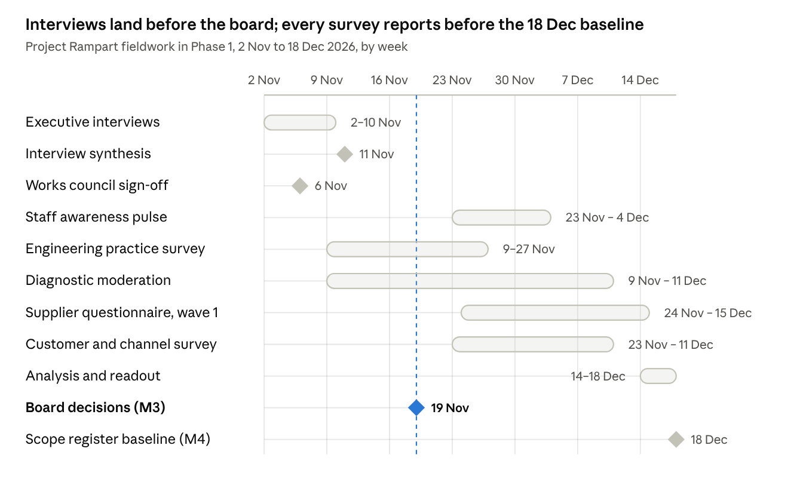

# Project Rampart — Survey and Interview Instruments

Oct 31, 2026 · Prepared by \[Advisor\]

Six instruments give Project Rampart measured evidence on product readiness, staff awareness, supplier exposure, executive priorities, customer expectations and engineering practice. Core fieldwork runs from 2 Nov to 18 Dec 2026, inside Phase 1, so the scope register baseline (M4, 18 Dec 2026) and the Wave 1 gap analysis rest on data rather than opinion. Each instrument tab is ready to paste into Microsoft Forms, Qualtrics or Google Forms, or to run as an interview; tab 8 shows how results roll up into the KPI pack.

## Objectives

Each instrument answers one research question that a programme decision depends on; no question is asked that no decision needs.

| ID | Objective | Research question | Decision or output it feeds | Instrument |
| --- | --- | --- | --- | --- |
| O1 | Baseline readiness | How far is each of the 13 product families from level 3 in each of the 10 domains, and what evidence exists? | K01 readiness index; Phase 2 gap analysis; Wave 1 risk assessments (M6); the 26.2 FTE-years remediation estimate | 2 · Readiness diagnostic |
| O2 | Awareness | Do staff know what the CRA asks of their role, starting with Article 14 reporting, which applies now? | WS8 training plan and K10; message timing in the Communication Pack (D05) | 3 · Staff awareness pulse |
| O3 | Supplier exposure | Which of the 41 in-scope suppliers can commit to vulnerability notification, SBOM delivery and support periods, and which components need an exit plan? | K09; order of clause-pack negotiations; intake-gate risk ratings; mitigation of R04 | 4 · Supplier questionnaire |
| O4 | Executive priorities | Where do executives agree and differ on product-risk appetite, roadmap trade-offs, notified bodies, legacy lines, reporting authority and budget? | Board decisions BD1 to BD5 on 19 Nov 2026; risks R01, R02 and R05 | 5 · Executive interviews |
| O5 | Customer expectations | Which CRA evidence will customers and channel partners request, by when, and how long do they keep our products in use? | Customer FAQ and trust page; Annex II content; support-period determinations; extended-support offer | 6 · Customer and channel survey |
| O6 | Engineering practice | Which SBOM, signing, update, testing and vulnerability-intake practices exist on each release train today? | Sizing of the shared-platform line (EUR 955k one-off, EUR 210k a year); plans for M8 and M10 | 7 · Engineering practice survey |

## Instrument map

Each instrument has a named owner, a fixed field window inside Phase 1 and a sample sized for the cuts reported in tab 8.

| ID | Instrument | Respondents | Sample | Mode | Length | Field window | Owner |
| --- | --- | --- | --- | --- | --- | --- | --- |
| DIA | Product readiness diagnostic | Product owner, lead engineer and PSIRT or quality contact for each family | Census: 13 families (55 SKUs), one moderated record each | Live CRA Readiness Diagnostic (D08) or the offline version, then a moderation workshop | 40 statements: 12–15 min to score, 60–90 min to moderate | 9 Nov – 11 Dec 2026 | Compliance lead, with the product security officer |
| PUL | Staff awareness pulse | All employees | Census of 3,800; at least 349 completes overall and 272 of the 920 engineers for ±5 points at 95% confidence | Anonymous online link, English and German | 15 questions, about 6 min | 23 Nov – 4 Dec 2026; baseline reported 11 Dec 2026; repeats \[Mar 2027\] and \[Oct 2027\] | Head of engineering enablement, with internal communications |
| SUP | Supplier questionnaire | Security or quality lead at each supplier | Census of the 41 in-scope suppliers: wave 1 the top 15 by component risk, wave 2 the other 26 | Online form, sent with the supplier letter (D05) | 31 questions, about 40 min | Wave 1 issued 24 Nov 2026; wave 2 to all 41 in-scope suppliers by 18 Dec 2026 (task T21) | Head of procurement |
| INT | Executive interviews | CTO, CFO, General Counsel, three BU presidents, CISO, Head of quality & regulatory, Head of procurement | 9 core interviews, 4 optional | Semi-structured, in person or by video, two interviewers | 45 min | 2–10 Nov 2026 | Programme director |
| CUS | Customer and channel survey | B2B customers, integrators, distributors, importers and retail partners | Key accounts covering 80% of each BU's EU B2B revenue, plus all EU channel partners; planning assumption about 80 invitations and 40 completes | Online, personal invitation from the account manager | 12 questions, about 8 min | 23 Nov – 11 Dec 2026 | Head of customer operations, with the Head of channel |
| ENG | Engineering practice survey | Engineering lead of each release train | Census of release trains, at least one per family | Online form | 15 questions, about 10 min | 9–27 Nov 2026 | Head of platform engineering, with the product security officer |

Every instrument is piloted with two or three respondents a week before launch, and question IDs stay fixed across waves so results can be trended. Sample sizes use the standard formula for a proportion at 50% with a finite-population correction: n = 384 / (1 + 383 / N).

## Fieldwork calendar



[Chart: Fieldwork calendar · 8 activities and 3 gates, 2 Nov to 18 Dec 2026]

The pulse launches only after works council sign-off on 6 Nov 2026 and reports its baseline on 11 Dec 2026. Supplier wave 2 takes the questionnaire to all 41 in-scope suppliers by 18 Dec 2026 (task T21), and the pulse repeats in \[Mar 2027\] and \[Oct 2027\] with the same question IDs.

## Data handling

Each instrument collects only what its analysis needs, staff answers are anonymous and reported in groups of ten or more, and raw data is deleted on a fixed schedule. The data protection officer confirms every line of the table below before launch.

- **Purpose limitation.** Results are used only to measure CRA readiness, plan training and communications, and assess supply-chain risk. No result is used to assess an individual's performance.
- **Minimisation.** The staff pulse asks for role group and business unit only; it stores no name, email address, IP address or device ID.
- **Pseudonymisation.** The survey tool assigns a random response token and the programme never holds the key. Cells under 10 responses are merged before reporting, and free text is screened for names before it is shared.
- **Works council.** The pulse goes to the works council for sign-off by 6 Nov 2026. Monitoring is its stated concern (ST13); anonymity and the no-performance-use rule answer it.
- **Confidential business data.** Supplier and customer answers stay with procurement and customer operations; the programme receives them in scored form.
- **No vulnerability details.** No instrument asks for details of unfixed vulnerabilities, and every introduction tells respondents not to enter them.

| Instrument | Personal data | Proposed lawful basis | Reported at | Retention |
| --- | --- | --- | --- | --- |
| DIA | Respondent roles; names optional | Legitimate interests (programme management) | Product family | In the system of record until programme close (Dec 2027), then archived with the evidence it cites; that evidence follows Art 13(13): 10 years after placing on the market or the support period, whichever is longer |
| PUL | Role group, business unit, free text | Legitimate interests; participation voluntary | Role group by BU, minimum 10 responses per cell | Raw responses deleted 24 months after each wave closes; aggregates kept |
| SUP | Supplier contact name, role and business email | Legitimate interests (supplier management) | Supplier and component | Kept as Art 13(5) due-diligence evidence with the technical documentation it supports (Art 13(13)) |
| INT | Name, role, notes, quotes | Legitimate interests; consent to notes and to each attributed quote | Role, never name | Notes deleted 6 months after the synthesis is accepted; synthesis kept |
| CUS | Contact name, business email, company | Legitimate interests (existing business relationship) | Segment; company only with consent | Raw responses deleted 24 months after close |
| ENG | Engineering lead name, release train | Legitimate interests | Release train | Kept with the platform sizing record until programme close |

The principles applied are purpose limitation, data minimisation and storage limitation in GDPR Art 5(1)(b), (c) and (e) ([Regulation (EU) 2016/679, Art 5, text as adopted](https://www.legislation.gov.uk/eur/2016/679/article/5/adopted/data.html)). Lawful bases and retention periods are proposals for the data protection officer, not legal advice.

## Analysis plan

Each instrument has one headline measure, defined before fieldwork so that results cannot be re-cut to fit a conclusion. The readiness index is the core measure:

```latex
\text{Readiness index} = \frac{1}{n}\sum_{i=1}^{n}\frac{\min(s_i,\,3)}{3}
```

Here s\_i is the moderated score (0 to 4) of statement i and n the number of statements: 40 for a family, 4 for a domain. Level 4 does not offset a gap elsewhere, and 100% means every statement at level 3 or above. Portfolio, BU and class indices are unweighted means of the family indices; the baseline is 44% (28 Oct 2026).

- **Heatmaps.** Families by domains, each cell the average level to two decimals, coloured on the 0–4 maturity scale with the number always printed (tab 8, output 2).
- **Cuts.** DIA by BU, class, wave and conformity route; PUL by role group and BU; SUP by component risk tier; INT by role; CUS by relationship type, Member State and NIS2 status; ENG by family, artefact type and CI system. No cut identifies a person.
- **Statistics.** Every figure carries its base (n). Pulse proportions carry a 95% confidence interval. Likert items are reported as % favourable (agree plus strongly agree), with "Don't know" outside the base and shown separately. Knowledge items count "Don't know" as not correct. No significance tests on bases under 30.
- **Benchmarks.** Published surveys give context, never targets: their populations, dates and methods differ from ours.

| ID | Benchmark | Value | Type | Compared with |
| --- | --- | --- | --- | --- |
| RD01 | [German companies that know what the CRA means for them](https://www.it-finanzmagazin.de/cyber-resilience-act-cra-nur-jedes-dritte-unternehmen-vorbereitet-250594/) (Bitkom Research, 1,003 companies with 10+ employees, Apr–Jun 2026) | 29% | Survey | PUL-03, % agree |
| RD02 | [CRA-aware respondents unaware of CRA penalties](https://www.linuxfoundation.org/hubfs/Research%20Reports/lfr_2026_cra_awareness_report_060826.pdf?hsLang=en) (Linux Foundation Research 2026: 404 CRA-aware respondents of 843 surveyed) | 56% | Survey | PUL-11, % not correct among PUL-03 agreers |
| RD03 | [Manufacturers relying passively on upstream projects for security fixes](https://www.linuxfoundation.org/hubfs/Research%20Reports/lfr_2026_cra_awareness_report_060826.pdf?hsLang=en) (LF 2026 manufacturer module, n=194–219) | 51% | Survey | DIA Q5.4, upstream reporting |
| RD04 | [SME manufacturers expecting to raise prices to cover compliance](https://www.linuxfoundation.org/hubfs/Research%20Reports/lfr_2026_cra_awareness_report_060826.pdf?hsLang=en) (Linux Foundation Research, 2026) | 47% | Survey (small subsample), 54 SME manufacturers | CUS-10, context only |
| RD05 | [SMEs asking for technical documentation templates](https://www.enisa.europa.eu/sites/default/files/2026-06/SME%20CRA%20survey%20report.pdf) (ENISA SME CRA survey, 194 responses, not representative, Jun 2026) | 73% | Survey (official) | DIA domain D9, documentation |
| RD06 | [Firms expecting longer product development under the CRA](https://www.onekey.com/press-release/onkey-iot-ot-cybersecurity-report-2026-half-of-all-companies-have-formed-cra-teams) (ONEKEY IoT/OT Cybersecurity Report, 200 German industrial firms, Sep 2026) | >60% | Vendor survey | INT question 5, roadmap |
| RD07 | [Respondents with partly or fully automated SBOM generation](https://www.enisa.europa.eu/sites/default/files/2026-06/SBOM%20Adoption%20State%20of%20Play%202026.pdf) (ENISA SBOM State of Play 2026: 74% of 334 respondents) | 74% | Survey (official) | ENG-05, SBOM generation |

## Reporting outputs

Seven outputs reach their owners between 11 Nov and 18 Dec 2026; the research readout to the programme board in the week of 14 Dec 2026 brings them together before the scope register is baselined.

| Output | Built from | Audience | Due | Feeds |
| --- | --- | --- | --- | --- |
| Interview synthesis: themes, stances, decisions implied, risks raised | INT | Executive sponsor, programme director | 11 Nov 2026 | Board pre-read; BD1 to BD5; risk register |
| Awareness baseline by role | PUL | Head of engineering enablement, internal communications | 11 Dec 2026 | WS8 training plan; measurement in the Communication Pack (D05) |
| Platform sizing note | ENG | Head of platform engineering, CTO | 4 Dec 2026 | Shared-platform line; M8 and M10 plans |
| Moderated readiness heatmap and family one-pagers | DIA | Programme board, product teams | 16 Dec 2026 | K01; Phase 2 gap analysis; Wave 1 risk assessments |
| Supplier risk register, wave 1 | SUP | Head of procurement, WS5 | 18 Dec 2026 | K09; clause-pack negotiations; intake gate |
| Customer evidence-demand brief | CUS | Head of customer operations, product management | 18 Dec 2026 | Customer FAQ; trust page; Annex II content; support-period records |
| Research readout, all instruments | All six | Programme board, then the next SteerCo | Week of 14 Dec 2026 | KPI pack; risk register; Phase 2 plan |

*Illustrative engagement: Example Group is a fictional client; regulatory facts verified to 30 Oct 2026. Project Rampart · Survey and Interview Instruments (D07) · v1.0 · 31 Oct 2026 · Prepared by \[Advisor\].*
