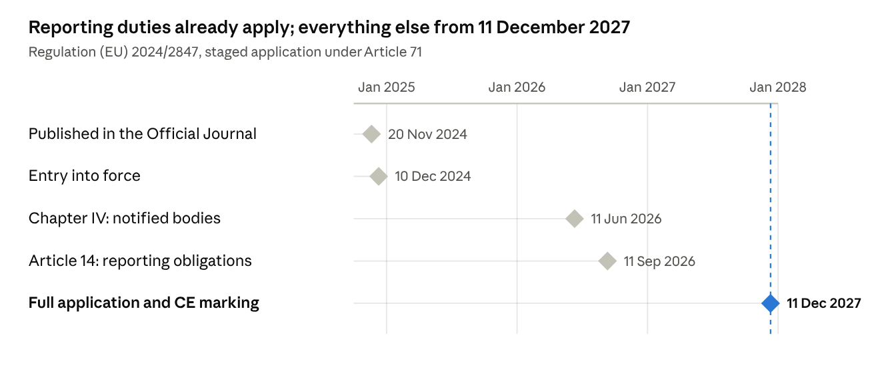
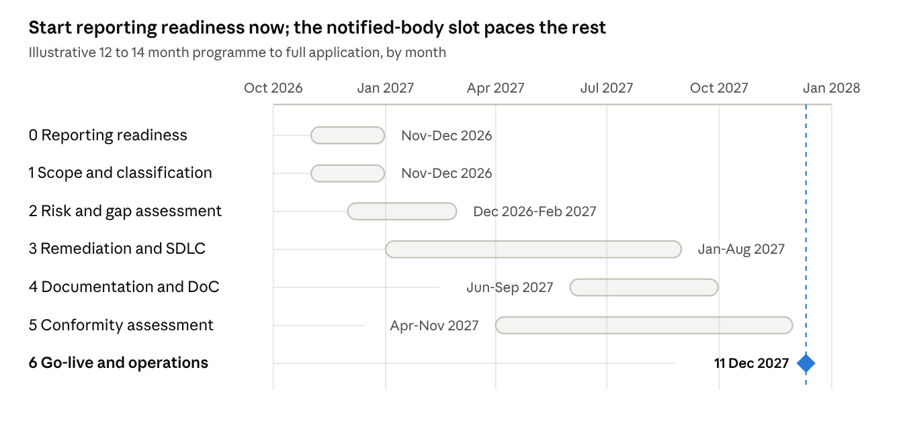

# EU Cyber Resilience Act — Engineering Compliance Knowledge Base

Oct 30, 2026 · @Aidan Murphy

## Executive summary

The [Cyber Resilience Act](https://eur-lex.europa.eu/eli/reg/2024/2847/oj) (Regulation (EU) 2024/2847, the CRA) is a horizontal New Legislative Framework product law that puts CE marking on cybersecurity. It covers every product with digital elements made available on the EU market in a commercial activity, from firmware to operating systems.

It applies in full from 11 Dec 2027. Article 14 reporting has been live since 11 Sep 2026 and already covers products placed on the market earlier (Art 69(3)).

Three design choices drive the engineering workload. The manufacturer carries almost every duty, and the law reaches the manufacturer-built backends a product needs to function (Art 3(2)). Obligations attach per unit, so a unit shipped on 10 Dec 2027 escapes Annex I and one shipped next day does not (Art 69(2)).

Classification decides the conformity route (Art 32). Default products self-assess under Module A; the 26 named categories in Annexes III and IV need a notified body or a recognised certificate. Class I may self-assess only under a fully applied cited harmonised standard; none is cited on 30 Oct 2026 (see Product classification).

### State of play on 30 Oct 2026

| Item | Status on 30 Oct 2026 | Source |
| --- | --- | --- |
| Commission FAQ | v1.4 of 4 Sep 2026, 66 pages, a "living document" that is not an official Commission position | [FAQ](https://ec.europa.eu/newsroom/dae/redirection/document/123307) |
| Art 26 guidance C(2026) 5252 | Content approved 27 Jul 2026; non-binding; formal adoption in all languages still pending, so formally a draft | [Communication](https://ec.europa.eu/newsroom/dae/redirection/document/131455) and [guidance annex](https://ec.europa.eu/newsroom/dae/redirection/document/131456) |
| Implementing Regulation (EU) 2025/2392 | Adopted 28 Nov 2025, in force 21 Dec 2025; technical descriptions of the 26 important and critical categories | [EUR-Lex](https://eur-lex.europa.eu/eli/reg_impl/2025/2392/oj/eng) |
| Delegated Regulation (EU) 2026/881 | Adopted 11 Dec 2025, in force 10 May 2026; when a CSIRT may delay dissemination of a notification | [EUR-Lex](https://eur-lex.europa.eu/legal-content/EN/TXT/?uri=CELEX:32026R0881) |
| ENISA Single Reporting Platform | Live since 11 Sep 2026; web form only, English only, mandatory Art 14 reports only | [ENISA SRP hub](https://www.enisa.europa.eu/topics/product-security/single-reporting-platform-srp) |
| Harmonised standards | None cited in the OJ; no common specification adopted; first citations expected in 2027 (commentary) | [Commission factpage](https://digital-strategy.ec.europa.eu/en/factpages/cyber-resilience-act-implementation) |
| Notified bodies | None verifiably designated for the CRA; Member States "strive" for enough bodies by 11 Dec 2026 (Art 35(2)) | [Commission conformity assessment page](https://digital-strategy.ec.europa.eu/en/policies/cra-conformity-assessment) |
| Digital Omnibus COM(2025) 837 | Proposed, not adopted as of 30 Oct 2026; does not amend the CRA; Council mandate 21 Oct 2026; Parliament at committee stage | [EUR-Lex](https://eur-lex.europa.eu/legal-content/EN/TXT/HTML/?uri=CELEX:52025PC0837) |
| RED cybersecurity delegated act | Delegated Regulation (EU) 2026/339 repeals Delegated Regulation (EU) 2022/30 with effect from 11 Dec 2027 | [EUR-Lex](https://eur-lex.europa.eu/eli/reg_del/2026/339/oj/eng) |
| AI Act | High-risk AI systems meeting Annex I are deemed to meet AI Act Art 15 (CRA Art 12; AI Act Art 42(3), inserted by Regulation (EU) 2026/1744) | [EUR-Lex](https://eur-lex.europa.eu/legal-content/EN/TXT/HTML/?uri=CELEX:32026R1744) |
| Product Liability Directive (EU) 2024/2853 | Applies from 9 Dec 2026; software is a product and a cybersecurity vulnerability can be a defect | [EUR-Lex](https://eur-lex.europa.eu/legal-content/EN/TXT/HTML/?uri=CELEX:32024L2853) |

No presumption of conformity exists yet, and Class I products cannot use Module A internal control today. The guidance is the best available evidence of how market surveillance authorities will read the law. Decisions that rest on it should be recorded as reliance on a published, non-binding Commission interpretation.

Enforcement starts on 11 Dec 2027. The top fine tier is EUR 15m or 2.5% of worldwide turnover for Annex I and Arts 13-14 breaches (Art 64(2)). Finland, Hungary and Malta had adopted national enforcement acts by 30 Oct 2026; Germany's law passed the Bundestag plenary on 15 Oct 2026 and awaits promulgation (see Enforcement, market surveillance and penalties).

UK manufacturers are third-country manufacturers for every EU sale. The CRA does not yet apply in Northern Ireland; see Interplay with other law, the Digital Omnibus and the UK position.

### What an engineering team must have in place

Start with what is live now: the Art 14 reporting runbook with SRP registration, and the product inventory behind scope and classification decisions. Then build the risk assessment, because every Annex I Part I item hangs off it (Art 13(3)). Everything else in the table follows from those three artefacts.

| Obligation | Legal basis | Deadline | Status today |
| --- | --- | --- | --- |
| Reporting process for actively exploited vulnerabilities and severe incidents; SRP registration; CSIRT chosen under Art 14(7) | Art 14; Art 16 | Live since 11 Sep 2026 | Mandatory now, including for legacy products (Art 69(3)) |
| Product inventory with a recorded scope decision per product, variant and backend | Art 2(1); Art 3(1)-(2) | Before 11 Dec 2027 | Guidance available; record each decision and its basis |
| Classification register (default, Class I, Class II, critical) with core-functionality rationale | Art 7; Art 8; Implementing Regulation (EU) 2025/2392 | Before 11 Dec 2027 | Technical descriptions adopted; no delegated act changes the lists |
| Cybersecurity risk assessment per product or family, stating how each Annex I Part I point (2) item applies | Art 13(2)-(4) | Before placing on the market; maintained through the support period | No mandated method; BSI TR-03183-1 v1.0.0 is a usable template |
| Annex I Part I design controls built, tested and evidenced | Art 13(1); Annex I Part I | Each placing on the market from 11 Dec 2027 | No harmonised standard cited; drafts usable as evidence only |
| Annex I Part II processes: SBOM, CVD policy, secure update mechanism, declared support period of at least 5 years | Art 13(8); Annex I Part II | From 11 Dec 2027, for the support period | SBOM format act not adopted; ENISA and BSI profiles available |
| Technical documentation (Annex VII), EU declaration of conformity (Annex V or VI), CE marking | Arts 28, 30, 31; Art 13(12)-(13) | Before placing on the market; retained 10 years or the support period | Simplified SME format not adopted |
| Annex II user information, including the end-of-support month and year at purchase | Art 13(18)-(19); Annex II | From 11 Dec 2027 | Legal text is complete; no implementing act needed |
| Conformity route chosen; notified body contracted where Module A is unavailable | Art 32; Annex VIII | Assessment complete before placing on the market | No notified body designated; pre-assessment with candidate bodies only |
| Due diligence on third-party and open-source components; upstream vulnerability reporting | Art 13(5)-(7) | From 11 Dec 2027 | FAQ gives an action list; no Art 25 attestation programme exists |

### Five facts that surprise teams

- Legacy products still report. Art 14 applies to every in-scope product placed on the market before 11 Dec 2027, and continues after the support period ends (Art 69(3)).
- The SBOM need not be public. Recital 77 says manufacturers "should not be obliged to make the SBOM public". It sits in the technical documentation and goes to authorities on reasoned request.
- Class I products cannot self-assess today. Module A needs a fully applied OJ-cited harmonised standard covering the core-functionality risks (Art 32(2); guidance para 149). Nothing is cited, and no notified body has been designated for the alternative routes.
- The authorised representative is optional. Art 18(1) says a manufacturer "may" appoint one, and the CRA adds no mandatory EU responsible operator (see Economic operators and roles).
- Manufacturer-run backends are in scope. A vendor-built API, authentication portal or update service that a product needs for a function is remote data processing. It is part of that product's conformity assessment (Art 3(2); guidance paras 184-194).

Tickable requirement checklists, per product and per role: Requirement checklists

Implementation guides: Implementation guide: corporate and Implementation guide: application

## Key dates and transition timeline

The Article 14 reporting duty has applied since 11 September 2026; every other obligation applies from 11 December 2027. Reporting also covers products already on the market (Art 69(3)).



[Chart: CRA application dates · 5 milestones, Article 71]

The accent marks the date on which every remaining obligation switches on.

| Date | What switches on | What it means for engineering |
| --- | --- | --- |
| 20 Nov 2024 | Regulation (EU) 2024/2847 published in the Official Journal | Legal text fixed; Annex I is the design target for anything shipping after December 2027 |
| 10 Dec 2024 | Entry into force (Art 71) | No obligations yet; the Commission's implementing and delegated acts count from here |
| 11 Jun 2026 | Chapter IV applies: Member States notify conformity assessment bodies (Arts 35-51) | Notified bodies can be accredited for the CRA; book third-party assessment capacity early for important Class II and critical products |
| 11 Sep 2026 | Art 14 applies: report actively exploited vulnerabilities and severe incidents through ENISA's single reporting platform | The 24h / 72h / 14-day clock is live now, and it also covers products placed on the market before full application (Art 69(3)) |
| 11 Dec 2027 | Everything else: Annex I requirements, conformity assessment, technical documentation, EU declaration of conformity, CE marking, importer and distributor duties | Hard deadline; products placed on the market before this date are caught only if substantially modified afterwards (Art 69(2)) |

## Scope: what the CRA covers

A product is in scope when three cumulative conditions in Art 2(1) of the [CRA](https://eur-lex.europa.eu/eli/reg/2024/2847/oj) are met. It is a product with digital elements, and it is made available on the EU market in a commercial activity. Its intended or reasonably foreseeable use includes a data connection to a device or network, direct or indirect, logical or physical.

The [Commission FAQ v1.4](https://ec.europa.eu/newsroom/dae/redirection/document/123307) and the [Art 26 guidance C(2026) 5252](https://ec.europa.eu/newsroom/dae/redirection/document/131456) both apply this three-part test. The operative article text in this doc was read from legal mirrors because EUR-Lex served only recitals to automated fetches; see Sources. Verify quoted wording against the OJ before relying on it in a filing.

### Definitions that decide scope

Art 3 has 51 definitions. The ones below settle most scope and role questions.

| Term | Art 3 point | Meaning in plain words | Engineering note |
| --- | --- | --- | --- |
| Product with digital elements | (1) | A software or hardware product and its remote data processing solutions, including components placed on the market separately | A library, SDK, driver, firmware image or chip sold on its own is a product with its own manufacturer |
| Remote data processing | (2) | Processing at a distance, built by or under the responsibility of the manufacturer, without which the product cannot perform one of its functions | Your backend is in scope; a licensed third-party SaaS you integrate is a component instead |
| Software | (4) | The part of an electronic information system that consists of computer code | Covers source code as well as machine code (guidance para 22) |
| Hardware | (5) | A physical system, or parts of one, able to process, store or transmit digital data | Integrated circuits and motherboards count (guidance para 18) |
| Component | (6) | Software or hardware intended for integration into an electronic information system | Component status does not remove a separately sold item from scope |
| Logical, physical and indirect connection | (8)-(10) | Software interfaces; electrical, optical, mechanical or radio links; connection through a larger system that is itself connectable | Indirect connection is what brings offline desktop software into scope |
| Manufacturer | (13) | Whoever develops or has developed the product and markets it under its own name or trademark, paid or free | Outsourced development under your brand still makes you the manufacturer |
| Support period | (20) | The period during which vulnerabilities must be handled under Annex I Part II | At least 5 years unless the expected use time is shorter (Art 13(8)) |
| Placing on the market | (21) | The first making available on the EU market | Judged per unit; for standalone software, per version (guidance paras 13-14) |
| Making available on the market | (22) | Supply for distribution or use in the course of a commercial activity, paid or free | Free supply by a business is still caught (Recital 15) |
| Intended purpose | (23) | The use the manufacturer specifies in instructions, marketing and technical documentation | Your marketing copy defines the assessed purpose |
| Reasonably foreseeable use | (24) | Use likely to result from foreseeable human behaviour or technical interaction, even if not intended | The connection test is run against this, not only the intended purpose |
| Substantial modification | (30) | A post-placing change that affects Annex I Part I compliance or alters the assessed intended purpose | Triggers a new placing on the market; see below |
| Security update and functionality update | not defined in Art 3 | The guidance and FAQ distinguish fixes that reduce risk from changes that add features | Ship them separately where technically feasible (Annex I Part II(2)) |
| Free and open-source software | (48) | Software whose source is openly shared under a licence allowing free use, modification and redistribution | Monetisation, not licence, decides whether it is placed on the market |

The table paraphrases mirror text. Not verified against the OJ text; confirm exact wording before relying on it.

### The data-connection test

The test is about exchanging digital information, not the presence of electronics. The guidance (paras 26-28) requires binary states deliberately encoded as information and decodable at the destination. A signal that only triggers or powers a function is not a data connection.

The FAQ lists a dishwasher with cycle firmware, a basic calculator and a toy with pre-recorded effects as out of scope. It adds that the same firmware sold separately may be in scope.

Indirect connections count. Recital 9 covers products "only indirectly connected". The FAQ treats an offline text editor on a networked operating system as in scope.

Almost all commercial software is therefore in scope. The live questions are who the manufacturer is and whether a backend is remote data processing.

### Remote data processing versus SaaS

The guidance applies a three-element test (paras 184-188). The processing is at a distance; the product needs it for one of its functions; and the manufacturer designed it or had it designed. Elements two and three are decisive and cumulative.

"At a distance" includes edge and on-premises deployments. Who operates the solution is not decisive (para 196).

"Functions" is broad (paras 189-192). Sending commands, synchronising files, onboarding, configuration, update distribution and identity and access management all count. Telemetry analysed only for statistics or future development does not.

The worked examples draw the line. A bank's self-hosted API that its mobile app calls is remote data processing; the ledger systems the app never talks to are not (section 8.3.1). An authentication portal that issues tokens the product needs is remote data processing (para 194).

A third-party support-chat SaaS embedded in an app is different. It is a component for Art 13(5) due diligence, not remote data processing (paras 197-202).

Browser-only software is not a product. Software must be "provided to a user" and run on the user's side (para 20). A progressive web app used only in a browser, or a website, is not a product (para 21, Examples 5-6).

Recital 12 sends cloud services built outside a manufacturer's responsibility to NIS2 (Directive (EU) 2022/2555). NIS2 covers medium-sized and larger SaaS, PaaS and IaaS providers. The same SaaS becomes remote data processing the moment the vendor ships an installed client that depends on it.

### Bespoke, internal and per-unit rules

Internal-use software is not placed on the market. The FAQ relies on Blue Guide section 2.3: a product "manufactured for one's own use" is not placed on the market. Internal build and configuration tools are out unless sold separately, and Recital 16 gives the same result for public bodies.

Bespoke software for one customer is placed on the market. Guidance Example 7 treats source code licensed to a single company as placed on the market by the licensor.

Such a product may use the tailor-made derogations for exactly two requirements. They are secure-by-default configuration (Annex I Part I 2(b)) and free security updates (Annex I Part II(8)). Both parties must have explicitly agreed different contractual terms (Recital 64).

A multi-tenant CRM with minor customisation is not tailor-made (FAQ). Keep the evidence of tailor-made status in the technical documentation.

Placing on the market is per unit, and for standalone software per version. All copies of a version are deemed placed at the first commercial offering, whatever the later download dates (guidance paras 13-14, Example 1). Non-substantial updates do not reset that date.

Variants that differ in components, configuration or enabled features are distinct products. Product families with the same architecture, security-relevant design, intended purpose and risks may share one risk assessment and one technical file. They may also share one declaration listing the variants (paras 174-177).

### Substantial modification

The test is risk-based, not size-based (guidance paras 104-110). Ask four questions about a change: new threat vectors; new attack scenarios; changed likelihood of known scenarios; changed impact. All-negative answers with the original risk assessment still valid mean no substantial modification (paras 111-112).

Security updates are "generally not" substantial, even when technically large (para 108). A "remember me" token-storage feature or an unencrypted log export is substantial because the risk was never assessed (Examples 44-45). A substantial modification is a new placing on the market with an assessment focused on the modified parts; see Conformity assessment and documentation.

### Hard cases

Rows marked "inference" rest on the researchers' reading, not on guidance text.

| Case | In or out | Why | Source |
| --- | --- | --- | --- |
| SaaS admin console used only in a browser | Out as a product; in only as remote data processing of an in-scope product | Guidance para 21, Examples 5-6; Recital 12 | [Guidance](https://ec.europa.eu/newsroom/dae/redirection/document/131456) |
| Mobile app controlling the manufacturer's device | In; app and device are one product and the vendor's control, sync and update backends are remote data processing | Guidance para 25, Example 9; paras 189-192 | [Guidance](https://ec.europa.eu/newsroom/dae/redirection/document/131456) |
| Internal tool used only by the developing company | Out; not placed on the market | FAQ, Blue Guide s.2.3; Recital 16 | [FAQ](https://ec.europa.eu/newsroom/dae/redirection/document/123307) |
| Open-source library, free download, maintainer sells optional paid support | Out for the library if access and maintenance are not conditioned on payment; publisher may be a steward | Recital 18; guidance paras 55-58, Example 18 | [Guidance](https://ec.europa.eu/newsroom/dae/redirection/document/131456) |
| Firmware security fix pushed to an in-scope device | Not a new product; not a substantial modification if it reduces risk and keeps the intended purpose | Recital 39; guidance para 108, Examples 46-48 | [Guidance](https://ec.europa.eu/newsroom/dae/redirection/document/131456) |
| Firmware update adding new connectivity or control | Likely substantial; new placing on the market | Recital 39; guidance Examples 40, 44, 45; FAQ smart-TV example | [FAQ](https://ec.europa.eu/newsroom/dae/redirection/document/123307) |
| Firmware image supplied separately to an OEM | In, as a component placed on the market separately | Art 3(1); FAQ product-forms list | [FAQ](https://ec.europa.eu/newsroom/dae/redirection/document/123307) |
| PC with pre-installed operating system | In; the PC maker is manufacturer of the whole; a separately marketed OS is its own product | Guidance para 25, Example 8; para 120, Example 51 | [Guidance](https://ec.europa.eu/newsroom/dae/redirection/document/131456) |
| Vendor-hosted API | Not a product itself; remote data processing where an in-scope client needs it; deeper backends out | Recital 11; guidance para 205, section 8.3.1 | [Guidance](https://ec.europa.eu/newsroom/dae/redirection/document/131456) |
| SDK or library sold or monetised | In, as a software component placed on the market separately | Art 3(1), (6); guidance para 24, Example 7 | [Guidance](https://ec.europa.eu/newsroom/dae/redirection/document/131456) |
| ML model weights file | Not addressed by guidance; inference: in when supplied as part of software executing on the user's side; a bare weights file is unresolved | Art 3(1), (4); guidance para 22 | [Guidance](https://ec.europa.eu/newsroom/dae/redirection/document/131456) |
| Product sold only B2B | In; B2B status matters only for the tailor-made derogations | Art 2(1); Recital 64; FAQ | [FAQ](https://ec.europa.eu/newsroom/dae/redirection/document/123307) |
| Free consumer app monetised by ads or personal data | In; free supply in a commercial activity | Art 3(22); Recital 15; guidance Examples 14-16 | [Guidance](https://ec.europa.eu/newsroom/dae/redirection/document/131456) |
| Free, unmonetised, non-FOSS app from a company | Grey area; Blue Guide "business-related context" case by case; inference | Recital 15; guidance paras 40-41 | [Guidance](https://ec.europa.eu/newsroom/dae/redirection/document/131456) |
| Offline desktop utility with no network code | In; indirect logical connection via the host OS | FAQ connection entry; Recital 9 | [FAQ](https://ec.europa.eu/newsroom/dae/redirection/document/123307) |
| Open-category drone, not EASA-certified | In; only certified aviation products are excluded | Art 2(3); FAQ aviation entry | [FAQ](https://ec.europa.eu/newsroom/dae/redirection/document/123307) |
| Dual-use product sold on the open market | In unless developed or modified exclusively for national security or defence | Art 2(7); Recital 26; FAQ | [FAQ](https://ec.europa.eu/newsroom/dae/redirection/document/123307) |
| Identical-specification spare part via after-sales channel | Out; a part with different cryptography or secure boot is not identical and is in | Art 2(6); guidance paras 97-101, Examples 36-38 | [Guidance](https://ec.europa.eu/newsroom/dae/redirection/document/131456) |
| Vendor CI/CD pipeline and update-distribution infrastructure | Out as remote data processing, but the user-facing update service a product calls can be in; inference reconciling paras 182 and 190 | Guidance paras 182, 190 | [Guidance](https://ec.europa.eu/newsroom/dae/redirection/document/131456) |
| Appliance with firmware and no connectivity | Out; no direct or indirect data connection | Art 2(1); FAQ examples; guidance para 28 | [FAQ](https://ec.europa.eu/newsroom/dae/redirection/document/123307) |

### Status of the guidance

The FAQ is a "living document" prepared by Commission services and is not an official Commission position. It was first published 3 Dec 2025 and reached v1.4 on 4 Sep 2026. The Commission told its Expert Group that the FAQ and the guidance have equal authoritative value.

Guidance C(2026) 5252 is non-binding; only the Court of Justice interprets the Regulation authoritatively (paras 7-9). The Commission approved its content on 27 Jul 2026 and said it "will be formally adopted" once all language versions exist. No evidence of adoption or OJ C-series publication was found by 30 Oct 2026, so it is formally a draft (see Open questions and watchlist).

A corrigendum to the Regulation was published in the OJ on 17 Oct 2025. The notes record it as affecting at least Art 67 wording; its full content was not reviewed. No adopted amendment to scope, definitions or roles existed on 30 Oct 2026.

## Exclusions and exceptions

The [CRA](https://eur-lex.europa.eu/eli/reg/2024/2847/oj) has only six narrow sectoral carve-outs in Art 2(2)-(7), plus one delegated act under Art 2(5) covering L-category vehicles. Most things teams call "exceptions" are not exclusions at all. They are either products never placed on the market, or legacy units that escape Annex I because they were placed before 11 Dec 2027.

Each exclusion is act-based. The test is whether the other EU act applies to that product, not whether the product looks medical or automotive.

### Exclusions and exceptions

| Exclusion or exception | Legal basis | What it covers | What it does not cover, watch-outs | Source |
| --- | --- | --- | --- | --- |
| Medical devices and in-vitro diagnostics | Art 2(2)(a)-(b); Recital 25 | Products to which Regulation (EU) 2017/745 or 2017/746 apply, including software that is itself a device | A generic component sold to a device maker that is not itself a device stays in scope for its own manufacturer | [Commission FAQ](https://ec.europa.eu/newsroom/dae/redirection/document/123307) |
| Type-approved motor vehicles | Art 2(2)(c); Recital 27 | Products to which Regulation (EU) 2019/2144 applies; components "exclusively designed" for such vehicles and sold through restricted B2B channels (guidance paras 241-246) | Generic components usable in other products, or sold through open retail or online channels, are in regardless of intended-use statements | [Guidance C(2026) 5252](https://ec.europa.eu/newsroom/dae/redirection/document/131456) |
| L-category vehicles | Art 2(5); Delegated Regulation (EU) 2025/1535, in force 18 Nov 2025 | Two- and three-wheel vehicles and quadricycles under Regulation (EU) No 168/2013 | Pedal-assist L1e vehicles (e-bikes) stay in; no other Art 2(5) delegated act exists for any sector | [EUR-Lex 2025/1535](https://eur-lex.europa.eu/legal-content/EN/TXT/HTML/?uri=CELEX:32025R1535) |
| Certified aviation products | Art 2(3); Recital 27 | Products certified under Regulation (EU) 2018/1139 | Open-category drones and uncertified components intended for certified aircraft "may be covered" | [Commission FAQ](https://ec.europa.eu/newsroom/dae/redirection/document/123307) |
| Marine equipment | Art 2(4) | Equipment within Directive 2014/90/EU, as listed in the annex to Implementing Regulation (EU) 2025/1533 | Components intended for marine equipment but outside the Directive may be covered | [Commission FAQ](https://ec.europa.eu/newsroom/dae/redirection/document/123307) |
| Identical-specification spare parts | Art 2(6); Recital 29 | Parts supplied to replace identical components, built to the same specifications, including a whole sub-product such as a PLC (guidance Example 39) | Repair purpose must be evident from the supply context; a part with different cryptography or secure boot is not identical and is a product in its own right (Example 37) | [Guidance C(2026) 5252](https://ec.europa.eu/newsroom/dae/redirection/document/131456) |
| National security, defence and classified information | Art 2(7); Recital 26 | Products developed or modified exclusively for national security or defence, or designed to process classified information | Dual-use products on the open market are in; Member States may add procurement requirements under Art 5 | [Commission FAQ](https://ec.europa.eu/newsroom/dae/redirection/document/123307) |
| Free and open-source software outside a commercial activity | Art 3(22); Recitals 15-20 | FOSS not monetised by its manufacturer is not made available on the market | Charging for binaries, updates or access makes the publisher a manufacturer; see Open-source software | [Guidance C(2026) 5252](https://ec.europa.eu/newsroom/dae/redirection/document/131456) |
| Open-source software stewards | Art 3(14); Art 24; Recital 19 | Legal persons sustaining FOSS intended for commercial activities without placing it on the market | Light regime, not an exclusion: documented security policy, cooperation with authorities and limited Art 14 reporting from 11 Dec 2027; see Open-source software | [Guidance C(2026) 5252](https://ec.europa.eu/newsroom/dae/redirection/document/131456) |
| Not placed on the market | Art 3(21)-(22); Blue Guide s.2.3 | Internal-use software and tools; software developed by a public body exclusively for its own use (Recital 16); unfinished code shared for review or testing; sample and demo code (guidance paras 22-24) | A later commercial supply of the same software is a placing on the market | [Commission FAQ](https://ec.europa.eu/newsroom/dae/redirection/document/123307) |
| Trade fairs and time-limited testing | Art 4(2)-(4); Recital 37 | Prototypes shown at fairs with a visible non-compliance sign; unfinished software made available "for a limited period required for testing" with a visible sign | Only for the time needed to test and gather feedback; a risk assessment is still expected; not for safety components under other harmonisation law | [Commission FAQ](https://ec.europa.eu/newsroom/dae/redirection/document/123307) |
| Tailor-made derogations | Annex I Part I 2(b); Annex I Part II(8); Recital 64 | Secure-by-default configuration and free security updates may be varied by explicit contract for a product fitted to one business user, including closed or air-gapped networks | Only those two requirements; a multi-tenant product with minor customisation or plugins is not tailor-made; keep the evidence in the technical documentation | [Commission FAQ](https://ec.europa.eu/newsroom/dae/redirection/document/123307) |
| Products placed before 11 Dec 2027 | Art 69(2) | Units placed on the market before full application are subject to the CRA only if substantially modified from that date | Art 14 reporting applies to all of them regardless (Art 69(3)); further units of a non-compliant type cannot be placed on or after 11 Dec 2027 | [Commission FAQ](https://ec.europa.eu/newsroom/dae/redirection/document/123307) |

Two points on the legacy rule deserve emphasis. The CRA applies to individual units, not product types (FAQ s.7.2). A design that shipped in 2026 must still be assessed, declared and CE-marked for units shipped from 11 Dec 2027.

The guidance allows such legacy designs to be placed "without redesign" where the risk assessment shows adequate security (paras 33-39). It does not require recreating historical design documentation.

### Partial reliefs

These do not remove a product from scope. They soften one obligation each.

| Relief | Legal basis | Effect | Status on 30 Oct 2026 |
| --- | --- | --- | --- |
| No fine for a missed 24-hour early warning | Art 64(10)(a); Recital 120 | Micro and small enterprise manufacturers cannot be fined for missing the deadlines in Art 14(2)(a) and 14(4)(a); the duty to report still stands | Adopted; national acts should impose no other pecuniary penalty for this (Recital 120) |
| No fines for stewards | Art 64(10)(b) | Open-source software stewards are exempt from administrative fines; corrective action under Art 52(3) remains | Adopted |
| Simplified technical documentation for micro and small enterprises | Art 33(5); Recital 93 | A simplified Annex VII format, once the Commission specifies it by implementing act; notified bodies must accept it | No implementing act adopted, drafted or scheduled; build the full Annex VII set |
| SME support measures | Art 33(1)-(4); Art 32(6); Art 39(12) | Awareness, advice channels, testing support, optional regulatory sandboxes; proportionately reduced conformity assessment fees | Sandboxes are optional and none was identified; fee reductions depend on notified bodies that do not yet exist |
| Internal control for important FOSS products | Art 32(5) | A manufacturer of FOSS in an Annex III category may use any Art 32(1) procedure, including Module A, if the technical documentation is public at placing on the market | Adopted; this is the only case where technical documentation must be published (FAQ s.6.6) |
| Automatic-update carve-outs | Annex I Part I 2(c); Recital 56 | Default-on automatic security updates do not apply to products primarily intended as components, or where users would not expect them, such as professional ICT networks and critical or industrial environments | Record the justification in the risk assessment (Art 13(4)); updates must still be made available without delay |
| Shorter support period | Art 13(8) | Less than 5 years only where the product is expected to be in use for less, such as a subscription product unusable after expiry | FAQ examples; five years is a floor, not a default (guidance section 5) |
| Existing type-examination certificates | Art 69(1) | EU type-examination certificates and approval decisions on cybersecurity requirements under other harmonisation law remain valid until 11 Jun 2028 | They count as evidence only for the risks they cover and never replace the CRA risk assessment (guidance paras 247-257) |

### Things that are not exclusions

- B2B-only sale. The CRA has no consumer-only limitation; B2B status matters only for the tailor-made derogations and for classification (Art 2(1); Recital 64).
- Free products from a company. Supply "free of charge" in a commercial activity is making available (Art 3(22)); ads, monetised platforms and personal-data conditions are commercial indicators (Recital 15).
- A non-EU manufacturer. The CRA applies to any product made available in the EU. The manufacturer's location changes who the importer is, not whether the product is in scope.
- Offline products with an indirect connection. Software on a networked host is in scope through the operating system (Recital 9; FAQ).
- Hardware that never receives updates. The absence of an update mechanism is a compliance gap against Annex I Part II, not a reason for being out of scope.
- Products sold through online marketplaces. A marketplace that only intermediates is not an economic operator, but the manufacturer and any importer keep their duties (Recital 78).
- White-label resale. Selling someone else's product under your own brand makes you the manufacturer (Art 21; Recital 78); see Economic operators and roles.
- Products designed before the CRA. Legacy designs placed on the market from 11 Dec 2027 need a conformity assessment, declaration and CE marking (guidance paras 33-39).

## Economic operators and roles

The manufacturer carries almost every obligation in the [CRA](https://eur-lex.europa.eu/eli/reg/2024/2847/oj): Art 13 alone has 25 paragraphs, and Art 14 reporting sits with the manufacturer too. The real question for each product is therefore who the manufacturer is. Art 3(13) answers it by brand, not authorship: whoever markets the product under its own name or trademark, paid or free.

### The roles

| Role | Definition and article | Main obligations with articles | Applies from | Notes |
| --- | --- | --- | --- | --- |
| Manufacturer | Art 3(13): develops or has developed the product and markets it under its own name or trademark, for payment or free | Annex I Part I design controls (Art 13(1)); risk assessment maintained through the support period (Art 13(2)-(4)); component due diligence and upstream reporting (Art 13(5)-(7)); support period and update availability (Art 13(8)-(11)); technical documentation, conformity assessment, declaration, CE marking (Art 13(12)-(13)); contact details and single point of contact (Art 13(15)-(17)); user information and end-of-support date (Art 13(18)-(20)); corrective action and cessation notice (Art 13(21)-(23)); reporting (Art 14) | Art 14 since 11 Sep 2026; the rest 11 Dec 2027 | Top fine tier, EUR 15m or 2.5% of worldwide turnover (Art 64(2)) |
| Authorised representative | Art 3(15): EU-established person with a written mandate from the manufacturer; Art 18(1) says a manufacturer "may" appoint one | Keep the declaration and technical documentation for 10 years or the support period; supply information on reasoned request; cooperate with authorities (Art 18(3)) | 11 Dec 2027 | Optional. Art 18(2) bars delegating Art 13(1)-(11), Art 13(12) first subparagraph and Art 13(14): design, risk assessment, support period, documentation and conformity assessment stay with the manufacturer |
| Importer | Art 3(16): EU-established person placing on the market a product bearing a non-EU name or trademark | Place only compliant products (Art 19(1)); verify conformity assessment, documentation, CE marking, declaration and Annex II information (Art 19(2)); withhold non-conforming products and alert authorities (Art 19(3)); add own name and contact details (Art 19(4)); inform the manufacturer of vulnerabilities "without undue delay" (Art 19(5)); keep the declaration 10 years or the support period; notify if the manufacturer ceases operations (Art 19(6)-(9)) | 11 Dec 2027 | Second fine tier, EUR 10m or 2% (Art 64(3)) |
| Distributor | Art 3(17): supply-chain person who makes the product available without affecting its properties | Act with due care (Art 20(1)); verify the CE marking and that manufacturer and importer met Art 13(15), (16), (18), (19), (20) and Art 19(4) (Art 20(2)); withhold products believed non-conforming (Art 20(3)); inform the manufacturer of vulnerabilities without undue delay (Art 20(4)); cooperate; notify on cessation (Art 20(5)-(6)) | 11 Dec 2027 | Not required to bring pre-11 Dec 2027 stock into compliance unless it substantially modifies it (FAQ) |
| Open-source software steward | Art 3(14): legal person, other than a manufacturer, systematically sustaining FOSS intended for commercial activities | Documented, verifiable cybersecurity policy (Art 24(1)); cooperate with authorities and supply the policy on reasoned request (Art 24(2)); Art 14 reporting only to the extent involved (Art 24(3)) | 11 Dec 2027 | No CE marking, no fines (Art 64(10)(b)); see Open-source software |
| Any other person who substantially modifies | Art 22(1): a person other than manufacturer, importer or distributor who substantially modifies a product and makes it available | Becomes manufacturer for the modified part, or for the whole product where the modification affects its cybersecurity as a whole (Art 22(2)) | 11 Dec 2027 | The original manufacturer's duties continue for the original product (guidance paras 117-121) |
| Fulfilment service providers and online marketplaces | Not CRA economic operators unless they manufacture, import or distribute (Recital 78) | Reg (EU) 2019/1020 Art 6 deems online offers targeted at EU users "made available"; GPSR Art 16 applies to consumer products via CRA Art 11 for safety risks the CRA does not cover | 11 Dec 2027 | A marketplace selling its own-branded products is a manufacturer (Recital 78) |

[Guidance C(2026) 5252](https://ec.europa.eu/newsroom/dae/redirection/document/131456) adds a per-product rule. The same legal person can be steward for a free community edition and manufacturer for the paid edition (paras 71-74). A steward that starts monetising becomes manufacturer from that date, not for earlier versions (para 84).

### When you become the manufacturer

Work through this list for every product, variant and resale arrangement.

- [ ] Own brand or trademark. An importer or distributor that places a product on the market under its own name or trademark is the manufacturer (Art 21). It takes on Arts 13 and 14 in full; the original developer's compliance is evidence, not a transfer of responsibility.
- [ ] Substantial modification (test in Scope: what the CRA covers). An importer or distributor that substantially modifies a product becomes its manufacturer (Art 21). Anyone else becomes manufacturer for the affected part, or the whole product if its security as a whole is affected (Art 22).
- [ ] Integration into a new product. Assembling third-party components, even modified ones, into a product you place on the market is not substantial modification. You are the manufacturer of the new product "in its entirety" (guidance para 120, Example 51: an agricultural monitor built from third-party microcontroller modules).
- [ ] White-label and resale. Same result as own brand: full manufacturer duties (Art 21; Recital 78).
- [ ] A distributor who patches. Installing or configuring software on a customer's systems without substantial modification is not placing it on the market (guidance para 59, Example 19). One who substantially modifies it as part of the service falls under Art 22.
- [ ] Software you host but the customer runs. If the customer obtains and runs the software, it is a product and you are its manufacturer. If the customer only accesses it in a browser, it is at most remote data processing for one of your products (guidance paras 20-21).
- [ ] Free software from a company. Free supply in a commercial activity is making available (Art 3(22); Recital 15); unmonetised FOSS makes a company a steward at most (guidance paras 67-68). A free closed-source app with no monetisation is a grey area the guidance resolves case by case (paras 40-41).
- [ ] Outsourced development. A product you had developed and sell under your brand is yours (Art 3(13) "has ... developed").

### Non-EU manufacturers, including the UK

The CRA itself imposes no mandatory EU representative, because Art 18 is permissive. CRA Art 66 adds the CRA to Annex I of [Regulation (EU) 2019/1020](https://eur-lex.europa.eu/legal-content/EN/TXT/HTML/?uri=CELEX:32019R1020) but not to its Art 4(5) list. Only that list requires an EU responsible economic operator.

The scope notes initially inferred otherwise; the timeline notes checked the Art 4(5) list and found the CRA absent. Treat the absence as the better-supported reading, but confirm with counsel.

What the CRA does require is that whoever places the product on the EU market is an importer (Art 19) with verification and record duties. In a pure direct-to-consumer model there is no importer, because a consumer does not act in a commercial activity. The manufacturer then carries Arts 13-14 alone.

Other laws close that gap for many products. Radio equipment is listed in Reg 2019/1020 Art 4(5), so an EU responsible operator is mandatory anyway. Consumer products outside other harmonisation law pick up the GPSR Art 16 responsible-person rule through CRA Art 11.

From 9 Dec 2026, [Directive (EU) 2024/2853](https://eur-lex.europa.eu/legal-content/EN/TXT/HTML/?uri=CELEX:32024L2853) Art 8 adds liability. Where no EU importer or authorised representative exists, the EU fulfilment service provider or online platform is liable. The practical advice in the notes is to appoint an authorised representative even though Art 18 is optional.

Reporting routes through the CSIRT of the main-establishment Member State, where product cybersecurity decisions are predominantly taken (Art 14(7)). A manufacturer with no EU establishment uses, in order, the Member State of its authorised representative, importer, distributor, or most users. ENISA's [SRP FAQ](https://www.enisa.europa.eu/topics/product-security/single-reporting-platform-srp/frequently-asked-questions) warns that a wrong CSIRT choice may invalidate the filing; see Reporting obligations (Article 14).

UK and Northern Ireland detail is in Interplay with other law, the Digital Omnibus and the UK position.

### Record-keeping and contacts

| Duty | Article | What to keep or publish | Period |
| --- | --- | --- | --- |
| Traceability up and down the chain | Art 23 | Name and address of every operator that supplied you and, where available, every operator you supplied | 10 years after being supplied and 10 years after supplying |
| Identification on the product | Art 13(15)-(16); Art 19(4) | Type, batch or serial number; manufacturer and importer name, trade name or trademark, postal address, email or digital contact, website, on the product, packaging or accompanying document and in the Annex II information | For the life of the product |
| Single point of contact for users | Art 13(17) | Easily identifiable channel for reporting and receiving vulnerability information; must not be limited to automated tools | Throughout the support period |
| Technical documentation and declaration | Art 13(13); Art 18(3) | Annex VII dossier and EU declaration of conformity available to authorities; the authorised representative may hold them | At least 10 years after placing on the market or the support period, whichever is longer |
| User information | Art 13(18) | Annex II information in a language users and authorities understand | At least 10 years or the support period, whichever is longer |
| Cessation of operations | Art 13(23); Art 19(9); Art 20(6) | Manufacturer informs authorities and users before ceasing; importers and distributors inform authorities and users if the manufacturer has ceased | Before cessation |

Vulnerability information flows upstream and downstream. Importers (Art 19(5)) and distributors (Art 20(4)) must inform the manufacturer of vulnerabilities without undue delay. They must also alert authorities where there is a significant cybersecurity risk.

Manufacturers must report vulnerabilities found in components, including open-source ones, to the component maintainer and share fixes (Art 13(6)). Fixes go "where appropriate in a machine-readable format". Actively exploited vulnerabilities and severe incidents are reported under Art 14; see Reporting obligations (Article 14).

Article text in this section was read from legal mirrors; see Sources. The fine tier for Arts 18-23 breaches (EUR 10m or 2%) is from Art 64(3) as mirrored and was not verified against the OJ text.

## Product classification

Twenty-six named categories decide the conformity route under the [CRA](https://eur-lex.europa.eu/eli/reg/2024/2847/oj). Annex III holds 19 Class I and 4 Class II "important" categories; Annex IV holds 3 "critical" categories. Everything else is a default product and may always self-assess under Module A.

[Commission Implementing Regulation (EU) 2025/2392](https://eur-lex.europa.eu/legal-content/EN/TXT/HTML/?uri=CELEX:32025R2392) of 28 Nov 2025, in force 21 Dec 2025, gives each category a technical description with non-exhaustive examples. A product is in a category when its core functionality matches that description (Art 7(1)).

Annex III categories meet one of two criteria in Art 7(2). Either the product "primarily performs functions critical to the cybersecurity of other products", or it can disrupt or damage many other products "through direct manipulation". Annex IV adds critical dependency of NIS2 essential entities, or supply-chain disruption potential (Art 8(2)).

The route pointers below reflect 30 Oct 2026. No harmonised standard is cited in the OJ, no Art 27(9) delegated act recognises a certification scheme, and no notified body is designated. The full route table is in Conformity assessment and documentation.

### Table A: Annex III Class I (19 categories)

| Annex III Class I category | Technical-description highlights from 2025/2392 | Typical products | Route pointer |
| --- | --- | --- | --- |
| 1. Identity management systems and privileged access management software and hardware, including authentication and access control readers, including biometric readers | Systems providing authentication or authorisation; privileged-access software; SSO, federated identity, OTP and MFA software; biometric readers | IdP and SSO platforms, PAM suites, MFA apps, badge and fingerprint readers | Module B+C or H until a cited standard allows Module A |
| 2. Standalone and embedded browsers | Software for accessing and rendering web content, including browsers with AI-agent integration | Desktop and mobile browsers, embedded webview engines | Module B+C or H until a cited standard allows Module A |
| 3. Password managers | Products storing passwords locally or remotely, including browser extensions and hardware-based managers | Password vault apps, browser extensions, hardware key stores | Module B+C or H until a cited standard allows Module A |
| 4. Software that searches for, removes, or quarantines malicious software | Detection, removal or quarantine of malicious code, including rootkit detection and rescue disks | Anti-malware, EDR agents, rescue media | Module B+C or H until a cited standard allows Module A |
| 5. Products with digital elements with the function of virtual private network (VPN) | Products creating encrypted logical tunnels: VPN clients, servers and gateways | VPN clients, concentrators, SD-WAN tunnel endpoints | Module B+C or H until a cited standard allows Module A |
| 6. Network management systems | Systems that monitor and configure network elements, including SDN controllers | NMS platforms, controllers, orchestration consoles | Module B+C or H until a cited standard allows Module A |
| 7. Security information and event management (SIEM) systems | Products that collect and correlate security data into actionable information | SIEM platforms; log tools without correlation fall short (guidance Example 60) | Module B+C or H until a cited standard allows Module A |
| 8. Boot managers | Software managing system start-up, including UEFI firmware and boot loaders | UEFI firmware, GRUB-type loaders, secure-boot chains | Module B+C or H until a cited standard allows Module A |
| 9. Public key infrastructure and digital certificate issuance software | Products managing certificates or cryptographic keys, including key management systems and OCSP responders | CA software, KMS, OCSP and CRL services | Module B+C or H until a cited standard allows Module A |
| 10. Physical and virtual network interfaces | Hardware or software connecting devices to networks: NICs, Wi-Fi, Bluetooth, virtual NICs, VPN interfaces | Network cards, radio modules, virtual switches and adapters | Module B+C or H until a cited standard allows Module A |
| 11. Operating systems | Software that abstracts hardware and manages execution, real-time and general-purpose | Desktop, server, mobile, embedded and real-time OS | Module B+C or H until a cited standard allows Module A |
| 12. Routers, modems intended for the connection to the internet, and switches | Routers select paths; modems convert signals; switches forward packets and have a management plane; access points acting as bridges included | Home and enterprise routers, DSL and fibre modems, managed switches, access points | Module B+C or H until a cited standard allows Module A |
| 13. Microprocessors with security-related functionalities | Central processing ICs that also provide security features such as encryption or secure boot | Application processors with crypto engines or secure boot | Module B+C or H until a cited standard allows Module A |
| 14. Microcontrollers with security-related functionalities | Programmable ICs with similar security features | MCUs with hardware crypto, secure boot or key storage | Module B+C or H until a cited standard allows Module A |
| 15. Application specific integrated circuits (ASIC) and field-programmable gate arrays (FPGA) with security-related functionalities | Custom or reprogrammable ICs with similar security features | Security ASICs, FPGAs with crypto or secure configuration | Module B+C or H until a cited standard allows Module A |
| 16. Smart home general purpose virtual assistants | Products processing natural-language requests and controlling connected home devices, including smart speakers with integrated assistants | Smart speakers, voice hubs | Module B+C or H until a cited standard allows Module A |
| 17. Smart home products with security functionalities, including smart door locks, security cameras, baby monitoring systems and alarm systems | Products protecting physical security in homes, including central control hardware and software | Smart locks, cameras, baby monitors, alarm panels and apps | Module B+C or H until a cited standard allows Module A |
| 18. Internet connected toys covered by Directive 2009/48/EC that have social interactive features (e.g. speaking or filming) or that have location tracking features | Toys with microphone, camera, speaker or location tracking; proximity sensing alone is not location tracking | Talking or filming connected toys, GPS-tracked toys | Module B+C or H until a cited standard allows Module A |
| 19. Personal wearable products to be worn or placed on a human body that have a health monitoring (such as tracking) purpose and to which Regulation (EU) 2017/745 or (EU) 2017/746 do not apply, or personal wearable products intended for the use by and for children | Health-monitoring wearables that are not medical devices; wearables for children under 14; fitness trackers and smartwatches | Fitness bands, smartwatches, children's wearables | Module B+C or H until a cited standard allows Module A |

### Table B: Annex III Class II (4 categories)

| Annex III Class II category | Technical-description highlights from 2025/2392 | Typical products | Route pointer |
| --- | --- | --- | --- |
| 1. Hypervisors and container runtime systems that support virtualised execution of operating systems and similar environments | Type 1, type 2 and hybrid hypervisors; container runtime systems | Bare-metal and hosted hypervisors, container runtimes | Module B+C or H; a "substantial" certificate once an Art 27(9) act names the scheme |
| 2. Firewalls, intrusion detection and prevention systems | Network and application firewalls including web application firewalls and anti-spam gateways; network- and host-based IDS and IPS | Next-generation firewalls, WAFs, IDS and IPS appliances and software | Module B+C or H; a "substantial" certificate once an Art 27(9) act names the scheme |
| 3. Tamper-resistant microprocessors | Class I.13 microprocessors with tamper features, designed to AVA\_VAN level 2 or 3 | Hardened application processors | Module B+C or H; a "substantial" certificate once an Art 27(9) act names the scheme |
| 4. Tamper-resistant microcontrollers | Class I.14 microcontrollers with tamper features, designed to AVA\_VAN level 2 or 3 | Hardened MCUs for payment, automotive or industrial use | Module B+C or H; a "substantial" certificate once an Art 27(9) act names the scheme |

### Table C: Annex IV critical (3 categories)

| Annex IV category | Technical-description highlights from 2025/2392 | Typical products | Route pointer |
| --- | --- | --- | --- |
| 1. Hardware Devices with Security Boxes | Multi-component hardware storing or processing sensitive data inside a tamper-protecting physical enclosure | Payment terminals, HSMs, tachographs | As Class II until an Art 8(1) delegated act mandates certification |
| 2. Smart meter gateways within smart metering systems as defined in Article 2, point (23) of Directive (EU) 2019/944 and other devices for advanced security purposes, including for secure cryptoprocessing | Gateways controlling smart-metering communication, handling encryption, firewalling and device control; electricity, and gas and heat where the description fits | Smart meter gateways, secure cryptoprocessing devices | As Class II until an Art 8(1) delegated act mandates certification |
| 3. Smartcards or similar devices, including secure elements | Secure elements are tamper-protected microcontrollers or microprocessors designed to at least AVA\_VAN.4, including TPMs and embedded UICCs; smartcards are secure elements in card or other carrier form | Payment, ID and access cards, TPMs, eUICCs, tachograph cards | As Class II until an Art 8(1) delegated act mandates certification |

For hardware teams the Common Criteria vulnerability-assurance target is the discriminator. AVA\_VAN 2-3 with tamper features puts a chip in Class II, and AVA\_VAN.4 or higher makes it an Annex IV secure element. A chip with security functions below those levels is Class I.

[Guidance C(2026) 5252](https://ec.europa.eu/newsroom/dae/redirection/document/131456) para 146 notes that choosing the wrong Art 32 route can attract fines under Art 64(3). Draft vertical standards exist for most categories but none is cited; see Standards and guidance map.

### Core-functionality rules

Core functionality is the set of main features without which the product "would not be able to meet its intended purpose" (guidance para 139). It is read from instructions, marketing and technical documentation. The recitals of Implementing Regulation 2025/2392 and guidance section 6.1 fix five rules.

- One core functionality per product. A product "may not have more than one core functionality" for classification, and the technical documentation must identify it (para 144).
- Integration does not reclassify the host. Embedding an important or critical component does not make the host important or critical (Art 7(1)). A smartphone with an OS is not an OS (Example 58), but the host must still assess the integrated component's security.
- Ancillary functions do not declassify. An operating system with a calculator is still an OS; a router with firewall functions is still a router (Implementing Regulation recitals).
- A product that could perform a category's function but has a different core is not in the category. SOAR software exceeds SIEM and is not a SIEM (Example 59); log collection without correlation falls short (Example 60).
- Separately sold modules are separate products. Sold separately, a suite's SIEM module is Class I, its IDS module Class II and its analytics module default (para 145, Example 61). Supplied only as parts of one integrated product, they take the product's class.

The test is objective. Classification does not depend on "the way in which the product ... is described or marketed" (para 142). Inconsistency between marketing, instructions and technical documentation is an indicator of misrepresentation (para 143).

Packaging and licensing decisions therefore change classification. Keep the register at SKU level.

### Self-classification procedure

1. Fix the product boundary. One product means the hardware, the software needed to use it, and manufacturer-built remote data processing (see Scope: what the CRA covers). List modules sold or licensed separately as their own products.
2. State the single core functionality. Derive it from the intended purpose in instructions, marketing and the technical documentation, and write it into Annex VII item 1(a).
3. Compare against the 26 technical descriptions in Implementing Regulation 2025/2392 Annex I (Class I and II) and Annex II (critical). For chips, use the designed AVA\_VAN level.
4. Apply the integration and ancillary rules. Ignore embedded important components and extra features; ask whether the product's own core matches, exceeds or falls short of the description.
5. Check the overlays. A FOSS product in an Annex III category may use any Art 32(1) route if its technical documentation is public (Art 32(5)). A high-risk AI system follows Art 12 (below).
6. Record the result. Enter the category or "default", the rationale and the evidence consulted in a SKU-level classification register, and keep it with the technical documentation.
7. Choose the route from the table in Conformity assessment and documentation. Book notified-body capacity early for Class I, Class II and critical products.
8. Re-run steps 1-7 on any substantial modification, new variant or change in how modules are sold.

### Status of the lists and the AI Act overlay

No Art 7(3) delegated act changing the Annex III lists has been adopted or put to consultation as of 30 Oct 2026. None under Art 8(1) makes certification mandatory for a critical category. The Commission told its Expert Group on 12 Feb 2025 that it "was not working on" such acts ([Expert Group minutes](https://ec.europa.eu/transparency/expert-groups-register/core/api/front/document/115256/download)).

A future Art 7(3) act must give at least 12 months' transition, and an Art 8(1) act at least 6 months, barring urgency. The Commission's [implementation factpage](https://digital-strategy.ec.europa.eu/en/factpages/cyber-resilience-act-implementation) lists only the planned Q4 2026 Art 27(9) delegated act recognising EUCC; see Open questions and watchlist.

High-risk AI systems that are products with digital elements get a deemed-compliance rule (CRA Art 12(1)). The product meets Annex I Part I, the processes meet Part II, and the EU declaration shows the AI Act Art 15 protection level. The product is then "deemed to comply" with AI Act Art 15 cybersecurity; [Regulation (EU) 2026/1744](https://eur-lex.europa.eu/legal-content/EN/TXT/HTML/?uri=CELEX:32026R1744) mirrors this in AI Act Art 42(3).

The AI Act Art 43 procedure then governs conformity assessment (Art 12(2)). The exception is an important or critical product under AI Act Annex VI internal control, which follows the CRA routes instead (Art 12(3)). No Commission guidance on sequencing the two assessments exists; CRA-AI Act interplay guidance is targeted for end-2026.

## Annex I Part I: essential requirements for product properties

Annex I Part I of the [CRA](https://eur-lex.europa.eu/eli/reg/2024/2847/oj) sets one absolute obligation, point (1), and thirteen risk-qualified requirements, points (2)(a) to (2)(m). All thirteen sit under one chapeau: "On the basis of the cybersecurity risk assessment referred to in Article 13(2) and where applicable". The Art 13(2)-(4) risk assessment therefore decides which items apply and must justify every item not applied.

Point (1) requires products designed, developed and produced to ensure "an appropriate level of cybersecurity based on the risks". Items (c) and (m) carry a second internal qualifier, and (b) a tailor-made carve-out.

The drafting bodies still treat (a), (b), (d) and (l) as near-universal. Draft [ETSI EN 304 621](https://labs.etsi.org/rep/stan4cra/en-304-621/-/raw/main/EN-304-621.md) applies access control at every risk tier and calls logging essential in every use case.

### Requirement-by-requirement reference

The mapping column cites these sources as the research notes give them:

- [JRC-ENISA standards mapping](https://www.enisa.europa.eu/sites/default/files/2024-11/Cyber%20Resilience%20Act%20Requirements%20Standards%20Mapping%20-%20final_with_identifiers_0.pdf), 4 Apr 2024
- [EN 18031-1:2024](https://www.nek.no/wp-content/uploads/2025/02/nek-en-18031-1_2024_en_001.pdf) control IDs and [ETSI EN 303 645 V3.1.3](https://www.etsi.org/deliver/etsi_en/303600_303699/303645/03.01.03_60/en_303645v030103p.pdf) provisions
- IEC 62443-4-2:2019 component requirements (CRs) and ISO/IEC 27002:2022
- [OWASP ISVS Appendix B](https://owasp.org/IoT-Security-Verification-Standard-ISVS/en/Appendix_B-Compliance_Mapping.html), a community crosswalk, and [NIST SP 800-213A](https://nvlpubs.nist.gov/nistpubs/SpecialPublications/NIST.SP.800-213A.pdf) capabilities
- [ENISA Secure by Design and Default Playbook v1.0](https://www.enisa.europa.eu/sites/default/files/2026-07/ENISA_Secure_By_Design_and_Default_Playbook_v1.pdf), July 2026, principles 4.1-4.22
- Draft EN 304 621 (v1.0.4, 20 Jul 2026) and the CEN-CENELEC [EN 40000-1-4 slides](https://www.cencenelec.eu/media/CEN-CENELEC/Events/Webinars/2026/2026-03-05_cra_unlocked_pt2_stan4cr_slides.pdf) of 5 Mar 2026, both marked "draft"

Nothing marked draft is cited in the OJ as of 30 Oct 2026 (see Standards and guidance map).

| Item | What the law requires | Engineering controls | Technical-file evidence | Standards mapping |
| --- | --- | --- | --- | --- |
| (1), absolute | Design, develop and produce to ensure "an appropriate level of cybersecurity based on the risks" (point 1) | Secure development lifecycle; threat modelling; risk treatment selecting (2)(a)-(m) controls; component due diligence | Art 13(3) risk assessment with per-item applicability; architecture diagrams; residual-risk register | EN 40000-1-2; BSI TR-03183-1 RH\_RA, RH\_RT; ISO/IEC 27002, 27005; IEC 62443-4-1; Playbook 4.1 |
| (2)(a) | Made available "without known exploitable vulnerabilities" (point 2(a)) | SBOM scanning against EUVD, CVE and KEV lists; SAST, fuzzing, pen test; fix or document before release; update at first use | Scan and pen-test reports; KEV list with fix status; release checklist | EN 304 621 cl 5.3 (draft); EN 40000-1-4 GEC-1 (draft); EN 303 645 5.2, 5.3; ISVS 1.2.3, 3.2.4; Playbook 4.9, 4.14 |
| (2)(b) | "Secure by default configuration", with a tailor-made carve-out, "including the possibility to reset the product to its original state" (point 2(b)) | No default credentials; per-device secrets; optional services off; debug interfaces disabled; enforced onboarding; factory reset to baseline | Default-configuration export; interface inventory; onboarding and reset tests | EN 304 621 cl 5.4 (draft); EN 40000-1-4 GEC-9/10/12 (draft); EN 18031-1 GEC, AUM; EN 303 645 5.1, 5.6; IEC 62443-4-2 CR 7.6, 7.7; ISVS 2.1.6, 5.1.5; Playbook 4.15-4.22 |
| (2)(c) | Updatable; "where applicable" automatic updates by default, with "a clear and easy-to-use opt-out mechanism", notification and postponement (point 2(c)) | Signature check before install; anti-rollback; recovery image; auto-install by default for consumer products, scheduling for managed estates; separate security train | Update design note; signature and rollback tests; default-config proof; opt-out UI evidence | EN 304 621 cl 5.5 (draft); EN 40000-1-4 SUM-1..4, UNM-4 (draft); EN 18031-1 SUM-1..3; EN 303 645 5.3; IEC 62443-4-2 EDR 3.10; NIST SU; ISVS 3.4; Playbook 4.20 |
| (2)(d) | Protection from unauthorised access by "authentication, identity or access management systems"; "report on possible unauthorised access" (point 2(d)) | Authentication on every interface; MFA for privileged roles; RBAC; lockout; expiring machine credentials; intrusion alerts | Access model; negative tests; audit-log samples; alert catalogue | EN 304 621 cl 5.6 (draft); EN 40000-1-4 ACM, AUM, GEC-13 (draft); EN 18031-1 ACM-1/2, AUM-1..6; EN 303 645 5.1, 5.5; IEC 62443-4-2 CR 1.1-1.14, 2.1; NIST LA; ISVS 2.1, 2.2; Playbook 4.3, 4.16 |
| (2)(e) | Confidentiality of stored, transmitted or processed data, "such as by encrypting relevant data at rest or in transit" (point 2(e)) | TLS 1.3 or equivalent; at-rest encryption with protected keys; approved algorithms; no plaintext fallback | Cryptographic inventory; downgrade tests; key-management design | EN 304 621 cl 5.7, Annex K (draft); EN 18031-1 SCM, SSM, CCK, CRY-1; EN 303 645 5.4, 5.5, 5.8; IEC 62443-4-2 CR 4.1, 4.3; NIST DP; ISVS 2.4, 3.5; Playbook 4.17 |
| (2)(f) | Integrity of data, "commands, programs and configuration"; "report on corruptions" (point 2(f)) | Verified boot and signed software; signed configuration; integrity monitoring; anti-tamper; W^X and CFI | Boot-chain tests; signature tests; corruption-detection test | EN 304 621 cl 5.8 (draft); EN 18031-1 SUM, SCM; EN 303 645 5.4, 5.7; IEC 62443-4-2 CR 3.1, 3.4, 3.8, EDR 3.11-3.14; ISVS 3.1; Playbook 4.11 |
| (2)(g) | Process only data "adequate, relevant and limited to what is necessary" (point 2(g)) | Per-function data inventory; telemetry off by default; defined retention; no personal data in logs | Data list for the default configuration; retention schedule | EN 304 621 cl 5.9 (draft); EN 40000-1-4 DTM-1..3 (draft); EN 18031-2; EN 303 645 5.8, cl 6; ISO/IEC 27701, 29100; ISVS 1.3.14; Playbook 4.2 |
| (2)(h) | Availability of "essential and basic functions, also after an incident", with DoS mitigation (point 2(h)) | Rate limiting; graceful degradation; watchdog; local operation without the backend; backup and failover | Essential-function list with mitigations; stress reports; recovery tests | EN 304 621 cl 5.10 (draft); EN 40000-1-4 RLM-1..6 (draft); EN 18031-1 RLM-1; EN 303 645 5.9; IEC 62443-4-2 CR 7.1-7.4; NIST DS:RSC; Playbook 4.5, 4.12 |
| (2)(i) | Minimise negative impact on services of other devices or networks (point 2(i)) | Documented emitters; egress control; no amplification; retry with back-off; no open relays | Emitter inventory; external port scans; amplification calculations | EN 304 621 cl 5.11 (draft); EN 40000-1-4 TCM-1, NMM-1, LIM-1/2 (draft); EN 18031-1 TCM-1, NMM-1; EN 303 645 5.6, 5.13; IEC 62443-4-2 CR 5.1, 5.2; JRC-ENISA: "minimal"; ISVS: none |
| (2)(j) | "Limit attack surfaces, including external interfaces" (point 2(j)) | Minimal services in every state; JTAG and debug ports disabled or protected; development tooling stripped; default deny | Interface inventory per state; port scans; hardware photographs; debug-lock evidence | EN 304 621 cl 5.12 (draft); EN 18031-1 GEC; EN 303 645 5.6; IEC 62443-4-2 CR 7.7, EDR 2.13; NIST DC:INT; ISVS 1.1.2, 1.2.4; Playbook 4.4 |
| (2)(k) | Reduce incident impact "using appropriate exploitation mitigation mechanisms and techniques" (point 2(k)) | Memory-safe languages or hardened builds (ASLR, W^X, CFI); sandboxing; privilege separation; input validation | Compiler-flag evidence; binary-hardening scan; fuzzing reports | EN 304 621 cl 5.13 (draft); IEC 62443-4-2 CR 3.5, 3.6, FR5; ISO/IEC 27034; NIST DS:EXE; ISVS 1.3.7-1.3.11; Playbook 4.5, 4.9 |
| (2)(l) | "Recording and monitoring relevant internal activity", including access to or modification of data, services or functions, "with an opt-out mechanism for the user" (point 2(l)) | Security event logging; structured fields; tamper-evident retention; SIEM export; user opt-out | Event catalogue; sample logs; opt-out evidence | EN 304 621 cl 5.14 (draft); EN 18031-1 NMM-1; EN 303 645 5.9-5.11; IEC 62443-4-2 CR 2.8-2.12, 6.1, 6.2; NIST CS; ISVS 1.4.1-1.4.7; Playbook 4.10 |
| (2)(m) | Users can "securely and easily remove on a permanent basis" all data and settings; secure transfer "where such data can be transferred" (point 2(m)) | Secure erase by overwrite or key destruction across storage, credentials and cloud bindings; authenticated export; ownership transfer | Write-erase-read test per data type; export test; Annex II point 8(d) text | EN 304 621 cl 5.15, transfer not required (draft); EN 40000-1-4 SO.FactoryReset (draft); EN 303 645 5.11; IEC 62443-4-2 CR 4.2; NIST EA:EOL; ISVS 1.4.6, 2.2.3; Playbook 4.7, 4.22 |

### Known exploitable vulnerabilities

No legal text defines "known exploitable vulnerability". Recital 54 makes avoiding such vulnerabilities the goal of the risk assessment. Recital 38 expects "all available security patches" applied at placing on the market.

The [Commission guidance C(2026) 5252](https://ec.europa.eu/newsroom/dae/redirection/document/131456) (paras 233-234) treats a vulnerability as known once it is in the EUVD or another prominent database. Private disclosure, internal testing and prominent media reporting also count.

Draft EN 304 621 clause 5.3 passes a product with no known exploitable vulnerabilities. It also passes one whose vulnerabilities were reported within 14 days or its CVD window, or carry a documented public mitigation.

Draft [ETSI EN 304 626](https://labs.etsi.org/rep/stan4cra/en-304-626/-/raw/main/EN-304-626.md) (operating systems, v0.0.11) tests "at first use" with five mitigations. Practical release gate: correlate the release SBOM with the EUVD, CVE/NVD and the CISA KEV catalogue. Apply every available patch, document a mitigation for anything unpatched, and test update at first use.

### The Art 13 risk assessment

Art 13(3) requires the assessment documented and "updated as appropriate during a support period". It rests on intended purpose, reasonably foreseeable use, conditions of use and expected time in use. It must state whether, how and with what implementation each Part I point (2) item applies.

Art 13(4) places it in the Annex VII technical documentation (point 3) with "a clear justification" for each item not applied. Recital 55 requires residual risk to be addressed by other means, such as limiting intended use or informing users.

Guidance paras 156-163 add that "internal risk tolerance, commercial strategy or mere cost considerations are not relevant". Risk cannot be shifted to users to cover design shortcomings.

Paras 174-177 allow one assessment, one documentation set and one declaration for a product family sharing architecture, security-relevant design, intended purpose and risks. Update triggers are security-relevant changes, new vulnerabilities, new threats and regular-test results (Art 13(7); Part II point 3); no source sets a cadence.

No methodology is mandated ([Commission FAQ v1.4](https://ec.europa.eu/newsroom/dae/redirection/document/123307), section 4.1). [BSI TR-03183-1 v1.0.0](https://www.bsi.bund.de/SharedDocs/Downloads/EN/BSI/Publications/TechGuidelines/TR03183/BSI-TR-03183-1_v1_0_0.pdf?__blob=publicationFile&v=3) offers a non-binding ISO 31000-style method and a section 4.8 report skeleton usable as the technical file.

### Special items

Point (2)(b) is a state requirement: the product ships secure and returns to that state on reset. The tailor-made carve-out needs a product fitted to a particular business user and terms both parties "explicitly agreed" (Recital 64; FAQ). A multi-tenant platform with minor customisation does not qualify, and draft EN 304 621 notes the carve-out does not remove the reset duty.

Point (2)(c) is a capability requirement. The matching process duties sit in Part II points 2, 7 and 8 (see Annex I Part II: vulnerability handling and lifecycle duties).

Recital 56 excuses products primarily intended as components and professional, critical or industrial environments where users would not expect automatic updates. Those products must still notify users and make updates available without delay.

Point (2)(l) requires a user opt-out from logging; no official text says how a component without a user interface provides one. Point (2)(m) requires permanent, easy removal of all data and settings, with secure transfer only where transfer is possible.

### Scope extensions

Remote data processing: Art 3(2) brings the manufacturer's own backend into the product where a product function depends on it (Recitals 11-12; guidance paras 184-205). The boundary test is in Scope: what the CRA covers. Annex I then applies at the product-to-cloud boundary.

Draft EN 304 621 [Annex R](https://labs.etsi.org/rep/stan4cra/en-304-621/-/raw/main/EN-304-621_AnnexR.md) applies clause 5 to the product as a whole and adds boundary requirements on both endpoints. The underlying third-party infrastructure stays outside.

Indirect connection: Recital 9 keeps in scope products connected only indirectly, logically or physically, including through "network sockets or APIs".

Components and microcontrollers: a separately sold MCU or module with a foreseeable data connection is a product with digital elements (see Product classification). Vendor papers from [TI (STDA050, Oct 2026)](https://www.ti.com/lit/pdf/STDA050) and [Microchip (DS00006536A, Aug 2026)](https://www.microchip.com/content/dam/mchp/documents/MCU32/ProductDocuments/SupportingCollateral/An-Embedded-Engineers-Guide-to-the-EU-Cyber-Resilience-Act-DS00006536.pdf) describe an integrator pattern.

The chip vendor documents silicon-level evidence and integration assumptions; the integrator owns defaults, reset, logging and the technical file. Both are vendor interpretations; draft EN 304 621 Annex K and EN 304 626 MI-PDDI-1 formalise the same split.

### Guidance state

C(2026) 5252 (approved 27 Jul 2026; formal adoption pending language versions) does not walk through Annex I items. The ENISA Playbook v1.0 (July 2026) gives 22 principles with minimum evidence and release gates. Its Annex B reproduces Annex I verbatim and Annex C maps principles to items indicatively.

BSI TR-03183-1 v1.0.0 (PDF dated 31 Jul 2026, announced 5 Aug 2026) carries no presumption of conformity. EN 40000-1-4, the horizontal standard for (2)(a)-(m), is due 30 Oct 2027 ([DKE project list, Oct 2026](https://www.dke.de/resource/blob/2435170/a4c8225091ac18023516487e3e55cb23/normungsprojekte-zum-cra-data.pdf)) and absorbed the discontinued TR 40000-1-5. ETSI's 17 final-draft EN 304 6xx verticals (Aug 2026) map clause 5.x one-to-one to (2)(a)-(m) in their Table A.1.

## Annex I Part II: vulnerability handling and lifecycle duties

Annex I Part II of the [CRA](https://eur-lex.europa.eu/eli/reg/2024/2847/oj) imposes eight process requirements on every manufacturer. Art 13 wraps them in lifecycle duties: a support period of at least 5 years (Art 13(8)), each security update available for at least 10 years (Art 13(9)), an SBOM, a CVD policy and due diligence on components (Art 13(5)). Unlike Part I, none of the eight is risk-qualified.

All eight apply "when placing a product with digital elements on the market, and for the support period" (Art 13(8)). They are assessed as processes through the Annex VII technical documentation. They apply from 11 Dec 2027; only Art 14 reporting is live now (see Reporting obligations (Article 14)).

### Table 1: the eight Part II requirements

| Point | Obligation | Process or artefact | Guidance and standards |
| --- | --- | --- | --- |
| 1 | Identify and document vulnerabilities and components, "including by drawing up a software bill of materials in a commonly used and machine-readable format" covering at least top-level dependencies | Build-time SBOM per version kept in the technical file; vulnerability register; feed monitoring (EUVD, CVE/NVD, OSV) against the SBOM | [BSI TR-03183-2 v2.1.0](https://www.bsi.bund.de/SharedDocs/Downloads/EN/BSI/Publications/TechGuidelines/TR03183/BSI-TR-03183-2_v2_1_0.pdf?__blob=publicationFile&v=6); [ENISA SBOM Technical Advisory v1.10](https://www.enisa.europa.eu/sites/default/files/2026-10/ENISA%20Technical%20Advisory%20-%20Software%20Bill%20of%20Materials%20-%20v1.10.pdf) (Oct 2026); prEN 40000-1-3 PRE-7 (draft) |
| 2 | "In relation to the risks posed", remediate "without delay, including by providing security updates"; separate security from functionality updates "where technically feasible" | Severity-tiered triage with internal SLAs; remedy may be a patch, workaround or configuration guidance; justification recorded for any bundling; version-support matrix (Art 13(10)) | [Commission FAQ v1.4](https://ec.europa.eu/newsroom/dae/redirection/document/123307) worked examples; [guidance C(2026) 5252](https://ec.europa.eu/newsroom/dae/redirection/document/131456) paras 129-131, 235-237; ISO/IEC 30111 |
| 3 | "Apply effective and regular tests and reviews of the security" of the product | Test plan per product; threat-driven re-test triggers; regression tests after changes; reports kept (Annex VII point 6); risk assessment updated | Guidance paras 238-240; prEN 40000-1-3 sections 6.1, 7.6 (draft); JRC-ENISA: ISO/IEC 27034-5-1, no cadence guidance |
| 4 | Once an update is available, publicly disclose fixed vulnerabilities: description, affected products, impact, severity, remediation; delay allowed "in duly justified cases" until users could patch | Human-readable advisory plus CSAF 2.0 (ISO/IEC 20153:2025) with CVE and EUVD IDs; public index; decision record for any delay | [ENISA SME Vulnerability Kit draft](https://www.enisa.europa.eu/sites/default/files/2026-10/Technical%20Advisory%20on%20security.txt%20CVD%20Policies%20and%20Security%20Advisories%20Public%20Consultation.pdf) section 3.3 (Oct 2026, consultation); prEN 40000-1-3 RLS-2 (draft); ISO/IEC 29147 |
| 5 | "Put in place and enforce a policy on coordinated vulnerability disclosure" | Published CVD policy; PSIRT procedure enforcing it; anonymous route via a coordinator CSIRT (Recital 76) | ENISA kit section 3.2.1 template; ISO/IEC 29147 clause 9; prEN 40000-1-3 PRE-2, 7-day acknowledgement (draft, reported by ENISA); [BSI TR-03183-3 v1.0.0](https://www.bsi.bund.de/SharedDocs/Downloads/EN/BSI/Publications/TechGuidelines/TR03183/BSI-TR-03183-3_v1_0_0.pdf?__blob=publicationFile&v=4) |
| 6 | Facilitate information sharing on vulnerabilities in the product "as well as in third-party components", including "a contact address for the reporting of the vulnerabilities" | security.txt; PSIRT mailbox plus a non-automated channel (Art 13(17)); intake accepting component reports; upstream-sharing records (Art 13(6)) | ENISA kit section 3.1 (RFC 9116); BSI TR-03183-3 sections 4.1-4.3; JRC-ENISA: 29147 and 30111 omit third-party sharing |
| 7 | "Provide for mechanisms to securely distribute updates", fixing vulnerabilities "in a timely manner and, where applicable for security updates, in an automatic manner" | Code signing with HSM-protected keys; verification before install; anti-rollback; atomic install and recovery; update logging; auto-install by default where applicable | [ENISA draft Secure Update Mechanisms advisory](https://www.enisa.europa.eu/sites/default/files/2026-05/Draft%20-%20ENISA%20Technical%20Advisory%20-%20Update%20Mechanisms%20-%20v0.6.pdf) sections 4.1-4.4 (May 2026, draft); IEC 62443-4-1 SUM |
| 8 | Security updates "disseminated without delay" and, unless agreed for a tailor-made product, "free of charge, accompanied by advisory messages" | Publish and notify on validation; no charge outside a tailor-made contract; advisory text per update; archive kept 10 years (Art 13(9)) | FAQ user-installation entry; Recitals 56, 64; JRC-ENISA: free updates undefined in 30111, 27002, 62443-4-1 |

The [JRC-ENISA mapping](https://www.enisa.europa.eu/sites/default/files/2024-11/Cyber%20Resilience%20Act%20Requirements%20Standards%20Mapping%20-%20final_with_identifiers_0.pdf) (4 Apr 2024) finds ISO/IEC 30111 covers 5 of the 8 points and ISO/IEC 29147 covers 4. FprEN 40000-1-3, built normatively on both, is at formal vote.

Publication is expected end-2026 to Feb 2027, with no OJ citation yet (see Standards and guidance map). No official source quantifies "without delay".

### Table 2: Article 13 lifecycle paragraphs

Numbering follows the OJ text as reproduced by legal mirrors and cross-checked against FAQ and guidance citations. The subparagraph order inside Art 13(8) follows the FAQ and is not verified against the OJ text.

| Paragraph | Duty | Engineering implication |
| --- | --- | --- |
| 13(5) | Due diligence on third-party components, including non-commercial FOSS | Component intake gate; SCA; EUVD checks; supplier review; records per component |
| 13(6) | Report component vulnerabilities to the maintainer; share fixes "where appropriate in a machine-readable format" | Upstream-reporting procedure; patch-sharing workflow with licence check |
| 13(7) | Document vulnerabilities and third-party information proportionately; update the risk assessment | Vulnerability register linked to the risk register |
| 13(8) | Support period from expected use time, "reasonable user expectations", product nature and Union law; "at least five years" unless expected use is shorter; evidence in Annex VII | Documented rationale per product and version |
| 13(9) | Each update "remains available after it has been issued for a minimum of 10 years" or the rest of the period | Long-lived signed-artefact repository |
| 13(10) | Point 2 may be met only for the latest substantially modified version if users upgrade free without added hardware or software costs | Version-support matrix; upgrade-path proof |
| 13(11) | Public archives of old versions allowed with clear risk warnings | Archive pages with warnings |
| 13(13) | Keep technical documentation and the declaration 10 years or the support period, whichever is longer | Retention schedule tied to each placing |
| 13(16) | Manufacturer identity and contact on product, packaging or accompanying document | Labelling; Annex II point 1 |
| 13(17) | Single point of contact; user's preferred means; "shall not limit such means to automated tools" | Human channel beside email or form (Recital 63) |
| 13(18) | Annex II information in paper or electronic form, available 10 years or the support period; online copies kept online | Versioned documentation URLs |
| 13(19) | End date "including at least the month and the year" shown "at the time of purchase"; end-of-support notice where feasible | Point-of-sale data; in-product notice |
| 13(21) | Immediately correct non-conformity or withdraw or recall "as appropriate" | Corrective-action procedure; recall exceptional (FAQ) |
| 13(22) | Give MSAs conformity information on reasoned request in a language they understand | Retrievable, translatable technical file |
| 13(23) | Inform MSAs and users before ceasing operations | Cessation playbook; Recital 61 suggests considering source release |
| 13(24) | Commission "may" set SBOM format by implementing act | None adopted or drafted as of 30 Oct 2026 |
| 13(25) | MSAs may request SBOMs for an ADCO dependency assessment | SBOM export per product category |

### SBOM

The legal minimum is one machine-readable SBOM per product in a commonly used format covering at least top-level dependencies. Neither the FAQ nor the guidance interprets "top-level".

The SBOM sits in the Annex VII technical documentation (point 2(b)), goes to an MSA on reasoned request (point 8) and may be requested under Art 13(25). Recital 77 says manufacturers "should not be obliged to make the SBOM public"; Annex II point 9 makes user access optional.

BSI TR-03183-2 v2.1.0 (20 Aug 2025, non-binding) requires CycloneDX 1.6 or later or SPDX 3.0.1 or later. Each component carries creator, name, version, filename, dependencies with completeness marked, licences, a SHA-512 hash and executable, archive and structured flags. Depth recurses to the first component outside the delivery scope.

BSI states the SBOM "MUST NOT contain vulnerability information", which goes separately in CSAF with VEX as a profile. The ENISA SBOM advisory v1.10 (Oct 2026) lists build-time tooling (Syft, Trivy, cdxgen, build plugins), quality checks (sbomqs) and monitoring (Dependency-Track). The Art 13(24) implementing act is discretionary and absent from the [Commission implementation factpage](https://digital-strategy.ec.europa.eu/en/factpages/cyber-resilience-act-implementation) (updated 27 Jul 2026).

### Support period

Guidance section 5 (paras 125-128) states five years "operates only as a safeguard" and "is therefore not to be considered as the default". Recital 60 names routers, operating systems, industrial control systems and microprocessors as typically used longer. The FAQ accepts shorter periods only where the lifetime is shorter, such as subscription software.

Each substantially modified version carries its own declared period, but a modification does not reset or extend it (guidance paras 132-135). The end month and year must be shown at purchase, with an end-of-support notice where feasible (Art 13(19)); update availability and archives follow Art 13(9) and 13(11) in Table 2. No delegated act on minimum periods and no ADCO statistics exist.

### Security updates

The FAQ confirms the CRA "does not require manufacturers to provide a patch for all vulnerabilities". Remedies are risk-based; its worked examples range from an immediate smart-hub patch to documenting an unreachable library flaw. Bundling is allowed where the fix needs a functional change or where disabling the vulnerable interface is the fix.

The manufacturer "is not responsible under the CRA if the user does not install security updates". Under Art 13(10) it may patch only the latest substantially modified version where users can upgrade free of charge; guidance footnote 19 then allows paid patching of older versions.

Default-on automatic installation with opt-out is the Part I point 2(c) capability (see Annex I Part I: essential requirements for product properties). ENISA's draft update advisory (v0.1, May 2026) covers signing, anti-rollback, atomic install and recovery, with qualitative timing only.

### CVD and information sharing

Recital 76 frames the CVD policy as a structured pre-disclosure process with anonymous reporting through a coordinator CSIRT and machine-readable publication encouraged. ENISA's SME Vulnerability Kit template has ten sections. They cover commitment, scope, how to report, testing rules, report content, what to expect, safe harbour, disclosure timeline, recognition and data protection.

Its footnote 7 reports that draft prEN 40000-1-3 caps acknowledgement of a report at 7 calendar days. Its security.txt profile follows RFC 9116: `/.well-known/security.txt` over HTTPS with Contact and Expires (at most 12 months ahead) mandatory and OpenPGP signing recommended.

BSI TR-03183-3 adds a 5-working-day response, 10-working-day detailed feedback and 90-day disclosure extendable once; these are BSI's figures, not law. Disclosure under point 4 may be delayed until users could patch.

ENISA adds notified vulnerabilities to the EUVD once mitigated, in agreement with the manufacturer (Art 17(5)). ENISA has been a CVE Root since 20 Nov 2025, with 20 CNAs by 6 Aug 2026 and further CNAs announced on 21 Oct 2026.

### Due diligence on third-party and open-source components

Recital 34 scales due diligence to component risk: conformity evidence, update history, EUVD listings and additional tests. The FAQ adds software composition analysis, sandboxing critical components, reviewing the component SBOM and support period, assessing the supplier's posture, and fuzzing or penetration testing. The integrating manufacturer stays responsible for the product "in its entirety" and must replace or patch an unsupported component itself.

Guidance section 9.2.1 (paras 222-229) on Art 13(6): report only the integrated version through the maintainer's channel, and skip reports the maintainer demonstrably knows about. Share fixes in verifiable, licence-compatible, machine-readable form; there is no duty that a fix be merged, and none where no maintainer exists.

Section 9.2.2 defines "known" (EUVD, databases, disclosure, testing, media); section 9.2.3 reads "regular tests" as threat-driven review, not fixed-interval repetition.

### Annex II user information

Annex II lists what must accompany the product "at minimum", "in paper or electronic form" (Art 13(18)). A versioned documentation URL kept online for 10 years or the support period satisfies it. No Commission or ENISA template exists.

- [ ] Point 1: manufacturer name, postal address, email or digital contact, website where available
- [ ] Point 2: single point of contact for vulnerability reports and where the CVD policy is found
- [ ] Point 3: name, type and information enabling unique identification
- [ ] Point 4: intended purpose, manufacturer-provided security environment, essential functionalities, security properties
- [ ] Point 5: known or foreseeable circumstances of use or misuse that may lead to significant cybersecurity risks
- [ ] Point 6: internet address of the EU declaration of conformity, where applicable
- [ ] Point 7: type of technical security support and the end date of the support period
- [ ] Point 8(a): measures for secure use at commissioning and throughout the lifetime
- [ ] Point 8(b): how changes to the product can affect data security
- [ ] Point 8(c): how security-relevant updates can be installed
- [ ] Point 8(d): secure decommissioning, including secure removal of user data
- [ ] Point 8(e): how to turn off default automatic installation of security updates (Part I point 2(c))
- [ ] Point 8(f): for products intended for integration, what integrators need to comply with Annex I and Annex VII
- [ ] Point 9: where the SBOM is accessed, only if the manufacturer chooses to offer it to users

## Reporting obligations (Article 14)

Art 14 of the [CRA](https://eur-lex.europa.eu/eli/reg/2024/2847/oj) has applied since 11 Sep 2026 to every in-scope product, including products already on the market (Art 69(3); Art 71(2)). Actively exploited vulnerabilities run on a 24-hour, 72-hour and 14-day clock; severe incidents on 24 hours, 72 hours and 1 month.

Every notification is filed on ENISA's Single Reporting Platform to the coordinator CSIRT of the manufacturer's main-establishment Member State. ENISA has simultaneous access (Art 14(7)).

### Triggers

Art 3(42) defines an actively exploited vulnerability as one with "reliable evidence that a malicious actor has exploited it" in a system without the owner's permission. A severe incident negatively affects, or could affect, the product's ability to protect "sensitive or important data or functions" (Art 14(5)(a)). It also covers an incident that has led, or could lead, to malicious code executing in the product or in users' systems (Art 14(5)(b)).

The clock starts at awareness. [Guidance C(2026) 5252](https://ec.europa.eu/newsroom/dae/redirection/document/131456) para 213 says the manufacturer "should assess the suspicious event immediately", and is aware once it has "a reasonable degree of certainty" after that assessment. Suspicion starts triage, not the clock; para 212 aligns this test with NIS2 Implementing Regulation (EU) 2024/2690 recital 31 and EDPB Guidelines 9/2022.

Not reportable, per [Commission FAQ v1.4](https://ec.europa.eu/newsroom/dae/redirection/document/122331) 5.2 and 5.4 and guidance paras 217-218: good-faith research or bug-bounty findings without exploitation evidence, and component CVEs not exploitable or not exploited in the product. Voluntary Art 15 notification remains open for both, and Art 13(6) upstream reporting still applies. Exploitation already known before 11 Sep 2026 is not reported retroactively (para 217).

A ransomware incident at the manufacturer counts only if it compromises product security, such as update channels or signing keys ([BSI SRP page](https://www.bsi.bund.de/DE/Themen/Unternehmen-und-Organisationen/Informationen-und-Empfehlungen/Cyber_Resilience_Act/Single_Reporting_Platform-CRA/single_reporting_platform-cra.html)). Reporting continues after the support period ends (guidance para 210).

Routing: the main establishment is where product cybersecurity decisions are predominantly taken, else the EU establishment with most employees. A manufacturer with no EU establishment uses, in order, the Member State of its authorised representative, then importer, then distributor handling most products.

Failing those, it uses the Member State with most users (Art 14(7)). A wrong choice "may invalidate the notification" ([ENISA SRP FAQ 18](https://www.enisa.europa.eu/topics/product-security/single-reporting-platform-srp/frequently-asked-questions)).

### Timeline

Mandatory content combines the statute with the required fields in the [ENISA SRP glossary](https://www.enisa.europa.eu/topics/product-security/single-reporting-platform-srp/cra-srp-glossary2). Date and time fields use UTC; estimates must be labelled.

| Stage | Deadline | Clock start | Recipient | Mandatory content | Article |
| --- | --- | --- | --- | --- | --- |
| AEV early warning | 24 h | Awareness with reasonable certainty | Coordinator CSIRT and ENISA via SRP | Type, title, summary, product name and version, Member States where available, UTC awareness time | 14(2)(a) |
| AEV vulnerability notification | 72 h | Same awareness time | Same; CSIRT disseminates onward | General information on product, exploit and vulnerability; measures taken; measures users can take; sensitivity; optional PEC flag | 14(2)(b) |
| AEV final report | 14 days | Availability of a corrective or mitigating measure | Same | Severity and impact; malicious actor if known; details and date of the security update or measure | 14(2)(c) |
| SI early warning | 24 h | Awareness with reasonable certainty | Same | Whether unlawful or malicious acts are suspected; Member States where available; UTC awareness time | 14(4)(a) |
| SI incident notification | 72 h | Same awareness time | Same | General nature of the incident; initial assessment; measures taken and user measures; sensitivity | 14(4)(b) |
| SI final report | 1 month | Submission of the 72 h notification | Same | Detailed severity and impact; threat type or root cause; applied and ongoing mitigation | 14(4)(c) |
| Intermediate update | On request | CSIRT request | Coordinator CSIRT | Status update | 14(6) |

No severity scale is prescribed; the glossary asks for "assessed severity rating, classification and rationale". The AEV final report has no SRP counter, so patch-availability dates must be tracked internally.

### The Single Reporting Platform

The [portal](https://portal.cra-srp.enisa.europa.eu/) went live on 11 Sep 2026 as an "initial operating capability" ([ENISA launch release](https://www.enisa.europa.eu/news/the-cra-single-reporting-platform-is-launched)). It is a web form only, with no API and no sandbox, in English only, for mandatory Art 14 notifications only. Each filer needs a personal EU Login with MFA; there is no corporate authentication.

1. The Primary Assigned Representative registers, selects the coordinator CSIRT from a drop-down, accepts the legal agreement and enters the manufacturer details ([registration guidance](https://www.enisa.europa.eu/topics/product-security/single-reporting-platform-srp/cra-srp-guidance-ar-user-registration)).
2. The CSIRT validates the association in parallel (3 business days observed in Belgium); up to 20 notifications may be filed while validation is pending.
3. Once verified, the Primary invites up to 20 Secondary Assigned Representatives; invitation links expire after 7 days.
4. A notification is one record with early-warning, 72-hour and final-report tabs plus updates ([submission guidance](https://www.enisa.europa.eu/topics/product-security/single-reporting-platform-srp/cra-srp-guidance-ar-notification-submission-and-update)); after the final report the record is frozen.
5. The CSIRT disseminates manually to the CSIRTs of the other Member States listed, and may delay under Art 16(2) and [Delegated Regulation (EU) 2026/881](https://eur-lex.europa.eu/eli/reg_del/2026/881/oj) (adopted 11 Dec 2025, in force 10 May 2026).
6. The "particularly exceptional circumstances" toggle exists only on the AEV 72-hour tab and limits what ENISA receives ([PEC guidance](https://www.enisa.europa.eu/topics/product-security/single-reporting-platform-srp/cra-srp-guidance-particular-exceptional-circumstances-pec)).

ENISA listed coordinator CSIRTs for all 27 Member States on 4 Sep 2026 ([list](https://www.enisa.europa.eu/topics/product-security/single-reporting-platform-srp/list-of-csirts-designated-as-coordinators)). The documentation set comprises a 31-item FAQ, the glossary, an Assigned Representative user manual (v1.2, 21 Oct 2026), guidance pages, a factsheet in 10 languages and terms and conditions. The help desk is cra-srp-helpdesk@enisa.europa.eu.

Outage fallbacks: wait and file when the platform returns (FAQ 25). [Ireland's NCSC](https://www.ncsc.gov.ie/cra/) accepts cra\_fallback@ncsc.gov.ie only once ENISA declares an outage; Germany's CERT-Bund takes email in English only while the SRP is down.

Known quirk: FAQ 26 says the 72-hour counter currently runs 48 hours from early-warning submission, so a notification can show overdue early. Counters are "visibility aids", not deadlines. The Irish [National CRA Guidelines v1](https://www.ncsc.gov.ie/pdfs/National_CRA_Guidelines_v1.pdf) describe the detailed notification as due "within 48 hours of the early warning"; the statute's 72 hours from awareness governs.

No official statistics exist; the one public first-hand account ([Aikido, 23 Sep 2026](https://www.cyberresilienceact.eu/news/aikido-security-first-account-using-enisa-srp-23-september-2026.html), as reported) describes launch-day glitches fixed within hours. The SRP "Assigned Representative" is an individual login, not the Art 18 authorised representative.

### User notification (Art 14(8))

After becoming aware, the manufacturer must inform impacted users and, "where appropriate", all users without undue delay. The notice covers the vulnerability or incident and any mitigating measures, "where appropriate, in a structured, machine-readable format". Guidance paras 219-221 make the duty risk-based: detailed disclosure may be limited to affected customers until a fix exists, with broader disclosure once mitigated.

If the manufacturer is not timely, the notified CSIRTs may inform users themselves. No format is named; CSAF is the obvious candidate but appears in no primary source.

### Runbook

- [ ] Register at least two people on the SRP now with EU Login, MFA and backup devices; ENISA's advice to register only when needed conflicts with practitioner advice, and pending validation does not block filing
- [ ] Name the Primary and Secondary Assigned Representatives and keep the roster current
- [ ] Decide and document the main-establishment Member State and coordinator CSIRT before any incident
- [ ] Write the exploitation and severity decision criteria, including the Art 14(5) tests and "reliable evidence"
- [ ] Stand up 24/7 on-call with escalation to the person who declares awareness
- [ ] Pre-draft early-warning, 72-hour and final-report templates using the glossary field names
- [ ] Link the runbook to the PSIRT intake and the Part II vulnerability-handling process
- [ ] Dry-run one AEV and one severe incident on paper; never submit synthetic reports
- [ ] Record UTC timestamps for first signal, awareness, escalation and each submission, and retain evidence
- [ ] Prepare user-notification templates, human-readable and machine-readable
- [ ] Hold CSIRT fallback contacts and the ENISA help desk address offline
- [ ] Keep end-of-support and legacy products in the reportable inventory

### Multiple regimes

| Regime | Trigger | Clock | Recipient | Overlap note |
| --- | --- | --- | --- | --- |
| CRA Art 14 | Actively exploited vulnerability or severe incident affecting product security | 24 h, 72 h, 14 days or 1 month | Coordinator CSIRT and ENISA via SRP | Product-level; applies to manufacturers only |
| NIS2 Art 23 | Significant incident at an essential or important entity | 24 h, 72 h, 1 month | National CSIRT or competent authority | Same awareness test by design; separate filing today |
| GDPR Art 33 | Personal data breach | 72 h | Data protection authority | The [Digital Omnibus proposal COM(2025) 837](https://eur-lex.europa.eu/legal-content/EN/TXT/?uri=celex:52025PC0837) would move this to 96 h; proposed, not adopted |
| DORA Art 19 | Major ICT-related incident at a financial entity | Initial, intermediate and final per the RTS | Financial competent authority | No cross-reference to the CRA; AFME asked for DORA-only reporting, a request not law |
| Proposed NIS2 Art 23(12) | CRA Art 14(3) severe-incident report containing NIS2 Art 23(4) content | Deemed to satisfy NIS2 | As CRA | In the Commission proposal and the [Council mandate ST 14756/26](https://data.consilium.europa.eu/doc/document/ST-14756-2026-INIT/en/pdf) of 22 Oct 2026; proposed, not adopted as of 30 Oct 2026 (see Interplay with other law, the Digital Omnibus and the UK position) |

Nothing today lets one filing discharge another. One compromised banking app can start four clocks with four recipients.

### Related duties and status

- Art 15 voluntary reporting of vulnerabilities, threats, incidents and near misses is not yet available in the SRP; CSIRTs must inform the manufacturer of third-party reports (Art 15(4)).
- Importers (Art 19(5)) and distributors (Art 20(4)) must inform the manufacturer of vulnerabilities without undue delay from 11 Dec 2027, and MSAs immediately where there is a significant risk.
- Open-source stewards fall under Art 14(1), (3) and (8) from 11 Dec 2027 only to the extent involved in development (Art 24(3)); they are exempt from fines (Art 64(10)(b)).
- Penalties sit in the top tier: up to EUR 15,000,000 or 2.5% of worldwide annual turnover (Art 64(2)); micro and small enterprises are exempt from fines for missing the 24-hour deadlines (Art 64(10)(a)); enforcement machinery applies from 11 Dec 2027.
- No Art 14(10) implementing act on notification format or procedure has been adopted or drafted; the ENISA glossary is the de facto format.

## Conformity assessment and documentation

The conformity route under Art 32 of the [CRA](https://eur-lex.europa.eu/eli/reg/2024/2847/oj) depends on the product's class (see Product classification), and as of 30 Oct 2026 an important Class I product cannot use self-assessment. Art 32(2) allows Module A only where an OJ-cited harmonised standard, common specification or Art 27(9) scheme is fully applied, and none is cited. The third-party alternative is blocked too, because no CRA notified body has been designated.

Art 13(12) sequences the work: technical documentation, then the Art 32 procedure, then the EU declaration and CE marking, all before placing on the market. [Guidance C(2026) 5252](https://ec.europa.eu/newsroom/dae/redirection/document/131456) pt 137 lets any manufacturer choose a stricter route than its class requires.

### Routes by class

| Class | Permitted routes (Art 32) | Notified body needed today? | What changes later |
| --- | --- | --- | --- |
| Default (no Annex III or IV core functionality) | Module A; stricter routes optional (guidance pt 137) | No | Nothing; a cited standard adds presumption of conformity for the risks it covers |
| Important Class I | Module A only if a cited harmonised standard, common specification or "substantial"-level scheme is applied in full and covers all core-functionality risks (guidance pt 149); otherwise B+C or H | Yes in practice, and none exists | First OJ citations (2027 at the earliest) reopen Module A; the Art 27(9) EUCC act would let a "substantial" certificate replace third-party assessment for covered requirements |
| Important Class II | B+C, H, or an Art 27(9) scheme at "substantial" or higher (Art 32(3)) | Yes, or an EUCC certificate once the Art 27(9) act exists | Art 27(9) act planned Q4 2026, not adopted |
| Critical (Annex IV) | An Art 8(1) mandatory scheme if adopted; otherwise any Art 32(3) route (Art 32(4)) | Yes | No Art 8(1) act adopted or consulted; a future one carries at least 6 months' transition |
| FOSS in Annex III | Any Art 32(1) route, including Module A, if the Annex VII documentation is public at placing (Art 32(5)) | No, if documentation is published | Nothing changes |
| High-risk AI system (AI Act Art 6) | AI Act Art 43 procedure covers the CRA requirements (Art 12(2)), except important or critical products under AI Act Annex VI internal control, which follow the CRA routes (Art 12(3)) | Per the AI Act route | No sequencing guidance yet; CRA-AI Act interplay guidance targeted for end-2026 |

### Annex VIII modules

| Module | Manufacturer does | Notified body does | Ongoing surveillance | Retention | CE mark and notified-body number |
| --- | --- | --- | --- | --- | --- |
| A, internal control | Annex VII documentation; measures so design, production and vulnerability handling meet Annex I; declaration on sole responsibility | Not involved | No surveillance | Declaration and documentation 10 years or the support period | CE mark only |
| B, EU-type examination | Application to one body with technical documentation, risk analysis and supporting evidence; inform the body of modifications affecting conformity (pt 7) | Examines design and vulnerability-handling processes; tests specimens; issues the EU-type examination certificate stating its own validity (pt 6) | Monitors the state of the art (pt 7); periodic audits of vulnerability handling (pt 8) | Certificate and additions 10 years or the support period (pt 10) | No number requirement |
| C, conformity to type | Keeps production conforming to the approved type and Part II processes; declaration per model | None in the production phase ([Commission FAQ](https://ec.europa.eu/newsroom/dae/redirection/document/123307) 6.2) | None beyond Module B | Declaration 10 years or the support period | CE mark only |
| H, full quality assurance | Operates an approved quality system covering design, development, final inspection, testing and vulnerability handling (pt 3.2); notifies intended changes (pt 3.5) | Audits the quality system, including one model's technical documentation per product category, with a product-experienced assessor and a site visit (pt 3.3) | Periodic audits with reports, plus site access (pt 4); whether pt 4 also allows unexpected visits is disputed between the two mirrors read and is not verified against the OJ text | Quality-system documentation, approved changes and body decisions 10 years or the support period (pt 6) | CE mark followed by the notified body's identification number (pt 5.1; Art 30(4)) |

The FAQ (6.2-6.3) describes B+C as one body doing documentation review and its own tests, with the certificate valid for a period the body defines. Module H suits portfolios with frequent substantial modifications because new variants extend the approved system; ISO 9000 certification alone does not satisfy it. Non-binding [BSI TR-03183-H v1.1.0](https://www.bsi.bund.de/SharedDocs/Downloads/EN/BSI/Publications/TechGuidelines/TR03183/BSI-TR-03183-H_v1_1_0.pdf?__blob=publicationFile&v=3) (30 May 2026) shows how an ISO/IEC 27001 ISMS can be extended to carry Module H.

### Technical documentation (Annex VII)

Art 31 requires the dossier before placing on the market, kept current at least through the support period. Art 13(13) sets retention at 10 years after placing or the support period, whichever is longer. It may be written in any language.

On reasoned request it must reach an MSA "in a language which can be easily understood by that authority" (Art 13(22); FAQ 6.6). Guidance pts 174-177 allow one dossier for a product family with the same architecture, security-relevant design, intended purpose and risks.

- [ ] Point 1, general description: intended purpose; software versions affecting compliance; for hardware, photographs or illustrations of external features, markings and internal layout; the Annex II user information
- [ ] Point 2(a), design and development: drawings and a system architecture description showing how software components build on or feed into each other
- [ ] Point 2(b), vulnerability handling: the SBOM, the CVD policy, evidence of the vulnerability-reporting contact address, and the technical solutions for secure update distribution
- [ ] Point 2(c), production and monitoring processes with validation evidence
- [ ] Point 3, the Art 13 cybersecurity risk assessment, including how each Part I requirement applies and justifications for any not applied
- [ ] Point 4, the information used to determine the support period (Art 13(8))
- [ ] Point 5, harmonised standards, common specifications or certification schemes applied in full or in part; where not applied, descriptions of the solutions adopted and other specifications used
- [ ] Point 6, test reports on the product and on the vulnerability-handling processes against Annex I Parts I and II
- [ ] Point 7, a copy of the EU declaration of conformity
- [ ] Point 8, the SBOM, where applicable, supplied on an MSA's reasoned request

Guidance pts 37-39 relieve products designed before 11 Dec 2027 of test evidence for the original design phases where the risk assessment shows existing measures adequate; Part II evidence is still required. The dossier is not owed to customers or the public, except for FOSS manufacturers self-attesting under Art 32(5) (FAQ 6.6).

### EU declaration of conformity and CE marking

Art 28 requires one declaration per product following the Annex V structure, "updated as appropriate", in the languages of the Member States of sale. The FAQ (6.8) ties it to the individual product rather than the type, and says a new version "might need a new declaration" after a substantial modification. One declaration may cover several Union acts (Art 28(3)).

- [ ] Annex V point 1: name, type and information enabling unique identification
- [ ] Point 2: name and address of the manufacturer or authorised representative
- [ ] Point 3: statement that the declaration is "issued under the sole responsibility of the provider"
- [ ] Point 4: object of the declaration allowing traceability, optionally with a photograph
- [ ] Point 5: statement of conformity with the relevant Union harmonisation legislation
- [ ] Point 6: references to harmonised standards, common specifications or certifications used
- [ ] Point 7: where applicable, notified body name and number, procedure performed and certificate identification
- [ ] Point 8: additional information; signed for and on behalf of, with place, date, name and function

The Annex VI simplified form reads "Hereby, \[manufacturer\] declares that the product with digital elements type \[...\]" complies with Regulation (EU) 2024/2847, and must give "the exact internet address" of the full declaration (Art 13(20)). The declaration accompanies the product; Annex II point 6 carries its address, and a copy sits in the technical file.

CE marking (Arts 29-30) goes "visibly, legibly and indelibly" on the product, else on the packaging and the declaration. For software it goes "either to the EU declaration of conformity" or on the accompanying website, in a section consumers can reach directly (Art 30(1)).

It must be affixed before placing on the market and takes the notified body's number only under Module H (Art 30(4)). Market surveillance may request the declaration and all conformity documentation on reasoned request (Art 13(22)).

### Notified bodies

Chapter IV (Arts 35-51) applies since 11 Jun 2026, yet no CRA notified body appeared in NANDO at the last verified checks on 8 Sep 2026. The [Commission conformity-assessment page](https://digital-strategy.ec.europa.eu/en/policies/cra-conformity-assessment), updated 31 Jul 2026, still says "once available". Art 35(2) only asks Member States to "strive" for sufficient bodies by 11 Dec 2026; the zero count is not verified past 8 Sep 2026.

Accreditation runs against EN ISO/IEC 17065 for Modules B+C and EN ISO/IEC 17021-1 for Module H. The Art 43 objection window is 2 weeks for accredited bodies and 2 months otherwise. Notifying authorities documented so far: Germany, [BSI](https://www.bsi.bund.de/EN/Themen/Unternehmen-und-Organisationen/Informationen-und-Empfehlungen/Cyber_Resilience_Act/Notifizierung-CRA/notifizierung-cra.html) with DAkkS accreditation; Finland, [Traficom](https://kyberturvallisuuskeskus.fi/en/our-activities/regulation-and-supervision/cyber-resilience-act-cra/apply-become-notified-body-under-cra) with FINAS; Malta, MDIA (Legal Notice 238 of 2026); Hungary, SZTFH (Act CXXXV of 2025).

France named ANSSI as notifying authority only, by Décret 2026-944 of 9 Oct 2026. ENISA published [technical competence requirements](https://www.enisa.europa.eu/publications/technical-competence-requirements-for-cra-notified-bodies) for CRA notified bodies on 4 Jun 2026.

In the pipeline: [Brightsight](https://www.brightsight.com/cra-notified-body-services) holds RvA ISO/IEC 17065 accreditation for Module B pending Dutch notification, and [Applus+](https://www.appluslaboratories.com/global/en/what-we-do/service-sheet/cyber-resilience-act-notified-body) is "progressing through" accreditation (both vendor statements). Vendor estimates, unverified: 12-18 months per body to designation; 2-4 months to contract a body; 3-6 months per Module B+C engagement; EUR 20,000-60,000 per Module B examination; EUR 80,000-150,000 for a first Module H engagement ([CRA Decoded](https://cra-decoded.com/blog/posts/cra-notified-body-capacity-crisis/), commentary).

### Substantial modification and re-assessment

A substantial modification is a new placing on the market (guidance pt 116). It is re-assessed with focus on the modified parts, reusing unaffected documentation (pts 122-123).

Guidance pt 110 gives a four-question test: new threat vectors, new attack scenarios, changed likelihood of known scenarios, or changed impact. All negative answers mean no substantial modification (pts 111-112).

Security updates are "generally not" substantial modifications, even with large technical changes (pt 108). The exception is an update that alters intended purpose or "materially" changes boundaries or dependencies, such as moving encryption to a remote service (pt 109). Under Module B the body must be told of any change that may affect conformity (Annex VIII pt 7); under Module H scope extensions go to the same body (FAQ 6.3).

Art 69(1) keeps existing EU type-examination certificates on cybersecurity requirements under other Union law valid until 11 Jun 2028. These are chiefly RED Delegated Regulation (EU) 2022/30 certificates; they evidence RED compliance, not CRA conformity.

### SMEs (Art 33)

Art 33(5) lets micro and small enterprises use a simplified Annex VII format once the Commission specifies it by implementing act. No such act has been adopted, drafted or scheduled per the [Commission MSME page](https://digital-strategy.ec.europa.eu/en/policies/cra-msmes), so small manufacturers must build the full dossier now. Fees must be reduced proportionately for SMEs (Art 32(6)); no Art 33(2) regulatory sandbox was identified.

## Standards and guidance map

No harmonised standard for the [CRA](https://eur-lex.europa.eu/eli/reg/2024/2847/oj) is cited in the Official Journal as of 30 Oct 2026, so no product has Art 27(1) presumption of conformity. The first candidate for citation is prEN 40000-1-3 (vulnerability handling), expected to publish end-2026 to Feb 2027 and to be cited in 2027 at the earliest. EN 40000-1-4, the horizontal standard for Annex I Part I product properties, is due 30 Oct 2027.

Until citation, existing standards such as EN 18031, ETSI EN 303 645 and IEC 62443 are design baselines and Annex VII point 5 evidence. They give no presumption of conformity.

### Table 1: the harmonised-standards programme

Status is as of 30 Oct 2026 from CEN-CENELEC, ETSI and national standards-body records and the trackers named in the Sources section. "Enquiry" and "formal vote" are CEN-CENELEC stages; ETSI runs a Public Enquiry followed by a Vote.

| Deliverable | Scope | Stage on 30 Oct 2026 | Expected publication or citation | Notes |
| --- | --- | --- | --- | --- |
| EN 40000-1-1 | Vocabulary | Passed formal vote; ratification scheduled 2 Nov 2026 (tracker-reported; iTeh lists publication 17 Nov 2026) | Publication Nov 2026; no citation expected | Supporting deliverable |
| EN 40000-1-2 | Principles for cyber resilience (Annex I Part I point 1; M/606 item 1) | Passed formal vote; ratification scheduled 2 Nov 2026 (tracker-reported) | Publication Nov 2026; CEN-CENELEC records "no citation expected" | Process standard; implementation shown by documented outputs |
| prEN 40000-1-3 | Vulnerability handling (Annex I Part II; item 15) | Enquiry closed 15 Feb 2026; sent for pre-formal-vote HAS assessment 3 Aug 2026; formal-vote draft agreed by WG 9 | Publication end-2026 to Feb 2027 ([Vulnir](https://www.vulnir.com/cra/en-40000/), commentary); citation 2027 at the earliest | Built normatively on ISO/IEC 29147 and 30111; only horizontal standard expected to be cited |
| prEN 40000-1-4 | Generic security requirements (Part I points 2(a)-(m); items 2-14) | Drafting | Due 30 Oct 2027 | Clauses 6.1-6.13 mirror 2(a)-(m); built on EN 18031 without its applicability trees |
| TR 40000-1-5 | Threats and security objectives | Discontinued; content folded into EN 40000-1-4 ([DKE list](https://www.dke.de/resource/blob/2435170/a4c8225091ac18023516487e3e55cb23/normungsprojekte-zum-cra-data.pdf)) | Will not publish | One tracker still shows it in vote; treat DKE as current |
| prEN 50765, 50766, 50764 and FPGA/ASIC standard (CLC/TC 47X) | Microprocessors and microcontrollers with security functions; tamper-resistant variants; EUCC-certified smart card platforms; ASICs and FPGAs | Enquiry 24 Jan to 25 Mar 2026 closed for 50765 and 50766; ASIC/FPGA draft entered enquiry 25 Sep 2026 | Vertical deadline 30 Oct 2026, proposed 31 Dec 2026 | Being renumbered EN 40001-3, 40002-3, 40003-3, 40004-3; AVA\_VAN.1 (50765) and AVA\_VAN.2-3 (50766) profiles |
| prEN 18330, EN 40000-10, EN 40000-11 (CEN/TC 224) | Smartcards and secure elements; identity management and PAM; hardware with security boxes | Enquiry closed | Vertical deadline 30 Oct 2026, proposed 31 Dec 2026 | Identity standard has basic (AVA\_VAN.2), substantial (AVA\_VAN.3) and high profiles |
| prEN 50770-1-1, -1-2, -2, -3, -4, -5, -6 (CLC/TC 65X) | OT profiles: firewalls, IDS/IPS, network management, network interfaces, VPN, routers and switches, SIEM | Draft or preliminary work item, pending EN IEC 62443-4-2 and -4-1 A11:2026 amendments | "Expected 31 Dec 2026", seen as uncertain ([Blue Panther](https://panther.blue/en/insights/cra-harmonised-standards-status/), commentary) | Laggard track |
| Smart meter gateway (JTC 13 WG 6) | Annex IV category 2 | Under development, no number | None announced | Restricted drafting setting under M/606 Art 2(3) |
| ETSI EN 304 617-627 and 631-636 | 17 verticals covering Annex III Class I items 2-12 and 16-19 and Class II items 1-2 | Public Enquiry opened 13 Aug 2026; windows close mid-Sep to mid-Nov 2026 | Vote and HAS assessment imply 2027 adoption | Common clause spine 5.2-5.15 with Annex A CRA mapping; EN 304 627 enquiry draft does not yet reference EN 40000-1-3 |
| ETSI EN 304 642 | Telecom network functions | Tracked by ETSI | Not verified | Not among the 41 M/606 items |

### The standardisation request and citation

[Commission Implementing Decision C(2025) 618](https://www.ibf-solutions.com/fileadmin/Dateidownloads/standardisation-request-cra.pdf) of 3 Feb 2025 (mandate M/606, mirror copy) requested 41 European standards: 15 horizontal and 26 vertical. Deadlines were 30 Aug 2026 for items 1 and 15, 30 Oct 2026 for items 16-41 and 30 Oct 2027 for items 2-14. CEN, CENELEC and ETSI accepted on 3 Apr 2025 ([CEN-CENELEC](https://www.cencenelec.eu/news-events/news/2025/newsletter/ots-62-cra/)).

A [draft amending decision](https://www.ibf-solutions.com/fileadmin/dateidownloads/cra-standardization-request-amendment.pdf) notified 7 Jul 2026 would move the dates to 30 Oct 2026, 31 Dec 2026 and 30 Oct 2027. Trackers dated 17-26 Oct 2026 report it not adopted, so the original deadlines remain operative and the 2026 ones have passed. Neither set of dates changes when the CRA applies.

Citation follows the Regulation (EU) No 1025/2012 process (CRA Art 27(6)). A draft passes mandatory HAS-consultant assessments at mature-draft and pre-formal-vote stages, carries a Common Checklist and an Annex ZZ mapping clauses to Annex I, then goes to Commission assessment and OJ publication ([CENELEC BOSS](https://boss.cenelec.eu/homegrowndeliverables/en/pages/enforojeu/)). The RED precedent matters: Implementing Decision (EU) 2025/138 cited EN 18031-1, -2 and -3 with restrictions where the HAS consultant found gaps.

Citation decides the conformity route. Under Art 32(2) and guidance paras 148-151, an important Class I product may self-assess only if it applies a cited standard in full and that standard covers all core-functionality risks.

Otherwise Module B+C or H applies (see Conformity assessment and documentation). No Art 27(2) common specification has been adopted or signalled.

The Commission's levers have been the deadline extension and a second standardisation request for products outside Annex III and IV. It told the Expert Group on 11 Jun 2026 that it is drafting that request ([Expert Group minutes](https://ec.europa.eu/transparency/expert-groups-register/core/api/front/document/135392/download)).

### Table 2: certification schemes

| Scheme | Legal basis | Status on 30 Oct 2026 | CRA relevance |
| --- | --- | --- | --- |
| EUCC | [Implementing Regulation (EU) 2024/482](https://certification.enisa.europa.eu/browse-topic/EUCC_en), amended by 2024/3144; applicable 27 Feb 2025 | Only adopted EU scheme; 111 valid certificates from 9 certification bodies in the ENISA register on 30 Oct 2026, 18 of them at substantial level; first "substantial" certificate 23 Jul 2025 (DEKRA, GMV GNSS cryptographic module) | Presumption under Art 27(8) only "in so far as" covered; the Art 27(9) delegated act naming EUCC is planned for Q4 2026 and not adopted; AVA\_VAN.1-2 map to "substantial", AVA\_VAN.3-5 to "high" |
| EUCC gaps per the [ENISA CRA-via-EUCC study](https://certification.enisa.europa.eu/publications/cyber-resilience-act-implementation-eucc-and-its-applicable-technical-elements_en) (26 Feb 2025) | Exploratory analysis, not guidance | CVD policy and free updates fall outside Common Criteria; protection profiles narrower than product scope; remote data processing unaddressed | Expect a gap assessment even with a certificate |
| EUCS (cloud) | Draft candidate scheme since Dec 2020 | Not adopted; deadlocked since 2024; [COM(2026) 502](https://eur-lex.europa.eu/legal-content/EN/TXT/HTML/?uri=CELEX%3A52026PC0502) of 3 Jun 2026 confirms work resumes with the Cybersecurity Act revision | Cannot support CRA presumption; remote data processing cannot be covered this way |
| EU5G | Candidate scheme | Not adopted | None today |
| Cybersecurity Act revision (CSA2) | Commission proposal of 20 Jan 2026 | Proposed, not adopted; one tracker reports trilogue, not verified | Would keep certification voluntary and reform scheme development |

### Table 3: official guidance inventory

| Document | Body | Date or version | Use it for | Link |
| --- | --- | --- | --- | --- |
| Guidance on the application of the CRA, Communication C(2026) 5252 with annex | European Commission (Art 26) | Approved 27 Jul 2026; formal adoption pending language versions; non-binding | Scope, FOSS, substantial modification, support period, classification, risk assessment, remote data processing, reporting, vulnerability handling | [Annex](https://ec.europa.eu/newsroom/dae/redirection/document/131456) |
| FAQs on the Cyber Resilience Act | Commission services | v1.0 3 Dec 2025 to v1.4 4 Sep 2026; living document | Worked examples on scope, classification, Annex I, due diligence, support period, reporting, conformity modules | [PDF](https://ec.europa.eu/newsroom/dae/redirection/document/122331) |
| Implementing Regulation (EU) 2025/2392 | Commission (Art 7(4)) | 28 Nov 2025; in force 21 Dec 2025 | Technical descriptions of important and critical product categories | [EUR-Lex](https://eur-lex.europa.eu/legal-content/EN/TXT/HTML/?uri=CELEX:32025R2392) |
| Delegated Regulation (EU) 2026/881 | Commission (Art 14(9)) | Adopted 11 Dec 2025; in force 10 May 2026 | Grounds for CSIRTs to delay dissemination of notifications | [EUR-Lex](https://eur-lex.europa.eu/eli/reg_del/2026/881/oj) |
| Delegated Regulation (EU) 2026/339 | Commission | Adopted 16 Feb 2026; in force 19 May 2026 | Repeals the RED cybersecurity delegated act with effect from 11 Dec 2027 | [EUR-Lex](https://eur-lex.europa.eu/eli/reg_del/2026/339/oj/eng) |
| Delegated Regulation (EU) 2025/1535 | Commission (Art 2(5)) | In force 18 Nov 2025 | Excludes L-category vehicles except pedal-assist L1e | [EUR-Lex](https://eur-lex.europa.eu/legal-content/EN/TXT/HTML/?uri=CELEX:32025R1535) |
| CRA Expert Group E03967 minutes | Commission expert group | 5th meeting 10-11 Jun 2026 | Primary record of standards, EUCC, SBOM and SRP state of play | [Minutes](https://ec.europa.eu/transparency/expert-groups-register/core/api/front/document/135392/download) |
| JRC-ENISA Requirements Standards Mapping | JRC and ENISA | 4 Apr 2024 | Per-requirement coverage and gaps in existing standards | [PDF](https://www.enisa.europa.eu/sites/default/files/2024-11/Cyber%20Resilience%20Act%20Requirements%20Standards%20Mapping%20-%20final_with_identifiers_0.pdf) |
| CRA implementation via EUCC | ENISA | 26 Feb 2025 | Common Criteria mapping and protection-profile gaps | [Page](https://certification.enisa.europa.eu/publications/cyber-resilience-act-implementation-eucc-and-its-applicable-technical-elements_en) |
| Secure by Design and Default Playbook | ENISA | v1.0, July 2026 | 22 principles with minimum evidence; Annex C indicative Annex I mapping | [PDF](https://www.enisa.europa.eu/sites/default/files/2026-07/ENISA_Secure_By_Design_and_Default_Playbook_v1.pdf) |
| Technical Advisory for Software Bill of Materials | ENISA | v1.10, Oct 2026 | SBOM formats, lifecycle, CI/CD integration, tooling | [PDF](https://www.enisa.europa.eu/sites/default/files/2026-10/ENISA%20Technical%20Advisory%20-%20Software%20Bill%20of%20Materials%20-%20v1.10.pdf) |
| Technical Advisory on Secure Update Mechanisms | ENISA | Draft v0.1 May 2026; consulted to 10 Jul 2026 | Signing, retrieval, verification, anti-rollback, recovery | [Draft PDF](https://www.enisa.europa.eu/sites/default/files/2026-05/Draft%20-%20ENISA%20Technical%20Advisory%20-%20Update%20Mechanisms%20-%20v0.6.pdf) |
| Technical Advisory on security.txt, CVD policies and advisories (SME Vulnerability Kit) | ENISA | Oct 2026, public consultation draft | security.txt profile, CVD policy and CSAF advisory templates | [PDF](https://www.enisa.europa.eu/sites/default/files/2026-10/Technical%20Advisory%20on%20security.txt%20CVD%20Policies%20and%20Security%20Advisories%20Public%20Consultation.pdf) |
| Technical Advisory for Secure Use of Package Managers | ENISA | Final 10 Mar 2026 | Third-party package selection, integration and monitoring | [Page](https://www.enisa.europa.eu/publications/enisa-technical-advisory-for-secure-use-of-package-managers) |
| Technical Competence Requirements for CRA Notified Bodies | ENISA | 4 Jun 2026 | Auditor and evaluator competences | [Page](https://www.enisa.europa.eu/publications/technical-competence-requirements-for-cra-notified-bodies) |
| Single Reporting Platform hub: FAQ, glossary, user manual, guidance, CSIRT list | ENISA | Live 11 Sep 2026; manual v1.2 21 Oct 2026 | Art 14 filing mechanics and field definitions | [Hub](https://www.enisa.europa.eu/topics/product-security/single-reporting-platform-srp) |
| TR-03183-1 General Requirements | BSI (Germany) | v1.0.0, PDF dated 31 Jul 2026, announced 5 Aug 2026; living document | Risk-assessment method, control selection, assessment-report skeleton | [PDF](https://www.bsi.bund.de/SharedDocs/Downloads/EN/BSI/Publications/TechGuidelines/TR03183/BSI-TR-03183-1_v1_0_0.pdf?__blob=publicationFile&v=3) |
| TR-03183-2 SBOM | BSI | v2.1.0, 20 Aug 2025; BSI also hosts a v2.2.0 comment draft | SBOM formats, fields and depth | [PDF](https://www.bsi.bund.de/SharedDocs/Downloads/EN/BSI/Publications/TechGuidelines/TR03183/BSI-TR-03183-2_v2_1_0.pdf?__blob=publicationFile&v=6) |
| TR-03183-3 Vulnerability Reports and Notifications | BSI | v1.0.0, 20 Aug 2025 | Receiving vulnerability reports: security.txt, PSIRT, CVD policy | [PDF](https://www.bsi.bund.de/SharedDocs/Downloads/EN/BSI/Publications/TechGuidelines/TR03183/BSI-TR-03183-3_v1_0_0.pdf?__blob=publicationFile&v=4) |
| TR-03183-H Module H | BSI | v1.1.0, 30 May 2026 | Module H through an ISO/IEC 27001 ISMS | [PDF](https://www.bsi.bund.de/SharedDocs/Downloads/EN/BSI/Publications/TechGuidelines/TR03183/BSI-TR-03183-H_v1_1_0.pdf?__blob=publicationFile&v=3) |
| Gids Cyber Resilience Act v2.0 | RDI and NCSC-NL (Netherlands) | Sep 2025; English Oct 2025 | Scope test, obligations per role, Annex VII contents | [PDF](https://www.digitaltrustcenter.nl/sites/default/files/2025-10/CRA%20Gids%20v2.0%20september%202025%20UK.pdf) |
| National CRA Guidelines v1 | NCSC Ireland | 31 Aug 2026, released 11 Sep 2026 | Reporting thresholds and SRP use; one researcher could not fetch it | [PDF](https://www.ncsc.gov.ie/pdfs/National_CRA_Guidelines_v1.pdf) |

All BSI parts are non-binding and give no presumption of conformity. The Commission told the Expert Group that FAQ and guidance "have equal authoritative value" and that CRA-AI Act and CRA-DORA interplay guidance is targeted for end-2026.

### Table 4: existing standards against the CRA

Rows marked "official" rest on the JRC-ENISA mapping, ETSI TR 103 990 or the ENISA EUCC study. Rows marked "assessment" are the researchers' reading of the standard against the CRA text; no EU mapping was found for them.

| Standard | What it covers | Gaps against the CRA | Use it for | Basis |
| --- | --- | --- | --- | --- |
| IEC 62443-4-1:2018 | Secure product development lifecycle for IACS components | IACS scope; no hashes, verification or code-signing certificates; free updates not explicit; not expected to be cited | Process evidence for Part I point 1 and Part II points 2, 4, 7, 8 | Official |
| IEC 62443-4-2:2019 | Technical component requirements, SL 1-4 | IACS scope; A11:2026 amendment pending; CRA vehicle will be prEN 50770 profiles | Deepest control catalogue for 2(d), (e), (f), (h), (j), (l) | Official |
| ETSI EN 303 645 V3.1.3 (Sep 2024) | Consumer IoT baseline, provisions 5.1-5.13 and clause 6 | "Very high level"; 37 of 68 provisions are "should"; no explicit security logging; no deletion detail; no CRA citation | Consumer product baseline; TS 103 701 test scheme | Official |
| EN 18031-1, -2, -3:2024 | RED Art 3(3)(d)-(f) radio equipment; mechanism families ACM, AUM, SUM, SSM, SCM, RLM, NMM, TCM, CCK, GEC, CRY | Cited only under RED with restrictions; secure defaults and integrity partly covered; no CRA presumption; RED act repealed from 11 Dec 2027 | Control vocabulary reused by EN 40000-1-4; reusable test evidence | Official (RED citation) and assessment |
| ISO/IEC 27001 and 27002:2022 | ISMS and controls | Organisational, not product-level; covers 6 of 13 Part I items; no SBOM or reporting timelines | Governance; Module H via BSI TR-03183-H; third-party service assurance (guidance para 207) | Official |
| ISO/IEC 27034 | Application security | No vulnerability handling detail; no testing cadence | Part II point 3 and 2(k) process framing | Official |
| ISO/IEC 29147:2018 | Vulnerability disclosure | Covers 4 of 8 Part II items; no third-party component sharing; no timelines or formats | CVD policy and advisory process; normative base of prEN 40000-1-3 | Official |
| ISO/IEC 30111:2019 | Vulnerability handling processes | Covers 5 of 8 Part II items; no free updates or notification methods; no SBOM | PSIRT process; normative base of prEN 40000-1-3 | Official |
| ISO/IEC 18974:2023 and 5230:2020 (OpenChain) | Open-source security assurance and licence compliance programmes | Programme-level; no product controls or SBOM format | Art 13(5) due diligence on open-source components; steward governance | Assessment |
| NIST SP 800-218 SSDF v1.1 | Secure software development practices | Not EU-recognised; no SBOM minimum content; no reporting | Process evidence for Part I point 1 and Part II points 2-3 | Assessment |
| NIST IR 8259 Rev 1 with 8259A/B | IoT manufacturer activities and device capability baseline | US framework; original withdrawn 20 Apr 2026 | Capability vocabulary comparable to 2(b)-(f), (j), (l) | Assessment |
| UL 2900-1 | Network-connectable product software security, private scheme | Not in EU mappings; no CRA presumption | Test and documentation evidence | Assessment |
| IEC 81001-5-1:2022 | Health software security lifecycle | MDR and IVDR devices are CRA-excluded; relevant only to in-scope health software | Lifecycle evidence for wellness and fitness software | Assessment |
| OWASP ASVS 5.0 and ISVS 1.0 | Web and IoT verification requirements | Community standards; ISVS Appendix B maps every Part I item except 2(i) | Requirement-level crosswalk for web, API and IoT verification | Assessment |

The JRC-ENISA conclusion stands: "there is not a single standard capable of covering all the requirements". Coverage is thinnest for Part II (SBOM, free and timely updates, third-party information sharing, testing cadence), hardware-level measures and generic products. No listed standard covers support-period determination, SRP reporting, Annex VII or Annex II; those come from the Regulation, the guidance and the FAQ alone.

## Open-source software

Unmonetised free and open-source software (FOSS) is outside the [CRA](https://eur-lex.europa.eu/eli/reg/2024/2847/oj) unless its publisher is an open-source software steward. Article 2 never mentions open source. The carve-out works through Art 3(22), which defines making available as supply "in the course of a commercial activity", read with recitals 15 to 20.

Section 3 (points 40 to 88, Examples 13 to 34) of the Commission guidance [C(2026) 5252](https://ec.europa.eu/newsroom/dae/redirection/document/131456) of 27 Jul 2026 applies that test case by case. The guidance is non-binding and formally still awaits adoption in all languages. Monetised FOSS makes its publisher a manufacturer with the full Regulation.

Stewards carry light duties under Art 24 from 11 Dec 2027. Manufacturers owe Art 13(5) due diligence on every open-source component they ship, whatever the component's own status.

### Who is caught

Point and Example numbers refer to C(2026) 5252 as mirrored by the [ORC WG](https://cra.orcwg.org/official-guidance/). The Commission PDF is authoritative. "Full CRA" means Annex I, Arts 13 and 14, conformity assessment and CE marking.

| Situation | Role under the CRA | Obligations | Source |
| --- | --- | --- | --- |
| Natural person publishes FOSS without monetising it; a donation link is fine | Outside the CRA; natural persons cannot be stewards | None | Pts 53, 58, 60-61; Ex 34 |
| Legal person publishes unmonetised FOSS and sustains it (hosting, governance, releases) | Steward | Art 24 only, from 11 Dec 2027 | Recital 19; pts 69-78 |
| Contributor submits code or holds commit rights on a project it does not publish or control | Neither manufacturer nor steward | None for that contribution | Recital 18; pts 48-49, 85-86; Ex 13 |
| Charging for binaries, updates or a specific supported version, even if a free equivalent exists | Manufacturer | Full CRA; fines possible | Pts 51, 57; Ex 17 |
| Open core: paid edition plus free community edition on near-identical code | Manufacturer for the paid edition; steward for the community edition if a legal person | Full CRA for the paid edition; Art 24 for the community edition | Pts 52-53; Ex 30 |
| Paid consulting, training or support sold separately; software and maintenance stay freely accessible | Not placed on the market; steward if a legal person sustains it | Art 24 if steward, else none | Pts 55-56; Ex 18 |
| Donations that gate access, essential functions or updates, or buy contractual benefits | Manufacturer; the donation is a de facto price | Full CRA | Pts 60-62; Ex 20-22 |
| Grants, bounties or paid development funding an openly shared feature | Not placed on the market by the developer | None for the developer; Art 13(5) for the integrator | Recital 18; pts 63-65; Ex 23, 27 |
| Not-for-profit whose earnings after costs go to not-for-profit aims, including search-partnership revenue | Not commercial; steward | Art 24 | Recital 18; pt 66; Ex 24 |
| Company publishes unmonetised FOSS it also integrates into its own products | Steward for the FOSS; manufacturer for its products | Art 24 for the FOSS; full CRA for the products | Pts 67-68, 76; Ex 25, 29 |
| Public administration supplies FOSS and charges only actual cost recovery | Not commercial on that ground alone | None on that basis | Recital 16 |
| Foundation sustains FOSS that companies use commercially | Steward; the companies owe due diligence | Art 24 | Pts 76-78; Ex 28, 33 |
| Repository, package manager or collaboration platform merely hosts FOSS | Not making available; not a distributor unless it supplies commercially | None | Recital 20; Ex 34 |
| Manufacturer integrates an unplaced FOSS component into a commercial product | Manufacturer for its own product; not responsible for the component's own compliance | Art 13(5), (6), (7); SBOM | Art 13; pts 86-88 |
| Manufacturer places FOSS on the market commercially and it is an Annex III important product | Manufacturer | Any Art 32(1) route, including Module A, if the Annex VII documentation is made public | Art 32(5); recital 91 |
| Dual licensing; paid hosting of FOSS as a service | Not addressed in the guidance | Treat the paid offering as a product and document the reasoning; unresolved as of 30 Oct 2026 | Nearest analogues pts 52-54 |

### Stewards (Art 24)

A steward is a legal person other than a manufacturer that systematically supports specific FOSS "intended for commercial activities" (Art 3(14)). Status is assessed per project: one entity can be steward for one codebase and manufacturer for another (pts 69-74). An OSPO is never the regulated entity; the company or foundation is.

| Item | What the CRA requires | Source |
| --- | --- | --- |
| Cybersecurity policy | Documented and verifiable; covers secure development, vulnerability documentation and remediation, information sharing with the community, and promotion of voluntary Art 15 reporting | Art 24(1) |
| Cooperation | Cooperate with market surveillance authorities on request; supply the policy on reasoned request in a language they understand | Art 24(2) |
| Reporting with non-technical support only (branding, governance, donations) | No Art 14 reporting; share information per the policy | Art 24(3); pt 80 |
| Reporting with infrastructure support (repositories, CI, signing keys) | Notify severe incidents affecting that infrastructure; inform users | Art 24(3) via Art 14(3), (8); pt 81 |
| Reporting with engineering support (employed developers, releases, patches) | Notify actively exploited vulnerabilities; inform users directly where there is a direct relationship | Art 24(3) via Art 14(1); pt 82 |
| Exemptions | No CE marking (recital 19), no conformity assessment, no Annex I, no technical documentation, no SBOM; no administrative fines under Art 64(10)(b) | Recitals 19, 120; [ORC FAQ](https://cra.orcwg.org/faq/stewards/) |
| Residual enforcement | A market surveillance authority may require corrective action | Art 52(3) |
| Status changes | Monetising a project makes the steward its manufacturer from that date, not for earlier versions; ceasing systematic support ends steward status | Pts 83-84; [LF Stewards Playbook](https://policy.openssf.org/CRA/stewards-playbook.html) |
| Applies from | 11 Dec 2027 under Art 71(2); the 11 Sep 2026 reporting start created no steward duty | [OpenSSF, 11 Sep 2026](https://openssf.org/blog/2026/09/11/a-community-guide-to-the-eu-cra-september-11-deadline-for-manufacturers/) |

Which CSIRT a non-EU steward reports to is "pending guidance" (ORC WG FAQ). Nobody can be forced into the role. [FSFE's](https://fsfe.org/news/2026/news-20260224-01.html) FOSDEM 2026 Q&A records the Commission and the German authority saying a manufacturer may fork or find alternatives instead.

### Contributors and maintainers

Recital 18 excludes anyone who contributes source code to FOSS "not under their responsibility". The guidance ties responsibility to publishing and controlling releases, so commit rights alone are not enough (pts 48-49, Ex 13). Integrators who contribute upstream do not become responsible for the component (pts 85-86).

A natural person who does not monetise has no obligations and cannot be a steward (pt 53). Recovering actual costs including "reasonable living expenses" is not monetisation (pt 58).

Residual exposure is confined to two cases. One is monetising access, updates or support in a way the table treats as a price. The other is substantially modifying FOSS for a customer under Art 22 (pt 59).

The revised Product Liability Directive is a separate question; see Interplay with other law, the Digital Omnibus and the UK position.

### Manufacturers consuming open source

Integrating FOSS never transfers compliance responsibility to the project. Art 13(5) requires due diligence on third-party components, expressly including FOSS never placed on the market. Art 13(6) requires the manufacturer to report a vulnerability it finds to the maintainer and to share any fix, machine-readable where appropriate.

Art 13(7) requires systematic documentation of vulnerabilities and third-party information. Components belong in the SBOM under Annex I Part II(1), which recital 77 says need not be public.

Guidance Section 7.3 (pts 167-173) frames due diligence as defining what the product needs from the component and verifying it by documentation, assurance evidence or tests. Recital 21 lets Art 25 attestations serve as that evidence once they exist. Section 9.2.1 upstream-reporting rules and SBOM depth are covered in Annex I Part II: vulnerability handling and lifecycle duties. The Art 32(5) route is in Conformity assessment and documentation.

### Art 25 attestation programmes

Nothing is adopted or launched as of 30 Oct 2026. Art 25 empowers the Commission to adopt delegated acts under Art 61 establishing voluntary attestation programmes; recital 21 also allows a Cybersecurity Act certification scheme. The Commission's [FOSDEM 2026 slides](https://archive.fosdem.org/2026/events/attachments/EERURR-implementing_the_cyber_resilience_act_-_engaging_with_open_source/slides/267519/slides-cr_pyebtat.pdf) (1 Feb 2026) mention only a study.

FSFE's community survey closed 28 Feb 2026. The ORC WG [two-tier draft](https://github.com/orcwg/cra-attestations/blob/main/overview.md) (Tier 1 self-declaration aligned to BSI TR-03185-2, Tier 2 undecided) is a working document, not a programme.

### Ecosystem resources

| Resource | Body | Status or date | What it gives you |
| --- | --- | --- | --- |
| [Steward white paper V1.0](https://orcwg.org/files/cra/resources/white-paper-on-open-source-software-stewards-and-cra.pdf) | ORC WG (Eclipse Foundation) | Shipped Jan 2026; marked "not legal guidance" | Art 24(1) policy content, evidence kept in SECURITY.md and advisories, open questions on CSIRT routing |
| [Due-diligence white paper D3.2](https://orcwg.org/cra/resources/) | ORC WG | Work in progress, Sep 2026 | Manufacturer side of Art 13(5) |
| D4.1 vulnerability-management spec; D4.2-D4.4 steward specs | ORC WG | D4.1 work in progress; D4.2-D4.4 no status shown, Sep 2026 | Future templates; none final |
| [Attestations white paper D3.3](https://orcwg.org/cra/resources/d3-3-white-paper-on-security-attestations/) | ORC WG | Planned; no date | Shape of a future Art 25 programme |
| [ORC Learning Hub](https://orcwg.org/cra/) | ORC WG | Live; two introductory courses | Open-source-focused CRA training |
| [OSPS Baseline](https://openssf.org/wp-content/uploads/2026/01/OpenSSF-OSPS-Baseline.pdf) | OpenSSF | Jan 2026 PDF; 41 requirements, 3 levels, 6 lifecycle stages | Project security controls; OpenSSF puts coverage of manufacturer duties at about 35% ([Tech Talk recap](https://openssf.org/?p=11738)) |
| [Stewards Playbook](https://policy.openssf.org/CRA/stewards-playbook.html) and [One Pager](https://policy.openssf.org/CRA/stewards-one-pager.html) | Linux Foundation / OpenSSF | Living documents | Monetisation triggers, reporting clocks, per-project steward entity check |
| Maintainer readiness guide; manufacturer checklist | OpenSSF | Linked from the 11 Sep 2026 guide | Plain-language duties for each side |
| [LF Research 2025](https://www.linuxfoundation.org/blog/unaware-and-uncertain-is-the-open-source-community-prepared-for-the-new-regulatory-reality-of-the-cyber-resilience-act) | Linux Foundation | 27 Mar 2025; survey | 62% unfamiliar with the CRA; 74% of stewards have policies; steward gaps funding 50%, legal 47%, technical 44% |
| [LF Research 2026](https://www.linuxfoundation.org/hubfs/Research%20Reports/lfr_2026_cra_awareness_report_060826.pdf?hsLang=en) | Linux Foundation | Jun 2026; 843 respondents; survey | Manufacturers (module n=194-219 of 843): 32% produce SBOMs for all products; 51% rely passively on upstream fixes; 41% expect compliance by 2027 |
| [FSFE FOSDEM Q&A](https://fsfe.org/news/2026/news-20260224-01.html) | FSFE | 24 Feb 2026 | "No one has to become a steward"; attestation survey |
| [Commission FAQ v1.4](https://ec.europa.eu/newsroom/dae/redirection/document/123307), guidance Section 3 and the [CRA open-source page](https://digital-strategy.ec.europa.eu/en/policies/cra-open-source) | European Commission | 4 Sep 2026; 27 Jul 2026 | Official interpretation of monetisation, stewards and contributors |

## Interplay with other law, the Digital Omnibus and the UK position

The [CRA](https://eur-lex.europa.eu/eli/reg/2024/2847/oj) sits beside the other regimes rather than replacing them, and only the AI Act carries a deemed-compliance rule (CRA Art 12(1)). The RED cybersecurity delegated act is repealed with effect from 11 Dec 2027. The Product Liability Directive makes a vulnerability a potential defect from 9 Dec 2026.

The Digital Omnibus does not amend the CRA. A GB manufacturer is a third-country manufacturer, and the CRA does not apply in Northern Ireland as of 30 Oct 2026.

### Instrument by instrument

| Instrument | Relationship to the CRA | Cross-reference | Engineering consequence |
| --- | --- | --- | --- |
| NIS2, Directive (EU) 2022/2555 (not opened directly; read through CRA recitals) | Complementary: NIS2 regulates entities, the CRA regulates products; cloud services are CRA-relevant only as the manufacturer's remote data processing | CRA recitals 12, 13, 24, 72; Arts 54(2), 56(2) (NIS2 Arts 8, 22); Art 16(2) (NIS2 Art 12) | Expect NIS2 customers to demand the DoC, SBOM, support period and CVD policy under NIS2 Art 21(2)(d); document the remote-data-processing boundary; CRA and customer NIS2 reports stay separate |
| RED Delegated Regulation (EU) 2022/30, repealed by [Delegated Regulation (EU) 2026/339](https://eur-lex.europa.eu/eli/reg_del/2026/339/oj/eng) (OJ 29 Apr 2026, in force 19 May 2026) | Replacement from 11 Dec 2027; CRA Annex I includes all RED Art 3(3)(d)-(f) elements (recital 30) | Del Reg 2026/339 Arts 1-2, recitals 3-5; CRA recitals 30, 100; Art 69(1) | Radio equipment placed 1 Aug 2025 to 10 Dec 2027 stays under RED and EN 18031; RED type-examination certificates remain valid to 11 Jun 2028 but evidence RED, not CRA, conformity; EN 18031 test evidence is partly reusable against EN 40000-1-4 |
| AI Act, Regulation (EU) 2024/1689, amended by [Regulation (EU) 2026/1744](https://eur-lex.europa.eu/legal-content/EN/TXT/HTML/?uri=CELEX:32026R1744) | The only true deemed-compliance rule: a high-risk AI system meeting CRA Annex I Parts I and II, with the DoC saying so, meets AI Act Art 15 cybersecurity | CRA Art 12(1)-(4), Art 52(14), recital 51; AI Act Art 42(3) as inserted by Reg 2026/1744; AI Act Art 43 route | One risk assessment can serve both regimes if it covers data poisoning and adversarial inputs; important or critical products using AI Act Annex VI internal control follow CRA procedures; AI Act Annex I products apply from 2 Aug 2028, after the CRA |
| GDPR, Regulation (EU) 2016/679 | Unaffected; CRA controls support data protection by design | CRA recital 32; Art 52(7) (DPA cooperation and access to CRA documentation); recital 72 | A breach can start GDPR Art 33 (72 h, controller) and CRA Art 14 (24 h, manufacturer) clocks at once; keep the technical file DPA-shareable |
| [Data Act, Regulation (EU) 2023/2854](https://eur-lex.europa.eu/legal-content/EN/TXT/HTML/?uri=CELEX:32023R2854) | No cross-reference in either text; parallel design duties for connected products placed after 12 Sep 2026 | Data Act Art 3(1); recital 31 | Build authenticated, logged data-export interfaces; do not treat user data access as an attack surface to close |
| eIDAS, Regulation (EU) No 910/2014 (EUDI Wallet, Art 5a) | Cumulative; a Cybersecurity Act certification scheme may give presumption for both | CRA recital 33 | Wallet software is a CRA product; plan for the EUDI Wallet scheme (Implementing Reg 2024/2981) as the dual route |
| Machinery Regulation (EU) 2023/1230, applies 20 Jan 2027 | Cumulative; CRA compliance "could facilitate" Annex III 1.1.9 and 1.2.1, not a presumption | CRA recital 53; [Machinery Reg Art 20(9)](https://eur-lex.europa.eu/legal-content/EN/TXT/HTML/?uri=CELEX:32023R1230) presumes only for Reg 2019/881 certificates | Map one risk assessment to both annexes; keep the 5-year safety-software intervention log; run both conformity procedures |
| MDR 2017/745, IVDR 2017/746, vehicles Reg 2019/2144, EASA-certified aviation, Marine Equipment Directive 2014/90/EU | Excluded | CRA Art 2(2)-(4); recital 25; [Delegated Regulation (EU) 2025/1535](https://eur-lex.europa.eu/legal-content/EN/TXT/HTML/?uri=CELEX:32025R1535) (L-category vehicles) | Medical-device software stays under MDR/IVDR; a generic module sold separately for medical use remains a CRA product |
| [Product Liability Directive (EU) 2024/2853](https://eur-lex.europa.eu/legal-content/EN/TXT/HTML/?uri=CELEX:32024L2853), applies 9 Dec 2026 | No express cross-reference, but software is a product and a vulnerability can be a defect | PLD recital 32; Art 7(2)(f); Art 10(2)(b); Art 11(2)(c); Art 9 disclosure | From 11 Dec 2027 breach of Annex I creates a rebuttable presumption of defect; missing security updates remove the later-defect defence; the technical file and update logs become disclosable evidence |
| [DORA, Regulation (EU) 2022/2554](https://eur-lex.europa.eu/legal-content/EN/TXT/HTML/?uri=CELEX:32022R2554) | No cross-reference either way; recital 72 names DORA only as a parallel reporting regime | [DORA Art 28(5)](https://www.digital-operational-resilience-act.com/Article_28.html) "highest quality information security standards" | CRA conformity is the natural evidence for bank and insurer procurement, not a safe harbour; CRA Art 14 and DORA Art 19 reports stay separate; AFME's Jul 2026 request to report under DORA only is a request, not law |
| Cybersecurity Act 2019/881; EUCC ([Implementing Reg 2024/482](https://certification.enisa.europa.eu/browse-topic/EUCC_en)); EUCS; CSA2 | A certificate at level "substantial" or higher removes third-party assessment for covered requirements, once an Art 27(9) delegated act exists | CRA Arts 8, 27(8)-(9), 52(4); recitals 46-48, 81-82 | Art 27(9) act "planned Q4 2026" on the [Commission factpage](https://digital-strategy.ec.europa.eu/en/factpages/cyber-resilience-act-implementation), not adopted; EUCS unadopted per [COM(2026) 502](https://eur-lex.europa.eu/legal-content/EN/TXT/HTML/?uri=CELEX%3A52026PC0502); CSA2 proposed 20 Jan 2026, trilogue status not verified; do not plan on a cloud certificate |
| [General Product Safety Regulation (EU) 2023/988](https://eur-lex.europa.eu/legal-content/EN/TXT/HTML/?uri=CELEX:32023R0988) | GPSR Chapter III Section 1, including Art 16, applies to safety risks the CRA does not cover | CRA Art 11 | An EU responsible person is needed for consumer products outside other harmonisation law |
| [Market Surveillance Regulation (EU) 2019/1020](https://eur-lex.europa.eu/legal-content/EN/TXT/HTML/?uri=CELEX:32019R1020) | Applies to CRA products; the CRA is added to Annex I but not to Art 4(5) | CRA Arts 52(1), 66; Reg 2019/1020 Arts 4, 6 | The CRA itself imposes no mandatory EU responsible operator; Art 6 deems EU-targeted online offers "made available"; the inserted Annex I point number differs between mirrors, verify in the OJ |

### The Digital Omnibus

The AI Omnibus is law. [Regulation (EU) 2026/1744](https://eur-lex.europa.eu/eli/reg/2026/1744/oj/eng) (OJ 24 Jul 2026, in force 27 Jul 2026) inserted AI Act Art 42(3). It also moved high-risk application to 2 Dec 2027 for Annex III systems and 2 Aug 2028 for Annex I product-embedded systems.

The data and cyber Omnibus, [COM(2025) 837](https://eur-lex.europa.eu/legal-content/EN/TXT/HTML/?uri=CELEX:52025PC0837) of 19 Nov 2025 (procedure 2025/0360(COD)), is a proposal, not adopted as of 30 Oct 2026. It does not list the CRA among the acts it amends. The operative articles were only partly retrieved, so that finding rests on the explanatory memorandum and secondary sources.

| Element | Commission proposal (19 Nov 2025) | Council mandate ([ST 14756/26](https://data.consilium.europa.eu/doc/document/ST-14756-2026-INIT/en/pdf), Coreper 21 Oct 2026) |
| --- | --- | --- |
| Entry point | New NIS2 Art 23a: ENISA single entry point that "may" build on the CRA platform | National entry points (new Art 23b); ENISA "incident reporting information point" that cannot receive notifications |
| Mandatory use | NIS2, GDPR, DORA, eIDAS, CER | Same regimes, national portals |
| GDPR Art 33 | 72 h to 96 h | 96 h kept; high-risk breaches only |
| CRA and NIS2 | NIS2 Art 23(12): a CRA Art 14(3) severe-incident report with the Art 23(4) content counts as the NIS2 report | Kept |
| Application | 18 months, extendable to 24 | Fallback 30 months |

Parliament has not voted. The [OEIL file](https://oeil.europarl.europa.eu/oeil/en/procedure-file?reference=2025%2F0360%28COD%29) shows joint ITRE/LIBE committees, rapporteurs Aura Salla and Marina Kaljurand, and a draft report of 22 Jun 2026. Over 1,750 amendments were tabled on 27 Jul 2026; status is "awaiting committee decision" with no trilogue.

For a CRA manufacturer nothing changes in Art 14 before 2028; see Reporting obligations (Article 14).

### United Kingdom and Northern Ireland

A GB manufacturer selling into the EU is a third-country manufacturer and carries Arts 13 and 14 itself. Its EU importer carries Art 19 duties. An Art 18 authorised representative is optional and cannot take over Art 13(1)-(11), 13(12) first subparagraph or 13(14).

Art 14(7) routes reports to the CSIRT of the authorised representative, then the importer, then the distributor, then where most users are. Three parallel rules make an EU responsible operator effectively necessary for direct-to-consumer sales. [Reg 2019/1020](https://eur-lex.europa.eu/legal-content/EN/TXT/HTML/?uri=CELEX:32019R1020) Art 4(5) requires one for radio equipment, and [GPSR](https://eur-lex.europa.eu/legal-content/EN/TXT/HTML/?uri=CELEX:32023R0988) Art 16 applies via CRA Art 11.

PLD Art 8 adds the third: where no EU importer or representative exists, liability falls on the fulfilment provider or platform.

UK Approved Bodies can certify only for UKCA ([gov.uk UKCA guidance](https://www.gov.uk/guidance/using-the-ukca-marking), 21 Aug 2026). Module B+C or H therefore needs an EU notified body, and none is listed as of 8 Sep 2026.

Northern Ireland. The CRA is not in Annex 2 of the Windsor Framework; only Arts 66 and 68 apply, via Art 13(3) ([DSIT explanatory memorandum, 4 Dec 2024](https://www.niassembly.gov.uk/globalassets/committee-blocks/windsor-framework-democratic-scrutiny-committee/reg-eu-20242847/regulation-eu-20242847-em.pdf)). Council Decision (EU) 2025/799 of 14 Apr 2025 proposes adding it to point 47.

The Art 13(4) exchange of views ran from Jun 2025 and was reported concluded on 7 May 2026. The [DSIT memorandum of 5 May 2026](https://assets.publishing.service.gov.uk/media/69fb0d9ad0e316a40f269a51/EM_Council_Decision__EU__2025_799_signed.pdf) nonetheless says it "remains ongoing". No Joint Committee decision was found as of 30 Oct 2026.

UK agreement needs Schedule 6B safeguards, normally an NI Assembly applicability motion. If the CRA is added, [PSTI SI 2023/1007 Schedule 3](https://www.legislation.gov.uk/uksi/2023/1007/schedule/3) para 1 would switch NI supplies from PSTI to the CRA.

| Attribute | UK PSTI regime | EU CRA |
| --- | --- | --- |
| Instrument | [PSTI Act 2022](https://www.legislation.gov.uk/ukpga/2022/46/part/1/chapter/3) and [SI 2023/1007](https://www.legislation.gov.uk/uksi/2023/1007/made) | Regulation (EU) 2024/2847 |
| Scope | Consumer connectable products; excepts desktops, laptops, non-cellular tablets, medical devices, smart meters, EV charge points, vehicles | All products with digital elements with a data connection, B2B and B2C |
| Requirements | Three: no default passwords, vulnerability-reporting information, published minimum support period | Annex I Part I (13 items plus risk-based design), Part II (8 lifecycle duties), Arts 13 and 14 |
| Deadlines | In force 29 Apr 2024 | Reporting 11 Sep 2026; full application 11 Dec 2027 |
| Regulator | OPSS under DSIT MoU | National market surveillance authorities; ENISA and CSIRTs for reporting |
| Maximum penalty | GBP 10m or 4% of worldwide revenue; GBP 20,000 daily | EUR 15m or 2.5% of worldwide turnover |
| Who it binds | Manufacturers, importers, distributors | Manufacturers, importers, distributors, authorised representatives, stewards |

The [Cyber Security and Resilience Bill](https://www.gov.uk/government/collections/cyber-security-and-resilience-bill) amends the NIS Regulations 2018 and imposes no product-security duties. It reached Lords Report Stage on 26 Oct 2026, with Third Reading expected 2 Nov 2026; stage dates come from vendor trackers.

The Budget of 28 Oct 2026 commits to a 2027 consultation on "insecure technology at source" and breach liability ([The Record](https://therecord.media/uk-budget-proposal-software-companies-liable-cyber-breaches)). The Law Commission's product-liability consultation runs 8 Oct 2026 to 14 Jan 2027 and would add software to the Consumer Protection Act 1987. Neither is law.

## Enforcement, market surveillance and penalties

Market surveillance authorities enforce the [CRA](https://eur-lex.europa.eu/eli/reg/2024/2847/oj) from 11 Dec 2027 with fines of up to EUR 15m or 2.5% of worldwide turnover (Art 64(2)). Their tools are document access on reasoned request (Art 53) and corrective orders up to recall (Arts 54-58). Three Member States (Finland, Hungary, Malta) had adopted enforcement laws by 30 Oct 2026; Germany's passed the Bundestag on 15 Oct 2026 and awaits promulgation.

Most others are drafting, and Finland alone already enforces Art 14 breaches. Enforcement is national under [Regulation (EU) 2019/1020](https://eur-lex.europa.eu/legal-content/EN/TXT/HTML/?uri=CELEX:32019R1020), to which Art 66 adds the CRA.

### Powers and procedures (Chapter V)

Article text was read from mirrors, not the authentic OJ text; article references are to Regulation (EU) 2024/2847.

| Article | Power or procedure | What it means for you |
| --- | --- | --- |
| Art 52(1)-(2) | Reg 2019/1020 applies; each Member State designates one or more market surveillance authorities (MSAs) | Your MSA is in the Member State where the product is made available, not only where you are established |
| Art 52(3) | MSAs supervise stewards' Art 24 duties and may require "all appropriate corrective actions" | Steward exposure is corrective action, not fines; see Open-source software |
| Art 52(4)-(5) | Cooperation with national certification authorities, coordinator CSIRTs and ENISA, which may give technical advice or analysis | Expect the CSIRT that received your Art 14 report to be consulted during an evaluation |
| Art 52(7) | Cooperation with data protection authorities, which may request and access CRA documentation | Keep the technical file in a form you can share with a DPA |
| Art 52(10)-(11) | MSAs may advise economic operators; consumer complaints route via Reg 2019/1020 Art 11 | A customer complaint can start a file |
| Art 52(14) | AI Act market surveillance authorities perform CRA surveillance for high-risk AI systems | One authority for both regimes on AI products |
| Art 52(15)-(16) | ADCO under Reg 2019/1020 Art 30(2); publishes statistics and indicative guidance on support periods and may recommend enforcement focus | The CRA ADCO is operational, chaired by BSI with Cyprus's Digital Security Authority as vice-chair ([Expert Group minutes, 10-11 Jun 2026](https://ec.europa.eu/transparency/expert-groups-register/core/api/front/document/135392/download)) |
| Art 13(25) | ADCO may run a Union-wide dependency assessment; MSAs may request SBOMs from manufacturers of the relevant categories, passed on anonymised and aggregated | SBOM requests can arrive outside any investigation of your product |
| Art 53 | On "reasoned request", access to data "required to assess the design, development, production and vulnerability handling", including internal documentation, in a language the MSA easily understands | The mirror served one paragraph and no source-code wording; whether Art 53 expressly reaches source code is not verified against the OJ text, confirm before relying on it |
| Art 16(3) | CSIRTs pass actively-exploited-vulnerability and severe-incident information to the MSAs of their Member States | Every Art 14 report is visible to the enforcer; ENISA may also propose sweeps from Art 14 data (Art 60) |
| Art 54 | National procedure for a product presenting a "significant cybersecurity risk": evaluation, possibly with the CSIRT; corrective action, withdrawal or recall within a period "commensurate with the nature of the cybersecurity risk"; provisional measures notified EU-wide; no objection within three months means the measure is "deemed to be justified" and all Member States follow | Art 54(2) imports non-technical risk factors from NIS2 Art 22 supply-chain assessments, so supplier origin can be an enforcement factor |
| Art 55 | Union safeguard procedure: on objection the Commission decides within nine months of the Art 54(5) notification; standards shortcomings go to Reg 1025/2012 Art 11 | A single national finding can become an EU-wide withdrawal |
| Art 56 | Commission implementing acts requiring corrective or restrictive measures where national action is absent or ineffective, including on ENISA information | Reserved for exceptional situations; examination procedure under Art 62(2) |
| Art 57 | Compliant products that still present a significant risk to health, safety, fundamental rights or essential services may be withdrawn or recalled | Conformity is not a complete defence |
| Art 58 | Formal non-compliance: CE marking wrongly affixed or missing, DoC absent or incorrect, notified-body number missing, technical documentation unavailable or incomplete; restrict, prohibit, withdraw or recall if it persists | Paperwork defects are enforceable on their own |
| Art 59 | Joint activities on products "often found to present cybersecurity risks"; the Commission or ENISA may propose joint compliance checks; agreements are public | Watch published agreements for your product category |
| Art 60 | Coordinated "sweeps", including inspection of products bought under a "cover identity" | Assume test purchases of retail and online products from 11 Dec 2027 |

### Penalties (Art 64)

| Tier | Maximum | Which breaches | Notes |
| --- | --- | --- | --- |
| Art 64(2) | EUR 15,000,000 or 2.5% of total worldwide annual turnover, whichever is higher | Annex I essential requirements; manufacturer obligations in Arts 13 and 14 | The percentage exceeds the fixed cap only above about EUR 600m turnover |
| Art 64(3) | EUR 10,000,000 or 2% | Arts 18-23 (representatives, importers, distributors, rebranding and modification, identification), 28 (DoC), 30(1)-(4) (CE marking), 31(1)-(4) (technical documentation), 32(1)-(3) (conformity assessment), 33(5), 39, 41, 47, 49 (notified bodies), 53 (access to data) | An importer that rebrands or substantially modifies moves to the top tier via Art 21 |
| Art 64(4) | EUR 5,000,000 or 1% | Incorrect, incomplete or misleading information to notified bodies or MSAs in reply to a request | Applies to the content of your reasoned-request responses |
| Art 64(5) | Factors | Nature, gravity, duration and consequences; prior fines for similar breaches; size and market share, with regard to micro, small and start-up enterprises | Recital 121 adds income level for non-undertakings |
| Art 64(10)(a) | Exemption | Micro and small enterprise manufacturers for missing the 24-hour early warnings in Art 14(2)(a) and 14(4)(a) | The 72-hour and final-report deadlines remain fineable |
| Art 64(10)(b) | Exemption | Any infringement by open-source software stewards | Recital 120: no other pecuniary penalties either |
| Art 64(1), (6)-(9) | National rules | Member States set "effective, proportionate and dissuasive" penalties and notify the Commission; fines shared via ICSMS; each state decides whether public authorities can be fined (64(7)); courts or other bodies may impose them (64(8)); fines may combine with corrective measures (64(9)) | Fines apply from 11 Dec 2027 with the rest of the Regulation |

Malta has chosen not to copy the tiers. Legal Notice 238 of 2026 applies the MDIA Act Part VIII regime of EUR 350,000 per infringement plus EUR 12,000 per day ([Hogan Lovells, Oct 2026](https://www.hlc.com/en/publications/eu-cyber-resilience-act-germany-adopts-cra-implementation-act-as-national-enforcement-regimes)). That rises to 5% of turnover where there is significant market effect; other states have so far mirrored Art 64.

### Member State implementation

Verified subset only; no official EU-wide tracker was found, and Austria, Belgium, Sweden, Poland, Portugal and Czechia among others were not checked.

| Country | Authority | Law | Status and date |
| --- | --- | --- | --- |
| Finland | Traficom (NCSC-FI): market surveillance and notifying authority | Act 439/2026 | Adopted; in force 1 Jun 2026; Art 14 breaches enforceable since 11 Sep 2026 ([Traficom](https://www.kyberturvallisuuskeskus.fi/en/our-activities/regulation-and-supervision/cyber-resilience-act-cra/business-opportunities-notified-bodies-under-cra)) |
| Hungary | SZTFH: both roles | Act CXXXV of 2025 | Adopted; follows the Art 71(2) timeline |
| Malta | Malta Digital Innovation Authority: both roles from 11 Dec 2027 | [Legal Notice 238 of 2026](https://www.cyberresilienceact.eu/news/malta-names-cra-enforcement-authorities-11-september-2026.html) | Adopted 11 Sep 2026; own fine regime |
| Germany | BSI: sole market surveillance authority, notifying authority and CSIRT (BNetzA for high-risk AI) | CRA Implementation Act, new Part 8 BSIG | Passed the Bundestag plenary 15 Oct 2026 (committee vote 14 Oct); Bundesrat consent not required; promulgation pending; fines in Secs 68-69 BSIG from 11 Dec 2027; the [BSI CRA page](https://www.bsi.bund.de/EN/Themen/Unternehmen-und-Organisationen/Informationen-und-Empfehlungen/Cyber_Resilience_Act/cyber_resilience_act_node.html) of 11 Sep 2026 still says no national implementation is needed |
| Netherlands | RDI: both roles | Uitvoeringswet verordening cyberweerbaarheid | Draft in the legislative process |
| Italy | ACN: both roles | Draft decree, Government Act No 447 | Draft sent to Parliament 9 Oct 2026 |
| Denmark | Danish Resilience Agency (Styrelsen for Samfundssikkerhed): both roles | Draft act | Consultation from 5 Oct 2026; entry planned 11 Dec 2027 |
| Spain | Secretary of State for Telecommunications (market surveillance); CCN (notifying); INCIBE (CSIRT) | Draft royal decree | Consultation Dec 2025; not adopted; no penalty regime published ([Innovatech Legal, 7 Oct 2026](https://innovatech.legal/en/digital-regulation/cyber-resilience-act-penalties/)) |
| France | ANSSI: notifying authority only | Décret n° 2026-944 of 9 Oct 2026 | Adopted for Chapter IV; no market surveillance or fine rules yet |
| Ireland | NCSC anticipated | None | Not formally designated as of 14 Sep 2026 ([Legal 500](https://www.legal500.com/intelligence/european-union/media-telecoms-it-entertainment/the-eu-cyber-resilience-act-reporting-obligations-take-effect)) |

Because Art 64(1) obliges every Member State to notify its penalty rules, expect a burst of national acts in the first half of 2027. Capacity will be uneven on 11 Dec 2027.

### Being ready for a reasoned request

Have the Annex VII technical file retrievable per product version. It should contain the risk assessment with its Annex I applicability matrix, the SBOM, the vulnerability-handling process description, test reports and the DoC. Annex VII point 8 names the SBOM as a reasoned-request item in its own right.

Art 13(22) requires all information and documentation showing conformity of the product and your processes, on paper or electronically, in a language the authority understands. The text as read sets no fixed response deadline, so agree one internally and name the owner.

An authorised representative or importer must hold the DoC and technical documentation for 10 years or the support period, whichever is longer (Arts 18(3), 19). The file must therefore exist outside engineering tooling.

Expect requests to be informed by your own filings. Art 16(3) feeds every Art 14 report to the MSAs, and Art 60 lets ENISA propose sweeps from that data. Log who answered what and when; a careless answer is itself a breach under Art 64(4).

## Engineering compliance programme

A 12 to 14 month programme takes a product portfolio from inventory to a declaration of conformity by 11 Dec 2027. Reporting readiness comes first, because Art 14 of the [CRA](https://eur-lex.europa.eu/eli/reg/2024/2847/oj) has applied since 11 Sep 2026. Class I and Class II products must be assessment-ready early enough to secure a notified-body slot.

No notified body was listed in NANDO as of 8 Sep 2026 and no harmonised standard is cited. The critical path for important products is therefore external capacity, not internal engineering. Everything below rests on the Commission [FAQ v1.4](https://ec.europa.eu/newsroom/dae/redirection/document/123307), guidance [C(2026) 5252](https://ec.europa.eu/newsroom/dae/redirection/document/131456), ENISA advisories and [BSI TR-03183](https://www.bsi.bund.de/EN/Themen/Unternehmen-und-Organisationen/Standards-und-Zertifizierung/Technische-Richtlinien/TR-nach-Thema-sortiert/tr03183/tr-03183.html), none of which gives presumption of conformity.

### Gap assessment

Run it on one representative product per family first, then scale. Record the answer to every line with evidence, not a tick.

**Inventory and scope**

- [ ] Every product, version, variant, companion app and OEM-branded unit is listed; early adopters report inventories growing five-fold once versions and cloud pieces are counted ([OmniTrust](https://omnitrust.com/blog/eu-cra-tales-from-the-trenches-2-the-first-problem-isnt-security-its-scope/), consultancy)
- [ ] Remote data processing boundary documented per product: which functions need which back-end (guidance Section 8)
- [ ] Economic-operator role fixed per product and market: manufacturer, importer, distributor, authorised representative
- [ ] Legacy products placed before 11 Dec 2027 tagged: Art 14 applies to them, the rest only on substantial modification (Art 69(2)-(3))

**Classification**

- [ ] Core functionality tested against Annex III and IV using [Implementing Regulation (EU) 2025/2392](https://eur-lex.europa.eu/legal-content/EN/TXT/HTML/?uri=CELEX:32025R2392); rationale recorded
- [ ] Conformity route chosen per product: Module A, B+C or H; Class I plans for B+C or H while no standard is cited
- [ ] Classification review trigger set for each release

**Risk assessment**

- [ ] Threat model exists per product with a data-flow diagram and asset list (data, functional, security)
- [ ] Each Annex I Part I(2)(a)-(m) item marked applicable or not, with written justification (Art 13(3)-(4))
- [ ] Residual risk judged against "appropriate level of cybersecurity", not cost or appetite (guidance paras 156-163)
- [ ] Update triggers defined: security-relevant release, new vulnerability, new threat (TR-03183-1 RH\_UPD.1)

**Annex I Part I controls**

- [ ] No known exploitable vulnerabilities at release; EUVD and vendor advisories checked (guidance paras 230-237)
- [ ] Secure defaults, reset to original state, no default credentials, default-deny exposure
- [ ] Security updates separable from feature updates where technically feasible (FAQ Section 4.3)
- [ ] Automatic security updates default-on with opt-out, or the Recital 56 carve-out documented

**Part II processes**

- [ ] SBOM generated at build for every release to at least top-level dependencies
- [ ] Vulnerability handling process written down with triage, remediation and advisory steps
- [ ] CVD policy published with RFC 9116 security.txt and an anonymous intake form
- [ ] Support period declared per product and per substantially modified version; at least 5 years unless use time is shorter

**Documentation**

- [ ] Annex VII technical file assembled per product version and retrievable in 10 working days
- [ ] Test reports, SBOM, risk assessment and DoC version-linked to the release
- [ ] Retention set to 10 years or the support period, whichever is longer (Art 13(13))

**Reporting**

- [ ] Primary and Secondary Assigned Representatives registered on the ENISA SRP with the right coordinating CSIRT
- [ ] Awareness definition, UTC timestamp log and 24-hour escalation path in the PSIRT runbook
- [ ] Two tabletop exercises run: one actively exploited vulnerability, one severe incident

**Supply chain and open source**

- [ ] Component intake gate records needs, evidence, EUVD check and maintenance status (Art 13(5))
- [ ] Upstream reporting and fix-sharing channel defined for each major component (Art 13(6))
- [ ] Supplier contracts carry vulnerability-notification, SBOM and disclosure-coordination clauses

**User information**

- [ ] Annex II content drafted: intended purpose, security properties, secure configuration, end-of-support month and year, reporting contact, foreseeable misuse
- [ ] End-of-support date shown at purchase; notification mechanism designed (Art 13(19))

**Governance**

- [ ] Accountable programme owner named with executive sponsor
- [ ] Standards and guidance tracking log maintained; re-mapping planned for EN 40000-1-3 when cited
- [ ] Evidence lives in a product system of record, not in mailboxes and spreadsheets

### Artefact inventory

| Artefact | CRA basis | Owner | Tooling or template |
| --- | --- | --- | --- |
| Product inventory and classification record | Art 3(1); Annexes III-IV; IR 2025/2392; guidance Sections 6, 8 | Product management with compliance lead | GRC register; [OpenChain CRA checklist](https://github.com/OpenChain-Project/CRA-Compliance/blob/main/CRA_Checklist_Requirement_latest.md) Section 2.5 |
| Cybersecurity risk assessment with Annex I applicability matrix | Art 13(2)-(4), (7); Annex VII point 3 | Product security architect | [TR-03183-1 v1.0.0](https://www.bsi.bund.de/SharedDocs/Downloads/EN/BSI/Publications/TechGuidelines/TR03183/BSI-TR-03183-1_v1_0_0.pdf?__blob=publicationFile&v=3) Sections 5-6; STRIDE; IEC 62443-3-2 |
| Component due-diligence records | Art 13(5); guidance Section 7.3 | Engineering lead or OSPO | SCA; OpenSSF Scorecard; [VDMA](https://vdma.eu/en/cyber-resilience-act) supplier self-disclosure |
| Secure development process description | Annex I Part I(1); Annex VII point 2 | Head of engineering | IEC 62443-4-1, NIST SSDF, OWASP SAMM; TR-03183-H |
| Release security gate record | Annex I Part I(2)(a); Art 3(30); guidance Sections 4.3, 9.2.2 | Release manager | CI attestations per [ENISA Playbook v1.0](https://www.enisa.europa.eu/sites/default/files/2026-07/ENISA_Secure_By_Design_and_Default_Playbook_v1.pdf) Section 5.1 |
| SBOM per release | Annex I Part II(1); Annex VII points 2(b), 8 | SBOM owner (build engineering) | Syft, Trivy, cdxgen, build plugins; sbomqs; cosign; [TR-03183-2 v2.1.0](https://www.bsi.bund.de/SharedDocs/Downloads/EN/BSI/Publications/TechGuidelines/TR03183/BSI-TR-03183-2_v2_1_0.pdf?__blob=publicationFile&v=6) |
| VEX and CSAF statements and advisories | Annex I Part II(2), (4); guidance para 218 | PSIRT | OpenVEX, CSAF provider, Dependency-Track |
| Security test reports | Annex I Part II(3); Annex VII point 6 | Security testing lead | SAST, DAST, fuzzing in CI; lab penetration tests |
| CVD policy, security.txt, anonymous intake form, PSIRT runbook | Annex I Part II(5)-(6); Art 13(17); Annex VII point 2 | PSIRT lead | [TR-03183-3 v1.0.0](https://www.bsi.bund.de/SharedDocs/Downloads/EN/BSI/Publications/TechGuidelines/TR03183/BSI-TR-03183-3_v1_0_0.pdf?__blob=publicationFile&v=4); [ENISA SME Vulnerability Kit](https://www.enisa.europa.eu/sites/default/files/2026-10/Technical%20Advisory%20on%20security.txt%20CVD%20Policies%20and%20Security%20Advisories%20Public%20Consultation.pdf) templates |
| Reporting runbook, templates, awareness log, SRP registrations, drill records | Arts 14, 16; Delegated Regulation (EU) 2026/881 | Notification owners (24 h, 72 h, final) | [ENISA SRP](https://www.enisa.europa.eu/topics/product-security/vulnerability-services/eu-incident-response-and-cyber-crisis-management/single-reporting-platform-srp) AR manual v1.2; OpenChain Section 4.5 |
| Upstream reporting and fix-sharing records | Art 13(6); guidance Section 9.2.1 | PSIRT or OSPO | Issue trackers; maintainer CVD channels |
| Secure update mechanism design and evidence | Annex I Part I(2)(c), (f); Part II(2), (7), (8) | Platform or firmware lead | [ENISA update advisory v0.1 draft](https://www.enisa.europa.eu/sites/default/files/2026-05/Draft%20-%20ENISA%20Technical%20Advisory%20-%20Update%20Mechanisms%20-%20v0.6.pdf); TUF, Uptane |
| Support-period policy, version and support register, end-of-support notices | Art 13(8), (10), (19); guidance Section 5 | Product management | Register per version; OpenChain Section 6 |
| Annex II user information | Art 13(18); Annex II | Technical writing with product security | Docs pipeline; public security page |
| Technical documentation (Annex VII file) | Art 31; Annex VII; Art 13(13) | Compliance lead | TR-03183-1 Section 4.8 report structure as skeleton |
| EU declaration of conformity and CE marking placement | Arts 28-30; Annexes V-VI | Legal with compliance lead | FAQ Sections 6.7-6.8; software CE mark on the DoC or website |
| Conformity assessment records | Art 32; Annex VIII | Quality or compliance lead | [TR-03183-H v1.1.0](https://www.bsi.bund.de/SharedDocs/Downloads/EN/BSI/Publications/TechGuidelines/TR03183/BSI-TR-03183-H_v1_1_0.pdf?__blob=publicationFile&v=3); notified body |
| Standards applicability matrix and tracking log | Art 27 | Compliance lead | CEN-CENELEC and ETSI work programmes; OJ citation watch |
| Traceability records, 10 years up and down the chain | Art 23 | Supply chain operations | ERP and order records |
| FOSS determination memos, steward registry, authorised-representative mandate | Arts 24, 32(5), 18 | Legal | OpenChain Sections 5, 7.4 |

### SDLC changes

1. Threat model before development and a per-product risk assessment stating per-item Annex I applicability; refresh on every substantial change (TR-03183-1 RH\_RA.1; Playbook Section 2.3).
2. Secure defaults, factory reset, no default credentials and default-deny network exposure as acceptance criteria.
3. SBOM generation in CI immediately after the build, in CycloneDX 1.6 or later or SPDX 3.0.1 or later, enriched to the TR-03183-2 fields, checked with sbomqs, signed and stored with the release ([ENISA SBOM advisory v1.10](https://www.enisa.europa.eu/sites/default/files/2026-10/ENISA%20Technical%20Advisory%20-%20Software%20Bill%20of%20Materials%20-%20v1.10.pdf)).
4. VEX and CSAF publication for affectedness and advisories; never embed vulnerability data in the SBOM (TR-03183-2 Section 8.1.14).
5. Continuous dependency monitoring in Dependency-Track against NVD, GHSA and OSV, feeding PSIRT triage.
6. Signed updates with role-separated keys and anti-rollback metadata following TUF or Uptane patterns; auto-update default-on with opt-out and recorded outcomes.
7. Security updates released separately from functionality updates, with the Commission's bundling exceptions documented per case.
8. Security testing cadence tied to threat input, not the calendar (guidance paras 238-240), with a release gate recording tests, SBOM hash, exploitability decision and the security-delta assessment.
9. CVD intake and PSIRT built on the [FIRST PSIRT Services Framework v1.1](https://www.first.org/standards/frameworks/psirts/psirt_services_framework_v1.1), with security.txt, functional mailboxes, 5 and 10 working-day response targets and a 90-day disclosure default (TR-03183-3).
10. End-of-support process: per-version dates, purchase-time display, notification and a legacy-version owner.
11. Upstream reporting to component maintainers and fix sharing in licence-compatible, machine-readable form.

### Roadmap



[Chart: Programme roadmap · 6 phases to 11 Dec 2027]

Phases overlap by design. The accent marks full application on 11 Dec 2027; contract a notified body by March 2027 so that phase 5 lands before it.

| Phase | When | Outputs | Gate |
| --- | --- | --- | --- |
| 0 Reporting readiness | Now; 4-8 weeks, then quarterly drills | SRP Assigned Representatives registered, CSIRT chosen, runbook, templates, awareness log, two tabletop exercises | Early warning can be filed within 24 h on a weekend |
| 1 Inventory, scope and classification | Nov-Dec 2026; 1-2 months | Product register with RDPS boundaries, roles, classes, routes; candidate notified bodies shortlisted | Every product has a class, a route and an owner |
| 2 Risk assessment and gap analysis | Dec 2026-Feb 2027; 4-8 weeks per family | TR-03183-1 style assessment on a representative product; evidence inventory; prioritised gap list | Annex I applicability matrix signed off |
| 3 Remediation and SDLC changes | Jan-Aug 2027; 6-8 months; largest cost | SBOM pipeline, update infrastructure, release gate, PSIRT, support policy, supplier clauses | Pipeline evidence generated automatically for one release |
| 4 Documentation and DoC | Jun-Sep 2027; 2-4 months per family, in parallel | Annex VII files, Annex II information, draft DoC per family | File complete and reviewed by someone outside engineering |
| 5 Conformity assessment | Contract by Q1 2027; engagement Apr-Nov 2027 | Module A record, or Module B certificate and Module C controls, or Module H certificate | Certificate or internal-control record in hand |
| 6 Go-live and operations | 11 Dec 2027 onwards | CE marking, DoC published, PSIRT and monitoring live, standards re-mapping | Declared products only on the market |

Phase 5 is the constraint. Commentators put accreditation plus notification at 12-18 months per body, contracting at 2-4 months and a Module B+C engagement at 3-6 months ([CRA Decoded](https://cra-decoded.com/blog/posts/cra-notified-body-capacity-crisis/), commentary). Brightsight has RvA accreditation pending RDI notification; others say they will apply.

Pre-contract two or three candidates and keep Module A paperwork complete regardless.

### Roles

| Role | Accountable for | Notes |
| --- | --- | --- |
| Executive sponsor | Budget, release-blocking authority, Art 64 exposure | Signs the DoC or delegates it in writing |
| Compliance lead | Classification record, Annex VII file, DoC, standards tracking, notified-body relationship | Owns the system of record |
| Product security officer | Risk assessments, Annex I applicability, release gate, remediation decisions | Chairs the gap assessment |
| PSIRT lead | CVD intake, triage, advisories, Art 14 awareness decision and SRP submissions | Distinct from the infrastructure CSIRT (TR-03183-3); names 24 h, 72 h and final-report owners with deputies |
| SBOM owner | Build-time generation, quality, signing, monitoring feeds | One per release train |
| Engineering leads | Threat models, controls, update mechanism, test evidence, due-diligence records | Per product family |
| Legal | FOSS determinations, steward registry, authorised-representative mandate, supplier terms | Reviews 72 h and final reports, not the 24 h early warning |
| Procurement and supplier management | Contract clauses, supplier SBOMs and attestations, traceability records | Art 23 records for 10 years |

### Effort and cost benchmarks

| Source | Type | Figure |
| --- | --- | --- |
| [ENISA SME CRA survey](https://www.enisa.europa.eu/sites/default/files/2026-06/SME%20CRA%20survey%20report.pdf), Jun 2026, 194 responses | Survey, not representative | Threat modelling used by 24%; SBOMs by 35%; templates requested by 73%; documentation and conformity assessment top challenges |
| [Linux Foundation 2026](https://www.linuxfoundation.org/hubfs/Research%20Reports/lfr_2026_cra_awareness_report_060826.pdf?hsLang=en), 843 respondents | Survey | Manufacturers (module n=194-219 of 843): 32% produce SBOMs for all products; 41% expect compliance by 2027. Cited LF 2025 ROI survey (n=236): forks average 86 with about 60 hours each per release |
| Bitkom, Apr-Jun 2026, 1,003 German companies | Survey | 29% know what the CRA means for them; 67% have heard of it |
| [ONEKEY](https://www.onekey.com/press-release/onkey-iot-ot-cybersecurity-report-2026-half-of-all-companies-have-formed-cra-teams), Sep 2026, 200 German industrial firms | Vendor survey | 61% budgeting; over 60% expect longer development, 28% "significantly longer" |
| [cyberresilienceact.eu calculator](https://www.cyberresilienceact.eu/cra-compliance-cost-calculator/) | Independent model, illustrative | EUR 78,300 one-off and EUR 13,500 a year for three default-class products at medium readiness, EUR 45 per hour |
| Notified-body fees | Vendor estimates, unsourced | Module B EUR 15,000-80,000; first Module H EUR 80,000-150,000; surveillance every 1-2 years |
| KONE-authored industrial study, 2024, 12 companies | Survey | 50% expected cost increases under 20% |

### Pitfalls

- Planning for 11 Dec 2027 while Art 14 has applied to every in-scope product, legacy included, since 11 Sep 2026.
- Undercounting scope: versions, OEM variants, mobile apps and cloud functions multiply the inventory.
- Treating IEC 62443, ISO/IEC 27001 or EN 18031 certification as CRA compliance; ISMS scopes that exclude firmware, build pipelines and update infrastructure.
- Risk accepted on cost or appetite grounds, or without a decision trail.
- SBOMs built from manifests rather than shipped binaries; SBOMs with no owner; vulnerability data inside the SBOM.
- CVE counts or scanner hits treated as risk or as active exploitation, with no reachability or VEX discipline.
- A published CVD policy that nobody staffs, with expired contacts and no check of each report for exploitation.
- Clock errors: awareness postponed pending approval, 24 h and 72 h treated as consecutive, the wrong coordinating CSIRT chosen.
- Security fixes bundled with features when separation was feasible; no security-delta assessment per release.
- Five years treated as the default support period; no per-version declaration for software.
- Evidence scattered across tools, assembled by hand for each request.
- Waiting for notified-body designation or standards citation before building the technical file.

### Using BSI TR-03183 as scaffolding

TR-03183-1 Section 4.8 lists the minimum content of an assessment report, and that list is a usable Annex VII skeleton until EN 40000-1-x is cited. It covers product identification with versions and SBOM, risk assessment with accepted risks, and design documentation naming applicable and non-applicable essential requirements with justification. It closes with the vulnerability-handling description and the user documentation.

TR-03183-H v1.1.0 (30 May 2026) shows how a Module H quality system can be an ISO/IEC 27001 ISMS extended to cover design, development, production and vulnerability handling. It adds CRA refinements to clauses 4.2 to 8.1 and to controls 5.7, 5.8, 8.8, 8.25, 8.29 and 8.32. Its Appendix B warns that Module H still includes review of one technical file per product category.

Both documents are non-binding and give no presumption of conformity; see Standards and guidance map.

## Open questions and watchlist

On 30 Oct 2026 the legal text of the [CRA](https://eur-lex.europa.eu/eli/reg/2024/2847/oj) is settled, but every instrument that would make compliance cheaper is still moving. The guidance awaits formal adoption, no harmonised standard is cited, no notified body is designated and the EUCC recognition act is only planned.

The nearest fixed dates are 2 Nov 2026 (EN 40000-1-1 and -1-2 ratification, not for citation) and 9 Dec 2026 (the Product Liability Directive). Then come 11 Dec 2026 (the Art 35(2) notified-body target) and 11 Dec 2027 (full application). Re-check this table at least quarterly; most "expected" dates below come from Commission plans or commentary, not from adopted acts.

### Watchlist

| Item | Why it matters to engineering | Status on 30 Oct 2026 | What to watch and expected date | Source |
| --- | --- | --- | --- | --- |
| Formal adoption of guidance C(2026) 5252 | Scope, remote data processing, substantial modification and support-period decisions rest on it | Content approved 27 Jul 2026; non-binding; formal adoption "at a later date" when all language versions exist; no adoption or OJ C publication found | Commission adoption decision and OJ C-series publication; no date given | [Communication](https://ec.europa.eu/newsroom/dae/redirection/document/131455) |
| Amendment to standardisation request M/606 | Sets when harmonised standards can arrive; the operative deadlines stay 30 Aug 2026, 30 Oct 2026 and 30 Oct 2027 until it is adopted | Draft notified 7 Jul 2026, feedback to 3 Aug 2026; proposed new dates 30 Oct 2026, 31 Dec 2026, 30 Oct 2027; not adopted per trackers to 26 Oct 2026 | Adoption of the amending decision; the Commission's standardisation page still cites C(2025) 618 | [Draft amending decision (mirror)](https://www.ibf-solutions.com/fileadmin/dateidownloads/cra-standardization-request-amendment.pdf) |
| prEN 40000-1-3 vulnerability handling | The only horizontal standard expected to be cited; would give presumption for Annex I Part II and anchor CVD timelines | Enquiry closed; pre-formal-vote HAS assessment submitted 3 Aug 2026; formal-vote draft agreed by WG 9; HAS outcome not public | Formal vote result, publication (commentary: end-2026 to Feb 2027), then OJ citation (commentary: 2027 at the earliest) | [CVD Portal EN 40000 tracker](https://cvdportal.com/standards/en-40000) |
| EN 40000-1-1 and EN 40000-1-2 | Vocabulary and principles that vertical standards reference; useful for terminology, not for presumption | Formal vote closed 1 Oct 2026; ratification 2 Nov 2026; CEN-CENELEC records "no citation expected" | Publication planned 18 Nov 2026 | [CVD Portal EN 40000 tracker](https://cvdportal.com/standards/en-40000) |
| prEN 40000-1-4 generic security requirements | The horizontal standard for Annex I Part I 2(a)-(m); clauses 6.1-6.13 mirror the thirteen items without EN 18031's applicability trees | Still drafting; enquiry was expected mid-July to mid-Nov 2026 but was not verified; TR 40000-1-5 folded into it | M/606 deadline 30 Oct 2027; enquiry announcement | [CEN-CENELEC PT2 webinar](https://www.cencenelec.eu/media/CEN-CENELEC/Events/Webinars/2026/2026-03-05_cra_unlocked_pt2_stan4cr_survey.pdf) |
| ETSI EN 304 617-627 and 631-636 verticals | Product standards for Annex III Class I items 2-12 and 16-19 and Class II items 1-2; Module A for Class I depends on their citation | Public Enquiry opened 13 Aug 2026 on 17 final drafts; windows close mid-Sep to mid-Nov 2026; drafts carry Annex A CRA mappings; the EN 304 627 draft did not yet reference EN 40000-1-3 | Enquiry close, ETSI Vote, HAS assessment; adoption implies 2027 (commentary); docbox access now needs login | [cyberresilienceact.eu enquiry note](https://www.cyberresilienceact.eu/news/etsi-17-cra-product-standards-public-enquiry-13-august-2026.html) |
| CEN and CENELEC verticals | Chips (prEN 40001-3 to 40004-3), identity management (prEN 40000-10), security boxes (prEN 40000-11), smartcards (prEN 18330), OT profiles (prEN 50770 series) | Most TC 47X and TC 224 drafts "enquiry closed"; prEN 40004-3 entered enquiry 25 Sep 2026; prEN 50770 parts still draft or PWI pending EN IEC 62443-4-2 amendments; smart meter gateway standard unnumbered | Formal votes; the OT track is the laggard and the 31 Dec 2026 target looks implausible (researcher inference) | [craevidence standards tracker](https://craevidence.com/cra-compliance/harmonised-standards-status) |
| Notified-body designations | Class I without a cited standard, all Class II and all critical products need one; none exists | Zero CRA notified bodies verifiably listed in NANDO or the Single Market Compliance Space (checks to 8 Sep 2026); Brightsight and Applus+ publicly in the accreditation pipeline; vendor estimates of 12-18 months per body | First NANDO entries; the Art 35(2) "strive" target of 11 Dec 2026; a body's accreditation date is the leading indicator because the Art 43 objection window is 2 weeks | [Commission conformity assessment page](https://digital-strategy.ec.europa.eu/en/policies/cra-conformity-assessment) |
| Art 27(9) EUCC delegated act | Would let a "substantial" or "high" EUCC certificate replace third-party assessment for covered requirements; the natural route for secure elements, HSMs and smart meter gateways | Planned Q4 2026 on the Commission factpage; a content paper was promised to the Expert Group in June 2026; no draft found | Have Your Say publication and adoption; conditions on certificate withdrawal | [Commission factpage](https://digital-strategy.ec.europa.eu/en/factpages/cyber-resilience-act-implementation) |
| Art 14(10) implementing act on notification format | Would fix the legal field set for Art 14 reports; today the ENISA glossary is the de facto format | "May" power; no act or draft found; nothing on the factpage | Any Commission draft; until then build templates on the SRP glossary | [ENISA SRP glossary](https://www.enisa.europa.eu/topics/product-security/single-reporting-platform-srp/cra-srp-glossary2) |
| Single Reporting Platform next steps | An API would allow pipeline integration; voluntary reporting and language versions are missing; the 72-hour counter runs 48 hours from early-warning submission (ENISA FAQ 26) | Live since 11 Sep 2026 as "initial operating capability": web form, English only, Art 14 mandatory reports only; counter fix promised for a future release | API, Art 15 voluntary reporting, language review, counter fix; no dates announced | [ENISA SRP FAQ](https://www.enisa.europa.eu/topics/product-security/single-reporting-platform-srp/frequently-asked-questions) |
| Art 13(24) SBOM implementing act | Would prescribe SBOM format and elements; today the legal minimum is a machine-readable format with top-level dependencies | "May" power; no act or draft; ENISA SBOM advisory v1.10 (Oct 2026) and BSI TR-03183-2 v2.1.0 are the reference profiles | Any Commission draft; design to CycloneDX 1.6+ or SPDX 3.0.1+ meanwhile | [ENISA SBOM advisory v1.10](https://www.enisa.europa.eu/sites/default/files/2026-10/ENISA%20Technical%20Advisory%20-%20Software%20Bill%20of%20Materials%20-%20v1.10.pdf) |
| Art 25 voluntary attestation delegated act | Would create attestation programmes that ease Art 13(5) due diligence on open-source components | No delegated act, draft or programme; Commission FOSDEM slides (1 Feb 2026) mention only a study; ORC WG white paper "Planned" | Commission study outcome; any Have Your Say entry; see Open-source software | [Commission FOSDEM slides](https://archive.fosdem.org/2026/events/attachments/EERURR-implementing_the_cyber_resilience_act_-_engaging_with_open_source/slides/267519/slides-cr_pyebtat.pdf) |
| Art 33(5) simplified technical documentation act | Would give micro and small enterprises a lighter Annex VII format | "Shall" power, but no act adopted, drafted or scheduled; the Commission MSME page says only "may" | Any draft; build the full Annex VII set meanwhile | [Commission MSME page](https://digital-strategy.ec.europa.eu/en/policies/cra-msmes) |
| Digital Omnibus COM(2025) 837 and NIS2 Art 23(12) | Would let a CRA Art 14(3) severe-incident report count as the NIS2 Art 23(4) report where it contains the required information; the single entry point could change reporting mechanics for NIS2 and DORA entities | Proposal of 19 Nov 2025, not adopted; Council mandate 21 Oct 2026 (ST 14756/26) replaces the ENISA entry point with national entry points and keeps Art 23(12); Parliament "awaiting committee decision"; no trilogue | Committee vote and trilogue start; European Council asked for agreement by end-2026; nothing changes CRA Art 14 before 2028 (researcher inference) | [EUR-Lex COM(2025) 837](https://eur-lex.europa.eu/legal-content/EN/TXT/HTML/?uri=CELEX:52025PC0837) |
| Cybersecurity Act revision (CSA2) and EUCS | CSA2 would reform the certification framework the CRA relies on in Art 27(8)-(9); EUCS would be the cloud scheme, relevant to remote data processing | CSA2 proposed 20 Jan 2026; status "in trilogue" per one secondary source, not verified; EUCS not adopted, work to resume with CSA2 per COM(2026) 502 | Trilogue outcome; any EUCS adoption; do not plan on an EUCS certificate | [Commission Cybersecurity Act page](https://digital-strategy.ec.europa.eu/en/policies/cybersecurity-act) |
| Member State enforcement laws | Decide which authority you face, fine mechanics and any national add-ons such as Malta's own fine regime | Adopted: Finland (Act 439/2026), Hungary (Act CXXXV/2025), Malta (LN 238/2026); passed by parliament, awaiting promulgation: Germany (Bundestag 15 Oct 2026); drafts: Netherlands, Italy, Denmark, Spain; France has named ANSSI as notifying authority only; Ireland not yet designated | A wave of national acts expected in H1 2027 (researcher inference); see Enforcement, market surveillance and penalties | [Hogan Lovells on national regimes](https://www.hlc.com/en/publications/eu-cyber-resilience-act-germany-adopts-cra-implementation-act-as-national-enforcement-regimes) |
| Northern Ireland and the Windsor Framework | If the CRA is added to Annex 2, in-scope NI supplies move from PSTI to the CRA and a GB-NI divergence arises | Council Decision (EU) 2025/799 proposes adding the CRA to point 47; the Art 13(4) exchange of views concluded 7 May 2026; no Joint Committee decision found; UK agreement needs Schedule 6B safeguards | Joint Committee agenda; an NI Assembly applicability motion; see Interplay with other law, the Digital Omnibus and the UK position | [DSIT explanatory memorandum](https://assets.publishing.service.gov.uk/media/69fb0d9ad0e316a40f269a51/EM_Council_Decision__EU__2025_799_signed.pdf) |
| UK 2027 consultation and the Law Commission review | Signals UK vendor obligations or liability that could converge with the CRA; the Cyber Security and Resilience Bill contains no product-security duties | Budget of 28 Oct 2026 commits to a 2027 consultation on "insecure technology at source" and breach liability; Law Commission product-liability consultation open 8 Oct 2026 to 14 Jan 2027 | Consultation documents in 2027; Law Commission report after 14 Jan 2027 | [The Record on the Budget](https://therecord.media/uk-budget-proposal-software-companies-liable-cyber-breaches) |
| Product Liability Directive (EU) 2024/2853 | From 9 Dec 2026 software is a product, a vulnerability can be a defect, and breach of mandatory safety requirements raises a presumption of defectiveness (Art 10(2)(b)); technical files and update logs become disclosable evidence (Art 9) | Adopted; applies to products placed on the market after 9 Dec 2026 | National transposition by 9 Dec 2026; first claims citing CRA Annex I after 11 Dec 2027 | [EUR-Lex PLD](https://eur-lex.europa.eu/legal-content/EN/TXT/HTML/?uri=CELEX:32024L2853) |
| CRA-AI Act and CRA-DORA interplay guidance | Sequencing of AI Act Art 43 and CRA Art 32 assessments; whether DORA entities get any credit for CRA-compliant suppliers | Commission work started (AI Board meetings Nov 2025 and 20 May 2026; DORA from April 2026); adoption of both targeted "by the end of 2026" | Publication by end-2026; the next Expert Group meeting was pencilled for 18 Nov 2026 | [Expert Group 5th meeting minutes](https://ec.europa.eu/transparency/expert-groups-register/core/api/front/document/135392/download) |
| Second standardisation request | Would extend harmonised standards, and so presumption of conformity, to products outside Annex III and IV | Being drafted under the 2026 Annual Union Work Programme; Expert Group to be consulted | Draft request and Expert Group consultation; no date | [Expert Group 5th meeting minutes](https://ec.europa.eu/transparency/expert-groups-register/core/api/front/document/135392/download) |

Two further items appear only in a vendor feed and are not verified. They are a Commission public-procurement proposal of 9 Sep 2026 said to amend the CRA, and a Slovenian-language corrigendum of 9 Oct 2026. Confirm both in EUR-Lex before acting on them.

### Unresolved interpretation questions

- APIs, SDKs and ML model files. No Commission text addresses them as such; the notes treat a monetised SDK as a component and a vendor-hosted API as remote data processing. Whether a bare model-weights file is "computer code" under Art 3(4) is open.
- Dual licensing and paid hosting of open-source software. Guidance section 3 covers paid support, donations and open-core editions but not dual licensing or a hosted service built on FOSS. The notes infer that the hosting business is manufacturer of its hosted product while freely available FOSS stays unplaced; this is inference.
- "Without delay" in Annex I Part II(2) and (8). No official source gives a number. The only numeric hint is a 7-day acknowledgement cap in the prEN 40000-1-3 enquiry draft, reported second-hand; the final text is not public.
- "Known exploitable vulnerability" in Annex I Part I 2(a). No official definition exists; draft ETSI EN 304 621 ties "known" to EUVD or industry-database publication, with a 14-day window or a documented mitigation. The guidance (section 9.2.2) treats EUVD listing, researcher disclosure and media reports as making a vulnerability known.
- Whether Art 53 reaches source code. The mirrored text grants access on reasoned request to data on design, development, production and vulnerability handling plus internal documentation. A separate source-code paragraph could not be confirmed against the OJ text.
- The 72-hour and 48-hour counters. Art 14(2)(b) and 14(4)(b) run 72 hours from awareness; the SRP counter runs 48 hours from early-warning submission, as does Ireland's NCSC guidance. Treat the statutory clock as authoritative and the counter as a visibility aid, as ENISA itself says.
- What "reliable evidence" of exploitation means. Art 3(42) and Commission FAQ 5.2 require reliable evidence of malicious exploitation, and guidance para 213 starts the clock at a "reasonable degree of certainty". No authority has said whether a single credible third-party report suffices; see Reporting obligations (Article 14).
- Module H surveillance. Two mirrors disagree on whether Annex VIII Module H point 4 includes an unannounced-visits clause. Treat surveillance as periodic audits plus site access until the OJ text is checked.
- The Recital 56 automatic-update carve-out. Which products count as "components", and how far "professional or industrial environments" extends, is unsettled. Record the justification in the Art 13(4) risk assessment and expect notified bodies to test it.

## Sources

Every entry is a page one of the nine research notes records as opened on or before 30 Oct 2026; pages that failed to load are omitted. Status labels follow the sections: adopted, proposed, draft, survey, vendor or commentary. An independent fact-check on 30 Oct 2026 tested 32 high-stakes claims against primary sources: 23 were confirmed as written, 4 were corrected in this doc (the EUCC certificate count, the Bundestag vote date, the provenance of the EN 40000 dates, the CVE-root count), and 5 rest on secondary sources only (the NANDO notified-body status, CEN-CENELEC vote dates, the French decree, Malta's designation, the CS&R Bill's content).

### Primary legislation

The authentic text of the CRA is Regulation (EU) 2024/2847 at its EUR-Lex ELI. During the research EUR-Lex served only the recitals (or empty PDFs) to automated fetches, so the operative articles and annexes were read from verbatim mirrors and cross-checked against each other, against Commission FAQ and guidance quotations and against Annex B of the ENISA Playbook: [Springlex](https://www.springlex.eu/en/packages/cra/cra-regulation/article-13/), [StreamLex](https://streamlex.eu/annexes/cra-en-annex-i/), [enobyte](https://enobyte.com/en/legal/cra/3/), [cyberresilienceact.eu](https://www.cyberresilienceact.eu/regulation.html), [european-cyber-resilience-act.com](https://www.european-cyber-resilience-act.com/Cyber_Resilience_Act_Articles.html) and [lxgesetze](https://lxgesetze.de/crv/69). Treat mirror wording as a close paraphrase and verify quotations against the OJ before relying on them.

- [Regulation (EU) 2024/2847, Cyber Resilience Act, ELI](https://eur-lex.europa.eu/eli/reg/2024/2847/oj) — OJ L 2024/2847, 20 Nov 2024; in force 10 Dec 2024
- [Regulation (EU) 2024/2847, OJ HTML text](https://eur-lex.europa.eu/legal-content/EN/TXT/HTML/?uri=OJ:L_202402847) — recitals 1-122 as served; articles not reached
- Corrigendum to Regulation (EU) 2024/2847 — OJ 17 Oct 2025; content not reviewed; noted in the [Springlex consolidated view at Art 67](https://www.springlex.eu/en/packages/cra/cra-regulation/article-67/)
- [Commission Implementing Regulation (EU) 2025/2392, technical descriptions of important and critical products](https://eur-lex.europa.eu/legal-content/EN/TXT/HTML/?uri=CELEX:32025R2392) — 28 Nov 2025; in force 21 Dec 2025; [ELI metadata](https://eur-lex.europa.eu/eli/reg_impl/2025/2392/oj/eng)
- [Commission Delegated Regulation (EU) 2026/881, delaying dissemination of notifications](https://eur-lex.europa.eu/eli/reg_del/2026/881/oj) — adopted 11 Dec 2025; OJ 20 Apr 2026; in force 10 May 2026; [CELEX page](https://eur-lex.europa.eu/legal-content/EN/TXT/?uri=CELEX:32026R0881); draft [C(2025) 8407](<https://eur-lex.europa.eu/legal-content/EN/TXT/HTML/?uri=PI_COM:C(2025)8407>)
- [Commission Delegated Regulation (EU) 2026/339, repealing Delegated Regulation (EU) 2022/30](https://eur-lex.europa.eu/eli/reg_del/2026/339/oj/eng) — adopted 16 Feb 2026; OJ 29 Apr 2026; in force 19 May 2026; effect 11 Dec 2027; draft [C(2026) 778](<https://eur-lex.europa.eu/legal-content/EN/TXT/HTML/?uri=PI_COM:C(2026)778>)
- [Commission Delegated Regulation (EU) 2025/1535, L-category vehicles](https://eur-lex.europa.eu/legal-content/EN/TXT/HTML/?uri=CELEX:32025R1535) — in force 18 Nov 2025
- [Commission Implementing Decision C(2025) 618, standardisation request M/606](https://www.ibf-solutions.com/fileadmin/Dateidownloads/standardisation-request-cra.pdf) — 3 Feb 2025; mirror without annexes; [draft amending decision](https://www.ibf-solutions.com/fileadmin/dateidownloads/cra-standardization-request-amendment.pdf) of 7 Jul 2026, not adopted; [April 2024 draft notification](https://ec.europa.eu/docsroom/documents/58974/attachments/1/translations/en/renditions/native)
- [Regulation (EU) 2026/1744, Digital Omnibus on AI](https://eur-lex.europa.eu/legal-content/EN/TXT/HTML/?uri=CELEX:32026R1744) — OJ 24 Jul 2026; in force 27 Jul 2026; [ELI metadata](https://eur-lex.europa.eu/eli/reg/2026/1744/oj/eng)
- [AI Act, Regulation (EU) 2024/1689, Art 42 as amended](https://www.springlex.eu/en/packages/ai-act/ai-act-regulation/article-42/) — Springlex mirror; [recital 77](https://ai-act-service-desk.ec.europa.eu/en/ai-act/recital-77) on the Commission AI Act Service Desk
- [Product Liability Directive (EU) 2024/2853](https://eur-lex.europa.eu/legal-content/EN/TXT/HTML/?uri=CELEX:32024L2853) — applies 9 Dec 2026; [ELI metadata](https://eur-lex.europa.eu/eli/dir/2024/2853/oj/eng)
- Commission Delegated Regulation (EU) 2022/30 (RED cybersecurity) — not opened directly; read through its repeal in Delegated Regulation (EU) 2026/339 and Commission FAQ 2.6
- [Regulation (EU) 2019/1020, market surveillance](https://eur-lex.europa.eu/legal-content/EN/TXT/HTML/?uri=CELEX:32019R1020) — Arts 3, 4, 6; [retained UK text of Art 4](https://www.legislation.gov.uk/eur/2019/1020/chapter/II/data.htm); [Commission Art 4 Guidelines 2021/C 100/01](https://www.ibf-solutions.com/fileadmin/dateidownloads/amtsblaetter/guidelines-on-the-market-surveillance-regulation-2019-1020.pdf), mirror
- NIS2, Directive (EU) 2022/2555 — not opened directly; read through CRA recitals, COM(2025) 837 and Council ST 14756/26
- [DORA, Regulation (EU) 2022/2554](https://eur-lex.europa.eu/legal-content/EN/TXT/HTML/?uri=CELEX:32022R2554) — recitals; [Art 28 mirror](https://www.digital-operational-resilience-act.com/Article_28.html)
- [Machinery Regulation (EU) 2023/1230](https://eur-lex.europa.eu/legal-content/EN/TXT/HTML/?uri=CELEX:32023R1230) — Art 20; applies 20 Jan 2027; [ELI metadata](https://eur-lex.europa.eu/eli/reg/2023/1230/oj/eng)
- EUCC, Commission Implementing Regulation (EU) 2024/482 as amended by (EU) 2024/3144 — not opened on EUR-Lex; read through the [ENISA EUCC topic page](https://certification.enisa.europa.eu/browse-topic/EUCC_en)
- [General Product Safety Regulation (EU) 2023/988](https://eur-lex.europa.eu/legal-content/EN/TXT/HTML/?uri=CELEX:32023R0988) — Arts 2, 16
- [Data Act, Regulation (EU) 2023/2854](https://eur-lex.europa.eu/legal-content/EN/TXT/HTML/?uri=CELEX:32023R2854) — recitals; mirrors of [Art 3](https://www.eu-data-act.com/Data_Act_Article_3.html) and [Art 50](https://www.eu-data-act.com/Data_Act_Article_50.html)
- Council Decision (EU) 2025/799, EU position on adding the CRA to Annex 2 of the Windsor Framework — 14 Apr 2025; not opened directly; read through the DSIT explanatory memorandum listed under National authorities

### Commission guidance and legislative files

- [Communication C(2026) 5252 final, approval of the draft guidance](https://ec.europa.eu/newsroom/dae/redirection/document/131455) — 27 Jul 2026; formal adoption pending language versions
- [Commission guidance on the application of the CRA, Annex to C(2026) 5252](https://ec.europa.eu/newsroom/dae/redirection/document/131456) — 27 Jul 2026; about 84 pages, 67 examples; non-binding; [ORC WG mirror](https://cra.orcwg.org/official-guidance/); [StreamLex resource page](https://streamlex.eu/law-resources/cra-implementation-guidance-c2026-5252/)
- [Commission news, draft guidance published for feedback](https://digital-strategy.ec.europa.eu/en/news/commission-publishes-feedback-draft-guidance-assist-companies-applying-cyber-resilience-act) — 3 Mar 2026; consultation to 13 Apr 2026
- [FAQs on the Cyber Resilience Act, landing page](https://digital-strategy.ec.europa.eu/en/library/cyber-resilience-act-implementation-frequently-asked-questions) — v1.0 3 Dec 2025 to v1.4 4 Sep 2026; [Markdown](https://ec.europa.eu/newsroom/dae/redirection/document/123307); [PDF](https://ec.europa.eu/newsroom/dae/redirection/document/122331)
- [Cyber Resilience Act implementation factpage](https://digital-strategy.ec.europa.eu/en/factpages/cyber-resilience-act-implementation) — updated 27 Jul 2026
- [Cyber Resilience Act policy page](https://digital-strategy.ec.europa.eu/en/policies/cyber-resilience-act) — Commission
- Commission CRA topic pages: [reporting](https://digital-strategy.ec.europa.eu/en/policies/cra-reporting), [conformity assessment](https://digital-strategy.ec.europa.eu/en/policies/cra-conformity-assessment), [open source](https://digital-strategy.ec.europa.eu/en/policies/cra-open-source), [manufacturers](https://digital-strategy.ec.europa.eu/en/policies/cra-manufacturers), [MSMEs](https://digital-strategy.ec.europa.eu/en/policies/cra-msmes) — 2026
- [Cybersecurity Act policy page](https://digital-strategy.ec.europa.eu/en/policies/cybersecurity-act) — CSA2 proposal of Jan 2026
- [Harmonised standards index](https://single-market-economy.ec.europa.eu/single-market/european-standards/harmonised-standards_en) — no entry for Regulation (EU) 2024/2847 as of Oct 2026
- Expert Group E03967 on cybersecurity of products with digital elements: [5th meeting minutes, 10-11 Jun 2026](https://ec.europa.eu/transparency/expert-groups-register/core/api/front/document/135392/download); [1st meeting minutes](https://ec.europa.eu/transparency/expert-groups-register/core/api/front/document/115256/download); [2nd meeting agenda](https://ec.europa.eu/transparency/expert-groups-register/core/api/front/document/117450/download); [3rd meeting agenda](https://ec.europa.eu/transparency/expert-groups-register/core/api/front/document/121846/download); [call for applications](https://digital-strategy.ec.europa.eu/en/news/call-applications-cyber-resilience-act-cra-expert-group)
- [Commission, CEN-CENELEC, ETSI and BSI slides, FOSDEM 2026](https://archive.fosdem.org/2026/events/attachments/EERURR-implementing_the_cyber_resilience_act_-_engaging_with_open_source/slides/267519/slides-cr_pyebtat.pdf) — 1 Feb 2026
- [COM(2025) 837, Digital Omnibus proposal](https://eur-lex.europa.eu/legal-content/EN/TXT/HTML/?uri=CELEX:52025PC0837) — 19 Nov 2025; proposed, not adopted; [PDF mirror](https://table.media/assets/europe/com_2025_837_1_en_act_part1_v7_v15itxw1bummxvxqje8koqqgw1y_121742.pdf)
- [Council document ST 14756/26, Digital Omnibus negotiating mandate](https://data.consilium.europa.eu/doc/document/ST-14756-2026-INIT/en/pdf) — Coreper 21 Oct 2026; circulated 22 Oct 2026
- [European Parliament OEIL file 2025/0360(COD)](https://oeil.europarl.europa.eu/oeil/en/procedure-file?reference=2025%2F0360%28COD%29) — awaiting committee decision as of 27 Oct 2026; [document summary](https://oeil.europarl.europa.eu/oeil/en/document-summary?id=1866785)
- [EP Legislative Train, Digital Omnibus on AI](https://www.europarl.europa.eu/legislative-train/package-digital-package/file-digital-omnibus-on-ai) — 2026; [digital package file](https://www.europarl.europa.eu/legislative-train/theme-a-new-plan-for-europe-s-sustainable-prosperity-and-competitiveness/file-digital-package); [EPRS at a glance](<https://www.europarl.europa.eu/thinktank/en/document/EPRS_ATA(2026)785685>)
- [Transition Pathways, Digital Omnibus incident reporting page](https://transition-pathways.europa.eu/adv-man/legislation/digital-omnibus-one-incident-reporting-point-replace-four-separate-ones) — Commission
- [COM(2026) 502, Cloud and AI Development Act proposal](https://eur-lex.europa.eu/legal-content/EN/TXT/HTML/?uri=CELEX%3A52026PC0502) — 3 Jun 2026; EUCS status statement

### ENISA

- [Single Reporting Platform portal](https://portal.cra-srp.enisa.europa.eu/) — live 11 Sep 2026; initial operating capability
- [SRP hub page](https://www.enisa.europa.eu/topics/product-security/single-reporting-platform-srp) — platform v1.2.1, 20 Oct 2026; AR User Manual v1.2, 21 Oct 2026; [longer-path variant of the same page](https://www.enisa.europa.eu/topics/product-security/vulnerability-services/eu-incident-response-and-cyber-crisis-management/single-reporting-platform-srp)
- [SRP FAQ](https://www.enisa.europa.eu/topics/product-security/single-reporting-platform-srp/frequently-asked-questions) — 31 items; updated 15 Oct 2026
- [SRP glossary](https://www.enisa.europa.eu/topics/product-security/single-reporting-platform-srp/cra-srp-glossary2) — field definitions per notification stage
- [List of CSIRTs designated as coordinators](https://www.enisa.europa.eu/topics/product-security/single-reporting-platform-srp/list-of-csirts-designated-as-coordinators) — all 27 Member States, 4 Sep 2026
- SRP guidance: [AR user registration](https://www.enisa.europa.eu/topics/product-security/single-reporting-platform-srp/cra-srp-guidance-ar-user-registration) (10 Sep 2026); [notification submission and update](https://www.enisa.europa.eu/topics/product-security/single-reporting-platform-srp/cra-srp-guidance-ar-notification-submission-and-update) (9 Sep 2026); [particularly exceptional circumstances](https://www.enisa.europa.eu/topics/product-security/single-reporting-platform-srp/cra-srp-guidance-particular-exceptional-circumstances-pec) (10 Sep 2026)
- [SRP launch news](https://www.enisa.europa.eu/news/the-cra-single-reporting-platform-is-launched) — 11 Sep 2026; [press release](https://www.enisa.europa.eu/node/19455)
- [Secure by Design and Default Playbook, a practical guide for SMEs, v1.0](https://www.enisa.europa.eu/sites/default/files/2026-07/ENISA_Secure_By_Design_and_Default_Playbook_v1.pdf) — Jul 2026; 22 principle playbooks; [publication page](https://www.enisa.europa.eu/publications/enisa-secure-by-design-and-default-playbook)
- [Technical Advisory for Software Bill of Materials, v1.10](https://www.enisa.europa.eu/sites/default/files/2026-10/ENISA%20Technical%20Advisory%20-%20Software%20Bill%20of%20Materials%20-%20v1.10.pdf) — Oct 2026; non-mandatory
- [Technical Advisory on Secure Update Mechanisms, draft](https://www.enisa.europa.eu/sites/default/files/2026-05/Draft%20-%20ENISA%20Technical%20Advisory%20-%20Update%20Mechanisms%20-%20v0.6.pdf) — May 2026; document states Version 0.1, file name v0.6; consulted to 10 Jul 2026
- [Technical Advisory on security.txt, CVD Policies and Security Advisories, SME Vulnerability Kit](https://www.enisa.europa.eu/sites/default/files/2026-10/Technical%20Advisory%20on%20security.txt%20CVD%20Policies%20and%20Security%20Advisories%20Public%20Consultation.pdf) — Oct 2026; public consultation version
- [Technical advisory for secure use of package managers](https://www.enisa.europa.eu/publications/enisa-technical-advisory-for-secure-use-of-package-managers) — 10 Mar 2026
- [Technical competence requirements for CRA notified bodies](https://www.enisa.europa.eu/publications/technical-competence-requirements-for-cra-notified-bodies) — 4 Jun 2026
- [SBOM Adoption State of Play 2026](https://www.enisa.europa.eu/sites/default/files/2026-06/SBOM%20Adoption%20State%20of%20Play%202026.pdf) — Jun 2026; survey
- [SME CRA Survey Report](https://www.enisa.europa.eu/sites/default/files/2026-06/SME%20CRA%20survey%20report.pdf) — Jun 2026; 194 responses; survey, not representative
- [JRC-ENISA Cyber Resilience Act Requirements Standards Mapping, EUR 31892 EN](https://www.enisa.europa.eu/sites/default/files/2024-11/Cyber%20Resilience%20Act%20Requirements%20Standards%20Mapping%20-%20final_with_identifiers_0.pdf) — 4 Apr 2024; pre-adoption numbering; [publication page](https://www.enisa.europa.eu/publications/cyber-resilience-act-requirements-standards-mapping-joint-research-centre-enisa-joint); [Nai Fovino slides](https://www.enisa.europa.eu/sites/default/files/all_files/NaiFovino.pdf)
- [Cyber Resilience Act implementation: EUCC and its applicable technical elements](https://certification.enisa.europa.eu/publications/cyber-resilience-act-implementation-eucc-and-its-applicable-technical-elements_en) — 26 Feb 2025; [PDF](https://certification.enisa.europa.eu/document/download/b51f00ee-d2c3-47e7-af85-059b5e06acef_en?filename=CRA%20implementation%20via%20EUCC.pdf)
- [EUCC certificate register](https://certification.enisa.europa.eu/certificates_en?page=2) — 111 valid certificates from 9 bodies at the fact-check on 30 Oct 2026; [EUCC topic page](https://certification.enisa.europa.eu/browse-topic/EUCC_en); [certification home](https://certification.enisa.europa.eu/index_en)
- ENISA certification news: [first EUCC certificate at level substantial](https://certification.enisa.europa.eu/news/first-eucc-certificate-level-substantial-2025-07-23_en) (23 Jul 2025); [first EUCC certificates](https://certification.enisa.europa.eu/news/first-eucc-cybersecurity-certificates-set-sails-france-2025-04-02_en) (2 Apr 2025); [EU5G consultation](https://certification.enisa.europa.eu/news/provide-your-feedback-enisa-public-consultation-bolsters-eu5g-cybersecurity-certification-2024-06-26_en) (26 Jun 2024)
- [ENISA news listing](https://www.enisa.europa.eu/news) — including "ENISA scales up its role in the CVE Program", 6 Aug 2026; ENISA a CVE Root since 20 Nov 2025

### Standards bodies and frameworks

No ISO or IEC catalogue entry was opened; ISO/IEC 29147, 30111, 27001, 27002 and IEC 62443 are cited through the JRC-ENISA mapping, BSI TR-03183 and the pages below.

- [CEN-CENELEC M/606 work programme V1](https://www.cencenelec.eu/media/CEN-CENELEC/News/Newsletters/2025/m_606_work_programme_final.pdf) — 2 Apr 2025
- [CEN-CENELEC newsletter OTS 62, CRA](https://www.cencenelec.eu/news-events/news/2025/newsletter/ots-62-cra/) — 2025
- CEN-CENELEC "CRA Standards Unlocked" webinars: [EN IEC 62443 to CRA](https://www.cencenelec.eu/news-events/events/2025/2025-09-09-en-iec-62443-to-cra) (9 Sep 2025); [smart meter gateways](https://www.cencenelec.eu/news-events/events/2026/2026-02-23-cra-unlocked-smart-meter-gateways/) (23 Feb 2026); [PT2 security controls slides](https://www.cencenelec.eu/media/CEN-CENELEC/Events/Webinars/2026/2026-03-05_cra_unlocked_pt2_stan4cr_slides.pdf) and [survey](https://www.cencenelec.eu/media/CEN-CENELEC/Events/Webinars/2026/2026-03-05_cra_unlocked_pt2_stan4cr_survey.pdf) (5 Mar 2026); [TC 224 WG 17 deep dive](https://www.cencenelec.eu/media/CEN-CENELEC/Events/Webinars/2026/2026-03-18_cra_unlocked_cybersecurity_requirements_deep-dive_tc224wg17_cra.pdf) (18 Mar 2026)
- [CEN-CLC/JTC 13 WG 9 PT3 vulnerability-handling workshop slides](https://www.cencenelec.eu/media/CEN-CENELEC/Events/Webinars/2025/cen-clc-jtc-13-wg-9_pt3_cra_workshop_2025-07-22.pdf) — 22 Jul 2025
- [CEN-CENELEC call for tender STAN4CR3](https://www.cencenelec.eu/news-events/news/2026/call-for-tender/2026-06-30-stan4cr3/) — 30 Jun 2026; [STAN4CRA project site](https://stan4cra.eu/)
- [CENELEC BOSS, ENs for OJEU citation](https://boss.cenelec.eu/homegrowndeliverables/en/pages/enforojeu/) — process page; [CEN experts training on OJEU citation](https://experts.cen.eu/media/Experts/Trainings/2024/3_harmonized-standards-development-for-ojeu-citation.pdf) (2024)
- prEN 40000-1-1 and prEN 40000-1-2 draft records: [vocabulary](https://projektai.lsd.lt/en/drafts/cybersecurity-requirements-for-products-with-digital-elements-vocabulary) and [principles](https://projektai.lsd.lt/en/drafts/cybersecurity-requirements-for-products-with-digital-elements-part-1-2-principles-for-cyber-resilience) (LSD Lithuania); [EVS prEN 40000-1-2](https://www.evs.ee/en/pren-40000-1-2); [BSI Group BS EN 40000-1-2](https://knowledge.bsigroup.com/products/bs-en-40000-1-2-cybersecurity-requirements-for-products-with-digital-elements-part-1-2-principles-for-cyber-resilience) — formal vote closed 1 Oct 2026; ratification 2 Nov 2026
- prEN 40000-1-3 vulnerability handling draft records: [LSD Lithuania](https://projektai.lsd.lt/en/drafts/cybersecurity-requirements-for-products-with-digital-elements-part-1-3-vulnerability-handling); [iTeh catalogue](https://standards.iteh.ai/catalog/standards/cen/487254bf-baa1-48e9-be33-658b37f6fb90/pren-40000-1-3); [DIN draft](https://www.din.de/en/getting-involved/standards-committees/nia/drafts/wdc-beuth:din21:404676965) — enquiry 19 Dec 2025 to 15 Feb 2026; draft
- [prEN 40000-1-4 generic security requirements, DIN project record](https://www.din.de/en/getting-involved/standards-committees/nia/projects/wdc-proj:din21:389316789) — drafting; due 30 Oct 2027
- CLC/TC 47X chip standards draft records: [microprocessors and microcontrollers with security functionality](https://projektai.lsd.lt/en/drafts/cybersecurity-requirements-for-microprocessors-and-microcontrollers-with-security-related-functionalities); [tamper-resistant chips](https://projektai.lsd.lt/en/drafts/cybersecurity-requirements-for-tamper-resistant-microprocessors-and-microcontrollers) — enquiry 24 Jan to 25 Mar 2026
- BSI Group standards development records: [project 2025-01809](https://standardsdevelopment.bsigroup.com/projects/2025-01809); [project 9025-12805](https://standardsdevelopment.bsigroup.com/projects/9025-12805)
- [DKE list of CRA standardisation projects](https://www.dke.de/resource/blob/2435170/a4c8225091ac18023516487e3e55cb23/normungsprojekte-zum-cra-data.pdf) — 2026
- [JTC 13 WG 9 update, Ben Kokx, SEMI](https://www.semi.org/sites/semi.org/files/2025-09/JTC13_WG9_Update_Ben_Kokx_SEMI_20250916a.pdf) — 16 Sep 2025; [UNE presentation, Angelo D'Amato](https://www.une.org/normalizacion_documentos/Presentation%20Angelo%20D'Amato.pdf)
- ETSI STAN4CRA repository drafts: [EN 304 621](https://labs.etsi.org/rep/stan4cra/en-304-621/-/raw/main/EN-304-621.md) with [Annex K](https://labs.etsi.org/rep/stan4cra/en-304-621/-/raw/main/EN-304-621_AnnexK.md), [Annex R](https://labs.etsi.org/rep/stan4cra/en-304-621/-/raw/main/EN-304-621_AnnexR.md) and [commit history](https://labs.etsi.org/rep/stan4cra/en-304-621/-/commit/f9ec5f1bd0fd3c1c85a90544ceb428e01b1eae9b); [EN 304 626 operating systems](https://labs.etsi.org/rep/stan4cra/en-304-626/-/raw/main/EN-304-626.md) — v1.0.4, 20 Jul 2026; drafts
- ETSI enquiry records via LSD Lithuania: [EN 304 627 routers, modems and switches](https://projektai.lsd.lt/en/drafts/cyber-security-cyber-cra-cybersecurity-requirements-for-routers-modems-intended-for-the-connection-to-the-internet-and-switches); [EN 304 626 operating systems](https://projektai.lsd.lt/en/drafts/cyber-security-cyber-cra-cybersecurity-requirements-for-operating-systems) — public enquiry Aug to Nov 2026
- [ETSI EN 303 645 V3.1.3, consumer IoT baseline](https://www.etsi.org/deliver/etsi_en/303600_303699/303645/03.01.03_60/en_303645v030103p.pdf) — Sep 2024; [consumer IoT security page](https://www.etsi.org/technologies/consumer-iot-security)
- [ETSI TR 103 990, CRA mapping](https://www.etsi.org/deliver/etsi_tr/103900_103999/103990/01.01.01_60/tr_103990v010101p.pdf) — V1.1.1, 2024; [ETSI TR 104 071](https://www.etsi.org/deliver/etsi_tr/104000_104099/104071/01.01.01_60/tr_104071v010101p.pdf)
- [NEK EN 18031-1:2024 preview](https://www.nek.no/wp-content/uploads/2025/02/nek-en-18031-1_2024_en_001.pdf) — RED harmonised standard, cited by Implementing Decision (EU) 2025/138 with restrictions
- [NIST SP 800-213A](https://nvlpubs.nist.gov/nistpubs/SpecialPublications/NIST.SP.800-213A.pdf); [NIST IR 8259](https://csrc.nist.gov/pubs/ir/8259/final) (original withdrawn 20 Apr 2026, superseded by Rev. 1); [NIST SSDF v1.1 news](https://csrc.nist.gov/news/2022/nist-publishes-sp-800-218-ssdf-v11) — no official EU mapping
- [CISA 2025 Minimum Elements for SBOM, public-comment draft](https://www.cisa.gov/sites/default/files/2025-08/2025_CISA_SBOM_Minimum_Elements.pdf) — Aug 2025
- [FIRST PSIRT Services Framework v1.1](https://www.first.org/standards/frameworks/psirts/psirt_services_framework_v1.1)
- [OASIS CSAF v2.0 standard](https://docs.oasis-open.org/csaf/csaf/v2.0/os/csaf-v2.0-os.html) — VEX profile sections could not be extracted; [CycloneDX VEX capability page](https://cyclonedx.org/capabilities/vex/)
- [OWASP ISVS Appendix B compliance mapping](https://owasp.org/IoT-Security-Verification-Standard-ISVS/en/Appendix_B-Compliance_Mapping.html)

### National authorities

- [BSI TR-03183 overview, Cyber Resilience Requirements for Manufacturers and Products](https://www.bsi.bund.de/EN/Themen/Unternehmen-und-Organisationen/Standards-und-Zertifizierung/Technische-Richtlinien/TR-nach-Thema-sortiert/tr03183/tr-03183.html) — non-binding; [short link](https://bsi.bund.de/dok/TR-03183-en)
- [BSI TR-03183-1 General requirements, v1.0.0](https://www.bsi.bund.de/SharedDocs/Downloads/EN/BSI/Publications/TechGuidelines/TR03183/BSI-TR-03183-1_v1_0_0.pdf?__blob=publicationFile&v=3) — 31 Jul 2026 per PDF, 5 Aug 2026 per BSI; living document; [mirror](https://www.ibf-solutions.com/fileadmin/dateidownloads/bsi-tr-03183-1-v-1-0-0.pdf); [BSI press release](https://www.bsi.bund.de/DE/Service-Navi/Presse/Alle-Meldungen-News/Meldungen/2026/TR-03183_Einstiegshilfe_CRA_260805.html) (5 Aug 2026)
- [BSI TR-03183-2 Software Bill of Materials, v2.1.0](https://www.bsi.bund.de/SharedDocs/Downloads/EN/BSI/Publications/TechGuidelines/TR03183/BSI-TR-03183-2_v2_1_0.pdf?__blob=publicationFile&v=6) — 20 Aug 2025; [mirror](https://ibf-solutions.com/fileadmin/Dateidownloads/bsi-tr-03183-2-v-2-1-0.pdf)
- [BSI TR-03183-3 Vulnerability Reports and Notifications, v1.0.0](https://www.bsi.bund.de/SharedDocs/Downloads/EN/BSI/Publications/TechGuidelines/TR03183/BSI-TR-03183-3_v1_0_0.pdf?__blob=publicationFile&v=4) — 20 Aug 2025
- [BSI TR-03183-H Conformity based on full quality assurance, v1.1.0](https://www.bsi.bund.de/SharedDocs/Downloads/EN/BSI/Publications/TechGuidelines/TR03183/BSI-TR-03183-H_v1_1_0.pdf?__blob=publicationFile&v=3) — 30 May 2026
- BSI CRA pages: [Cyber Resilience Act](https://www.bsi.bund.de/EN/Themen/Unternehmen-und-Organisationen/Informationen-und-Empfehlungen/Cyber_Resilience_Act/cyber_resilience_act_node.html) (updated 11 Sep 2026); [Single Reporting Platform FAQ](https://www.bsi.bund.de/DE/Themen/Unternehmen-und-Organisationen/Informationen-und-Empfehlungen/Cyber_Resilience_Act/Single_Reporting_Platform-CRA/single_reporting_platform-cra.html); [notification of conformity assessment bodies](https://www.bsi.bund.de/EN/Themen/Unternehmen-und-Organisationen/Informationen-und-Empfehlungen/Cyber_Resilience_Act/Notifizierung-CRA/notifizierung-cra.html)
- [RDI Guide to the Cyber Resilience Act v2.0, English edition](https://www.digitaltrustcenter.nl/sites/default/files/2025-10/CRA%20Gids%20v2.0%20september%202025%20UK.pdf) — Sep 2025; hosted by Digital Trust Center, Oct 2025
- [NCSC-NL Cyber Resilience Act page](https://www.ncsc.nl/wet-en-regelgeving/cyber-resilience-act-cra) — 2026; [contact page](https://www.ncsc.nl/contact)
- [NCSC Ireland National CRA Guidelines v1](https://www.ncsc.gov.ie/pdfs/National_CRA_Guidelines_v1.pdf) — 31 Aug 2026, released 11 Sep 2026; [NCSC Ireland CRA page](https://www.ncsc.gov.ie/cra/); [gov.ie press release](https://www.gov.ie/en/department-of-justice-home-affairs-and-migration/press-releases/cyber-resilience-act-guidelines-published-as-reporting-obligations-come-into-effect/) (11 Sep 2026)
- Traficom (Finland): [business opportunities for notified bodies under the CRA](https://www.kyberturvallisuuskeskus.fi/en/our-activities/regulation-and-supervision/cyber-resilience-act-cra/business-opportunities-notified-bodies-under-cra) (updated 17 Aug 2026); [apply to become a notified body](https://kyberturvallisuuskeskus.fi/en/our-activities/regulation-and-supervision/cyber-resilience-act-cra/apply-become-notified-body-under-cra) — Act 439/2026 in force 1 Jun 2026
- [Centre for Cybersecurity Belgium, SECURE project CRA 101 update](https://ccb.belgium.be/sites/default/files/2026-04/SECURE_CRA101_Update2026.pdf) — Apr 2026
- [CERT-FR contact page](https://cert.cyber.gouv.fr/contact-us) — France; Décret n° 2026-944 of 9 Oct 2026 not opened directly
- [INCIBE-CERT blog, IEC 62443-4-2 secure components](https://www.incibe.es/en/incibe-cert/blog/iec-62443-4-2-need-secure-components) — Spain
- [European Accreditation workshop on the CRA](https://european-accreditation.org/workshop-on-the-eu-cyber-resilience-act-30-march-2026/) — 30 Mar 2026
- Finland Act 439/2026, Hungary Act CXXXV of 2025, Malta Legal Notice 238 of 2026 and Germany's CRA Implementation Act (BSIG Part 8) — not opened directly; status from the Hogan Lovells note of Oct 2026 and the cyberresilienceact.eu Malta item under Commentary
- [UK PSTI product security regime page](https://www.gov.uk/government/publications/the-uk-product-security-and-telecommunications-infrastructure-product-security-regime) — in force 29 Apr 2024
- [Product Security and Telecommunications Infrastructure (Security Requirements for Relevant Connectable Products) Regulations 2023, SI 2023/1007](https://www.legislation.gov.uk/uksi/2023/1007/made) — [Schedule 3 exceptions](https://www.legislation.gov.uk/uksi/2023/1007/schedule/3)
- [Product Security and Telecommunications Infrastructure Act 2022, Part 1 Chapter 3 enforcement](https://www.legislation.gov.uk/ukpga/2022/46/part/1/chapter/3)
- [Using the UKCA marking, gov.uk guidance](https://www.gov.uk/guidance/using-the-ukca-marking) — updated 21 Aug 2026
- [Cyber Security and Resilience Bill collection, gov.uk](https://www.gov.uk/government/collections/cyber-security-and-resilience-bill) — introduced 12 Nov 2025; Lords Report Stage 26 Oct 2026 per trackers
- [DSIT explanatory memorandum on Regulation (EU) 2024/2847, NI Assembly copy](https://www.niassembly.gov.uk/globalassets/committee-blocks/windsor-framework-democratic-scrutiny-committee/reg-eu-20242847/regulation-eu-20242847-em.pdf) — 4 Dec 2024
- [DSIT explanatory memorandum on Council Decision (EU) 2025/799](https://assets.publishing.service.gov.uk/media/69fb0d9ad0e316a40f269a51/EM_Council_Decision__EU__2025_799_signed.pdf) — 5 May 2026; [gov.uk landing page](https://www.gov.uk/government/publications/em-on-council-decision-2025799-on-the-eu-cyber-resilience-act)
- [Specialised Committee on the Windsor Framework, agenda 10 Jun 2025](https://commission.europa.eu/document/download/8a143237-a176-4020-be98-3d71f8604d4f_en) — Commission
- Windsor Framework joint statements: [3 Dec 2025](https://www.gov.uk/government/news/specialised-committee-on-the-implementation-of-the-windsor-framework-joint-statement-3-december-2025); [2 Feb 2026 Joint Committee](https://www.gov.uk/government/news/joint-statement-on-the-withdrawal-agreement-joint-committee-and-trade-and-cooperation-agreement-partnership-council-meetings-2-february-2026); [7 May 2026](https://www.wired-gov.net/wg/news.nsf/articles/Joint+Statement+following+the+meeting+of+the+Specialised+Committee+on+the+Implementation+of+the+Windsor+Framework+7+May+2026+07052026162500?open=) (wired-gov copy); [15 Sep 2026](https://www.gov.uk/government/news/specialised-committee-on-the-implementation-of-the-windsor-framework-joint-statement-15-september-2026); [WAJC collection](https://www.gov.uk/government/collections/withdrawal-agreement-joint-committee)
- [NI Assembly Windsor Framework Democratic Scrutiny Committee](https://www.niassembly.gov.uk/assembly-business/committees/2022-2027/windsor-framework-democratic-scrutiny-committee/) — no CRA inquiry listed as of Oct 2026
- [InterTradeIreland, understanding the EU Cyber Resilience Act](https://crossbordertradehub.intertradeireland.com/understanding-the-eu-cyber-resilience-act) — reviewed Mar 2026
- Law Commission product liability consultation — 8 Oct 2026 to 14 Jan 2027; not opened directly; reported by The Record and Tech Times under Commentary

### Open-source ecosystem

- [ORC WG CRA hub](https://orcwg.org/cra/) — Eclipse Foundation; Learning Hub and timeline; [deliverables list](https://orcwg.org/cra/resources/) (updated Sep 2026)
- [ORC WG white paper on open-source software stewards and the CRA, V1.0](https://orcwg.org/files/cra/resources/white-paper-on-open-source-software-stewards-and-cra.pdf) — Jan 2026; CC-BY-SA 4.0; "not legal guidance"; [D3.5 landing page](https://orcwg.org/cra/resources/d3-5-white-paper-on-open-source-software-stewards-and-cra/)
- [ORC WG D3.3 white paper on security attestations](https://orcwg.org/cra/resources/d3-3-white-paper-on-security-attestations/) — planned
- [ORC WG FAQ on stewards](https://cra.orcwg.org/faq/stewards/)
- [ORC WG cra-attestations overview](https://github.com/orcwg/cra-attestations/blob/main/overview.md) — two-tier working document
- Eclipse Foundation ORC monthly posts: [Mar 2025](https://blogs.eclipse.org/post/juan-rico/orc-monthly-cyber-resilience-spec-project-deliverables-plan-and-feedback-european); [Apr 2025](https://blogs.eclipse.org/post/juan-rico/orc-monthly-cra-monday-launched-feedback-submitted-and-deliverables-plan-expanded); [blog tag](https://eclipse-foundation.blog/tag/cyber-resilience-act/)
- [OpenSSF, a community guide to the EU CRA 11 September deadline](https://openssf.org/blog/2026/09/11/a-community-guide-to-the-eu-cra-september-11-deadline-for-manufacturers/) — 11 Sep 2026
- [Linux Foundation CRA Stewards Playbook](https://policy.openssf.org/CRA/stewards-playbook.html) — living document; [Stewards One Pager](https://policy.openssf.org/CRA/stewards-one-pager.html); [standards page](https://policy.openssf.org/CRA/standards.html)
- [OpenSSF Open Source Project Security Baseline](https://openssf.org/wp-content/uploads/2026/01/OpenSSF-OSPS-Baseline.pdf) — Jan 2026; 41 requirements, 3 levels
- [OpenSSF Tech Talk recap on CRA practice](https://openssf.org/?p=11738) — 10 Sep 2026; [SBOMs in the era of the CRA](https://openssf.org/blog/2025/10/22/sboms-in-the-era-of-the-cra-toward-a-unified-and-actionable-framework/) (22 Oct 2025)
- [Linux Foundation Research, Unaware and Uncertain](https://www.linuxfoundation.org/blog/unaware-and-uncertain-is-the-open-source-community-prepared-for-the-new-regulatory-reality-of-the-cyber-resilience-act) — 27 Mar 2025; survey
- [Linux Foundation 2026 CRA Awareness and Readiness report](https://www.linuxfoundation.org/hubfs/Research%20Reports/lfr_2026_cra_awareness_report_060826.pdf?hsLang=en) — Jun 2026; 843 respondents; survey; [summary blog](https://www.linuxfoundation.org/blog/the-cra-readiness-reality-what-changed-and-what-didnt-between-2025-and-2026) (19 Jun 2026)
- [OpenChain CRA compliance checklist](https://github.com/OpenChain-Project/CRA-Compliance/blob/main/CRA_Checklist_Requirement_latest.md) — PA5 draft, 5 Aug 2026; community draft; [OpenChain CRA page](https://openchainproject.org/cracompliance); [FINOS OSR note on OpenChain security assurance](https://osr.finos.org/docs/bok/Artifacts/OpenChain-SecurityAssurance)
- [FSFE, CRA Q&A with the Commission and the German market surveillance authority](https://fsfe.org/news/2026/news-20260224-01.html) — 24 Feb 2026
- [Debian General Resolution 2023/002 on the CRA and PLD](https://www.debian.org/vote/2023/vote_002) — vote 9-22 Dec 2023; pre-final text
- [Seven foundations pool resources for CRA specifications, TechCrunch via Yahoo](https://www.yahoo.com/news/open-source-foundations-unite-common-185548711.html) — 2024
- [Trustpoint project CRA compliance notes](https://trustpoint.readthedocs.io/en/latest/_sources/cra/CRA_COMPLIANCE.md.txt) — project documentation

### Commentary and vendor material

**Law firms**

- Hogan Lovells: [final CRA guidance](https://www.hlc.com/en/publications/eu-cyber-resilience-act-european-commission-publishes-final-cra-guidance) (31 Jul 2026); [Germany adopts CRA Implementation Act and national enforcement regimes](https://www.hlc.com/en/publications/eu-cyber-resilience-act-germany-adopts-cra-implementation-act-as-national-enforcement-regimes) (Oct 2026); [getting ready for CRA compliance in 2026](https://www.hlc.com/en/publications/eu-cyber-resilience-act-getting-ready-for-cra-compliance-in-2026) (20 Jan 2026); [reporting obligations now apply](https://www.hlc.com/en/publications/eu-cyber-resilience-act-vulnerability-and-incident-reporting-obligations-now-apply) (Sep 2026)
- Osborne Clarke: [Commission guidelines on the CRA](https://www.osborneclarke.com/insights/european-commission-publishes-new-guidelines-cyber-resilience-act) (23 Sep 2026); [Regulatory Outlook, cyber security](https://www.osborneclarke.com/insights/regulatory-outlook-april-2026-cyber-security) (Apr 2026)
- Hunton: [Commission guidance](https://www.hunton.com/privacy-and-cybersecurity-law-blog/european-commission-issues-guidance-on-the-cyber-resilience-act) (2026); [Digital Omnibus single reporting point](https://www.hunton.com/privacy-and-cybersecurity-law-blog/eu-digital-omnibus-introduces-a-single-reporting-point-for-cybersecurity-incidents) (20 Nov 2025)
- [Legal 500, CRA reporting obligations take effect](https://www.legal500.com/intelligence/european-union/media-telecoms-it-entertainment/the-eu-cyber-resilience-act-reporting-obligations-take-effect) — 14 Sep 2026
- [Maples, Ireland update on the CRA](https://maples.com/knowledge/ireland-update-the-cyber-resilience-act) — 21 Sep 2026
- Taylor Wessing: [CRA overview](https://www.taylorwessing.com/en/insights-and-events/insights/2025/11/cyber-resilience-act-overview) (Nov 2025); [UK Cyber Security and Resilience Bill](https://www.taylorwessing.com/en/global-data-hub/2026/cyber-security/gdh---uk-cyber-security-and-resilience-bill) (2026)
- [White & Case, EU agrees Digital Omnibus deal on AI](https://www.whitecase.com/insight-alert/eu-agrees-digital-omnibus-deal-simplify-ai-rules) — 14 May 2026
- [Sidley, EU Digital Omnibus proposals](https://datamatters.sidley.com/2025/12/09/eu-digital-omnibus-the-european-commission-proposes-important-changes-to-the-eus-digital-rulebook/) — 9 Dec 2025
- [Alston & Bird, single entry point for incident reporting](https://www.alstonprivacy.com/eu-moves-toward-a-single-entry-point-for-security-incident-reporting/) — 19 Mar 2026
- [Covington, Cybersecurity Act 2 proposal](https://www.insideprivacy.com/cybersecurity-2/european-commission-proposes-cybersecurity-act-2-new-eu-supply-chain-rules-and-certification-reforms/) — 23 Jan 2026
- [Skadden, CRA reporting FAQs and checklist](https://www.skadden.com/insights/publications/2026/09/get-ready-reporting-faqs-and-checklist) — Sep 2026
- [Jones Day, 24-hour reporting duties start 11 September 2026](https://www.jonesday.com/en/insights/2026/07/eu-cyber-resilience-act-24hour-reporting-duties-start-september-11-2026) — Jul 2026
- Noerr: [SRP launched](https://www.noerr.com/en/insights/cra-single-reporting-platform-launched-reporting-requirements-apply-with-immediate-effect) (Sep 2026); [Commission specifies the CRA](https://www.noerr.com/en/insights/eu-kommission-konkretisiert-den-cyber-resilience-act) (2026)
- [K&L Gates, first notification obligations and implementation guidance](https://www.klgates.com/thought-leadership/Part-One-Companies-Prepare-for-First-Notification-Obligations-to-Apply-as-Commission-Publishes-Implementation-Guidance-8-19-2026) — 19 Aug 2026
- [Kennedys, comparative overview of EU reporting requirements](https://kennedyslaw.com/en/thought-leadership/article/2025/comparative-overview-of-reporting-requirements-under-eu-data-protection-and-cybersecurity-laws) — 2025
- [Linklaters, first draft guidance, 10 key points](https://techinsights.linklaters.com/post/102mmlo/eu-cyber-resilience-act-commission-issues-first-draft-guidance-10-key-points-y) — Mar 2026; [Steptoe, draft guidance](https://www.steptoe.com/en/news-publications/steptechtoe-blog/cra-countdown-european-commission-publishes-draft-guidance-highlighting-fast-approaching-deadlines.html) (2026)
- [Bird & Bird, Digital Omnibus single harmonised incident reporting regime](https://cm.twobirds.com/en/insights/2025/digital-omnibus-package-single-eu-harmonised-incident-reporting-regime-across-cyber-and-data-protect) — 2025
- [Innovatech Legal, CRA penalties](https://innovatech.legal/en/digital-regulation/cyber-resilience-act-penalties/) — 7 Oct 2026
- ICTRecht: [what must I report under the CRA](https://www.ictrecht.nl/en/blog/help-ook-van-de-cra-moet-ik-van-alles-melden-maar-wat-precies-en-bij-wie) (13 Aug 2026); [the 13 essential security requirements](https://www.ictrecht.nl/en/blog/the-13-essential-security-requirements-under-the-cyber-resilience-act)
- [Scheja & Partners, Commission FAQs on the CRA](https://scheja-partners.de/en/insights/eu-commission-publishes-faqs-on-the-cyber-resilience-act/) — Dec 2025
- [Center for Cybersecurity Policy and Law, final CRA guidance](https://www.centerforcybersecuritypolicy.org/insights-and-research/european-commission-publishes-final-cyber-resilience-act-implementation-guidance-addresses-concerns-raised-by-cybersecurity-coalition) — 5 Aug 2026
- [Cullen International, revised Cybersecurity Act](https://wwworigin.cullen-international.com/news/2026/02/Revised-Cybersecurity-Act--CSA2----Changes-to-the-EU-cybersecurity-certification-framework.html) (Feb 2026); [eucrim, Cybersecurity Act reform](https://eucrim.eu/news/commission-proposes-reform-of-the-cybersecurity-act/) (2026)
- [cep, EU cloud certification at an impasse](https://www.cep.eu/eu-topics/details/eu-cloud-certification-at-an-impasse.html) — 25 Apr 2025; [cepInput PDF](https://www.cep.eu/fileadmin/user_upload/cep.eu/cepItalia/cepInput_EU_Cloud_Certification_at_an_Impasse.pdf)

**Trackers and industry bodies**

- cyberresilienceact.eu (i46 s.r.o., independent): [state of play](https://www.cyberresilienceact.eu/state-of-play.html); [current state of play](https://www.cyberresilienceact.eu/current-state-of-play/); [Commission guidance page](https://www.cyberresilienceact.eu/commission-guidance.html); [reporting page](https://www.cyberresilienceact.eu/reporting.html); [cost calculator](https://www.cyberresilienceact.eu/cra-compliance-cost-calculator/) (illustrative model)
- cyberresilienceact.eu news items: [Commission guidance published, 27 Jul 2026](https://www.cyberresilienceact.eu/news/commission-cra-application-guidance-published-27-july-2026.html); [notified-body rules apply, 11 Jun 2026](https://www.cyberresilienceact.eu/news/cra-notified-bodies-rules-apply-11-june-2026.html); [standardisation deadlines pushed back](https://www.cyberresilienceact.eu/news/cra-standardisation-deadlines-pushed-back-two-months.html); [ETSI 17 product standards enquiry, 13 Aug 2026](https://www.cyberresilienceact.eu/news/etsi-17-cra-product-standards-public-enquiry-13-august-2026.html); [SRP step-by-step, 31 Jul 2026](https://www.cyberresilienceact.eu/news/enisa-srp-step-by-step-instructions-31-july-2026.html); [reporting readiness](https://www.cyberresilienceact.eu/news/cra-reporting-readiness-what-to-prepare-before-11-september-2026.html); [ENISA CVE Root, 20 CNAs](https://www.cyberresilienceact.eu/news/enisa-cve-root-20-cnas-6-august-2026.html); [Malta names enforcement authorities](https://www.cyberresilienceact.eu/news/malta-names-cra-enforcement-authorities-11-september-2026.html); [coordinating CSIRT list](https://www.cyberresilienceact.eu/news/enisa-publishes-coordinating-csirt-list-4-september-2026.html); [SRP not yet live](https://www.cyberresilienceact.eu/news/cra-single-reporting-platform-not-yet-live.html); [Aikido first-hand SRP account](https://www.cyberresilienceact.eu/news/aikido-security-first-account-using-enisa-srp-23-september-2026.html) (23 Sep 2026)
- cra-facts.com: [September 2026 news](https://cra-facts.com/blog/eu-cyber-resilience-act-news-september-2026) (8 Sep 2026); [July 2026 update](https://cra-facts.com/blog/eu-cyber-resilience-act-july-2026-update); [first weeks of SRP reporting](https://cra-facts.com/blog/cra-reporting-first-weeks-srp-lessons-disclosure-delays)
- craevidence.com: [harmonised standards status](https://craevidence.com/cra-compliance/harmonised-standards-status) (17 Oct 2026); [ENISA certification conference 2026](https://craevidence.com/blog/enisa-certification-conference-2026) — vendor
- cra-decoded.com: [notified-body capacity crisis](https://cra-decoded.com/blog/posts/cra-notified-body-capacity-crisis/) (19 Jul 2026); [CRA SBOM pipeline](https://cra-decoded.com/blog/posts/005_cra_sbom_pipeline/) (24 Oct 2026) — commentary
- Digital Policy Alert: [Delegated Regulation 2026/881](https://digitalpolicyalert.org/change/19136-commission-delegated-regulation-eu-2026881-supplementing-the-cyber-resilience-act-on-notification-dissemination-delay-conditions); [its entry into force](https://digitalpolicyalert.org/event/39318-commission-delegated-regulation-eu-2026881-supplementing-the-cyber-resilience-act-on-notification-dissemination-delay-conditions-enters-into-force); [CRA guidance](https://digitalpolicyalert.org/change/20630-guidance-on-implementation-of-cyber-resilience-act); [CRA record](https://digitalpolicyalert.org/change/2075-european-cyber-resilience-act)
- Digital Omnibus trackers: [eudigitalpolicy.eu](https://eudigitalpolicy.eu/instruments/data-omnibus/) (28 Oct 2026); [EUTechReg dossier v1.3](https://research.eutechreg.com/dossiers/gdpr-reform-digital-omnibus/) (26 Oct 2026); [ppc.land](https://ppc.land/digital-omnibus/) and [Council agrees position](https://ppc.land/eu-council-agrees-4-month-cookie-re-ask-wait-for-digital-omnibus-talks/) (25 Oct 2026); [euinternetpolicy](https://euinternetpolicy.wordpress.com/2026/10/23/the-councils-digital-omnibus-mandate-what-it-would-change-in-the-gdpr/) (23 Oct 2026); [Acompli](https://acompli.ie/news/digital-omnibus-gdpr-cookies-status-september-2026/) (24 Sep 2026); [Yeandel, twenty-seven front doors](https://www.yeandel.co.uk/22-q3-2026-updates/twenty-seven-front-doors.html) (11 Oct 2026); [Kontorbund](https://kontorbund.com/notes/eu-digital-omnibus.html) (23 Oct 2026); [DIESEC](https://diesec.com/2026/10/digital-omnibus-incident-reporting-council-position/) (27 Oct 2026); [Transparency International EU](https://transparency.eu/call-to-withdraw-european-parliaments-digital-omnibus-rapporteur-appointment/)
- [CENTR EU policy update, summer 2026](https://www.centr.org/policy/policy-updates/item/eu-policy-update---summer-2026.html)
- DIGITALEUROPE: [Digital Omnibus, a first step](https://www.digitaleurope.org/resources/digital-omnibus-a-first-step-and-what-must-come-next-now/) (16 Feb 2026); [towards clear guidance for remote data processing](https://cdn.digitaleurope.org/uploads/2025/07/Towards-clear-guidance-for-remote-data-processing-under-the-CRA_DIGITALEUROPE.pdf) (Jul 2025)
- [Bitkom position paper on the CRA](https://www.bitkom.org/sites/main/files/2026-02/bitkom-stellungnahme-cyber-resilience-act-cra.pdf) — Jan 2026; [IT Finanzmagazin on Bitkom Research](https://www.it-finanzmagazin.de/cyber-resilience-act-cra-nur-jedes-dritte-unternehmen-vorbereitet-250594/) (11 Sep 2026; survey)
- [VDMA Cyber Resilience Act page](https://vdma.eu/en/cyber-resilience-act) — supplier self-disclosure guideline, Jan 2026
- [AFME, guidance on the interplay between DORA and the CRA](https://www.afme.eu/our-work/digital-innovation/ensuring-appropriate-and-workable-cyber-and-operational-resilience-requirement/guidance-on-the-interplay-between-dora-and-the-cyber-resilience-act/) — Jul 2026; industry request
- [Cloud Security Alliance research note on the SRP](https://labs.cloudsecurityalliance.org/research/csa-research-note-cra-single-reporting-platform-20260916-csa/) — 16 Sep 2026; [Help Net Security on the SRP](https://www.helpnetsecurity.com/2026/09/14/enisa-cra-single-reporting-platform/) (14 Sep 2026)
- [EU Cyber Act conference agenda 2026](https://eucyberact.org/conference-agenda-2026/); [Compliance & Risks note](https://www.complianceandrisks.com/?p=35186)
- Standards trackers: [panther.blue](https://panther.blue/en/insights/cra-harmonised-standards-status/); [Standards Drift](https://standardsdrift.com/analysis/the-first-cra-deadline/); [Cenitia](https://cenitia.com/library/cra-harmonised-standards-tracker); [Interlynk](https://www.interlynk.io/resources/cra-harmonised-standards-delay); [Sempersec](https://www.sempersec.com/insights/framework-and-regulatory-updates/eu-cyber-resilience-act-2026-update/); [Security World Market on ETSI approval](https://www.securityworldmarket.com/me/News/Business-News/etsi-launches-approval-process-supporting-cyber-resilience-act) — vendor and press
- UK trackers and press: [Precursor Security, CSR Bill Lords Report Stage](https://www.cybersecurityandresiliencebill.com/blog/cyber-security-resilience-bill-lords-report-stage-october-2026) (Oct 2026); [Servnet UK resilience regulation tracker](https://www.servnetuk.com/research/uk-resilience-regulation-tracker-2026) (18 Sep 2026); [The Record on the Budget liability consultation](https://therecord.media/uk-budget-proposal-software-companies-liable-cyber-breaches) (28 Oct 2026); [Tech Times](https://www.techtimes.com/articles/329652/20261029/uk-budget-launches-first-ever-software-liability-consultation-cyber-breaches.htm) (29 Oct 2026)
- Press on EUCS and cloud: [Reuters via Yahoo](https://tech.yahoo.com/cyber-security/articles/eu-drops-sovereignty-requirements-cybersecurity-182556245.html) (3 Apr 2024); [The Stack](https://www.thestack.technology/eu-cloud-security/); [EUCS watch](https://www.marekhronec.com/knowledge-base/compliance/eucs-watch-political-tracking-2026/); [NIS 2 templates certification roadmap](https://www.nis-2-templates.com/certification-schemes-roadmap/)
- Research papers: [arXiv 2505.14325, industrial CRA readiness study](https://arxiv.org/pdf/2505.14325) (12 companies, 2024 survey); [arXiv 2505.13641](https://arxiv.org/pdf/2505.13641); [ISAGCA, IEC 62443-4-1 versus NIST SSDF](https://gca.isa.org/blog/new-resource-comparison-of-isa/iec-62443-4-1-and-nist-sp-800-218-secure-software-development-framework) (2025)

**Notified bodies, test laboratories and vendors**

- [TÜViT (TÜV NORD) CRA services](https://www.tuvit.de/en/topics/regulations/cyber-resilience-act/); [TÜV Rheinland on Implementing Regulation 2025/2392](https://www.tuv.com/regulations-and-standards/en/eu-commission-implementing-regulation-eu-2025-2392-on-the-technical-description-of-the-categories-of-important-and-critical-products-with-digital-elements.html) — vendor
- [DEKRA CRA services](https://www.dekra.com/en/cyberresilienceact/) — vendor
- [Brightsight (SGS) CRA notified-body services](https://www.brightsight.com/cra-notified-body-services) — RvA accreditation pending RDI notification; [SGS SafeGuard 131/25](https://www.sgs.com/en-us/news/2025/09/safeguards-13125-update-on-developments-relating-to-the-eu-cyber-resilience-act) (15 Sep 2025); [SGS SafeGuard, EU edition](https://www.sgs.com/en/news/2025/09/safeguards-13125-update-on-developments-relating-to-the-eu-cyber-resilience-act) — vendor
- [UL Solutions, why manufacturers must act now](https://www.ul.com/resources/cyber-resilience-act-why-manufacturers-must-act-now) (early 2026); [UL Solutions on reporting requirements](https://www.ul.com/news/cyber-resilience-act-readiness-what-manufacturers-need-know-about-new-reporting-requirements) — vendor
- Applus+ Laboratories: [CRA readiness assessment](https://www.appluslaboratories.com/global/en/what-we-do/service-sheet/cyber-resilience-act-cra-readiness-assessment); [notified-body service sheet](https://www.appluslaboratories.com/global/en/what-we-do/service-sheet/cyber-resilience-act-notified-body); [requirements and standards mapping](https://www.appluslaboratories.com/global/en/resource-center/eu-cyber-resilience-act/cra-requirements-standards-mapping); [EN 304 627 note](https://www.appluslaboratories.com/global/en/news/publications/cyber-resilience-act-cra-en-304-627) — vendor
- Nemko: [prepared for the new European cybersecurity requirements](https://www.nemko.com/blog/prepared-for-the-new-european-cyber-security-requirements) (Feb 2025); [EN 40000 note](https://www.nemko.com/ja/blog/en40000) — vendor
- IBF Solutions: [current status of CRA standardisation](https://www.ibf-solutions.com/en/news-and-knowledge/technical-papers-and-news-on-ce-marking/current-status-of-standardisation-for-the-cyber-resilience-act) (6 Oct 2026); [the new BSI TR-03183-1](https://www.ibf-solutions.com/en/news-and-knowledge/technical-papers-and-news-on-ce-marking/the-new-technical-guideline-bsi-tr-03183-1) (27 Aug 2026); [ENISA secure update advisory](https://www.ibf-solutions.com/en/news-and-knowledge/technical-papers-and-news-on-ce-marking/enisa-technical-advisory-on-secure-update-mechanisms); [German standardisation status](https://www.ibf-solutions.com/fachbeitraege/status-quo-der-normung-zum-cyber-resilience-act) — consultancy
- RED to CRA transition notes: [TESTiLABS](https://testilabs.com/16702/); [IoT Approval](https://www.iotapproval.com/articles/red-cybersecurity-to-cyber-resilience-act-transition); [Security and Standards](https://www.securityandstandards.com/regulation/radio-equipment-directive/); [Eleos Compliance](https://www.eleoscompliance.com/en/article/european-union-repeal-red-cybersecurity-delegated-regulation-eu-202230); [Ezurio on Decision (EU) 2025/138](https://www.ezurio.com/resources/blog/understanding-eu-commission-implementation-of-decision-eu-2025-138-new-harmonized-standards-and-restrictions); [QIMA EN 18031 readiness guide](https://www.qima.com/blog/cyberexpert/red-en-18031-cra-readiness-guide) (14 Jul 2026) — vendor
- sota.io: [notified bodies developer guide 2026](https://sota.io/blog/cra-notified-bodies-developer-guide-conformity-assessment-2026) (unsourced cost figures); [Art 7 presumption of conformity guide](https://sota.io/blog/cra-article-7-presumption-of-conformity-harmonised-standards-en-18031-developer-guide-2026) — vendor; its EUCS post was disregarded as unreliable
- CyberCert Labs: [notified bodies 2026](https://www.cybercertlabs.com/case-studies/insights-cra-notified-bodies-2026/) (7 Sep 2026); [harmonised standards landscape](https://www.cybercertlabs.com/case-studies/the-cra-harmonised-standards-landscape-explained/); [Digital Omnibus and incident reporting](https://www.cybercertlabs.com/case-studies/what-will-the-digital-omnibus-proposal-means-for-incident-reporting-under-eu-regulations/) — vendor
- [Complyd, BSI named as Germany's notified body](https://complyd.io/en/blog/security-pulse-bsi-named-as-germanys-notified-body-for-the-cra/) — 14 Sep 2026; vendor; claim unverified
- [RedComply CRA regulatory updates](https://redcomply.com/resources/cra-regulatory-updates) — vendor feed
- ONEKEY: [IoT and OT cybersecurity report 2026](https://www.onekey.com/press-release/onkey-iot-ot-cybersecurity-report-2026-half-of-all-companies-have-formed-cra-teams) (9 Sep 2026; vendor survey of 200 firms); [preparing for SRP reporting](https://www.onekey.com/resource/how-should-manufacturers-prepare-for-cra-vulnerability-and-incident-reporting-through-the-enisa-single-reporting-platform-and-can-it-currently-be-automated) (15 Sep 2026)
- Reporting playbooks: [Wavect](https://wavect.io/blog/cyber-resilience-act-reporting-playbook-2026/) (reviewed 5 Oct 2026); [Clarysec](https://blog.clarysec.com/posts/eu-cra-2026-vulnerability-reporting-readiness/) (9 Jun 2026); [CVD Portal, building a PSIRT from scratch](https://cvdportal.com/blog/building-psirt-from-scratch) (21 Aug 2026); [Conformance House](https://conformancehouse.com/cra-enisa-reporting-platform.html); [Nexvyra on reporting](https://nexvyra.de/news/2026-09-12-cra-meldepflichten-anwendbar-cra-srp-enisa.html) and [on TR-03183-1](https://nexvyra.de/news/2026-08-14-bsi-tr-03183-1-cra-einstiegshilfe.html); [MyBusinessFuture](https://mybusinessfuture.com/enisa-gibt-die-cra-meldung-ohne-csirt-pruefung-frei/); [Lovguiden on Delegated Regulation 2026/881](https://lovguiden.dk/en/det-offentlige/eur-lex-eu-tidende/2026-04-20-eu-fastsaetter-regler-for-udskydelse-af-cybersikkerhedsnotifikationer-under-cra) — vendor and press
- CVD Portal standards notes: [EN 40000-1-3](https://cvdportal.com/standards/en-40000-1-3); [EN 40000 series](https://cvdportal.com/standards/en-40000); [notified bodies](https://cvdportal.com/standards/notified-bodies); [Vulnir on EN 40000](https://www.vulnir.com/cra/en-40000/) — vendor
- [SCHUTZWERK, CRA guidance 2026 and the five records](https://www.schutzwerk.com/en/blog/cra-guidance-2026/) — 9 Sep 2026; vendor
- OmniTrust, tales from the trenches: [scope](https://omnitrust.com/blog/eu-cra-tales-from-the-trenches-2-the-first-problem-isnt-security-its-scope/); [security maturity is not enough](https://omnitrust.com/blog/eu-cra-tales-from-the-trenches-3-why-security-maturity-is-not-enough-for-cra-readiness/) (9 Jul 2026) — consultancy
- [Finite State, CRA compliance mistakes](https://finitestate.io/blog/cra-compliance-mistakes) — 13 Aug 2026; vendor
- [Turingpoint, Commission guidance 2026](https://turingpoint.de/en/blog/cra-commission-guidance-2026/); [Noze, CRA Commission guidance](https://www.noze.it/en/insights/cra-commission-guidance/) — vendor
- Semiconductor and industrial vendor papers: [Texas Instruments STDA050](https://www.ti.com/lit/pdf/STDA050) (Oct 2026); [Microchip, an embedded engineer's guide to the EU CRA](https://www.microchip.com/content/dam/mchp/documents/MCU32/ProductDocuments/SupportingCollateral/An-Embedded-Engineers-Guide-to-the-EU-Cyber-Resilience-Act-DS00006536.pdf) (Aug 2026); [HMS Networks](https://www.hms-networks.com/tech-blog/blogpost/hms-blog/2026/04/07/cra-is-redefining-industrial-connectivity) (7 Apr 2026); [Rockwell Automation CRA update](https://www.rockwellautomation.com/en-ca/trust-center/eu-cyber-resilience-act-update.html); [ICP DAS white paper](https://www.icpdas.com/upload/CRA/CRA_White_Paper_English_20260408.pdf) (8 Apr 2026); [Keysight on harmonised standards](https://www.keysight.com/blogs/en/tech/nwvs/2026/02/24/cra-harmonized-standards-framework-for-secure-by-design) (24 Feb 2026); [Jama Software on the Machinery Regulation](https://www.jamasoftware.com/blog/eu-machinery-regulation/) (6 Oct 2026); [Teeptrak on IEC 62443-4-2](https://teeptrak.com/en/iec-62443-4-2-component-requirements-2026/)
- Annex I mapping and template material: [Secure Controls Framework STRM for CRA Annex I](https://content.securecontrolsframework.com/strm/scf-strm-emea-eu-cyber-resilience-act-annex-i-2024.pdf) (2026.3); [Orbiq self-assessment template](https://www.orbiqhq.com/downloads/templates/cra-conformity-self-assessment.md); [Cyberday on Art 13(3)](https://www.cyberday.ai/requirement/cra-article-13-3-documenting-risk-assessment); [eucybersecurity.org Annex I glossary](https://www.eucybersecurity.org/glossary/annex-i); [Cyprus CYS slides on CRA security controls](https://www.cys.org.cy/wp-content/uploads/2025/05/6.-Exploring-Security-Controls-of-Products-based-on-CRA-Angelo-Damato.pdf) (May 2025); [Luca Berton on ETSI EN 304 6xx](https://lucaberton.com/blog/cra-etsi-standards-en304/); [Presencis on IEC 62443 component requirements](https://cdn.presencis.com/regulations/iec-62443/article-4-3-component-requirements/); [StreamLex standards mapping](https://streamlex.eu/law-resources/cra-standards-mapping/) and [Delegated Regulation 2026/881 resource](https://streamlex.eu/law-resources/cra-delegated-regulation-2026-881-delaying-notifications/); [Springlex Delegated Regulation 2026/881 Art 2](https://www.springlex.eu/en/packages/cra/tcdn-regulation/article-2/)
- Vulnerability-standard explainers: [Fluid Attacks on ISO/IEC 29147](https://fluidattacks.com/blog/iso-iec-29147/) and [ISO/IEC 30111](https://fluidattacks.com/blog/iso-iec-30111/); [Johner Institute on IEC 81001-5-1](https://blog.johner-institute.com/iec-62304-medical-software/iec-81001-5-1/); [Complife on MDR/IVDR cybersecurity](https://www.complifegroup.com/2026/02/10/cybersecurity-regulatory-mdr-ivdr/) (10 Feb 2026); [SmartSuite on UL 2900-1](https://www.smartsuite.com/framework/ul-2900-1-software-cybersecurity-for-network-connectable-products-part-1-general-requirements)
- Other: [it-sa 365 on the ENISA Playbook](https://www.itsa365.de/en/news-knowledge/2026/09/cyber-resilience-act-enisa-playbook-for-manufacturers) (25 Sep 2026); [DevOps.com on CISA 2026 SBOM guidance](https://devops.com/cisas-2026-sbom-guidance-adds-hash-requirements-and-ai-coverage/); [CyAdviso on the CRA and DORA](https://www.cyadviso.com/cyber-resilience-act-and-dora) — commentary


---

# Requirement checklists

Oct 30, 2026

One tickable line per legal requirement of Regulation (EU) 2024/2847, with its article reference and the evidence to hold. Tick a line only against a pointer to that evidence. Run the first checklist per product; the rest follow from the role and class it records. Article wording was read via legal mirrors; verify quotations against the OJ text before relying on them in a filing.

## 1. Scope, role and route gate (per product)

Record every answer with its basis. The class and role recorded here decide which of the later checklists apply.

- [ ] Product boundary fixed: the hardware, the software needed to use it, and manufacturer-built remote data processing count as one product (Art 3(1)-(2)); modules sold or licensed separately are listed as their own products
- [ ] The three scope conditions tested and recorded: a product with digital elements; made available on the EU market in a commercial activity; an intended or reasonably foreseeable direct or indirect, logical or physical data connection (Art 2(1); Art 3(1), (22))
- [ ] Exclusions checked: MDR and IVDR devices, vehicles under Regulation 2019/2144 and Delegated Regulation 2025/1535, EASA-certified aviation products, marine equipment, identical-specification spare parts, products exclusively for national security, defence or classified information (Art 2(2)-(7))
- [ ] Placing on the market decided per unit, and per version for standalone software; internal-use and not-yet-supplied software recorded as not placed (Art 3(21)-(22); Art 4)
- [ ] Economic-operator role fixed per product and market: manufacturer, authorised representative, importer, distributor or open-source steward (Art 3(13)-(17); Arts 18-24)
- [ ] Own-brand, white-label, integration and substantial-modification triggers checked for becoming the manufacturer (Arts 21-22)
- [ ] Free and open-source determination made: unmonetised and outside the CRA, steward, or manufacturer (Art 3(22); Art 24; guidance C(2026) 5252 Section 3)
- [ ] Core functionality stated once, from instructions, marketing and technical documentation, and compared with the 26 technical descriptions in Implementing Regulation (EU) 2025/2392 (Art 7(1); Art 8(1))
- [ ] Class recorded with rationale: default, important Class I, important Class II or critical (Annexes III and IV)
- [ ] Conformity route chosen under Art 32: Module A, B+C, H or certification; Class I plans for B+C or H while no harmonised standard is cited
- [ ] High-risk AI overlay checked: deemed compliance and the applicable assessment route (Art 12)
- [ ] Tailor-made status and any explicitly agreed derogation documented (Annex I Part I 2(b); Part II point 8; Recital 64)
- [ ] Legacy status recorded: units placed before 11 Dec 2027 are caught only on substantial modification, but Art 14 applies to all of them (Art 69(2)-(3))
- [ ] Support period set from expected use, user expectations, product nature and Union law, at least five years unless expected use is shorter (Art 13(8))

## 2. Annex I Part I: essential requirements for product properties

Point 1 is absolute. Points 2(a) to 2(m) apply on the basis of the Art 13(2) risk assessment, so each is ticked either as implemented or as not applicable with a written justification (Art 13(3)-(4)).

- [ ] Point 1: designed, developed and produced to ensure an appropriate level of cybersecurity based on the risks. Evidence: secure-development process description, threat model, risk assessment with per-item applicability
- [ ] 2(a): made available without known exploitable vulnerabilities. Evidence: release scan against EUVD, CVE/NVD and the CISA KEV catalogue; patch status; documented mitigations for anything unpatched
- [ ] 2(b): secure by default configuration, including the possibility to reset the product to its original state; any tailor-made derogation agreed in writing. Evidence: default-configuration export, no default credentials, optional services off, reset test
- [ ] 2(c): vulnerabilities addressable through security updates; where applicable, automatic security updates installed by default with a clear opt-out, user notification and postponement. Evidence: update design note, signature and anti-rollback tests, opt-out evidence, Recital 56 justification where automatic install is not default
- [ ] 2(d): protection from unauthorised access by appropriate control mechanisms, including authentication, identity or access management, and reporting of possible unauthorised access. Evidence: access model, MFA for privileged roles, lockout, intrusion alerting, negative tests
- [ ] 2(e): confidentiality of stored, transmitted or otherwise processed data, such as by encrypting relevant data at rest or in transit. Evidence: cryptographic inventory, protocol configuration, key management design, downgrade tests
- [ ] 2(f): integrity of stored, transmitted or otherwise processed data, commands, programs and configuration against unauthorised manipulation, and reporting of corruption. Evidence: verified boot, signed software and configuration, integrity monitoring tests
- [ ] 2(g): processing of only data that are adequate, relevant and limited to what is necessary for the intended purpose. Evidence: data inventory per function, telemetry defaults, retention schedule
- [ ] 2(h): availability of essential and basic functions, also after an incident, including resilience and mitigation measures against denial-of-service attacks. Evidence: essential-function list, rate limiting, degradation and recovery tests
- [ ] 2(i): minimised negative impact on the availability of services provided by other devices or networks. Evidence: emitter inventory, egress controls, no amplification behaviour
- [ ] 2(j): limited attack surfaces, including external interfaces. Evidence: interface inventory per operating state, port scans, debug ports disabled or protected
- [ ] 2(k): reduced impact of an incident using appropriate exploitation mitigation mechanisms and techniques. Evidence: hardened build flags, sandboxing, privilege separation, fuzzing results
- [ ] 2(l): recording and monitoring of relevant internal activity, including access to or modification of data, services or functions, with an opt-out mechanism for the user. Evidence: event catalogue, sample logs, opt-out mechanism
- [ ] 2(m): users can securely and easily remove all data and settings on a permanent basis, and transfer them securely to another product where such transfer is possible. Evidence: erase test per data type, export test
- [ ] Cross-check: every item marked not applicable has a clear justification in the technical documentation, and residual risk is treated by other means (Art 13(4); Recital 55)
- [ ] Cross-check: Annex I is applied to the manufacturer's own remote data processing where a product function depends on it (Art 3(2); Recitals 11-12)

## 3. Annex I Part II: vulnerability handling requirements

All eight apply to every manufacturer, when placing the product on the market and throughout the support period (Art 13(8)). None is risk-qualified.

- [ ] Point 1: vulnerabilities and components identified and documented, including a software bill of materials in a commonly used and machine-readable format covering at least the top-level dependencies. Evidence: SBOM per release in the technical file, vulnerability register
- [ ] Point 2: vulnerabilities addressed and remediated without delay in relation to the risks posed, including by providing security updates; security updates separated from functionality updates where technically feasible. Evidence: triage SLAs, release records, justification for any bundling
- [ ] Point 3: effective and regular tests and reviews of the security of the product. Evidence: test plan, reports, threat-driven re-test triggers
- [ ] Point 4: once a security update is available, information about fixed vulnerabilities shared and publicly disclosed: description, affected products, impact, severity, remediation; any delay justified in the duly justified cases allowed. Evidence: advisory index, machine-readable advisories, delay decisions
- [ ] Point 5: a policy on coordinated vulnerability disclosure put in place and enforced. Evidence: published CVD policy, PSIRT procedure, enforcement records
- [ ] Point 6: sharing of information about potential vulnerabilities facilitated, including in third-party components, with a contact address for reporting. Evidence: security.txt, published contact address, intake records, upstream-sharing records
- [ ] Point 7: mechanisms to securely distribute updates so that vulnerabilities are fixed or mitigated in a timely manner and, where applicable for security updates, automatically. Evidence: signing, verification before install, anti-rollback, recovery
- [ ] Point 8: security updates disseminated without delay and, unless otherwise agreed for a tailor-made product, free of charge, accompanied by advisory messages. Evidence: publication records, advisories, pricing policy
- [ ] Cross-check: each security update stays available for at least 10 years or the remaining support period (Art 13(9)); public archives of earlier versions carry risk warnings (Art 13(11))

## 4. Article 13: manufacturer obligations

One line per paragraph. Paragraph numbering follows the OJ text as reproduced by legal mirrors and cross-checked against the Commission FAQ and guidance.

- [ ] 13(1): the product is designed, developed and produced in accordance with Annex I Part I
- [ ] 13(2): a cybersecurity risk assessment is undertaken and its outcome applied in planning, design, development, production, delivery and maintenance
- [ ] 13(3): the risk assessment is documented and updated as appropriate during the support period, and states whether and how each Annex I Part I point 2 requirement applies
- [ ] 13(4): the risk assessment is included in the technical documentation, with a justification for each requirement not applied
- [ ] 13(5): due diligence is exercised on third-party components, including open-source components, so that they do not compromise the product's security
- [ ] 13(6): a vulnerability found in a component is reported to its maintainer, remediated, and the fix shared, in a machine-readable format where appropriate
- [ ] 13(7): relevant cybersecurity aspects, including vulnerabilities and third-party information, are documented systematically and the risk assessment updated
- [ ] 13(8): vulnerabilities are handled per Annex I Part II for the support period; the support period is determined (at least five years unless expected use is shorter) and its basis recorded in the technical documentation
- [ ] 13(9): each security update remains available for at least 10 years after issue or the remaining support period
- [ ] 13(10): the latest-version rule is relied on only where users can upgrade free of charge without additional hardware or software costs
- [ ] 13(11): any public archive of earlier versions carries clear risk warnings
- [ ] 13(12): before placing on the market, the technical documentation is drawn up, the conformity assessment completed, the EU declaration of conformity drawn up and the CE marking affixed
- [ ] 13(13): the technical documentation and declaration are kept for 10 years after placing or the support period, whichever is longer
- [ ] 13(14): procedures keep series production in conformity, taking account of design changes and changes to harmonised standards and specifications
- [ ] 13(15): the product bears a type, batch or serial number or another identification element
- [ ] 13(16): the manufacturer's name, registered trade name or trademark, postal address, email or digital contact and website appear on the product, its packaging or an accompanying document, and in the Annex II information
- [ ] 13(17): a single point of contact lets users report and receive vulnerability information by their preferred means, not limited to automated tools, and is stated in the Annex II information
- [ ] 13(18): the Annex II information accompanies the product in paper or electronic form, is retained for 10 years or the support period, and online copies stay available
- [ ] 13(19): the end of the support period, at least month and year, is clearly shown at the time of purchase; users are notified of the end of support where feasible
- [ ] 13(20): the EU declaration of conformity, or the simplified declaration with the full declaration's internet address, accompanies the product
- [ ] 13(21): a known or suspected non-conformity is corrected immediately, or the product withdrawn or recalled, as appropriate
- [ ] 13(22): information and documentation demonstrating conformity is supplied to a market surveillance authority on reasoned request, in a language it easily understands, with cooperation on corrective measures
- [ ] 13(23): market surveillance authorities and, where feasible, users are informed before operations cease
- [ ] 13(24): the SBOM follows any Commission implementing act on format and elements (none adopted as of 30 Oct 2026; design to CycloneDX 1.6 or later or SPDX 3.0.1 or later)
- [ ] 13(25): SBOMs can be produced for a market surveillance request made for a Union-wide dependency assessment

## 5. Articles 14 to 16: reporting duties and platform readiness

Live since 11 Sep 2026 for every in-scope product, including those placed on the market earlier (Art 69(3)). Clocks run from awareness with a reasonable degree of certainty.

- [ ] 14(1): actively exploited vulnerabilities are notified (Art 3(42): reliable evidence of malicious exploitation without the owner's permission)
- [ ] 14(2)(a): early warning within 24 hours of awareness
- [ ] 14(2)(b): vulnerability notification within 72 hours: general information on the product, the exploit and the vulnerability, corrective or mitigating measures taken and available to users
- [ ] 14(2)(c): final report no later than 14 days after a corrective or mitigating measure is available: severity, impact, malicious actor where known, details of the fix
- [ ] 14(3): severe incidents having an impact on the security of the product are notified
- [ ] 14(4)(a): early warning within 24 hours, stating whether unlawful or malicious acts are suspected
- [ ] 14(4)(b): incident notification within 72 hours: nature of the incident, initial assessment, measures taken and available to users
- [ ] 14(4)(c): final report within one month of the 72-hour notification
- [ ] 14(5): the severe-incident criteria are written into the decision procedure: impact on the product's ability to protect sensitive or important data or functions, or malicious code executing in the product or in users' systems
- [ ] 14(6): intermediate status reports are supplied on the CSIRT's request
- [ ] 14(7): notifications are filed on the single reporting platform to the coordinator CSIRT of the main-establishment Member State; for a manufacturer with no EU establishment the authorised representative, importer, distributor or most-users fallback is decided in advance
- [ ] 14(8): impacted users and, where appropriate, all users are informed without undue delay about the vulnerability or incident and the corrective measures, in a structured machine-readable format where appropriate
- [ ] 14(9) and 16(2): the grounds in Delegated Regulation (EU) 2026/881 for a CSIRT to delay dissemination are understood; the particularly exceptional circumstances flag is used only where justified
- [ ] 14(10): notification templates follow any Commission implementing act on format and procedure (none adopted; the ENISA glossary fields are the de facto format)
- [ ] Art 15: the voluntary reporting route for other vulnerabilities, threats, incidents and near misses is known (not yet available on the platform)
- [ ] Art 16: the organisation is registered on the ENISA platform with a Primary and Secondary Assigned Representatives, EU Login with MFA, and the CSIRT association validated
- [ ] Awareness, escalation and submission timestamps are recorded in UTC and retained with the evidence for every stage
- [ ] Legacy and end-of-support products stay in the reportable inventory; reporting continues after the support period ends
- [ ] Importers and distributors have a channel to inform the manufacturer of vulnerabilities without undue delay (Arts 19(5), 20(4), from 11 Dec 2027)

## 6. Annex II: information and instructions to the user

Supplied with the product in paper or electronic form, in a language users and authorities understand, and kept available for 10 years or the support period (Art 13(18)).

- [ ] Point 1: manufacturer's name, registered trade name or trademark, postal address, email or other digital contact, and website where available
- [ ] Point 2: the single point of contact for reporting and receiving vulnerability information, and where the coordinated vulnerability disclosure policy can be found
- [ ] Point 3: name and type of the product and any additional information enabling its unique identification
- [ ] Point 4: intended purpose, including the security environment provided by the manufacturer, essential functionalities and information about the security properties
- [ ] Point 5: any known or foreseeable circumstance of use or misuse that may lead to significant cybersecurity risks
- [ ] Point 6: where applicable, the internet address of the EU declaration of conformity
- [ ] Point 7: the type of technical security support offered and the end date of the support period
- [ ] Point 8(a): the measures to take at initial commissioning and throughout the lifetime to ensure secure use
- [ ] Point 8(b): how changes to the product can affect the security of data
- [ ] Point 8(c): how security-relevant updates can be installed
- [ ] Point 8(d): secure decommissioning, including how to remove user data securely
- [ ] Point 8(e): how the default automatic installation of security updates can be turned off
- [ ] Point 8(f): for a product intended for integration into other products, the information integrators need to comply with Annex I and the Annex VII documentation requirements
- [ ] Point 9: where the manufacturer chooses to make the SBOM available to users, where it can be accessed
- [ ] Cross-check: the end of support (month and year) is visible at the time of purchase, not only in the documentation (Art 13(19))

## 7. Technical documentation, declaration and CE marking

Drawn up before placing on the market, kept current through the support period, and held for 10 years or the support period, whichever is longer (Arts 13(12)-(13), 31).

**Annex VII technical documentation**

- [ ] Point 1: general description, including intended purpose, software versions affecting compliance, photographs or illustrations of hardware, and the Annex II user information
- [ ] Point 2(a): design and development information, including drawings and a system architecture description showing how software components build on or feed into each other
- [ ] Point 2(b): vulnerability-handling information: the SBOM, the coordinated vulnerability disclosure policy, evidence of the contact address for reporting, and the technical description of the secure update mechanism
- [ ] Point 2(c): production and monitoring processes and their validation
- [ ] Point 3: the Art 13 cybersecurity risk assessment, including how each Annex I Part I requirement applies and the justification for any not applied
- [ ] Point 4: the information used to determine the support period (Art 13(8))
- [ ] Point 5: the harmonised standards, common specifications or certification schemes applied in full or in part, and the solutions adopted where none applied
- [ ] Point 6: test reports on the product and on the vulnerability-handling processes against Annex I Parts I and II
- [ ] Point 7: a copy of the EU declaration of conformity
- [ ] Point 8: the SBOM, available for a market surveillance authority's reasoned request
- [ ] The file exists per product version, is retrievable outside engineering tooling, and can be supplied in a language the authority understands (Art 13(22))

**Annex V EU declaration of conformity (Art 28)**

- [ ] Point 1: name and type of the product and information enabling unique identification
- [ ] Point 2: name and address of the manufacturer or its authorised representative
- [ ] Point 3: statement that the declaration is issued under the sole responsibility of the manufacturer
- [ ] Point 4: object of the declaration, with enough detail for traceability, optionally with a photograph
- [ ] Point 5: statement of conformity with the relevant Union harmonisation legislation
- [ ] Point 6: references to the harmonised standards, common specifications or certifications used
- [ ] Point 7: where applicable, the notified body's name and number, the procedure performed and the certificate reference
- [ ] Point 8: additional information; signed for and on behalf of the manufacturer with place, date, name and function
- [ ] One declaration per product, updated as appropriate, in the languages required by the Member States of sale (Art 28); a simplified Annex VI declaration gives the exact internet address of the full one (Art 13(20))

**CE marking (Arts 29 to 31)**

- [ ] Affixed visibly, legibly and indelibly before placing on the market, on the product, or else on the packaging and the declaration (Art 30(1))
- [ ] For software, placed on the EU declaration of conformity or on the accompanying website in a section consumers can reach directly (Art 30(1))
- [ ] Followed by the notified body's identification number where Module H was used (Art 30(4))
- [ ] Not affixed before the conformity assessment is complete; no marking or sign likely to mislead third parties as to its meaning (Art 29)

## 8. Annex VIII: conformity assessment modules

The route recorded in checklist 1 decides which block applies (Art 32). As of 30 Oct 2026 no harmonised standard is cited and no notified body is designated, so Class I products need Module B+C or H in practice.

**Module A, internal control (default products; Class I only with a fully applied cited standard; Art 32(5) open-source products with public documentation)**

- [ ] Annex VII technical documentation complete
- [ ] Internal measures ensure design, development, production and vulnerability handling conform to Annex I
- [ ] EU declaration of conformity drawn up on the manufacturer's sole responsibility; CE marking affixed
- [ ] Documentation and declaration retained for 10 years or the support period

**Module B, EU-type examination**

- [ ] Application lodged with one notified body, with the technical documentation, the risk assessment and supporting evidence
- [ ] Design and vulnerability-handling processes examined and specimens tested by the body; EU-type examination certificate obtained with its stated validity
- [ ] The body is informed of every modification that may affect conformity (point 7)
- [ ] Periodic audits of vulnerability handling by the body accepted (point 8)
- [ ] Certificate and its additions retained for 10 years or the support period (point 10)

**Module C, conformity to type**

- [ ] Production keeps each unit in conformity with the approved type and the Part II processes
- [ ] EU declaration of conformity drawn up per product model; CE marking affixed

**Module H, full quality assurance**

- [ ] An approved quality system covers design, development, final inspection, testing and vulnerability handling (point 3.2)
- [ ] Intended changes to the quality system notified to the notified body (point 3.5)
- [ ] Periodic audits and site access for the body accepted (point 4); one model's technical documentation per product category available for review
- [ ] Quality-system documentation, approved changes and body decisions retained for 10 years or the support period (point 6)
- [ ] CE marking followed by the notified body's identification number (point 5.1; Art 30(4))

**All routes**

- [ ] A substantial modification is treated as a new placing on the market: the modified parts are re-assessed and the body informed where Module B or H applies (guidance pts 104-124)
- [ ] Where a European cybersecurity certificate is relied on, it covers the requirements concerned and the Art 27(9) delegated act recognising the scheme is in force (none adopted as of 30 Oct 2026)

## 9. Other economic operators

All apply from 11 Dec 2027. An importer or distributor that rebrands or substantially modifies a product moves to checklists 4 to 8 as its manufacturer (Art 21).

**Authorised representative (Art 18, optional)**

- [ ] A written mandate exists and covers only delegable tasks; it does not cover Art 13(1)-(11), the first subparagraph of Art 13(12) or Art 13(14) (Art 18(2))
- [ ] The EU declaration of conformity and technical documentation are held for 10 years or the support period and supplied to authorities on reasoned request (Art 18(3))
- [ ] Cooperation with market surveillance authorities on any action to eliminate risks (Art 18(3))

**Importer (Art 19)**

- [ ] 19(1): only products that comply with Annex I and whose manufacturer's processes meet Part II are placed on the market
- [ ] 19(2): verified before placing: the conformity assessment was carried out, the technical documentation exists, the CE marking is affixed, the declaration and Annex II information accompany the product, and the manufacturer's identification under Art 13(15)-(16) is present
- [ ] 19(3): a non-conforming product, or one presenting a significant cybersecurity risk, is not placed; the manufacturer and the market surveillance authorities are informed
- [ ] 19(4): the importer's name, registered trade name or trademark, postal address, contact and website appear on the product, its packaging or an accompanying document, in the Annex II information
- [ ] 19(5): the manufacturer is informed of vulnerabilities without undue delay; authorities are informed immediately where there is a significant risk
- [ ] 19(6)-(8): a copy of the declaration is kept for 10 years or the support period; information and cooperation are supplied on reasoned request
- [ ] 19(9): authorities and users are informed if the manufacturer has ceased operations and cannot meet its obligations

**Distributor (Art 20)**

- [ ] 20(1): due care in relation to the requirements of the Regulation
- [ ] 20(2): verified before making available: the CE marking is present and the manufacturer and importer have met Art 13(15), (16), (18), (19), (20) and Art 19(4)
- [ ] 20(3): a product believed non-conforming is not made available; where it presents a significant risk, the manufacturer or importer and the authorities are informed
- [ ] 20(4): the manufacturer or importer is informed of vulnerabilities without undue delay; authorities where there is a significant risk
- [ ] 20(5)-(6): information and cooperation on reasoned request; authorities and users informed if the manufacturer has ceased operations

**Open-source software steward (Art 24)**

- [ ] 24(1): a documented, verifiable cybersecurity policy fosters secure development and effective vulnerability handling, covers vulnerability documentation and remediation, information sharing with the community and promotion of voluntary reporting
- [ ] 24(2): cooperation with market surveillance authorities; the policy is supplied on reasoned request in a language they understand
- [ ] 24(3): Art 14(1), (3) and (8) reporting is performed to the extent the steward is involved in development or runs the development infrastructure
- [ ] Steward status is recorded per project, and any monetisation that would make the steward a manufacturer is flagged

## 10. Transition, traceability and watch items

- [ ] Art 23: the name and address of every operator that supplied you, and where available every operator you supplied, are recorded and kept for 10 years after each supply
- [ ] Art 69(1): existing EU type-examination certificates and approval decisions under other Union law are relied on only for the risks they cover and only until 11 Jun 2028
- [ ] Art 69(2): every unit placed on the market on or after 11 Dec 2027, including units of designs that shipped earlier, is assessed, declared and CE-marked
- [ ] Art 69(3): all products placed before 11 Dec 2027 are covered by the Art 14 reporting process
- [ ] Art 71: the programme plan carries the three application dates: 11 Jun 2026 notified bodies, 11 Sep 2026 reporting, 11 Dec 2027 everything else
- [ ] Guidance C(2026) 5252 and FAQ v1.4 versions in use are recorded, and decisions resting on them are marked as reliance on non-binding guidance
- [ ] A standards watch re-maps the Annex I evidence when prEN 40000-1-3 and EN 40000-1-4 are cited in the Official Journal, and re-opens Module A for Class I products at that point
- [ ] The notified-body watch tracks NANDO designations and the Art 27(9) EUCC delegated act (planned Q4 2026)
- [ ] The Member State watch tracks national enforcement acts and the designated market surveillance authority for each market sold into
- [ ] For UK-based manufacturers: the importer or responsible-operator arrangement for direct-to-consumer EU sales, the coordinator CSIRT under Art 14(7), and the Northern Ireland status are reviewed quarterly


---

# Implementation guide: corporate level

Oct 30, 2026

How to set up the organisation so that every product in the portfolio can meet Regulation (EU) 2024/2847 by 11 Dec 2027, with reporting live now. Built from the Commission FAQ and guidance, ENISA and BSI material, notified-body and consultancy practice, and the open-source ecosystem's own guidance; vendor and consultancy claims are labelled as such.

## 1. Purpose and how to use this guide

This guide tells an organisation how to set itself up so every product it sells can comply with the [CRA](https://eur-lex.europa.eu/eli/reg/2024/2847/oj) by 11 Dec 2027. The knowledge base explains what Regulation (EU) 2024/2847 requires. This guide explains how to organise, decide, document and run compliance across a portfolio.

### Who it is for

| Reader | What to take from this guide |
| --- | --- |
| Executive sponsor | Decision rights, budget lines, board metrics (Sections 2, 11) |
| Compliance lead | Policy set, scope register, evidence system, market access (Sections 3, 4, 8, 10) |
| Product security officer | Assurance model, risk-acceptance rules, release gate (Sections 2, 5) |
| PSIRT lead | Reporting governance, awareness authority, drills (Section 7) |
| OSPO | Component intake, upstream duties, stewardship decisions (Section 6) |
| Procurement | Supplier clauses, questionnaires, evidence rights (Section 6) |
| Legal | DoC signature control, representation, steward determinations, records (Sections 2, 8, 10) |

### What it produces

The output is a governed, evidenced, repeatable product-compliance capability. Governed means every CRA decision has a named owner and a written basis. Evidenced means every claim in a declaration of conformity traces to a record in a system of record.

Repeatable means a new product, version or market enters an existing process instead of starting a project.

### How it fits with the rest of the knowledge base

- The knowledge base sections hold the law and guidance by topic; this guide cross-refers to them by name.
- The Requirement checklists tab holds the per-item questions a product must answer; this guide says who answers them and where the answers live.
- The application-level guide applies the system to one product: corporate sets the system, application applies it per product.
- Where this guide and a knowledge base section differ, the section wins.

### Two facts that change the sequencing

1. Art 14 reporting has applied since 11 Sep 2026 to every in-scope product, legacy products included (Art 69(3)). Reporting governance (Section 7) is therefore built first.
2. A Class I product cannot self-assess today. No harmonised standard is cited in the OJ, and no notified body was verifiably designated at checks to 8 Sep 2026. Market access (Section 10) therefore starts now, in parallel with engineering.

Everything else follows the phases in the knowledge base, Engineering compliance programme. Commission [FAQ v1.4](https://ec.europa.eu/newsroom/dae/redirection/document/123307) and guidance [C(2026) 5252](https://ec.europa.eu/newsroom/dae/redirection/document/131456) are non-binding and give no presumption of conformity.

## 2. Governance: roles, decision rights and cadence

Every CRA decision needs one accountable person, and three of them cannot wait for a committee. Those three are the Art 14 awareness declaration, the acceptance of residual product risk and the signature on the EU declaration of conformity. This section fixes who holds each decision, how often the governing bodies meet and how disputes escalate.

The role descriptions themselves are in the knowledge base, Engineering compliance programme (Roles table). This section adds the decision rights and the cadence around them.

### RACI

R is responsible for the work, A is accountable for the outcome, C is consulted before the decision and I is informed after it. One A per row, always a named individual, never a team.

| Decision | Executive sponsor | Compliance lead | Product security officer | PSIRT lead | Engineering lead | Legal | Procurement | Product management |
| --- | --- | --- | --- | --- | --- | --- | --- | --- |
| Scope and classification decision per product (Arts 2-3, 7; IR 2025/2392) | I | A | C | I | R | C | I | R |
| Risk assessment sign-off (Art 13(2)-(4)) | I | C | A | C | R | I | I | C |
| Release gate (Annex I Part I(2)(a); guidance paras 230-237) | I | I | A | C | R | I | I | C |
| Declaration of conformity signature (Art 28; Annex V) | A | R | C | I | C | C | I | I |
| Art 14 awareness decision (guidance para 213) | I | I | C | A | R | I | I | I |
| Notified-body relationship (Art 32; Annex VIII) | C | A | R | I | C | C | R | I |
| Supplier terms (Art 13(5); Art 23) | I | C | C | I | C | R | A | I |
| Support period and end-of-support decision (Art 13(8), (19)) | I | C | C | C | C | C | I | A |
| Steward determination for published FOSS (Arts 3(14), 24) | I | C | C | I | R | A | I | C |
| Budget (Section 11) | A | R | C | C | C | I | C | C |

Two rows deserve comment. Product management is accountable for the support period because Art 13(8) ties it to expected use time, a commercial judgement with engineering inputs. Legal is accountable for steward determinations because the per-project monetisation test in guidance [C(2026) 5252](https://ec.europa.eu/newsroom/dae/redirection/document/131456) paras 69-84 is a legal reading of business facts.

### Decision rights that must sit with named individuals

| Decision | Holder | Deputy chain | Written rule |
| --- | --- | --- | --- |
| Declaring "awareness" of an actively exploited vulnerability or severe incident, including at 03:00 on a Sunday | PSIRT lead | Two named deputies on the on-call rota | Awareness is a "reasonable degree of certainty" after an immediate initial assessment (guidance para 213); no approval step may precede it |
| Submitting the 24-hour early warning | The on-call Primary or Secondary Assigned Representative | Any other registered Assigned Representative | Legal reviews the 72-hour and final reports, not the early warning |
| Signing the EU declaration of conformity | Executive sponsor, or a delegate named in a signed instrument | One named alternate | The signatory assumes responsibility for compliance (Art 28(4)); no delegation by email |
| Accepting residual product risk | Product security officer | Executive sponsor on appeal | Judged against "appropriate level of cybersecurity"; cost, appetite or commercial strategy are "not relevant" (guidance paras 156-163) |
| Approving a non-applicable Annex I Part I(2) item | Product security officer | None | Justification recorded in the risk assessment (Art 13(3)-(4); Recital 55) |
| Blocking a release | Product security officer | Executive sponsor | Release-blocking authority is written into the sponsor's mandate |
| Choosing the main-establishment Member State and coordinator CSIRT | Compliance lead with legal | None | Decided and recorded before any incident (Art 14(7)); see the knowledge base, Reporting obligations |

The residual-risk rule needs emphasis because it breaks enterprise habit. Most risk frameworks let a risk owner accept a risk above appetite with a business case. Guidance paras 156-163 say that for product risk "internal risk tolerance, commercial strategy or mere cost considerations" do not count.

If a risk cannot be addressed, the design, functionality or intended purpose may have to change instead. Section 5 explains how to carry this into the enterprise risk framework.

### Making the DoC signature a controlled authority

1. Record the signing authority in a board or executive-committee instrument naming the signatory, alternate and scope (product families, markets).
2. Require a completed pre-signature checklist. It covers the Annex VII file, the assessment record or certificate, the signed risk assessment, the release gate and the Annex II information.
3. Make the compliance lead counter-sign the checklist, so the sponsor signs on evidence they did not assemble.
4. Log every signature in the system of record (Section 8) with the DoC id, product versions covered and the checklist reference.
5. Review the authority annually and on any change of signatory. An incorrect or absent DoC is a formal non-compliance under Art 58.

Commission [FAQ v1.4](https://ec.europa.eu/newsroom/dae/redirection/document/123307) Section 6.8 says a DoC cannot be signed without a positive conformity assessment. It adds that a new version "might need a new declaration". The checklist step above is where both are enforced.

### Steering cadence

| Forum | Frequency | Chair | Standing agenda | Decisions taken |
| --- | --- | --- | --- | --- |
| PSIRT review | Weekly, plus ad hoc on any awareness declaration | PSIRT lead | Open vulnerability cases, reporting clocks, upstream reports owed, advisory backlog, on-call rota | Case closure, disclosure timing, Art 14(8) user notification |
| Programme board | Monthly | Compliance lead; executive sponsor attends | Scope register changes, classification decisions, risk assessments awaiting sign-off, technical-file completeness, notified-body status, KPIs (Section 11) | Wave priorities, budget drawdown, escalations |
| Standards and guidance review | Quarterly | Compliance lead | OJ citations, FAQ and guidance versions, ENISA and BSI publications, delegated and implementing acts, Member State enforcement laws, notified-body designations | Re-mapping decisions, policy updates |
| Executive review | Quarterly, aligned to board reporting | Executive sponsor | Portfolio status, residual-risk appeals, DoC pipeline, exposure under Art 64 | Risk appeals, resourcing |

The quarterly review exists because the authority stack moves. The Commission FAQ reached v1.4 within nine months, and the Art 26 guidance of 27 Jul 2026 formally remains a draft. The knowledge base, Open questions and watchlist, lists the dates to track.

### Escalation paths

- Engineering disagrees with a release block: engineering lead to product security officer, then to the executive sponsor within two working days. The block stands until overturned in writing.
- Residual risk the product security officer will not accept: to the executive sponsor. The sponsor may only overturn with a written basis that is not cost or appetite (guidance paras 156-163).
- Dispute over classification or scope: compliance lead to legal; if unresolved, the stricter reading applies until the programme board decides.
- Awareness contested after the fact: never reopened to delay a filing; reviewed at the next PSIRT review and the lesson recorded.
- Supplier refuses CRA clauses: procurement to compliance lead; the component enters the intake gate (Section 6) as high risk with a documented exit plan.
- Notified-body slot at risk: compliance lead to programme board; fallback is a second pre-contracted body (Section 10).

### Governance checklist

- [ ] RACI adopted and published, with one named individual per A
- [ ] Awareness authority and deputy chain written into the PSIRT runbook and the on-call rota
- [ ] DoC signing instrument executed; pre-signature checklist and counter-signature in use
- [ ] Residual-risk rule from guidance paras 156-163 written into the product-risk category (Section 5)
- [ ] Four forums scheduled with chairs and standing agendas
- [ ] Escalation paths published with working-day limits
- [ ] Annual review date set for the RACI, signing authority and on-call roster

## 3. The policy set

Seven policies carry the CRA into the organisation, and two of them are legal requirements rather than good practice. Annex I Part II point 5 requires a coordinated vulnerability disclosure (CVD) policy of every manufacturer. Art 24(1) requires a documented, verifiable cybersecurity policy of every open-source software steward.

The other five are the organisation's way of making the remaining obligations repeatable. Each policy names an owner, maps to articles and annex points, and borrows from a published template where one exists. None of the templates gives presumption of conformity.

### The seven policies

| Policy | Mandatory contents mapped to articles and annex points | Owner | Template or reference |
| --- | --- | --- | --- |
| Product cybersecurity (secure by design and default) | Risk assessment per product and version, maintained through the support period (Art 13(2)-(4), (7)); Annex I Part I(1) and per-item applicability for (2)(a)-(m) with justification (Art 13(3)-(4)); release gate and "no known exploitable vulnerabilities" decision (Part I(2)(a)); secure defaults (Part I(2)(b)); remote data processing in scope (Art 3(2)); substantial-modification test per release (Art 3(30); guidance paras 104-124) | Product security officer | [BSI TR-03183-1 v1.0.0](https://www.bsi.bund.de/SharedDocs/Downloads/EN/BSI/Publications/TechGuidelines/TR03183/BSI-TR-03183-1_v1_0_0.pdf?__blob=publicationFile&v=3) Sections 5-6; [ENISA Playbook v1.0](https://www.enisa.europa.eu/sites/default/files/2026-07/ENISA_Secure_By_Design_and_Default_Playbook_v1.pdf); OpenChain CRA checklist (community draft) |
| Vulnerability handling and coordinated disclosure | Component and vulnerability documentation and SBOM (Part II(1)); remediation without delay and separation of security from functionality updates (Part II(2)); regular tests and reviews (Part II(3)); public disclosure of fixed vulnerabilities (Part II(4)); CVD policy (Part II(5)); information sharing and contact address (Part II(6); Art 13(17)); secure update distribution (Part II(7)-(8)); upstream reporting and fix sharing (Art 13(6)) | PSIRT lead | [BSI TR-03183-3 v1.0.0](https://www.bsi.bund.de/SharedDocs/Downloads/EN/BSI/Publications/TechGuidelines/TR03183/BSI-TR-03183-3_v1_0_0.pdf?__blob=publicationFile&v=4); [ENISA SME Vulnerability Kit](https://www.enisa.europa.eu/sites/default/files/2026-10/Technical%20Advisory%20on%20security.txt%20CVD%20Policies%20and%20Security%20Advisories%20Public%20Consultation.pdf) (Oct 2026, consultation draft); [FIRST PSIRT Services Framework v1.1](https://www.first.org/standards/frameworks/psirts/psirt_services_framework_v1.1) |
| Support period and end of support | Determination criteria and evidence (Art 13(8); Annex VII point 4); 10-year update availability (Art 13(9)); latest-version rule and archives (Art 13(10)-(11)); end date at purchase and end-of-support notification (Art 13(19)); Annex II point 7 | Product management | Guidance [C(2026) 5252](https://ec.europa.eu/newsroom/dae/redirection/document/131456) Section 5, paras 125-135; OpenChain CRA checklist Section 6 |
| Third-party and open-source component due diligence | Due diligence on all components including unplaced FOSS (Art 13(5); Recital 34; guidance paras 167-173); documentation of third-party information (Art 13(7)); upstream reporting (Art 13(6); guidance paras 222-229); SBOM inclusion (Part II(1)); traceability records (Art 23) | Engineering lead or OSPO, with procurement | Commission FAQ v1.4 due-diligence actions; [ENISA SBOM advisory v1.10](https://www.enisa.europa.eu/sites/default/files/2026-10/ENISA%20Technical%20Advisory%20-%20Software%20Bill%20of%20Materials%20-%20v1.10.pdf); [VDMA](https://vdma.eu/en/cyber-resilience-act) supplier self-disclosure guideline (trade association); OpenChain CRA checklist |
| CRA reporting | Triggers and awareness test (Art 3(42); Art 14(1), (3), (5); guidance paras 211-218); clocks and content (Art 14(2), (4), (6)); routing to the coordinator CSIRT via the SRP (Art 14(7)); user notification (Art 14(8)); legacy products (Art 69(3)); records | PSIRT lead | [ENISA SRP](https://www.enisa.europa.eu/topics/product-security/vulnerability-services/eu-incident-response-and-cyber-crisis-management/single-reporting-platform-srp) glossary and AR manual v1.2; BSI TR-03183-3; OpenChain CRA checklist Section 4.5 |
| Documentation and records | Technical documentation before placing on the market and kept current (Art 31; Annex VII); DoC (Art 28; Annexes V-VI); retention of 10 years or the support period (Arts 13(13), 13(18), 18(3), 19); reasoned requests in a language the authority understands (Art 13(22)); traceability (Art 23) | Compliance lead | BSI TR-03183-1 Section 4.8 report structure; Commission FAQ v1.4 Sections 6.6-6.8 |
| Open-source stewardship (where the organisation publishes open source) | Documented, verifiable cybersecurity policy for each stewarded project (Art 24(1)); cooperation with authorities and supply on reasoned request (Art 24(2)); reporting to the extent involved (Art 24(3); guidance paras 79-82); per-project steward or manufacturer determination (guidance paras 69-74, 84) | Legal, with the OSPO | [ORC WG steward white paper V1.0](https://orcwg.org/files/cra/resources/white-paper-on-open-source-software-stewards-and-cra.pdf) (Jan 2026, "not legal guidance"); [LF Stewards Playbook](https://policy.openssf.org/CRA/stewards-playbook.html); [OSPS Baseline](https://openssf.org/wp-content/uploads/2026/01/OpenSSF-OSPS-Baseline.pdf) |

### Legal status of each policy

| Policy | Status | Basis |
| --- | --- | --- |
| Vulnerability handling and coordinated disclosure | Legally required: the CVD policy is Annex I Part II point 5; the process behind it is Art 13(8) fourth subparagraph | Must exist by 11 Dec 2027 for every product placed from then; Annex VII point 2(b) puts it in the technical file |
| Open-source stewardship | Legally required where the organisation is a steward (Art 24(1)); applies from 11 Dec 2027 | No fines for stewards (Art 64(10)(b)), but corrective action under Art 52(3) |
| Product cybersecurity | Good practice; the obligations are real but no policy document is prescribed | Module H assessors expect written policies (Annex VIII pt 3.2) |
| Support period and end of support | Good practice; the determination evidence is required (Annex VII point 4) | A policy makes per-product decisions consistent |
| Third-party and open-source component due diligence | Good practice; Art 13(5) is an obligation of conduct, not a document | Due-diligence records are the evidence |
| CRA reporting | Good practice; Art 14 prescribes the duty, not a policy | A written awareness rule protects the 24-hour clock |
| Documentation and records | Good practice; Arts 13(13) and 31 prescribe the records | A policy stops evidence drifting into mailboxes |

### What each policy must say

**Product cybersecurity**

- Every product and every substantially modified version has a risk assessment before placing on the market. It is kept current through the support period (Art 13(2)-(4), (7)).
- The risk assessment states for each Annex I Part I(2)(a)-(m) item whether it applies and how it is implemented. Any non-applicable item carries a written justification (Art 13(3)-(4)).
- Residual risk is judged against "appropriate level of cybersecurity based on the risks". Cost, appetite or commercial strategy cannot justify unaddressed risk (guidance paras 156-163).
- No product is released with a known exploitable vulnerability; "known" includes EUVD and other databases, private disclosure and reliable media (guidance paras 230-237).
- Secure defaults, reset to original state, no default credentials and default-deny exposure are acceptance criteria (Part I(2)(b)).
- Remote data processing under the manufacturer's responsibility and needed for a product function is inside the assessed boundary (Art 3(2); guidance Section 8).
- Every release passes a security-delta assessment against the four-question substantial-modification test (guidance paras 104-124).
- Threat modelling follows a documented method and precedes development; TR-03183-1 and the ENISA Playbook are the reference methods.

**Vulnerability handling and coordinated disclosure**

- The public contact: a single point of contact that is not automated-only (Art 13(17)). Add a security.txt per RFC 9116 and an anonymous web form (TR-03183-3).
- Scope: which products, versions and services the policy covers, including out-of-support versions still reportable under Art 14.
- Safe harbour: assurances of confidentiality, no disclosure of reporter data, no legal action and no NDA requirement for good-faith research (TR-03183-3 Section 4.4).
- Timelines: acknowledgement and detailed feedback targets. BSI gives 5 and 10 working days; draft prEN 40000-1-3 caps acknowledgement at 7 calendar days (ENISA kit footnote, draft standard).
- What reporters can expect: triage, status updates, credit and a default disclosure window. BSI's model is 90 days, extendable once by 90 days with the national CSIRT.
- Every report is checked for active exploitation, because that check starts the Art 14 clock (ENISA kit "common mistakes").
- Security updates are released separately from functionality updates where technically feasible, with the Commission's exceptions documented (FAQ Section 4.3).
- Fixed vulnerabilities are disclosed publicly with affected versions and remediation, machine-readable where appropriate (Part II(4); CSAF recommended by BSI).

**Support period and end of support**

- Five years is a floor, not the default; expected use time governs (Art 13(8); guidance paras 125-128).
- The period is set per product and per substantially modified software version using the Art 13(8) criteria. The evidence goes in Annex VII point 4.
- A substantial modification triggers reassessment but does not reset the period by itself (guidance paras 132-135).
- The end date, at least month and year, is shown at purchase and in the Annex II information (Art 13(19); Annex II point 7). It also goes on the product or packaging where applicable.
- Users receive an end-of-support notification where technically feasible, and a legacy-version owner is named (Art 13(19); OpenChain CRA checklist).
- Security updates stay available for at least 10 years or the remainder of the support period (Art 13(9)).
- Remediating only the latest version is allowed only where users can upgrade free of charge without "additional costs" (Art 13(10); guidance paras 129-131).
- Reporting under Art 14 continues after the end of support; vulnerability handling does not (guidance para 210).

**Third-party and open-source component due diligence**

- Every component passes an intake gate that records the need, the evidence and the decision (Art 13(5); guidance paras 167-173; Section 6).
- The level of diligence matches the component's risk; Recital 34 and the FAQ list the actions to choose from.
- Unplaced FOSS gets the same gate; the project's own status under the CRA is irrelevant to the integrator's duty (guidance paras 86-88).
- Vulnerabilities found in a component are reported to its maintainer through the maintainer's channel (Art 13(6)). Fixes are shared in licence-compatible, machine-readable form (guidance paras 222-229).
- Suppliers of commercial components must accept the contract clauses in Section 6, or the component is treated as unsupported.
- Every component appears in the release SBOM to at least top-level dependencies (Part II(1)), with BSI TR-03183-2 depth as the target.
- Supply-chain records are kept for 10 years up and down the chain (Art 23).

**CRA reporting**

- The PSIRT lead or a named deputy declares awareness at "reasonable degree of certainty" after immediate initial assessment (guidance para 213). No approval step precedes it.
- Not reportable: good-faith findings without exploitation evidence, and component CVEs not reachable or exploited in the product (FAQ 5.2, 5.4; guidance para 218). These are still documented.
- The early warning is filed within 24 hours of awareness and the notification within 72 hours of the same awareness. The final report follows Art 14(2)(c) or 14(4)(c) timing.
- Legal reviews the 72-hour and final reports, not the early warning.
- The main-establishment Member State and coordinator CSIRT are decided in advance (Art 14(7)); a wrong choice "may invalidate the notification" (ENISA SRP FAQ 18).
- Users are informed without undue delay, in a risk-based and proportionate way (Art 14(8); guidance paras 219-221).
- Legacy products placed before 11 Dec 2027 stay in the reportable inventory (Art 69(3)).
- UTC timestamps for first signal, awareness, escalation and each submission are recorded in the case file.

**Documentation and records**

- The Annex VII technical file exists before placing on the market and is kept current at least through the support period (Art 31(2)).
- Each product version has its own file state, with the SBOM, risk assessment, test reports and DoC version-linked to the release.
- Retention is 10 years from placing on the market or the support period, whichever is longer (Art 13(13), (18); Annex VIII).
- Documents can be supplied on reasoned request in a language the authority easily understands (Art 13(22)). The internal target is 10 working days.
- Evidence lives in the system of record (Section 8), not in mailboxes or spreadsheets.
- Every answer to an authority is logged with author, recipient and date, because misleading information is fined under Art 64(4).

**Open-source stewardship**

- Each published open-source project has a written steward or manufacturer determination, reviewed when monetisation changes (guidance paras 69-74, 84).
- The policy fosters secure development and effective vulnerability handling by the project's developers (Art 24(1)).
- It covers documenting, addressing and remediating vulnerabilities, and sharing information on discovered vulnerabilities within the community (Art 24(1)).
- It promotes voluntary reporting under Art 15 (Art 24(1)).
- It states the type of support provided, because non-technical, infrastructure and engineering support carry different Art 14 duties (guidance paras 79-82).
- It is "verifiable": evidence lives in version-controlled files such as SECURITY.md, advisories and CVE or EUVD entries (ORC WG white paper V1.0).
- It can be supplied to a market surveillance authority on reasoned request in a language it understands (Art 24(2)).

### Policy checklist

- [ ] Seven policies drafted, each with an owner from the RACI in Section 2
- [ ] CVD policy published at the URL named in security.txt and the Annex II information
- [ ] Steward policies published for every project with a steward determination
- [ ] Each policy cites the guidance version it relies on and has a review trigger in the quarterly standards review
- [ ] Policies cross-reference the Requirement checklists tab for the per-product questions they govern

## 4. Portfolio inventory and scope register

The scope register is the record every other CRA artefact hangs off, and the first pass almost always undercounts. One consultancy reports inventories growing five-fold once versions, OEM-branded units, companion apps and cloud functions are counted ([OmniTrust](https://omnitrust.com/blog/eu-cra-tales-from-the-trenches-2-the-first-problem-isnt-security-its-scope/), consultancy claim). A register that lists only marketed SKUs will leave products unassessed on 11 Dec 2027.

This section gives the data model, the build method, the decision-record format and the change triggers. The scope tests themselves are in the knowledge base, Scope: what the CRA covers, and the class tests in Product classification.

### Data model

One row per product version, grouped into families and lineages. The "why" column says which obligation the field serves; the source article is where the obligation sits in [Regulation (EU) 2024/2847](https://eur-lex.europa.eu/eli/reg/2024/2847/oj).

| Field | Why | Source article or guidance |
| --- | --- | --- |
| Product id | Stable key joining the register to the technical file, SBOMs, DoCs and case files | Art 13(15) type, batch or serial identification |
| SKU and version lineage | Obligations attach per unit at placing; for software, all copies of a version are deemed placed at first offering. The version is the unit of compliance | Art 3(21)-(22); guidance paras 13-14 |
| Hardware, software and RDPS boundary | Annex I reaches manufacturer-built back-ends needed for a product function; the boundary decides what the risk assessment covers | Art 3(2); Recitals 11-12; guidance Section 8 |
| Companion apps | A mobile or desktop app supplied with the product is itself a product with digital elements, with its own version lineage | Art 3(1); guidance paras 20-21 |
| Variants and families | A family sharing architecture, security-relevant design, intended purpose and risks may share one risk assessment, one technical file and one DoC | Guidance paras 174-177 |
| Markets | Which Member States the product is made available in; drives the DoC language rule and which MSAs can ask | Art 28(2); Art 52(1) |
| Role per market | Manufacturer, importer, distributor or authorised representative; own-brand resale or substantial modification makes you manufacturer | Arts 3(13)-(17), 18-22 |
| Placing date per version | Units placed before 11 Dec 2027 are caught only on substantial modification; Art 14 applies regardless | Art 69(2)-(3) |
| Scope decision and basis | In, out or RDPS, with the test applied and the guidance paragraphs relied on | Art 2(1); guidance Section 2 |
| Class and core-functionality rationale | Default, Class I, Class II or critical, judged on core functionality against the technical descriptions | Art 7; Annexes III-IV; [Implementing Regulation (EU) 2025/2392](https://eur-lex.europa.eu/legal-content/EN/TXT/HTML/?uri=CELEX:32025R2392); guidance Section 6 |
| Conformity route | Module A, B+C, H or a certificate; Class I needs B+C or H while no harmonised standard is cited | Art 32; Annex VIII; guidance paras 148-151 |
| Support period and end date | Declared per product and per substantially modified software version; month and year shown at purchase | Art 13(8), (19); guidance Section 5 |
| Notified body | Which body, which module, certificate id and surveillance dates | Art 32; Annex VIII Modules B and H |
| DoC id | Which declaration covers this version, who signed it and when | Art 28; Annex V; Section 2 |
| Art 14 coordinator CSIRT | The Member State and CSIRT this product's reports route to | Art 14(7) |
| Legacy flag | Placed before 11 Dec 2027 and not substantially modified since: reportable, not otherwise regulated | Art 69(2)-(3); FAQ Section 5.3 |
| Owner | The product manager and engineering lead accountable for keeping the row true | Section 2 RACI |
| Last reviewed | Date and reviewer of the last scope and class check | Programme board cadence |

Two fields need discipline. The RDPS boundary field must name the functions the product cannot perform without each back-end, the three-element test in guidance Section 8. The class field must record the one core functionality, since separately sold modules are separate products (guidance Section 6).

### How to build it

1. Start from the release system: every tagged release, firmware image, installer and app-store build of the last support period, not the current catalogue.
2. Join the commercial systems: SKUs, price lists, OEM and white-label agreements, reseller contracts and bundles, so own-brand resale and rebranding surface (Art 21).
3. Reconcile with cloud and app stores: list every back-end a product talks to and every app-store listing. Classify each as RDPS, third-party component or out of scope (guidance Section 8).
4. Add acquisitions and legacy lines, where documentation often has to be recreated and classifications are inconsistent ([OmniTrust](https://omnitrust.com/blog/eu-cra-tales-from-the-trenches-2-the-first-problem-isnt-security-its-scope/), consultancy).
5. Run the scope test on each row with a cross-functional group: product, engineering, security, legal and quality. Consultancy practice recommends this mix.
6. Record a decision record for each product (below) before the class test, because class depends on the scope boundary.
7. Fix the economic-operator role per market and flag any market where there is no EU importer or representative (see Section 10).
8. Baseline the register and put it under change control, with the triggers below.

Expect the first count to be wrong. Plan a second reconciliation pass after the first release-gate run, when engineering discovers the components and services the register missed.

### Decision records

Each product gets one scope and classification decision record, held in the system of record (Section 8) and referenced from the register. The record is what a market surveillance authority or notified body will read first.

| Element | Content |
| --- | --- |
| Decision | In scope, out of scope, or RDPS of a named product; class and conformity route |
| Basis | The three cumulative scope conditions of Art 2(1) applied to this product; the core-functionality test; the exclusion considered (Art 2(2)-(7)) |
| Guidance relied on | Paragraph and example numbers from guidance [C(2026) 5252](https://ec.europa.eu/newsroom/dae/redirection/document/131456) and section numbers from [FAQ v1.4](https://ec.europa.eu/newsroom/dae/redirection/document/123307), with the versions used |
| Who | The compliance lead as accountable, the product and engineering leads as responsible, legal as consulted (Section 2 RACI) |
| Date | Decision date and the date of the guidance versions relied on |
| Review trigger | Which of the change triggers below reopens the record |
| Open points | Anything unresolved, such as dual licensing or paid hosting where the guidance is silent |

Because the guidance is non-binding and still formally a draft, the record must say which version it relied on. When a later FAQ version or a cited harmonised standard changes the answer, the record is superseded, not edited.

### The per-version rule for software

For standalone software, the register treats each version as the unit placed on the market. Guidance paras 13-14 deem all copies of a version placed at the moment the version is first offered.

A version that is a substantial modification is a new placing and needs its own declared support period (guidance paras 104-124, 128). It may also need its own DoC (FAQ Section 6.8).

The register therefore needs the release engineering feed, not a quarterly product list. The release gate (knowledge base, Engineering compliance programme) is where the security-delta assessment decides whether a release opens a new lineage row.

### Ownership and change triggers

The compliance lead owns the register; product management owns each row's commercial fields and engineering owns the technical ones. The register is reviewed at the monthly programme board (Section 2).

| Trigger | What reopens | Who raises it |
| --- | --- | --- |
| New SKU, bundle or OEM agreement | Scope decision, role per market, family membership | Product management |
| New market or sales channel, including a marketplace or direct-to-consumer site | Role per market, importer or representative, DoC language, CSIRT routing for non-EU manufacturers | Product management with legal |
| Substantial modification found at the release gate | New version row, new placing date, support-period reassessment, DoC review, classification re-check | Engineering lead |
| Module unbundling or a function sold separately | New product with its own core functionality and class | Product management |
| New or changed back-end, or a third-party SaaS integrated | RDPS boundary, component due diligence | Engineering lead |
| Acquisition or divestment | Whole register section; roles and brands | Legal |
| New guidance version, OJ citation or implementing act | Decision records relying on the changed text | Compliance lead (quarterly review) |
| End of support reached | Legacy flag, reportable-only status | Product management |

### Register checklist

- [ ] Every release of the last support period is a row, including companion apps and app-store builds
- [ ] Every row has an RDPS boundary statement naming the dependent functions
- [ ] Every row has a role per market and a flagged gap where no EU operator exists
- [ ] Every product has a dated decision record naming the guidance paragraphs relied on
- [ ] Every Class I and II row has a route and a notified-body plan (Section 10)
- [ ] Legacy rows carry the Art 14 coordinator CSIRT, because they remain reportable
- [ ] Change triggers are wired to the release gate and the commercial systems, not to a calendar

## 5. Risk and assurance model

Product risk under the CRA is not enterprise risk, and the assurance model must say so in writing. The Art 13 risk assessment is judged against an "appropriate level of cybersecurity based on the risks" (Annex I Part I(1)). Guidance [C(2026) 5252](https://ec.europa.eu/newsroom/dae/redirection/document/131456) paras 156-163 add that "internal risk tolerance, commercial strategy or mere cost considerations are not relevant" to that judgement.

This section sets out three lines of assurance and the product-risk category the enterprise framework needs. It then covers applicability sign-off and how an ISO/IEC 27001 ISMS can carry Module H. It closes with what auditors expect and what existing certificates prove.

### Three lines of assurance

| Line | Who | What they do | Evidence produced | Independence |
| --- | --- | --- | --- | --- |
| 1. Engineering self-assessment | Product team, engineering lead | Threat model, risk assessment, Annex I applicability matrix, controls, tests, SBOM, release-gate record | Risk assessment with decision trail; release security gate record; test reports | None; the team that builds also assesses |
| 2. Product security review | Product security officer and reviewers outside the delivering team | Challenge the threat model, verify the applicability justifications, check the release-gate evidence, sign off residual risk | Signed risk assessment; review notes; accepted and rejected residual risks | Reviewer has no delivery role on the product |
| 3. Internal audit or compliance sampling | Internal audit, or the compliance lead sampling across families | Test that lines 1 and 2 ran as written; sample technical files; check retention, system-of-record integrity and reasoned-request readiness | Audit reports to the programme board and executive review | Reports outside the product organisation |

Line 2 is the one most organisations lack. Early adopters performed risk assessments but "could not show the decision trail" ([OmniTrust](https://omnitrust.com/blog/eu-cra-tales-from-the-trenches-3-why-security-maturity-is-not-enough-for-cra-readiness/), consultancy). The second line exists to make that trail visible before a notified body or authority asks for it.

Line 3 should sample, not re-perform. One technical file per product family per year, chosen by risk, shows the system works and feeds the KPIs in Section 11.

### The product-risk rule

The enterprise risk framework needs a product-risk category with its own acceptance rules, because the usual rules do not apply.

| Enterprise risk habit | Product-risk rule under the CRA | Source |
| --- | --- | --- |
| Risk above appetite may be accepted with a business case | Residual risk is judged against the appropriate level of cybersecurity for the product; appetite is irrelevant | Annex I Part I(1); guidance paras 156-163 |
| Cost of control is weighed against likelihood and impact | Cost alone cannot justify leaving a risk unaddressed; if a risk cannot be addressed, design or intended purpose may have to change | Guidance paras 156-163 |
| Risk may be transferred to the customer by contract or warning | Risk cannot be transferred to users to compensate for design shortcomings; user information treats residual risk, not design gaps | Guidance paras 156-163; Recital 55; Annex II point 5 |
| Annual risk review | Update on security-relevant release, newly known vulnerability or new threat; maintained through the support period | Art 13(2)-(4), (7); [BSI TR-03183-1 v1.0.0](https://www.bsi.bund.de/SharedDocs/Downloads/EN/BSI/Publications/TechGuidelines/TR03183/BSI-TR-03183-1_v1_0_0.pdf?__blob=publicationFile&v=3) RH\_UPD.1 |
| Risk owner is any manager | Residual product risk is accepted by the product security officer; appeal to the executive sponsor on a non-cost basis only | Section 2 |

Write the category into the risk policy, with its own register, acceptance authority and escalation. Tailor-made products are the one place contract can narrow obligations, and only for secure-by-default and free updates (FAQ Section 4.2). Everything else stays with the manufacturer whatever the contract says.

### Per-item applicability sign-off

Art 13(3) requires the risk assessment to state whether and how each Annex I Part I(2)(a)-(m) item applies and how it is implemented. Art 13(4) and Recital 55 require a justification for each item marked not applicable. Part II items are not subject to this test; all eight apply throughout the support period (FAQ Section 4.1).

1. Line 1 completes the applicability matrix as a design input, before development, and refreshes it at each release gate.
2. Each "not applicable" entry carries a reason tied to intended purpose or interoperability constraints. It also names the compensating measure, such as limiting intended purpose to trusted environments or informing users (FAQ Section 4.1).
3. Line 2 signs the matrix as a whole; a matrix cannot be signed with a blank justification.
4. The signed matrix is filed in the technical documentation under Annex VII point 3 and referenced from the DoC pre-signature checklist (Section 2).
5. Line 3 samples justifications against the knowledge base, Annex I Part I: essential requirements for product properties, and the Requirement checklists tab.

Items (2)(c) automatic updates and (2)(m) data transfer carry a second "where applicable". Recital 56 gives carve-outs for components and professional or industrial environments. Those are the most common non-applicable entries and the most scrutinised.

### Extending an ISO/IEC 27001 ISMS to carry Module H

Non-binding [BSI TR-03183-H v1.1.0](https://www.bsi.bund.de/SharedDocs/Downloads/EN/BSI/Publications/TechGuidelines/TR03183/BSI-TR-03183-H_v1_1_0.pdf?__blob=publicationFile&v=3) (30 May 2026) shows how an ISO/IEC 27001 ISMS can be extended to design, development, production and vulnerability handling. It is not a new management-system standard and gives no presumption of conformity. BSI's accreditation programme for Module H bodies builds on ISO/IEC 17021-1 with TR-03183-H, so it is the reference for German-notified bodies at least.

| TR-03183-H refines | Clause or control | What changes |
| --- | --- | --- |
| ISMS scope and context | ISO/IEC 27001 clauses 4.2, 4.3 | Interested parties include users, authorities and notified bodies; scope must include the products, their RDPS, build pipelines and update infrastructure |
| Policy and risk | Clauses 5.2, 6.1.2, 6.1.3, 6.3 | Product-risk assessment per TR-03183-1 sits inside the ISMS risk process; the product-risk rule above is written into 6.1.3 acceptance criteria |
| Communication and documented information | Clauses 7.4, 7.5.1 | Annex II user information, advisories and Art 14 reports are controlled communications; Annex VII files are controlled documents |
| Operational planning | Clause 8.1 | Design, development, production and post-market updates run as controlled processes; updates are "changes to the product" |
| Threat intelligence and project security | ISO/IEC 27002 controls 5.7, 5.8 | Threat feeds drive risk-assessment updates; security is planned into every product project |
| Technical vulnerabilities | Control 8.8 | Covers product vulnerabilities, not only infrastructure; links to Annex I Part II |
| Secure development, testing, change | Controls 8.25, 8.29, 8.32 | SDLC, security testing and change management are specified to CRA Part II expectations |
| Quality additions | ISO 9001 elements | Production, final inspection and testing requirements that ISO/IEC 27001 does not carry |

Two warnings. Module H "is not just a quality system certification" (TR-03183-H Appendix B). The body also reviews one technical file per product category, with a product-field assessor on the team (Annex VIII Module H pts 3.1, 3.3).

An ISMS whose scope excludes firmware, build pipelines or update infrastructure cannot carry Module H, whatever its certificate says.

### Choosing Module H over B+C

| Factor | Favours Module H | Favours Module B+C |
| --- | --- | --- |
| Portfolio size | Many product types; FAQ Section 6.3 describes H as suited to many types or frequent updates | Few, stable product types |
| Change rate | Frequent substantial modifications; scope extensions go to the same body as a "more streamlined process" (FAQ Section 6.3) | Rare substantial modifications; each needs a new type examination |
| Existing systems | ISO/IEC 27001 ISMS already covering product engineering | No ISMS, or one scoped to IT only |
| Marking | Notified-body number follows the CE mark (Art 30(4); Module H pt 5.1) | No body number on the mark; certificate referenced in the DoC (Annex V item 7) |
| Cost (vendor estimates, unverified) | First engagement EUR 80,000-150,000 with surveillance every 1-2 years; break-even around four products ([CRA Decoded](https://cra-decoded.com/blog/posts/cra-notified-body-capacity-crisis/), commentary) | EUR 20,000-60,000 per type examination (same source) |
| Surveillance | Periodic audits of the quality system plus site access (Module H pt 4) | Periodic audits of vulnerability handling under Module B pt 8 |
| Availability | Needs a body accredited to EN ISO/IEC 17021-1 for the CRA; none designated as of checks to 8 Sep 2026 | Needs a body accredited to EN ISO/IEC 17065; same position |

Whichever route is chosen, keep the Module A paperwork complete regardless (knowledge base, Engineering compliance programme). A Module A record is also the fallback if an OJ citation arrives before a Class I product is placed on the market.

### Evidence auditors expect

Notified bodies and labs have not published checklists, but their service pages converge (Brightsight, TÜViT, Applus+, UL, all vendor statements).

- Technical documentation structured to Annex VII, with the risk assessment and its applicability matrix at the centre.
- A threat model with a data-flow diagram and an asset list in three categories: data, functional and security (TR-03183-1).
- Decision records for each applicability path, in the EN 18031 style of requirement, asset, interface, path, rationale and evidence (QIMA, vendor).
- An SBOM per release and a vulnerability-handling process with a live CVD policy.
- Test evidence tied to the release: SAST, DAST or fuzzing, penetration test, and re-tests on new threat input (guidance paras 238-240).
- Mapping from existing certifications (IEC 62443, EUCC, SESIP, EN 18031) to Annex I, with the gaps named.
- A supplier evidence trail: SBOMs, attestations and due-diligence records (UL, vendor).

### Limits of existing certificates as CRA evidence

| Certificate | What it does prove | What it does not prove | Source |
| --- | --- | --- | --- |
| ISO/IEC 27001 | A management system exists and is audited | Product conformity; nothing unless the scope covers products, pipelines and update infrastructure; ISO 9000 alone does not satisfy Module H | FAQ Section 6.3; TR-03183-H |
| IEC 62443-4-1 and 4-2 | A strong SDLC and component controls for industrial systems; covers 36 of 42 NIST SSDF tasks (ISAGCA) | Fixed reporting timelines, SBOM depth, public disclosure, user documentation; not expected to be cited in the OJ | JRC-ENISA mapping; [IBF Solutions](https://www.ibf-solutions.com/en/news-and-knowledge/technical-papers-and-news-on-ce-marking/current-status-of-standardisation-for-the-cyber-resilience-act) (consultancy) |
| EN 18031-1/-2/-3 | RED cybersecurity conformity for radio equipment placed to 10 Dec 2027 | CRA conformity. [Delegated Regulation (EU) 2026/339](https://eur-lex.europa.eu/eli/reg_del/2026/339/oj/eng) repeals the RED act from 11 Dec 2027. Evidence is partly reusable but "does not replace" an EN 40000-1-4 assessment | Knowledge base, Interplay with other law, the Digital Omnibus and the UK position |
| EUCC or Common Criteria | Assurance against a protection profile; a "substantial" certificate may lift the third-party duty once an Art 27(9) delegated act names the scheme | CVD policy and free updates sit outside CC; RDPS unaddressed; the Art 27(9) act is planned for Q4 2026 and not adopted | ENISA EUCC-CRA study, Feb 2025; knowledge base, Standards and guidance map |
| Any draft EN 40000 or ETSI EN 304 6xx assessment | Evidence under Annex VII point 5 as a technical specification; reduces rework when cited | No presumption and no Module A eligibility for Class I until the OJ citation exists | Art 27; guidance paras 148-151 |

The common lesson from early adopters is that "being secure and being CRA-ready are not the same thing" ([OmniTrust](https://omnitrust.com/blog/eu-cra-tales-from-the-trenches-3-why-security-maturity-is-not-enough-for-cra-readiness/), consultancy). Certificates are inputs to the risk assessment and the standards list, never substitutes for the file.

### Assurance checklist

- [ ] Product-risk category with its own acceptance rule and authority written into the enterprise risk framework
- [ ] Line 2 reviewers named per product family, with no delivery role on the products they review
- [ ] Applicability matrix template adopted with mandatory justification fields and sign-off
- [ ] ISMS scope statement checked against products, RDPS, pipelines and update infrastructure
- [ ] Module H or B+C decision recorded per family with the factors above
- [ ] Certificate-to-Annex I mapping produced for every existing certification, gaps listed
- [ ] Line 3 sampling plan agreed for the year, one file per family minimum

## 6. Supplier and open-source supply chain

Every component a product ships, bought or open source, is the manufacturer's responsibility, and Art 13(5) requires due diligence on all of them. The duty expressly includes free and open-source software never placed on the market. Integrating a component never transfers its compliance to the project or supplier (guidance [C(2026) 5252](https://ec.europa.eu/newsroom/dae/redirection/document/131456) paras 86-88).

This section covers contract clauses, the supplier questionnaire, the component intake gate and the Art 13(6) upstream channel. It then covers the consumption policy and stewardship decisions for open source the organisation publishes. The legal analysis of who is a steward or manufacturer is in the knowledge base, Open-source software.

### Supplier contract clauses

Procurement is accountable for these clauses (Section 2 RACI). Add them to master agreements for any supplier of software, firmware, hardware with firmware, SaaS integrated into a product, or development services.

| Clause | What it must say | Why |
| --- | --- | --- |
| Vulnerability notification | Supplier notifies the manufacturer of vulnerabilities in supplied components without undue delay, through a named channel, with affected versions and available fixes | Mirrors the Art 19(5) and 20(4) duties on importers and distributors; feeds the Art 14 awareness test |
| SBOM delivery | A machine-readable SBOM per delivered release in CycloneDX 1.6 or later or SPDX 3.0.1 or later, with the [BSI TR-03183-2 v2.1.0](https://www.bsi.bund.de/SharedDocs/Downloads/EN/BSI/Publications/TechGuidelines/TR03183/BSI-TR-03183-2_v2_1_0.pdf?__blob=publicationFile&v=6) fields and declared known unknowns | Annex I Part II(1); the manufacturer's SBOM depth depends on supplier SBOMs; BSI allows referencing compliant component SBOMs |
| Support-period commitment | Declared support period per component version; notice before end of support; security updates for the period | Art 13(8) lets the manufacturer consider third-party core component support periods; an unsupported component must be replaced or patched by the manufacturer (FAQ Section 4) |
| Disclosure coordination | Embargo handling, joint advisory timing, CVE or EUVD assignment, and who speaks to users | Annex I Part II(4); Art 14(8); avoids a supplier advisory starting the manufacturer's clock unseen |
| Right to request evidence | Access to the supplier's DoC, technical documentation extracts, test reports and risk assessment on request, and on an authority's reasoned request | Art 13(5) due diligence evidence; Art 13(22) reasoned requests reach the manufacturer, not the supplier |
| End-of-life notice | Minimum notice before a component is withdrawn, with a last-time-buy or migration path | Art 13(8); Art 13(19) end-of-support promises to users depend on it |
| Cooperation with authorities | Supplier cooperates with the manufacturer's responses to market surveillance and notified bodies | Art 13(22); Annex VIII Module B pt 8 periodic audits |
| Traceability | Supplier identifies itself and its own suppliers of the component as required | Art 23 ten-year records |
| Fix sharing and licence | For open-source components supplied commercially, the supplier accepts upstream fix sharing in licence-compatible form | Art 13(6) |
| Cessation | Supplier notifies the manufacturer before ceasing operations and escrows or transfers what is needed to keep updating | Art 13(23) applies to the manufacturer, who must be able to keep its own promise |

Clauses are not a substitute for diligence. Where a supplier refuses them, the component enters the intake gate as high risk with a documented exit plan (Section 2 escalation paths).

### Supplier questionnaire outline

The [VDMA](https://vdma.eu/en/cyber-resilience-act) supplier self-disclosure guideline (Jan 2026, trade association) is a usable model; VDMA also warns against over-engineering component testing. Adapt it to the following outline.

1. Identity and role: legal entity, EU establishment, whether the component is itself a CRA product and under which class.
2. Conformity: DoC and CE marking status, standards applied, notified body if any, Art 32(5) public documentation for open-source products.
3. Vulnerability handling: CVD policy URL, security.txt, PSIRT contact, acknowledgement and remediation targets, advisory format (CSAF preferred).
4. SBOM: format, version, depth, known unknowns, delivery mechanism per release.
5. Support: declared support period per version, update mechanism, end-of-life notice period.
6. Secure development: SDLC framework (IEC 62443-4-1, NIST SSDF, OWASP SAMM), testing cadence, signing and provenance practice.
7. Incident and reporting posture: how the supplier will notify the manufacturer of actively exploited vulnerabilities and severe incidents affecting the component.
8. Evidence available on request: risk assessment extracts, test reports, certifications with scope statements.

Score the answers against the component's risk, not against a fixed pass mark. Recital 34 says the level of diligence depends on the nature and level of cybersecurity risk of the component.

### Component intake gate for open source

The gate records a decision for every new component and every major version. It satisfies Art 13(5) and the due-diligence actions in Commission [FAQ v1.4](https://ec.europa.eu/newsroom/dae/redirection/document/123307). Those actions are composition analysis, sandboxing critical components, reviewing the component's SBOM and support period, assessing the maintainer's posture, and testing where risk warrants.

| Gate question | Evidence recorded | Source |
| --- | --- | --- |
| What does the product need from this component? | Functional and security need, trust boundary, data handled | Guidance paras 167-173: define the need, then verify |
| Is it maintained and released regularly? | Last release date, release cadence, responsiveness to issues, number of active maintainers | Recital 34 security-update history |
| What is its security posture? | OpenSSF Scorecard result, Best Practices Badge, SECURITY.md, published CVD channel | OpenSSF guidance; LF Stewards Playbook |
| What is the licence and is it compatible? | SPDX licence identifier, obligations, compatibility with fix sharing | Art 13(6) licence-compatible fixes |
| Any known vulnerabilities? | EUVD, NVD and OSV check at intake and continuously after | Recital 34; FAQ |
| Does it have a steward or a commercial vendor? | Steward determination from the project, vendor contract status | Guidance paras 69-78; Art 25 attestations once they exist |
| Does the SBOM depth reach it? | Whether it will appear in the release SBOM, with its own dependencies | Annex I Part II(1); TR-03183-2 depth rule |
| Fork and exit plan | What the organisation does if the maintainer disappears or the licence changes | Section below |
| Decision | Approved, approved with conditions, rejected; owner and date | Art 13(7) systematic documentation |

Run the gate in the engineering workflow, not in procurement. A pull request that adds a dependency is the natural trigger. The gate record becomes part of the release-gate evidence (knowledge base, Engineering compliance programme).

### The Art 13(6) upstream duty as an organisational channel

Art 13(6) requires the manufacturer to report a component vulnerability to the maintainer and to share any fix it develops, machine-readable where appropriate. Guidance Section 9.2.1 (paras 222-229) sets the practical rules, and ENISA's [SME Vulnerability Kit](https://www.enisa.europa.eu/sites/default/files/2026-10/Technical%20Advisory%20on%20security.txt%20CVD%20Policies%20and%20Security%20Advisories%20Public%20Consultation.pdf) lists failing to report upstream among its common mistakes.

| Rule | Organisational consequence |
| --- | --- |
| Report only for the integrated version, through the maintainer's CVD channel | PSIRT or the OSPO owns upstream reporting; engineers do not file ad hoc issues |
| No duty where the maintainer is demonstrably already aware; check databases, advisories and issue trackers first | Triage includes a duplicate check and records it |
| Report vulnerabilities in the component itself, not integration-caused ones, though the latter is encouraged | Case file distinguishes component from integration defects |
| No duty where the component has no maintainer or the manufacturer no longer relies on the maintainer | The fork and exit plan takes over; inform the community where possible |
| Share fixes machine-readable, verifiable and licence-compatible, following maintainer guidelines | Legal pre-clears outbound contribution under the organisation's open-source contribution policy |
| No obligation that the fix be accepted or merged, and no obligation to accept the maintainer's fix | Keep the local patch under version control with its rationale |

The duty applies from 11 Dec 2027, but a component vulnerability that is actively exploited in the product is reportable under Art 14 today. The PSIRT case file should therefore carry both the upstream report and the Art 14 decision.

### Consumption policy

The policy says where code may come from and how it is pinned, verified and kept. It applies to developers, build systems and container images alike.

- Approved sources: named registries and mirrors only; direct downloads from arbitrary URLs are blocked in CI.
- Pinning: exact versions or commit hashes, including for CI actions and plugins. The March 2026 compromise of a scanner's GitHub Actions is the cautionary example ([CRA Decoded](https://cra-decoded.com/blog/posts/005_cra_sbom_pipeline/), vendor-adjacent).
- Provenance: signed packages and attestations where available; SLSA-style build provenance for the organisation's own artefacts (OpenSSF guidance).
- Package-manager hygiene per ENISA's Technical Advisory for Secure Use of Package Managers (10 Mar 2026): package selection, integration, monitoring and dependency-vulnerability handling.
- Lock files committed and reviewed; dependency updates arrive as reviewed changes, not silent resolution.
- Private forks are a cost centre: LF's 2025 Open Source ROI survey (n=236), cited in its 2026 CRA report, puts the average at 86 forks and about 60 labour hours each per release. Fork only with an owner and a re-sync plan.
- Binary SCA on the shipped artefact, not only the manifest, because manifest-derived SBOMs miss embedded components ([Finite State](https://finitestate.io/blog/cra-compliance-mistakes), vendor).

### Stewardship decisions for open source the organisation publishes

Each published project gets a written determination, owned by legal with the OSPO (Section 2 RACI). The tests are in the knowledge base, Open-source software; the organisational rule is simple.

| Situation | Role | What the organisation must do |
| --- | --- | --- |
| Unmonetised project the organisation sustains, including code it also uses in its own products | Steward for the project (guidance paras 67-68, 75-78; Ex 25, 29) | Adopt an Art 24(1) policy for the project; cooperate with authorities (Art 24(2)); report under Art 24(3) to the extent of involvement; from 11 Dec 2027 |
| Monetised project: paid binaries, paid updates, paid access to a supported version, donations that gate access | Manufacturer (guidance paras 51-57, 62) | Full CRA for the monetised edition; Art 32(5) lets an Annex III product self-assess if the Annex VII documentation is public |
| Open core | Manufacturer for the paid edition; steward for the community edition (paras 52-53) | Two determinations, two obligation sets; the register (Section 4) holds both |
| Contributions to projects the organisation does not control | Neither (Recital 18; paras 48-49, 85-86) | Contribution policy only; no CRA record needed beyond the intake gate |

The OSPO's role is to maintain the project registry, run the Art 24(1) policies as living documents and own the upstream channel. The OSPO is never itself the regulated entity; the legal person is, project by project (knowledge base, Open-source software).

### What an Art 24(1) policy must contain

Art 24(1) requires a documented, verifiable cybersecurity policy that fosters secure development and effective vulnerability handling by the project's developers. The [ORC WG steward white paper V1.0](https://orcwg.org/files/cra/resources/white-paper-on-open-source-software-stewards-and-cra.pdf) (Jan 2026, "not legal guidance") and the [LF Stewards Playbook](https://policy.openssf.org/CRA/stewards-playbook.html) are the references. The ORC WG's formal steward policy specification (D4.4) is not shipped.

- Scope: the project and versions covered, and the type of support the steward provides, since obligations scale with it (guidance paras 79-82).
- Secure development expectations for contributors, with the OSPS Baseline as a control reference (41 requirements, three levels).
- Vulnerability handling: triage, prioritisation and remediation, and a channel for manufacturers to report (Art 24(1)).
- Information sharing with the community and with upstream and dependency maintainers (Art 24(1)).
- Promotion of voluntary reporting under Art 15 (Art 24(1)).
- Evidence kept in version-controlled files: SECURITY.md, advisories, CVE or EUVD entries (ORC WG white paper).
- Reporting arrangements for actively exploited vulnerabilities and severe incidents where engineering or infrastructure support is provided, including the SRP (Art 24(3)).
- User notification, preferably machine-readable such as CSAF (ORC WG white paper).
- The steward's contact and the legal entity that holds the role (LF One Pager).

### When a maintainer disappears

1. Note that an unmaintained component removes the Art 13(6) upstream duty but not the duty to remediate (guidance paras 222-229; FAQ Section 4).
2. Decide between switching the component, disabling the function and patching autonomously; the FAQ names all three as remediation "via other means".
3. If patching, fork under a named owner, record the patch and rationale, and keep sharing fixes with the community where possible.
4. Update the SBOM to show the fork and its pedigree, and the risk assessment to show the new dependency.
5. Consider becoming the steward if the organisation will sustain the fork. Nobody can be forced into the role; a manufacturer may fork instead ([FSFE](https://fsfe.org/news/2026/news-20260224-01.html), FOSDEM 2026 Q&A).
6. Reopen the intake gate record and the register row (Section 4).

### Supply chain checklist

- [ ] Master agreements carry the ten clauses, or a documented exception per supplier
- [ ] Supplier questionnaire issued to every supplier of in-scope components; answers scored by component risk
- [ ] Intake gate wired to the dependency-change workflow, with records in the system of record
- [ ] Upstream reporting channel owned by PSIRT or the OSPO, with legal pre-clearance of fix sharing
- [ ] Consumption policy enforced in CI: approved sources, pinning, provenance checks, binary SCA
- [ ] Steward or manufacturer determination on file for every published project
- [ ] Art 24(1) policy published for every stewarded project before 11 Dec 2027
- [ ] Fork and exit plan recorded for every component rated high risk

## 7. Reporting and incident governance

Art 14 has applied since 11 Sep 2026, so this part of the programme must already work, legacy products included (Art 69(3)). The organisational design has to deliver an early warning within 24 hours of awareness on any day of the year. That rules out committee approval and legal review before the first filing.

This section covers the PSIRT, the awareness authority, platform governance and the choice of coordinator CSIRT. It then covers multi-regime coordination, user communication, drills and records. The platform mechanics, clocks and field sets are in the knowledge base, Reporting obligations (Article 14), and are not repeated here.

### PSIRT distinct from the infrastructure CSIRT

[BSI TR-03183-3 v1.0.0](https://www.bsi.bund.de/SharedDocs/Downloads/EN/BSI/Publications/TechGuidelines/TR03183/BSI-TR-03183-3_v1_0_0.pdf?__blob=publicationFile&v=4) requires at least two roles: a PSIRT for products and services, and a CSIRT for the organisation's own infrastructure. They may not be the same person unless the organisation is a microenterprise.

Art 14 is about the product's security. A ransomware incident at the manufacturer counts only if it compromises product security, such as update channels or signing keys (knowledge base, Reporting obligations).

| Function | PSIRT | Infrastructure CSIRT |
| --- | --- | --- |
| Object | Products, companion apps, RDPS, components shipped | Corporate networks, endpoints, SaaS the company uses |
| Intake | security.txt, psirt@ mailbox, anonymous web form, supplier notifications, telemetry | SOC alerts, IT service desk, threat intelligence |
| Decision owned | Art 14 awareness; CVD disclosure timing; Art 14(8) user notification | Incident severity for the enterprise; NIS2 or GDPR notifications where applicable |
| Reporting channel | ENISA SRP to the coordinator CSIRT | National CSIRT or competent authority under NIS2; DPA under GDPR |
| Framework | [FIRST PSIRT Services Framework v1.1](https://www.first.org/standards/frameworks/psirts/psirt_services_framework_v1.1) | NIST SP 800-61 or equivalent |
| Shared | Threat intelligence, forensics, the multi-regime coordination cell below |  |

BSI recommends functional mailboxes with "psirt" and "csirt" prefixes and dedicated OpenPGP keys valid for five years or less. It also recommends daily automated reachability tests and enough staff "to compensate for any absences". A published CVD policy that nobody staffs is among the most reported pitfalls (ENISA [SME Vulnerability Kit](https://www.enisa.europa.eu/sites/default/files/2026-10/Technical%20Advisory%20on%20security.txt%20CVD%20Policies%20and%20Security%20Advisories%20Public%20Consultation.pdf), Oct 2026 consultation draft).

### 24/7 on-call and the deputy chain

1. One PSIRT lead holds the awareness authority (Section 2); two named deputies hold it in the lead's absence, in a written order.
2. An on-call rota covers every hour; the person on call can reach an Assigned Representative with SRP access within one hour.
3. At least two Assigned Representatives are registered with EU Login, MFA and backup devices; the SRP has no corporate login, so each is personal.
4. The Primary and Secondary Assigned Representatives are themselves on the rota or reachable from it, because only they can file.
5. The rota, deputy chain and awareness authority are re-confirmed annually and on any personnel change (OpenChain CRA checklist Section 4.5, community draft).
6. Weekend coverage, loss of platform access and supplier delays are tested in drills (below).

### The awareness decision and its written criteria

Guidance [C(2026) 5252](https://ec.europa.eu/newsroom/dae/redirection/document/131456) para 213 requires an "immediate" assessment of a suspicious event. Awareness follows at "a reasonable degree of certainty". Suspicion starts triage; certainty starts the clock.

The criteria below are the PSIRT runbook's written test; they belong to the PSIRT lead and no one else.

| Criterion | Reportable when | Not reportable when | Source |
| --- | --- | --- | --- |
| Actively exploited vulnerability | There is reliable evidence that a malicious actor exploited the vulnerability in a system without permission | A proof of concept or published exploit exists but no exploitation is observed | Art 3(42); BSI webinar examples via [SCHUTZWERK](https://www.schutzwerk.com/en/blog/cra-guidance-2026/) (vendor, second-hand) |
| Research or bug-bounty finding | Only if exploitation evidence accompanies it | Good-faith finding without exploitation evidence; voluntary Art 15 report possible | FAQ 5.2; guidance para 218 |
| Component vulnerability | The vulnerable code is present, reachable and exploited in this product | Code not present, not reachable or not exploited in the product; record the VEX justification | FAQ 5.4; guidance para 218 |
| Severe incident | The incident affects, or could affect, the product's ability to protect sensitive data or functions, or leads to malicious code in the product or users' systems | An enterprise incident with no product-security effect | Art 14(5)(a)-(b) |
| Legacy product | Same tests; products placed before 11 Dec 2027 are reportable | Exploitation already known before 11 Sep 2026 is not reported retroactively | Art 69(3); guidance para 217 |
| Out-of-support product | Same tests; reporting continues after end of support |  | Guidance para 210 |

Write a "not reportable" decision with the same rigour as a report ([Clarysec](https://blog.clarysec.com/posts/eu-cra-2026-vulnerability-reporting-readiness/), vendor). The case file records the awareness timestamp in UTC, the criterion applied and the evidence. For a component, a "not\_affected" VEX statement with its justification is both the engineering artefact and the evidence that no report was due.

### Where legal review sits

Legal reviews the 72-hour notification and the final report, never the 24-hour early warning. The early warning carries only the glossary's mandatory fields: type, title, summary, product and version, Member States and UTC awareness time. For incidents it adds whether malicious acts are suspected.

Nothing in it needs legal drafting, and waiting for approval is a named pitfall ([Wavect](https://wavect.io/blog/cyber-resilience-act-reporting-playbook-2026/), vendor).

Legal's job at 72 hours is the description of the vulnerability or incident, the measures taken and the user-facing wording. At the final report it is severity, impact and the record that will be visible to market surveillance under Art 16(3). Legal also owns the "particularly exceptional circumstances" decision, which exists only on the actively-exploited-vulnerability 72-hour tab.

### Platform governance

The SRP Assigned Representative is an individual with an EU Login, not the Art 18 authorised representative. The roster needs managing like any privileged access.

| Item | Rule | Source |
| --- | --- | --- |
| Accounts | Personal EU Login with MFA for each Assigned Representative; passkeys and backup MFA devices; no shared accounts | ENISA SRP FAQ 9; practitioner account via [cyberresilienceact.eu](https://www.cyberresilienceact.eu/news/aikido-security-first-account-using-enisa-srp-23-september-2026.html) |
| Roles | One Primary Assigned Representative; up to 20 Secondary Assigned Representatives invited by the Primary once verified; invitation links expire after 7 days | ENISA SRP FAQ 9; registration guidance |
| Who holds them | PSIRT lead and deputies as Primary and first Secondaries; compliance lead as a Secondary; no one outside the on-call chain | Section 2 |
| Roster | Held in the system of record with name, role, EU Login identity, date granted, date reviewed | Section 8 |
| Offboarding | Remove or replace a leaver's association on exit day; a Secondary may claim the Primary role subject to CSIRT approval, so plan the succession | ENISA SRP FAQ 9 |
| Drafts | Drafts are visible only to the creating Assigned Representative, so the authoritative case record is internal, never the SRP | ENISA SRP FAQ; Section 8 |
| Validation | The coordinator CSIRT validates the association in parallel; up to 20 notifications may be filed while pending | ENISA SRP FAQ 9 |
| Help desk and fallbacks | cra-srp-helpdesk@enisa.europa.eu, national fallbacks and the coordinator CSIRT contact held offline | Knowledge base, Reporting obligations |

ENISA advises registering only when a notification is needed, to limit CSIRT workload; practitioners advise pre-registering. The safer position is to create the EU Login accounts and pre-decide the coordinator CSIRT now. Validation does not block filing (knowledge base, Reporting obligations).

### Choosing and documenting the coordinator CSIRT

Art 14(7) routes every report to the CSIRT designated as coordinator in the Member State of the manufacturer's main establishment. The main establishment is where decisions on product cybersecurity are predominantly taken, else the EU establishment with most employees. A manufacturer with no EU establishment uses the Member State of its authorised representative, then importer, then distributor, then most users.

1. Legal and the compliance lead decide the Member State and record the reasoning in a decision record (Section 4 format), before any incident.
2. The record names the coordinator CSIRT from ENISA's list of 4 Sep 2026 and its contact URL.
3. A group with several legal entities decides per manufacturer entity, because the SRP association is per manufacturer.
4. The decision is reviewed when product-security decision-making moves, on acquisition or restructuring, and at the quarterly review.
5. The reason this matters: a wrong choice "may invalidate the notification" (ENISA SRP FAQ 18).

### The multi-regime coordination cell

One compromised product can start several clocks with several recipients, and nothing in force lets one filing discharge another (knowledge base, Reporting obligations). Organisations also under NIS2, GDPR or DORA need a standing coordination cell, convened by the PSIRT lead on any awareness declaration.

| Regime | Who in the cell | Their clock | Their recipient |
| --- | --- | --- | --- |
| CRA Art 14 | PSIRT lead, Assigned Representative | 24 h, 72 h, 14 days or 1 month from awareness | Coordinator CSIRT and ENISA via the SRP |
| NIS2 Art 23 | Infrastructure CSIRT, NIS2 compliance owner | 24 h, 72 h, 1 month | National CSIRT or competent authority |
| GDPR Art 33 | Data protection officer | 72 h from awareness of the breach | Data protection authority |
| DORA Art 19 | ICT risk function of the financial entity | Initial, intermediate, final per the RTS | Financial competent authority |

The cell shares one fact base and one UTC timeline, and each owner files separately. The Digital Omnibus proposal (COM(2025) 837) would let a CRA severe-incident report satisfy NIS2 Art 23(4) and would move GDPR to 96 hours. Both remain proposals, with trilogues not started as of 30 Oct 2026, so the cell plans for cumulative filing.

### Customer and user communication governance

Art 14(8) requires the manufacturer to inform impacted users, and where appropriate all users, without undue delay, "where appropriate, in a structured, machine-readable format". Guidance paras 219-221 make the duty risk-based: detailed disclosure may be limited to affected customers until a fix exists, with broader disclosure once mitigated. If the manufacturer is not timely, the CSIRTs may inform users themselves.

| Decision | Owner | Rule |
| --- | --- | --- |
| Who is told first | PSIRT lead with product management | Affected customers with mitigations before public disclosure; wider notice once mitigated |
| Wording | Legal with communications | Pre-approved templates, human-readable and machine-readable; CSAF is the obvious format but no primary source names one |
| Channels | Support and sales leadership | Named customer contacts, in-product notices, advisory page, security.txt pointers |
| Timing relative to filings | PSIRT lead | User notice is not gated on the SRP filing, and the SRP filing is not gated on the user notice |
| Record | PSIRT | Who was told, when, through which channel, with the message text |

Support and sales staff need a script: what has happened, what to do, where the advisory is, and what not to speculate about. Section 9 covers their training.

### Drills twice a year

Run two tabletop exercises a year: one actively exploited vulnerability in a third-party component, one severe incident affecting an update channel or signing key. Never submit synthetic reports to the live SRP; there is no sandbox (ENISA SRP FAQ). Rehearse on paper against the glossary field names.

Each drill tests awareness declared by a deputy at a weekend, platform access by a Secondary Assigned Representative and an unresponsive supplier. It also tests the multi-regime cell, user-notification wording and the UTC timeline. Record the results against the 24-hour and 72-hour targets as a KPI (Section 11) and feed lessons into the runbook within a month.

### Records

- UTC timestamps for first signal, organisational awareness, internal escalation and each SRP submission. The glossary's mandatory "date and time became aware" field must match the case file.
- A decision log entry for every awareness declaration and every "not reportable" decision, naming the criterion and the decider.
- The internal case file as the authoritative record; the SRP is a submission surface whose drafts live in one person's account.
- Submission receipts and notification identifiers, retained with the technical documentation for 10 years or the support period (Art 13(13)).
- Patch-availability dates tracked internally, because the actively-exploited-vulnerability final report has no SRP counter.
- User-notification records under Art 14(8).
- Drill records and lessons learned.

### Reporting governance checklist

- [ ] PSIRT and infrastructure CSIRT defined as separate roles with separate mailboxes and keys
- [ ] Awareness authority, deputy chain and written criteria in the runbook; no approval step before the early warning
- [ ] Legal review placed on the 72-hour and final reports only
- [ ] At least two Assigned Representatives registered with EU Login, MFA and backup devices; roster and offboarding rule in force
- [ ] Coordinator CSIRT decision record signed before any incident, per manufacturer entity
- [ ] Multi-regime cell membership and clocks documented
- [ ] User-notification templates pre-approved, human-readable and machine-readable
- [ ] Two drills scheduled for the year with results feeding the KPIs

## 8. Evidence and records management

The CRA is enforced on documents, so the organisation needs one system of record for product compliance evidence, not mailboxes and spreadsheets. Early adopters with mature security programmes "could not show the decision trail"; evidence sat across ticketing, file shares, test platforms and email ([OmniTrust](https://omnitrust.com/blog/eu-cra-tales-from-the-trenches-3-why-security-maturity-is-not-enough-for-cra-readiness/), consultancy). Formal non-compliance, such as unavailable or incomplete technical documentation, is enforceable on its own under Art 58.

This section defines what the system holds per product version, for how long, and how it is versioned and controlled. It then covers answering an authority, custody with representatives and importers, the product-liability dimension from 9 Dec 2026 and the audit trail.

### The system of record

The system of record is wherever the organisation chooses to keep controlled, versioned, access-managed records with an audit trail. A GRC platform, a document-management system or a dedicated product-compliance tool all qualify. A shared drive with naming conventions does not, and neither does the ENISA SRP, whose drafts live in one individual's account.

| Property | Requirement | Why |
| --- | --- | --- |
| Single index | Every product version in the scope register (Section 4) resolves to its evidence set | Annex VII point 1(b): software versions affecting compliance must be identifiable |
| Immutable versions | Records are superseded, not edited; the state at placing on the market is recoverable | Art 31(2): documentation drawn up before placing and kept current; authorities ask about the version placed |
| Machine-readable where possible | SBOMs, VEX, attestations, test outputs stored as data, not screenshots | ENISA [Playbook v1.0](https://www.enisa.europa.eu/sites/default/files/2026-07/ENISA_Secure_By_Design_and_Default_Playbook_v1.pdf) Section 5.1: machine-processable attestations keep documentation current |
| Pipeline-fed | Release gates write their records automatically; humans add decisions | Reduces hand assembly for each request |
| Access-controlled | Role-based access with a log of reads and exports | Art 13(22) responses and Art 64(4) exposure need to show who saw and sent what |
| Exportable | A complete technical file per version exports as a package an authority can read | Art 13(22): paper or electronic form, in a language the authority understands |
| Retained | Retention rules enforced by the system, not by memory | Arts 13(13), 13(18), 18(3), 19, 23 |

### What it holds per product version

| Record | CRA basis | Produced by | Notes |
| --- | --- | --- | --- |
| Technical documentation per Annex VII | Art 31; Annex VII points 1-8 | Compliance lead assembles from the records below | [BSI TR-03183-1 v1.0.0](https://www.bsi.bund.de/SharedDocs/Downloads/EN/BSI/Publications/TechGuidelines/TR03183/BSI-TR-03183-1_v1_0_0.pdf?__blob=publicationFile&v=3) Section 4.8 is a usable skeleton until EN 40000-1-x is cited |
| Cybersecurity risk assessment with the Annex I applicability matrix | Art 13(2)-(4), (7); Annex VII point 3 | Product security officer (Section 5) | Signed, with decision trail and update log |
| SBOM per release | Annex I Part II(1); Annex VII points 2(b), 8 | Build engineering | Signed, with known unknowns; supplied to an MSA on reasoned request; not public by default (Recital 77) |
| VEX and CSAF statements and advisories | Annex I Part II(2), (4); guidance para 218 | PSIRT | "Not\_affected" statements are evidence that no Art 14 report was due |
| Test evidence | Annex I Part II(3); Annex VII point 6 | Security testing | SAST, DAST, fuzzing, penetration tests, re-tests on new threat input |
| Release security gate record | Annex I Part I(2)(a); guidance paras 230-237, 104-124 | Release manager | Exploitability decision, SBOM hash, secure-default check, security-delta assessment |
| EU declaration of conformity | Art 28; Annexes V-VI | Legal with compliance lead | DoC id, signatory, authority instrument reference (Section 2) |
| Annex II user information | Art 13(18); Annex II | Technical writing | Each published version, with the end-of-support date shown |
| Classification and scope decision records | Arts 2, 7; Section 4 | Compliance lead | Guidance paragraphs relied on and their version |
| Conformity assessment records | Art 32; Annex VIII | Compliance or quality lead | Module A record; Module B certificate and change notifications; Module H approvals, changes and audit reports |
| Supplier and component evidence | Art 13(5)-(7); Art 23 | Procurement, engineering, OSPO | Questionnaires, SBOMs, attestations, intake-gate records, upstream reports |
| Support-period determination | Art 13(8); Annex VII point 4 | Product management | The information taken into account, per version |
| Reporting records | Art 14; Art 16 | PSIRT | Case files, UTC timelines, decision logs, SRP receipts, user notifications, drill records (Section 7) |
| Standards and guidance applied | Annex VII point 5 | Compliance lead | Which standards, specifications and guidance versions, fully or partly applied |
| Traceability records | Art 23 | Supply chain operations | Who supplied you and whom you supplied, 10 years each way |

### Retention

| Record | Period | Source |
| --- | --- | --- |
| Technical documentation and EU declaration of conformity | At least 10 years after placing on the market, or the support period, whichever is longer | Art 13(13); Annex VIII Module A pt 4.2, B pt 10, C pt 3.2, H pts 5.2 and 6 |
| User information and instructions | At least 10 years or the support period, whichever is longer | Art 13(18) |
| Copies held by an authorised representative | 10 years or the support period, whichever is longer | Art 18(3) |
| Copy of the declaration held by an importer | 10 years or the support period, whichever is longer | Art 19 |
| Traceability of operators up and down the chain | 10 years after being supplied and 10 years after supplying | Art 23 |
| Module B certificate, annexes and additions | With the technical documentation, 10 years or the support period | Annex VIII Module B pt 10 |
| Module H quality-system documentation, approved changes, body decisions and audit reports | At least 10 years or the support period | Annex VIII Module H pt 6 |
| Security updates themselves | Available for at least 10 years or the remainder of the support period | Art 13(9) |
| Reporting case files and receipts | Align to the technical documentation period for the product concerned | Internal rule; Art 16(3) makes reports visible to MSAs |

Because the support period for a long-lived product can exceed 10 years, the retention clock is per version and ends at the later date. The system must compute it from the scope register, not from a fixed policy figure.

### Versioning tied to releases

1. Every release that passes the gate creates or updates a version record; nothing is filed against "the product" without a version.
2. The record carries the state of each artefact at placing on the market, plus later updates with their dates. Both Art 31(2) currency and the original state are then recoverable.
3. A substantial modification opens a new version lineage with its own risk-assessment delta and support period (guidance paras 104-124). It may need its own DoC (FAQ Section 6.8).
4. A product family may share one risk assessment, technical file and DoC (guidance paras 174-177). Each variant still resolves to that shared set.
5. Guidance para 113 requires documentation kept "accurate, complete and continuously up to date" whether or not an update is substantial. The pipeline feed meets that without hand editing.

### Answering an authority

Art 13(22) requires the manufacturer to answer a reasoned request from a market surveillance authority with all information needed to demonstrate conformity. It may be on paper or electronic, but must be in a language the authority easily understands. The text sets no deadline, so set an internal one and name the owner.

| Step | Owner | Target |
| --- | --- | --- |
| Log the request, its legal basis and the authority's language | Compliance lead | Same day |
| Confirm the product versions concerned from the register | Compliance lead | Day 1 |
| Export the technical file package for those versions | System of record | Day 2 |
| Legal review of the package and the covering response | Legal | Days 3-7 |
| Translation or summary where the file is not in a language the authority understands | Compliance lead | Within the target |
| Deliver, log recipient, date and contents | Compliance lead | 10 working days |

Ten working days is an internal target, not a legal deadline. Documentation may be kept in any language, but the authority is entitled to a version it understands (FAQ Section 6.6). Plan translation capacity for the Member States in the register.

The knowledge base, Enforcement, market surveillance and penalties, covers the powers behind the request.

Expect requests informed by your own filings. Art 16(3) feeds every Art 14 report to the market surveillance authorities, and Art 60 lets ENISA propose sweeps from that data. Art 13(25) lets MSAs request SBOMs for ADCO dependency assessments outside any investigation.

### Custody with the authorised representative and importers

An authorised representative must keep the DoC and technical documentation for 10 years or the support period (Art 18(3)). It must supply them on reasoned request. An importer must keep a copy of the DoC for the same period and verify that the technical documentation exists (Art 19).

Both therefore need a controlled copy or controlled access, not an email attachment.

- Give the representative read access to the system of record for the products in its mandate. Alternatively, deliver a versioned package at each placing and update.
- Record in the mandate which Annex VIII tasks the representative performs, since Modules A, B, C and H each allow delegation of specified points.
- Supply importers with the DoC per version and a confirmation that the technical documentation exists, logged in the system.
- On a change of representative or importer, transfer custody formally and record it; the 10-year duty follows the product, not the contract.
- Review custody arrangements at the quarterly review and on any market change in the register.

### The product-liability dimension from 9 Dec 2026

[Directive (EU) 2024/2853](https://eur-lex.europa.eu/legal-content/EN/TXT/HTML/?uri=CELEX:32024L2853) applies to products placed on the market from 9 Dec 2026. Software is a product, a cybersecurity vulnerability can be a defect (recital 32), and Art 9 gives claimants a right to disclosure of evidence. The CRA technical file, SBOM, risk assessment and update logs therefore become disclosable evidence in civil claims, and the main defence file.

Three consequences follow. Art 10(2)(b) presumes defectiveness where the claimant shows non-compliance with mandatory safety requirements, which Annex I becomes from 11 Dec 2027. Art 11(2)(c) removes the later-defect defence for a lack of software updates within the manufacturer's control, so update logs matter.

Art 7(2)(f) counts "safety-relevant cybersecurity requirements" in assessing defectiveness, so courts as well as authorities will read the applicability matrix.

Write records as if they will be disclosed. Decision trails, justifications and risk acceptances should stand on their own without oral explanation. See the knowledge base, Interplay with other law, the Digital Omnibus and the UK position.

### Audit trail for answers to authorities

Art 64(4) fines incorrect, incomplete or misleading information supplied to notified bodies or authorities in reply to a request. The ceiling is EUR 5m or 1% of worldwide turnover. The exposure sits on the content of the answer, so the trail must show who said what to whom.

- Every outbound answer to an authority or notified body is logged with author, approver, recipient, date, the question and the documents sent.
- Answers are drawn from the system of record, not reconstructed; where a statement cannot be evidenced, it says so.
- Corrections are filed as new entries referencing the original, never by editing the original.
- Oral exchanges, such as calls with a CSIRT or notified-body auditor, are minuted and filed the same day.
- Legal reviews any statement about conformity, classification or awareness before it leaves (Section 2).
- The trail is sampled by the third line of assurance (Section 5).

### Evidence checklist

- [ ] System of record chosen and every scope-register row resolves to a version-level evidence set
- [ ] Retention computed per version from the support period, with the later of 10 years or support period enforced
- [ ] Release gate writes its record automatically; manual records are the decisions only
- [ ] Reasoned-request procedure tested end to end against the 10 working-day target, with translation capacity identified
- [ ] Authorised representative and importers hold controlled copies or access, recorded in the mandate
- [ ] Records reviewed for disclosure readiness under Directive (EU) 2024/2853 Art 9
- [ ] Outbound-answer log in use for every authority and notified-body contact

## 9. Training and enablement

Training turns the policies in Section 3 into behaviour, and the survey evidence says most organisations have not started. Bitkom found 29% of German companies know what the CRA means for them (Apr-Jun 2026, 1,003 companies, survey). The Linux Foundation found 56% of CRA-aware respondents unaware of penalties and only 34% identifying 2027 as the compliance year ([LF 2026](https://www.linuxfoundation.org/hubfs/Research%20Reports/lfr_2026_cra_awareness_report_060826.pdf?hsLang=en), 404 CRA-aware respondents of 843 surveyed, survey).

The ENISA SME survey found templates to be the single most requested support, at 73% of respondents (Jun 2026, 194 responses, not representative). This section therefore pairs role-based training with the enablement assets each role needs to act. Module H assessors also look for competence and training records (Annex VIII pt 3.2(g)).

### Role by content

| Role | Must know | Must be able to do | Depth and cadence |
| --- | --- | --- | --- |
| Executives and board | The obligations in Arts 13-14; fine tiers in Art 64 (EUR 15m or 2.5%; EUR 10m or 2%; EUR 5m or 1%); the decision rights in Section 2; that cost cannot justify unaddressed product risk (guidance paras 156-163); the 11 Sep 2026 and 11 Dec 2027 dates | Sign or delegate the DoC on evidence; hear a residual-risk appeal; read the Section 11 KPIs | 90 minutes at programme start; annual refresh; briefing on each guidance version change |
| Engineering leads and developers | Annex I Part I patterns for (2)(a)-(m); the applicability matrix; SBOM generation and quality; secure update design; the release gate; the substantial-modification test; Art 13(5)-(6) component duties | Threat-model a product; justify a non-applicable item; produce a release-gate record; file an upstream report | Half-day at onboarding; per-release refresher through the gate checklist; annual update |
| PSIRT | Awareness criteria (guidance para 213; FAQ 5.2, 5.4); the SRP, its roles and limits; the 24-hour, 72-hour and final-report content; CVD policy and disclosure timelines; VEX and CSAF; the multi-regime cell | Declare awareness; file an early warning on a weekend; write a "not reportable" decision; publish an advisory | Full day at appointment; two drills a year; monthly case review |
| Product management | Support-period determination and the five-year floor (Art 13(8)); Annex II content; end-of-support display and notification (Art 13(19)); the scope register fields; the per-version rule for software | Set and document a support period; draft Annex II information; raise a register change | Half-day; refresh at each guidance change on Section 5 of the guidance |
| Procurement and legal | The Section 6 contract clauses; roles under Arts 18-22 and when a reseller becomes manufacturer; FOSS determinations and the steward test (guidance paras 40-88); Art 13(22) requests and Art 64(4) exposure; PLD disclosure from 9 Dec 2026 | Negotiate the clauses; write a steward determination; review a 72-hour report; answer an authority | Half-day; refresh at each guidance or case-law change |
| Support and sales | What the CRA promises customers: support period, security updates, where the DoC, Annex II information and CVD policy are published; what to say during an incident; where SBOM access sits if the organisation offers it (Annex II point 9) | Answer a customer's CRA questionnaire from the published material; route a vulnerability report to PSIRT within the hour; use the incident script | Two hours; refresh with each incident template change |
| Internal audit and compliance sampling | The three lines of assurance (Section 5); what a complete Annex VII file looks like; retention rules; the reasoned-request procedure | Sample a technical file; test the system of record; report to the programme board | Half-day; annual |

Support and sales deserve more attention than they usually get. Customers under NIS2 and DORA will ask for the DoC, SBOM access, support period and CVD policy as supply-chain evidence. See the knowledge base, Interplay with other law, the Digital Omnibus and the UK position.

A sales team that improvises answers creates exposure under Art 64(4) if those answers reach an authority.

### Enablement assets to produce

| Asset | For whom | Built from | Owner |
| --- | --- | --- | --- |
| PSIRT runbook with awareness criteria, deputy chain, SRP steps and templates for the three report stages | PSIRT, on-call | ENISA SRP glossary and AR manual v1.2; [BSI TR-03183-3](https://www.bsi.bund.de/SharedDocs/Downloads/EN/BSI/Publications/TechGuidelines/TR03183/BSI-TR-03183-3_v1_0_0.pdf?__blob=publicationFile&v=4); Section 7 | PSIRT lead |
| Risk assessment and applicability matrix template with worked justifications | Engineering, product security | [BSI TR-03183-1](https://www.bsi.bund.de/SharedDocs/Downloads/EN/BSI/Publications/TechGuidelines/TR03183/BSI-TR-03183-1_v1_0_0.pdf?__blob=publicationFile&v=3) Sections 4.8, 5-6 and Annex C network-camera example; [ENISA Playbook v1.0](https://www.enisa.europa.eu/sites/default/files/2026-07/ENISA_Secure_By_Design_and_Default_Playbook_v1.pdf) Section 2.3 | Product security officer |
| Release-gate checklist and record template | Release managers | Knowledge base, Engineering compliance programme; OpenChain CRA checklist (community draft) | Product security officer |
| SBOM pipeline template and quality checks | Build engineering | [ENISA SBOM advisory v1.10](https://www.enisa.europa.eu/sites/default/files/2026-10/ENISA%20Technical%20Advisory%20-%20Software%20Bill%20of%20Materials%20-%20v1.10.pdf) Section 4.1; [BSI TR-03183-2](https://www.bsi.bund.de/SharedDocs/Downloads/EN/BSI/Publications/TechGuidelines/TR03183/BSI-TR-03183-2_v2_1_0.pdf?__blob=publicationFile&v=6) fields | SBOM owner |
| CVD policy, security.txt and advisory templates | PSIRT, web team | ENISA [SME Vulnerability Kit](https://www.enisa.europa.eu/sites/default/files/2026-10/Technical%20Advisory%20on%20security.txt%20CVD%20Policies%20and%20Security%20Advisories%20Public%20Consultation.pdf) (Oct 2026, consultation draft); TR-03183-3 Section 4.4 | PSIRT lead |
| Support-period determination template and end-of-support notice | Product management | Guidance [C(2026) 5252](https://ec.europa.eu/newsroom/dae/redirection/document/131456) Section 5; Annex II point 7 | Product management |
| Annex II information template | Technical writing | Annex II points 1-9; knowledge base, Annex I Part II: vulnerability handling and lifecycle duties | Technical writing lead |
| Scope and classification decision-record template | Compliance, product | Section 4; guidance Sections 2, 6 and 8; [Implementing Regulation (EU) 2025/2392](https://eur-lex.europa.eu/legal-content/EN/TXT/HTML/?uri=CELEX:32025R2392) | Compliance lead |
| Supplier clause pack and questionnaire | Procurement | Section 6; [VDMA](https://vdma.eu/en/cyber-resilience-act) self-disclosure guideline (trade association) | Procurement |
| Steward determination memo and Art 24(1) policy template | Legal, OSPO | [ORC WG white paper V1.0](https://orcwg.org/files/cra/resources/white-paper-on-open-source-software-stewards-and-cra.pdf); [LF Stewards Playbook](https://policy.openssf.org/CRA/stewards-playbook.html) | Legal |
| Customer-facing CRA fact sheet and incident script | Support, sales | Published DoC, Annex II, CVD policy, support-period table; Section 7 communication rules | Product management with legal |
| Worked examples: one default product, one Class I product, one software-only product, one legacy product | All | The representative products from the first wave (Section 11) | Compliance lead |
| Executive briefing deck and quarterly dashboard | Executives, board | Sections 2 and 11 | Compliance lead |

Produce the worked examples from the first wave's real products, not hypotheticals. Consultancy practice recommends piloting the record set on one representative product before scaling ([SCHUTZWERK](https://www.schutzwerk.com/en/blog/cra-guidance-2026/), vendor), and the same pilot yields the training material.

### Reference material to build from

| Source | Status on 30 Oct 2026 | Best used for |
| --- | --- | --- |
| ENISA Secure by Design and Default Playbook v1.0 (Jul 2026) | Published; 22 principle playbooks with "minimum evidence" per principle; Annex B reproduces Annex I; Annex C indicative mapping | Developer training on Annex I patterns; threat-modelling method for small teams |
| BSI TR-03183-1 v1.0.0 (31 Jul 2026, living document) | Non-binding; OSCAL controls on request from BSI | Risk-assessment method; the Annex C worked example as a classroom case |
| BSI TR-03183-2 v2.1.0 (20 Aug 2025) | Non-binding | SBOM field and depth training for build engineers |
| BSI TR-03183-3 v1.0.0 (20 Aug 2025) | Non-binding | PSIRT set-up: security.txt, mailboxes, CVD policy content, response targets |
| BSI TR-03183-H v1.1.0 (30 May 2026) | Non-binding | Module H and ISMS extension for quality and compliance staff |
| ENISA SRP FAQ (31 items), glossary, AR user manual v1.2 (21 Oct 2026), factsheet in 10 languages | Live | PSIRT and Assigned Representative training; the factsheet for non-specialists |
| ENISA SME Vulnerability Kit (Oct 2026) | Consultation draft | CVD policy and advisory templates; the "common mistakes" table as a teaching aid |
| ENISA SBOM advisory v1.10 (Oct 2026) and package-manager advisory (10 Mar 2026) | Published, non-mandatory | Pipeline and consumption-policy training |
| ENISA update mechanisms advisory v0.1 (May 2026) | Draft | Secure update design; label as draft |
| ORC Learning Hub | Live; two introductory courses | Open-source-focused CRA training for OSPO and maintainers |
| OpenSSF guides: Stewards Playbook, One Pager, maintainer readiness guide, manufacturer checklist, OSPS Baseline | Living documents | Steward and OSPO enablement; component selection criteria |
| Commission FAQ v1.4 and guidance C(2026) 5252 | Non-binding; guidance formally a draft pending language versions | Legal and product-management training on scope, support period, substantial modification and awareness |
| Knowledge base sections and the Requirement checklists tab | Internal | The per-item questions every role trains against |

Label every training asset with the source version it rests on. When the FAQ or guidance changes, or when EN 40000-1-3 is cited, the quarterly review (Section 2) triggers an update to the affected assets.

### Training checklist

- [ ] Role-by-content matrix adopted and mapped to the organisation's actual roles
- [ ] Executive briefing delivered and minuted, including the residual-risk rule
- [ ] Developer and PSIRT training delivered before the first release-gate run and the first drill
- [ ] Support and sales script and fact sheet issued before any public DoC
- [ ] Thirteen enablement assets produced, each labelled with its source version
- [ ] Worked examples built from the first wave's real products
- [ ] Competence and training records filed in the system of record (Section 8)

## 10. Market access: notified bodies, EU representation, CE marking

Market access for important products depends on capacity the organisation does not control, so it has to be secured early and hedged. No CRA notified body was verifiably listed in NANDO at checks to 8 Sep 2026; the Commission's page still says "once available". Art 35(2) only asks Member States to "strive" for sufficient bodies by 11 Dec 2026.

This section covers selecting and contracting notified bodies before any is designated, and keeping Module A paperwork complete regardless. It then covers EU representation, CE marking and the DoC, marketplace arrangements and the UK lines. The route rules per class are in the knowledge base, Conformity assessment and documentation.

### Selecting notified bodies while none is designated

Designation is a leading-indicator game. Accreditation runs against EN ISO/IEC 17065 for Modules B+C and EN ISO/IEC 17021-1 for Module H. The notifying authority then notifies through NANDO, with a two-week objection window for accredited bodies (Art 43).

A body's accreditation certificate is therefore the signal that designation is weeks, not months, away.

| Candidate signal | What is public | Label |
| --- | --- | --- |
| [Brightsight](https://www.brightsight.com/cra-notified-body-services) (SGS, NL) | ISO/IEC 17065 accreditation from RvA for Module B, notification via the Dutch RDI as the next step; Module H status described inconsistently | Vendor statement |
| [Applus+ Laboratories](https://www.appluslaboratories.com/global/en/what-we-do/service-sheet/cyber-resilience-act-notified-body) | "Progressing through" accreditation and notification; targets Module B+C; offers a "Module B + C simulation" pre-assessment | Vendor statement |
| TÜViT (TÜV NORD) | Says it "will apply to the BSI" for Module H designation; sells gap assessments and a two-day roadmap workshop | Vendor statement |
| DEKRA | Says it "will be a Notified Body for CRA"; CRA Pilot Program; notification "starts in June 2026" | Vendor statement |
| Others presenting at the 2026 EU Cyber Act conference: Bureau Veritas Cybersecurity, jtsec, DNV Cyber, CCLab, TÜV SÜD, secuvera, atsec, Intertek | Conference presence; no designation claims | Ecosystem signal, not status |

Shortlist three, preferring bodies already accredited for EUCC or the RED delegated act. RED-notified bodies must be newly assessed for the CRA (Recital 100) but have the staff and procedures. Check the Single Market Compliance Space listing for Regulation (EU) 2024/2847 at each programme board.

### Pre-assessment contracts and what to ask

Labs sell gap assessments, readiness checks and pre-assessments today under their own names, not as notified bodies. Use them to make the technical file assessment-ready and to secure a place in the queue. Record that none of this is a conformity assessment under Art 32.

1. Contract a pre-assessment with two or three candidates on a representative product per family. Write in conversion to a formal Module B or H engagement as an option.
2. Ask each candidate the questions below and file the answers in the system of record (Section 8) as the basis for the selection decision.
3. Prepare the Annex VIII application contents now. Module B needs the technical documentation with "an adequate risk analysis" and a declaration that no other body has the application (pt 3). Module H needs the quality-system documentation and one technical file per product category (pt 3.1).
4. Agree in writing how the candidate handles the transition if it is not designated in time, including return of documentation and release from exclusivity.
5. Target contracting a formal slot by Q1 2027 working back from 11 Dec 2027, as commentary suggests ([CRA Decoded](https://cra-decoded.com/blog/posts/cra-notified-body-capacity-crisis/), commentary).

| Question | Why it matters |
| --- | --- |
| Scope of accreditation sought: EN ISO/IEC 17065, 17021-1 or both; which notifying authority; expected notification date | Determines whether Module B+C or H is available from this body and when |
| Which Annex III and IV categories the body intends to cover | A body may be notified for some categories only (Art 43) |
| Lead time from contract to certificate | No lab publishes one; vendor estimates run 3-6 months for Module B+C once engaged, labelled unverified |
| Surveillance terms: frequency of Module B pt 8 vulnerability-handling audits or Module H pt 4 audits; site access; fees | Module H surveillance is "typically every one to two years" (vendor estimate) |
| Fees: per type examination, per quality-system approval, per surveillance cycle, per scope extension | Vendor estimates run EUR 20,000-60,000 per Module B examination and EUR 80,000-150,000 for a first Module H engagement; unverified |
| Handling of substantial modifications: additions to a Module B certificate (pt 7) or Module H scope extension (FAQ Section 6.3) | Decides the running cost of a fast-moving portfolio |
| Treatment of draft standards as evidence under Annex VII point 5 | Nothing gives presumption until cited, but the body's view shapes the file |
| Independence and SME terms under Arts 39 and 47 | Fees must consider SMEs proportionately (Art 32(6)); assessments must avoid "unnecessary burdens" |
| Subcontracted testing and where tests take place (Module B pt 4.5) | Logistics and confidentiality |
| Confidentiality and the body's reporting duties to its notifying authority (Module B pt 9) | What the body will share with authorities and other bodies |

### Keeping Module A paperwork complete regardless

Module A internal control is the default route and the fallback for every other. Its paperwork is the Annex VII file, the Annex I process measures, the CE marking and a written DoC (Module A pts 2-4). Every Class I and II product should hold a complete Module A record even while waiting for a body.

Three reasons. A Class I product becomes Module A eligible once a cited harmonised standard covering its core-functionality risks is fully applied (guidance paras 148-151). An Annex III product that is FOSS may use Module A if its Annex VII documentation is public (Art 32(5)).

And the Module B application is the Module A file plus supporting evidence (Module B pts 3.3-3.4), so nothing is wasted.

### EU representation for non-EU manufacturers

A non-EU manufacturer, including one in Great Britain, carries Arts 13-14 itself. The CRA does not force it to appoint anyone in the EU, because Art 18 is permissive. Art 66 adds the CRA to Annex I of [Regulation (EU) 2019/1020](https://eur-lex.europa.eu/legal-content/EN/TXT/HTML/?uri=CELEX:32019R1020), not to the Art 4(5) list that mandates an EU responsible operator.

Confirm that reading with counsel; the knowledge base, Economic operators and roles, explains both readings.

| Instrument | What it does | Mandatory? |
| --- | --- | --- |
| Authorised representative (Art 18) | Holds the DoC and technical documentation for 10 years or the support period; answers reasoned requests; cooperates with authorities; cannot take on Art 13(1)-(11), 13(12) first subparagraph or 13(14) | Optional ("may") |
| Importer (Art 19) | Verifies conformity assessment, documentation, CE marking, DoC and Annex II information before placing; adds its own name and contact; informs the manufacturer of vulnerabilities; keeps the DoC | Exists by definition where an EU business places the product; absent in pure direct-to-consumer sales |
| Reg 2019/1020 Art 4 responsible operator | Required for the legislation listed in Art 4(5), such as the Radio Equipment Directive | Not for the CRA as such; yes where the product is also radio equipment |
| GPSR Art 16 responsible person, via CRA Art 11 | EU-established person for consumer products not under other harmonisation law, for safety risks the CRA does not cover | Yes for in-scope consumer products without other harmonisation law |
| Directive (EU) 2024/2853 Art 8 | Where no EU importer or authorised representative exists, the EU fulfilment service provider or online platform is liable | Liability from 9 Dec 2026, not a market-access condition |

The practical advice is to appoint an authorised representative anyway. It fixes the Art 14(7) coordinator CSIRT for a manufacturer with no EU establishment and gives authorities one EU address. It also keeps custody of the file (Section 8) and keeps liability off fulfilment partners.

Write the mandate to cover the Annex VIII points the module allows to be delegated.

### CE marking and labelling responsibilities

| Duty | Rule | Owner |
| --- | --- | --- |
| Affix the CE marking before placing on the market | Visibly, legibly and indelibly on the product; else on the packaging and the DoC (Art 30(1), (3)) | Production or release management |
| Software | On the EU declaration of conformity or on the website accompanying the software, in a section "easily and directly accessible to consumers" (Art 30(1)) | Release management with the web team |
| Size | Generally at least 5 mm; smaller only where the product's nature requires, not for aesthetics (Art 30(2); FAQ Section 6.7) | Production |
| Notified-body number | Follows the CE marking only under Module H, affixed by the body or under its instructions (Art 30(4); Annex VIII Module H pt 5.1) | Compliance lead with the body |
| No marking without a positive assessment | The CE marking cannot be affixed until the conformity assessment is complete (FAQ Section 6.7) | Compliance lead |
| Other CE legislation | One marking indicates compliance with all applicable CE legislation (Art 30(5)) | Compliance lead |
| Future labels | Art 30(6) implementing acts on pictograms and support-period marks; none adopted | Watch at the quarterly review |

For software-only products a single public compliance page is the efficient pattern. It carries the CE marking, the DoC, the Annex II information, the support-period table and the CVD policy (knowledge base, Engineering compliance programme). No authority example exists yet, and app-store presentation of the CE mark is unaddressed in any source read.

### Declaration signing authority and format

The DoC follows Annex V, or Annex VI simplified with "the exact internet address" of the full text (Art 13(20); Art 28(2)). It must accompany the product, be in the languages required by the Member States of sale, and be updated as appropriate. A single DoC may cover a product family that clearly identifies the variants (guidance para 175) and several Union acts (Art 28(3)).

Signing is a controlled authority: Section 2 sets out the instrument, the pre-signature checklist and the counter-signature. Annex V item 7 records any notified body, procedure and certificate; item 8 carries the signatory's name, function, signature, place and date. A new version "might need a new declaration", especially after a substantial modification (FAQ Section 6.8).

### Marketplace and direct-to-consumer arrangements

- An online offer targeted at EU end users is "made available on the market" (Reg 2019/1020 Art 6). A web shop selling into the EU places the product there.
- A marketplace or fulfilment provider is not a CRA economic operator unless it manufactures, imports or distributes (Recital 78). One selling its own brand is a manufacturer.
- In direct-to-consumer sales there is no importer, because a consumer does not act in a commercial activity; the manufacturer alone carries Arts 13-14.
- The GPSR Art 16 responsible-person rule and, where applicable, Reg 2019/1020 Art 4 still require an EU person for consumer products.
- From 9 Dec 2026 the fulfilment provider or platform is liable under Directive (EU) 2024/2853 Art 8 where no importer or representative exists. Platforms will therefore ask for one.
- Expect test purchases under "cover identity" in coordinated sweeps from 11 Dec 2027 (Art 60).
- Each marketplace listing is a market and channel entry in the scope register (Section 4) with its own role decision.

### UK-specific lines

| Point | Position on 30 Oct 2026 |
| --- | --- |
| GB manufacturers | Third-country manufacturers for the CRA; Arts 13-14 apply to any product made available in the EU |
| UK Approved Bodies | Can only certify for UKCA marking; they cannot act as EU notified bodies, so CRA third-party assessment needs an EU notified body (gov.uk UKCA guidance, 21 Aug 2026) |
| Mutual recognition | Art 34 allows agreements; none covering CRA conformity assessment was found |
| Northern Ireland | The CRA is not in Annex 2 of the Windsor Framework; only Arts 66 and 68 apply via Art 13(3); Council Decision (EU) 2025/799 proposes adding it; the Art 13(4) exchange of views concluded 7 May 2026 with no Joint Committee decision found; UK agreement requires Schedule 6B safeguards |
| If the CRA is added to Annex 2 | In-scope NI supplies would move from PSTI to the CRA (SI 2023/1007 Sch 3 para 1); NI manufacturers remain third-country manufacturers until then |
| UK regime | PSTI (in force 29 Apr 2024; three requirements; OPSS; GBP 10m or 4%); the Cyber Security and Resilience Bill has no product-security duties; the 28 Oct 2026 Budget committed to a 2027 consultation on "insecure technology at source" |
| Reporting route for GB manufacturers | Art 14(7): the authorised representative's Member State, else importer, distributor, then most users; appoint a representative to make this certain |

UK groups should budget for an EU notified body, an authorised representative and EU-language DoCs as separate lines (Section 11). The knowledge base, Interplay with other law, the Digital Omnibus and the UK position, carries the detail and the open Northern Ireland question.

### Market access checklist

- [ ] Three candidate bodies shortlisted with accreditation status checked at each programme board
- [ ] Pre-assessment contracts in place on a representative product per family, with conversion options and exit terms
- [ ] Module A record complete for every product, including Class I and II
- [ ] Representation decision per market: authorised representative appointed, importer identified, GPSR and Reg 2019/1020 Art 4 checked
- [ ] CE marking placement decided per product type, including the software compliance page
- [ ] DoC format, languages and family coverage decided; signing instrument in force (Section 2)
- [ ] Marketplace listings entered in the scope register with role decisions
- [ ] UK lines reflected in budget and representation plans; Northern Ireland status reviewed quarterly

## 11. Programme plan, budget and metrics

The portfolio programme runs the phases from the knowledge base, Engineering compliance programme, as waves rather than as one project. Each wave takes a set of products through inventory, risk assessment, remediation, documentation and conformity assessment. Each later wave reuses what the first produced; the phase dates, outputs and gates are in that section's roadmap.

This section covers wave planning, budget lines, the KPIs the programme board tracks and what the board itself sees. The benchmark figures are thin; all are survey or vendor material and are labelled as such.

### Running the phases at portfolio level

| Principle | How it works | Why |
| --- | --- | --- |
| Wave by class and revenue | Wave 1: Class I and II products with the highest revenue or exposure, plus one default product as a control. Wave 2: remaining important products. Wave 3: default products by revenue. Wave 4: legacy products due for substantial modification | Important products face the notified-body constraint; revenue decides what cannot be left off the market on 11 Dec 2027 |
| Representative product first | One product per family goes through every phase before the rest of the family starts; its records become the templates and worked examples (Section 9) | Consultancy practice: pilot the record set on one product, then scale ([SCHUTZWERK](https://www.schutzwerk.com/en/blog/cra-guidance-2026/), vendor); lab practice: gap-assess a representative product (Nemko, vendor) |
| Parallel documentation | Technical-file assembly starts when the risk assessment is signed, not when remediation ends; families share one file where guidance paras 174-177 allow | Phase 4 runs in parallel at 2-4 months per family; waiting for remediation to finish pushes documentation into the notified-body window |
| Reporting first, everywhere | Phase 0 covers the whole portfolio, including legacy products, before any wave starts | Art 14 applies now (Art 69(3)); it does not wait for waves |
| Shared services, product decisions | SBOM pipeline, update infrastructure, PSIRT, system of record and policies are built once; scope, class, risk and support period are decided per product | Engineering uplift is the largest cost (phase 3); sharing it is where the saving is |
| Notified-body slot drives the wave calendar | Wave 1 contracting by Q1 2027 (commentary), with assessment from Q2 2027; Wave 2 slots follow | Phase 5 is the constraint; vendor estimates give 2-4 months to contract and 3-6 months per Module B+C engagement, unverified |
| Guidance changes are re-planned, not absorbed | A cited harmonised standard, a new FAQ version or a notified-body designation triggers a wave review at the next programme board | Class I products may switch to Module A on citation; records relying on old guidance are superseded (Section 4) |

A mid-size manufacturer should expect 12 to 18 months from a standing start to assessment-ready for an important product. That is roughly the time left to 11 Dec 2027 (an inference in the research notes, not an authority figure). The waves therefore overlap: Wave 2 inventory and risk assessment start while Wave 1 is in remediation.

### Budget lines

| Line | What it covers | Benchmark, labelled |
| --- | --- | --- |
| People | Compliance lead, product security officer, PSIRT lead and on-call, SBOM owner per release train, line 2 reviewers, programme management; engineering time for remediation | ONEKEY (Sep 2026, 200 German industrial firms, vendor survey): 28% have CRA teams of up to 10 people, 22% larger, 16% up to 3; over 60% expect longer development, 28% "significantly longer". No authoritative FTE benchmark exists |
| Tooling | SBOM generation and quality (Syft, Trivy, cdxgen, sbomqs), signing and attestation (cosign), dependency monitoring (Dependency-Track), VEX and CSAF, threat-modelling tools, the system of record, SRP access devices | ENISA SBOM State of Play 2026 (survey) (334 responses): 74% have partly or fully automated SBOM generation; completeness is the top challenge at 62%. Open-source tooling dominates ENISA's landscape table |
| Notified-body fees | Pre-assessments, Module B type examinations, Module H quality-system approval and surveillance, scope extensions | Vendor estimates, unverified: EUR 20,000-60,000 per Module B examination; EUR 80,000-150,000 for a first Module H engagement with surveillance every 1-2 years ([CRA Decoded](https://cra-decoded.com/blog/posts/cra-notified-body-capacity-crisis/), commentary); another vendor gives EUR 15,000-80,000 for Module B (sota.io, unsourced) |
| External testing | Penetration tests, fuzzing, binary SCA, lab gap assessments | [cyberresilienceact.eu calculator](https://www.cyberresilienceact.eu/cra-compliance-cost-calculator/) (independent model, illustrative): security testing EUR 6,400 within a EUR 78,300 one-off for three default products at medium readiness and EUR 45 per hour |
| Training | Role-based training (Section 9), drills, ORC Learning Hub and vendor courses | ENISA SME survey (Jun 2026, 194 responses, not representative): 73% want technical documentation templates; 13% rate their documentation understanding good |
| Legal | Steward determinations, supplier clause negotiation, authorised-representative mandate, DoC signing instrument, reasoned-request responses, PLD readiness | LF 2026 (survey, 28 stewards): 39% of stewards cite legal guidance as a support need (47% in 2025, n=34) |
| Representation and market access | Authorised representative fees, EU-language DoCs and Annex II translations, marketplace compliance | No benchmark found; UK groups carry this as a separate line (Section 10) |
| Running cost after go-live | Vulnerability handling, security updates, surveillance audits, standards re-mapping, SRP operation | Calculator (illustrative): EUR 13,500 a year for three default products; vulnerability handling and updates EUR 6,000 each |

Two further figures frame the business case. The KONE-authored industrial study (2024, 12 companies, survey) found 50% expecting cost increases under 20%. LF 2026 found 47% of SME manufacturers expecting to raise prices to cover compliance (survey, 54 SME manufacturers).

Treat every figure above as a planning prompt, not a quote. Bitkom, Orgalim, DigitalEurope, ZVEI and techUK have published positions but no quantitative cost surveys that the research found.

### KPIs

The programme board (Section 2) tracks these monthly; the executive review sees them quarterly. Every KPI reads from the system of record (Section 8) or the scope register (Section 4), never from a slide.

| Metric | Target | Source of truth |
| --- | --- | --- |
| Products with a recorded scope and class decision | 100% of register rows by end of phase 1 (Dec 2026); 100% maintained | Scope register; decision records |
| Products with a conformity route and notified-body plan | 100% of Class I and II rows by end of phase 1 | Scope register |
| Risk assessments signed off by line 2 | 100% of Wave 1 by Feb 2027; 100% of in-scope products before placing on or after 11 Dec 2027 | System of record, risk assessment status |
| Annex I applicability matrices with no blank justification | 100% of signed assessments | System of record |
| SBOM coverage per release | 100% of releases with a signed SBOM meeting the TR-03183-2 fields; depth to the first out-of-scope component | Build pipeline; sbomqs results |
| Mean time to remediate by severity | Set per the vulnerability-handling policy; one vendor's example is 7 days critical, 30 days high, 90 days medium (CVD Portal, vendor); the CRA itself gives no numeric "without delay" | PSIRT case files |
| Upstream reports filed where due | 100% of component vulnerabilities found, with duplicate-check recorded | PSIRT case files |
| Drill results against 24-hour and 72-hour targets | Two drills a year; early warning filed on paper within 24 hours by a deputy at a weekend; 72-hour content complete | Drill records |
| Awareness-to-early-warning time in live cases | Under 24 hours in 100% of cases; median tracked | PSIRT case files, UTC timeline |
| Technical files complete per Annex VII | 100% of Wave 1 by Sep 2027; 100% before placing | System of record, file completeness check |
| Reasoned-request readiness | Test export of a complete file in under 10 working days, twice a year | Line 3 sampling |
| DoCs issued | One per family or product as planned, signed under the Section 2 instrument, before placing | DoC register |
| Supplier clauses in place | 100% of suppliers of in-scope components under the Section 6 clauses or a documented exception | Procurement contract register |
| Supplier SBOMs received per release | 100% of commercial components | Intake-gate records |
| Open high-risk findings | Zero at any release gate; ageing of open findings reported | Risk register, product-risk category |
| Residual-risk acceptances and appeals | All recorded with a non-cost basis; appeals count reported | Product-risk register |
| Steward determinations and Art 24(1) policies | 100% of published projects determined; policies published before 11 Dec 2027 | Project registry |
| Training completion by role | 100% of named roles before their first gate, drill or signature | Training records |
| Assigned Representative roster currency | Reviewed within 30 days of any personnel change; at least two active | Roster in the system of record |
| Standards and guidance review held | Quarterly, with a dated re-mapping decision | Review minutes |

### Board reporting cadence and content

The executive sponsor reports to the board quarterly, aligned with the executive review (Section 2). The report is short and reads from the KPIs.

1. Portfolio status: products in scope by class and wave; the share with a decision record, signed risk assessment, complete file and DoC.
2. The constraint: notified-body status for each Class I and II product, slot dates and the fallback.
3. Reporting performance: live cases and drills against the 24-hour and 72-hour targets; roster currency.
4. Risk: open high-risk findings, residual-risk acceptances and any appeal the sponsor decided.
5. Exposure: the Art 64 tiers, Member States with enforcement laws in force (three adopted on 30 Oct 2026; Germany awaiting promulgation), the PLD from 9 Dec 2026.
6. Money: spend against the budget lines above and any re-forecast.
7. Changes in the authority stack since the last report: FAQ or guidance versions, OJ citations, designations, delegated or implementing acts.
8. Decisions requested of the board, if any, with the written basis.

Keep the board aware that the authority stack is non-binding and moving. A board that signs off a programme built on a draft guidance version should know when that version changes.

### Programme checklist

- [ ] Waves defined by class and revenue, with one representative product per family in Wave 1
- [ ] Phase 0 reporting readiness complete for the whole portfolio, legacy included
- [ ] Budget lines approved with benchmark labels retained in the papers
- [ ] KPIs wired to the system of record and the scope register, not to manual reporting
- [ ] Notified-body contracting milestone set for Q1 2027 with a fallback body
- [ ] Board report template agreed with the eight items above
- [ ] Wave review trigger set for any OJ citation, guidance version or designation

## 12. Corporate-level pitfalls

These failures happen at organisation level rather than in any one product, and each has a countermeasure elsewhere in this guide. Product-level pitfalls are in the knowledge base, Engineering compliance programme. Sources are consultancy or vendor observations unless an article or guidance paragraph is cited.

- Treating ISO/IEC 27001, IEC 62443 or EN 18031 certificates as CRA compliance ([OmniTrust](https://omnitrust.com/blog/eu-cra-tales-from-the-trenches-3-why-security-maturity-is-not-enough-for-cra-readiness/), consultancy). Countermeasure: map every certificate to Annex I with the gaps named; certificates feed the file, never replace it (Section 5).
- An ISMS scope that excludes firmware, build pipelines and update infrastructure ([Clarysec](https://blog.clarysec.com/posts/eu-cra-2026-vulnerability-reporting-readiness/), vendor). Countermeasure: rewrite the scope statement before any Module H plan, using BSI TR-03183-H clauses 4.2-4.3 (Section 5).
- Waiting for a cited harmonised standard or a designated notified body before building the file ([cyberresilienceact.eu](https://www.cyberresilienceact.eu/news/cra-notified-bodies-rules-apply-11-june-2026.html); Hogan Lovells, law firm). Countermeasure: complete Module A paperwork now and pre-contract two or three candidate bodies (Section 10).
- Residual product risk accepted on cost or appetite grounds, which guidance paras 156-163 call "not relevant". Countermeasure: a product-risk category in the enterprise framework with its own acceptance authority and a non-cost appeal rule (Sections 2, 5).
- No controlled authority for the DoC signature, so declarations are signed by whoever is asked. Countermeasure: a signing instrument, a pre-signature checklist and a counter-signature, logged per DoC (Section 2).
- Evidence scattered across ticketing, file shares, test tools and email, assembled by hand for each request ([OmniTrust](https://omnitrust.com/blog/eu-cra-tales-from-the-trenches-3-why-security-maturity-is-not-enough-for-cra-readiness/), consultancy). Countermeasure: one system of record fed by the release gate, with retention computed per version (Section 8).
- PSIRT and infrastructure CSIRT confused or combined, against BSI TR-03183-3's two-role requirement. Countermeasure: separate roles, mailboxes, keys and decision rights, joined by the multi-regime cell (Section 7).
- Legal review placed before the 24-hour early warning, delaying awareness pending approval ([Wavect](https://wavect.io/blog/cyber-resilience-act-reporting-playbook-2026/), vendor). Countermeasure: awareness authority with the PSIRT lead and deputies; legal on the 72-hour and final reports only (Sections 2, 7).
- Undercounted inventory missing versions, OEM units, companion apps and cloud functions, often by five-fold ([OmniTrust](https://omnitrust.com/blog/eu-cra-tales-from-the-trenches-2-the-first-problem-isnt-security-its-scope/), consultancy). Countermeasure: build the register from release and commercial systems with change triggers, and plan a second reconciliation (Section 4).
- Supplier contracts without vulnerability-notification, SBOM or disclosure clauses, and passive reliance on upstream fixes by 51% of manufacturers ([Clarysec](https://blog.clarysec.com/posts/eu-cra-2026-vulnerability-reporting-readiness/), vendor; LF 2026, survey). Countermeasure: the ten clauses and the questionnaire in master agreements, with refusals routed to the intake gate (Section 6).
- Publishing open source without a steward or manufacturer determination, so Art 24(1) duties land unplanned or monetisation quietly creates a manufacturer. Countermeasure: a per-project determination memo owned by legal and a published Art 24(1) policy for every stewarded project (Section 6).
- UK teams assuming UKCA Approved Bodies can act as CRA notified bodies, or that Northern Ireland is already covered. Countermeasure: budget for an EU notified body and an authorised representative, and review the Windsor Framework position quarterly (Section 10).


---

# Implementation guide: application level

Oct 30, 2026

How an engineering team takes one product, or one product family, from scope decision to EU declaration of conformity under Regulation (EU) 2024/2847, and keeps it compliant through the support period. Each section names the artefact it produces and the checklist line it satisfies.

## 1. Purpose and how to run this guide

This guide takes one product or product family from scope decision to EU declaration of conformity, and keeps it compliant through the support period. It is written for product security engineers, tech leads, release and platform engineers and the PSIRT. The knowledge base sections hold the legal detail; this guide holds procedures, patterns, templates and acceptance criteria.

Run it per product or family, in section order. Each section produces one named artefact, and the next section consumes it. Skipping ahead produces evidence nobody can trace to a decision, the failure early adopters report most often (see Engineering compliance programme).

| Section | Artefact produced | Requirement checklist served |
| --- | --- | --- |
| 2 Define the product | Product definition record | 1 scope gate; 10 transition |
| 3 Risk assessment | Art 13 risk assessment with applicability matrix | 2 Annex I Part I; 4 Article 13 |
| 4 Annex I patterns | Control notes and acceptance evidence | 2 Annex I Part I |
| 5 SDLC integration | Release gate records and attestations | 2; 3 Part II; 4 |
| 6 SBOM pipeline | Signed SBOM per release | 3 Part II |
| 7 Secure updates | Update design note and tests | 2; 3 |
| 8 Vulnerability handling | CVD policy, security.txt, case files, advisories | 3 Part II; 4 |
| 9 Open source | Due-diligence records; FOSS determination memo | 3; 4; 9 other operators |
| 10 Reporting runbook | Product reporting data pack | 5 reporting |
| 11 Documentation set | Annex VII file, Annex II document, declaration | 6 Annex II; 7 documentation and declaration |
| 12 Conformity preparation | Evidence index; Module A record or body pack | 8 modules |
| 13 Worked example | Reference walk-through | All |
| 14 Pitfalls | Review list | All |

Three dates frame the work. Art 14 reporting has applied since 11 Sep 2026 to every in-scope product, including products already sold (Art 69(3)). Everything else applies from 11 Dec 2027; earlier products are caught only on substantial modification (Art 69(2)).

No harmonised standard is cited in the OJ and no notified body is designated. This guide therefore relies on [Commission FAQ v1.4](https://ec.europa.eu/newsroom/dae/redirection/document/123307), guidance [C(2026) 5252](https://ec.europa.eu/newsroom/dae/redirection/document/131456), ENISA advisories, BSI TR-03183 and draft standards, all non-binding. Drafts and vendor material are labelled as such, and each artefact should record which guidance it followed.

Each section opens with the point it makes, names the knowledge base section that holds the law, then gives the procedure. Tables list items against attributes, numbered lists give sequences, and `- [ ]` lines are acceptance criteria to tick with evidence. Code blocks show a CI step, a file or a document skeleton that can be copied and adapted.

The artefacts map one-to-one onto the Requirement checklists tab. Finish a section, tick its lines there with the artefact reference, and move on. Section 13 walks a fictional smart thermostat through sections 2 to 12; read it first if the shape of the end result is unclear.

## 2. Define the product

Every later artefact depends on an agreed product boundary, so fix it first and write it down. The boundary decides what the risk assessment covers and what the SBOM lists. It also decides which backend the declaration speaks for and whether one file can serve several variants.

Early adopters report inventories growing five-fold once versions, apps and cloud pieces are counted ([OmniTrust](https://omnitrust.com/blog/eu-cra-tales-from-the-trenches-2-the-first-problem-isnt-security-its-scope/), consultancy).

The legal tests are in Scope: what the CRA covers and Product classification. This section turns them into a procedure and a record.

### Step 1: list the elements

Start from what the user receives and what it talks to. Include hardware, firmware, embedded operating system, host software, drivers, companion mobile and desktop apps, browser front-ends, cloud services and third-party services. For each element record who develops it, who operates it and which product functions depend on it.

Software needed to use the hardware is part of the product even when downloaded later from an app store. Guidance [C(2026) 5252](https://ec.europa.eu/newsroom/dae/redirection/document/131456) para 25 and Examples 8 and 9 make a printer and its drivers, or a wearable and its app, one product. Software the product merely redirects to, such as an informational website, is not (para 194).

### Step 2: apply the remote-data-processing test

A backend element is remote data processing (RDPS), and therefore part of the product, when three elements hold together (paras 184-188). Elements (ii) and (iii) are "decisive and cumulative".

1. The processing happens at a distance, which includes edge, on-premises and private-cloud deployments as much as public cloud.
2. Without it the product cannot perform one of its functions. "Functions" is wider than core functionality: sending commands, synchronising files, onboarding, configuration, identity and access management, and automated update distribution all count (paras 189-192). A function offered both remotely and manually still counts.
3. The software was designed and developed by the manufacturer or built solely for it to its specifications (paras 195-196). Licensing an existing third-party service, even slightly modified, fails this element; who operates it is "not a decisive factor".

The guidance examples anchor the boundary. For a mobile banking app, the bank's own API is RDPS; the ledger systems the app never talks to are not (section 8.3, para 205). An authentication portal issuing the tokens the product needs is RDPS; an informational website is not (para 194).

A smart thermostat's manufacturer-built cloud functions on third-party IaaS are RDPS (section 8.3).

Third-party SaaS integrated into the product, such as a support-chat widget or a generic storage service, is not RDPS. Treat it as a component under Art 13(5) due diligence with product-level mitigations (paras 197-202).

Telemetry analysed purely for statistics or future development is not RDPS (para 192). The data still counts for Annex I Part I item 2(g).

Write the result as a remote-function map: function, dependent service, developer, operator, local fallback behaviour, RDPS yes or no. Draft [ETSI EN 304 621](https://labs.etsi.org/rep/stan4cra/en-304-621/-/raw/main/EN-304-621.md) MAS\_TECH-2 (draft) adds that the product must not connect to undocumented remote services, so the map must be complete.

### Step 3: decide variants and families

Variants sharing architecture, security-relevant design, intended purpose and risks may share one risk assessment, one technical file and one declaration (guidance paras 174-177). The declaration must list the variants. Differences in interfaces, software stacks, update mechanisms or remote connectivity must be reflected, and usually split the family.

Modules sold or licensed separately are separate products (para 145).

Record a family only when an engineer can name the shared security architecture document. A shared brand is not a family.

### Step 4: write the intended-purpose statement

Intended purpose drives the risk assessment (Art 13(3)), the Annex II document (point 4) and classification. Write one paragraph covering what the product does, for whom, in what environment, with what connectivity and for how long. Add a foreseeable-use list, including misuse the design should tolerate, and the security environment the user is assumed to provide.

Where the product is tailor-made for one business user, record the contract clause that varies secure-by-default or free updates. The [Commission FAQ v1.4](https://ec.europa.eu/newsroom/dae/redirection/document/123307) section 4.2 limits the carve-out to those two items. Minor customisation of a multi-tenant product does not qualify.

### Step 5: name the core functionality and classify

State the single core functionality, then compare it against the technical descriptions in [Implementing Regulation (EU) 2025/2392](https://eur-lex.europa.eu/legal-content/EN/TXT/HTML/?uri=CELEX:32025R2392). Follow the eight-step self-classification procedure in Product classification; ignore embedded important components and ancillary functions, and classify from documentation and behaviour rather than marketing. Record "default", Class I, Class II or critical with the rationale and evidence consulted.

### Step 6: select the route

Default products use Module A. Class I products cannot use Module A until a harmonised standard is cited, so plan for Module B+C or H and pre-contract candidate bodies. Class II and critical products need a notified body now.

A FOSS product in Annex III may use Module A if the technical file is published (Art 32(5)). The route table is in Conformity assessment and documentation; the preparation steps are in section 12.

### Step 7: apply the per-version placing rule

For standalone software, every copy of a version is deemed placed on the market at its first offering (guidance paras 11-16, Example 1). Each substantially modified version is a new placing with its own declaration and declared support period. Non-substantial updates do not reset the date (Example 2), so the release process must record which releases cross the security-delta threshold (section 5).

For hardware with software, placing happens unit by unit when the hardware ships (para 25). Companion software released later is placed when the units are. Record both rules in the definition record so release engineering applies the right one.

### Output: the product definition record

| Field | Content | Source |
| --- | --- | --- |
| Product name and identifiers | Commercial name, model, SKU list, type or serial scheme (Art 13(15)) | Product management |
| Elements in the boundary | Hardware, firmware, host software, apps, RDPS modules and interfaces | Step 1 |
| Remote-function map | Function, service, developer, operator, fallback, RDPS decision | Step 2 |
| Third-party services as components | Service, provider, function served, due-diligence owner | Step 2 |
| Family and variants | Variant list, shared architecture document, differences recorded | Step 3 |
| Intended purpose and foreseeable use | One paragraph plus misuse list and assumed security environment | Step 4 |
| Expected time in use and support period | Years, rationale, end month and year per variant and version (Art 13(8), (19)) | Product management |
| Core functionality and class | Statement, Implementing Regulation category or "default", rationale | Step 5 |
| Conformity route | Module A, B+C, H or certificate; candidate bodies if needed | Step 6 |
| Placing rule | Per-version software or per-unit hardware; substantial-modification trigger owner | Step 7 |
| Economic-operator roles | Manufacturer, importer, distributor, authorised representative per market | Who the CRA regulates |
| Legacy status | Placed before 11 Dec 2027 yes or no; Art 69(2)-(3) consequences | Transition |
| Tailor-made terms | Contract reference for any 2(b) or Part II(8) variation, else "none" | Step 4 |
| Review triggers | New variant, new backend, new sales model, substantial modification | Classification procedure step 8 |
| Approvals | Product owner, product security, legal; date; version of this record | Governance |

Keep the record under version control beside the technical file. It is the first entry in the Requirement checklists tab, checklist 1 scope gate, and it feeds checklist 10 transition.

## 3. Threat modelling and the Article 13 risk assessment

The Art 13 risk assessment decides which Annex I Part I items apply, so build it as a living engineering artefact. It rests on intended purpose, foreseeable use, conditions of use and expected time in use (Art 13(2)-(3)). It states per item whether and how 2(a) to 2(m) apply, justifies every "not applicable" and is updated through the support period (Art 13(3)-(4)).

The legal reading is in Annex I Part I: essential requirements for product properties; this section gives the method.

No methodology is mandated ([Commission FAQ v1.4](https://ec.europa.eu/newsroom/dae/redirection/document/123307) section 4.1). Whatever method you choose, a market surveillance authority must be able to follow the trail from asset to threat to decision to evidence.

### Method options

| Method | Fits | What it gives the file | Reference |
| --- | --- | --- | --- |
| STRIDE on data-flow diagrams | Software products, apps, backends | Per-flow threats across six classes; trust boundaries; a diagram the ENISA Playbook calls for | [ENISA Playbook v1.0](https://www.enisa.europa.eu/sites/default/files/2026-07/ENISA_Secure_By_Design_and_Default_Playbook_v1.pdf) section 2.3 (illustrative method; Shostack four questions; "minimum viable model" for SMEs) |
| IEC 62443-3-2 zones and conduits | OT and industrial devices, gateways | Zone partitioning, conduit risk, security-level targets reusable in 62443-4-2 control selection | JRC-ENISA mapping places it against Part I point (1); IACS-scoped, not expected to be cited |
| BSI TR-03183-1 v1.0.0 method | Any product; teams without a mature process | ISO 31000-style flow: RH\_RA.1 assets and threat modelling, RH\_RA.1.2 impact 1-5 by likelihood, RH\_RT.1 treatment, RH\_DOC.1, RH\_UPD.1; PASS, FAIL or N/A verdicts per control; section 4.8 report skeleton | [BSI TR-03183-1](https://www.bsi.bund.de/SharedDocs/Downloads/EN/BSI/Publications/TechGuidelines/TR03183/BSI-TR-03183-1_v1_0_0.pdf?__blob=publicationFile&v=3) (non-binding, living document) |
| EN 18031 decision trees | Radio equipment already assessed under RED | Decision record per requirement: asset, interface, path, rationale, evidence; same control families reused in draft EN 40000-1-4 | EN 18031-1:2024 (cited under RED only) |

Combine them freely. A common pattern is BSI TR-03183-1 for structure and verdicts, with STRIDE on the data-flow diagram for threat discovery. Add 62443-3-2 zoning where the product sits in an industrial network, and record the method and the reason in the assessment header.

### Inputs

1. The product definition record from section 2: boundary, remote-function map, variants, intended purpose, foreseeable use and misuse, expected time in use (Art 13(3)).
2. Conditions of use: operational environment, user capability, who administers it, network exposure, physical access.
3. Asset list in the three BSI classes. Data assets: credentials, keys, personal data. Functional assets: control functions, the update path. Security assets: root of trust, signing keys, audit log.
4. Architecture and data-flow diagrams showing every interface, including the product-to-RDPS boundary and each third-party service.
5. Component inventory with due-diligence status (section 9), because recital 58 asks for supplier dependencies to appear in the assessment.
6. Threat intelligence relevant to the product class, including EUVD and vendor advisories for the components used.

For critical-infrastructure products the model must include capable adversaries; for consumer products a different model is acceptable (FAQ section 4.1). Write the attacker profile down.

### Procedure

1. Draw the data-flow diagram and mark trust boundaries, including the RDPS endpoints on both sides.
2. Enumerate assets per class and attach each to the components and flows that hold or move it.
3. Run the threat method against each flow and asset; record threats with an identifier, the affected component and the attack path.
4. Rate impact on confidentiality, integrity and availability and likelihood from interface exposure, access restriction and user capability (TR-03183-1 RH\_RA.1.2 style).
5. Evaluate each risk against acceptance criteria written for this product, not a corporate appetite table (see residual risk below).
6. Select controls and trace each to the Annex I Part I item it serves; populate the applicability matrix.
7. Record residual risk per item and the "other means" relied on, such as user information or intended-use limits.
8. State how Part I point (1) and the Part II processes are applied, as Art 13(3) requires.
9. Sign off, version, and register the update triggers.

Where a companion app or RDPS serves several products, model it once and reference it, as TR-03183-1 section 5.8.1.2 suggests.

### The applicability matrix

Art 13(3) requires a statement per item. Art 13(4) and recital 55 require a justification for each item not applied, plus treatment of the residual risk by other means. Keep one row per item and one matrix per product or family.

| Item | Applies? | Implementation (control, component, version) | Evidence (test, config export, report, location) | Justification if not applicable and residual-risk treatment |
| --- | --- | --- | --- | --- |
| 2(a) no known exploitable vulnerabilities |  |  |  |  |
| 2(b) secure by default and reset |  |  |  |  |
| 2(c) security updates, automatic where applicable |  |  |  |  |
| 2(d) access control and unauthorised-access reporting |  |  |  |  |
| 2(e) confidentiality |  |  |  |  |
| 2(f) integrity and corruption reporting |  |  |  |  |
| 2(g) data minimisation |  |  |  |  |
| 2(h) availability and DoS resilience |  |  |  |  |
| 2(i) limit impact on other networks |  |  |  |  |
| 2(j) limit attack surfaces |  |  |  |  |
| 2(k) exploitation mitigation |  |  |  |  |
| 2(l) logging with user opt-out |  |  |  |  |
| 2(m) secure erase and transfer |  |  |  |  |

Expect a heavy justification burden for marking (a), (b), (d) or (l) not applicable. The ETSI drafts treat them as near-universal (see Annex I Part I: essential requirements for product properties). Legitimate cases include 2(g) with no personal data processed, 2(c) automatic installation under the recital 56 carve-out, and 2(m) transfer with nothing transferable.

### Residual-risk treatment

Residual risk is judged against "an appropriate level of cybersecurity based on the risks". Guidance [C(2026) 5252](https://ec.europa.eu/newsroom/dae/redirection/document/131456) paras 156-163 state that cost, commercial strategy and internal risk tolerance "are not relevant". Risk cannot be shifted to users to cover a design shortcoming; an unaddressable risk means the design, functionality or intended purpose must change.

Recital 55 allows residual risk on a non-applicable item to be addressed by other means, such as limiting intended use or informing users. A documented real deployment environment can form part of the intended purpose; a vague disclaimer cannot. Every such reliance must appear in the Annex II document (point 5) so it reaches the user.

Write acceptance criteria per product in terms of impact to users, data and connected systems. A row reading "accepted, business decision" fails. A row reading "accepted: physical access required, documented in Annex II 8(a), re-test on new interface" passes.

### Update triggers

Art 13(3) requires the assessment "updated as appropriate during a support period". Part II point 3 requires updates after regular tests and reviews, and BSI TR-03183-1 RH\_UPD.1 names the minimum triggers. Wire these into the PSIRT and release processes rather than a calendar.

- A security-relevant release, including any release that changes interfaces, dependencies, the update path or RDPS boundaries.
- A newly known vulnerability in the product or a component (section 8 triage output).
- A newly known threat or attack technique relevant to the product class.
- Results of security tests, reviews or penetration tests that reveal new information.
- A substantial-modification assessment at the release gate (section 5), which re-runs the affected rows only (guidance paras 122-123).

Each update is a new version of the assessment with a change log. Keep old versions, because the technical file must reflect every version placed on the market (Art 13(13)).

### Where it lives

The assessment is Annex VII point 3, with the support-period rationale beside it in point 4 (see Conformity assessment and documentation). The BSI TR-03183-1 section 4.8 report structure is a usable container, and section 11 of this guide adopts it. Store the diagrams, threat list, matrix and change log together under version control, linked from the evidence index (section 12).

### Worked mini-example

Three rows for a connected device with a companion app and a manufacturer cloud, written to the standard an assessor should see.

| Threat and asset | Risk and rating | Item and control | Evidence | Residual risk and treatment |
| --- | --- | --- | --- | --- |
| T-07: attacker on the home network replays a captured remote command to the device (functional asset: actuator control) | Integrity high; likelihood medium (remote interface, no physical access needed) | 2(f): commands carry a device-bound signature and monotonic nonce; device rejects stale or unsigned commands; rejection logged under 2(l) | Protocol design note v3; negative test NT-12 (replay rejected); log sample L-04 | Low; residual depends on device clock integrity, covered by signed time sync; no user action needed |
| T-11: factory-default credential reused across units lets an attacker log in to the local admin interface (data asset: admin credential) | Confidentiality and integrity high; likelihood high if defaults exist | 2(b) and 2(d): per-unit credential provisioned at manufacture, printed on the unit, forced change at first login; lockout after 10 failures | Provisioning record P-02; firmware config export FC-09 showing no default account; test NT-03 | Low; residual is sticker loss, treated by Annex II 8(a) guidance and in-app reset flow |
| T-19: OSS TLS library in firmware carries CVE listed in EUVD at release candidate time (security asset: TLS stack) | Severity depends on reachability; the vulnerable code path is not compiled in | 2(a): reachability analysis shows function excluded by build flags; VEX statement "not\_affected" with justification; upgrade scheduled for next security release | SBOM hash S-2026.10; VEX V-031; build-flag evidence BF-02 | Accepted as not exploitable in this product (guidance para 218); re-test trigger if library configuration changes |

Each row names an item, a control, an evidence identifier and a treatment that is not cost. That is the decision trail authorities and notified bodies will ask for.

The signed assessment closes the Annex I Part I and Article 13 lines in the Requirement checklists tab (checklists 2 and 4).

## 4. Implementing Annex I Part I: design patterns and acceptance criteria

Each Annex I Part I item below gets a pattern to build, criteria to test and an artefact for the technical file. The legal text, mapping tables and standards state are in Annex I Part I: essential requirements for product properties. Items apply only as the section 3 risk assessment says they do.

Sources are the [ENISA Secure by Design and Default Playbook v1.0](https://www.enisa.europa.eu/sites/default/files/2026-07/ENISA_Secure_By_Design_and_Default_Playbook_v1.pdf) principles 4.1 to 4.22 with their "minimum evidence". Draft [ETSI EN 304 621](https://labs.etsi.org/rep/stan4cra/en-304-621/-/raw/main/EN-304-621.md) v1.0.4 clauses 5.3 to 5.15 are the second source.

They are joined by draft [ETSI EN 304 626](https://labs.etsi.org/rep/stan4cra/en-304-626/-/raw/main/EN-304-626.md) mitigations, EN 18031-1 mechanism families and IEC 62443-4-2 component requirements. The ETSI texts are drafts under public enquiry with no presumption of conformity; EN 18031 is cited under RED only.

Where software and connected devices differ, both are given.

### 2(a) No known exploitable vulnerabilities

Build a release gate that correlates the release SBOM with the EUVD, NVD and the CISA KEV catalogue and blocks on unresolved exploitable findings. Software products add an update-at-first-use check so vulnerabilities disclosed between placing and installation are closed on first launch (draft EN 304 626 MI-KEVD/MI-KEVA). Devices held in stock need the same behaviour on first boot (draft EN 304 621 Annex G.5.3).

- [ ] Every component in the release SBOM has been matched against EUVD, NVD and KEV within 24 hours of the gate
- [ ] Each open finding has a VEX status with justification or a documented public mitigation
- [ ] All available upstream patches are applied or the exception is recorded with severity, exploitability and impact (guidance paras 235-237)
- [ ] First-use update test passes on a unit built from the release image

Evidence: scan reports, VEX file, gate record with SBOM hash, first-use update test log (Annex VII point 6).

### 2(b) Secure by default and reset to original state

Ship with no shared credentials, optional services off, approved cryptography only and debug interfaces protected or disabled. Add an onboarding flow that cannot be skipped (Playbook 4.15, 4.16, 4.19; draft EN 304 621 SBD\_TECH-1 to -3). Software products enforce this through the installer and first-run wizard.

Devices add per-unit secrets provisioned at manufacture and a hardware or recovery-mode reset to the secure baseline. The reset must wipe user data, settings and credentials, and it survives the tailor-made carve-out (draft EN 304 621 note to SBD\_TECH-3).

- [ ] Fresh-install configuration export contains no default account and no listening optional service
- [ ] First-run flow forces credential set-up and, for privileged roles, a second factor
- [ ] Reset test: write data to every store, reset, read back nothing; cloud bindings revoked
- [ ] Any legacy or interoperability protocol is off by default with a user notice and upgrade path (guidance Example 10)

Evidence: default-configuration baseline, interface inventory with default state, provisioning record, reset test record, EN 18031-1 GEC and AUM decision records where RED applies.

### 2(c) Security updates, automatic where applicable

Build the client side here and the mechanism in section 7. Consumer products install security updates automatically by default, with notification, postponement and a clear opt-out. Managed estates offer scheduling in place of unattended installation (recital 56; draft EN 304 621 SU\_UPDATES-7 to -14).

Software products keep OS and application update paths independent. Devices separate firmware from application updates so a security fix never requires a feature image.

- [ ] Default configuration shows automatic security updates enabled, or the recital 56 carve-out is justified in the risk assessment
- [ ] Opt-out and postpone are reachable in at most two steps and are documented in Annex II point 8(e)
- [ ] Security-only release installs without the preceding feature release
- [ ] User sees a notification for each available update with the advisory text

Evidence: Playbook 4.20 minimum evidence (default configuration, release notes showing separable fixes, update tests, user-notification proof).

### 2(d) Access control and unauthorised-access reporting

Authenticate every interface, including device-to-cloud and management paths. Add role-based authorisation, lockout, session limits and expiring machine credentials (Playbook 4.3, 4.16; EN 18031-1 ACM-1/2, AUM-1 to -6; IEC 62443-4-2 FR1). The reporting half is often missed: the product must surface possible unauthorised access, which draft EN 40000-1-4 slides place in a new control GEC-13.

- [ ] No unauthenticated interface in any product state, confirmed by port and endpoint scans
- [ ] Negative tests show denied access for wrong role, expired session and revoked token
- [ ] Ten failed logins trigger lockout or back-off and an audit event
- [ ] Repeated failures or privilege changes raise a visible alert or report

Evidence: access model, IAM inventory, negative-test results, alert catalogue, audit-log samples.

### 2(e) Confidentiality

Use TLS 1.3 or equivalent with server authentication, mutual authentication for machine links and no plaintext fallback. Encrypt data at rest with keys held in a secure element, TEE or key-management service (Playbook 4.17, 4.18; EN 18031-1 SCM, SSM, CCK, CRY-1). Choose algorithms from a published catalogue such as the one draft EN 304 621 Annex K references, and record crypto agility.

Devices without a secure element document the compensating key protection.

- [ ] Cryptographic inventory lists every algorithm, mode, key size and library against the chosen catalogue
- [ ] Downgrade and plaintext-fallback tests fail closed
- [ ] Keys are never in firmware images or logs, confirmed by binary scan
- [ ] Data classification table maps each data type to its at-rest and in-transit protection

Evidence: crypto inventory, protocol configuration, negative tests, key-management design.

### 2(f) Integrity and corruption reporting

Implement verified boot with a hardware or firmware root of trust, signed firmware and software, signed configuration and authenticated commands. Add integrity monitoring that reports corruption (Playbook 4.11, 4.14; IEC 62443-4-2 CR 3.1, 3.4, EDR 3.11 to 3.14). Software products sign packages and configuration bundles and verify at load; devices add anti-tamper and a signed configuration store.

The "report on corruptions" clause needs a user-visible or logged event, not silent repair.

- [ ] Modified image, configuration or command is rejected and an integrity event is logged
- [ ] Boot chain verifies every stage; a tampered stage halts into recovery
- [ ] Key rotation and trust-anchor update are tested without bricking the unit
- [ ] Corruption of stored data is detected and reported to the user or administrator

Evidence: boot-chain description and tests, signature-verification tests, corruption-detection test, tamper evidence.

### 2(g) Data minimisation and telemetry defaults

Inventory every data item per function and collect only what the function needs. Keep telemetry and analytics off by default with explicit opt-in (Playbook 4.2; draft EN 304 621 DM\_RETENTION; draft EN 40000-1-4 DTM-1 to -3). Define retention per data type and strip personal data and secrets from logs.

Where the risk assessment marks 2(g) not applicable because no personal data is processed, the data inventory is the justification.

- [ ] Data inventory for the default configuration lists source, purpose, retention and legal basis where GDPR applies
- [ ] Telemetry is disabled in the default configuration export
- [ ] Log scan finds no personal data or secrets
- [ ] Retention is enforced by code or configuration, not policy alone

Evidence: data inventory, retention schedule, default-configuration export, DPIA cross-reference.

### 2(h) Availability and DoS resilience

List essential and basic functions, then protect each with rate limiting, resource quotas, early rejection of bad input, watchdogs and graceful degradation. The references are Playbook 4.5 and 4.12, IEC 62443-4-2 CR 7.1 to 7.4 and EN 18031-1 RLM-1. Devices must keep local control working when the backend is unavailable; backends need failover and tested restore.

Draft EN 304 621 AP\_HA and the draft EN 40000-1-4 RLM-2 to -6 objectives add recovery, prioritisation and backup.

- [ ] Essential-function list exists with a mitigation per function
- [ ] Load test at the documented ceiling keeps essential functions responsive
- [ ] Backend outage test: device keeps local operation and recovers automatically
- [ ] Restore from backup meets the documented recovery objective

Evidence: essential-function list, stress and recovery test reports, availability-event logs.

### 2(i) Limiting impact on other networks

Document every network emitter and bound outbound traffic with rate limits and retry back-off. Prevent the product being used as an amplifier or relay (Playbook 4.15; EN 18031-1 TCM-1, NMM-1; IEC 62443-4-2 CR 5.1, 5.2). The JRC-ENISA mapping calls standards coverage "minimal" here, so test it yourself.

Management interfaces accept connections only from known sources where the deployment allows.

- [ ] Emitter inventory lists each outbound destination, protocol, frequency and worst-case volume
- [ ] Amplification factor of every UDP or broadcast service is calculated and below one, or the service is authenticated
- [ ] Retry storms are bounded by exponential back-off with jitter in a backend-outage test
- [ ] External port scan from a separate network segment shows only documented listeners

Evidence: emitter inventory, scan results, amplification calculations, segmentation guidance for Annex II.

### 2(j) Attack-surface reduction

Enumerate services, ports, protocols and physical interfaces per product state and justify each one (Playbook 4.4; draft EN 304 621 MAS\_TECH; EN 18031-1 GEC). Devices disable or lock JTAG, SWD, UART and test pads in production, with fuse or lock-state evidence. The references are draft EN 304 626 MI-PDDI-1 to -4 and IEC 62443-4-2 EDR 2.13.

Software products strip development tooling, debug endpoints and sample configurations from release builds.

- [ ] Interface inventory per state (boot, idle, in use, recovery) with a reason for each exposed interface
- [ ] Production unit shows debug ports locked, verified by attempting a debugger attach
- [ ] Release build contains no debug endpoint, test account or development dependency
- [ ] Default-deny network policy confirmed by scan

Evidence: interface inventory, debug-lock evidence, port scans, hardware photographs (Annex VII point 1).

### 2(k) Exploitation mitigation

Prefer memory-safe languages for new code. Where C or C++ remains, build with stack protection, ASLR, W^X, control-flow integrity and fortified libraries, and verify the flags on the shipped binary. The references are Playbook 4.5 and 4.9 and draft EN 304 626 TR-SSDD, TR-MSAF and TR-LMII.

Sandbox parsers and network-facing services, separate privileges and zero secrets after use. Devices with a TEE or TrustZone isolate key handling there.

- [ ] Binary hardening scan of the shipped artefact shows every mandated flag present
- [ ] Fuzzing of each external parser runs in CI with memory-error detection and no open crashes at release
- [ ] Network-facing processes run unprivileged in a sandbox or container with a deny-by-default policy
- [ ] Penetration test confirms a compromised service cannot reach keys or the update path

Evidence: compiler-flag and hardening-scan output, fuzzing reports, privilege model, penetration-test report.

### 2(l) Logging with user opt-out

Log authentication outcomes, privilege and configuration changes, update events and integrity events. Use structured fields with timestamp, actor, action, object and result (Playbook 4.10; IEC 62443-4-2 CR 2.8 to 2.12; draft EN 304 621 MON\_LOG). Protect logs from tampering, export them to the user's SIEM, and give the user an opt-out.

Where the opt-out would disable security-essential events, document which events persist and why in the risk assessment and Annex II.

- [ ] Event catalogue exists and every listed event appears in a sample log
- [ ] Logs are tamper-evident and rotated to the documented retention
- [ ] Opt-out control is reachable by the user and its effect is documented
- [ ] No personal data or secrets in log output

Evidence: event catalogue, annotated samples, retention configuration, SIEM forwarding test, opt-out evidence.

### 2(m) Secure erase and transfer

Provide a factory reset or account deletion that permanently removes all user data and settings, by overwrite or by destroying the encryption key. Cover local storage, credentials and cloud bindings (Playbook 4.7, 4.22; EN 303 645 5.11; IEC 62443-4-2 CR 4.2). Ownership transfer must revoke the previous owner's access.

Where data can be exported, the export runs over an authenticated, protected channel. Draft EN 304 621 does not require transfer support.

- [ ] Write-erase-read test per data type on device, in the app and in the cloud account
- [ ] Previous owner cannot reach the unit or its data after transfer
- [ ] Export requires authentication and is encrypted in transit
- [ ] Decommissioning steps are written into Annex II point 8(d)

Evidence: erase test records, crypto-erase design note, transfer test, Annex II text.

### The remote-data-processing boundary

Annex I applies to the product as a whole, including its RDPS modules. Draft EN 304 621 Annex R (draft) adds boundary requirements on both endpoints.

The local side verifies origin, integrity and freshness of what arrives and behaves safely on unavailability. The RDPS side does the same for what the device sends.

The hosting infrastructure stays outside the product and is a supply-chain dependency under Art 13(5). Assurance such as ISO/IEC 27001 or NIS2 evidence is reusable for it (guidance para 207).

- [ ] Each remote function in the section 2 map has an authentication, integrity, confidentiality and availability control on both ends
- [ ] Device behaviour on backend loss is defined and tested per function
- [ ] RDPS modules appear in the SBOM, the risk assessment and the test reports
- [ ] The product connects only to documented remote services

Evidence: remote-function map, boundary test results, RDPS deployment and configuration records.

### The integrator pattern for components and MCUs

A separately sold chip or module is a product in its own right. Items 2(b), 2(l) and 2(m) cannot be fully met at silicon level.

Vendor papers from [TI](https://www.ti.com/lit/pdf/STDA050) and [Microchip](https://www.microchip.com/content/dam/mchp/documents/MCU32/ProductDocuments/SupportingCollateral/An-Embedded-Engineers-Guide-to-the-EU-Cyber-Resilience-Act-DS00006536.pdf) (vendor material) describe a split. Draft EN 304 621 Annex K and EN 304 626 MI-PDDI-1 formalise the same split.

The component vendor documents root of trust, debug-lock states, key provisioning and integration assumptions in Annex II point 8(f). The integrator owns product-level defaults, reset, logging, the risk assessment and the technical file.

As an integrator, treat each vendor's integration assumptions as requirements and test them on your board. Record the vendor documentation reviewed in the due-diligence record (section 9).

Each item's evidence artefact is the entry for checklist 2, Annex I Part I, in the Requirement checklists tab.

## 5. Secure development lifecycle integration

The CRA is satisfied by evidence a pipeline produces, so add gates to the existing lifecycle rather than a parallel compliance process. Teams already running IEC 62443-4-1, NIST SSDF or OWASP SAMM add rather than replace. The additions are the Annex I applicability matrix, SBOM depth and quality, the per-release security-delta check, declared support periods and the Art 14 clock.

The programme view is in Engineering compliance programme; this section specifies the gates.

### The gates to add

| Gate | Where | What it checks | Record produced |
| --- | --- | --- | --- |
| Design review | Before implementation of a feature or product | Threat model updated for the change; applicability matrix rows affected; RDPS boundary unchanged or re-mapped | Design review minute referencing threat identifiers |
| Component intake | On adding or upgrading a dependency | Need statement, maintenance signals, licence, EUVD and OSV history, exit plan (section 9) | Due-diligence record (Art 13(5)) |
| Code review | Every merge | Security-relevant change flagged; secure-coding checklist; no secrets or debug endpoints | Review approval with security label |
| Static and dynamic analysis | Every release candidate | SAST with critical and high findings resolved or risk-accepted; DAST on exposed interfaces; fuzzing of external parsers with memory-error detection | Scan reports attached to the build |
| Dependency and SBOM check | Every build | SBOM generated from the artefact (section 6); quality score; vulnerability match against EUVD, NVD, GHSA and OSV; VEX for non-reachable findings | Signed SBOM, VEX, scan output |
| Release gate | Before tagging a release | Tests complete; SBOM hash recorded; known-exploitable check against EUVD, NVD and the CISA KEV catalogue; secure-default configuration verified; security-delta assessment; substantial-modification decision; documentation delta | Release security gate record |
| Post-release | Continuous | Monitoring feeds, PSIRT triage, risk-assessment update triggers (section 3) | PSIRT case files, assessment versions |

The release security gate record is the single most useful artefact in the file. It ties a shipped artefact to its tests, SBOM, exploitability decision and placing decision. That is what a notified body or market surveillance authority will ask to see first.

### The security-delta assessment

Every release answers whether it is a substantial modification. A substantial modification is a new placing on the market with its own declaration and support period (see Conformity assessment and documentation).

Use the four questions from guidance [C(2026) 5252](https://ec.europa.eu/newsroom/dae/redirection/document/131456) para 110: new threat vectors, new attack scenarios, changed likelihood, changed impact. Four negative answers mean not substantial.

Security updates that reduce risk and keep the intended purpose are "generally not" substantial (para 108). Features foreseen in the risk assessment are not substantial. Small features adding unassessed risk, such as persistent login tokens or unencrypted log export, can be (paras 103-108, Examples 40-48).

Record the answers, the assessor and the decision on the gate record. Route a positive decision to section 11 for a new declaration and to section 12 for the notified body where one is involved.

### Mapping to existing frameworks

| Framework | What it already covers | What the CRA adds |
| --- | --- | --- |
| IEC 62443-4-1 | Security management, requirements, secure design, implementation, verification, defect management, update management; covers 36 of 42 SSDF tasks fully ([ISAGCA](https://gca.isa.org/blog/new-resource-comparison-of-isa/iec-62443-4-1-and-nist-sp-800-218-secure-software-development-framework)) | Fixed Art 14 clocks, SBOM depth and fields, Annex II user information, declared support periods, separation of security from feature updates |
| NIST SSDF (SP 800-218) | Prepare, protect, produce, respond practices | Post-release practices that 62443-4-1 has and SSDF lacks; the Annex I applicability trail; EU reporting |
| OWASP SAMM | Maturity measurement across governance, design, implementation, verification, operations | Nothing CRA-specific; use it to score the gates above and show improvement over time |
| ISO/IEC 27001 with BSI TR-03183-H | ISMS extended to design, development, production and vulnerability handling; controls 5.7, 5.8, 8.8, 8.25, 8.29, 8.32 refined | The Module H route; see section 12 |

The [ENISA Playbook v1.0](https://www.enisa.europa.eu/sites/default/files/2026-07/ENISA_Secure_By_Design_and_Default_Playbook_v1.pdf) references OWASP SAMM for maturity and gives per-principle release gates and evidence lists that fit the table above. None of these frameworks is cited under the CRA and none gives presumption of conformity.

### Testing cadence: threat-driven, not calendar-driven

Part II point 3 requires "effective and regular tests and reviews". Guidance paras 238-240 read "regular" as reviewing whether new threats or vulnerabilities require the test set to change, then executing.

Repeating an unchanged campaign at fixed intervals is not the obligation. Proportionality to the risk profile is explicit, and a review finding no new input needs no new tests.

"Regular" must still be shown. Keep a test plan per product with a review log: date, inputs reviewed, decision, tests added or re-run, results. Inputs include EUVD and vendor advisories, threat reports and product changes.

Regression tests after every modification remain mandatory in that reading. Quarterly review entries, each citing the intelligence considered, demonstrate regularity without treating calendar repetition as the obligation.

Minimum content of the plan: SAST on every release candidate, fuzzing of every external parser and DAST or API testing on every exposed interface. Add a penetration test on the product and its RDPS before first placing and after any substantial modification, plus re-tests triggered by PSIRT findings.

### Evidence capture in CI

Generate evidence where the work happens and sign it, so the technical file is assembled rather than written. The ENISA Playbook section 5.1 argues machine-processable attestations keep documentation current, while cautioning that a self-issued attestation is not proof of security.

1. Emit SAST, DAST and fuzzing results as SARIF or equivalent and store them with the build identifier.
2. Generate the SBOM at build and attach it as an attestation bound to the artefact digest (section 6).
3. Sign release artefacts and attestations with Sigstore cosign or GitHub artefact attestations. Keep signing keys out of the pipeline runner where an HSM-backed signer exists (section 7).
4. Record the gate decisions as a structured file committed with the release tag.
5. Pin third-party CI actions to commit hashes. One vendor-adjacent guide cites the March 2026 compromise of a popular scanner action as the reason ([CRA Decoded](https://cra-decoded.com/blog/posts/005_cra_sbom_pipeline/), vendor-adjacent).

```yaml
# release-gate job (GitHub Actions excerpt)
- name: Verify SBOM attestation
  run: cosign verify-attestation --type cyclonedx \
       --certificate-identity-regexp '^https://github.com/acme/.*' \
       --certificate-oidc-issuer https://token.actions.githubusercontent.com \
       ghcr.io/acme/thermostat-fw@${{ steps.build.outputs.digest }}
- name: Known-exploitable check
  run: grype sbom:sbom.cdx.json --fail-on high --only-fixed=false \
       && ./kev-check.sh sbom.cdx.json kev.json
- name: Record gate
  run: ./gate-record.sh --sbom-sha512 "$(sha512sum sbom.cdx.json | cut -d' ' -f1)" \
       --delta "$DELTA_DECISION" --out gate-${{ github.ref_name }}.json
```

The gate record travels with the release into the technical file and into the evidence index (section 12).

### Sample release-gate checklist

- [ ] Threat model and applicability matrix reviewed for this release; affected rows updated or confirmed
- [ ] Code review complete with every security-relevant change labelled and approved
- [ ] SAST: no open critical or high finding without a recorded risk acceptance
- [ ] Fuzzing and DAST run on changed parsers and interfaces; no open crash or exploitable finding
- [ ] SBOM generated from the shipped artefact, quality-checked, signed; SHA-512 recorded here
- [ ] Known-exploitable check against EUVD, NVD and KEV complete; every finding fixed, mitigated with a VEX justification, or release-blocked
- [ ] Secure-default configuration export matches the baseline; no default credentials, telemetry off, debug interfaces locked
- [ ] Update package signed with the release key; anti-rollback version incremented; first-use update test passed
- [ ] Security-delta assessment answered on the four guidance questions; substantial-modification decision recorded with assessor
- [ ] Separation check: security fix shipped separately from features, or the bundling exception recorded (FAQ section 4.3)
- [ ] Documentation delta: Annex II text, advisory, release notes and support-period statement updated
- [ ] Declaration decision: existing declaration covers this release, or a new declaration is triggered
- [ ] Gate record signed by the release manager and product security owner

### Legacy designs

Products designed before 11 Dec 2027 but placed after may rely on the Art 13(2) risk assessment and technical documentation to show appropriate security. No redesign and no recreated historical design or test documentation is needed (guidance paras 33-39, Example 12). Conformity assessment, the declaration, the CE marking and Part II process evidence are still required.

For such a product, the gates above apply from the next release onward. Build the applicability matrix against the product as it exists and run the current tests.

State in the file which design-phase evidence is contemporary and which rests on the assessment. Any later substantial modification brings the modified parts under the full set of gates.

The gate records are the evidence for checklists 2, 3 and 4 in the Requirement checklists tab.

## 6. SBOM pipeline

Generate the SBOM at build time from the artefact you ship, not from the manifest you think you built. The legal minimum is one machine-readable SBOM per product covering at least top-level dependencies. The de facto engineering profile is [BSI TR-03183-2 v2.1.0](https://www.bsi.bund.de/SharedDocs/Downloads/EN/BSI/Publications/TechGuidelines/TR03183/BSI-TR-03183-2_v2_1_0.pdf?__blob=publicationFile&v=6), non-binding but the strictest widely referenced European specification.

The legal position and the missing Art 13(24) implementing act are covered in Annex I Part II: vulnerability handling and lifecycle duties.

### Generation from the shipped artefact

Run generation immediately after compilation or image assembly while the build context exists, so transitive dependencies are captured ([ENISA SBOM advisory v1.10](https://www.enisa.europa.eu/sites/default/files/2026-10/ENISA%20Technical%20Advisory%20-%20Software%20Bill%20of%20Materials%20-%20v1.10.pdf) section 4.1). A manifest-only SBOM misses vendored code, statically linked libraries and binaries copied into images. One vendor teardown found an embedded web server with a 2002 CVE that way ([Finite State](https://finitestate.io/blog/cra-compliance-mistakes), vendor).

Where the build system cannot see a component, scan the final artefact and merge.

| Artefact type | Primary generator | Supplement |
| --- | --- | --- |
| Container image | Syft or Trivy on the image digest | cdxgen for application manifests inside the image |
| Language package (JVM, npm, Go, .NET) | cyclonedx-maven-plugin, @cyclonedx/cyclonedx-npm, cyclonedx-gomod, CycloneDX dotnet tool | Syft on the packaged output |
| Embedded Linux firmware | Yocto or Buildroot built-in SBOM generation | Binary SCA of the final image for blobs and vendored code |
| RTOS or bare-metal firmware | Zephyr "west spdx" or build-system plugin | Linker map cross-check for statically linked libraries |
| Mobile app | cdxgen or platform plugin on the signed bundle | Store-delivered SDK versions recorded per release |
| RDPS backend | Same as container or language package, per deployable service | Infrastructure left out; recorded as a dependency in the file |

Treat RDPS modules as part of the product and give them SBOMs. The hosting platform is a supply-chain dependency, not an SBOM entry (guidance para 205).

### Format and version

Produce CycloneDX 1.6 or later, or SPDX 3.0.1 or later, in JSON or XML (TR-03183-2 section 5). Favour one format natively rather than converting; conversion loses fields. CycloneDX 1.7 (October 2025) adds native VEX metadata and CSAF linkage per ENISA's comparison table, which helps with the separation rule below.

### Required fields per component

TR-03183-2 section 5.2 requires, per component: creator, name (else filename), version (SemVer or CalVer recommended), filename and dependencies with completeness marked. It also requires distribution licences, the SHA-512 hash of the deployable component, and the executable, archive and structured properties. Add where they exist: source-code URI, deployable URI, CPE and purl, original licences.

At SBOM level record creator (email or URL), timestamp in UTC and an SBOM URI where one exists.

Default generator output does not emit the BSI filename, executable, archive and structured properties. Post-process with BSI's registered CycloneDX taxonomy and validate ([CRA Decoded](https://cra-decoded.com/blog/posts/005_cra_sbom_pipeline/), vendor-adjacent). The CISA 2025 and 2026 minimum elements add component hash algorithm, licence, tool name and generation context.

ENISA's advisory carries a BSI-to-CISA field mapping. Recording tool name and generation context costs little and satisfies both.

```json
{
  "type": "library",
  "bom-ref": "pkg:generic/mbedtls@3.6.2?file=libmbedtls.a",
  "supplier": { "name": "Trusted Firmware project", "url": ["https://www.trustedfirmware.org"] },
  "name": "mbedtls",
  "version": "3.6.2",
  "purl": "pkg:github/Mbed-TLS/mbedtls@v3.6.2",
  "hashes": [{ "alg": "SHA-512", "content": "9f2c...e41a" }],
  "licenses": [{ "license": { "id": "Apache-2.0" } }],
  "properties": [
    { "name": "bsi:filename", "value": "libmbedtls.a" },
    { "name": "bsi:executable", "value": "false" },
    { "name": "bsi:archive", "value": "true" },
    { "name": "bsi:structured", "value": "false" },
    { "name": "bsi:dependencies:complete", "value": "true" }
  ]
}
```

Property names shown illustrate the BSI taxonomy pattern; use the identifiers BSI publishes for its CycloneDX namespace.

### Depth

Recurse down every dependency path at least to the first component outside your delivery scope, and include it. TR-03183-2 section 5.1 calls this the "delivery item SBOM".

List multiple instances of the same component with different metadata separately. You may reference a component's own SBOM instead of merging it only if that SBOM is itself compliant.

Mark completeness explicitly and declare known unknowns, distinguishing unknown from redacted.

The CRA floor is top-level dependencies. The OpenChain CRA checklist (community draft) ties the depth decision to the ability to make a 24-hour exploited-vulnerability determination. Record the depth decision and its rationale in the technical file.

### No vulnerability data in the SBOM

The SBOM is static inventory; vulnerability status changes daily. TR-03183-2 section 8.1.14 states the SBOM "MUST NOT contain vulnerability information" and recommends CSAF, with VEX as a profile, for that exchange. Keep three artefacts per release: the SBOM, a VEX document with a justified status per finding, and CSAF advisories for fixed vulnerabilities (section 8).

A "not\_affected" VEX statement with a reachability justification is also evidence that no Art 14 report was due (guidance para 218).

### Quality, signing, storage and retention

1. Validate the schema with the CycloneDX CLI or the SPDX validators.
2. Score with sbomqs, which has a TR-03183-2 check, and fail the build below your threshold; record the score.
3. Sign or attest the SBOM bound to the artefact digest with Sigstore cosign or GitHub artefact attestations. Record the SHA-512 of the SBOM in the release gate record (section 5).
4. Store the SBOM, VEX, validation output, signature and generation log with the release artefacts. Use a dedicated location and a naming convention per product and version.
5. Retain for at least 10 years after placing or the support period, whichever is longer. The SBOM is part of the Annex VII technical documentation (Art 13(13)).

```yaml
# sbom job (GitHub Actions excerpt)
- name: Generate SBOM from image
  run: syft ghcr.io/acme/thermostat-fw@${DIGEST} -o cyclonedx-json@1.6 > sbom.cdx.json
- name: Enrich to BSI fields
  run: ./bsi-enrich.py sbom.cdx.json --hash sha512 --mark-completeness
- name: Validate and score
  run: cyclonedx validate --input-file sbom.cdx.json && sbomqs score sbom.cdx.json --category bsi-v2 --min 8.0
- name: Attest
  run: cosign attest --yes --type cyclonedx --predicate sbom.cdx.json ghcr.io/acme/thermostat-fw@${DIGEST}
- name: Upload to Dependency-Track
  run: curl -X PUT "$DT_URL/api/v1/bom" -H "X-Api-Key: $DT_KEY" \
       -F "projectName=thermostat-fw" -F "projectVersion=${GITHUB_REF_NAME}" -F "bom=@sbom.cdx.json"
```

### Continuous monitoring

Upload every release SBOM to Dependency-Track or an equivalent that polls NVD, GHSA and OSV. Add an EUVD watch, because the Commission treats EUVD listing as making a vulnerability "known" (guidance paras 233-234).

Route new matches to PSIRT triage (section 8) with product, version and support status attached. The Art 14 exploitation determination then starts the same day.

Keep monitoring running for every version still inside its support period, including versions no longer sold.

### Who receives the SBOM

The SBOM lives in the Annex VII technical documentation (point 2(b)). It goes to a market surveillance authority on reasoned request (point 8), or under Art 13(25) for an ADCO dependency assessment. Recital 77 says manufacturers need not publish it; Annex II point 9 makes user access optional and, if offered, requires saying where.

Decide per product and record the decision; many B2B customers will ask for it contractually regardless.

### Tooling landscape

ENISA's advisory section 2.2.3 lists generation tools (Syft, Trivy, cdxgen, and build plugins for Maven, Gradle, npm, Go, .NET, Linux and Zephyr). It lists validation (CycloneDX CLI, SPDX tools), quality (sbomqs, sbom-scorecard) and signing (cosign, GitHub attestations). Vulnerability management covers Grype, Trivy, Dependency-Track, OWASP Dependency-Check and dep-scan.

ENISA's SBOM State of Play 2026 (334 responses) found 44% of respondents using CycloneDX, 29% SPDX and 39% generating at build. Completeness was the top challenge at 62%, which is the manifest problem this section exists to prevent.

The signed SBOM and VEX per release close the SBOM lines of checklist 3, Part II, in the Requirement checklists tab.

## 7. Secure update mechanism

The update mechanism keeps every other Annex I item true after shipment, so design it as a security product in its own right. It serves Part I items 2(c) and 2(f) and Part II points 2, 7 and 8. The legal detail is in Annex I Part I: essential requirements for product properties and Annex I Part II: vulnerability handling and lifecycle duties.

ENISA's [draft Technical Advisory on Secure Update Mechanisms](https://www.enisa.europa.eu/sites/default/files/2026-05/Draft%20-%20ENISA%20Technical%20Advisory%20-%20Update%20Mechanisms%20-%20v0.6.pdf) (draft v0.1 of May 2026; v0.6 consulted to 10 Jul 2026) is the reference used here. It is technology-agnostic and "consistent with" TUF, Uptane and NIST SP 800-40.

### Architecture

| Element | Pattern | Why |
| --- | --- | --- |
| Signing keys | Offline root key; online operational signing key; both in an HSM or cloud KMS with role separation between build, release approval and key custody | ENISA section 4.1 (secure signing, key protection, separation of duties); draft EN 304 621 threat list names revoked and compromised signing keys |
| Metadata | TUF-style roles (root, targets, snapshot, timestamp) or Uptane director and image repositories for fleets; metadata carries version, expiry and a monotonic counter | Freshness and anti-rollback (ENISA 4.2, 4.3); TUF and Uptane are the named patterns |
| Transport | TLS to a trusted source, with trust placed in the signature not the download location; controlled redirects | ENISA 4.2 trust model |
| Verification | Verify signature, applicability (model, hardware revision, current version) and freshness before any write to the active partition | ENISA 4.3; draft EN 304 621 SU\_UPDATES-4 to -6 |
| Anti-rollback | Reject any image whose counter is below the installed one; an intentional downgrade needs explicit authorisation and an auditable event | ENISA 4.3; draft EN 304 621 SU-6 |
| Install | Atomic A/B slots or transactional package install; power loss at any point leaves a bootable, secure unit; recovery image retained | ENISA 4.3, 4.4; Playbook 4.20 release gate "failed updates do not leave the system insecure or unusable" |
| Observability | Record start, finish, outcome and failure reason per unit; secure logging; corruption handling; trust-anchor recovery path | ENISA 4.4; draft EN 304 621 SU-12 |

For software products the same pattern applies with package signatures, a signed manifest and transactional installation. For app-store distribution the store's signing is the transport; the manufacturer still verifies and logs applicability and version on first run.

### Default-on automatic security updates

Part I item 2(c) requires, where applicable, automatic security updates installed within an appropriate timeframe and enabled by default. It adds a clear and easy opt-out, user notification and temporary postponement; consumer products are the primary case (recital 56). Implement a check-and-install cycle that runs unattended and notifies the user with the advisory text.

Allow postponement for a bounded period. Let the user disable automatic installation in a clearly labelled setting documented in Annex II point 8(e).

Managed estates implement "where applicable" through scheduling rather than unattended installation. Maintenance windows, staged rollout and an administrator approval step are the pattern (draft EN 304 621 Annex G on cluster and MDM-managed deployments). The product must still notify and must still make the update available without delay.

Recital 56 carves out products primarily intended as components and products in professional, critical or industrial environments where users would not expect automatic updates. Claim the carve-out only in the risk assessment row for 2(c), with the deployment context as justification, and keep notification and timely availability regardless. A consumer device sold through a professional channel does not qualify by sales channel alone.

### Separating security from functionality updates

Part II point 2 requires security updates provided separately from functionality updates "where technically feasible". Run maintenance branches per supported version with a security-only hotfix channel, and keep feature releases on a separate train.

The [Commission FAQ v1.4](https://ec.europa.eu/newsroom/dae/redirection/document/123307) section 4.3 gives the examples. A certificate-validation fix ships alone; bundling is defensible where the fix needs a functional change, such as a stricter parser. It is also defensible where disabling the vulnerable interface is itself the fix.

Record every bundling decision with the reason on the release gate (section 5). A device with one monolithic firmware image can still separate by cutting a security-only image from the maintenance branch. The exception is rare and must be argued per case.

### Advisory messages with each update

Part II point 8 requires security updates "accompanied by advisory messages" with the action users should take. Attach a short advisory to each security update: what was fixed, affected versions, severity and any restart or configuration step. Link it to the full CSAF advisory (section 8).

Devices show it in the app or admin interface; software shows it at install time and in release notes.

### Availability for 10 years and public archives

Each security update must remain available for at least 10 years after issue, or the rest of the support period if longer (Art 13(9)). Design the update repository as a long-lived signed-artefact store with immutable storage and metadata that survives key rotation. Budget for it beyond the product's commercial life.

Art 13(11) permits public archives of old versions if users are "clearly informed in an easily accessible manner" of the risks. Put a warning banner on every archive page and in the package metadata.

### The latest-version rule

Where successive substantially modified software versions are placed on the market, Art 13(10) allows patching only the latest version. The condition is that users can upgrade free of charge without additional hardware or infrastructure costs. Guidance paras 129-131 exclude normal operational effort from "additional costs" and include mandatory new hardware.

Maintain a version-support matrix stating, per version, whether it receives fixes, the free upgrade path and the end-of-support month and year. The CVD policy and information sharing continue for all versions.

### Update at first use for stock units

Units sit in warehouses and on shelves while vulnerabilities are disclosed. Draft EN 304 621 SU\_UPDATES-3 (draft) expects the product to attempt installation of security updates released since placing at first use. Draft EN 304 626 frames item 2(a) "at first use" with the same mitigation.

Build the first-boot flow to check for and install security updates before onboarding completes. Document a manual path where no connectivity exists at first use.

### Design note contents

The Annex VII technical documentation must describe "the technical solutions chosen for the secure distribution of updates" (point 2(b)). Write one update design note per product or family. Cover trust model and key hierarchy, metadata and anti-rollback, transport and sources, verification and installation flow, recovery and observability.

Add default behaviour and user controls, release trains and separation policy, repository retention and the version-support matrix. Reference the test records below.

### Acceptance tests

- [ ] Unsigned, wrongly signed and expired-metadata images are rejected and logged
- [ ] An image with a lower rollback counter is rejected; an authorised downgrade produces an audit event
- [ ] Power loss injected at each stage of install leaves a bootable unit on the previous or new image, never a broken one
- [ ] Recovery image restores a unit after a corrupted active slot
- [ ] Factory-fresh unit with the release-time image installs the latest security update before onboarding completes
- [ ] Default configuration has automatic security updates enabled, or the recital 56 carve-out is justified in the risk assessment
- [ ] Notification, postponement and opt-out work and match the Annex II 8(e) text
- [ ] A security-only release installs on the maintenance branch without the latest feature release
- [ ] Every update event appears in the device log with outcome and reason
- [ ] Signing key rotation and trust-anchor update succeed on fielded units without manual intervention
- [ ] Update server test from a separate network confirms TLS, no plaintext fallback and controlled redirects
- [ ] Archive page for an unsupported version shows the risk warning before download

Keep the test records with the design note; they are Annex VII point 6 evidence and feed the evidence index in section 12.

The design note and test records serve checklist 2 (item 2(c)) and checklist 3 (points 7 and 8) in the Requirement checklists tab.

## 8. Vulnerability handling and coordinated disclosure

Run one PSIRT process from intake to disclosure, and make the Art 14 exploitation decision a step inside it rather than a separate committee. Part II points 2, 4, 5 and 6 and Art 13(6) and 13(17) set the obligations. The legal detail and the standards state are in Annex I Part II: vulnerability handling and lifecycle duties.

This section is the operating procedure. It is built on [BSI TR-03183-3 v1.0.0](https://www.bsi.bund.de/SharedDocs/Downloads/EN/BSI/Publications/TechGuidelines/TR03183/BSI-TR-03183-3_v1_0_0.pdf?__blob=publicationFile&v=4) (non-binding) and ENISA's [SME Vulnerability Kit](https://www.enisa.europa.eu/sites/default/files/2026-10/Technical%20Advisory%20on%20security.txt%20CVD%20Policies%20and%20Security%20Advisories%20Public%20Consultation.pdf) (consultation draft, October 2026).

### Roles

Keep the PSIRT (products) distinct from the CSIRT (own infrastructure), each with a functional mailbox and OpenPGP key. Split the roles across several people unless you are a microenterprise (TR-03183-3 section 4.3.1). Name a triage coordinator, an analyst per product line, a remediation lead and an incident commander.

The incident commander can declare awareness and file the early warning without legal sign-off; legal reviews the 72-hour and final reports. The [FIRST PSIRT Services Framework v1.1](https://www.first.org/standards/frameworks/psirts/psirt_services_framework_v1.1) gives the full service catalogue.

### Intake

Offer three channels and monitor all of them daily (TR-03183-3 recommends automated reachability tests).

1. `/.well-known/security.txt` per RFC 9116 over HTTPS with the ENISA profile. Contact (preferred method first) and Expires (at most 12 months ahead) are mandatory. Encryption, Policy, Canonical, Acknowledgments, Preferred-Languages and an OpenPGP signature are recommended, plus a CSAF field pointing to the provider metadata (BSI section 4.2.8).
2. A web form that allows anonymous submission, carries no third-party scripts or tracking and logs minimally. It exists in English and is linked from the home page (TR-03183-3 sections 4.3.3 to 4.5).
3. A non-automated channel, because Art 13(17) says the single point of contact "shall not limit such means to automated tools". A monitored mailbox or phone line beside any chatbot satisfies recital 63.

The intake must accept reports about third-party components in the product, not only your own code (Part II point 6). Publish the same contact in Annex II point 2.

```text
# https://www.example.com/.well-known/security.txt
Contact: mailto:psirt@example.com
Contact: https://www.example.com/security/report
Expires: 2027-10-01T00:00:00.000Z
Encryption: https://www.example.com/security/psirt-pgp.asc
Preferred-Languages: en, de
Canonical: https://www.example.com/.well-known/security.txt
Policy: https://www.example.com/security/cvd-policy
Acknowledgments: https://www.example.com/security/hall-of-fame
CSAF: https://www.example.com/.well-known/csaf/provider-metadata.json
```

Sign the file with the PSIRT key, check it quarterly and renew before Expires; expired contacts head ENISA's "common mistakes" list.

### Acknowledgement and response targets

No legal text sets a number. BSI TR-03183-3 section 4.4 asks for a non-automated response within 5 working days and detailed feedback within 10 working days. It also says no single analyst may close a report.

ENISA's kit footnote 7 reports that draft prEN 40000-1-3 caps acknowledgement at 7 calendar days. That figure is second-hand and the standard is not yet published. Set your CVD policy targets at or inside those numbers and measure them.

### Triage and severity

Open a case for every report and every monitoring hit (section 6). Fields: source and intake time in UTC; product, versions and support status; component and reachability analysis; affected functionality; severity with CVSS vector; exploitation evidence. Add awareness timestamp if declared, remediation decision, user information, upstream action and regulatory routing.

One vendor case-file schema of this shape is published by [SCHUTZWERK](https://www.schutzwerk.com/en/blog/cra-guidance-2026/) (vendor). Document "not reportable" outcomes with the same rigour as reportable ones.

Severity drives internal SLAs by tier; write them down because "without delay" is nowhere quantified.

Reachability comes first. A component CVE whose code is not compiled in or not reachable is not exploitable in your product. It gets a VEX "not\_affected" statement (guidance para 218).

### The exploitation determination

Every report and every monitoring hit is checked for active exploitation immediately, because Art 14 runs from awareness. Ask three questions for a component finding: is the vulnerable code contained, is it reachable, is it actually exploited in this product. Reliable evidence of malicious exploitation is the test, not a published exploit or a scanner hit (Art 3(42)).

Researcher and bug-bounty findings without exploitation evidence are not actively exploited vulnerabilities ([Commission FAQ v1.4](https://ec.europa.eu/newsroom/dae/redirection/document/123307) section 5).

When the incident commander judges there is "a reasonable degree of certainty" of exploitation, record the UTC awareness timestamp in the case. Hand the product data pack to the reporting runbook (section 10). The rest of the PSIRT process continues in parallel; remediation does not pause the clock.

### Remediation options

The FAQ confirms the CRA does not require a patch for every vulnerability; the remedy is risk-based. Options are a security update on the separate security train (section 7), or a published mitigation such as disabling a feature or changing configuration. Documentation updates suit low risks, such as a debug interface needing physical access; component replacement suits a maintainer who will not fix.

Where no fix exists for an exploited vulnerability, publish the threat and temporary measures without details that help attackers.

Record the decision, the reasoning on severity, exploitability and impact, and the user information issued. Update the risk assessment row (section 3) when the finding changes the threat picture.

### Disclosure and advisories

Once a fix is available, publish a human-readable advisory and a CSAF 2.0 document (ISO/IEC 20153:2025). Both carry the CVE and EUVD identifiers, affected and fixed versions, severity with CVSS, impact, remediation and timeline. The basis is Part II point 4 and ENISA kit section 3.3.

Maintain a public advisory index and a CSAF provider with `provider-metadata.json`.

Delay is permitted only in duly justified cases until users could patch; record the justification. BSI's default is disclosure within 90 days, extendable once by 90 days with the national CSIRT, at least on the EUVD. Those are BSI figures, not law.

```json
{
  "document": {
    "category": "csaf_security_advisory",
    "csaf_version": "2.0",
    "publisher": { "category": "vendor", "name": "Example GmbH", "namespace": "https://www.example.com" },
    "title": "Replay of remote commands in Thermostat T200 firmware",
    "tracking": {
      "id": "EX-SA-2026-004", "status": "final", "version": "1",
      "initial_release_date": "2026-11-12T09:00:00Z", "current_release_date": "2026-11-12T09:00:00Z",
      "revision_history": [{ "number": "1", "date": "2026-11-12T09:00:00Z", "summary": "Initial" }]
    }
  },
  "product_tree": { "branches": [{ "category": "product_name", "name": "Thermostat T200 firmware",
    "branches": [
      { "category": "product_version_range", "name": "<2.4.1", "product": { "name": "T200 fw <2.4.1", "product_id": "T200-FW-LT-2.4.1" } },
      { "category": "product_version", "name": "2.4.1", "product": { "name": "T200 fw 2.4.1", "product_id": "T200-FW-2.4.1" } }
    ] }] },
  "vulnerabilities": [{
    "cve": "CVE-2026-XXXXX",
    "ids": [{ "system_name": "EUVD", "text": "EUVD-2026-XXXXX" }],
    "product_status": { "known_affected": ["T200-FW-LT-2.4.1"], "fixed": ["T200-FW-2.4.1"] },
    "scores": [{ "cvss_v3": { "version": "3.1", "baseScore": 7.5, "baseSeverity": "HIGH",
      "vectorString": "CVSS:3.1/AV:A/AC:L/PR:N/UI:N/S:U/C:N/I:H/A:N" }, "products": ["T200-FW-LT-2.4.1"] }],
    "remediations": [{ "category": "vendor_fix", "details": "Install firmware 2.4.1 via automatic update or the app.",
      "product_ids": ["T200-FW-LT-2.4.1"] }]
  }]
}
```

For component findings that do not affect the product, publish a VEX document with `product_status.known_not_affected` and a justification flag. For the exact label vocabulary consult the OASIS CSAF 2.0 specification, which this guide does not reproduce. BSI TR-03183-2 and ENISA both place vulnerability status in CSAF or VEX, never in the SBOM (section 6).

### Upstream reporting and fix sharing

Art 13(6) requires reporting a vulnerability found in an integrated component to its maintainer and sharing any fix you develop, machine-readable where appropriate. Guidance [C(2026) 5252](https://ec.europa.eu/newsroom/dae/redirection/document/131456) section 9.2.1 (paras 222-229) sets the mechanics.

Report only the integrated version through the maintainer's CVD channel. Check databases, advisories and issue trackers first to skip reports the maintainer already knows about.

Share fixes in verifiable, licence-compatible form following the project's contribution rules. No duty exists where there is no maintainer, and none that the fix is merged. Record each upstream action in the case file; section 9 covers forks and patches.

### Records

Keep the case file, the awareness decision, the VEX and CSAF documents, upstream reports and user notifications for 10 years or the support period. Art 13(7) requires systematic documentation and Annex VII point 2(b) requires evidence of the vulnerability-handling process. Report quarterly on acknowledgement and response times, open cases by severity and disclosure timeliness.

A Module B notified body audits this process periodically (Annex VIII Module B point 8).

### CVD policy

Publish the policy at the URL named in security.txt and Annex II point 2, and review it yearly. Build it on the ENISA kit's ten sections.

They are commitment, scope, how to report, testing rules, report information, what to expect, safe harbour, disclosure timeline, recognition and data protection. The disclosure timeline needs an accelerated path for actively exploited vulnerabilities.

Name the coordinating CSIRT the manufacturer reports to and offer the anonymous route through it (recital 76). The ENISA kit and BSI TR-03183-3 both provide templates. The kit's advisory template and "common mistakes" table are worth adopting as they stand, noting that the kit is a consultation draft.

The policy, security.txt, case files and advisories close the Part II and Article 13 lines in checklists 3 and 4 of the Requirement checklists tab.

## 9. Open-source components and open-source products

Treat every open-source component as a supplier you cannot contract with, and every open-source product you sell as a product like any other. Art 13(5) requires due diligence on third-party components, expressly including FOSS never placed on the market. Art 13(6) requires upstream reporting and fix sharing, and Annex I Part II(1) puts every component in the SBOM.

The legal position on who is caught, stewards and attestations is in Open-source software; this section is the engineering procedure.

### Component selection due diligence

Run a component intake gate before a dependency enters the product, scaled to the component's risk (recital 34).

The [Commission FAQ v1.4](https://ec.europa.eu/newsroom/dae/redirection/document/123307) lists acceptable actions. They include software composition analysis, sandboxing critical components, reviewing the component's SBOM and support period, and checking its intended purpose fits yours. It adds assessing the supplier's posture and testing by fuzzing or penetration testing.

Guidance [C(2026) 5252](https://ec.europa.eu/newsroom/dae/redirection/document/131456) section 7.3 frames due diligence as defining what the product needs from the component. That need is then verified by documentation, assurance evidence or tests.

| Field | What to record | Signal sources |
| --- | --- | --- |
| Need statement | The function the product takes from the component and the security properties it relies on | Architecture; applicability matrix rows served |
| Maintenance signals | Release cadence, time to fix past CVEs, active maintainers, security policy present, bus factor | Repository history; SECURITY.md; OpenSSF Scorecard; Security Insights |
| Assurance | OpenSSF Scorecard result; OSPS Baseline level claimed or assessed; any published self-attestation; conformity evidence where the component is itself a CRA product | [OSPS Baseline](https://openssf.org/wp-content/uploads/2026/01/OpenSSF-OSPS-Baseline.pdf) (41 requirements, 3 levels); Scorecard |
| Licence | SPDX identifier; compatibility with your distribution; obligations triggered by shipping fixes upstream | Licence scanner output |
| Vulnerability history | Open and historical entries in EUVD, NVD and OSV; whether fixes shipped in supported branches | EUVD, NVD, OSV, GHSA |
| Support horizon | Upstream support period against your declared support period; what happens at upstream end of life | Project release policy |
| Exit plan | Replacement candidates; effort to swap; isolation measures if it must stay | Architecture review |
| Decision | Approved, approved with conditions, rejected; owner; date; review trigger | Intake gate record |

A component whose upstream support ends inside your support period needs an exit plan at intake. The FAQ requires you to replace or patch an unsupported component yourself. Recital 58 asks that dependencies on high-risk suppliers appear in the risk assessment; link the intake record to section 3.

### Inventory and monitoring

Every component, including transitive ones to the depth chosen in section 6, appears in the release SBOM with purl, version, licence and hash. Dependency-Track or an equivalent watches NVD, GHSA, OSV and the EUVD for every supported version and feeds PSIRT triage (section 8). Pin versions and verify hashes or signatures at build; a lockfile without hash verification is an inventory, not a control.

### Forking and patching strategy

When upstream will not fix in time, fix it yourself and share the fix. Keep patches as discrete commits on a vendor branch tracking upstream, named by CVE or EUVD identifier. The SBOM can then record pedigree and the patch can be dropped when upstream catches up.

Avoid silent forks. The [Linux Foundation 2026 report](https://www.linuxfoundation.org/hubfs/Research%20Reports/lfr_2026_cra_awareness_report_060826.pdf?hsLang=en) cites LF's 2025 Open Source ROI survey (n=236): an average of 86 private forks per organisation at about 60 hours per fork per release cycle. Its own 2026 survey finds 51% of manufacturers rely passively on upstream for fixes.

For each fork record the upstream commit, the patches carried, the reason, the owner and the re-sync cadence. A fork that drifts from upstream becomes your component with your vulnerability-handling burden.

### Contributing fixes upstream

Art 13(6) requires sharing the code or documentation of a fix with the maintainer, "where appropriate in a machine-readable format". Guidance section 9.2.1 (paras 222-229) sets the mechanics. Report the vulnerability through the project's CVD channel for the version you integrate, after checking databases, advisories and issue trackers to avoid duplicates.

Submit the fix as a patch or pull request in the project's format under a compatible licence and contributor agreement. There is no duty that it is merged and no duty to accept the project's own fix.

Contributing code to a project you do not control does not make you its manufacturer or steward (recital 18; guidance paras 48-49, 85-86). Log every upstream report and contribution in the PSIRT case file.

### Unmaintained components and replacement

Where a component has no maintainer, Art 13(6) imposes no upstream duty, but the product duty remains. Document the finding, the risk, the mitigation (isolation, feature removal, own patch) and a dated replacement plan. Add a review trigger to the risk assessment; the guidance encourages informing the community through public vulnerability records even without a maintainer.

### When the product itself is open source

A monetised open-source product makes its publisher a manufacturer with the full CRA. An unmonetised one from a legal person makes the publisher a steward with Art 24 duties only; non-monetising natural persons have no obligations. The tests are in Open-source software; two engineering consequences follow.

First, Art 32(5): a FOSS product in an Annex III category may use any conformity route, including Module A. The condition is that the Annex VII technical documentation is made public when the product is placed on the market. Publishing the technical file means publishing the risk assessment, the SBOM, the test reports and the vulnerability-handling description.

Decide what the risk assessment can say in public before relying on this route. Redact nothing that the file needs to be complete.

Second, the open-core split. The paid edition is placed on the market and the free community edition is not, even on a near-identical codebase (guidance paras 52-53).

The company is manufacturer for the paid edition and steward for the community edition, per project. Keep one codebase but two sets of records.

The paid edition needs a full Annex VII file and declaration. The community edition needs an Art 24(1) cybersecurity policy.

### The project's SECURITY.md and policy

For the community edition, the steward's Art 24(1) policy must be documented "in a verifiable manner". It covers secure development, vulnerability documentation and remediation, voluntary reporting under Art 15 and information sharing within the community. For the paid edition, the same file doubles as the Part II point 5 CVD policy.

The ORC WG steward white paper V1.0 (January 2026, marked "not legal guidance") recommends keeping the evidence in version-controlled files.

- [ ] Reporting channel, PGP key and expected response times (section 8 targets)
- [ ] Supported versions and the fix policy per branch, with end-of-support dates
- [ ] Disclosure timeline, embargo rules and the accelerated path for actively exploited vulnerabilities
- [ ] Where advisories are published (GitHub Security Advisories, CSAF endpoint) and how CVE and EUVD IDs are obtained
- [ ] Secure-development practices: review requirements, signed releases, SBOM per release, dependency policy
- [ ] How the project shares information with downstream manufacturers and upstream dependencies
- [ ] For the steward: the legal entity acting as steward, the type of support it provides and the Art 24(3) reporting consequence
- [ ] Review date and owner

Stewards cannot CE-mark, need no SBOM or technical file, and are exempt from fines. Art 24 applies only from 11 Dec 2027, and a steward that starts monetising becomes a manufacturer from that date (guidance para 84).

### References and open points

Use the [ORC WG](https://orcwg.org/cra/) deliverables with care. The steward white paper is shipped, the due-diligence white paper D3.2 is work in progress, and the D4.x specifications are not shipped. OpenSSF resources are the [Stewards Playbook](https://policy.openssf.org/CRA/stewards-playbook.html), the OSPS Baseline and the manufacturer checklist linked from its [11 Sep 2026 guide](https://openssf.org/blog/2026/09/11/a-community-guide-to-the-eu-cra-september-11-deadline-for-manufacturers/).

OpenSSF itself puts the Baseline's coverage of manufacturer duties at about 35% ([Tech Talk recap](https://openssf.org/?p=11738)).

Two monetisation patterns are unresolved in the guidance: dual licensing and paid hosting of an otherwise free project. The nearest analogues are the open-core treatment and the rule that monetising services around the software can place it on the market (para 54). Record a FOSS determination memo per project, note the reliance on Commission interpretation, and take legal advice before relying on either pattern.

The due-diligence records and FOSS determination memo serve checklists 3, 4 and 9 in the Requirement checklists tab.

## 10. Product-level reporting runbook

The product team's job in an Art 14 case is to supply the facts fast enough for a filing within 24 hours. The clocks, the Single Reporting Platform, the registration steps and the fallbacks are in Reporting obligations (Article 14). This section lists what the product team contributes, in the form the ENISA [SRP glossary](https://www.enisa.europa.eu/topics/product-security/single-reporting-platform-srp/cra-srp-glossary2) fields need.

Art 14 has applied since 11 Sep 2026 to every in-scope product, including products no longer sold or past support (Art 69(3); para 210). The reportable inventory therefore includes every version in the field.

### Awareness decision inputs

Awareness arrives when, after an immediate initial assessment, the manufacturer has "a reasonable degree of certainty" of exploitation or a severe incident. The source is guidance [C(2026) 5252](https://ec.europa.eu/newsroom/dae/redirection/document/131456) para 213. The product team owns most of the inputs to that assessment and must deliver them within hours.

| Input | Product-team source | What to hand over |
| --- | --- | --- |
| Product telemetry | Crash reports, authentication-failure spikes, anomalous update or command traffic, integrity-event logs (Annex I items 2(d), 2(f), 2(l)) | Timeline of anomalous events in UTC; affected versions; whether evidence shows exploitation or only vulnerability |
| Honeypots and canaries | Exposed decoy units or endpoints for the product class | Capture of exploitation attempts; indicators; whether the attack path works against shipped versions |
| Customer and partner reports | Support tickets, integrator escalations, PSIRT intake (section 8) | Reproduction status; affected configurations; exploitation evidence quality |
| Third-party intelligence | CSIRT or ENISA notices, researcher contact, vendor advisories, KEV additions for a component, media reporting | Reachability analysis for component findings; whether the exploited path exists in the product |
| Internal findings | Test results, scanner hits, bug-bounty submissions | Marked "no exploitation evidence" unless telemetry says otherwise; these are not actively exploited vulnerabilities on their own ([Commission FAQ v1.4](https://ec.europa.eu/newsroom/dae/redirection/document/123307) section 5) |

The PSIRT case file (section 8) records each input with its UTC time. The incident commander declares awareness; monitoring these channels is good practice, not itself mandated.

### Product data every notification needs

Keep a current product data pack per product family so the notification owner never has to ask engineering for basics under the clock.

| Field (glossary name where applicable) | Content | Owner |
| --- | --- | --- |
| Product name and version | Commercial name, model, firmware and app versions affected; version-support status | Release engineering |
| Product type, class and category | From the product definition record (section 2); "default" if no Annex III or IV match | Compliance lead |
| Affected configurations | Hardware revisions, feature flags, deployment modes, RDPS dependencies affected | Product security |
| Component name | Upstream component and version where the vulnerability sits; VEX status | SBOM owner |
| Member States where available | Current distribution map per product, maintained from sales and app-store data; drives dissemination under Art 16(2) | Product management |
| End-of-support indicator | Whether any affected version is past its declared end date | Product management |
| Mitigating measure expected shortly; user action able to reduce impact | Yes or no, and the interim guidance text | Remediation lead |
| CVE ID and EUVD ID | Only once assigned; a CVE record is not a notification | PSIRT |
| Date and time became aware | UTC, from the case file; estimates labelled | Incident commander |
| Attack vector | Network, adjacent, local, physical, with the reachability note | Product security |

A stale distribution map is the most common blocker to a 24-hour filing. The "Member States where product available" field is required at early warning.

### Content by stage

| Stage | Product team supplies | Glossary fields served |
| --- | --- | --- |
| Early warning (24 h) | Title and summary; product name and version; Member States; awareness time in UTC; for incidents, whether malicious or unlawful acts are suspected | Type, Title, Summary, Product name and version, Member States, Date/time became aware, Incident suspected of unlawful or malicious acts |
| 72-hour notification | General information on the vulnerability and exploit, or the incident and initial assessment; corrective or mitigating measures taken; measures users can take; sensitivity view; attack vector; whether to request limited dissemination | General information, Initial assessment, Corrective or mitigating measures taken, Corrective or mitigating measures users can take, Considered sensitivity, Attack vector, PEC indicator |
| Final report (14 days after a fix for vulnerabilities; 1 month after the 72-hour report for incidents) | Severity rating, classification and rationale; impact description; malicious actor if known, else "unknown"; details of the security update; date the measure became available; root cause for incidents | Description of severity and impact, Malicious actor, Details of the security update, Date corrective measure became available, Type of threat or root cause, Applied and ongoing mitigation |

No severity scale is prescribed; supply the CVSS vector and a plain-language rationale. Track the date a fix became available internally, because the vulnerability final report has no platform counter.

### User notification (Art 14(8))

After awareness the manufacturer informs impacted users and, where appropriate, all users without undue delay, including mitigating measures, "where appropriate" in a machine-readable format. Guidance paras 219-221 make this proportionate: affected customers may receive detail before a fix exists and the wider public once mitigated. The product team prepares both forms.

- Human-readable: in-product notice, app notification or email with the interim action, the fix version and the advisory link. The same text travels with the update as its advisory message (section 7).
- Machine-readable: a CSAF advisory, with a VEX "under\_investigation" or "known\_affected" status until the fix, then the final advisory with fixed versions (section 8). CSAF is the obvious candidate and appears in no primary source as a required format.
- Channel list per product: which users can be reached directly, which only through distributors or integrators, and which only through the public page. A CSIRT may inform users if the manufacturer is not timely.

### Link to the PSIRT case

One identifier binds the case file, the VEX and CSAF documents, the SRP notification reference, the user notices and the fixing release. Record the SRP notification ID in the case once filed. The platform stores drafts only in the individual filer's account, so the case file is the authoritative record.

After the final report, file the post-incident review against the case and update the risk assessment rows affected (section 3).

### Timeline from first signal to final report

| Step | Owner | Target | Output |
| --- | --- | --- | --- |
| 1 First signal logged | PSIRT on-call | Within 1 hour of receipt | Case opened; UTC first-signal time |
| 2 Initial assessment | Product security analyst with incident commander | Immediately; hours, not days | Reachability, exploitation evidence, severity; awareness declared or not, with UTC time |
| 3 Product data pack checked | Release engineering and product management | Within 4 hours of awareness | Versions, configurations, Member States, support status confirmed |
| 4 Early warning drafted and filed | Notification owner (24 h) with incident commander | Within 24 hours of awareness | SRP notification ID recorded in the case |
| 5 User interim notice | Remediation lead with communications | Without undue delay; affected customers first | Interim guidance, human-readable and CSAF |
| 6 72-hour notification | Notification owner (72 h) with legal review | Within 72 hours of awareness | General information, measures, sensitivity view |
| 7 Fix built, tested and released | Remediation lead; release engineering | Per severity SLA; security-only release | Signed update; gate record; CSAF final advisory |
| 8 Final report | Notification owner (final) | 14 days after the fix is available (vulnerability); 1 month after step 6 (incident) | Severity, impact, actor, update details |
| 9 Post-incident review | PSIRT lead; product security | Within 2 weeks of the final report | Case closed; risk assessment and test plan updated; drill lessons |

Treat the 24-hour and 72-hour deadlines as both running from awareness, not consecutively; remediation never pauses the clock. Two paper exercises a year, one vulnerability and one incident, keep the data pack and the roles honest. Never submit synthetic reports to the live platform.

The product data pack and case-file links are the product team's contribution to checklist 5, reporting, in the Requirement checklists tab.

## 11. The documentation set per product

Three documents leave the engineering process for every product version: the Annex VII file, the Annex II user information and the declaration of conformity. Their legal contents are in Conformity assessment and documentation and Annex I Part II: vulnerability handling and lifecycle duties. This section gives the file structure, the publication mechanics and the versioning rules.

### The Annex VII file structure

No authority publishes an Annex VII template. [BSI TR-03183-1 v1.0.0](https://www.bsi.bund.de/SharedDocs/Downloads/EN/BSI/Publications/TechGuidelines/TR03183/BSI-TR-03183-1_v1_0_0.pdf?__blob=publicationFile&v=3) section 4.8 lists the minimum content of an assessment report, which "can therefore form part of the technical documentation". The outline below uses it as the skeleton and maps each part to the Annex VII point it satisfies.

1. **Cover and control.** Product name, model and variants; file version; date; author and approver; retention date (Art 13(13)). Language note: any language internally, translatable for an authority on reasoned request (Art 13(22)).
2. **Product identification.** Intended purpose and foreseeable use from the product definition record (section 2); hardware and software versions affecting compliance. For hardware, photographs or illustrations of external features, markings and internal layout. The remote-function map and the family variant list. Annex VII point 1(a)-(c).
3. **Risk context.** Operational environment, user profile, assets in the three classes, attacker profile, expected time in use. Feeds Annex VII point 3.
4. **Risk assessment.** Threat model and data-flow diagrams; evaluated risks; accepted risks with treatment. The Annex I Part I applicability matrix with justifications, and the Part I point (1) and Part II application statements (section 3). Annex VII point 3.
5. **Design documentation.** Architecture including network and physical interfaces and how software components build on each other. Selected controls with the risk each mitigates and the Annex I item each serves. Non-applicable items with justification; implementation description; verification approach. Annex VII point 2(a).
6. **Vulnerability handling.** The SBOM reference and hash per version; CVD policy; evidence of the reporting contact (security.txt and Annex II point 2). The update design note (section 7), the PSIRT process description (section 8) and upstream reporting records. Annex VII point 2(b).
7. **Production and monitoring.** Build and release process, signing, gate records, series-production conformity measures (Art 13(14)). Annex VII point 2(c).
8. **Support period.** Declared period per variant and version with the information used to determine it under Art 13(8); the version-support matrix; end-of-support communication plan. Annex VII point 4.
9. **Standards and specifications.** Harmonised standards, common specifications or certification schemes applied in full or in part. Where none applies, the solutions adopted and the specifications used, labelled draft where they are drafts. Annex VII point 5.
10. **Test reports.** Product tests against Part I and process tests against Part II, indexed by requirement (section 12 evidence index). Annex VII point 6.
11. **User documentation.** The Annex II document and its published URL. Annex VII point 1(d).
12. **Declaration.** Copy of the EU declaration of conformity. Annex VII point 7.
13. **SBOM annex.** The SBOM itself, held for supply on a market surveillance authority's reasoned request. Annex VII point 8.

Products designed before 11 Dec 2027 may state where historical design evidence is replaced by the risk assessment (guidance paras 37-39). Say so in part 5.

### The Annex II user-information document

Annex II lists what must accompany the product "at minimum", in paper or electronic form (Art 13(18)). It stays available for 10 years or the support period and is kept online where provided online. The point-by-point checklist is in Annex I Part II: vulnerability handling and lifecycle duties; write it as one versioned document per product or family.

- Publish at a stable URL of the form `/security/<product>/<version>/` with a `latest` alias, and never delete a version page while its retention runs.
- Point 2 carries the same contact and policy URL as security.txt; point 6 carries the exact declaration URL.
- Point 7 carries the end month and year per version.
- Point 8(e) explains the opt-out from automatic security updates; point 9 appears only if you choose to give users the SBOM.
- Point 5 is where residual-risk treatment by user information lands (section 3); write it as concrete conditions and compensating measures, not a disclaimer.
- Point 8(f) applies to components intended for integration. It must give integrators what they need for their own Annex I and Annex VII work (section 4 integrator pattern).
- Language: easily understood by users and by market surveillance authorities in the Member States of sale.

The same page can host the CE marking for software, the declaration, the advisory index and the archive warnings. That satisfies Art 30(1), Annex VI, Annex II and the public-page expectations of BSI TR-03183-3 in one place.

### The EU declaration of conformity

Draw up one declaration per product following the Annex V structure, with the eight elements listed in Conformity assessment and documentation. Keep it "updated as appropriate" and in the languages required by the Member States of sale (Art 28). Element 6 cites standards used, which today means none cited and possibly drafts named as specifications.

Element 7 names the notified body, procedure and certificate where Module B+C or H applies.

Signing: the person signing acts for the manufacturer and assumes responsibility for compliance (Art 28(4)). Name the function, place and date, and keep the signing authority with the executive sponsor or a written delegate. Where several Union acts apply, one declaration or a dossier of declarations covers all of them (Art 28(3)).

The simplified Annex VI form reads "Hereby, \[manufacturer\] declares that the product with digital elements type \[...\]" complies with Regulation (EU) 2024/2847. It then gives "the exact internet address" of the full declaration (Art 13(20)). Use it in packaging and in-app screens; the full declaration lives at that address and a copy sits in the technical file.

A product family may share one declaration that "clearly identifies the product variants" (guidance paras 174-177).

### CE marking placement

Hardware carries the CE marking visibly, legibly and indelibly on the product, else on the packaging and the declaration. It may be under 5 mm where the product's nature warrants it (Art 30(1)-(2)). Software carries it on the declaration or on the accompanying website, in a section consumers can reach directly (Art 30(1)).

For app-store software no authority has said how the store listing should present it. Put it on the declaration and the security page.

Affix it before placing on the market and only after a positive conformity assessment ([Commission FAQ v1.4](https://ec.europa.eu/newsroom/dae/redirection/document/123307) section 6.7). The notified body's identification number follows the CE marking only under Module H (Art 30(4)).

### Support-period declaration and end-of-support notice

Declare the support period per variant and, for software, per substantially modified version. Show the end month and year at the time of purchase on the product, packaging or digitally (Art 13(19)). Five years is a floor, not a default (guidance paras 125-128).

Design an in-product or in-app end-of-support notification where technically feasible. Plan the notice content now: date reached, risk of continued use, upgrade path, archive warning text under Art 13(11).

Keep a version-support register: version, placing date, declared end date, what was shown at purchase, update channel, migration path, legacy-version owner. It feeds Annex VII part 8, Annex II point 7 and the Art 13(10) decision.

### Versioning and retention tied to each placing

Every placing on the market freezes a document set. For hardware that is each unit shipment against the file version current at the time.

For software it is the first offering of each version (guidance paras 11-16). Record the mapping from product version to file, Annex II and declaration versions in the release gate record (section 5).

Retention runs 10 years from placing or the support period, whichever is longer. It covers the file and declaration (Art 13(13)) and the Annex II information (Art 13(18)).

A substantial modification produces a new placing, a new declaration and a new file version while the earlier versions stay retained. Store the set under version control with signed tags, mirrored to immutable storage independent of any repository provider.

### Product-family variant list

One file, one assessment and one declaration may cover a family that shares architecture, security-relevant design, intended purpose and risks (guidance paras 174-177). Maintain a variant list inside the file and the declaration.

| Variant | Model and SKU | Differences from the reference variant | Interfaces, stack, update path or connectivity differences | Affected matrix rows | Separate evidence | Declared end of support |
| --- | --- | --- | --- | --- | --- | --- |
| Reference |  | None | None | None | Full set |  |
| Variant A |  | For example, no cellular modem | Interface removed; emitter inventory differs | 2(i), 2(j) | Port scan for variant A |  |
| Variant B |  | For example, retail firmware with cloud onboarding | Additional RDPS function | 2(d), 2(e), 2(h) boundary rows | Boundary tests for variant B |  |

A difference in the update mechanism or remote connectivity usually means a new family rather than a variant; when in doubt, split.

The three documents close checklists 6, Annex II, and 7, documentation and declaration, in the Requirement checklists tab.

## 12. Preparing for conformity assessment

Prepare the same evidence whichever route the product takes, because a notified body asks for exactly what Module A asks you to hold yourself. The routes by class, the Annex VIII modules and the notified-body landscape are in Conformity assessment and documentation. This section is the preparation procedure.

As of 30 Oct 2026 no harmonised standard is cited and no CRA notified body is designated. Class I products cannot yet use Module A and no body can yet be engaged.

### What a Module A record contains

Module A (Annex VIII Part I) has no external party, so the record is the proof that the manufacturer did the work. It holds the Annex VII technical documentation (section 11) and the measures ensuring that design, development, production and vulnerability handling conform (points 2 and 3).

It also holds the declaration drawn up on the manufacturer's sole responsibility (point 4.2) and the CE marking decision (point 4.1).

Make it a signed internal-control report: scope and product version; the evidence index with every requirement closed; the applicability matrix sign-off. Add the gate record of the release declared, the release-approval minute and the declaration. The person who signs the declaration signs the record, with authority held by the executive sponsor or a written delegate (section 11).

Retain it with the file for 10 years or the support period.

Default-class products use Module A today. A FOSS product in Annex III may use it if the technical file is public (Art 32(5)). Everyone else keeps the same record complete as the fallback and as the body's input.

### What a notified body asks for under Module B

Module B (EU-type examination) examines the technical design and the vulnerability-handling processes and attests both. The application goes to a single body (Annex VIII Module B point 3).

It contains the manufacturer's name and address and a declaration that no other body holds it. It also contains the technical documentation, including "an adequate risk analysis" and the Annex VII elements, plus supporting evidence with test results where needed.

The body examines the documentation, verifies that specimens match it, tests the application of any standards chosen and tests non-standard solutions (point 4).

Prepare a pack with these parts.

- The Annex VII file and the risk assessment with the applicability matrix and the decision trail (section 3)
- Specimens of the product and of each critical part, built from the release under assessment, with an inventory of serials, image hashes and configuration
- Vulnerability-handling process evidence: the CVD policy, the live security.txt, the PSIRT procedure, case files and advisories (section 8)
- The update design note and tests (section 7); the SBOM and VEX per release (section 6)
- Test reports indexed by requirement

The body audits vulnerability handling periodically after certification (point 8), so the PSIRT records must keep accumulating.

### What a notified body asks for under Module H

Module H (full quality assurance) approves a quality system covering design, development, final inspection and testing, and vulnerability handling, maintained through the support period. The application (point 3.1) contains the manufacturer's details, technical documentation for one model per product category, the quality-system documentation and the no-other-body declaration. The audit team includes a product-experienced assessor and the audit includes a site visit where premises exist (point 3.3).

Surveillance means periodic audits plus site access (point 4).

Define the quality-system scope to include firmware, build pipelines, signing infrastructure and the update service; scopes that exclude them are a reported failure pattern. Pick one representative technical file per product category and bring it to the standard of section 11.

[BSI TR-03183-H v1.1.0](https://www.bsi.bund.de/SharedDocs/Downloads/EN/BSI/Publications/TechGuidelines/TR03183/BSI-TR-03183-H_v1_1_0.pdf?__blob=publicationFile&v=3) (non-binding) shows how an extended ISO/IEC 27001 ISMS carries Module H. It refines clauses 4.2 to 8.1 and controls 5.7, 5.8, 8.8, 8.25, 8.29 and 8.32. ISO 9000 certification alone does not satisfy the module.

### The evidence index

Build one index per product or family and keep it current from the release gate. It is the first page a body or an authority reads, and it is the Module A record's spine.

| Requirement | Evidence | Location | Owner | Date |
| --- | --- | --- | --- | --- |
| Annex I Part I 2(a) | Gate record G-2026.11 with KEV check; VEX V-031; scan reports | repo/evidence/releases/2.4.1/ | Product security | 2026-11-05 |
| Annex I Part I 2(b) | Default-config baseline FC-09; reset test RT-02; provisioning record P-02 | repo/evidence/controls/2b/ | Firmware lead | 2026-10-20 |
| Annex I Part I 2(c) | Update design note UDN-3; tests UT-01 to UT-12 | repo/evidence/update/ | Platform lead | 2026-10-22 |
| Annex I Part II(1) | Signed SBOM S-2026.10, sbomqs score, attestation | artefact store, release 2.4.1 | SBOM owner | 2026-11-05 |
| Annex I Part II(5), (6) | CVD policy v3; security.txt capture; intake monitoring log | security site; repo/evidence/psirt/ | PSIRT lead | 2026-10-01 |
| Art 13(3)-(4) | Risk assessment RA-7 with applicability matrix and change log | repo/evidence/risk/ | Product security | 2026-10-28 |
| Art 13(8) | Support-period determination SP-2; version-support register | repo/evidence/support/ | Product management | 2026-10-15 |
| Annex II | User information v2.4 at the versioned URL | security site | Technical writing | 2026-11-05 |
| Annex V | Declaration D-2026-02 signed | repo/evidence/doc/ | Compliance lead | 2026-11-06 |

Add one row per Annex I item, per Part II point, per Art 13 paragraph that needs evidence, and per Annex VII point. Every evidence identifier resolves to a file under version control or in the artefact store; nothing resolves to a mailbox.

### Pre-assessment and gap review

Run a gap review on one representative product before engaging anyone, using the evidence index and the Requirement checklists tab. Score each row as present, partial or missing with the owner and the fix date. Record the review itself as evidence of the Module A point 3 measures.

Labs sell readiness assessments and "Module B+C simulations" (TÜViT, DEKRA, Brightsight, Applus+, UL; vendor offers). They give an outside reading of the file but confer no conformity status.

Have someone outside engineering read the file for completeness and traceability. The failure mode early adopters report is not weak security but security that "could not show the decision trail".

### Substantial modifications with the body

Under Module B the manufacturer must inform the body of any modification that may affect conformity or certificate validity. Such modifications need approval as an addition to the certificate (Module B point 7).

Report every positive security-delta decision from the release gate (section 5). Report borderline negative decisions with the reasoning too, since the information duty is wider than the test.

Under Module H, intended changes to the quality system go to the body (point 3.5). New or substantially modified products extend the approved system through the same body in a streamlined process ([Commission FAQ v1.4](https://ec.europa.eu/newsroom/dae/redirection/document/123307) section 6.3).

A substantial modification is a new placing on the market. The re-assessment focuses on the modified parts and reuses unaffected documentation (guidance [C(2026) 5252](https://ec.europa.eu/newsroom/dae/redirection/document/131456) paras 116, 122-123). Keep the delta assessment and the body's response together in the file.

### While no body is designated

Keep the Module A paperwork complete for every product, including Class I, Class II and critical products that will need a body. The record, the evidence index and the file are the application pack once a body exists. They are also what a market surveillance authority can request from 11 Dec 2027 regardless of route.

Pre-contract two or three candidates now. Brightsight holds RvA accreditation pending Dutch notification and Applus+ is in the accreditation process (both vendor statements); others state they will apply. Ask each for its intended modules, accreditation status, expected designation date and a conditional engagement letter, and check NANDO before signing anything.

Track the OJ for harmonised-standard citations. A citation of a vertical standard covering the product's core functionality reopens Module A for Class I products if applied in full. Aligning the file to the draft's clause structure now reduces re-work.

### Timelines

All figures are vendor or commentator estimates and none comes from an authority or a designated body.

| Item | Estimate | Source |
| --- | --- | --- |
| Accreditation plus notification per body | 12 to 18 months | [CRA Decoded](https://cra-decoded.com/blog/posts/cra-notified-body-capacity-crisis/), commentary |
| Finding and contracting a body | 2 to 4 months | CRA Decoded, commentary |
| Module B+C engagement once engaged | 3 to 6 months; 3 to 12 months for complex products | CRA Decoded; [sota.io](https://sota.io/blog/cra-notified-bodies-developer-guide-conformity-assessment-2026), vendor, unsourced |
| Module H surveillance | Every 1 to 2 years | CRA Decoded, commentary |
| Module B examination fee | EUR 20,000 to 60,000; EUR 15,000 to 80,000 | CRA Decoded; sota.io, vendor, unsourced |
| First Module H engagement | EUR 80,000 to 150,000 | CRA Decoded, commentary |

Working back from 11 Dec 2027 on those estimates means contracting by the first quarter of 2027. Plan on that basis and label it as an estimate in the programme plan. Keep the Module A record complete as the only part of the timeline you control.

## 13. Worked example: a connected device with a mobile app and a vendor backend

A fictional smart thermostat, the Thermostat T200, shows the guide applied end to end. The product comprises device firmware, iOS and Android apps, and a vendor cloud for remote control and updates hosted on third-party IaaS. A third-party weather API feeds scheduling; the manufacturer, Example GmbH, is established in Germany and sells across the EU through retail and installers.

### Section 2: boundary, class and route

The product is the device, the two apps, and two cloud modules: the remote-control service and the update service. Both cloud modules pass the three-element test.

They process at a distance and a product function fails without them. Example GmbH built them to its own design on IaaS (guidance paras 184-196; thermostat example in section 8.3).

The IaaS hypervisor and the account database the app never talks to are outside the product and are recorded as dependencies (para 205).

The weather API is a licensed third-party service, so it fails element (iii). It is a component under Art 13(5), not RDPS, and the remote-function map records "weather API: scheduling input, provider X, fallback to last-known forecast". Telemetry sent for product analytics is not RDPS (para 192) and is off by default under item 2(g).

Intended purpose: residential heating control by consumers, with optional installer configuration, expected in use for 10 years. Core functionality is heating control. Nothing in [Implementing Regulation (EU) 2025/2392](https://eur-lex.europa.eu/legal-content/EN/TXT/HTML/?uri=CELEX:32025R2392) matches.

The Class I smart-home categories cover general-purpose virtual assistants and products with security functionalities such as locks, cameras and alarms (see Product classification). The T200 has a presence sensor for scheduling but no security function, so it is default class and the route is Module A. The record notes the review trigger: adding a door-sensor integration or a camera would re-run the test.

Variants: T200 with cellular backup and T200 Wi-Fi only share architecture and security design, so one family. The emitter inventory and the 2(i) and 2(j) rows differ.

The support period is 10 years to match expected use, declared per variant. Firmware releases are per-version placings and app releases follow the hardware units.

### Section 3: risk assessment highlights

Method: BSI TR-03183-1 structure with STRIDE on the data-flow diagram covering device, apps, remote-control service, update service, weather API and installer laptop. Assets: boiler-control function and setpoints (functional); account credentials, device keys, occupancy data (data); root of trust, update signing keys, audit log (security). Attacker profile: opportunistic remote attackers and a local attacker on the home network; no capable-adversary assumption, recorded with reasoning.

| Threat and asset | Item and control | Residual risk and treatment |
| --- | --- | --- |
| Replayed or forged remote command turns heating off in winter (boiler-control function) | 2(f) and 2(d): device-bound signed commands with nonce; mutual TLS to the control service; local override always available | Low; residual on clock drift covered by signed time; Annex II point 5 states the local override |
| Occupancy data exposes when the home is empty (occupancy data) | 2(g) and 2(e): presence used only on-device for scheduling; cloud receives setpoints only; TLS 1.3; encrypted at rest with device-wrapped key | Low; justification for 2(g) applicability recorded with the data inventory |
| Compromised update signing key pushes malicious firmware (signing keys) | 2(f) and 2(c): offline root in HSM, online targets key in KMS, two-person release approval, anti-rollback counter | Low; key-rotation test UT-09; recovery image; residual accepted with monitoring of signing events |

All thirteen items apply except 2(m) transfer. It is marked not applicable because no exportable data exists beyond schedules, which the app can re-create. Annex II point 8(d) carries the erase procedure.

### Section 4: the items that bite hardest

Item 2(b): per-unit pairing codes printed under the faceplate, no default account, debug UART locked by fuse in production, Bluetooth pairing limited to onboarding. Item 2(c): automatic security updates on by default, in-app postpone of up to 7 days, a labelled opt-out; installers set maintenance windows.

Item 2(h): heating control continues on the local schedule when the cloud is unreachable, tested with a 72-hour outage.

Item 2(i): the device's only emitters are the control-service connection, the update check and NTP; retry back-off is tested. Item 2(l): authentication, pairing, update and integrity events are logged and exportable from the app, with an opt-out that keeps update and integrity events. The RDPS boundary rows follow draft EN 304 621 Annex R (draft): both ends authenticate, check integrity and freshness, and define behaviour on loss.

### Section 5: lifecycle

Design review on every firmware or service change; component intake for every dependency. SAST runs on every candidate, fuzzing covers the command parser and the weather-API response parser, and DAST covers the control-service API. The release gate records the SBOM hash, the KEV check, the secure-default export, the security-delta answers and the declaration decision.

Firmware 2.4.1, a security-only release fixing the command-replay flaw, answered all four guidance questions negatively and shipped under the existing declaration.

### Sections 6 and 7: SBOM and update design

SBOMs: Yocto-generated CycloneDX 1.6 for the firmware image, cdxgen for each app bundle, Syft on each service container. Each is enriched to the TR-03183-2 fields, scored with sbomqs, attested with cosign and uploaded to Dependency-Track with an EUVD watch. Depth recurses to the first component outside the delivery scope; the weather API appears in the remote-function map, not the SBOM.

VEX is produced per release; no vulnerability data enters the SBOM.

Updates: TUF-style metadata with root, targets, snapshot and timestamp roles; A/B firmware slots with power-fail recovery; a monotonic version counter. First-boot update runs before onboarding completes, security and feature trains are separated by maintenance branches, and the advisory text travels with each update. The update repository is immutable storage budgeted for 10 years after the last release, with archive pages carrying the Art 13(11) warning.

### Sections 8 and 10: CVD and reporting data

security.txt sits at the example.com well-known path with psirt@example.com, the anonymous form, the PGP key, the CVD policy URL and the CSAF provider metadata. A monitored phone line satisfies Art 13(17). Targets: acknowledgement in 5 working days, detailed response in 10, disclosure default 90 days.

Example GmbH's coordinating CSIRT is Germany's; two Assigned Representatives are registered on the SRP (see Reporting obligations (Article 14)).

The product data pack holds firmware and app versions, hardware revisions, configuration flags and the distribution map (14 Member States). It also holds end-of-support dates and the component list with VEX status.

For the replay flaw, telemetry showed probing but no successful exploitation. The incident commander recorded "no awareness of active exploitation" with reasoning and no Art 14 report was filed.

The fix shipped with a CSAF advisory carrying the CVE and EUVD IDs within the 90-day window.

### Sections 11 and 12: documentation and declaration

The Annex VII file follows the thirteen-part outline, one file for the family with a variant list. The Annex II document sits at a versioned URL with the CE marking for the apps, the Annex VI text and the full declaration. The same page holds the support-period table (end of support November 2036 for first-batch units), the advisory index and the archive warnings.

The device carries the CE marking on the back plate and the end month and year on the packaging. The app shows the end-of-support notice when reached.

The Module A record is a signed internal-control report. It holds the evidence index, the gate record for firmware 2.4.0 and apps 3.1, and the applicability matrix sign-off.

The managing director signs the declaration. The record is retained with the file for 10 years after the last unit is placed or the support period, whichever is longer.

### Artefacts produced

- Product definition record with remote-function map and variant list
- Art 13 risk assessment RA-7 with data-flow diagram, threat list, applicability matrix and change log
- Control implementation notes and acceptance test records per Annex I item, including RDPS boundary tests
- Release gate records per firmware, app and service release with security-delta decisions
- Signed SBOMs, sbomqs scores, attestations and VEX documents per release
- Update design note with key hierarchy, metadata, recovery and the twelve acceptance tests
- CVD policy, security.txt, PSIRT procedure, case files and CSAF advisories
- Component due-diligence records, including the weather API and the TLS library
- Reporting data pack and distribution map; awareness decision records
- Annex VII technical file for the family; Annex II document at a versioned URL
- EU declaration of conformity and the Annex VI simplified text; CE marking placement record
- Module A internal-control record with the evidence index

Each artefact above maps to a line in the Requirement checklists tab, from checklist 1 scope gate to checklist 8 modules.

## 14. Application-level pitfalls

These are the product-level mistakes that recur in early-adopter reports and vendor teardowns, each with the countermeasure this guide prescribes. The programme-level pitfalls are in Engineering compliance programme. Sources are the [Commission FAQ v1.4](https://ec.europa.eu/newsroom/dae/redirection/document/123307), guidance [C(2026) 5252](https://ec.europa.eu/newsroom/dae/redirection/document/131456), [BSI TR-03183-2](https://www.bsi.bund.de/SharedDocs/Downloads/EN/BSI/Publications/TechGuidelines/TR03183/BSI-TR-03183-2_v2_1_0.pdf?__blob=publicationFile&v=6) and vendor material from [Finite State](https://finitestate.io/blog/cra-compliance-mistakes) and [OmniTrust](https://omnitrust.com/blog/eu-cra-tales-from-the-trenches-3-why-security-maturity-is-not-enough-for-cra-readiness/).

- SBOM generated from the manifest misses vendored and statically linked code. Generate from the shipped artefact at build and add binary scanning (section 6).
- Vulnerability data embedded in the SBOM goes stale and breaks the BSI profile. Keep status in VEX and CSAF beside a static SBOM (sections 6 and 8).
- CVE counts or scanner hits treated as risk or as active exploitation. Apply reachability, record VEX justifications and reserve Art 14 for reliable exploitation evidence (sections 3, 8, 10).
- Default credentials or shared secrets shipped for convenience. Provision per-unit secrets, force credential set-up at first use and test the fresh-install export (section 4, item 2(b)).
- Debug ports left enabled in production units. Lock JTAG, SWD and UART by fuse or configuration and verify by attempting a debugger attach (section 4, item 2(j)).
- Telemetry on by default and justified as product improvement. Inventory every data item, default telemetry off with opt-in and record the 2(g) justification (section 4).
- Logging without a user opt-out, or an opt-out that silently disables security events. Provide the control, document which events persist and why, and say so in Annex II (section 4, item 2(l)).
- Updates verified by signature but without anti-rollback, so an attacker reinstalls a vulnerable version. Add a monotonic counter and an audited downgrade path (section 7).
- Security fixes bundled into feature releases because one train is easier. Run maintenance branches with a security-only channel and record any exception per FAQ section 4.3 (sections 5, 7).
- No per-version support declaration for software, so nobody knows which versions receive fixes. Keep a version-support register with end month and year and the Art 13(10) upgrade path (sections 7, 11).
- Evidence not linked to releases and assembled by hand when asked. Emit gate records, SBOM hashes, test results and attestations in CI and index them per requirement (sections 5, 12).
- The manufacturer-built backend left out of the risk assessment because "it is cloud". Apply the three-element test, map every remote function and assess both ends of each RDPS boundary (sections 2, 4).
- A weather-API-style third-party service treated as RDPS and assessed as the manufacturer's own. It fails element (iii) and belongs under Art 13(5) due diligence with product-level mitigations (sections 2, 9).
