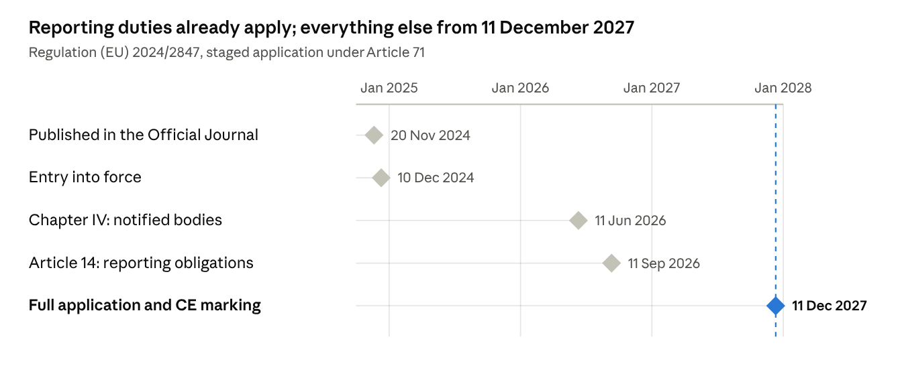
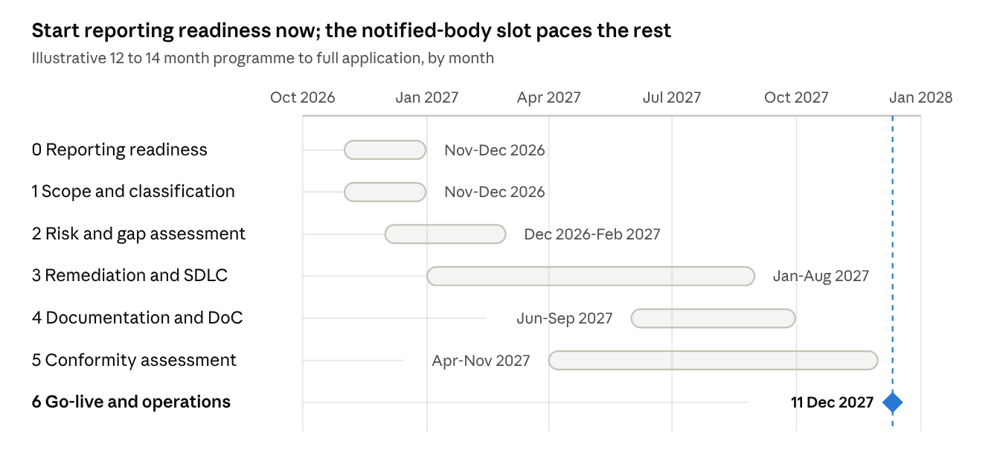

# EU Cyber Resilience Act — Engineering Compliance Knowledge Base

Oct 30, 2026 · @Aidan Murphy

## Executive summary

The [Cyber Resilience Act](https://eur-lex.europa.eu/eli/reg/2024/2847/oj) (Regulation (EU) 2024/2847, the CRA) is a horizontal New Legislative Framework product law that puts CE marking on cybersecurity. It covers every product with digital elements made available on the EU market in a commercial activity, from firmware to operating systems.

It applies in full from 11 Dec 2027. Article 14 reporting has been live since 11 Sep 2026 and already covers products placed on the market earlier (Art 69(3)).

Three design choices drive the engineering workload. The manufacturer carries almost every duty, and the law reaches the manufacturer-built backends a product needs to function (Art 3(2)). Obligations attach per unit, so a unit shipped on 10 Dec 2027 escapes Annex I and one shipped next day does not (Art 69(2)).

Classification decides the conformity route (Art 32). Default products self-assess under Module A; the 26 named categories in Annexes III and IV need a notified body or a recognised certificate. Class I may self-assess only under a fully applied cited harmonised standard; none is cited on 30 Oct 2026 (see Product classification).

### State of play on 30 Oct 2026

| Item | Status on 30 Oct 2026 | Source |
| --- | --- | --- |
| Commission FAQ | v1.4 of 4 Sep 2026, 66 pages, a "living document" that is not an official Commission position | [FAQ](https://ec.europa.eu/newsroom/dae/redirection/document/123307) |
| Art 26 guidance C(2026) 5252 | Content approved 27 Jul 2026; non-binding; formal adoption in all languages still pending, so formally a draft | [Communication](https://ec.europa.eu/newsroom/dae/redirection/document/131455) and [guidance annex](https://ec.europa.eu/newsroom/dae/redirection/document/131456) |
| Implementing Regulation (EU) 2025/2392 | Adopted 28 Nov 2025, in force 21 Dec 2025; technical descriptions of the 26 important and critical categories | [EUR-Lex](https://eur-lex.europa.eu/eli/reg_impl/2025/2392/oj/eng) |
| Delegated Regulation (EU) 2026/881 | Adopted 11 Dec 2025, in force 10 May 2026; when a CSIRT may delay dissemination of a notification | [EUR-Lex](https://eur-lex.europa.eu/legal-content/EN/TXT/?uri=CELEX:32026R0881) |
| ENISA Single Reporting Platform | Live since 11 Sep 2026; web form only, English only, mandatory Art 14 reports only | [ENISA SRP hub](https://www.enisa.europa.eu/topics/product-security/single-reporting-platform-srp) |
| Harmonised standards | None cited in the OJ; no common specification adopted; first citations expected in 2027 (commentary) | [Commission factpage](https://digital-strategy.ec.europa.eu/en/factpages/cyber-resilience-act-implementation) |
| Notified bodies | None verifiably designated for the CRA; Member States "strive" for enough bodies by 11 Dec 2026 (Art 35(2)) | [Commission conformity assessment page](https://digital-strategy.ec.europa.eu/en/policies/cra-conformity-assessment) |
| Digital Omnibus COM(2025) 837 | Proposed, not adopted as of 30 Oct 2026; does not amend the CRA; Council mandate 21 Oct 2026; Parliament at committee stage | [EUR-Lex](https://eur-lex.europa.eu/legal-content/EN/TXT/HTML/?uri=CELEX:52025PC0837) |
| RED cybersecurity delegated act | Delegated Regulation (EU) 2026/339 repeals Delegated Regulation (EU) 2022/30 with effect from 11 Dec 2027 | [EUR-Lex](https://eur-lex.europa.eu/eli/reg_del/2026/339/oj/eng) |
| AI Act | High-risk AI systems meeting Annex I are deemed to meet AI Act Art 15 (CRA Art 12; AI Act Art 42(3), inserted by Regulation (EU) 2026/1744) | [EUR-Lex](https://eur-lex.europa.eu/legal-content/EN/TXT/HTML/?uri=CELEX:32026R1744) |
| Product Liability Directive (EU) 2024/2853 | Applies from 9 Dec 2026; software is a product and a cybersecurity vulnerability can be a defect | [EUR-Lex](https://eur-lex.europa.eu/legal-content/EN/TXT/HTML/?uri=CELEX:32024L2853) |

No presumption of conformity exists yet, and Class I products cannot use Module A internal control today. The guidance is the best available evidence of how market surveillance authorities will read the law. Decisions that rest on it should be recorded as reliance on a published, non-binding Commission interpretation.

Enforcement starts on 11 Dec 2027. The top fine tier is EUR 15m or 2.5% of worldwide turnover for Annex I and Arts 13-14 breaches (Art 64(2)). Finland, Hungary and Malta had adopted national enforcement acts by 30 Oct 2026; Germany's law passed the Bundestag plenary on 15 Oct 2026 and awaits promulgation (see Enforcement, market surveillance and penalties).

UK manufacturers are third-country manufacturers for every EU sale. The CRA does not yet apply in Northern Ireland; see Interplay with other law, the Digital Omnibus and the UK position.

### What an engineering team must have in place

Start with what is live now: the Art 14 reporting runbook with SRP registration, and the product inventory behind scope and classification decisions. Then build the risk assessment, because every Annex I Part I item hangs off it (Art 13(3)). Everything else in the table follows from those three artefacts.

| Obligation | Legal basis | Deadline | Status today |
| --- | --- | --- | --- |
| Reporting process for actively exploited vulnerabilities and severe incidents; SRP registration; CSIRT chosen under Art 14(7) | Art 14; Art 16 | Live since 11 Sep 2026 | Mandatory now, including for legacy products (Art 69(3)) |
| Product inventory with a recorded scope decision per product, variant and backend | Art 2(1); Art 3(1)-(2) | Before 11 Dec 2027 | Guidance available; record each decision and its basis |
| Classification register (default, Class I, Class II, critical) with core-functionality rationale | Art 7; Art 8; Implementing Regulation (EU) 2025/2392 | Before 11 Dec 2027 | Technical descriptions adopted; no delegated act changes the lists |
| Cybersecurity risk assessment per product or family, stating how each Annex I Part I point (2) item applies | Art 13(2)-(4) | Before placing on the market; maintained through the support period | No mandated method; BSI TR-03183-1 v1.0.0 is a usable template |
| Annex I Part I design controls built, tested and evidenced | Art 13(1); Annex I Part I | Each placing on the market from 11 Dec 2027 | No harmonised standard cited; drafts usable as evidence only |
| Annex I Part II processes: SBOM, CVD policy, secure update mechanism, declared support period of at least 5 years | Art 13(8); Annex I Part II | From 11 Dec 2027, for the support period | SBOM format act not adopted; ENISA and BSI profiles available |
| Technical documentation (Annex VII), EU declaration of conformity (Annex V or VI), CE marking | Arts 28, 30, 31; Art 13(12)-(13) | Before placing on the market; retained 10 years or the support period | Simplified SME format not adopted |
| Annex II user information, including the end-of-support month and year at purchase | Art 13(18)-(19); Annex II | From 11 Dec 2027 | Legal text is complete; no implementing act needed |
| Conformity route chosen; notified body contracted where Module A is unavailable | Art 32; Annex VIII | Assessment complete before placing on the market | No notified body designated; pre-assessment with candidate bodies only |
| Due diligence on third-party and open-source components; upstream vulnerability reporting | Art 13(5)-(7) | From 11 Dec 2027 | FAQ gives an action list; no Art 25 attestation programme exists |

### Five facts that surprise teams

- Legacy products still report. Art 14 applies to every in-scope product placed on the market before 11 Dec 2027, and continues after the support period ends (Art 69(3)).
- The SBOM need not be public. Recital 77 says manufacturers "should not be obliged to make the SBOM public". It sits in the technical documentation and goes to authorities on reasoned request.
- Class I products cannot self-assess today. Module A needs a fully applied OJ-cited harmonised standard covering the core-functionality risks (Art 32(2); guidance para 149). Nothing is cited, and no notified body has been designated for the alternative routes.
- The authorised representative is optional. Art 18(1) says a manufacturer "may" appoint one, and the CRA adds no mandatory EU responsible operator (see Economic operators and roles).
- Manufacturer-run backends are in scope. A vendor-built API, authentication portal or update service that a product needs for a function is remote data processing. It is part of that product's conformity assessment (Art 3(2); guidance paras 184-194).

Tickable requirement checklists, per product and per role: Requirement checklists

Implementation guides: Implementation guide: corporate and Implementation guide: application

## Key dates and transition timeline

The Article 14 reporting duty has applied since 11 September 2026; every other obligation applies from 11 December 2027. Reporting also covers products already on the market (Art 69(3)).

[Chart: CRA application dates · 5 milestones, Article 71]

The accent marks the date on which every remaining obligation switches on.

| Date | What switches on | What it means for engineering |
| --- | --- | --- |
| 20 Nov 2024 | Regulation (EU) 2024/2847 published in the Official Journal | Legal text fixed; Annex I is the design target for anything shipping after December 2027 |
| 10 Dec 2024 | Entry into force (Art 71) | No obligations yet; the Commission's implementing and delegated acts count from here |
| 11 Jun 2026 | Chapter IV applies: Member States notify conformity assessment bodies (Arts 35-51) | Notified bodies can be accredited for the CRA; book third-party assessment capacity early for important Class II and critical products |
| 11 Sep 2026 | Art 14 applies: report actively exploited vulnerabilities and severe incidents through ENISA's single reporting platform | The 24h / 72h / 14-day clock is live now, and it also covers products placed on the market before full application (Art 69(3)) |
| 11 Dec 2027 | Everything else: Annex I requirements, conformity assessment, technical documentation, EU declaration of conformity, CE marking, importer and distributor duties | Hard deadline; products placed on the market before this date are caught only if substantially modified afterwards (Art 69(2)) |

## Scope: what the CRA covers

A product is in scope when three cumulative conditions in Art 2(1) of the [CRA](https://eur-lex.europa.eu/eli/reg/2024/2847/oj) are met. It is a product with digital elements, and it is made available on the EU market in a commercial activity. Its intended or reasonably foreseeable use includes a data connection to a device or network, direct or indirect, logical or physical.

The [Commission FAQ v1.4](https://ec.europa.eu/newsroom/dae/redirection/document/123307) and the [Art 26 guidance C(2026) 5252](https://ec.europa.eu/newsroom/dae/redirection/document/131456) both apply this three-part test. The operative article text in this doc was checked on 1 Nov 2026 against the authentic OJ text (OJ L, 2024/2847, 20.11.2024, Publications Office cellar) and the English corrigenda; see the E6 claims register.

### Definitions that decide scope

Art 3 has 51 definitions. The ones below settle most scope and role questions.

| Term | Art 3 point | Meaning in plain words | Engineering note |
| --- | --- | --- | --- |
| Product with digital elements | (1) | A software or hardware product and its remote data processing solutions, including components placed on the market separately | A library, SDK, driver, firmware image or chip sold on its own is a product with its own manufacturer |
| Remote data processing | (2) | Processing at a distance, built by or under the responsibility of the manufacturer, without which the product cannot perform one of its functions | Your backend is in scope; a licensed third-party SaaS you integrate is a component instead |
| Software | (4) | The part of an electronic information system that consists of computer code | Covers source code as well as machine code (guidance para 22) |
| Hardware | (5) | A physical system, or parts of one, able to process, store or transmit digital data | Integrated circuits and motherboards count (guidance para 18) |
| Component | (6) | Software or hardware intended for integration into an electronic information system | Component status does not remove a separately sold item from scope |
| Logical, physical and indirect connection | (8)-(10) | Software interfaces; electrical, optical, mechanical or radio links; connection through a larger system that is itself connectable | Indirect connection is what brings offline desktop software into scope |
| Manufacturer | (13) | Whoever develops or has developed the product and markets it under its own name or trademark, paid or free | Outsourced development under your brand still makes you the manufacturer |
| Support period | (20) | The period during which vulnerabilities must be handled under Annex I Part II | At least 5 years unless the expected use time is shorter (Art 13(8)) |
| Placing on the market | (21) | The first making available on the EU market | Judged per unit; for standalone software, per version (guidance paras 13-14) |
| Making available on the market | (22) | Supply for distribution or use in the course of a commercial activity, paid or free | Free supply by a business is still caught (Recital 15) |
| Intended purpose | (23) | The use the manufacturer specifies in instructions, marketing and technical documentation | Your marketing copy defines the assessed purpose |
| Reasonably foreseeable use | (24) | Use likely to result from foreseeable human behaviour or technical interaction, even if not intended | The connection test is run against this, not only the intended purpose |
| Substantial modification | (30) | A post-placing change that affects Annex I Part I compliance or alters the assessed intended purpose | Triggers a new placing on the market; see below |
| Security update and functionality update | not defined in Art 3 | The guidance and FAQ distinguish fixes that reduce risk from changes that add features | Ship them separately where technically feasible (Annex I Part II(2)) |
| Free and open-source software | (48) | Software whose source is openly shared under a licence allowing free use, modification and redistribution | Monetisation, not licence, decides whether it is placed on the market |

The table paraphrases Art 3; each row was checked against the OJ text on 1 Nov 2026 (E6 claims register S03-S13).

### The data-connection test

The test is about exchanging digital information, not the presence of electronics. The guidance (paras 26-28) requires binary states deliberately encoded as information and decodable at the destination. A signal that only triggers or powers a function is not a data connection.

The FAQ lists a dishwasher with cycle firmware, a basic calculator and a toy with pre-recorded effects as out of scope. It adds that the same firmware sold separately may be in scope.

Indirect connections count. Recital 9 covers products "only indirectly connected". The FAQ treats an offline text editor on a networked operating system as in scope.

Almost all commercial software is therefore in scope. The live questions are who the manufacturer is and whether a backend is remote data processing.

### Remote data processing versus SaaS

The guidance applies a three-element test (paras 184-188). The processing is at a distance; the product needs it for one of its functions; and the manufacturer designed it or had it designed. Elements two and three are decisive and cumulative.

"At a distance" includes edge and on-premises deployments. Who operates the solution is not decisive (para 196).

"Functions" is broad (paras 189-192). Sending commands, synchronising files, onboarding, configuration, update distribution and identity and access management all count. Telemetry analysed only for statistics or future development does not.

The worked examples draw the line. A bank's self-hosted API that its mobile app calls is remote data processing; the ledger systems the app never talks to are not (section 8.3.1). An authentication portal that issues tokens the product needs is remote data processing (para 194).

A third-party support-chat SaaS embedded in an app is different. It is a component for Art 13(5) due diligence, not remote data processing (paras 197-202).

Browser-only software is not a product. Software must be "provided to a user" and run on the user's side (para 20). A progressive web app used only in a browser, or a website, is not a product (para 21, Examples 5-6).

Recital 12 sends cloud services built outside a manufacturer's responsibility to NIS2 (Directive (EU) 2022/2555). NIS2 covers medium-sized and larger SaaS, PaaS and IaaS providers. The same SaaS becomes remote data processing the moment the vendor ships an installed client that depends on it.

### Bespoke, internal and per-unit rules

Internal-use software is not placed on the market. The FAQ relies on Blue Guide section 2.3: a product "manufactured for one's own use" is not placed on the market. Internal build and configuration tools are out unless sold separately, and Recital 16 gives the same result for public bodies.

Bespoke software for one customer is placed on the market. Guidance Example 7 treats source code licensed to a single company as placed on the market by the licensor.

Such a product may use the tailor-made derogations for exactly two requirements. They are secure-by-default configuration (Annex I Part I 2(b)) and free security updates (Annex I Part II(8)). Both parties must have explicitly agreed different contractual terms (Recital 64).

A multi-tenant CRM with minor customisation is not tailor-made (FAQ). Keep the evidence of tailor-made status in the technical documentation.

Placing on the market is per unit, and for standalone software per version. All copies of a version are deemed placed at the first commercial offering, whatever the later download dates (guidance paras 13-14, Example 1). Non-substantial updates do not reset that date.

Variants that differ in components, configuration or enabled features are distinct products. Product families with the same architecture, security-relevant design, intended purpose and risks may share one risk assessment and one technical file. They may also share one declaration listing the variants (paras 174-177).

### Substantial modification

The test is risk-based, not size-based (guidance paras 104-110). Ask four questions about a change: new threat vectors; new attack scenarios; changed likelihood of known scenarios; changed impact. All-negative answers with the original risk assessment still valid mean no substantial modification (paras 111-112).

Security updates are "generally not" substantial, even when technically large (para 108). A "remember me" token-storage feature or an unencrypted log export is substantial because the risk was never assessed (Examples 44-45). A substantial modification is a new placing on the market with an assessment focused on the modified parts; see Conformity assessment and documentation.

### Hard cases

Rows marked "inference" rest on the researchers' reading, not on guidance text.

| Case | In or out | Why | Source |
| --- | --- | --- | --- |
| SaaS admin console used only in a browser | Out as a product; in only as remote data processing of an in-scope product | Guidance para 21, Examples 5-6; Recital 12 | [Guidance](https://ec.europa.eu/newsroom/dae/redirection/document/131456) |
| Mobile app controlling the manufacturer's device | In; app and device are one product and the vendor's control, sync and update backends are remote data processing | Guidance para 25, Example 9; paras 189-192 | [Guidance](https://ec.europa.eu/newsroom/dae/redirection/document/131456) |
| Internal tool used only by the developing company | Out; not placed on the market | FAQ, Blue Guide s.2.3; Recital 16 | [FAQ](https://ec.europa.eu/newsroom/dae/redirection/document/123307) |
| Open-source library, free download, maintainer sells optional paid support | Out for the library if access and maintenance are not conditioned on payment; publisher may be a steward | Recital 18; guidance paras 55-58, Example 18 | [Guidance](https://ec.europa.eu/newsroom/dae/redirection/document/131456) |
| Firmware security fix pushed to an in-scope device | Not a new product; not a substantial modification if it reduces risk and keeps the intended purpose | Recital 39; guidance para 108, Examples 46-48 | [Guidance](https://ec.europa.eu/newsroom/dae/redirection/document/131456) |
| Firmware update adding new connectivity or control | Likely substantial; new placing on the market | Recital 39; guidance Examples 40, 44, 45; FAQ smart-TV example | [FAQ](https://ec.europa.eu/newsroom/dae/redirection/document/123307) |
| Firmware image supplied separately to an OEM | In, as a component placed on the market separately | Art 3(1); FAQ product-forms list | [FAQ](https://ec.europa.eu/newsroom/dae/redirection/document/123307) |
| PC with pre-installed operating system | In; the PC maker is manufacturer of the whole; a separately marketed OS is its own product | Guidance para 25, Example 8; para 120, Example 51 | [Guidance](https://ec.europa.eu/newsroom/dae/redirection/document/131456) |
| Vendor-hosted API | Not a product itself; remote data processing where an in-scope client needs it; deeper backends out | Recital 11; guidance para 205, section 8.3.1 | [Guidance](https://ec.europa.eu/newsroom/dae/redirection/document/131456) |
| SDK or library sold or monetised | In, as a software component placed on the market separately | Art 3(1), (6); guidance para 24, Example 7 | [Guidance](https://ec.europa.eu/newsroom/dae/redirection/document/131456) |
| ML model weights file | Not addressed by guidance; inference: in when supplied as part of software executing on the user's side; a bare weights file is unresolved | Art 3(1), (4); guidance para 22 | [Guidance](https://ec.europa.eu/newsroom/dae/redirection/document/131456) |
| Product sold only B2B | In; B2B status matters only for the tailor-made derogations | Art 2(1); Recital 64; FAQ | [FAQ](https://ec.europa.eu/newsroom/dae/redirection/document/123307) |
| Free consumer app monetised by ads or personal data | In; free supply in a commercial activity | Art 3(22); Recital 15; guidance Examples 14-16 | [Guidance](https://ec.europa.eu/newsroom/dae/redirection/document/131456) |
| Free, unmonetised, non-FOSS app from a company | Grey area; Blue Guide "business-related context" case by case; inference | Recital 15; guidance paras 40-41 | [Guidance](https://ec.europa.eu/newsroom/dae/redirection/document/131456) |
| Offline desktop utility with no network code | In; indirect logical connection via the host OS | FAQ connection entry; Recital 9 | [FAQ](https://ec.europa.eu/newsroom/dae/redirection/document/123307) |
| Open-category drone, not EASA-certified | In; only certified aviation products are excluded | Art 2(3); FAQ aviation entry | [FAQ](https://ec.europa.eu/newsroom/dae/redirection/document/123307) |
| Dual-use product sold on the open market | In unless developed or modified exclusively for national security or defence | Art 2(7); Recital 26; FAQ | [FAQ](https://ec.europa.eu/newsroom/dae/redirection/document/123307) |
| Identical-specification spare part via after-sales channel | Out; a part with different cryptography or secure boot is not identical and is in | Art 2(6); guidance paras 97-101, Examples 36-38 | [Guidance](https://ec.europa.eu/newsroom/dae/redirection/document/131456) |
| Vendor CI/CD pipeline and update-distribution infrastructure | Out as remote data processing, but the user-facing update service a product calls can be in; inference reconciling paras 182 and 190 | Guidance paras 182, 190 | [Guidance](https://ec.europa.eu/newsroom/dae/redirection/document/131456) |
| Appliance with firmware and no connectivity | Out; no direct or indirect data connection | Art 2(1); FAQ examples; guidance para 28 | [FAQ](https://ec.europa.eu/newsroom/dae/redirection/document/123307) |

### Status of the guidance

The FAQ is a "living document" prepared by Commission services and is not an official Commission position. It was first published 3 Dec 2025 and reached v1.4 on 4 Sep 2026. The Commission told its Expert Group that the FAQ and the guidance have equal authoritative value.

Guidance C(2026) 5252 is non-binding; only the Court of Justice interprets the Regulation authoritatively (paras 7-9). The Commission approved its content on 27 Jul 2026 and said it "will be formally adopted" once all language versions exist. No evidence of adoption or OJ C-series publication was found by 30 Oct 2026, so it is formally a draft (see Open questions and watchlist).

Three corrigenda change the English text: 5 Dec 2024 (title: "(EU) 2019/1020"), 2 Jul 2025 (Art 64(10): the fines derogation runs from "paragraphs 2 to 9", not 3 to 9) and 17 Oct 2025 (Art 67: the CRA is point 72, not 69, of Annex I to Directive 2020/1828). Five more correct other language versions only (FR 3 Oct 2025 and 25 Mar 2026; SK 23 Feb 2026; DE 6 Aug 2026; SL 9 Oct 2026). No adopted amendment to scope, definitions or roles existed on 30 Oct 2026.

## Exclusions and exceptions

The [CRA](https://eur-lex.europa.eu/eli/reg/2024/2847/oj) has only six narrow sectoral carve-outs in Art 2(2)-(7), plus one delegated act under Art 2(5) covering L-category vehicles. Most things teams call "exceptions" are not exclusions at all. They are either products never placed on the market, or legacy units that escape Annex I because they were placed before 11 Dec 2027.

Each exclusion is act-based. The test is whether the other EU act applies to that product, not whether the product looks medical or automotive.

### Exclusions and exceptions

| Exclusion or exception | Legal basis | What it covers | What it does not cover, watch-outs | Source |
| --- | --- | --- | --- | --- |
| Medical devices and in-vitro diagnostics | Art 2(2)(a)-(b); Recital 25 | Products to which Regulation (EU) 2017/745 or 2017/746 apply, including software that is itself a device | A generic component sold to a device maker that is not itself a device stays in scope for its own manufacturer | [Commission FAQ](https://ec.europa.eu/newsroom/dae/redirection/document/123307) |
| Type-approved motor vehicles | Art 2(2)(c); Recital 27 | Products to which Regulation (EU) 2019/2144 applies; components "exclusively designed" for such vehicles and sold through restricted B2B channels (guidance paras 241-246) | Generic components usable in other products, or sold through open retail or online channels, are in regardless of intended-use statements | [Guidance C(2026) 5252](https://ec.europa.eu/newsroom/dae/redirection/document/131456) |
| L-category vehicles | Art 2(5); Delegated Regulation (EU) 2025/1535, in force 18 Nov 2025 | Two- and three-wheel vehicles and quadricycles under Regulation (EU) No 168/2013 | Pedal-assist L1e vehicles (e-bikes) stay in; no other Art 2(5) delegated act exists for any sector | [EUR-Lex 2025/1535](https://eur-lex.europa.eu/legal-content/EN/TXT/HTML/?uri=CELEX:32025R1535) |
| Certified aviation products | Art 2(3); Recital 27 | Products certified under Regulation (EU) 2018/1139 | Open-category drones and uncertified components intended for certified aircraft "may be covered" | [Commission FAQ](https://ec.europa.eu/newsroom/dae/redirection/document/123307) |
| Marine equipment | Art 2(4) | Equipment within Directive 2014/90/EU, as listed in the annex to Implementing Regulation (EU) 2025/1533 | Components intended for marine equipment but outside the Directive may be covered | [Commission FAQ](https://ec.europa.eu/newsroom/dae/redirection/document/123307) |
| Identical-specification spare parts | Art 2(6); Recital 29 | Parts supplied to replace identical components, built to the same specifications, including a whole sub-product such as a PLC (guidance Example 39) | Repair purpose must be evident from the supply context; a part with different cryptography or secure boot is not identical and is a product in its own right (Example 37) | [Guidance C(2026) 5252](https://ec.europa.eu/newsroom/dae/redirection/document/131456) |
| National security, defence and classified information | Art 2(7); Recital 26 | Products developed or modified exclusively for national security or defence, or designed to process classified information | Dual-use products on the open market are in; Member States may add procurement requirements under Art 5 | [Commission FAQ](https://ec.europa.eu/newsroom/dae/redirection/document/123307) |
| Free and open-source software outside a commercial activity | Art 3(22); Recitals 15-20 | FOSS not monetised by its manufacturer is not made available on the market | Charging for binaries, updates or access makes the publisher a manufacturer; see Open-source software | [Guidance C(2026) 5252](https://ec.europa.eu/newsroom/dae/redirection/document/131456) |
| Open-source software stewards | Art 3(14); Art 24; Recital 19 | Legal persons sustaining FOSS intended for commercial activities without placing it on the market | Light regime, not an exclusion: documented security policy, cooperation with authorities and limited Art 14 reporting from 11 Dec 2027; see Open-source software | [Guidance C(2026) 5252](https://ec.europa.eu/newsroom/dae/redirection/document/131456) |
| Not placed on the market | Art 3(21)-(22); Blue Guide s.2.3 | Internal-use software and tools; software developed by a public body exclusively for its own use (Recital 16); unfinished code shared for review or testing; sample and demo code (guidance paras 22-24) | A later commercial supply of the same software is a placing on the market | [Commission FAQ](https://ec.europa.eu/newsroom/dae/redirection/document/123307) |
| Trade fairs and time-limited testing | Art 4(2)-(4); Recital 37 | Prototypes shown at fairs with a visible non-compliance sign; unfinished software made available "for a limited period required for testing" with a visible sign | Only for the time needed to test and gather feedback; a risk assessment is still expected; not for safety components under other harmonisation law | [Commission FAQ](https://ec.europa.eu/newsroom/dae/redirection/document/123307) |
| Tailor-made derogations | Annex I Part I 2(b); Annex I Part II(8); Recital 64 | Secure-by-default configuration and free security updates may be varied by explicit contract for a product fitted to one business user, including closed or air-gapped networks | Only those two requirements; a multi-tenant product with minor customisation or plugins is not tailor-made; keep the evidence in the technical documentation | [Commission FAQ](https://ec.europa.eu/newsroom/dae/redirection/document/123307) |
| Products placed before 11 Dec 2027 | Art 69(2) | Units placed on the market before full application are subject to the CRA only if substantially modified from that date | Art 14 reporting applies to all of them regardless (Art 69(3)); further units of a non-compliant type cannot be placed on or after 11 Dec 2027 | [Commission FAQ](https://ec.europa.eu/newsroom/dae/redirection/document/123307) |

Two points on the legacy rule deserve emphasis. The CRA applies to individual units, not product types (FAQ s.7.2). A design that shipped in 2026 must still be assessed, declared and CE-marked for units shipped from 11 Dec 2027.

The guidance allows such legacy designs to be placed "without redesign" where the risk assessment shows adequate security (paras 33-39). It does not require recreating historical design documentation.

### Partial reliefs

These do not remove a product from scope. They soften one obligation each.

| Relief | Legal basis | Effect | Status on 30 Oct 2026 |
| --- | --- | --- | --- |
| No fine for a missed 24-hour early warning | Art 64(10)(a); Recital 120 | Micro and small enterprise manufacturers cannot be fined for missing the deadlines in Art 14(2)(a) and 14(4)(a); the duty to report still stands | Adopted; national acts should impose no other pecuniary penalty for this (Recital 120) |
| No fines for stewards | Art 64(10)(b) | Open-source software stewards are exempt from administrative fines; corrective action under Art 52(3) remains | Adopted |
| Simplified technical documentation for micro and small enterprises | Art 33(5); Recital 93 | A simplified Annex VII format, once the Commission specifies it by implementing act; notified bodies must accept it | No implementing act adopted, drafted or scheduled; build the full Annex VII set |
| SME support measures | Art 33(1)-(4); Art 32(6); Art 39(12) | Awareness, advice channels, testing support, optional regulatory sandboxes; proportionately reduced conformity assessment fees | Sandboxes are optional and none was identified; fee reductions depend on notified bodies that do not yet exist |
| Internal control for important FOSS products | Art 32(5) | A manufacturer of FOSS in an Annex III category may use any Art 32(1) procedure, including Module A, if the technical documentation is public at placing on the market | Adopted; this is the only case where technical documentation must be published (FAQ s.6.6) |
| Automatic-update carve-outs | Annex I Part I 2(c); Recital 56 | Default-on automatic security updates do not apply to products primarily intended as components, or where users would not expect them, such as professional ICT networks and critical or industrial environments | Record the justification in the risk assessment (Art 13(4)); updates must still be made available without delay |
| Shorter support period | Art 13(8) | Less than 5 years only where the product is expected to be in use for less, such as a subscription product unusable after expiry | FAQ examples; five years is a floor, not a default (guidance section 5) |
| Existing type-examination certificates | Art 69(1) | EU type-examination certificates and approval decisions on cybersecurity requirements under other harmonisation law remain valid until 11 Jun 2028 | They count as evidence only for the risks they cover and never replace the CRA risk assessment (guidance paras 247-257) |

### Things that are not exclusions

- B2B-only sale. The CRA has no consumer-only limitation; B2B status matters only for the tailor-made derogations and for classification (Art 2(1); Recital 64).
- Free products from a company. Supply "free of charge" in a commercial activity is making available (Art 3(22)); ads, monetised platforms and personal-data conditions are commercial indicators (Recital 15).
- A non-EU manufacturer. The CRA applies to any product made available in the EU. The manufacturer's location changes who the importer is, not whether the product is in scope.
- Offline products with an indirect connection. Software on a networked host is in scope through the operating system (Recital 9; FAQ).
- Hardware that never receives updates. The absence of an update mechanism is a compliance gap against Annex I Part II, not a reason for being out of scope.
- Products sold through online marketplaces. A marketplace that only intermediates is not an economic operator, but the manufacturer and any importer keep their duties (Recital 78).
- White-label resale. Selling someone else's product under your own brand makes you the manufacturer (Art 21; Recital 78); see Economic operators and roles.
- Products designed before the CRA. Legacy designs placed on the market from 11 Dec 2027 need a conformity assessment, declaration and CE marking (guidance paras 33-39).

## Economic operators and roles

The manufacturer carries almost every obligation in the [CRA](https://eur-lex.europa.eu/eli/reg/2024/2847/oj): Art 13 alone has 25 paragraphs, and Art 14 reporting sits with the manufacturer too. The real question for each product is therefore who the manufacturer is. Art 3(13) answers it by brand, not authorship: whoever markets the product under its own name or trademark, paid or free.

### The roles

| Role | Definition and article | Main obligations with articles | Applies from | Notes |
| --- | --- | --- | --- | --- |
| Manufacturer | Art 3(13): develops or has developed the product and markets it under its own name or trademark, for payment or free | Annex I Part I design controls (Art 13(1)); risk assessment maintained through the support period (Art 13(2)-(4)); component due diligence and upstream reporting (Art 13(5)-(7)); support period and update availability (Art 13(8)-(11)); technical documentation, conformity assessment, declaration, CE marking (Art 13(12)-(13)); contact details and single point of contact (Art 13(15)-(17)); user information and end-of-support date (Art 13(18)-(20)); corrective action and cessation notice (Art 13(21)-(23)); reporting (Art 14) | Art 14 since 11 Sep 2026; the rest 11 Dec 2027 | Top fine tier, EUR 15m or 2.5% of worldwide turnover (Art 64(2)) |
| Authorised representative | Art 3(15): EU-established person with a written mandate from the manufacturer; Art 18(1) says a manufacturer "may" appoint one | Keep the declaration and technical documentation for 10 years or the support period; supply information on reasoned request; cooperate with authorities (Art 18(3)) | 11 Dec 2027 | Optional. Art 18(2) bars delegating Art 13(1)-(11), Art 13(12) first subparagraph and Art 13(14): design, risk assessment, support period, documentation and conformity assessment stay with the manufacturer |
| Importer | Art 3(16): EU-established person placing on the market a product bearing a non-EU name or trademark | Place only compliant products (Art 19(1)); verify conformity assessment, documentation, CE marking, declaration and Annex II information (Art 19(2)); withhold non-conforming products and alert authorities (Art 19(3)); add own name and contact details (Art 19(4)); inform the manufacturer of vulnerabilities "without undue delay" (Art 19(5)); keep the declaration 10 years or the support period; notify if the manufacturer ceases operations (Art 19(6)-(9)) | 11 Dec 2027 | Second fine tier, EUR 10m or 2% (Art 64(3)) |
| Distributor | Art 3(17): supply-chain person who makes the product available without affecting its properties | Act with due care (Art 20(1)); verify the CE marking and that manufacturer and importer met Art 13(15), (16), (18), (19), (20) and Art 19(4) (Art 20(2)); withhold products believed non-conforming (Art 20(3)); inform the manufacturer of vulnerabilities without undue delay (Art 20(4)); cooperate; notify on cessation (Art 20(5)-(6)) | 11 Dec 2027 | Not required to bring pre-11 Dec 2027 stock into compliance unless it substantially modifies it (FAQ) |
| Open-source software steward | Art 3(14): legal person, other than a manufacturer, systematically sustaining FOSS intended for commercial activities | Documented, verifiable cybersecurity policy (Art 24(1)); cooperate with authorities and supply the policy on reasoned request (Art 24(2)); Art 14 reporting only to the extent involved (Art 24(3)) | 11 Dec 2027 | No CE marking, no fines (Art 64(10)(b)); see Open-source software |
| Any other person who substantially modifies | Art 22(1): a person other than manufacturer, importer or distributor who substantially modifies a product and makes it available | Becomes manufacturer for the modified part, or for the whole product where the modification affects its cybersecurity as a whole (Art 22(2)) | 11 Dec 2027 | The original manufacturer's duties continue for the original product (guidance paras 117-121) |
| Fulfilment service providers and online marketplaces | Not CRA economic operators unless they manufacture, import or distribute (Recital 78) | Reg (EU) 2019/1020 Art 6 deems online offers targeted at EU users "made available"; GPSR Art 16 applies to consumer products via CRA Art 11 for safety risks the CRA does not cover | 11 Dec 2027 | A marketplace selling its own-branded products is a manufacturer (Recital 78) |

[Guidance C(2026) 5252](https://ec.europa.eu/newsroom/dae/redirection/document/131456) adds a per-product rule. The same legal person can be steward for a free community edition and manufacturer for the paid edition (paras 71-74). A steward that starts monetising becomes manufacturer from that date, not for earlier versions (para 84).

### When you become the manufacturer

Work through this list for every product, variant and resale arrangement.

- [ ] Own brand or trademark. An importer or distributor that places a product on the market under its own name or trademark is the manufacturer (Art 21). It takes on Arts 13 and 14 in full; the original developer's compliance is evidence, not a transfer of responsibility.
- [ ] Substantial modification (test in Scope: what the CRA covers). An importer or distributor that substantially modifies a product becomes its manufacturer (Art 21). Anyone else becomes manufacturer for the affected part, or the whole product if its security as a whole is affected (Art 22).
- [ ] Integration into a new product. Assembling third-party components, even modified ones, into a product you place on the market is not substantial modification. You are the manufacturer of the new product "in its entirety" (guidance para 120, Example 51: an agricultural monitor built from third-party microcontroller modules).
- [ ] White-label and resale. Same result as own brand: full manufacturer duties (Art 21; Recital 78).
- [ ] A distributor who patches. Installing or configuring software on a customer's systems without substantial modification is not placing it on the market (guidance para 59, Example 19). One who substantially modifies it as part of the service falls under Art 22.
- [ ] Software you host but the customer runs. If the customer obtains and runs the software, it is a product and you are its manufacturer. If the customer only accesses it in a browser, it is at most remote data processing for one of your products (guidance paras 20-21).
- [ ] Free software from a company. Free supply in a commercial activity is making available (Art 3(22); Recital 15); unmonetised FOSS makes a company a steward at most (guidance paras 67-68). A free closed-source app with no monetisation is a grey area the guidance resolves case by case (paras 40-41).
- [ ] Outsourced development. A product you had developed and sell under your brand is yours (Art 3(13) "has ... developed").

### Non-EU manufacturers, including the UK

The CRA itself imposes no mandatory EU representative, because Art 18 is permissive. CRA Art 66 adds the CRA to Annex I of [Regulation (EU) 2019/1020](https://eur-lex.europa.eu/legal-content/EN/TXT/HTML/?uri=CELEX:32019R1020) but not to its Art 4(5) list. Only that list requires an EU responsible economic operator.

The scope notes initially inferred otherwise; the timeline notes checked the Art 4(5) list and found the CRA absent. Treat the absence as the better-supported reading, but confirm with counsel.

What the CRA does require is that whoever places the product on the EU market is an importer (Art 19) with verification and record duties. In a pure direct-to-consumer model there is no importer, because a consumer does not act in a commercial activity. The manufacturer then carries Arts 13-14 alone.

Other laws close that gap for many products. Radio equipment is listed in Reg 2019/1020 Art 4(5), so an EU responsible operator is mandatory anyway. Consumer products outside other harmonisation law pick up the GPSR Art 16 responsible-person rule through CRA Art 11.

From 9 Dec 2026, [Directive (EU) 2024/2853](https://eur-lex.europa.eu/legal-content/EN/TXT/HTML/?uri=CELEX:32024L2853) Art 8 adds liability. Where no EU importer or authorised representative exists, the EU fulfilment service provider or online platform is liable. The practical advice in the notes is to appoint an authorised representative even though Art 18 is optional.

Reporting routes through the CSIRT of the main-establishment Member State, where product cybersecurity decisions are predominantly taken (Art 14(7)). A manufacturer with no EU establishment uses, in order, the Member State of its authorised representative, importer, distributor, or most users. ENISA's [SRP FAQ](https://www.enisa.europa.eu/topics/product-security/single-reporting-platform-srp/frequently-asked-questions) warns that a wrong CSIRT choice may invalidate the filing; see Reporting obligations (Article 14).

UK and Northern Ireland detail is in Interplay with other law, the Digital Omnibus and the UK position.

### Record-keeping and contacts

| Duty | Article | What to keep or publish | Period |
| --- | --- | --- | --- |
| Traceability up and down the chain | Art 23 | Name and address of every operator that supplied you and, where available, every operator you supplied | 10 years after being supplied and 10 years after supplying |
| Identification on the product | Art 13(15)-(16); Art 19(4) | Type, batch or serial number; manufacturer and importer name, trade name or trademark, postal address, email or digital contact, website, on the product, packaging or accompanying document and in the Annex II information | For the life of the product |
| Single point of contact for users | Art 13(17) | Easily identifiable channel for reporting and receiving vulnerability information; must not be limited to automated tools | Throughout the support period |
| Technical documentation and declaration | Art 13(13); Art 18(3) | Annex VII dossier and EU declaration of conformity available to authorities; the authorised representative may hold them | At least 10 years after placing on the market or the support period, whichever is longer |
| User information | Art 13(18) | Annex II information in a language users and authorities understand | At least 10 years or the support period, whichever is longer |
| Cessation of operations | Art 13(23); Art 19(9); Art 20(6) | Manufacturer informs authorities and users before ceasing; importers and distributors inform authorities and users if the manufacturer has ceased | Before cessation |

Vulnerability information flows upstream and downstream. Importers (Art 19(5)) and distributors (Art 20(4)) must inform the manufacturer of vulnerabilities without undue delay. They must also alert authorities where there is a significant cybersecurity risk.

Manufacturers must report vulnerabilities found in components, including open-source ones, to the component maintainer and share fixes (Art 13(6)). Fixes go "where appropriate in a machine-readable format". Actively exploited vulnerabilities and severe incidents are reported under Art 14; see Reporting obligations (Article 14).

Article references in this section were checked against the OJ text on 1 Nov 2026 (E6). The fine tier for Arts 18-23 breaches (EUR 10m or 2%) is confirmed in Art 64(3).

## Product classification

Twenty-six named categories decide the conformity route under the [CRA](https://eur-lex.europa.eu/eli/reg/2024/2847/oj). Annex III holds 19 Class I and 4 Class II "important" categories; Annex IV holds 3 "critical" categories. Everything else is a default product and may always self-assess under Module A.

[Commission Implementing Regulation (EU) 2025/2392](https://eur-lex.europa.eu/legal-content/EN/TXT/HTML/?uri=CELEX:32025R2392) of 28 Nov 2025, in force 21 Dec 2025, gives each category a technical description with non-exhaustive examples. A product is in a category when its core functionality matches that description (Art 7(1)).

Annex III categories meet one of two criteria in Art 7(2). Either the product "primarily performs functions critical to the cybersecurity of other products", or it can disrupt or damage many other products "through direct manipulation". Annex IV adds critical dependency of NIS2 essential entities, or supply-chain disruption potential (Art 8(2)).

The route pointers below reflect 30 Oct 2026. No harmonised standard is cited in the OJ, no Art 27(9) delegated act recognises a certification scheme, and no notified body is designated. The full route table is in Conformity assessment and documentation.

### Table A: Annex III Class I (19 categories)

| Annex III Class I category | Technical-description highlights from 2025/2392 | Typical products | Route pointer |
| --- | --- | --- | --- |
| 1. Identity management systems and privileged access management software and hardware, including authentication and access control readers, including biometric readers | Systems providing authentication or authorisation; privileged-access software; SSO, federated identity, OTP and MFA software; biometric readers | IdP and SSO platforms, PAM suites, MFA apps, badge and fingerprint readers | Module B+C or H until a cited standard allows Module A |
| 2. Standalone and embedded browsers | Software for accessing and rendering web content, including browsers with AI-agent integration | Desktop and mobile browsers, embedded webview engines | Module B+C or H until a cited standard allows Module A |
| 3. Password managers | Products storing passwords locally or remotely, including browser extensions and hardware-based managers | Password vault apps, browser extensions, hardware key stores | Module B+C or H until a cited standard allows Module A |
| 4. Software that searches for, removes, or quarantines malicious software | Detection, removal or quarantine of malicious code, including rootkit detection and rescue disks | Anti-malware, EDR agents, rescue media | Module B+C or H until a cited standard allows Module A |
| 5. Products with digital elements with the function of virtual private network (VPN) | Products creating encrypted logical tunnels: VPN clients, servers and gateways | VPN clients, concentrators, SD-WAN tunnel endpoints | Module B+C or H until a cited standard allows Module A |
| 6. Network management systems | Systems that monitor and configure network elements, including SDN controllers | NMS platforms, controllers, orchestration consoles | Module B+C or H until a cited standard allows Module A |
| 7. Security information and event management (SIEM) systems | Products that collect and correlate security data into actionable information | SIEM platforms; log tools without correlation fall short (guidance Example 60) | Module B+C or H until a cited standard allows Module A |
| 8. Boot managers | Software managing system start-up, including UEFI firmware and boot loaders | UEFI firmware, GRUB-type loaders, secure-boot chains | Module B+C or H until a cited standard allows Module A |
| 9. Public key infrastructure and digital certificate issuance software | Products managing certificates or cryptographic keys, including key management systems and OCSP responders | CA software, KMS, OCSP and CRL services | Module B+C or H until a cited standard allows Module A |
| 10. Physical and virtual network interfaces | Hardware or software connecting devices to networks: NICs, Wi-Fi, Bluetooth, virtual NICs, VPN interfaces | Network cards, radio modules, virtual switches and adapters | Module B+C or H until a cited standard allows Module A |
| 11. Operating systems | Software that abstracts hardware and manages execution, real-time and general-purpose | Desktop, server, mobile, embedded and real-time OS | Module B+C or H until a cited standard allows Module A |
| 12. Routers, modems intended for the connection to the internet, and switches | Routers select paths; modems convert signals; switches forward packets and have a management plane; access points acting as bridges included | Home and enterprise routers, DSL and fibre modems, managed switches, access points | Module B+C or H until a cited standard allows Module A |
| 13. Microprocessors with security-related functionalities | Central processing ICs that also provide security features such as encryption or secure boot | Application processors with crypto engines or secure boot | Module B+C or H until a cited standard allows Module A |
| 14. Microcontrollers with security-related functionalities | Programmable ICs with similar security features | MCUs with hardware crypto, secure boot or key storage | Module B+C or H until a cited standard allows Module A |
| 15. Application specific integrated circuits (ASIC) and field-programmable gate arrays (FPGA) with security-related functionalities | Custom or reprogrammable ICs with similar security features | Security ASICs, FPGAs with crypto or secure configuration | Module B+C or H until a cited standard allows Module A |
| 16. Smart home general purpose virtual assistants | Products processing natural-language requests and controlling connected home devices, including smart speakers with integrated assistants | Smart speakers, voice hubs | Module B+C or H until a cited standard allows Module A |
| 17. Smart home products with security functionalities, including smart door locks, security cameras, baby monitoring systems and alarm systems | Products protecting physical security in homes, including central control hardware and software | Smart locks, cameras, baby monitors, alarm panels and apps | Module B+C or H until a cited standard allows Module A |
| 18. Internet connected toys covered by Directive 2009/48/EC that have social interactive features (e.g. speaking or filming) or that have location tracking features | Toys with microphone, camera, speaker or location tracking; proximity sensing alone is not location tracking | Talking or filming connected toys, GPS-tracked toys | Module B+C or H until a cited standard allows Module A |
| 19. Personal wearable products to be worn or placed on a human body that have a health monitoring (such as tracking) purpose and to which Regulation (EU) 2017/745 or (EU) 2017/746 do not apply, or personal wearable products intended for the use by and for children | Health-monitoring wearables that are not medical devices; wearables for children under 14; fitness trackers and smartwatches | Fitness bands, smartwatches, children's wearables | Module B+C or H until a cited standard allows Module A |

### Table B: Annex III Class II (4 categories)

| Annex III Class II category | Technical-description highlights from 2025/2392 | Typical products | Route pointer |
| --- | --- | --- | --- |
| 1. Hypervisors and container runtime systems that support virtualised execution of operating systems and similar environments | Type 1, type 2 and hybrid hypervisors; container runtime systems | Bare-metal and hosted hypervisors, container runtimes | Module B+C or H; a "substantial" certificate once an Art 27(9) act names the scheme |
| 2. Firewalls, intrusion detection and prevention systems | Network and application firewalls including web application firewalls and anti-spam gateways; network- and host-based IDS and IPS | Next-generation firewalls, WAFs, IDS and IPS appliances and software | Module B+C or H; a "substantial" certificate once an Art 27(9) act names the scheme |
| 3. Tamper-resistant microprocessors | Class I.13 microprocessors with tamper features, designed to AVA\_VAN level 2 or 3 | Hardened application processors | Module B+C or H; a "substantial" certificate once an Art 27(9) act names the scheme |
| 4. Tamper-resistant microcontrollers | Class I.14 microcontrollers with tamper features, designed to AVA\_VAN level 2 or 3 | Hardened MCUs for payment, automotive or industrial use | Module B+C or H; a "substantial" certificate once an Art 27(9) act names the scheme |

### Table C: Annex IV critical (3 categories)

| Annex IV category | Technical-description highlights from 2025/2392 | Typical products | Route pointer |
| --- | --- | --- | --- |
| 1. Hardware Devices with Security Boxes | Multi-component hardware storing or processing sensitive data inside a tamper-protecting physical enclosure | Payment terminals, HSMs, tachographs | As Class II until an Art 8(1) delegated act mandates certification |
| 2. Smart meter gateways within smart metering systems as defined in Article 2, point (23) of Directive (EU) 2019/944 and other devices for advanced security purposes, including for secure cryptoprocessing | Gateways controlling smart-metering communication, handling encryption, firewalling and device control; electricity, and gas and heat where the description fits | Smart meter gateways, secure cryptoprocessing devices | As Class II until an Art 8(1) delegated act mandates certification |
| 3. Smartcards or similar devices, including secure elements | Secure elements are tamper-protected microcontrollers or microprocessors designed to at least AVA\_VAN.4, including TPMs and embedded UICCs; smartcards are secure elements in card or other carrier form | Payment, ID and access cards, TPMs, eUICCs, tachograph cards | As Class II until an Art 8(1) delegated act mandates certification |

For hardware teams the Common Criteria vulnerability-assurance target is the discriminator. AVA\_VAN 2-3 with tamper features puts a chip in Class II, and AVA\_VAN.4 or higher makes it an Annex IV secure element. A chip with security functions below those levels is Class I.

[Guidance C(2026) 5252](https://ec.europa.eu/newsroom/dae/redirection/document/131456) para 146 notes that choosing the wrong Art 32 route can attract fines under Art 64(3). Draft vertical standards exist for most categories but none is cited; see Standards and guidance map.

### Core-functionality rules

Core functionality is the set of main features without which the product "would not be able to meet its intended purpose" (guidance para 139). It is read from instructions, marketing and technical documentation. The recitals of Implementing Regulation 2025/2392 and guidance section 6.1 fix five rules.

- One core functionality per product. A product "may not have more than one core functionality" for classification, and the technical documentation must identify it (para 144).
- Integration does not reclassify the host. Embedding an important or critical component does not make the host important or critical (Art 7(1)). A smartphone with an OS is not an OS (Example 58), but the host must still assess the integrated component's security.
- Ancillary functions do not declassify. An operating system with a calculator is still an OS; a router with firewall functions is still a router (Implementing Regulation recitals).
- A product that could perform a category's function but has a different core is not in the category. SOAR software exceeds SIEM and is not a SIEM (Example 59); log collection without correlation falls short (Example 60).
- Separately sold modules are separate products. Sold separately, a suite's SIEM module is Class I, its IDS module Class II and its analytics module default (para 145, Example 61). Supplied only as parts of one integrated product, they take the product's class.

The test is objective. Classification does not depend on "the way in which the product ... is described or marketed" (para 142). Inconsistency between marketing, instructions and technical documentation is an indicator of misrepresentation (para 143).

Packaging and licensing decisions therefore change classification. Keep the register at SKU level.

### Self-classification procedure

1. Fix the product boundary. One product means the hardware, the software needed to use it, and manufacturer-built remote data processing (see Scope: what the CRA covers). List modules sold or licensed separately as their own products.
2. State the single core functionality. Derive it from the intended purpose in instructions, marketing and the technical documentation, and write it into Annex VII item 1(a).
3. Compare against the 26 technical descriptions in Implementing Regulation 2025/2392 Annex I (Class I and II) and Annex II (critical). For chips, use the designed AVA\_VAN level.
4. Apply the integration and ancillary rules. Ignore embedded important components and extra features; ask whether the product's own core matches, exceeds or falls short of the description.
5. Check the overlays. A FOSS product in an Annex III category may use any Art 32(1) route if its technical documentation is public (Art 32(5)). A high-risk AI system follows Art 12 (below).
6. Record the result. Enter the category or "default", the rationale and the evidence consulted in a SKU-level classification register, and keep it with the technical documentation.
7. Choose the route from the table in Conformity assessment and documentation. Book notified-body capacity early for Class I, Class II and critical products.
8. Re-run steps 1-7 on any substantial modification, new variant or change in how modules are sold.

### Status of the lists and the AI Act overlay

No Art 7(3) delegated act changing the Annex III lists has been adopted or put to consultation as of 30 Oct 2026. None under Art 8(1) makes certification mandatory for a critical category. The Commission told its Expert Group on 12 Feb 2025 that it "was not working on" such acts ([Expert Group minutes](https://ec.europa.eu/transparency/expert-groups-register/core/api/front/document/115256/download)).

A future Art 7(3) act must give at least 12 months' transition, and an Art 8(1) act at least 6 months, barring urgency. The Commission's [implementation factpage](https://digital-strategy.ec.europa.eu/en/factpages/cyber-resilience-act-implementation) lists only the planned Q4 2026 Art 27(9) delegated act recognising EUCC; see Open questions and watchlist.

High-risk AI systems that are products with digital elements get a deemed-compliance rule (CRA Art 12(1)). The product meets Annex I Part I, the processes meet Part II, and the EU declaration shows the AI Act Art 15 protection level. The product is then "deemed to comply" with AI Act Art 15 cybersecurity; [Regulation (EU) 2026/1744](https://eur-lex.europa.eu/legal-content/EN/TXT/HTML/?uri=CELEX:32026R1744) mirrors this in AI Act Art 42(3).

The AI Act Art 43 procedure then governs conformity assessment (Art 12(2)). The exception is an important or critical product under AI Act Annex VI internal control, which follows the CRA routes instead (Art 12(3)). No Commission guidance on sequencing the two assessments exists; CRA-AI Act interplay guidance is targeted for end-2026.

## Annex I Part I: essential requirements for product properties

Annex I Part I of the [CRA](https://eur-lex.europa.eu/eli/reg/2024/2847/oj) sets one absolute obligation, point (1), and thirteen risk-qualified requirements, points (2)(a) to (2)(m). All thirteen sit under one chapeau: "On the basis of the cybersecurity risk assessment referred to in Article 13(2) and where applicable". The Art 13(2)-(4) risk assessment therefore decides which items apply and must justify every item not applied.

Point (1) requires products designed, developed and produced to ensure "an appropriate level of cybersecurity based on the risks". Items (c) and (m) carry a second internal qualifier, and (b) a tailor-made carve-out.

The drafting bodies still treat (a), (b), (d) and (l) as near-universal. Draft [ETSI EN 304 621](https://labs.etsi.org/rep/stan4cra/en-304-621/-/raw/main/EN-304-621.md) applies access control at every risk tier and calls logging essential in every use case.

### Requirement-by-requirement reference

The mapping column cites these sources as the research notes give them:

- [JRC-ENISA standards mapping](https://www.enisa.europa.eu/sites/default/files/2024-11/Cyber%20Resilience%20Act%20Requirements%20Standards%20Mapping%20-%20final_with_identifiers_0.pdf), 4 Apr 2024
- [EN 18031-1:2024](https://www.nek.no/wp-content/uploads/2025/02/nek-en-18031-1_2024_en_001.pdf) control IDs and [ETSI EN 303 645 V3.1.3](https://www.etsi.org/deliver/etsi_en/303600_303699/303645/03.01.03_60/en_303645v030103p.pdf) provisions
- IEC 62443-4-2:2019 component requirements (CRs) and ISO/IEC 27002:2022
- [OWASP ISVS Appendix B](https://owasp.org/IoT-Security-Verification-Standard-ISVS/en/Appendix_B-Compliance_Mapping.html), a community crosswalk, and [NIST SP 800-213A](https://nvlpubs.nist.gov/nistpubs/SpecialPublications/NIST.SP.800-213A.pdf) capabilities
- [ENISA Secure by Design and Default Playbook v1.0](https://www.enisa.europa.eu/sites/default/files/2026-07/ENISA_Secure_By_Design_and_Default_Playbook_v1.pdf), July 2026, principles 4.1-4.22
- Draft EN 304 621 (v1.0.4, 20 Jul 2026) and the CEN-CENELEC [EN 40000-1-4 slides](https://www.cencenelec.eu/media/CEN-CENELEC/Events/Webinars/2026/2026-03-05_cra_unlocked_pt2_stan4cr_slides.pdf) of 5 Mar 2026, both marked "draft"

Nothing marked draft is cited in the OJ as of 30 Oct 2026 (see Standards and guidance map).

| Item | What the law requires | Engineering controls | Technical-file evidence | Standards mapping |
| --- | --- | --- | --- | --- |
| (1), absolute | Design, develop and produce to ensure "an appropriate level of cybersecurity based on the risks" (point 1) | Secure development lifecycle; threat modelling; risk treatment selecting (2)(a)-(m) controls; component due diligence | Art 13(3) risk assessment with per-item applicability; architecture diagrams; residual-risk register | EN 40000-1-2; BSI TR-03183-1 RH\_RA, RH\_RT; ISO/IEC 27002, 27005; IEC 62443-4-1; Playbook 4.1 |
| (2)(a) | Made available "without known exploitable vulnerabilities" (point 2(a)) | SBOM scanning against EUVD, CVE and KEV lists; SAST, fuzzing, pen test; fix or document before release; update at first use | Scan and pen-test reports; KEV list with fix status; release checklist | EN 304 621 cl 5.3 (draft); EN 40000-1-4 GEC-1 (draft); EN 303 645 5.2, 5.3; ISVS 1.2.3, 3.2.4; Playbook 4.9, 4.14 |
| (2)(b) | "Secure by default configuration", with a tailor-made carve-out, "including the possibility to reset the product to its original state" (point 2(b)) | No default credentials; per-device secrets; optional services off; debug interfaces disabled; enforced onboarding; factory reset to baseline | Default-configuration export; interface inventory; onboarding and reset tests | EN 304 621 cl 5.4 (draft); EN 40000-1-4 GEC-9/10/12 (draft); EN 18031-1 GEC, AUM; EN 303 645 5.1, 5.6; IEC 62443-4-2 CR 7.6, 7.7; ISVS 2.1.6, 5.1.5; Playbook 4.15-4.22 |
| (2)(c) | Updatable; "where applicable" automatic updates by default, with "a clear and easy-to-use opt-out mechanism", notification and postponement (point 2(c)) | Signature check before install; anti-rollback; recovery image; auto-install by default for consumer products, scheduling for managed estates; separate security train | Update design note; signature and rollback tests; default-config proof; opt-out UI evidence | EN 304 621 cl 5.5 (draft); EN 40000-1-4 SUM-1..4, UNM-4 (draft); EN 18031-1 SUM-1..3; EN 303 645 5.3; IEC 62443-4-2 EDR 3.10; NIST SU; ISVS 3.4; Playbook 4.20 |
| (2)(d) | Protection from unauthorised access by "authentication, identity or access management systems"; "report on possible unauthorised access" (point 2(d)) | Authentication on every interface; MFA for privileged roles; RBAC; lockout; expiring machine credentials; intrusion alerts | Access model; negative tests; audit-log samples; alert catalogue | EN 304 621 cl 5.6 (draft); EN 40000-1-4 ACM, AUM, GEC-13 (draft); EN 18031-1 ACM-1/2, AUM-1..6; EN 303 645 5.1, 5.5; IEC 62443-4-2 CR 1.1-1.14, 2.1; NIST LA; ISVS 2.1, 2.2; Playbook 4.3, 4.16 |
| (2)(e) | Confidentiality of stored, transmitted or processed data, "such as by encrypting relevant data at rest or in transit" (point 2(e)) | TLS 1.3 or equivalent; at-rest encryption with protected keys; approved algorithms; no plaintext fallback | Cryptographic inventory; downgrade tests; key-management design | EN 304 621 cl 5.7, Annex K (draft); EN 18031-1 SCM, SSM, CCK, CRY-1; EN 303 645 5.4, 5.5, 5.8; IEC 62443-4-2 CR 4.1, 4.3; NIST DP; ISVS 2.4, 3.5; Playbook 4.17 |
| (2)(f) | Integrity of data, "commands, programs and configuration"; "report on corruptions" (point 2(f)) | Verified boot and signed software; signed configuration; integrity monitoring; anti-tamper; W^X and CFI | Boot-chain tests; signature tests; corruption-detection test | EN 304 621 cl 5.8 (draft); EN 18031-1 SUM, SCM; EN 303 645 5.4, 5.7; IEC 62443-4-2 CR 3.1, 3.4, 3.8, EDR 3.11-3.14; ISVS 3.1; Playbook 4.11 |
| (2)(g) | Process only data "adequate, relevant and limited to what is necessary" (point 2(g)) | Per-function data inventory; telemetry off by default; defined retention; no personal data in logs | Data list for the default configuration; retention schedule | EN 304 621 cl 5.9 (draft); EN 40000-1-4 DTM-1..3 (draft); EN 18031-2; EN 303 645 5.8, cl 6; ISO/IEC 27701, 29100; ISVS 1.3.14; Playbook 4.2 |
| (2)(h) | Availability of "essential and basic functions, also after an incident", with DoS mitigation (point 2(h)) | Rate limiting; graceful degradation; watchdog; local operation without the backend; backup and failover | Essential-function list with mitigations; stress reports; recovery tests | EN 304 621 cl 5.10 (draft); EN 40000-1-4 RLM-1..6 (draft); EN 18031-1 RLM-1; EN 303 645 5.9; IEC 62443-4-2 CR 7.1-7.4; NIST DS:RSC; Playbook 4.5, 4.12 |
| (2)(i) | Minimise negative impact on services of other devices or networks (point 2(i)) | Documented emitters; egress control; no amplification; retry with back-off; no open relays | Emitter inventory; external port scans; amplification calculations | EN 304 621 cl 5.11 (draft); EN 40000-1-4 TCM-1, NMM-1, LIM-1/2 (draft); EN 18031-1 TCM-1, NMM-1; EN 303 645 5.6, 5.13; IEC 62443-4-2 CR 5.1, 5.2; JRC-ENISA: "minimal"; ISVS: none |
| (2)(j) | "Limit attack surfaces, including external interfaces" (point 2(j)) | Minimal services in every state; JTAG and debug ports disabled or protected; development tooling stripped; default deny | Interface inventory per state; port scans; hardware photographs; debug-lock evidence | EN 304 621 cl 5.12 (draft); EN 18031-1 GEC; EN 303 645 5.6; IEC 62443-4-2 CR 7.7, EDR 2.13; NIST DC:INT; ISVS 1.1.2, 1.2.4; Playbook 4.4 |
| (2)(k) | Reduce incident impact "using appropriate exploitation mitigation mechanisms and techniques" (point 2(k)) | Memory-safe languages or hardened builds (ASLR, W^X, CFI); sandboxing; privilege separation; input validation | Compiler-flag evidence; binary-hardening scan; fuzzing reports | EN 304 621 cl 5.13 (draft); IEC 62443-4-2 CR 3.5, 3.6, FR5; ISO/IEC 27034; NIST DS:EXE; ISVS 1.3.7-1.3.11; Playbook 4.5, 4.9 |
| (2)(l) | "Recording and monitoring relevant internal activity", including access to or modification of data, services or functions, "with an opt-out mechanism for the user" (point 2(l)) | Security event logging; structured fields; tamper-evident retention; SIEM export; user opt-out | Event catalogue; sample logs; opt-out evidence | EN 304 621 cl 5.14 (draft); EN 18031-1 NMM-1; EN 303 645 5.9-5.11; IEC 62443-4-2 CR 2.8-2.12, 6.1, 6.2; NIST CS; ISVS 1.4.1-1.4.7; Playbook 4.10 |
| (2)(m) | Users can "securely and easily remove on a permanent basis" all data and settings; secure transfer "where such data can be transferred" (point 2(m)) | Secure erase by overwrite or key destruction across storage, credentials and cloud bindings; authenticated export; ownership transfer | Write-erase-read test per data type; export test; Annex II point 8(d) text | EN 304 621 cl 5.15, transfer not required (draft); EN 40000-1-4 SO.FactoryReset (draft); EN 303 645 5.11; IEC 62443-4-2 CR 4.2; NIST EA:EOL; ISVS 1.4.6, 2.2.3; Playbook 4.7, 4.22 |

### Known exploitable vulnerabilities

No legal text defines "known exploitable vulnerability". Recital 54 makes avoiding such vulnerabilities the goal of the risk assessment. Recital 38 expects each product to have received "all security patches or updates available to address relevant security issues" when placed on the market.

The [Commission guidance C(2026) 5252](https://ec.europa.eu/newsroom/dae/redirection/document/131456) (paras 233-234) treats a vulnerability as known once it is in the EUVD or another prominent database. Private disclosure, internal testing and prominent media reporting also count.

Draft EN 304 621 clause 5.3 passes a product with no known exploitable vulnerabilities. It also passes one whose vulnerabilities were reported within 14 days or its CVD window, or carry a documented public mitigation.

Draft [ETSI EN 304 626](https://labs.etsi.org/rep/stan4cra/en-304-626/-/raw/main/EN-304-626.md) (operating systems, v0.0.11) tests "at first use" with five mitigations. Practical release gate: correlate the release SBOM with the EUVD, CVE/NVD and the CISA KEV catalogue. Apply every available patch, document a mitigation for anything unpatched, and test update at first use.

### The Art 13 risk assessment

Art 13(3) requires the assessment documented and "updated as appropriate during a support period". It rests on intended purpose, reasonably foreseeable use, conditions of use and expected time in use. It must state whether, how and with what implementation each Part I point (2) item applies.

Art 13(4) places it in the Annex VII technical documentation (point 3) with "a clear justification" for each item not applied. Recital 55 requires residual risk to be addressed by other means, such as limiting intended use or informing users.

Guidance paras 156-163 add that "internal risk tolerance, commercial strategy or mere cost considerations are not relevant". Risk cannot be shifted to users to cover design shortcomings.

Paras 174-177 allow one assessment, one documentation set and one declaration for a product family sharing architecture, security-relevant design, intended purpose and risks. Update triggers are security-relevant changes, new vulnerabilities, new threats and regular-test results (Art 13(7); Part II point 3); no source sets a cadence.

No methodology is mandated ([Commission FAQ v1.4](https://ec.europa.eu/newsroom/dae/redirection/document/123307), section 4.1). [BSI TR-03183-1 v1.0.0](https://www.bsi.bund.de/SharedDocs/Downloads/EN/BSI/Publications/TechGuidelines/TR03183/BSI-TR-03183-1_v1_0_0.pdf?__blob=publicationFile&v=3) offers a non-binding ISO 31000-style method and a section 4.8 report skeleton usable as the technical file.

### Special items

Point (2)(b) is a state requirement: the product ships secure and returns to that state on reset. The tailor-made carve-out needs a product fitted to a particular business user and terms both parties "explicitly agreed" (Recital 64; FAQ). A multi-tenant platform with minor customisation does not qualify, and draft EN 304 621 notes the carve-out does not remove the reset duty.

Point (2)(c) is a capability requirement. The matching process duties sit in Part II points 2, 7 and 8 (see Annex I Part II: vulnerability handling and lifecycle duties).

Recital 56 excuses products primarily intended as components and professional, critical or industrial environments where users would not expect automatic updates. Those products must still notify users and make updates available without delay.

Point (2)(l) requires a user opt-out from logging; no official text says how a component without a user interface provides one. Point (2)(m) requires permanent, easy removal of all data and settings, with secure transfer only where transfer is possible.

### Scope extensions

Remote data processing: Art 3(2) brings the manufacturer's own backend into the product where a product function depends on it (Recitals 11-12; guidance paras 184-205). The boundary test is in Scope: what the CRA covers. Annex I then applies at the product-to-cloud boundary.

Draft EN 304 621 [Annex R](https://labs.etsi.org/rep/stan4cra/en-304-621/-/raw/main/EN-304-621_AnnexR.md) applies clause 5 to the product as a whole and adds boundary requirements on both endpoints. The underlying third-party infrastructure stays outside.

Indirect connection: Recital 9 keeps in scope products connected only indirectly, logically or physically, including logical connection "via network sockets, pipes, files, application programming interfaces or any other types of software interface".

Components and microcontrollers: a separately sold MCU or module with a foreseeable data connection is a product with digital elements (see Product classification). Vendor papers from [TI (STDA050, Oct 2026)](https://www.ti.com/lit/pdf/STDA050) and [Microchip (DS00006536A, Aug 2026)](https://www.microchip.com/content/dam/mchp/documents/MCU32/ProductDocuments/SupportingCollateral/An-Embedded-Engineers-Guide-to-the-EU-Cyber-Resilience-Act-DS00006536.pdf) describe an integrator pattern.

The chip vendor documents silicon-level evidence and integration assumptions; the integrator owns defaults, reset, logging and the technical file. Both are vendor interpretations; draft EN 304 621 Annex K and EN 304 626 MI-PDDI-1 formalise the same split.

### Guidance state

C(2026) 5252 (approved 27 Jul 2026; formal adoption pending language versions) does not walk through Annex I items. The ENISA Playbook v1.0 (July 2026) gives 22 principles with minimum evidence and release gates. Its Annex B reproduces Annex I verbatim and Annex C maps principles to items indicatively.

BSI TR-03183-1 v1.0.0 (PDF dated 31 Jul 2026, announced 5 Aug 2026) carries no presumption of conformity. EN 40000-1-4, the horizontal standard for (2)(a)-(m), is due 30 Oct 2027 ([DKE project list, Oct 2026](https://www.dke.de/resource/blob/2435170/a4c8225091ac18023516487e3e55cb23/normungsprojekte-zum-cra-data.pdf)) and absorbed the discontinued TR 40000-1-5. ETSI's 17 final-draft EN 304 6xx verticals (Aug 2026) map clause 5.x one-to-one to (2)(a)-(m) in their Table A.1.

## Annex I Part II: vulnerability handling and lifecycle duties

Annex I Part II of the [CRA](https://eur-lex.europa.eu/eli/reg/2024/2847/oj) imposes eight process requirements on every manufacturer. Art 13 wraps them in lifecycle duties: a support period of at least 5 years (Art 13(8)), each security update available for at least 10 years (Art 13(9)), an SBOM, a CVD policy and due diligence on components (Art 13(5)). Unlike Part I, Part II has no risk-assessment chapeau and every point applies, though point 2 is framed "in relation to the risks posed" and points 2 and 7 carry "where technically feasible" and "where applicable" qualifiers.

All eight apply "when placing a product with digital elements on the market, and for the support period" (Art 13(8)). They are assessed as processes through the Annex VII technical documentation. They apply from 11 Dec 2027; only Art 14 reporting is live now (see Reporting obligations (Article 14)).

### Table 1: the eight Part II requirements

| Point | Obligation | Process or artefact | Guidance and standards |
| --- | --- | --- | --- |
| 1 | Identify and document vulnerabilities and components, "including by drawing up a software bill of materials in a commonly used and machine-readable format" covering at least top-level dependencies | Build-time SBOM per version kept in the technical file; vulnerability register; feed monitoring (EUVD, CVE/NVD, OSV) against the SBOM | [BSI TR-03183-2 v2.1.0](https://www.bsi.bund.de/SharedDocs/Downloads/EN/BSI/Publications/TechGuidelines/TR03183/BSI-TR-03183-2_v2_1_0.pdf?__blob=publicationFile&v=6); [ENISA SBOM Technical Advisory v1.10](https://www.enisa.europa.eu/sites/default/files/2026-10/ENISA%20Technical%20Advisory%20-%20Software%20Bill%20of%20Materials%20-%20v1.10.pdf) (Oct 2026); prEN 40000-1-3 PRE-7 (draft) |
| 2 | "In relation to the risks posed", remediate "without delay, including by providing security updates"; separate security from functionality updates "where technically feasible" | Severity-tiered triage with internal SLAs; remedy may be a patch, workaround or configuration guidance; justification recorded for any bundling; version-support matrix (Art 13(10)) | [Commission FAQ v1.4](https://ec.europa.eu/newsroom/dae/redirection/document/123307) worked examples; [guidance C(2026) 5252](https://ec.europa.eu/newsroom/dae/redirection/document/131456) paras 129-131, 235-237; ISO/IEC 30111 |
| 3 | "Apply effective and regular tests and reviews of the security" of the product | Test plan per product; threat-driven re-test triggers; regression tests after changes; reports kept (Annex VII point 6); risk assessment updated | Guidance paras 238-240; prEN 40000-1-3 sections 6.1, 7.6 (draft); JRC-ENISA: ISO/IEC 27034-5-1, no cadence guidance |
| 4 | Once an update is available, publicly disclose fixed vulnerabilities: description, affected products, impact, severity, remediation; delay allowed "in duly justified cases" until users could patch | Human-readable advisory plus CSAF 2.0 (ISO/IEC 20153:2025) with CVE and EUVD IDs; public index; decision record for any delay | [ENISA SME Vulnerability Kit draft](https://www.enisa.europa.eu/sites/default/files/2026-10/Technical%20Advisory%20on%20security.txt%20CVD%20Policies%20and%20Security%20Advisories%20Public%20Consultation.pdf) section 3.3 (Oct 2026, consultation); prEN 40000-1-3 RLS-2 (draft); ISO/IEC 29147 |
| 5 | "Put in place and enforce a policy on coordinated vulnerability disclosure" | Published CVD policy; PSIRT procedure enforcing it; anonymous route via a coordinator CSIRT (Recital 76) | ENISA kit section 3.2.1 template; ISO/IEC 29147 clause 9; prEN 40000-1-3 PRE-2, 7-day acknowledgement (draft, reported by ENISA); [BSI TR-03183-3 v1.0.0](https://www.bsi.bund.de/SharedDocs/Downloads/EN/BSI/Publications/TechGuidelines/TR03183/BSI-TR-03183-3_v1_0_0.pdf?__blob=publicationFile&v=4) |
| 6 | Facilitate information sharing on vulnerabilities in the product "as well as in third-party components", including "a contact address for the reporting of the vulnerabilities" | security.txt; PSIRT mailbox plus a non-automated channel (Art 13(17)); intake accepting component reports; upstream-sharing records (Art 13(6)) | ENISA kit section 3.1 (RFC 9116); BSI TR-03183-3 sections 4.1-4.3; JRC-ENISA: 29147 and 30111 omit third-party sharing |
| 7 | "Provide for mechanisms to securely distribute updates", fixing vulnerabilities "in a timely manner and, where applicable for security updates, in an automatic manner" | Code signing with HSM-protected keys; verification before install; anti-rollback; atomic install and recovery; update logging; auto-install by default where applicable | [ENISA draft Secure Update Mechanisms advisory](https://www.enisa.europa.eu/sites/default/files/2026-05/Draft%20-%20ENISA%20Technical%20Advisory%20-%20Update%20Mechanisms%20-%20v0.6.pdf) sections 4.1-4.4 (May 2026, draft); IEC 62443-4-1 SUM |
| 8 | Security updates "disseminated without delay" and, unless agreed for a tailor-made product, "free of charge, accompanied by advisory messages" | Publish and notify on validation; no charge outside a tailor-made contract; advisory text per update; archive kept 10 years (Art 13(9)) | FAQ user-installation entry; Recitals 56, 64; JRC-ENISA: free updates undefined in 30111, 27002, 62443-4-1 |

The [JRC-ENISA mapping](https://www.enisa.europa.eu/sites/default/files/2024-11/Cyber%20Resilience%20Act%20Requirements%20Standards%20Mapping%20-%20final_with_identifiers_0.pdf) (4 Apr 2024) finds ISO/IEC 30111 covers 5 of the 8 points and ISO/IEC 29147 covers 4. FprEN 40000-1-3, built normatively on both, is at formal vote.

Publication is expected end-2026 to Feb 2027, with no OJ citation yet (see Standards and guidance map). No official source quantifies "without delay".

### Table 2: Article 13 lifecycle paragraphs

Numbering was checked against the OJ text on 1 Nov 2026. Art 13(8) has six subparagraphs: vulnerability handling for the support period; the factors for setting it; the five-year floor; delegated acts on minimum periods; the Annex VII information; and CVD policies.

| Paragraph | Duty | Engineering implication |
| --- | --- | --- |
| 13(5) | Due diligence on third-party components, including non-commercial FOSS | Component intake gate; SCA; EUVD checks; supplier review; records per component |
| 13(6) | Report component vulnerabilities to the maintainer; share fixes "where appropriate in a machine-readable format" | Upstream-reporting procedure; patch-sharing workflow with licence check |
| 13(7) | Document vulnerabilities and third-party information proportionately; update the risk assessment | Vulnerability register linked to the risk register |
| 13(8) | Support period from expected use time, "reasonable user expectations", product nature and Union law; "at least five years" unless expected use is shorter; evidence in Annex VII | Documented rationale per product and version |
| 13(9) | Each update "remains available after it has been issued for a minimum of 10 years" or the rest of the period | Long-lived signed-artefact repository |
| 13(10) | Point 2 may be met only for the latest substantially modified version if users upgrade free without added hardware or software costs | Version-support matrix; upgrade-path proof |
| 13(11) | Public archives of old versions allowed with clear risk warnings | Archive pages with warnings |
| 13(13) | Keep technical documentation and the declaration 10 years or the support period, whichever is longer | Retention schedule tied to each placing |
| 13(16) | Manufacturer identity and contact on product, packaging or accompanying document | Labelling; Annex II point 1 |
| 13(17) | Single point of contact; user's preferred means; "shall not limit such means to automated tools" | Human channel beside email or form (Recital 63) |
| 13(18) | Annex II information in paper or electronic form, available 10 years or the support period; online copies kept online | Versioned documentation URLs |
| 13(19) | End date "including at least the month and the year" shown "at the time of purchase"; end-of-support notice where feasible | Point-of-sale data; in-product notice |
| 13(21) | Immediately correct non-conformity or withdraw or recall "as appropriate" | Corrective-action procedure; recall exceptional (FAQ) |
| 13(22) | Give MSAs conformity information on reasoned request in a language they understand | Retrievable, translatable technical file |
| 13(23) | Inform MSAs and users before ceasing operations | Cessation playbook; Recital 61 suggests considering source release |
| 13(24) | Commission "may" set SBOM format by implementing act | None adopted or drafted as of 30 Oct 2026 |
| 13(25) | MSAs may request SBOMs for an ADCO dependency assessment | SBOM export per product category |

### SBOM

The legal minimum is one machine-readable SBOM per product in a commonly used format covering at least top-level dependencies. Neither the FAQ nor the guidance interprets "top-level".

The SBOM sits in the Annex VII technical documentation (point 2(b)), goes to an MSA on reasoned request (point 8) and may be requested under Art 13(25). Recital 77 says manufacturers "should not be obliged to make the SBOM public"; Annex II point 9 makes user access optional.

BSI TR-03183-2 v2.1.0 (20 Aug 2025, non-binding) requires CycloneDX 1.6 or later or SPDX 3.0.1 or later. Each component carries creator, name, version, filename, dependencies with completeness marked, licences, a SHA-512 hash and executable, archive and structured flags. Depth recurses to the first component outside the delivery scope.

BSI states the SBOM "MUST NOT contain vulnerability information", which goes separately in CSAF with VEX as a profile. The ENISA SBOM advisory v1.10 (Oct 2026) lists build-time tooling (Syft, Trivy, cdxgen, build plugins), quality checks (sbomqs) and monitoring (Dependency-Track). The Art 13(24) implementing act is discretionary and absent from the [Commission implementation factpage](https://digital-strategy.ec.europa.eu/en/factpages/cyber-resilience-act-implementation) (updated 27 Jul 2026).

### Support period

Guidance section 5 (paras 125-128) states five years "operates only as a safeguard" and "is therefore not to be considered as the default". Recital 60 names routers, operating systems, industrial control systems and microprocessors as typically used longer. The FAQ accepts shorter periods only where the lifetime is shorter, such as subscription software.

Each substantially modified version carries its own declared period, but a modification does not reset or extend it (guidance paras 132-135). The end month and year must be shown at purchase, with an end-of-support notice where feasible (Art 13(19)); update availability and archives follow Art 13(9) and 13(11) in Table 2. No delegated act on minimum periods and no ADCO statistics exist.

### Security updates

The FAQ confirms the CRA "does not require manufacturers to provide a patch for all vulnerabilities". Remedies are risk-based; its worked examples range from an immediate smart-hub patch to documenting an unreachable library flaw. Bundling is allowed where the fix needs a functional change or where disabling the vulnerable interface is the fix.

The manufacturer "is not responsible under the CRA if the user does not install security updates". Under Art 13(10) it may patch only the latest substantially modified version where users can upgrade free of charge; guidance footnote 19 then allows paid patching of older versions.

Default-on automatic installation with opt-out is the Part I point 2(c) capability (see Annex I Part I: essential requirements for product properties). ENISA's draft update advisory (v0.1, May 2026) covers signing, anti-rollback, atomic install and recovery, with qualitative timing only.

### CVD and information sharing

Recital 76 frames the CVD policy as a structured pre-disclosure process with anonymous reporting through a coordinator CSIRT and machine-readable publication encouraged. ENISA's SME Vulnerability Kit template has ten sections. They cover commitment, scope, how to report, testing rules, report content, what to expect, safe harbour, disclosure timeline, recognition and data protection.

Its footnote 7 reports that draft prEN 40000-1-3 caps acknowledgement of a report at 7 calendar days. Its security.txt profile follows RFC 9116: `/.well-known/security.txt` over HTTPS with Contact and Expires (at most 12 months ahead) mandatory and OpenPGP signing recommended.

BSI TR-03183-3 adds a 5-working-day response, 10-working-day detailed feedback and 90-day disclosure extendable once; these are BSI's figures, not law. Disclosure under point 4 may be delayed until users could patch.

ENISA adds notified vulnerabilities to the EUVD once mitigated, in agreement with the manufacturer (Art 17(5)). ENISA has been a CVE Root since 20 Nov 2025, with 20 CNAs by 6 Aug 2026 and further CNAs announced on 21 Oct 2026.

### Due diligence on third-party and open-source components

Recital 34 scales due diligence to component risk: conformity evidence, update history, EUVD listings and additional tests. The FAQ adds software composition analysis, sandboxing critical components, reviewing the component SBOM and support period, assessing the supplier's posture, and fuzzing or penetration testing. The integrating manufacturer stays responsible for the product "in its entirety" and must replace or patch an unsupported component itself.

Guidance section 9.2.1 (paras 222-229) on Art 13(6): report only the integrated version through the maintainer's channel, and skip reports the maintainer demonstrably knows about. Share fixes in verifiable, licence-compatible, machine-readable form; there is no duty that a fix be merged, and none where no maintainer exists.

Section 9.2.2 defines "known" (EUVD, databases, disclosure, testing, media); section 9.2.3 reads "regular tests" as threat-driven review, not fixed-interval repetition.

### Annex II user information

Annex II lists what must accompany the product "at minimum", "in paper or electronic form" (Art 13(18)). A versioned documentation URL kept online for 10 years or the support period satisfies it. No Commission or ENISA template exists.

- [ ] Point 1: manufacturer name, postal address, email or digital contact, website where available
- [ ] Point 2: single point of contact for vulnerability reports and where the CVD policy is found
- [ ] Point 3: name, type and information enabling unique identification
- [ ] Point 4: intended purpose, manufacturer-provided security environment, essential functionalities, security properties
- [ ] Point 5: known or foreseeable circumstances of use or misuse that may lead to significant cybersecurity risks
- [ ] Point 6: internet address of the EU declaration of conformity, where applicable
- [ ] Point 7: type of technical security support and the end date of the support period
- [ ] Point 8(a): measures for secure use at commissioning and throughout the lifetime
- [ ] Point 8(b): how changes to the product can affect data security
- [ ] Point 8(c): how security-relevant updates can be installed
- [ ] Point 8(d): secure decommissioning, including secure removal of user data
- [ ] Point 8(e): how to turn off default automatic installation of security updates (Part I point 2(c))
- [ ] Point 8(f): for products intended for integration, what integrators need to comply with Annex I and Annex VII
- [ ] Point 9: where the SBOM is accessed, only if the manufacturer chooses to offer it to users

## Reporting obligations (Article 14)

Art 14 of the [CRA](https://eur-lex.europa.eu/eli/reg/2024/2847/oj) has applied since 11 Sep 2026 to every in-scope product, including products already on the market (Art 69(3); Art 71(2)). Actively exploited vulnerabilities run on a 24-hour, 72-hour and 14-day clock; severe incidents on 24 hours, 72 hours and 1 month.

Every notification is filed on ENISA's Single Reporting Platform to the coordinator CSIRT of the manufacturer's main-establishment Member State. ENISA has simultaneous access (Art 14(7)).

### Triggers

Art 3(42) defines an actively exploited vulnerability as one with "reliable evidence that a malicious actor has exploited it" in a system without the owner's permission. A severe incident negatively affects, or could affect, the product's ability to protect "sensitive or important data or functions" (Art 14(5)(a)). It also covers an incident that has led, or could lead, to malicious code executing in the product or in users' systems (Art 14(5)(b)).

The clock starts at awareness. [Guidance C(2026) 5252](https://ec.europa.eu/newsroom/dae/redirection/document/131456) para 213 says the manufacturer "should assess the suspicious event immediately", and is aware once it has "a reasonable degree of certainty" after that assessment. Suspicion starts triage, not the clock; para 212 aligns this test with NIS2 Implementing Regulation (EU) 2024/2690 recital 31 and EDPB Guidelines 9/2022.

Not reportable, per [Commission FAQ v1.4](https://ec.europa.eu/newsroom/dae/redirection/document/122331) 5.2 and 5.4 and guidance paras 217-218: good-faith research or bug-bounty findings without exploitation evidence, and component CVEs not exploitable or not exploited in the product. Voluntary Art 15 notification remains open for both, and Art 13(6) upstream reporting still applies. Exploitation already known before 11 Sep 2026 is not reported retroactively (para 217).

A ransomware incident at the manufacturer counts only if it compromises product security, such as update channels or signing keys ([BSI SRP page](https://www.bsi.bund.de/DE/Themen/Unternehmen-und-Organisationen/Informationen-und-Empfehlungen/Cyber_Resilience_Act/Single_Reporting_Platform-CRA/single_reporting_platform-cra.html)). Reporting continues after the support period ends (guidance para 210).

Routing: the main establishment is where product cybersecurity decisions are predominantly taken, else the EU establishment with most employees. A manufacturer with no EU establishment uses, in order, the Member State of its authorised representative, then importer, then distributor handling most products.

Failing those, it uses the Member State with most users (Art 14(7)). A wrong choice "may invalidate the notification" ([ENISA SRP FAQ 18](https://www.enisa.europa.eu/topics/product-security/single-reporting-platform-srp/frequently-asked-questions)).

### Timeline

Mandatory content combines the statute with the required fields in the [ENISA SRP glossary](https://www.enisa.europa.eu/topics/product-security/single-reporting-platform-srp/cra-srp-glossary2). Date and time fields use UTC; estimates must be labelled.

| Stage | Deadline | Clock start | Recipient | Mandatory content | Article |
| --- | --- | --- | --- | --- | --- |
| AEV early warning | 24 h | Awareness with reasonable certainty | Coordinator CSIRT and ENISA via SRP | Type, title, summary, product name and version, Member States where available, UTC awareness time | 14(2)(a) |
| AEV vulnerability notification | 72 h | Same awareness time | Same; CSIRT disseminates onward | General information on product, exploit and vulnerability; measures taken; measures users can take; sensitivity; optional PEC flag | 14(2)(b) |
| AEV final report | 14 days | Availability of a corrective or mitigating measure | Same | Description of the vulnerability, including severity and impact; malicious actor where available; details of the security update or other corrective measures (date of availability is an SRP field) | 14(2)(c) |
| SI early warning | 24 h | Awareness with reasonable certainty | Same | Whether unlawful or malicious acts are suspected; Member States where available; UTC awareness time | 14(4)(a) |
| SI incident notification | 72 h | Same awareness time | Same | General nature of the incident; initial assessment; measures taken and user measures; sensitivity | 14(4)(b) |
| SI final report | 1 month | Submission of the 72 h notification | Same | Detailed severity and impact; threat type or root cause; applied and ongoing mitigation | 14(4)(c) |
| Intermediate update | On request | CSIRT request | Coordinator CSIRT | Status update | 14(6) |

No severity scale is prescribed; the glossary asks for "assessed severity rating, classification and rationale". The AEV final report has no SRP counter, so patch-availability dates must be tracked internally.

### The Single Reporting Platform

The [portal](https://portal.cra-srp.enisa.europa.eu/) went live on 11 Sep 2026 as an "initial operating capability" ([ENISA launch release](https://www.enisa.europa.eu/news/the-cra-single-reporting-platform-is-launched)). It is a web form only, with no API and no sandbox, in English only, for mandatory Art 14 notifications only. Each filer needs a personal EU Login with MFA; there is no corporate authentication.

1. The Primary Assigned Representative registers, selects the coordinator CSIRT from a drop-down, accepts the legal agreement and enters the manufacturer details ([registration guidance](https://www.enisa.europa.eu/topics/product-security/single-reporting-platform-srp/cra-srp-guidance-ar-user-registration)).
2. The CSIRT validates the association in parallel (3 business days observed in Belgium); up to 20 notifications may be filed while validation is pending.
3. Once verified, the Primary invites up to 20 Secondary Assigned Representatives; invitation links expire after 7 days.
4. A notification is one record with early-warning, 72-hour and final-report tabs plus updates ([submission guidance](https://www.enisa.europa.eu/topics/product-security/single-reporting-platform-srp/cra-srp-guidance-ar-notification-submission-and-update)); after the final report the record is frozen.
5. The CSIRT disseminates manually to the CSIRTs of the other Member States listed, and may delay under Art 16(2) and [Delegated Regulation (EU) 2026/881](https://eur-lex.europa.eu/eli/reg_del/2026/881/oj) (adopted 11 Dec 2025, in force 10 May 2026).
6. The "particularly exceptional circumstances" toggle exists only on the AEV 72-hour tab and limits what ENISA receives ([PEC guidance](https://www.enisa.europa.eu/topics/product-security/single-reporting-platform-srp/cra-srp-guidance-particular-exceptional-circumstances-pec)).

ENISA listed coordinator CSIRTs for all 27 Member States on 4 Sep 2026 ([list](https://www.enisa.europa.eu/topics/product-security/single-reporting-platform-srp/list-of-csirts-designated-as-coordinators)). The documentation set comprises a 31-item FAQ, the glossary, an Assigned Representative user manual (v1.2, 21 Oct 2026), guidance pages, a factsheet in 10 languages and terms and conditions. The help desk is cra-srp-helpdesk@enisa.europa.eu.

Outage fallbacks: wait and file when the platform returns (FAQ 25). [Ireland's NCSC](https://www.ncsc.gov.ie/cra/) accepts cra\_fallback@ncsc.gov.ie only once ENISA declares an outage; Germany's CERT-Bund takes email in English only while the SRP is down.

Known quirk: FAQ 26 says the 72-hour counter currently runs 48 hours from early-warning submission, so a notification can show overdue early. Counters are "visibility aids", not deadlines. The Irish [National CRA Guidelines v1](https://www.ncsc.gov.ie/pdfs/National_CRA_Guidelines_v1.pdf) describe the detailed notification as due "within 48 hours of the early warning"; the statute's 72 hours from awareness governs.

No official statistics exist; the one public first-hand account ([Aikido, 23 Sep 2026](https://www.cyberresilienceact.eu/news/aikido-security-first-account-using-enisa-srp-23-september-2026.html), as reported) describes launch-day glitches fixed within hours. The SRP "Assigned Representative" is an individual login, not the Art 18 authorised representative.

### User notification (Art 14(8))

After becoming aware, the manufacturer must inform impacted users and, "where appropriate", all users. Art 14(8) sets no fixed deadline; the test is whether users are informed "in a timely manner", failing which the notified CSIRTs may inform them. The notice covers the vulnerability or incident and any mitigating measures, "where appropriate, in a structured, machine-readable format". Guidance paras 219-221 make the duty risk-based: detailed disclosure may be limited to affected customers until a fix exists, with broader disclosure once mitigated.

If the manufacturer is not timely, the notified CSIRTs may inform users themselves. No format is named; CSAF is the obvious candidate but appears in no primary source.

### Runbook

- [ ] Register at least two people on the SRP now with EU Login, MFA and backup devices; ENISA's advice to register only when needed conflicts with practitioner advice, and pending validation does not block filing
- [ ] Name the Primary and Secondary Assigned Representatives and keep the roster current
- [ ] Decide and document the main-establishment Member State and coordinator CSIRT before any incident
- [ ] Write the exploitation and severity decision criteria, including the Art 14(5) tests and "reliable evidence"
- [ ] Stand up 24/7 on-call with escalation to the person who declares awareness
- [ ] Pre-draft early-warning, 72-hour and final-report templates using the glossary field names
- [ ] Link the runbook to the PSIRT intake and the Part II vulnerability-handling process
- [ ] Dry-run one AEV and one severe incident on paper; never submit synthetic reports
- [ ] Record UTC timestamps for first signal, awareness, escalation and each submission, and retain evidence
- [ ] Prepare user-notification templates, human-readable and machine-readable
- [ ] Hold CSIRT fallback contacts and the ENISA help desk address offline
- [ ] Keep end-of-support and legacy products in the reportable inventory

### Multiple regimes

| Regime | Trigger | Clock | Recipient | Overlap note |
| --- | --- | --- | --- | --- |
| CRA Art 14 | Actively exploited vulnerability or severe incident affecting product security | 24 h, 72 h, 14 days or 1 month | Coordinator CSIRT and ENISA via SRP | Product-level; applies to manufacturers only |
| NIS2 Art 23 | Significant incident at an essential or important entity | 24 h, 72 h, 1 month | National CSIRT or competent authority | Same awareness test by design; separate filing today |
| GDPR Art 33 | Personal data breach | 72 h | Data protection authority | The [Digital Omnibus proposal COM(2025) 837](https://eur-lex.europa.eu/legal-content/EN/TXT/?uri=celex:52025PC0837) would move this to 96 h; proposed, not adopted |
| DORA Art 19 | Major ICT-related incident at a financial entity | Initial, intermediate and final per the RTS | Financial competent authority | No cross-reference to the CRA; AFME asked for DORA-only reporting, a request not law |
| Proposed NIS2 Art 23(12) | CRA Art 14(3) severe-incident report containing NIS2 Art 23(4) content | Deemed to satisfy NIS2 | As CRA | In the Commission proposal and the [Council mandate ST 14756/26](https://data.consilium.europa.eu/doc/document/ST-14756-2026-INIT/en/pdf) of 22 Oct 2026; proposed, not adopted as of 30 Oct 2026 (see Interplay with other law, the Digital Omnibus and the UK position) |

Nothing today lets one filing discharge another. One compromised banking app can start four clocks with four recipients.

### Related duties and status

- Art 15 voluntary reporting of vulnerabilities, threats, incidents and near misses is not yet available in the SRP; CSIRTs must inform the manufacturer of third-party reports (Art 15(4)).
- Importers (Art 19(5)) and distributors (Art 20(4)) must inform the manufacturer of vulnerabilities without undue delay from 11 Dec 2027, and MSAs immediately where there is a significant risk.
- From 11 Dec 2027 open-source stewards fall under Art 14(1) to the extent they are involved in development, and under Art 14(3) and (8) only for severe incidents affecting network and information systems they provide for development (Art 24(3)); they are exempt from fines (Art 64(10)(b)).
- Penalties sit in the top tier: up to EUR 15,000,000 or 2.5% of worldwide annual turnover (Art 64(2)); micro and small enterprises are exempt from fines for missing the 24-hour deadlines (Art 64(10)(a), as corrected by corrigendum OJ L, 2025/90555, which extends the derogation to paragraph 2); enforcement machinery applies from 11 Dec 2027.
- No Art 14(10) implementing act on notification format or procedure has been adopted or drafted; the ENISA glossary is the de facto format.

## Conformity assessment and documentation

The conformity route under Art 32 of the [CRA](https://eur-lex.europa.eu/eli/reg/2024/2847/oj) depends on the product's class (see Product classification), and as of 30 Oct 2026 an important Class I product cannot use self-assessment. Art 32(2) allows Module A only where harmonised standards, common specifications or European cybersecurity certification schemes at assurance level at least "substantial" "as referred to in Article 27" are applied in full; no CRA standard or common specification exists. The text does not name Art 27(9); reading the scheme limb as requiring an Art 27(9) act is an interpretation (see Risks in E6). The third-party alternative is blocked too, because no CRA notified body has been designated.

Art 13(12) sequences the work: technical documentation, then the Art 32 procedure, then the EU declaration and CE marking, all before placing on the market. [Guidance C(2026) 5252](https://ec.europa.eu/newsroom/dae/redirection/document/131456) pt 137 lets any manufacturer choose a stricter route than its class requires.

### Routes by class

| Class | Permitted routes (Art 32) | Notified body needed today? | What changes later |
| --- | --- | --- | --- |
| Default (no Annex III or IV core functionality) | Module A; stricter routes optional (guidance pt 137) | No | Nothing; a cited standard adds presumption of conformity for the risks it covers |
| Important Class I | Module A only if a cited harmonised standard, common specification or "substantial"-level scheme is applied in full and covers all core-functionality risks (guidance pt 149); otherwise B+C or H | Yes in practice, and none exists | First OJ citations (2027 at the earliest) reopen Module A; the Art 27(9) EUCC act would let a "substantial" certificate replace third-party assessment for covered requirements |
| Important Class II | B+C, H, or an Art 27(9) scheme at "substantial" or higher (Art 32(3)) | Yes, or an EUCC certificate once the Art 27(9) act exists | Art 27(9) act planned Q4 2026, not adopted |
| Critical (Annex IV) | An Art 8(1) mandatory scheme if adopted; otherwise any Art 32(3) route (Art 32(4)) | Yes | No Art 8(1) act adopted or consulted; a future one carries at least 6 months' transition |
| FOSS in Annex III | Any Art 32(1) route, including Module A, if the Annex VII documentation is public at placing (Art 32(5)) | No, if documentation is published | Nothing changes |
| High-risk AI system (AI Act Art 6) | AI Act Art 43 procedure covers the CRA requirements (Art 12(2)), except important or critical products under AI Act Annex VI internal control, which follow the CRA routes (Art 12(3)) | Per the AI Act route | No sequencing guidance yet; CRA-AI Act interplay guidance targeted for end-2026 |

### Annex VIII modules

| Module | Manufacturer does | Notified body does | Ongoing surveillance | Retention | CE mark and notified-body number |
| --- | --- | --- | --- | --- | --- |
| A, internal control | Annex VII documentation; measures so design, production and vulnerability handling meet Annex I; declaration on sole responsibility | Not involved | No surveillance | Declaration and documentation 10 years or the support period | CE mark only |
| B, EU-type examination | Application to one body with technical documentation, risk analysis and supporting evidence; inform the body of modifications affecting conformity (pt 7) | Examines design and vulnerability-handling processes; tests specimens; issues the EU-type examination certificate, stating any conditions for its validity (pt 6) | Monitors the state of the art (pt 7); periodic audits of vulnerability handling (pt 8) | Certificate and additions 10 years or the support period (pt 10) | No number requirement |
| C, conformity to type | Keeps production conforming to the approved type and Part II processes; declaration per model | None in the production phase ([Commission FAQ](https://ec.europa.eu/newsroom/dae/redirection/document/123307) 6.2) | None beyond Module B | Declaration 10 years or the support period | CE mark only |
| H, full quality assurance | Operates an approved quality system covering design, development, final inspection, testing and vulnerability handling (pt 3.2); notifies intended changes (pt 3.5) | Audits the quality system, including one model's technical documentation per product category, with a product-experienced assessor and a site visit (pt 3.3) | Periodic audits with an audit report, plus access to design, development, production, inspection, testing and storage sites (pts 4.2-4.3); the OJ text has no unexpected-visit provision | Quality-system documentation, approved changes and body decisions 10 years or the support period (pt 6) | CE mark followed by the notified body's identification number (pt 5.1; Art 30(4)) |

The FAQ (6.2-6.3) describes B+C as one body doing documentation review and its own tests, with the certificate valid for a period the body defines. Module H suits portfolios with frequent substantial modifications because new variants extend the approved system; ISO 9000 certification alone does not satisfy it. Non-binding [BSI TR-03183-H v1.1.0](https://www.bsi.bund.de/SharedDocs/Downloads/EN/BSI/Publications/TechGuidelines/TR03183/BSI-TR-03183-H_v1_1_0.pdf?__blob=publicationFile&v=3) (30 May 2026) shows how an ISO/IEC 27001 ISMS can be extended to carry Module H.

### Technical documentation (Annex VII)

Art 31 requires the dossier before placing on the market, kept current at least through the support period. Art 13(13) sets retention at 10 years after placing or the support period, whichever is longer. No language is set for the dossier itself, but documentation and correspondence for a notified-body procedure must be in an official language of the body's Member State or a language the body accepts (Art 31(4)), and an MSA is entitled to a language it easily understands (Art 13(22)).

On reasoned request it must reach an MSA "in a language which can be easily understood by that authority" (Art 13(22); FAQ 6.6). Guidance pts 174-177 allow one dossier for a product family with the same architecture, security-relevant design, intended purpose and risks.

- [ ] Point 1, general description: intended purpose; software versions affecting compliance; for hardware, photographs or illustrations of external features, markings and internal layout; the Annex II user information
- [ ] Point 2(a), design and development: drawings and a system architecture description showing how software components build on or feed into each other
- [ ] Point 2(b), vulnerability handling: the SBOM, the CVD policy, evidence of the vulnerability-reporting contact address, and the technical solutions for secure update distribution
- [ ] Point 2(c), production and monitoring processes with validation evidence
- [ ] Point 3, the Art 13 cybersecurity risk assessment, including how each Part I requirement applies and justifications for any not applied
- [ ] Point 4, the information used to determine the support period (Art 13(8))
- [ ] Point 5, harmonised standards, common specifications or certification schemes applied in full or in part; where not applied, descriptions of the solutions adopted and other specifications used
- [ ] Point 6, test reports on the product and on the vulnerability-handling processes against Annex I Parts I and II
- [ ] Point 7, a copy of the EU declaration of conformity
- [ ] Point 8, the SBOM, where applicable, supplied on an MSA's reasoned request

Guidance pts 37-39 relieve products designed before 11 Dec 2027 of test evidence for the original design phases where the risk assessment shows existing measures adequate; Part II evidence is still required. The dossier is not owed to customers or the public, except for FOSS manufacturers self-attesting under Art 32(5) (FAQ 6.6).

### EU declaration of conformity and CE marking

Art 28 requires a declaration with the Annex V model structure (Annex VIII: one per product under Module A, one per product model under Modules C and H), "updated as appropriate", in the languages of the Member States of sale. The FAQ (6.8) ties it to the individual product rather than the type, and says a new version "might need a new declaration" after a substantial modification. Where several Union acts require a declaration, a single declaration covering all of them is mandatory (Art 28(3)).

- [ ] Annex V point 1: name, type and information enabling unique identification
- [ ] Point 2: name and address of the manufacturer or authorised representative
- [ ] Point 3: statement that the declaration is "issued under the sole responsibility of the provider"
- [ ] Point 4: object of the declaration allowing traceability, optionally with a photograph
- [ ] Point 5: statement of conformity with the relevant Union harmonisation legislation
- [ ] Point 6: references to harmonised standards, common specifications or certifications used
- [ ] Point 7: where applicable, notified body name and number, procedure performed and certificate identification
- [ ] Point 8: additional information; signed for and on behalf of, with place, date, name and function

The Annex VI simplified form reads "Hereby, \[manufacturer\] declares that the product with digital elements type \[...\]" complies with Regulation (EU) 2024/2847, and must give "the exact internet address" of the full declaration (Art 13(20)). The declaration accompanies the product; Annex II point 6 carries its address, and a copy sits in the technical file.

CE marking (Arts 29-30) goes "visibly, legibly and indelibly" on the product, else on the packaging and the declaration. For software it goes "either to the EU declaration of conformity" or on the accompanying website, in a section consumers can reach directly (Art 30(1)).

It must be affixed before placing on the market and takes the notified body's number only under Module H (Art 30(4)). Market surveillance may request the declaration and all conformity documentation on reasoned request (Art 13(22)).

### Notified bodies

Chapter IV (Arts 35-51) applies since 11 Jun 2026, yet no CRA notified body appeared in NANDO at the last verified checks on 8 Sep 2026. The [Commission conformity-assessment page](https://digital-strategy.ec.europa.eu/en/policies/cra-conformity-assessment), updated 31 Jul 2026, still says "once available". Art 35(2) only asks Member States to "strive" for sufficient bodies by 11 Dec 2026; the zero count is not verified past 8 Sep 2026.

Accreditation in practice runs against EN ISO/IEC 17065 for Modules B+C and EN ISO/IEC 17021-1 for Module H (accreditation practice; not stated in the CRA text). The Art 43 objection window is 2 weeks for accredited bodies and 2 months otherwise. Notifying authorities documented so far: Germany, [BSI](https://www.bsi.bund.de/EN/Themen/Unternehmen-und-Organisationen/Informationen-und-Empfehlungen/Cyber_Resilience_Act/Notifizierung-CRA/notifizierung-cra.html) with DAkkS accreditation; Finland, [Traficom](https://kyberturvallisuuskeskus.fi/en/our-activities/regulation-and-supervision/cyber-resilience-act-cra/apply-become-notified-body-under-cra) with FINAS; Malta, MDIA (Legal Notice 238 of 2026); Hungary, SZTFH (Act CXXXV of 2025).

France named ANSSI as notifying authority only, by Décret 2026-944 of 9 Oct 2026. ENISA published [technical competence requirements](https://www.enisa.europa.eu/publications/technical-competence-requirements-for-cra-notified-bodies) for CRA notified bodies on 4 Jun 2026.

In the pipeline: [Brightsight](https://www.brightsight.com/cra-notified-body-services) holds RvA ISO/IEC 17065 accreditation for Module B pending Dutch notification, and [Applus+](https://www.appluslaboratories.com/global/en/what-we-do/service-sheet/cyber-resilience-act-notified-body) is "progressing through" accreditation (both vendor statements). Vendor estimates, unverified: 12-18 months per body to designation; 2-4 months to contract a body; 3-6 months per Module B+C engagement; EUR 20,000-60,000 per Module B examination; EUR 80,000-150,000 for a first Module H engagement ([CRA Decoded](https://cra-decoded.com/blog/posts/cra-notified-body-capacity-crisis/), commentary).

### Substantial modification and re-assessment

A substantial modification is a new placing on the market (guidance pt 116). It is re-assessed with focus on the modified parts, reusing unaffected documentation (pts 122-123).

Guidance pt 110 gives a four-question test: new threat vectors, new attack scenarios, changed likelihood of known scenarios, or changed impact. All negative answers mean no substantial modification (pts 111-112).

Security updates are "generally not" substantial modifications, even with large technical changes (pt 108). The exception is an update that alters intended purpose or "materially" changes boundaries or dependencies, such as moving encryption to a remote service (pt 109). Under Module B the body must be told of any change that may affect conformity (Annex VIII pt 7); under Module H scope extensions go to the same body (FAQ 6.3).

Art 69(1) keeps existing EU type-examination certificates on cybersecurity requirements under other Union law valid until 11 Jun 2028. These are chiefly RED Delegated Regulation (EU) 2022/30 certificates; they evidence RED compliance, not CRA conformity.

### SMEs (Art 33)

Art 33(5) lets micro and small enterprises use a simplified Annex VII format once the Commission specifies it by implementing act. No such act has been adopted, drafted or scheduled per the [Commission MSME page](https://digital-strategy.ec.europa.eu/en/policies/cra-msmes), so small manufacturers must build the full dossier now. Fees must be reduced proportionately for SMEs (Art 32(6)); no Art 33(2) regulatory sandbox was identified.

## Standards and guidance map

No harmonised standard for the [CRA](https://eur-lex.europa.eu/eli/reg/2024/2847/oj) is cited in the Official Journal as of 30 Oct 2026, so no product has Art 27(1) presumption of conformity. The first candidate for citation is prEN 40000-1-3 (vulnerability handling), expected to publish end-2026 to Feb 2027 and to be cited in 2027 at the earliest. EN 40000-1-4, the horizontal standard for Annex I Part I product properties, is due 30 Oct 2027.

Until citation, existing standards such as EN 18031, ETSI EN 303 645 and IEC 62443 are design baselines and Annex VII point 5 evidence. They give no presumption of conformity.

### Table 1: the harmonised-standards programme

Status is as of 30 Oct 2026 from CEN-CENELEC, ETSI and national standards-body records and the trackers named in the Sources section. "Enquiry" and "formal vote" are CEN-CENELEC stages; ETSI runs a Public Enquiry followed by a Vote.

| Deliverable | Scope | Stage on 30 Oct 2026 | Expected publication or citation | Notes |
| --- | --- | --- | --- | --- |
| EN 40000-1-1 | Vocabulary | Passed formal vote; ratification scheduled 2 Nov 2026 (tracker-reported; iTeh lists publication 17 Nov 2026) | Publication Nov 2026; no citation expected | Supporting deliverable |
| EN 40000-1-2 | Principles for cyber resilience (Annex I Part I point 1; M/606 item 1) | Passed formal vote; ratification scheduled 2 Nov 2026 (tracker-reported) | Publication Nov 2026; CEN-CENELEC records "no citation expected" | Process standard; implementation shown by documented outputs |
| prEN 40000-1-3 | Vulnerability handling (Annex I Part II; item 15) | Enquiry closed 15 Feb 2026; sent for pre-formal-vote HAS assessment 3 Aug 2026; formal-vote draft agreed by WG 9 | Publication end-2026 to Feb 2027 ([Vulnir](https://www.vulnir.com/cra/en-40000/), commentary); citation 2027 at the earliest | Built normatively on ISO/IEC 29147 and 30111; only horizontal standard expected to be cited |
| prEN 40000-1-4 | Generic security requirements (Part I points 2(a)-(m); items 2-14) | Drafting | Due 30 Oct 2027 | Clauses 6.1-6.13 mirror 2(a)-(m); built on EN 18031 without its applicability trees |
| TR 40000-1-5 | Threats and security objectives | Discontinued; content folded into EN 40000-1-4 ([DKE list](https://www.dke.de/resource/blob/2435170/a4c8225091ac18023516487e3e55cb23/normungsprojekte-zum-cra-data.pdf)) | Will not publish | One tracker still shows it in vote; treat DKE as current |
| prEN 50765, 50766, 50764 and FPGA/ASIC standard (CLC/TC 47X) | Microprocessors and microcontrollers with security functions; tamper-resistant variants; EUCC-certified smart card platforms; ASICs and FPGAs | Enquiry 24 Jan to 25 Mar 2026 closed for 50765 and 50766; ASIC/FPGA draft entered enquiry 25 Sep 2026 | Vertical deadline 30 Oct 2026, proposed 31 Dec 2026 | Being renumbered EN 40001-3, 40002-3, 40003-3, 40004-3; AVA\_VAN.1 (50765) and AVA\_VAN.2-3 (50766) profiles |
| prEN 18330, EN 40000-10, EN 40000-11 (CEN/TC 224) | Smartcards and secure elements; identity management and PAM; hardware with security boxes | Enquiry closed | Vertical deadline 30 Oct 2026, proposed 31 Dec 2026 | Identity standard has basic (AVA\_VAN.2), substantial (AVA\_VAN.3) and high profiles |
| prEN 50770-1-1, -1-2, -2, -3, -4, -5, -6 (CLC/TC 65X) | OT profiles: firewalls, IDS/IPS, network management, network interfaces, VPN, routers and switches, SIEM | Draft or preliminary work item, pending EN IEC 62443-4-2 and -4-1 A11:2026 amendments | "Expected 31 Dec 2026", seen as uncertain ([Blue Panther](https://panther.blue/en/insights/cra-harmonised-standards-status/), commentary) | Laggard track |
| Smart meter gateway (JTC 13 WG 6) | Annex IV category 2 | Under development, no number | None announced | Restricted drafting setting under M/606 Art 2(3) |
| ETSI EN 304 617-627 and 631-636 | 17 verticals covering Annex III Class I items 2-12 and 16-19 and Class II items 1-2 | Public Enquiry opened 13 Aug 2026; windows close mid-Sep to mid-Nov 2026 | Vote and HAS assessment imply 2027 adoption | Common clause spine 5.2-5.15 with Annex A CRA mapping; EN 304 627 enquiry draft does not yet reference EN 40000-1-3 |
| ETSI EN 304 642 | Telecom network functions | Tracked by ETSI | Not verified | Not among the 41 M/606 items |

### The standardisation request and citation

[Commission Implementing Decision C(2025) 618](https://www.ibf-solutions.com/fileadmin/Dateidownloads/standardisation-request-cra.pdf) of 3 Feb 2025 (mandate M/606, mirror copy) requested 41 European standards: 15 horizontal and 26 vertical. Deadlines were 30 Aug 2026 for items 1 and 15, 30 Oct 2026 for items 16-41 and 30 Oct 2027 for items 2-14. CEN, CENELEC and ETSI accepted on 3 Apr 2025 ([CEN-CENELEC](https://www.cencenelec.eu/news-events/news/2025/newsletter/ots-62-cra/)).

A [draft amending decision](https://www.ibf-solutions.com/fileadmin/dateidownloads/cra-standardization-request-amendment.pdf) notified 7 Jul 2026 would move the dates to 30 Oct 2026, 31 Dec 2026 and 30 Oct 2027. Trackers dated 17-26 Oct 2026 report it not adopted, so the original deadlines remain operative and the 2026 ones have passed. Neither set of dates changes when the CRA applies.

Citation follows the Regulation (EU) No 1025/2012 process (CRA Art 27(6)). A draft passes mandatory HAS-consultant assessments at mature-draft and pre-formal-vote stages, carries a Common Checklist and an Annex ZZ mapping clauses to Annex I, then goes to Commission assessment and OJ publication ([CENELEC BOSS](https://boss.cenelec.eu/homegrowndeliverables/en/pages/enforojeu/)). The RED precedent matters: Implementing Decision (EU) 2025/138 cited EN 18031-1, -2 and -3 with restrictions where the HAS consultant found gaps.

Citation decides the conformity route. Under Art 32(2) and guidance paras 148-151, an important Class I product may self-assess only if it applies a cited standard in full and that standard covers all core-functionality risks.

Otherwise Module B+C or H applies (see Conformity assessment and documentation). No Art 27(2) common specification has been adopted or signalled.

The Commission's levers have been the deadline extension and a second standardisation request for products outside Annex III and IV. It told the Expert Group on 11 Jun 2026 that it is drafting that request ([Expert Group minutes](https://ec.europa.eu/transparency/expert-groups-register/core/api/front/document/135392/download)).

### Table 2: certification schemes

| Scheme | Legal basis | Status on 30 Oct 2026 | CRA relevance |
| --- | --- | --- | --- |
| EUCC | [Implementing Regulation (EU) 2024/482](https://certification.enisa.europa.eu/browse-topic/EUCC_en), amended by 2024/3144; applicable 27 Feb 2025 | Only adopted EU scheme; 111 valid certificates from 9 certification bodies in the ENISA register on 30 Oct 2026, 18 of them at substantial level; first "substantial" certificate 23 Jul 2025 (DEKRA, GMV GNSS cryptographic module) | Presumption under Art 27(8) only "in so far as" covered; the Art 27(9) delegated act naming EUCC is planned for Q4 2026 and not adopted; AVA\_VAN.1-2 map to "substantial", AVA\_VAN.3-5 to "high" |
| EUCC gaps per the [ENISA CRA-via-EUCC study](https://certification.enisa.europa.eu/publications/cyber-resilience-act-implementation-eucc-and-its-applicable-technical-elements_en) (26 Feb 2025) | Exploratory analysis, not guidance | CVD policy and free updates fall outside Common Criteria; protection profiles narrower than product scope; remote data processing unaddressed | Expect a gap assessment even with a certificate |
| EUCS (cloud) | Draft candidate scheme since Dec 2020 | Not adopted; deadlocked since 2024; [COM(2026) 502](https://eur-lex.europa.eu/legal-content/EN/TXT/HTML/?uri=CELEX%3A52026PC0502) of 3 Jun 2026 confirms work resumes with the Cybersecurity Act revision | Cannot support CRA presumption; remote data processing cannot be covered this way |
| EU5G | Candidate scheme | Not adopted | None today |
| Cybersecurity Act revision (CSA2) | Commission proposal of 20 Jan 2026 | Proposed, not adopted; one tracker reports trilogue, not verified | Would keep certification voluntary and reform scheme development |

### Table 3: official guidance inventory

| Document | Body | Date or version | Use it for | Link |
| --- | --- | --- | --- | --- |
| Guidance on the application of the CRA, Communication C(2026) 5252 with annex | European Commission (Art 26) | Approved 27 Jul 2026; formal adoption pending language versions; non-binding | Scope, FOSS, substantial modification, support period, classification, risk assessment, remote data processing, reporting, vulnerability handling | [Annex](https://ec.europa.eu/newsroom/dae/redirection/document/131456) |
| FAQs on the Cyber Resilience Act | Commission services | v1.0 3 Dec 2025 to v1.4 4 Sep 2026; living document | Worked examples on scope, classification, Annex I, due diligence, support period, reporting, conformity modules | [PDF](https://ec.europa.eu/newsroom/dae/redirection/document/122331) |
| Implementing Regulation (EU) 2025/2392 | Commission (Art 7(4)) | 28 Nov 2025; in force 21 Dec 2025 | Technical descriptions of important and critical product categories | [EUR-Lex](https://eur-lex.europa.eu/legal-content/EN/TXT/HTML/?uri=CELEX:32025R2392) |
| Delegated Regulation (EU) 2026/881 | Commission (Art 14(9)) | Adopted 11 Dec 2025; in force 10 May 2026 | Grounds for CSIRTs to delay dissemination of notifications | [EUR-Lex](https://eur-lex.europa.eu/eli/reg_del/2026/881/oj) |
| Delegated Regulation (EU) 2026/339 | Commission | Adopted 16 Feb 2026; in force 19 May 2026 | Repeals the RED cybersecurity delegated act with effect from 11 Dec 2027 | [EUR-Lex](https://eur-lex.europa.eu/eli/reg_del/2026/339/oj/eng) |
| Delegated Regulation (EU) 2025/1535 | Commission (Art 2(5)) | In force 18 Nov 2025 | Excludes L-category vehicles except pedal-assist L1e | [EUR-Lex](https://eur-lex.europa.eu/legal-content/EN/TXT/HTML/?uri=CELEX:32025R1535) |
| CRA Expert Group E03967 minutes | Commission expert group | 5th meeting 10-11 Jun 2026 | Primary record of standards, EUCC, SBOM and SRP state of play | [Minutes](https://ec.europa.eu/transparency/expert-groups-register/core/api/front/document/135392/download) |
| JRC-ENISA Requirements Standards Mapping | JRC and ENISA | 4 Apr 2024 | Per-requirement coverage and gaps in existing standards | [PDF](https://www.enisa.europa.eu/sites/default/files/2024-11/Cyber%20Resilience%20Act%20Requirements%20Standards%20Mapping%20-%20final_with_identifiers_0.pdf) |
| CRA implementation via EUCC | ENISA | 26 Feb 2025 | Common Criteria mapping and protection-profile gaps | [Page](https://certification.enisa.europa.eu/publications/cyber-resilience-act-implementation-eucc-and-its-applicable-technical-elements_en) |
| Secure by Design and Default Playbook | ENISA | v1.0, July 2026 | 22 principles with minimum evidence; Annex C indicative Annex I mapping | [PDF](https://www.enisa.europa.eu/sites/default/files/2026-07/ENISA_Secure_By_Design_and_Default_Playbook_v1.pdf) |
| Technical Advisory for Software Bill of Materials | ENISA | v1.10, Oct 2026 | SBOM formats, lifecycle, CI/CD integration, tooling | [PDF](https://www.enisa.europa.eu/sites/default/files/2026-10/ENISA%20Technical%20Advisory%20-%20Software%20Bill%20of%20Materials%20-%20v1.10.pdf) |
| Technical Advisory on Secure Update Mechanisms | ENISA | Draft v0.1 May 2026; consulted to 10 Jul 2026 | Signing, retrieval, verification, anti-rollback, recovery | [Draft PDF](https://www.enisa.europa.eu/sites/default/files/2026-05/Draft%20-%20ENISA%20Technical%20Advisory%20-%20Update%20Mechanisms%20-%20v0.6.pdf) |
| Technical Advisory on security.txt, CVD policies and advisories (SME Vulnerability Kit) | ENISA | Oct 2026, public consultation draft | security.txt profile, CVD policy and CSAF advisory templates | [PDF](https://www.enisa.europa.eu/sites/default/files/2026-10/Technical%20Advisory%20on%20security.txt%20CVD%20Policies%20and%20Security%20Advisories%20Public%20Consultation.pdf) |
| Technical Advisory for Secure Use of Package Managers | ENISA | Final 10 Mar 2026 | Third-party package selection, integration and monitoring | [Page](https://www.enisa.europa.eu/publications/enisa-technical-advisory-for-secure-use-of-package-managers) |
| Technical Competence Requirements for CRA Notified Bodies | ENISA | 4 Jun 2026 | Auditor and evaluator competences | [Page](https://www.enisa.europa.eu/publications/technical-competence-requirements-for-cra-notified-bodies) |
| Single Reporting Platform hub: FAQ, glossary, user manual, guidance, CSIRT list | ENISA | Live 11 Sep 2026; manual v1.2 21 Oct 2026 | Art 14 filing mechanics and field definitions | [Hub](https://www.enisa.europa.eu/topics/product-security/single-reporting-platform-srp) |
| TR-03183-1 General Requirements | BSI (Germany) | v1.0.0, PDF dated 31 Jul 2026, announced 5 Aug 2026; living document | Risk-assessment method, control selection, assessment-report skeleton | [PDF](https://www.bsi.bund.de/SharedDocs/Downloads/EN/BSI/Publications/TechGuidelines/TR03183/BSI-TR-03183-1_v1_0_0.pdf?__blob=publicationFile&v=3) |
| TR-03183-2 SBOM | BSI | v2.1.0, 20 Aug 2025; BSI also hosts a v2.2.0 comment draft | SBOM formats, fields and depth | [PDF](https://www.bsi.bund.de/SharedDocs/Downloads/EN/BSI/Publications/TechGuidelines/TR03183/BSI-TR-03183-2_v2_1_0.pdf?__blob=publicationFile&v=6) |
| TR-03183-3 Vulnerability Reports and Notifications | BSI | v1.0.0, 20 Aug 2025 | Receiving vulnerability reports: security.txt, PSIRT, CVD policy | [PDF](https://www.bsi.bund.de/SharedDocs/Downloads/EN/BSI/Publications/TechGuidelines/TR03183/BSI-TR-03183-3_v1_0_0.pdf?__blob=publicationFile&v=4) |
| TR-03183-H Module H | BSI | v1.1.0, 30 May 2026 | Module H through an ISO/IEC 27001 ISMS | [PDF](https://www.bsi.bund.de/SharedDocs/Downloads/EN/BSI/Publications/TechGuidelines/TR03183/BSI-TR-03183-H_v1_1_0.pdf?__blob=publicationFile&v=3) |
| Gids Cyber Resilience Act v2.0 | RDI and NCSC-NL (Netherlands) | Sep 2025; English Oct 2025 | Scope test, obligations per role, Annex VII contents | [PDF](https://www.digitaltrustcenter.nl/sites/default/files/2025-10/CRA%20Gids%20v2.0%20september%202025%20UK.pdf) |
| National CRA Guidelines v1 | NCSC Ireland | 31 Aug 2026, released 11 Sep 2026 | Reporting thresholds and SRP use; one researcher could not fetch it | [PDF](https://www.ncsc.gov.ie/pdfs/National_CRA_Guidelines_v1.pdf) |

All BSI parts are non-binding and give no presumption of conformity. The Commission told the Expert Group that FAQ and guidance "have equal authoritative value" and that CRA-AI Act and CRA-DORA interplay guidance is targeted for end-2026.

### Table 4: existing standards against the CRA

Rows marked "official" rest on the JRC-ENISA mapping, ETSI TR 103 990 or the ENISA EUCC study. Rows marked "assessment" are the researchers' reading of the standard against the CRA text; no EU mapping was found for them.

| Standard | What it covers | Gaps against the CRA | Use it for | Basis |
| --- | --- | --- | --- | --- |
| IEC 62443-4-1:2018 | Secure product development lifecycle for IACS components | IACS scope; no hashes, verification or code-signing certificates; free updates not explicit; not expected to be cited | Process evidence for Part I point 1 and Part II points 2, 4, 7, 8 | Official |
| IEC 62443-4-2:2019 | Technical component requirements, SL 1-4 | IACS scope; A11:2026 amendment pending; CRA vehicle will be prEN 50770 profiles | Deepest control catalogue for 2(d), (e), (f), (h), (j), (l) | Official |
| ETSI EN 303 645 V3.1.3 (Sep 2024) | Consumer IoT baseline, provisions 5.1-5.13 and clause 6 | "Very high level"; 37 of 68 provisions are "should"; no explicit security logging; no deletion detail; no CRA citation | Consumer product baseline; TS 103 701 test scheme | Official |
| EN 18031-1, -2, -3:2024 | RED Art 3(3)(d)-(f) radio equipment; mechanism families ACM, AUM, SUM, SSM, SCM, RLM, NMM, TCM, CCK, GEC, CRY | Cited only under RED with restrictions; secure defaults and integrity partly covered; no CRA presumption; RED act repealed from 11 Dec 2027 | Control vocabulary reused by EN 40000-1-4; reusable test evidence | Official (RED citation) and assessment |
| ISO/IEC 27001 and 27002:2022 | ISMS and controls | Organisational, not product-level; covers 6 of 13 Part I items; no SBOM or reporting timelines | Governance; Module H via BSI TR-03183-H; third-party service assurance (guidance para 207) | Official |
| ISO/IEC 27034 | Application security | No vulnerability handling detail; no testing cadence | Part II point 3 and 2(k) process framing | Official |
| ISO/IEC 29147:2018 | Vulnerability disclosure | Covers 4 of 8 Part II items; no third-party component sharing; no timelines or formats | CVD policy and advisory process; normative base of prEN 40000-1-3 | Official |
| ISO/IEC 30111:2019 | Vulnerability handling processes | Covers 5 of 8 Part II items; no free updates or notification methods; no SBOM | PSIRT process; normative base of prEN 40000-1-3 | Official |
| ISO/IEC 18974:2023 and 5230:2020 (OpenChain) | Open-source security assurance and licence compliance programmes | Programme-level; no product controls or SBOM format | Art 13(5) due diligence on open-source components; steward governance | Assessment |
| NIST SP 800-218 SSDF v1.1 | Secure software development practices | Not EU-recognised; no SBOM minimum content; no reporting | Process evidence for Part I point 1 and Part II points 2-3 | Assessment |
| NIST IR 8259 Rev 1 with 8259A/B | IoT manufacturer activities and device capability baseline | US framework; original withdrawn 20 Apr 2026 | Capability vocabulary comparable to 2(b)-(f), (j), (l) | Assessment |
| UL 2900-1 | Network-connectable product software security, private scheme | Not in EU mappings; no CRA presumption | Test and documentation evidence | Assessment |
| IEC 81001-5-1:2022 | Health software security lifecycle | MDR and IVDR devices are CRA-excluded; relevant only to in-scope health software | Lifecycle evidence for wellness and fitness software | Assessment |
| OWASP ASVS 5.0 and ISVS 1.0 | Web and IoT verification requirements | Community standards; ISVS Appendix B maps every Part I item except 2(i) | Requirement-level crosswalk for web, API and IoT verification | Assessment |

The JRC-ENISA conclusion stands: "there is not a single standard capable of covering all the requirements". Coverage is thinnest for Part II (SBOM, free and timely updates, third-party information sharing, testing cadence), hardware-level measures and generic products. No listed standard covers support-period determination, SRP reporting, Annex VII or Annex II; those come from the Regulation, the guidance and the FAQ alone.

## Open-source software

Unmonetised free and open-source software (FOSS) is outside the [CRA](https://eur-lex.europa.eu/eli/reg/2024/2847/oj) unless its publisher is an open-source software steward. Article 2 never mentions open source. The carve-out works through Art 3(22), which defines making available as supply "in the course of a commercial activity", read with recitals 15 to 20.

Section 3 (points 40 to 88, Examples 13 to 34) of the Commission guidance [C(2026) 5252](https://ec.europa.eu/newsroom/dae/redirection/document/131456) of 27 Jul 2026 applies that test case by case. The guidance is non-binding and formally still awaits adoption in all languages. Monetised FOSS makes its publisher a manufacturer with the full Regulation.

Stewards carry light duties under Art 24 from 11 Dec 2027. Manufacturers owe Art 13(5) due diligence on every open-source component they ship, whatever the component's own status.

### Who is caught

Point and Example numbers refer to C(2026) 5252 as mirrored by the [ORC WG](https://cra.orcwg.org/official-guidance/). The Commission PDF is authoritative. "Full CRA" means Annex I, Arts 13 and 14, conformity assessment and CE marking.

| Situation | Role under the CRA | Obligations | Source |
| --- | --- | --- | --- |
| Natural person publishes FOSS without monetising it; a donation link is fine | Outside the CRA; natural persons cannot be stewards | None | Pts 53, 58, 60-61; Ex 34 |
| Legal person publishes unmonetised FOSS and sustains it (hosting, governance, releases) | Steward | Art 24 only, from 11 Dec 2027 | Recital 19; pts 69-78 |
| Contributor submits code or holds commit rights on a project it does not publish or control | Neither manufacturer nor steward | None for that contribution | Recital 18; pts 48-49, 85-86; Ex 13 |
| Charging for binaries, updates or a specific supported version, even if a free equivalent exists | Manufacturer | Full CRA; fines possible | Pts 51, 57; Ex 17 |
| Open core: paid edition plus free community edition on near-identical code | Manufacturer for the paid edition; steward for the community edition if a legal person | Full CRA for the paid edition; Art 24 for the community edition | Pts 52-53; Ex 30 |
| Paid consulting, training or support sold separately; software and maintenance stay freely accessible | Not placed on the market; steward if a legal person sustains it | Art 24 if steward, else none | Pts 55-56; Ex 18 |
| Donations that gate access, essential functions or updates, or buy contractual benefits | Manufacturer; the donation is a de facto price | Full CRA | Pts 60-62; Ex 20-22 |
| Grants, bounties or paid development funding an openly shared feature | Not placed on the market by the developer | None for the developer; Art 13(5) for the integrator | Recital 18; pts 63-65; Ex 23, 27 |
| Not-for-profit whose earnings after costs go to not-for-profit aims, including search-partnership revenue | Not commercial; steward | Art 24 | Recital 18; pt 66; Ex 24 |
| Company publishes unmonetised FOSS it also integrates into its own products | Steward for the FOSS; manufacturer for its products | Art 24 for the FOSS; full CRA for the products | Pts 67-68, 76; Ex 25, 29 |
| Public administration supplies FOSS and charges only actual cost recovery | Not commercial on that ground alone | None on that basis | Recital 16 |
| Foundation sustains FOSS that companies use commercially | Steward; the companies owe due diligence | Art 24 | Pts 76-78; Ex 28, 33 |
| Repository, package manager or collaboration platform merely hosts FOSS | Not making available; not a distributor unless it supplies commercially | None | Recital 20; Ex 34 |
| Manufacturer integrates an unplaced FOSS component into a commercial product | Manufacturer for its own product; not responsible for the component's own compliance | Art 13(5), (6), (7); SBOM | Art 13; pts 86-88 |
| Manufacturer places FOSS on the market commercially and it is an Annex III important product | Manufacturer | Any Art 32(1) route, including Module A, if the Annex VII documentation is made public | Art 32(5); recital 91 |
| Dual licensing; paid hosting of FOSS as a service | Not addressed in the guidance | Treat the paid offering as a product and document the reasoning; unresolved as of 30 Oct 2026 | Nearest analogues pts 52-54 |

### Stewards (Art 24)

A steward is a legal person other than a manufacturer that systematically supports specific FOSS "intended for commercial activities" (Art 3(14)). Status is assessed per project: one entity can be steward for one codebase and manufacturer for another (pts 69-74). An OSPO is never the regulated entity; the company or foundation is.

| Item | What the CRA requires | Source |
| --- | --- | --- |
| Cybersecurity policy | Documented and verifiable; covers secure development, vulnerability documentation and remediation, information sharing with the community, and promotion of voluntary Art 15 reporting | Art 24(1) |
| Cooperation | Cooperate with market surveillance authorities on request; supply the policy on reasoned request in a language they understand | Art 24(2) |
| Reporting with non-technical support only (branding, governance, donations) | No Art 14 reporting; share information per the policy | Art 24(3); pt 80 |
| Reporting with infrastructure support (repositories, CI, signing keys) | Notify severe incidents affecting that infrastructure; inform users | Art 24(3) via Art 14(3), (8); pt 81 |
| Reporting with engineering support (employed developers, releases, patches) | Notify actively exploited vulnerabilities; inform users directly where there is a direct relationship | Art 24(3) via Art 14(1); pt 82 |
| Exemptions | No CE marking (recital 19), no conformity assessment, no Annex I, no technical documentation, no SBOM; no administrative fines under Art 64(10)(b) | Recitals 19, 120; [ORC FAQ](https://cra.orcwg.org/faq/stewards/) |
| Residual enforcement | A market surveillance authority may require corrective action | Art 52(3) |
| Status changes | Monetising a project makes the steward its manufacturer from that date, not for earlier versions; ceasing systematic support ends steward status | Pts 83-84; [LF Stewards Playbook](https://policy.openssf.org/CRA/stewards-playbook.html) |
| Applies from | 11 Dec 2027 under Art 71(2); the 11 Sep 2026 reporting start created no steward duty | [OpenSSF, 11 Sep 2026](https://openssf.org/blog/2026/09/11/a-community-guide-to-the-eu-cra-september-11-deadline-for-manufacturers/) |

Which CSIRT a non-EU steward reports to is "pending guidance" (ORC WG FAQ). Nobody can be forced into the role. [FSFE's](https://fsfe.org/news/2026/news-20260224-01.html) FOSDEM 2026 Q&A records the Commission and the German authority saying a manufacturer may fork or find alternatives instead.

### Contributors and maintainers

Recital 18 excludes anyone who contributes source code to FOSS "not under their responsibility". The guidance ties responsibility to publishing and controlling releases, so commit rights alone are not enough (pts 48-49, Ex 13). Integrators who contribute upstream do not become responsible for the component (pts 85-86).

A natural person who does not monetise has no obligations and cannot be a steward (pt 53). Recovering actual costs including "reasonable living expenses" is not monetisation (pt 58).

Residual exposure is confined to two cases. One is monetising access, updates or support in a way the table treats as a price. The other is substantially modifying FOSS for a customer under Art 22 (pt 59).

The revised Product Liability Directive is a separate question; see Interplay with other law, the Digital Omnibus and the UK position.

### Manufacturers consuming open source

Integrating FOSS never transfers compliance responsibility to the project. Art 13(5) requires due diligence on third-party components, expressly including FOSS never placed on the market. Art 13(6) requires the manufacturer to report a vulnerability it finds to the maintainer and to share any fix, machine-readable where appropriate.

Art 13(7) requires systematic documentation of vulnerabilities and third-party information. Components belong in the SBOM under Annex I Part II(1), which recital 77 says need not be public.

Guidance Section 7.3 (pts 167-173) frames due diligence as defining what the product needs from the component and verifying it by documentation, assurance evidence or tests. Recital 21 lets Art 25 attestations serve as that evidence once they exist. Section 9.2.1 upstream-reporting rules and SBOM depth are covered in Annex I Part II: vulnerability handling and lifecycle duties. The Art 32(5) route is in Conformity assessment and documentation.

### Art 25 attestation programmes

Nothing is adopted or launched as of 30 Oct 2026. Art 25 empowers the Commission to adopt delegated acts under Art 61 establishing voluntary attestation programmes; recital 21 also allows a Cybersecurity Act certification scheme. The Commission's [FOSDEM 2026 slides](https://archive.fosdem.org/2026/events/attachments/EERURR-implementing_the_cyber_resilience_act_-_engaging_with_open_source/slides/267519/slides-cr_pyebtat.pdf) (1 Feb 2026) mention only a study.

FSFE's community survey closed 28 Feb 2026. The ORC WG [two-tier draft](https://github.com/orcwg/cra-attestations/blob/main/overview.md) (Tier 1 self-declaration aligned to BSI TR-03185-2, Tier 2 undecided) is a working document, not a programme.

### Ecosystem resources

| Resource | Body | Status or date | What it gives you |
| --- | --- | --- | --- |
| [Steward white paper V1.0](https://orcwg.org/files/cra/resources/white-paper-on-open-source-software-stewards-and-cra.pdf) | ORC WG (Eclipse Foundation) | Shipped Jan 2026; marked "not legal guidance" | Art 24(1) policy content, evidence kept in SECURITY.md and advisories, open questions on CSIRT routing |
| [Due-diligence white paper D3.2](https://orcwg.org/cra/resources/) | ORC WG | Work in progress, Sep 2026 | Manufacturer side of Art 13(5) |
| D4.1 vulnerability-management spec; D4.2-D4.4 steward specs | ORC WG | D4.1 work in progress; D4.2-D4.4 no status shown, Sep 2026 | Future templates; none final |
| [Attestations white paper D3.3](https://orcwg.org/cra/resources/d3-3-white-paper-on-security-attestations/) | ORC WG | Planned; no date | Shape of a future Art 25 programme |
| [ORC Learning Hub](https://orcwg.org/cra/) | ORC WG | Live; two introductory courses | Open-source-focused CRA training |
| [OSPS Baseline](https://openssf.org/wp-content/uploads/2026/01/OpenSSF-OSPS-Baseline.pdf) | OpenSSF | Jan 2026 PDF; 41 requirements, 3 levels, 6 lifecycle stages | Project security controls; OpenSSF puts coverage of manufacturer duties at about 35% ([Tech Talk recap](https://openssf.org/?p=11738)) |
| [Stewards Playbook](https://policy.openssf.org/CRA/stewards-playbook.html) and [One Pager](https://policy.openssf.org/CRA/stewards-one-pager.html) | Linux Foundation / OpenSSF | Living documents | Monetisation triggers, reporting clocks, per-project steward entity check |
| Maintainer readiness guide; manufacturer checklist | OpenSSF | Linked from the 11 Sep 2026 guide | Plain-language duties for each side |
| [LF Research 2025](https://www.linuxfoundation.org/blog/unaware-and-uncertain-is-the-open-source-community-prepared-for-the-new-regulatory-reality-of-the-cyber-resilience-act) | Linux Foundation | 27 Mar 2025; survey | 62% unfamiliar with the CRA; 74% of stewards have policies; steward gaps funding 50%, legal 47%, technical 44% |
| [LF Research 2026](https://www.linuxfoundation.org/hubfs/Research%20Reports/lfr_2026_cra_awareness_report_060826.pdf?hsLang=en) | Linux Foundation | Jun 2026; 843 respondents; survey | Manufacturers (module n=194-219 of 843): 32% produce SBOMs for all products; 51% rely passively on upstream fixes; 41% expect compliance by 2027 |
| [FSFE FOSDEM Q&A](https://fsfe.org/news/2026/news-20260224-01.html) | FSFE | 24 Feb 2026 | "No one has to become a steward"; attestation survey |
| [Commission FAQ v1.4](https://ec.europa.eu/newsroom/dae/redirection/document/123307), guidance Section 3 and the [CRA open-source page](https://digital-strategy.ec.europa.eu/en/policies/cra-open-source) | European Commission | 4 Sep 2026; 27 Jul 2026 | Official interpretation of monetisation, stewards and contributors |

## Interplay with other law, the Digital Omnibus and the UK position

The [CRA](https://eur-lex.europa.eu/eli/reg/2024/2847/oj) sits beside the other regimes rather than replacing them, and only the AI Act carries a deemed-compliance rule (CRA Art 12(1)). The RED cybersecurity delegated act is repealed with effect from 11 Dec 2027. The Product Liability Directive makes a vulnerability a potential defect from 9 Dec 2026.

The Digital Omnibus does not amend the CRA. A GB manufacturer is a third-country manufacturer, and the CRA does not apply in Northern Ireland as of 30 Oct 2026.

### Instrument by instrument

| Instrument | Relationship to the CRA | Cross-reference | Engineering consequence |
| --- | --- | --- | --- |
| NIS2, Directive (EU) 2022/2555 (not opened directly; read through CRA recitals) | Complementary: NIS2 regulates entities, the CRA regulates products; cloud services are CRA-relevant only as the manufacturer's remote data processing | CRA recitals 12, 13, 24, 72; Arts 54(2), 56(2) (NIS2 Arts 8, 22); Art 16(2) (NIS2 Art 12) | Expect NIS2 customers to demand the DoC, SBOM, support period and CVD policy under NIS2 Art 21(2)(d); document the remote-data-processing boundary; CRA and customer NIS2 reports stay separate |
| RED Delegated Regulation (EU) 2022/30, repealed by [Delegated Regulation (EU) 2026/339](https://eur-lex.europa.eu/eli/reg_del/2026/339/oj/eng) (OJ 29 Apr 2026, in force 19 May 2026) | Replacement from 11 Dec 2027; CRA Annex I includes all RED Art 3(3)(d)-(f) elements (recital 30) | Del Reg 2026/339 Arts 1-2, recitals 3-5; CRA recitals 30, 100; Art 69(1) | Radio equipment placed 1 Aug 2025 to 10 Dec 2027 stays under RED and EN 18031; RED type-examination certificates remain valid to 11 Jun 2028 but evidence RED, not CRA, conformity; EN 18031 test evidence is partly reusable against EN 40000-1-4 |
| AI Act, Regulation (EU) 2024/1689, amended by [Regulation (EU) 2026/1744](https://eur-lex.europa.eu/legal-content/EN/TXT/HTML/?uri=CELEX:32026R1744) | The only true deemed-compliance rule: a high-risk AI system meeting CRA Annex I Parts I and II, with the DoC saying so, meets AI Act Art 15 cybersecurity | CRA Art 12(1)-(4), Art 52(14), recital 51; AI Act Art 42(3) as inserted by Reg 2026/1744; AI Act Art 43 route | One risk assessment can serve both regimes if it covers data poisoning and adversarial inputs; important or critical products using AI Act Annex VI internal control follow CRA procedures; AI Act Annex I products apply from 2 Aug 2028, after the CRA |
| GDPR, Regulation (EU) 2016/679 | Unaffected; CRA controls support data protection by design | CRA recital 32; Art 52(7) (DPA cooperation and access to CRA documentation); recital 72 | A breach can start GDPR Art 33 (72 h, controller) and CRA Art 14 (24 h, manufacturer) clocks at once; keep the technical file DPA-shareable |
| [Data Act, Regulation (EU) 2023/2854](https://eur-lex.europa.eu/legal-content/EN/TXT/HTML/?uri=CELEX:32023R2854) | No cross-reference in either text; parallel design duties for connected products placed after 12 Sep 2026 | Data Act Art 3(1); recital 31 | Build authenticated, logged data-export interfaces; do not treat user data access as an attack surface to close |
| eIDAS, Regulation (EU) No 910/2014 (EUDI Wallet, Art 5a) | Cumulative; a Cybersecurity Act certification scheme may give presumption for both | CRA recital 33 | Wallet software is a CRA product; plan for the EUDI Wallet scheme (Implementing Reg 2024/2981) as the dual route |
| Machinery Regulation (EU) 2023/1230, applies 20 Jan 2027 | Cumulative; CRA compliance "could facilitate" Annex III 1.1.9 and 1.2.1, not a presumption | CRA recital 53; [Machinery Reg Art 20(9)](https://eur-lex.europa.eu/legal-content/EN/TXT/HTML/?uri=CELEX:32023R1230) presumes only for Reg 2019/881 certificates | Map one risk assessment to both annexes; keep the 5-year safety-software intervention log; run both conformity procedures |
| MDR 2017/745, IVDR 2017/746, vehicles Reg 2019/2144, EASA-certified aviation, Marine Equipment Directive 2014/90/EU | Excluded | CRA Art 2(2)-(4); recital 25; [Delegated Regulation (EU) 2025/1535](https://eur-lex.europa.eu/legal-content/EN/TXT/HTML/?uri=CELEX:32025R1535) (L-category vehicles) | Medical-device software stays under MDR/IVDR; a generic module sold separately for medical use remains a CRA product |
| [Product Liability Directive (EU) 2024/2853](https://eur-lex.europa.eu/legal-content/EN/TXT/HTML/?uri=CELEX:32024L2853), applies 9 Dec 2026 | No express cross-reference, but software is a product and a vulnerability can be a defect | PLD recital 32; Art 7(2)(f); Art 10(2)(b); Art 11(2)(c); Art 9 disclosure | From 11 Dec 2027 breach of Annex I creates a rebuttable presumption of defect; missing security updates remove the later-defect defence; the technical file and update logs become disclosable evidence |
| [DORA, Regulation (EU) 2022/2554](https://eur-lex.europa.eu/legal-content/EN/TXT/HTML/?uri=CELEX:32022R2554) | No cross-reference either way; recital 72 names DORA only as a parallel reporting regime | [DORA Art 28(5)](https://www.digital-operational-resilience-act.com/Article_28.html) "highest quality information security standards" | CRA conformity is the natural evidence for bank and insurer procurement, not a safe harbour; CRA Art 14 and DORA Art 19 reports stay separate; AFME's Jul 2026 request to report under DORA only is a request, not law |
| Cybersecurity Act 2019/881; EUCC ([Implementing Reg 2024/482](https://certification.enisa.europa.eu/browse-topic/EUCC_en)); EUCS; CSA2 | A certificate at level "substantial" or higher removes third-party assessment for covered requirements, once an Art 27(9) delegated act exists | CRA Arts 8, 27(8)-(9), 52(4); recitals 46-48, 81-82 | Art 27(9) act "planned Q4 2026" on the [Commission factpage](https://digital-strategy.ec.europa.eu/en/factpages/cyber-resilience-act-implementation), not adopted; EUCS unadopted per [COM(2026) 502](https://eur-lex.europa.eu/legal-content/EN/TXT/HTML/?uri=CELEX%3A52026PC0502); CSA2 proposed 20 Jan 2026, trilogue status not verified; do not plan on a cloud certificate |
| [General Product Safety Regulation (EU) 2023/988](https://eur-lex.europa.eu/legal-content/EN/TXT/HTML/?uri=CELEX:32023R0988) | GPSR Chapter III Section 1, including Art 16, applies to safety risks the CRA does not cover | CRA Art 11 | An EU responsible person is needed for consumer products outside other harmonisation law |
| [Market Surveillance Regulation (EU) 2019/1020](https://eur-lex.europa.eu/legal-content/EN/TXT/HTML/?uri=CELEX:32019R1020) | Applies to CRA products; the CRA is added to Annex I but not to Art 4(5) | CRA Arts 52(1), 66; Reg 2019/1020 Arts 4, 6 | The CRA itself imposes no mandatory EU responsible operator; Art 6 deems EU-targeted online offers "made available"; the CRA is inserted as point 72 of Annex I (Art 66, OJ text) |

### The Digital Omnibus

The AI Omnibus is law. [Regulation (EU) 2026/1744](https://eur-lex.europa.eu/eli/reg/2026/1744/oj/eng) (OJ 24 Jul 2026, in force 27 Jul 2026) inserted AI Act Art 42(3). It also moved high-risk application to 2 Dec 2027 for Annex III systems and 2 Aug 2028 for Annex I product-embedded systems.

The data and cyber Omnibus, [COM(2025) 837](https://eur-lex.europa.eu/legal-content/EN/TXT/HTML/?uri=CELEX:52025PC0837) of 19 Nov 2025 (procedure 2025/0360(COD)), is a proposal, not adopted as of 30 Oct 2026. It does not list the CRA among the acts it amends. The operative articles were only partly retrieved, so that finding rests on the explanatory memorandum and secondary sources.

| Element | Commission proposal (19 Nov 2025) | Council mandate ([ST 14756/26](https://data.consilium.europa.eu/doc/document/ST-14756-2026-INIT/en/pdf), Coreper 21 Oct 2026) |
| --- | --- | --- |
| Entry point | New NIS2 Art 23a: ENISA single entry point that "may" build on the CRA platform | National entry points (new Art 23b); ENISA "incident reporting information point" that cannot receive notifications |
| Mandatory use | NIS2, GDPR, DORA, eIDAS, CER | Same regimes, national portals |
| GDPR Art 33 | 72 h to 96 h | 96 h kept; high-risk breaches only |
| CRA and NIS2 | NIS2 Art 23(12): a CRA Art 14(3) severe-incident report with the Art 23(4) content counts as the NIS2 report | Kept |
| Application | 18 months, extendable to 24 | Fallback 30 months |

Parliament has not voted. The [OEIL file](https://oeil.europarl.europa.eu/oeil/en/procedure-file?reference=2025%2F0360%28COD%29) shows joint ITRE/LIBE committees, rapporteurs Aura Salla and Marina Kaljurand, and a draft report of 22 Jun 2026. Over 1,750 amendments were tabled on 27 Jul 2026; status is "awaiting committee decision" with no trilogue.

For a CRA manufacturer nothing changes in Art 14 before 2028; see Reporting obligations (Article 14).

### United Kingdom and Northern Ireland

A GB manufacturer selling into the EU is a third-country manufacturer and carries Arts 13 and 14 itself. Its EU importer carries Art 19 duties. An Art 18 authorised representative is optional and cannot take over Art 13(1)-(11), 13(12) first subparagraph or 13(14).

Art 14(7) routes reports to the CSIRT of the authorised representative, then the importer, then the distributor, then where most users are. Three parallel rules make an EU responsible operator effectively necessary for direct-to-consumer sales. [Reg 2019/1020](https://eur-lex.europa.eu/legal-content/EN/TXT/HTML/?uri=CELEX:32019R1020) Art 4(5) requires one for radio equipment, and [GPSR](https://eur-lex.europa.eu/legal-content/EN/TXT/HTML/?uri=CELEX:32023R0988) Art 16 applies via CRA Art 11.

PLD Art 8 adds the third: where no EU importer or representative exists, liability falls on the fulfilment provider or platform.

UK Approved Bodies can certify only for UKCA ([gov.uk UKCA guidance](https://www.gov.uk/guidance/using-the-ukca-marking), 21 Aug 2026). Module B+C or H therefore needs an EU notified body, and none is listed as of 8 Sep 2026.

Northern Ireland. The CRA is not in Annex 2 of the Windsor Framework; only Arts 66 and 68 apply, via Art 13(3) ([DSIT explanatory memorandum, 4 Dec 2024](https://www.niassembly.gov.uk/globalassets/committee-blocks/windsor-framework-democratic-scrutiny-committee/reg-eu-20242847/regulation-eu-20242847-em.pdf)). Council Decision (EU) 2025/799 of 14 Apr 2025 proposes adding it to point 47.

The Art 13(4) exchange of views ran from Jun 2025 and was reported concluded on 7 May 2026. The [DSIT memorandum of 5 May 2026](https://assets.publishing.service.gov.uk/media/69fb0d9ad0e316a40f269a51/EM_Council_Decision__EU__2025_799_signed.pdf) nonetheless says it "remains ongoing". No Joint Committee decision was found as of 30 Oct 2026.

UK agreement needs Schedule 6B safeguards, normally an NI Assembly applicability motion. If the CRA is added, [PSTI SI 2023/1007 Schedule 3](https://www.legislation.gov.uk/uksi/2023/1007/schedule/3) para 1 would switch NI supplies from PSTI to the CRA.

| Attribute | UK PSTI regime | EU CRA |
| --- | --- | --- |
| Instrument | [PSTI Act 2022](https://www.legislation.gov.uk/ukpga/2022/46/part/1/chapter/3) and [SI 2023/1007](https://www.legislation.gov.uk/uksi/2023/1007/made) | Regulation (EU) 2024/2847 |
| Scope | Consumer connectable products; excepts desktops, laptops, non-cellular tablets, medical devices, smart meters, EV charge points, vehicles | All products with digital elements with a data connection, B2B and B2C |
| Requirements | Three: no default passwords, vulnerability-reporting information, published minimum support period | Annex I Part I (13 items plus risk-based design), Part II (8 lifecycle duties), Arts 13 and 14 |
| Deadlines | In force 29 Apr 2024 | Reporting 11 Sep 2026; full application 11 Dec 2027 |
| Regulator | OPSS under DSIT MoU | National market surveillance authorities; ENISA and CSIRTs for reporting |
| Maximum penalty | GBP 10m or 4% of worldwide revenue; GBP 20,000 daily | EUR 15m or 2.5% of worldwide turnover |
| Who it binds | Manufacturers, importers, distributors | Manufacturers, importers, distributors, authorised representatives, stewards |

The [Cyber Security and Resilience Bill](https://www.gov.uk/government/collections/cyber-security-and-resilience-bill) amends the NIS Regulations 2018 and imposes no product-security duties. It reached Lords Report Stage on 26 Oct 2026, with Third Reading expected 2 Nov 2026; stage dates come from vendor trackers.

The Budget of 28 Oct 2026 commits to a 2027 consultation on "insecure technology at source" and breach liability ([The Record](https://therecord.media/uk-budget-proposal-software-companies-liable-cyber-breaches)). The Law Commission's product-liability consultation runs 8 Oct 2026 to 14 Jan 2027 and would add software to the Consumer Protection Act 1987. Neither is law.

## Enforcement, market surveillance and penalties

Market surveillance authorities enforce the [CRA](https://eur-lex.europa.eu/eli/reg/2024/2847/oj) from 11 Dec 2027 with fines of up to EUR 15m or 2.5% of worldwide turnover (Art 64(2)). Their tools are document access on reasoned request (Art 53) and corrective orders up to recall (Arts 54-58). Three Member States (Finland, Hungary, Malta) had adopted enforcement laws by 30 Oct 2026; Germany's passed the Bundestag on 15 Oct 2026 and awaits promulgation.

Most others are drafting, and Finland alone already enforces Art 14 breaches. Enforcement is national under [Regulation (EU) 2019/1020](https://eur-lex.europa.eu/legal-content/EN/TXT/HTML/?uri=CELEX:32019R1020), to which Art 66 adds the CRA.

### Powers and procedures (Chapter V)

Article references are to Regulation (EU) 2024/2847 and were checked against the authentic OJ text on 1 Nov 2026 (E6).

| Article | Power or procedure | What it means for you |
| --- | --- | --- |
| Art 52(1)-(2) | Reg 2019/1020 applies; each Member State designates one or more market surveillance authorities (MSAs) | Your MSA is in the Member State where the product is made available, not only where you are established |
| Art 52(3) | MSAs supervise stewards' Art 24 duties and may require "all appropriate corrective actions" | Steward exposure is corrective action, not fines; see Open-source software |
| Art 52(4)-(5) | Cooperation with national certification authorities, coordinator CSIRTs and ENISA, which may give technical advice or analysis | Expect the CSIRT that received your Art 14 report to be consulted during an evaluation |
| Art 52(7) | Cooperation with data protection authorities, which may request and access CRA documentation | Keep the technical file in a form you can share with a DPA |
| Art 52(10)-(11) | MSAs may advise economic operators; consumer complaints route via Reg 2019/1020 Art 11 | A customer complaint can start a file |
| Art 52(14) | AI Act market surveillance authorities perform CRA surveillance for high-risk AI systems | One authority for both regimes on AI products |
| Art 52(15)-(16) | ADCO under Reg 2019/1020 Art 30(2); publishes statistics and indicative guidance on support periods and may recommend enforcement focus | The CRA ADCO is operational, chaired by BSI with Cyprus's Digital Security Authority as vice-chair ([Expert Group minutes, 10-11 Jun 2026](https://ec.europa.eu/transparency/expert-groups-register/core/api/front/document/135392/download)) |
| Art 13(25) | ADCO may run a Union-wide dependency assessment; MSAs may request SBOMs from manufacturers of the relevant categories, passed on anonymised and aggregated | SBOM requests can arrive outside any investigation of your product |
| Art 53 | On "reasoned request", access to data "required to assess the design, development, production and vulnerability handling", including internal documentation, in a language the MSA easily understands | Art 53 is one paragraph in the OJ text and does not mention source code; the only operative mention is the confidentiality duty in Art 63(1)(a). Whether "data required to assess the design" includes source code is interpretation |
| Art 16(3) | CSIRTs pass actively-exploited-vulnerability and severe-incident information to the MSAs of their Member States | Every Art 14 report is visible to the enforcer; ENISA may also propose sweeps from Art 14 data (Art 60) |
| Art 54 | National procedure for a product presenting a "significant cybersecurity risk": evaluation, possibly with the CSIRT; corrective action, withdrawal or recall within a period "commensurate with the nature of the cybersecurity risk"; provisional measures notified EU-wide; no objection within three months means the measure is "deemed to be justified" and all Member States follow | Art 54(2) imports non-technical risk factors from NIS2 Art 22 supply-chain assessments, so supplier origin can be an enforcement factor |
| Art 55 | Union safeguard procedure: on objection the Commission decides within nine months of the Art 54(5) notification; standards shortcomings go to Reg 1025/2012 Art 11 | A single national finding can become an EU-wide withdrawal |
| Art 56 | Commission implementing acts requiring corrective or restrictive measures where national action is absent or ineffective, including on ENISA information | Reserved for exceptional situations; examination procedure under Art 62(2) |
| Art 57 | Compliant products that still present a significant risk to health, safety, fundamental rights or essential services may be withdrawn or recalled | Conformity is not a complete defence |
| Art 58 | Formal non-compliance: CE marking wrongly affixed or missing, DoC absent or incorrect, notified-body number missing, technical documentation unavailable or incomplete; restrict, prohibit, withdraw or recall if it persists | Paperwork defects are enforceable on their own |
| Art 59 | Joint activities on products "often found to present cybersecurity risks"; the Commission or ENISA may propose joint compliance checks; agreements are public | Watch published agreements for your product category |
| Art 60 | Coordinated "sweeps", including inspection of products bought under a "cover identity" | Assume test purchases of retail and online products from 11 Dec 2027 |

### Penalties (Art 64)

| Tier | Maximum | Which breaches | Notes |
| --- | --- | --- | --- |
| Art 64(2) | EUR 15,000,000 or 2.5% of total worldwide annual turnover, whichever is higher | Annex I essential requirements; manufacturer obligations in Arts 13 and 14 | The percentage exceeds the fixed cap only above about EUR 600m turnover |
| Art 64(3) | EUR 10,000,000 or 2% | Arts 18-23 (representatives, importers, distributors, rebranding and modification, identification), 28 (DoC), 30(1)-(4) (CE marking), 31(1)-(4) (technical documentation), 32(1)-(3) (conformity assessment), 33(5), 39, 41, 47, 49 (notified bodies), 53 (access to data) | An importer that rebrands or substantially modifies moves to the top tier via Art 21 |
| Art 64(4) | EUR 5,000,000 or 1% | Incorrect, incomplete or misleading information to notified bodies or MSAs in reply to a request | Applies to the content of your reasoned-request responses |
| Art 64(5) | Factors | Nature, gravity, duration and consequences; prior fines for similar breaches; size and market share, with regard to micro, small and start-up enterprises | Recital 121 adds income level for non-undertakings |
| Art 64(10)(a), as corrected by OJ L, 2025/90555 | Exemption | Micro and small enterprise manufacturers for missing the 24-hour early warnings in Art 14(2)(a) and 14(4)(a) | The 72-hour and final-report deadlines remain fineable |
| Art 64(10)(b) | Exemption | Any infringement by open-source software stewards | Recital 120: no other pecuniary penalties either |
| Art 64(1), (6)-(9) | National rules | Member States set "effective, proportionate and dissuasive" penalties and notify the Commission; fines shared via ICSMS; each state decides whether public authorities can be fined (64(7)); courts or other bodies may impose them (64(8)); fines may combine with corrective measures (64(9)) | Fines apply from 11 Dec 2027 with the rest of the Regulation |

Malta has chosen not to copy the tiers. Legal Notice 238 of 2026 applies the MDIA Act Part VIII regime of EUR 350,000 per infringement plus EUR 12,000 per day ([Hogan Lovells, Oct 2026](https://www.hlc.com/en/publications/eu-cyber-resilience-act-germany-adopts-cra-implementation-act-as-national-enforcement-regimes)). That rises to 5% of turnover where there is significant market effect; other states have so far mirrored Art 64.

### Member State implementation

Verified subset only; no official EU-wide tracker was found, and Austria, Belgium, Sweden, Poland, Portugal and Czechia among others were not checked.

| Country | Authority | Law | Status and date |
| --- | --- | --- | --- |
| Finland | Traficom (NCSC-FI): market surveillance and notifying authority | Act 439/2026 | Adopted; in force 1 Jun 2026; Art 14 breaches enforceable since 11 Sep 2026 ([Traficom](https://www.kyberturvallisuuskeskus.fi/en/our-activities/regulation-and-supervision/cyber-resilience-act-cra/business-opportunities-notified-bodies-under-cra)) |
| Hungary | SZTFH: both roles | Act CXXXV of 2025 | Adopted; follows the Art 71(2) timeline |
| Malta | Malta Digital Innovation Authority: both roles from 11 Dec 2027 | [Legal Notice 238 of 2026](https://www.cyberresilienceact.eu/news/malta-names-cra-enforcement-authorities-11-september-2026.html) | Adopted 11 Sep 2026; own fine regime |
| Germany | BSI: sole market surveillance authority, notifying authority and CSIRT (BNetzA for high-risk AI) | CRA Implementation Act, new Part 8 BSIG | Passed the Bundestag plenary 15 Oct 2026 (committee vote 14 Oct); Bundesrat consent not required; promulgation pending; fines in Secs 68-69 BSIG from 11 Dec 2027; the [BSI CRA page](https://www.bsi.bund.de/EN/Themen/Unternehmen-und-Organisationen/Informationen-und-Empfehlungen/Cyber_Resilience_Act/cyber_resilience_act_node.html) of 11 Sep 2026 still says no national implementation is needed |
| Netherlands | RDI: both roles | Uitvoeringswet verordening cyberweerbaarheid | Draft in the legislative process |
| Italy | ACN: both roles | Draft decree, Government Act No 447 | Draft sent to Parliament 9 Oct 2026 |
| Denmark | Danish Resilience Agency (Styrelsen for Samfundssikkerhed): both roles | Draft act | Consultation from 5 Oct 2026; entry planned 11 Dec 2027 |
| Spain | Secretary of State for Telecommunications (market surveillance); CCN (notifying); INCIBE (CSIRT) | Draft royal decree | Consultation Dec 2025; not adopted; no penalty regime published ([Innovatech Legal, 7 Oct 2026](https://innovatech.legal/en/digital-regulation/cyber-resilience-act-penalties/)) |
| France | ANSSI: notifying authority only | Décret n° 2026-944 of 9 Oct 2026 | Adopted for Chapter IV; no market surveillance or fine rules yet |
| Ireland | NCSC anticipated | None | Not formally designated as of 14 Sep 2026 ([Legal 500](https://www.legal500.com/intelligence/european-union/media-telecoms-it-entertainment/the-eu-cyber-resilience-act-reporting-obligations-take-effect)) |

Because Art 64(1) obliges every Member State to notify its penalty rules, expect a burst of national acts in the first half of 2027. Capacity will be uneven on 11 Dec 2027.

### Being ready for a reasoned request

Have the Annex VII technical file retrievable per product version. It should contain the risk assessment with its Annex I applicability matrix, the SBOM, the vulnerability-handling process description, test reports and the DoC. Annex VII point 8 names the SBOM as a reasoned-request item in its own right.

Art 13(22) requires all information and documentation showing conformity of the product and your processes, on paper or electronically, in a language the authority understands. The text as read sets no fixed response deadline, so agree one internally and name the owner.

An authorised representative or importer must hold the DoC and technical documentation for 10 years or the support period, whichever is longer (Arts 18(3), 19). The file must therefore exist outside engineering tooling.

Expect requests to be informed by your own filings. Art 16(3) feeds every Art 14 report to the MSAs, and Art 60 lets ENISA propose sweeps from that data. Log who answered what and when; a careless answer is itself a breach under Art 64(4).

## Engineering compliance programme

A 12 to 14 month programme takes a product portfolio from inventory to a declaration of conformity by 11 Dec 2027. Reporting readiness comes first, because Art 14 of the [CRA](https://eur-lex.europa.eu/eli/reg/2024/2847/oj) has applied since 11 Sep 2026. Class I and Class II products must be assessment-ready early enough to secure a notified-body slot.

No notified body was listed in NANDO as of 8 Sep 2026 and no harmonised standard is cited. The critical path for important products is therefore external capacity, not internal engineering. Everything below rests on the Commission [FAQ v1.4](https://ec.europa.eu/newsroom/dae/redirection/document/123307), guidance [C(2026) 5252](https://ec.europa.eu/newsroom/dae/redirection/document/131456), ENISA advisories and [BSI TR-03183](https://www.bsi.bund.de/EN/Themen/Unternehmen-und-Organisationen/Standards-und-Zertifizierung/Technische-Richtlinien/TR-nach-Thema-sortiert/tr03183/tr-03183.html), none of which gives presumption of conformity.

### Gap assessment

Run it on one representative product per family first, then scale. Record the answer to every line with evidence, not a tick.

**Inventory and scope**

- [ ] Every product, version, variant, companion app and OEM-branded unit is listed; early adopters report inventories growing five-fold once versions and cloud pieces are counted ([OmniTrust](https://omnitrust.com/blog/eu-cra-tales-from-the-trenches-2-the-first-problem-isnt-security-its-scope/), consultancy)
- [ ] Remote data processing boundary documented per product: which functions need which back-end (guidance Section 8)
- [ ] Economic-operator role fixed per product and market: manufacturer, importer, distributor, authorised representative
- [ ] Legacy products placed before 11 Dec 2027 tagged: Art 14 applies to them, the rest only on substantial modification (Art 69(2)-(3))

**Classification**

- [ ] Core functionality tested against Annex III and IV using [Implementing Regulation (EU) 2025/2392](https://eur-lex.europa.eu/legal-content/EN/TXT/HTML/?uri=CELEX:32025R2392); rationale recorded
- [ ] Conformity route chosen per product: Module A, B+C or H; Class I plans for B+C or H while no standard is cited
- [ ] Classification review trigger set for each release

**Risk assessment**

- [ ] Threat model exists per product with a data-flow diagram and asset list (data, functional, security)
- [ ] Each Annex I Part I(2)(a)-(m) item marked applicable or not, with written justification (Art 13(3)-(4))
- [ ] Residual risk judged against "appropriate level of cybersecurity", not cost or appetite (guidance paras 156-163)
- [ ] Update triggers defined: security-relevant release, new vulnerability, new threat (TR-03183-1 RH\_UPD.1)

**Annex I Part I controls**

- [ ] No known exploitable vulnerabilities at release; EUVD and vendor advisories checked (guidance paras 230-237)
- [ ] Secure defaults, reset to original state, no default credentials, default-deny exposure
- [ ] Security updates separable from feature updates where technically feasible (FAQ Section 4.3)
- [ ] Automatic security updates default-on with opt-out, or the Recital 56 carve-out documented

**Part II processes**

- [ ] SBOM generated at build for every release to at least top-level dependencies
- [ ] Vulnerability handling process written down with triage, remediation and advisory steps
- [ ] CVD policy published with RFC 9116 security.txt and an anonymous intake form
- [ ] Support period declared per product and per substantially modified version; at least 5 years unless use time is shorter

**Documentation**

- [ ] Annex VII technical file assembled per product version and retrievable in 10 working days
- [ ] Test reports, SBOM, risk assessment and DoC version-linked to the release
- [ ] Retention set to 10 years or the support period, whichever is longer (Art 13(13))

**Reporting**

- [ ] Primary and Secondary Assigned Representatives registered on the ENISA SRP with the right coordinating CSIRT
- [ ] Awareness definition, UTC timestamp log and 24-hour escalation path in the PSIRT runbook
- [ ] Two tabletop exercises run: one actively exploited vulnerability, one severe incident

**Supply chain and open source**

- [ ] Component intake gate records needs, evidence, EUVD check and maintenance status (Art 13(5))
- [ ] Upstream reporting and fix-sharing channel defined for each major component (Art 13(6))
- [ ] Supplier contracts carry vulnerability-notification, SBOM and disclosure-coordination clauses

**User information**

- [ ] Annex II content drafted: intended purpose, security properties, secure configuration, end-of-support month and year, reporting contact, foreseeable misuse
- [ ] End-of-support date shown at purchase; notification mechanism designed (Art 13(19))

**Governance**

- [ ] Accountable programme owner named with executive sponsor
- [ ] Standards and guidance tracking log maintained; re-mapping planned for EN 40000-1-3 when cited
- [ ] Evidence lives in a product system of record, not in mailboxes and spreadsheets

### Artefact inventory

| Artefact | CRA basis | Owner | Tooling or template |
| --- | --- | --- | --- |
| Product inventory and classification record | Art 3(1); Annexes III-IV; IR 2025/2392; guidance Sections 6, 8 | Product management with compliance lead | GRC register; [OpenChain CRA checklist](https://github.com/OpenChain-Project/CRA-Compliance/blob/main/CRA_Checklist_Requirement_latest.md) Section 2.5 |
| Cybersecurity risk assessment with Annex I applicability matrix | Art 13(2)-(4), (7); Annex VII point 3 | Product security architect | [TR-03183-1 v1.0.0](https://www.bsi.bund.de/SharedDocs/Downloads/EN/BSI/Publications/TechGuidelines/TR03183/BSI-TR-03183-1_v1_0_0.pdf?__blob=publicationFile&v=3) Sections 5-6; STRIDE; IEC 62443-3-2 |
| Component due-diligence records | Art 13(5); guidance Section 7.3 | Engineering lead or OSPO | SCA; OpenSSF Scorecard; [VDMA](https://vdma.eu/en/cyber-resilience-act) supplier self-disclosure |
| Secure development process description | Annex I Part I(1); Annex VII point 2 | Head of engineering | IEC 62443-4-1, NIST SSDF, OWASP SAMM; TR-03183-H |
| Release security gate record | Annex I Part I(2)(a); Art 3(30); guidance Sections 4.3, 9.2.2 | Release manager | CI attestations per [ENISA Playbook v1.0](https://www.enisa.europa.eu/sites/default/files/2026-07/ENISA_Secure_By_Design_and_Default_Playbook_v1.pdf) Section 5.1 |
| SBOM per release | Annex I Part II(1); Annex VII points 2(b), 8 | SBOM owner (build engineering) | Syft, Trivy, cdxgen, build plugins; sbomqs; cosign; [TR-03183-2 v2.1.0](https://www.bsi.bund.de/SharedDocs/Downloads/EN/BSI/Publications/TechGuidelines/TR03183/BSI-TR-03183-2_v2_1_0.pdf?__blob=publicationFile&v=6) |
| VEX and CSAF statements and advisories | Annex I Part II(2), (4); guidance para 218 | PSIRT | OpenVEX, CSAF provider, Dependency-Track |
| Security test reports | Annex I Part II(3); Annex VII point 6 | Security testing lead | SAST, DAST, fuzzing in CI; lab penetration tests |
| CVD policy, security.txt, anonymous intake form, PSIRT runbook | Annex I Part II(5)-(6); Art 13(17); Annex VII point 2 | PSIRT lead | [TR-03183-3 v1.0.0](https://www.bsi.bund.de/SharedDocs/Downloads/EN/BSI/Publications/TechGuidelines/TR03183/BSI-TR-03183-3_v1_0_0.pdf?__blob=publicationFile&v=4); [ENISA SME Vulnerability Kit](https://www.enisa.europa.eu/sites/default/files/2026-10/Technical%20Advisory%20on%20security.txt%20CVD%20Policies%20and%20Security%20Advisories%20Public%20Consultation.pdf) templates |
| Reporting runbook, templates, awareness log, SRP registrations, drill records | Arts 14, 16; Delegated Regulation (EU) 2026/881 | Notification owners (24 h, 72 h, final) | [ENISA SRP](https://www.enisa.europa.eu/topics/product-security/vulnerability-services/eu-incident-response-and-cyber-crisis-management/single-reporting-platform-srp) AR manual v1.2; OpenChain Section 4.5 |
| Upstream reporting and fix-sharing records | Art 13(6); guidance Section 9.2.1 | PSIRT or OSPO | Issue trackers; maintainer CVD channels |
| Secure update mechanism design and evidence | Annex I Part I(2)(c), (f); Part II(2), (7), (8) | Platform or firmware lead | [ENISA update advisory v0.1 draft](https://www.enisa.europa.eu/sites/default/files/2026-05/Draft%20-%20ENISA%20Technical%20Advisory%20-%20Update%20Mechanisms%20-%20v0.6.pdf); TUF, Uptane |
| Support-period policy, version and support register, end-of-support notices | Art 13(8), (10), (19); guidance Section 5 | Product management | Register per version; OpenChain Section 6 |
| Annex II user information | Art 13(18); Annex II | Technical writing with product security | Docs pipeline; public security page |
| Technical documentation (Annex VII file) | Art 31; Annex VII; Art 13(13) | Compliance lead | TR-03183-1 Section 4.8 report structure as skeleton |
| EU declaration of conformity and CE marking placement | Arts 28-30; Annexes V-VI | Legal with compliance lead | FAQ Sections 6.7-6.8; software CE mark on the DoC or website |
| Conformity assessment records | Art 32; Annex VIII | Quality or compliance lead | [TR-03183-H v1.1.0](https://www.bsi.bund.de/SharedDocs/Downloads/EN/BSI/Publications/TechGuidelines/TR03183/BSI-TR-03183-H_v1_1_0.pdf?__blob=publicationFile&v=3); notified body |
| Standards applicability matrix and tracking log | Art 27 | Compliance lead | CEN-CENELEC and ETSI work programmes; OJ citation watch |
| Traceability records, 10 years up and down the chain | Art 23 | Supply chain operations | ERP and order records |
| FOSS determination memos, steward registry, authorised-representative mandate | Arts 24, 32(5), 18 | Legal | OpenChain Sections 5, 7.4 |

### SDLC changes

1. Threat model before development and a per-product risk assessment stating per-item Annex I applicability; refresh on every substantial change (TR-03183-1 RH\_RA.1; Playbook Section 2.3).
2. Secure defaults, factory reset, no default credentials and default-deny network exposure as acceptance criteria.
3. SBOM generation in CI immediately after the build, in CycloneDX 1.6 or later or SPDX 3.0.1 or later, enriched to the TR-03183-2 fields, checked with sbomqs, signed and stored with the release ([ENISA SBOM advisory v1.10](https://www.enisa.europa.eu/sites/default/files/2026-10/ENISA%20Technical%20Advisory%20-%20Software%20Bill%20of%20Materials%20-%20v1.10.pdf)).
4. VEX and CSAF publication for affectedness and advisories; never embed vulnerability data in the SBOM (TR-03183-2 Section 8.1.14).
5. Continuous dependency monitoring in Dependency-Track against NVD, GHSA and OSV, feeding PSIRT triage.
6. Signed updates with role-separated keys and anti-rollback metadata following TUF or Uptane patterns; auto-update default-on with opt-out and recorded outcomes.
7. Security updates released separately from functionality updates, with the Commission's bundling exceptions documented per case.
8. Security testing cadence tied to threat input, not the calendar (guidance paras 238-240), with a release gate recording tests, SBOM hash, exploitability decision and the security-delta assessment.
9. CVD intake and PSIRT built on the [FIRST PSIRT Services Framework v1.1](https://www.first.org/standards/frameworks/psirts/psirt_services_framework_v1.1), with security.txt, functional mailboxes, 5 and 10 working-day response targets and a 90-day disclosure default (TR-03183-3).
10. End-of-support process: per-version dates, purchase-time display, notification and a legacy-version owner.
11. Upstream reporting to component maintainers and fix sharing in licence-compatible, machine-readable form.

### Roadmap

[Chart: Programme roadmap · 6 phases to 11 Dec 2027]

Phases overlap by design. The accent marks full application on 11 Dec 2027; contract a notified body by March 2027 so that phase 5 lands before it.

| Phase | When | Outputs | Gate |
| --- | --- | --- | --- |
| 0 Reporting readiness | Now; 4-8 weeks, then quarterly drills | SRP Assigned Representatives registered, CSIRT chosen, runbook, templates, awareness log, two tabletop exercises | Early warning can be filed within 24 h on a weekend |
| 1 Inventory, scope and classification | Nov-Dec 2026; 1-2 months | Product register with RDPS boundaries, roles, classes, routes; candidate notified bodies shortlisted | Every product has a class, a route and an owner |
| 2 Risk assessment and gap analysis | Dec 2026-Feb 2027; 4-8 weeks per family | TR-03183-1 style assessment on a representative product; evidence inventory; prioritised gap list | Annex I applicability matrix signed off |
| 3 Remediation and SDLC changes | Jan-Aug 2027; 6-8 months; largest cost | SBOM pipeline, update infrastructure, release gate, PSIRT, support policy, supplier clauses | Pipeline evidence generated automatically for one release |
| 4 Documentation and DoC | Jun-Sep 2027; 2-4 months per family, in parallel | Annex VII files, Annex II information, draft DoC per family | File complete and reviewed by someone outside engineering |
| 5 Conformity assessment | Contract by Q1 2027; engagement Apr-Nov 2027 | Module A record, or Module B certificate and Module C controls, or Module H certificate | Certificate or internal-control record in hand |
| 6 Go-live and operations | 11 Dec 2027 onwards | CE marking, DoC published, PSIRT and monitoring live, standards re-mapping | Declared products only on the market |

Phase 5 is the constraint. Commentators put accreditation plus notification at 12-18 months per body, contracting at 2-4 months and a Module B+C engagement at 3-6 months ([CRA Decoded](https://cra-decoded.com/blog/posts/cra-notified-body-capacity-crisis/), commentary). Brightsight has RvA accreditation pending RDI notification; others say they will apply.

Pre-contract two or three candidates and keep Module A paperwork complete regardless.

### Roles

| Role | Accountable for | Notes |
| --- | --- | --- |
| Executive sponsor | Budget, release-blocking authority, Art 64 exposure | Signs the DoC or delegates it in writing |
| Compliance lead | Classification record, Annex VII file, DoC, standards tracking, notified-body relationship | Owns the system of record |
| Product security officer | Risk assessments, Annex I applicability, release gate, remediation decisions | Chairs the gap assessment |
| PSIRT lead | CVD intake, triage, advisories, Art 14 awareness decision and SRP submissions | Distinct from the infrastructure CSIRT (TR-03183-3); names 24 h, 72 h and final-report owners with deputies |
| SBOM owner | Build-time generation, quality, signing, monitoring feeds | One per release train |
| Engineering leads | Threat models, controls, update mechanism, test evidence, due-diligence records | Per product family |
| Legal | FOSS determinations, steward registry, authorised-representative mandate, supplier terms | Reviews 72 h and final reports, not the 24 h early warning |
| Procurement and supplier management | Contract clauses, supplier SBOMs and attestations, traceability records | Art 23 records for 10 years |

### Effort and cost benchmarks

| Source | Type | Figure |
| --- | --- | --- |
| [ENISA SME CRA survey](https://www.enisa.europa.eu/sites/default/files/2026-06/SME%20CRA%20survey%20report.pdf), Jun 2026, 194 responses | Survey, not representative | Threat modelling used by 24%; SBOMs by 35%; templates requested by 73%; documentation and conformity assessment top challenges |
| [Linux Foundation 2026](https://www.linuxfoundation.org/hubfs/Research%20Reports/lfr_2026_cra_awareness_report_060826.pdf?hsLang=en), 843 respondents | Survey | Manufacturers (module n=194-219 of 843): 32% produce SBOMs for all products; 41% expect compliance by 2027. Cited LF 2025 ROI survey (n=236): forks average 86 with about 60 hours each per release |
| Bitkom, Apr-Jun 2026, 1,003 German companies | Survey | 29% know what the CRA means for them; 67% have heard of it |
| [ONEKEY](https://www.onekey.com/press-release/onkey-iot-ot-cybersecurity-report-2026-half-of-all-companies-have-formed-cra-teams), Sep 2026, 200 German industrial firms | Vendor survey | 61% budgeting; over 60% expect longer development, 28% "significantly longer" |
| [cyberresilienceact.eu calculator](https://www.cyberresilienceact.eu/cra-compliance-cost-calculator/) | Independent model, illustrative | EUR 78,300 one-off and EUR 13,500 a year for three default-class products at medium readiness, EUR 45 per hour |
| Notified-body fees | Vendor estimates, unsourced | Module B EUR 15,000-80,000; first Module H EUR 80,000-150,000; surveillance every 1-2 years |
| KONE-authored industrial study, 2024, 12 companies | Survey | 50% expected cost increases under 20% |

### Pitfalls

- Planning for 11 Dec 2027 while Art 14 has applied to every in-scope product, legacy included, since 11 Sep 2026.
- Undercounting scope: versions, OEM variants, mobile apps and cloud functions multiply the inventory.
- Treating IEC 62443, ISO/IEC 27001 or EN 18031 certification as CRA compliance; ISMS scopes that exclude firmware, build pipelines and update infrastructure.
- Risk accepted on cost or appetite grounds, or without a decision trail.
- SBOMs built from manifests rather than shipped binaries; SBOMs with no owner; vulnerability data inside the SBOM.
- CVE counts or scanner hits treated as risk or as active exploitation, with no reachability or VEX discipline.
- A published CVD policy that nobody staffs, with expired contacts and no check of each report for exploitation.
- Clock errors: awareness postponed pending approval, 24 h and 72 h treated as consecutive, the wrong coordinating CSIRT chosen.
- Security fixes bundled with features when separation was feasible; no security-delta assessment per release.
- Five years treated as the default support period; no per-version declaration for software.
- Evidence scattered across tools, assembled by hand for each request.
- Waiting for notified-body designation or standards citation before building the technical file.

### Using BSI TR-03183 as scaffolding

TR-03183-1 Section 4.8 lists the minimum content of an assessment report, and that list is a usable Annex VII skeleton until EN 40000-1-x is cited. It covers product identification with versions and SBOM, risk assessment with accepted risks, and design documentation naming applicable and non-applicable essential requirements with justification. It closes with the vulnerability-handling description and the user documentation.

TR-03183-H v1.1.0 (30 May 2026) shows how a Module H quality system can be an ISO/IEC 27001 ISMS extended to cover design, development, production and vulnerability handling. It adds CRA refinements to clauses 4.2 to 8.1 and to controls 5.7, 5.8, 8.8, 8.25, 8.29 and 8.32. Its Appendix B warns that Module H still includes review of one technical file per product category.

Both documents are non-binding and give no presumption of conformity; see Standards and guidance map.

## Open questions and watchlist

On 30 Oct 2026 the legal text of the [CRA](https://eur-lex.europa.eu/eli/reg/2024/2847/oj) is settled, but every instrument that would make compliance cheaper is still moving. The guidance awaits formal adoption, no harmonised standard is cited, no notified body is designated and the EUCC recognition act is only planned.

The nearest fixed dates are 2 Nov 2026 (EN 40000-1-1 and -1-2 ratification, not for citation) and 9 Dec 2026 (the Product Liability Directive). Then come 11 Dec 2026 (the Art 35(2) notified-body target) and 11 Dec 2027 (full application). Re-check this table at least quarterly; most "expected" dates below come from Commission plans or commentary, not from adopted acts.

### Watchlist

| Item | Why it matters to engineering | Status on 30 Oct 2026 | What to watch and expected date | Source |
| --- | --- | --- | --- | --- |
| Formal adoption of guidance C(2026) 5252 | Scope, remote data processing, substantial modification and support-period decisions rest on it | Content approved 27 Jul 2026; non-binding; formal adoption "at a later date" when all language versions exist; no adoption or OJ C publication found | Commission adoption decision and OJ C-series publication; no date given | [Communication](https://ec.europa.eu/newsroom/dae/redirection/document/131455) |
| Amendment to standardisation request M/606 | Sets when harmonised standards can arrive; the operative deadlines stay 30 Aug 2026, 30 Oct 2026 and 30 Oct 2027 until it is adopted | Draft notified 7 Jul 2026, feedback to 3 Aug 2026; proposed new dates 30 Oct 2026, 31 Dec 2026, 30 Oct 2027; not adopted per trackers to 26 Oct 2026 | Adoption of the amending decision; the Commission's standardisation page still cites C(2025) 618 | [Draft amending decision (mirror)](https://www.ibf-solutions.com/fileadmin/dateidownloads/cra-standardization-request-amendment.pdf) |
| prEN 40000-1-3 vulnerability handling | The only horizontal standard expected to be cited; would give presumption for Annex I Part II and anchor CVD timelines | Enquiry closed; pre-formal-vote HAS assessment submitted 3 Aug 2026; formal-vote draft agreed by WG 9; HAS outcome not public | Formal vote result, publication (commentary: end-2026 to Feb 2027), then OJ citation (commentary: 2027 at the earliest) | [CVD Portal EN 40000 tracker](https://cvdportal.com/standards/en-40000) |
| EN 40000-1-1 and EN 40000-1-2 | Vocabulary and principles that vertical standards reference; useful for terminology, not for presumption | Formal vote closed 1 Oct 2026; ratification 2 Nov 2026; CEN-CENELEC records "no citation expected" | Publication planned 18 Nov 2026 | [CVD Portal EN 40000 tracker](https://cvdportal.com/standards/en-40000) |
| prEN 40000-1-4 generic security requirements | The horizontal standard for Annex I Part I 2(a)-(m); clauses 6.1-6.13 mirror the thirteen items without EN 18031's applicability trees | Still drafting; enquiry was expected mid-July to mid-Nov 2026 but was not verified; TR 40000-1-5 folded into it | M/606 deadline 30 Oct 2027; enquiry announcement | [CEN-CENELEC PT2 webinar](https://www.cencenelec.eu/media/CEN-CENELEC/Events/Webinars/2026/2026-03-05_cra_unlocked_pt2_stan4cr_survey.pdf) |
| ETSI EN 304 617-627 and 631-636 verticals | Product standards for Annex III Class I items 2-12 and 16-19 and Class II items 1-2; Module A for Class I depends on their citation | Public Enquiry opened 13 Aug 2026 on 17 final drafts; windows close mid-Sep to mid-Nov 2026; drafts carry Annex A CRA mappings; the EN 304 627 draft did not yet reference EN 40000-1-3 | Enquiry close, ETSI Vote, HAS assessment; adoption implies 2027 (commentary); docbox access now needs login | [cyberresilienceact.eu enquiry note](https://www.cyberresilienceact.eu/news/etsi-17-cra-product-standards-public-enquiry-13-august-2026.html) |
| CEN and CENELEC verticals | Chips (prEN 40001-3 to 40004-3), identity management (prEN 40000-10), security boxes (prEN 40000-11), smartcards (prEN 18330), OT profiles (prEN 50770 series) | Most TC 47X and TC 224 drafts "enquiry closed"; prEN 40004-3 entered enquiry 25 Sep 2026; prEN 50770 parts still draft or PWI pending EN IEC 62443-4-2 amendments; smart meter gateway standard unnumbered | Formal votes; the OT track is the laggard and the 31 Dec 2026 target looks implausible (researcher inference) | [craevidence standards tracker](https://craevidence.com/cra-compliance/harmonised-standards-status) |
| Notified-body designations | Class I without a cited standard, all Class II and all critical products need one; none exists | Zero CRA notified bodies verifiably listed in NANDO or the Single Market Compliance Space (checks to 8 Sep 2026); Brightsight and Applus+ publicly in the accreditation pipeline; vendor estimates of 12-18 months per body | First NANDO entries; the Art 35(2) "strive" target of 11 Dec 2026; a body's accreditation date is the leading indicator because the Art 43 objection window is 2 weeks | [Commission conformity assessment page](https://digital-strategy.ec.europa.eu/en/policies/cra-conformity-assessment) |
| Art 27(9) EUCC delegated act | Would let a "substantial" or "high" EUCC certificate replace third-party assessment for covered requirements; the natural route for secure elements, HSMs and smart meter gateways | Planned Q4 2026 on the Commission factpage; a content paper was promised to the Expert Group in June 2026; no draft found | Have Your Say publication and adoption; conditions on certificate withdrawal | [Commission factpage](https://digital-strategy.ec.europa.eu/en/factpages/cyber-resilience-act-implementation) |
| Art 14(10) implementing act on notification format | Would fix the legal field set for Art 14 reports; today the ENISA glossary is the de facto format | "May" power; no act or draft found; nothing on the factpage | Any Commission draft; until then build templates on the SRP glossary | [ENISA SRP glossary](https://www.enisa.europa.eu/topics/product-security/single-reporting-platform-srp/cra-srp-glossary2) |
| Single Reporting Platform next steps | An API would allow pipeline integration; voluntary reporting and language versions are missing; the 72-hour counter runs 48 hours from early-warning submission (ENISA FAQ 26) | Live since 11 Sep 2026 as "initial operating capability": web form, English only, Art 14 mandatory reports only; counter fix promised for a future release | API, Art 15 voluntary reporting, language review, counter fix; no dates announced | [ENISA SRP FAQ](https://www.enisa.europa.eu/topics/product-security/single-reporting-platform-srp/frequently-asked-questions) |
| Art 13(24) SBOM implementing act | Would prescribe SBOM format and elements; today the legal minimum is a machine-readable format with top-level dependencies | "May" power; no act or draft; ENISA SBOM advisory v1.10 (Oct 2026) and BSI TR-03183-2 v2.1.0 are the reference profiles | Any Commission draft; design to CycloneDX 1.6+ or SPDX 3.0.1+ meanwhile | [ENISA SBOM advisory v1.10](https://www.enisa.europa.eu/sites/default/files/2026-10/ENISA%20Technical%20Advisory%20-%20Software%20Bill%20of%20Materials%20-%20v1.10.pdf) |
| Art 25 voluntary attestation delegated act | Would create attestation programmes that ease Art 13(5) due diligence on open-source components | No delegated act, draft or programme; Commission FOSDEM slides (1 Feb 2026) mention only a study; ORC WG white paper "Planned" | Commission study outcome; any Have Your Say entry; see Open-source software | [Commission FOSDEM slides](https://archive.fosdem.org/2026/events/attachments/EERURR-implementing_the_cyber_resilience_act_-_engaging_with_open_source/slides/267519/slides-cr_pyebtat.pdf) |
| Art 33(5) simplified technical documentation act | Would give micro and small enterprises a lighter Annex VII format | "Shall" power, but no act adopted, drafted or scheduled; the Commission MSME page says only "may" | Any draft; build the full Annex VII set meanwhile | [Commission MSME page](https://digital-strategy.ec.europa.eu/en/policies/cra-msmes) |
| Digital Omnibus COM(2025) 837 and NIS2 Art 23(12) | Would let a CRA Art 14(3) severe-incident report count as the NIS2 Art 23(4) report where it contains the required information; the single entry point could change reporting mechanics for NIS2 and DORA entities | Proposal of 19 Nov 2025, not adopted; Council mandate 21 Oct 2026 (ST 14756/26) replaces the ENISA entry point with national entry points and keeps Art 23(12); Parliament "awaiting committee decision"; no trilogue | Committee vote and trilogue start; European Council asked for agreement by end-2026; nothing changes CRA Art 14 before 2028 (researcher inference) | [EUR-Lex COM(2025) 837](https://eur-lex.europa.eu/legal-content/EN/TXT/HTML/?uri=CELEX:52025PC0837) |
| Cybersecurity Act revision (CSA2) and EUCS | CSA2 would reform the certification framework the CRA relies on in Art 27(8)-(9); EUCS would be the cloud scheme, relevant to remote data processing | CSA2 proposed 20 Jan 2026; status "in trilogue" per one secondary source, not verified; EUCS not adopted, work to resume with CSA2 per COM(2026) 502 | Trilogue outcome; any EUCS adoption; do not plan on an EUCS certificate | [Commission Cybersecurity Act page](https://digital-strategy.ec.europa.eu/en/policies/cybersecurity-act) |
| Member State enforcement laws | Decide which authority you face, fine mechanics and any national add-ons such as Malta's own fine regime | Adopted: Finland (Act 439/2026), Hungary (Act CXXXV/2025), Malta (LN 238/2026); passed by parliament, awaiting promulgation: Germany (Bundestag 15 Oct 2026); drafts: Netherlands, Italy, Denmark, Spain; France has named ANSSI as notifying authority only; Ireland not yet designated | A wave of national acts expected in H1 2027 (researcher inference); see Enforcement, market surveillance and penalties | [Hogan Lovells on national regimes](https://www.hlc.com/en/publications/eu-cyber-resilience-act-germany-adopts-cra-implementation-act-as-national-enforcement-regimes) |
| Northern Ireland and the Windsor Framework | If the CRA is added to Annex 2, in-scope NI supplies move from PSTI to the CRA and a GB-NI divergence arises | Council Decision (EU) 2025/799 proposes adding the CRA to point 47; the Art 13(4) exchange of views concluded 7 May 2026; no Joint Committee decision found; UK agreement needs Schedule 6B safeguards | Joint Committee agenda; an NI Assembly applicability motion; see Interplay with other law, the Digital Omnibus and the UK position | [DSIT explanatory memorandum](https://assets.publishing.service.gov.uk/media/69fb0d9ad0e316a40f269a51/EM_Council_Decision__EU__2025_799_signed.pdf) |
| UK 2027 consultation and the Law Commission review | Signals UK vendor obligations or liability that could converge with the CRA; the Cyber Security and Resilience Bill contains no product-security duties | Budget of 28 Oct 2026 commits to a 2027 consultation on "insecure technology at source" and breach liability; Law Commission product-liability consultation open 8 Oct 2026 to 14 Jan 2027 | Consultation documents in 2027; Law Commission report after 14 Jan 2027 | [The Record on the Budget](https://therecord.media/uk-budget-proposal-software-companies-liable-cyber-breaches) |
| Product Liability Directive (EU) 2024/2853 | From 9 Dec 2026 software is a product, a vulnerability can be a defect, and breach of mandatory safety requirements raises a presumption of defectiveness (Art 10(2)(b)); technical files and update logs become disclosable evidence (Art 9) | Adopted; applies to products placed on the market after 9 Dec 2026 | National transposition by 9 Dec 2026; first claims citing CRA Annex I after 11 Dec 2027 | [EUR-Lex PLD](https://eur-lex.europa.eu/legal-content/EN/TXT/HTML/?uri=CELEX:32024L2853) |
| CRA-AI Act and CRA-DORA interplay guidance | Sequencing of AI Act Art 43 and CRA Art 32 assessments; whether DORA entities get any credit for CRA-compliant suppliers | Commission work started (AI Board meetings Nov 2025 and 20 May 2026; DORA from April 2026); adoption of both targeted "by the end of 2026" | Publication by end-2026; the next Expert Group meeting was pencilled for 18 Nov 2026 | [Expert Group 5th meeting minutes](https://ec.europa.eu/transparency/expert-groups-register/core/api/front/document/135392/download) |
| Second standardisation request | Would extend harmonised standards, and so presumption of conformity, to products outside Annex III and IV | Being drafted under the 2026 Annual Union Work Programme; Expert Group to be consulted | Draft request and Expert Group consultation; no date | [Expert Group 5th meeting minutes](https://ec.europa.eu/transparency/expert-groups-register/core/api/front/document/135392/download) |

Two further items appear only in a vendor feed and are not verified. They are a Commission public-procurement proposal of 9 Sep 2026 said to amend the CRA, and a Slovenian-language corrigendum of 9 Oct 2026. The corrigendum is confirmed (OJ L, 2026/90847, Slovenian text only, including Art 3(17) and Art 14(7)(c)); it does not change the English text. Confirm the procurement proposal in EUR-Lex before acting on it.

### Unresolved interpretation questions

- APIs, SDKs and ML model files. No Commission text addresses them as such; the notes treat a monetised SDK as a component and a vendor-hosted API as remote data processing. Whether a bare model-weights file is "computer code" under Art 3(4) is open.
- Dual licensing and paid hosting of open-source software. Guidance section 3 covers paid support, donations and open-core editions but not dual licensing or a hosted service built on FOSS. The notes infer that the hosting business is manufacturer of its hosted product while freely available FOSS stays unplaced; this is inference.
- "Without delay" in Annex I Part II(2) and (8). No official source gives a number. The only numeric hint is a 7-day acknowledgement cap in the prEN 40000-1-3 enquiry draft, reported second-hand; the final text is not public.
- "Known exploitable vulnerability" in Annex I Part I 2(a). No official definition exists; draft ETSI EN 304 621 ties "known" to EUVD or industry-database publication, with a 14-day window or a documented mitigation. The guidance (section 9.2.2) treats EUVD listing, researcher disclosure and media reports as making a vulnerability known.
- Whether Art 53 reaches source code. The OJ text grants access on reasoned request to data on design, development, production and vulnerability handling plus internal documentation; it has no source-code paragraph. Source code appears only in the Art 63(1)(a) confidentiality duty. Watch for MSA or ADCO practice.
- The 72-hour and 48-hour counters. Art 14(2)(b) and 14(4)(b) run 72 hours from awareness; the SRP counter runs 48 hours from early-warning submission, as does Ireland's NCSC guidance. Treat the statutory clock as authoritative and the counter as a visibility aid, as ENISA itself says.
- What "reliable evidence" of exploitation means. Art 3(42) and Commission FAQ 5.2 require reliable evidence of malicious exploitation, and guidance para 213 starts the clock at a "reasonable degree of certainty". No authority has said whether a single credible third-party report suffices; see Reporting obligations (Article 14).
- The Recital 56 automatic-update carve-out. Which products count as "components", and how far "professional or industrial environments" extends, is unsettled. Record the justification in the Art 13(4) risk assessment and expect notified bodies to test it.

## Sources

Every entry is a page one of the nine research notes records as opened on or before 30 Oct 2026; pages that failed to load are omitted. Status labels follow the sections: adopted, proposed, draft, survey, vendor or commentary. An independent fact-check on 30 Oct 2026 tested 32 high-stakes claims against primary sources: 23 were confirmed as written, 4 were corrected in this doc (the EUCC certificate count, the Bundestag vote date, the provenance of the EN 40000 dates, the CVE-root count), and 5 rest on secondary sources only (the NANDO notified-body status, CEN-CENELEC vote dates, the French decree, Malta's designation, the CS&R Bill's content).

### Primary legislation

The authentic text of the CRA is Regulation (EU) 2024/2847 at its EUR-Lex ELI. During the research EUR-Lex served only the recitals (or empty PDFs) to automated fetches, so the operative articles and annexes were read from verbatim mirrors and cross-checked against each other, against Commission FAQ and guidance quotations and against Annex B of the ENISA Playbook: [Springlex](https://www.springlex.eu/en/packages/cra/cra-regulation/article-13/), [StreamLex](https://streamlex.eu/annexes/cra-en-annex-i/), [enobyte](https://enobyte.com/en/legal/cra/3/), [cyberresilienceact.eu](https://www.cyberresilienceact.eu/regulation.html), [european-cyber-resilience-act.com](https://www.european-cyber-resilience-act.com/Cyber_Resilience_Act_Articles.html) and [lxgesetze](https://lxgesetze.de/crv/69). On 1 Nov 2026 the article and annex references and quotations were re-checked against the authentic OJ text obtained from the Publications Office cellar (CELEX 32024R2847, XHTML manifestation); see pack/enterprise/oj-verification/claims.csv.

- [Regulation (EU) 2024/2847, Cyber Resilience Act, ELI](https://eur-lex.europa.eu/eli/reg/2024/2847/oj) — OJ L 2024/2847, 20 Nov 2024; in force 10 Dec 2024
- [Regulation (EU) 2024/2847, OJ HTML text](https://eur-lex.europa.eu/legal-content/EN/TXT/HTML/?uri=OJ:L_202402847) — recitals 1-122 as served; articles not reached
- Corrigendum to Regulation (EU) 2024/2847 — OJ 17 Oct 2025; content not reviewed; noted in the [Springlex consolidated view at Art 67](https://www.springlex.eu/en/packages/cra/cra-regulation/article-67/)
- [Commission Implementing Regulation (EU) 2025/2392, technical descriptions of important and critical products](https://eur-lex.europa.eu/legal-content/EN/TXT/HTML/?uri=CELEX:32025R2392) — 28 Nov 2025; in force 21 Dec 2025; [ELI metadata](https://eur-lex.europa.eu/eli/reg_impl/2025/2392/oj/eng)
- [Commission Delegated Regulation (EU) 2026/881, delaying dissemination of notifications](https://eur-lex.europa.eu/eli/reg_del/2026/881/oj) — adopted 11 Dec 2025; OJ 20 Apr 2026; in force 10 May 2026; [CELEX page](https://eur-lex.europa.eu/legal-content/EN/TXT/?uri=CELEX:32026R0881); draft [C(2025) 8407](<https://eur-lex.europa.eu/legal-content/EN/TXT/HTML/?uri=PI_COM:C(2025)8407>)
- [Commission Delegated Regulation (EU) 2026/339, repealing Delegated Regulation (EU) 2022/30](https://eur-lex.europa.eu/eli/reg_del/2026/339/oj/eng) — adopted 16 Feb 2026; OJ 29 Apr 2026; in force 19 May 2026; effect 11 Dec 2027; draft [C(2026) 778](<https://eur-lex.europa.eu/legal-content/EN/TXT/HTML/?uri=PI_COM:C(2026)778>)
- [Commission Delegated Regulation (EU) 2025/1535, L-category vehicles](https://eur-lex.europa.eu/legal-content/EN/TXT/HTML/?uri=CELEX:32025R1535) — in force 18 Nov 2025
- [Commission Implementing Decision C(2025) 618, standardisation request M/606](https://www.ibf-solutions.com/fileadmin/Dateidownloads/standardisation-request-cra.pdf) — 3 Feb 2025; mirror without annexes; [draft amending decision](https://www.ibf-solutions.com/fileadmin/dateidownloads/cra-standardization-request-amendment.pdf) of 7 Jul 2026, not adopted; [April 2024 draft notification](https://ec.europa.eu/docsroom/documents/58974/attachments/1/translations/en/renditions/native)
- [Regulation (EU) 2026/1744, Digital Omnibus on AI](https://eur-lex.europa.eu/legal-content/EN/TXT/HTML/?uri=CELEX:32026R1744) — OJ 24 Jul 2026; in force 27 Jul 2026; [ELI metadata](https://eur-lex.europa.eu/eli/reg/2026/1744/oj/eng)
- [AI Act, Regulation (EU) 2024/1689, Art 42 as amended](https://www.springlex.eu/en/packages/ai-act/ai-act-regulation/article-42/) — Springlex mirror; [recital 77](https://ai-act-service-desk.ec.europa.eu/en/ai-act/recital-77) on the Commission AI Act Service Desk
- [Product Liability Directive (EU) 2024/2853](https://eur-lex.europa.eu/legal-content/EN/TXT/HTML/?uri=CELEX:32024L2853) — applies 9 Dec 2026; [ELI metadata](https://eur-lex.europa.eu/eli/dir/2024/2853/oj/eng)
- Commission Delegated Regulation (EU) 2022/30 (RED cybersecurity) — not opened directly; read through its repeal in Delegated Regulation (EU) 2026/339 and Commission FAQ 2.6
- [Regulation (EU) 2019/1020, market surveillance](https://eur-lex.europa.eu/legal-content/EN/TXT/HTML/?uri=CELEX:32019R1020) — Arts 3, 4, 6; [retained UK text of Art 4](https://www.legislation.gov.uk/eur/2019/1020/chapter/II/data.htm); [Commission Art 4 Guidelines 2021/C 100/01](https://www.ibf-solutions.com/fileadmin/dateidownloads/amtsblaetter/guidelines-on-the-market-surveillance-regulation-2019-1020.pdf), mirror
- NIS2, Directive (EU) 2022/2555 — not opened directly; read through CRA recitals, COM(2025) 837 and Council ST 14756/26
- [DORA, Regulation (EU) 2022/2554](https://eur-lex.europa.eu/legal-content/EN/TXT/HTML/?uri=CELEX:32022R2554) — recitals; [Art 28 mirror](https://www.digital-operational-resilience-act.com/Article_28.html)
- [Machinery Regulation (EU) 2023/1230](https://eur-lex.europa.eu/legal-content/EN/TXT/HTML/?uri=CELEX:32023R1230) — Art 20; applies 20 Jan 2027; [ELI metadata](https://eur-lex.europa.eu/eli/reg/2023/1230/oj/eng)
- EUCC, Commission Implementing Regulation (EU) 2024/482 as amended by (EU) 2024/3144 — not opened on EUR-Lex; read through the [ENISA EUCC topic page](https://certification.enisa.europa.eu/browse-topic/EUCC_en)
- [General Product Safety Regulation (EU) 2023/988](https://eur-lex.europa.eu/legal-content/EN/TXT/HTML/?uri=CELEX:32023R0988) — Arts 2, 16
- [Data Act, Regulation (EU) 2023/2854](https://eur-lex.europa.eu/legal-content/EN/TXT/HTML/?uri=CELEX:32023R2854) — recitals; mirrors of [Art 3](https://www.eu-data-act.com/Data_Act_Article_3.html) and [Art 50](https://www.eu-data-act.com/Data_Act_Article_50.html)
- Council Decision (EU) 2025/799, EU position on adding the CRA to Annex 2 of the Windsor Framework — 14 Apr 2025; not opened directly; read through the DSIT explanatory memorandum listed under National authorities

### Commission guidance and legislative files

- [Communication C(2026) 5252 final, approval of the draft guidance](https://ec.europa.eu/newsroom/dae/redirection/document/131455) — 27 Jul 2026; formal adoption pending language versions
- [Commission guidance on the application of the CRA, Annex to C(2026) 5252](https://ec.europa.eu/newsroom/dae/redirection/document/131456) — 27 Jul 2026; about 84 pages, 67 examples; non-binding; [ORC WG mirror](https://cra.orcwg.org/official-guidance/); [StreamLex resource page](https://streamlex.eu/law-resources/cra-implementation-guidance-c2026-5252/)
- [Commission news, draft guidance published for feedback](https://digital-strategy.ec.europa.eu/en/news/commission-publishes-feedback-draft-guidance-assist-companies-applying-cyber-resilience-act) — 3 Mar 2026; consultation to 13 Apr 2026
- [FAQs on the Cyber Resilience Act, landing page](https://digital-strategy.ec.europa.eu/en/library/cyber-resilience-act-implementation-frequently-asked-questions) — v1.0 3 Dec 2025 to v1.4 4 Sep 2026; [Markdown](https://ec.europa.eu/newsroom/dae/redirection/document/123307); [PDF](https://ec.europa.eu/newsroom/dae/redirection/document/122331)
- [Cyber Resilience Act implementation factpage](https://digital-strategy.ec.europa.eu/en/factpages/cyber-resilience-act-implementation) — updated 27 Jul 2026
- [Cyber Resilience Act policy page](https://digital-strategy.ec.europa.eu/en/policies/cyber-resilience-act) — Commission
- Commission CRA topic pages: [reporting](https://digital-strategy.ec.europa.eu/en/policies/cra-reporting), [conformity assessment](https://digital-strategy.ec.europa.eu/en/policies/cra-conformity-assessment), [open source](https://digital-strategy.ec.europa.eu/en/policies/cra-open-source), [manufacturers](https://digital-strategy.ec.europa.eu/en/policies/cra-manufacturers), [MSMEs](https://digital-strategy.ec.europa.eu/en/policies/cra-msmes) — 2026
- [Cybersecurity Act policy page](https://digital-strategy.ec.europa.eu/en/policies/cybersecurity-act) — CSA2 proposal of Jan 2026
- [Harmonised standards index](https://single-market-economy.ec.europa.eu/single-market/european-standards/harmonised-standards_en) — no entry for Regulation (EU) 2024/2847 as of Oct 2026
- Expert Group E03967 on cybersecurity of products with digital elements: [5th meeting minutes, 10-11 Jun 2026](https://ec.europa.eu/transparency/expert-groups-register/core/api/front/document/135392/download); [1st meeting minutes](https://ec.europa.eu/transparency/expert-groups-register/core/api/front/document/115256/download); [2nd meeting agenda](https://ec.europa.eu/transparency/expert-groups-register/core/api/front/document/117450/download); [3rd meeting agenda](https://ec.europa.eu/transparency/expert-groups-register/core/api/front/document/121846/download); [call for applications](https://digital-strategy.ec.europa.eu/en/news/call-applications-cyber-resilience-act-cra-expert-group)
- [Commission, CEN-CENELEC, ETSI and BSI slides, FOSDEM 2026](https://archive.fosdem.org/2026/events/attachments/EERURR-implementing_the_cyber_resilience_act_-_engaging_with_open_source/slides/267519/slides-cr_pyebtat.pdf) — 1 Feb 2026
- [COM(2025) 837, Digital Omnibus proposal](https://eur-lex.europa.eu/legal-content/EN/TXT/HTML/?uri=CELEX:52025PC0837) — 19 Nov 2025; proposed, not adopted; [PDF mirror](https://table.media/assets/europe/com_2025_837_1_en_act_part1_v7_v15itxw1bummxvxqje8koqqgw1y_121742.pdf)
- [Council document ST 14756/26, Digital Omnibus negotiating mandate](https://data.consilium.europa.eu/doc/document/ST-14756-2026-INIT/en/pdf) — Coreper 21 Oct 2026; circulated 22 Oct 2026
- [European Parliament OEIL file 2025/0360(COD)](https://oeil.europarl.europa.eu/oeil/en/procedure-file?reference=2025%2F0360%28COD%29) — awaiting committee decision as of 27 Oct 2026; [document summary](https://oeil.europarl.europa.eu/oeil/en/document-summary?id=1866785)
- [EP Legislative Train, Digital Omnibus on AI](https://www.europarl.europa.eu/legislative-train/package-digital-package/file-digital-omnibus-on-ai) — 2026; [digital package file](https://www.europarl.europa.eu/legislative-train/theme-a-new-plan-for-europe-s-sustainable-prosperity-and-competitiveness/file-digital-package); [EPRS at a glance](<https://www.europarl.europa.eu/thinktank/en/document/EPRS_ATA(2026)785685>)
- [Transition Pathways, Digital Omnibus incident reporting page](https://transition-pathways.europa.eu/adv-man/legislation/digital-omnibus-one-incident-reporting-point-replace-four-separate-ones) — Commission
- [COM(2026) 502, Cloud and AI Development Act proposal](https://eur-lex.europa.eu/legal-content/EN/TXT/HTML/?uri=CELEX%3A52026PC0502) — 3 Jun 2026; EUCS status statement

### ENISA

- [Single Reporting Platform portal](https://portal.cra-srp.enisa.europa.eu/) — live 11 Sep 2026; initial operating capability
- [SRP hub page](https://www.enisa.europa.eu/topics/product-security/single-reporting-platform-srp) — platform v1.2.1, 20 Oct 2026; AR User Manual v1.2, 21 Oct 2026; [longer-path variant of the same page](https://www.enisa.europa.eu/topics/product-security/vulnerability-services/eu-incident-response-and-cyber-crisis-management/single-reporting-platform-srp)
- [SRP FAQ](https://www.enisa.europa.eu/topics/product-security/single-reporting-platform-srp/frequently-asked-questions) — 31 items; updated 15 Oct 2026
- [SRP glossary](https://www.enisa.europa.eu/topics/product-security/single-reporting-platform-srp/cra-srp-glossary2) — field definitions per notification stage
- [List of CSIRTs designated as coordinators](https://www.enisa.europa.eu/topics/product-security/single-reporting-platform-srp/list-of-csirts-designated-as-coordinators) — all 27 Member States, 4 Sep 2026
- SRP guidance: [AR user registration](https://www.enisa.europa.eu/topics/product-security/single-reporting-platform-srp/cra-srp-guidance-ar-user-registration) (10 Sep 2026); [notification submission and update](https://www.enisa.europa.eu/topics/product-security/single-reporting-platform-srp/cra-srp-guidance-ar-notification-submission-and-update) (9 Sep 2026); [particularly exceptional circumstances](https://www.enisa.europa.eu/topics/product-security/single-reporting-platform-srp/cra-srp-guidance-particular-exceptional-circumstances-pec) (10 Sep 2026)
- [SRP launch news](https://www.enisa.europa.eu/news/the-cra-single-reporting-platform-is-launched) — 11 Sep 2026; [press release](https://www.enisa.europa.eu/node/19455)
- [Secure by Design and Default Playbook, a practical guide for SMEs, v1.0](https://www.enisa.europa.eu/sites/default/files/2026-07/ENISA_Secure_By_Design_and_Default_Playbook_v1.pdf) — Jul 2026; 22 principle playbooks; [publication page](https://www.enisa.europa.eu/publications/enisa-secure-by-design-and-default-playbook)
- [Technical Advisory for Software Bill of Materials, v1.10](https://www.enisa.europa.eu/sites/default/files/2026-10/ENISA%20Technical%20Advisory%20-%20Software%20Bill%20of%20Materials%20-%20v1.10.pdf) — Oct 2026; non-mandatory
- [Technical Advisory on Secure Update Mechanisms, draft](https://www.enisa.europa.eu/sites/default/files/2026-05/Draft%20-%20ENISA%20Technical%20Advisory%20-%20Update%20Mechanisms%20-%20v0.6.pdf) — May 2026; document states Version 0.1, file name v0.6; consulted to 10 Jul 2026
- [Technical Advisory on security.txt, CVD Policies and Security Advisories, SME Vulnerability Kit](https://www.enisa.europa.eu/sites/default/files/2026-10/Technical%20Advisory%20on%20security.txt%20CVD%20Policies%20and%20Security%20Advisories%20Public%20Consultation.pdf) — Oct 2026; public consultation version
- [Technical advisory for secure use of package managers](https://www.enisa.europa.eu/publications/enisa-technical-advisory-for-secure-use-of-package-managers) — 10 Mar 2026
- [Technical competence requirements for CRA notified bodies](https://www.enisa.europa.eu/publications/technical-competence-requirements-for-cra-notified-bodies) — 4 Jun 2026
- [SBOM Adoption State of Play 2026](https://www.enisa.europa.eu/sites/default/files/2026-06/SBOM%20Adoption%20State%20of%20Play%202026.pdf) — Jun 2026; survey
- [SME CRA Survey Report](https://www.enisa.europa.eu/sites/default/files/2026-06/SME%20CRA%20survey%20report.pdf) — Jun 2026; 194 responses; survey, not representative
- [JRC-ENISA Cyber Resilience Act Requirements Standards Mapping, EUR 31892 EN](https://www.enisa.europa.eu/sites/default/files/2024-11/Cyber%20Resilience%20Act%20Requirements%20Standards%20Mapping%20-%20final_with_identifiers_0.pdf) — 4 Apr 2024; pre-adoption numbering; [publication page](https://www.enisa.europa.eu/publications/cyber-resilience-act-requirements-standards-mapping-joint-research-centre-enisa-joint); [Nai Fovino slides](https://www.enisa.europa.eu/sites/default/files/all_files/NaiFovino.pdf)
- [Cyber Resilience Act implementation: EUCC and its applicable technical elements](https://certification.enisa.europa.eu/publications/cyber-resilience-act-implementation-eucc-and-its-applicable-technical-elements_en) — 26 Feb 2025; [PDF](https://certification.enisa.europa.eu/document/download/b51f00ee-d2c3-47e7-af85-059b5e06acef_en?filename=CRA%20implementation%20via%20EUCC.pdf)
- [EUCC certificate register](https://certification.enisa.europa.eu/certificates_en?page=2) — 111 valid certificates from 9 bodies at the fact-check on 30 Oct 2026; [EUCC topic page](https://certification.enisa.europa.eu/browse-topic/EUCC_en); [certification home](https://certification.enisa.europa.eu/index_en)
- ENISA certification news: [first EUCC certificate at level substantial](https://certification.enisa.europa.eu/news/first-eucc-certificate-level-substantial-2025-07-23_en) (23 Jul 2025); [first EUCC certificates](https://certification.enisa.europa.eu/news/first-eucc-cybersecurity-certificates-set-sails-france-2025-04-02_en) (2 Apr 2025); [EU5G consultation](https://certification.enisa.europa.eu/news/provide-your-feedback-enisa-public-consultation-bolsters-eu5g-cybersecurity-certification-2024-06-26_en) (26 Jun 2024)
- [ENISA news listing](https://www.enisa.europa.eu/news) — including "ENISA scales up its role in the CVE Program", 6 Aug 2026; ENISA a CVE Root since 20 Nov 2025

### Standards bodies and frameworks

No ISO or IEC catalogue entry was opened; ISO/IEC 29147, 30111, 27001, 27002 and IEC 62443 are cited through the JRC-ENISA mapping, BSI TR-03183 and the pages below.

- [CEN-CENELEC M/606 work programme V1](https://www.cencenelec.eu/media/CEN-CENELEC/News/Newsletters/2025/m_606_work_programme_final.pdf) — 2 Apr 2025
- [CEN-CENELEC newsletter OTS 62, CRA](https://www.cencenelec.eu/news-events/news/2025/newsletter/ots-62-cra/) — 2025
- CEN-CENELEC "CRA Standards Unlocked" webinars: [EN IEC 62443 to CRA](https://www.cencenelec.eu/news-events/events/2025/2025-09-09-en-iec-62443-to-cra) (9 Sep 2025); [smart meter gateways](https://www.cencenelec.eu/news-events/events/2026/2026-02-23-cra-unlocked-smart-meter-gateways/) (23 Feb 2026); [PT2 security controls slides](https://www.cencenelec.eu/media/CEN-CENELEC/Events/Webinars/2026/2026-03-05_cra_unlocked_pt2_stan4cr_slides.pdf) and [survey](https://www.cencenelec.eu/media/CEN-CENELEC/Events/Webinars/2026/2026-03-05_cra_unlocked_pt2_stan4cr_survey.pdf) (5 Mar 2026); [TC 224 WG 17 deep dive](https://www.cencenelec.eu/media/CEN-CENELEC/Events/Webinars/2026/2026-03-18_cra_unlocked_cybersecurity_requirements_deep-dive_tc224wg17_cra.pdf) (18 Mar 2026)
- [CEN-CLC/JTC 13 WG 9 PT3 vulnerability-handling workshop slides](https://www.cencenelec.eu/media/CEN-CENELEC/Events/Webinars/2025/cen-clc-jtc-13-wg-9_pt3_cra_workshop_2025-07-22.pdf) — 22 Jul 2025
- [CEN-CENELEC call for tender STAN4CR3](https://www.cencenelec.eu/news-events/news/2026/call-for-tender/2026-06-30-stan4cr3/) — 30 Jun 2026; [STAN4CRA project site](https://stan4cra.eu/)
- [CENELEC BOSS, ENs for OJEU citation](https://boss.cenelec.eu/homegrowndeliverables/en/pages/enforojeu/) — process page; [CEN experts training on OJEU citation](https://experts.cen.eu/media/Experts/Trainings/2024/3_harmonized-standards-development-for-ojeu-citation.pdf) (2024)
- prEN 40000-1-1 and prEN 40000-1-2 draft records: [vocabulary](https://projektai.lsd.lt/en/drafts/cybersecurity-requirements-for-products-with-digital-elements-vocabulary) and [principles](https://projektai.lsd.lt/en/drafts/cybersecurity-requirements-for-products-with-digital-elements-part-1-2-principles-for-cyber-resilience) (LSD Lithuania); [EVS prEN 40000-1-2](https://www.evs.ee/en/pren-40000-1-2); [BSI Group BS EN 40000-1-2](https://knowledge.bsigroup.com/products/bs-en-40000-1-2-cybersecurity-requirements-for-products-with-digital-elements-part-1-2-principles-for-cyber-resilience) — formal vote closed 1 Oct 2026; ratification 2 Nov 2026
- prEN 40000-1-3 vulnerability handling draft records: [LSD Lithuania](https://projektai.lsd.lt/en/drafts/cybersecurity-requirements-for-products-with-digital-elements-part-1-3-vulnerability-handling); [iTeh catalogue](https://standards.iteh.ai/catalog/standards/cen/487254bf-baa1-48e9-be33-658b37f6fb90/pren-40000-1-3); [DIN draft](https://www.din.de/en/getting-involved/standards-committees/nia/drafts/wdc-beuth:din21:404676965) — enquiry 19 Dec 2025 to 15 Feb 2026; draft
- [prEN 40000-1-4 generic security requirements, DIN project record](https://www.din.de/en/getting-involved/standards-committees/nia/projects/wdc-proj:din21:389316789) — drafting; due 30 Oct 2027
- CLC/TC 47X chip standards draft records: [microprocessors and microcontrollers with security functionality](https://projektai.lsd.lt/en/drafts/cybersecurity-requirements-for-microprocessors-and-microcontrollers-with-security-related-functionalities); [tamper-resistant chips](https://projektai.lsd.lt/en/drafts/cybersecurity-requirements-for-tamper-resistant-microprocessors-and-microcontrollers) — enquiry 24 Jan to 25 Mar 2026
- BSI Group standards development records: [project 2025-01809](https://standardsdevelopment.bsigroup.com/projects/2025-01809); [project 9025-12805](https://standardsdevelopment.bsigroup.com/projects/9025-12805)
- [DKE list of CRA standardisation projects](https://www.dke.de/resource/blob/2435170/a4c8225091ac18023516487e3e55cb23/normungsprojekte-zum-cra-data.pdf) — 2026
- [JTC 13 WG 9 update, Ben Kokx, SEMI](https://www.semi.org/sites/semi.org/files/2025-09/JTC13_WG9_Update_Ben_Kokx_SEMI_20250916a.pdf) — 16 Sep 2025; [UNE presentation, Angelo D'Amato](https://www.une.org/normalizacion_documentos/Presentation%20Angelo%20D'Amato.pdf)
- ETSI STAN4CRA repository drafts: [EN 304 621](https://labs.etsi.org/rep/stan4cra/en-304-621/-/raw/main/EN-304-621.md) with [Annex K](https://labs.etsi.org/rep/stan4cra/en-304-621/-/raw/main/EN-304-621_AnnexK.md), [Annex R](https://labs.etsi.org/rep/stan4cra/en-304-621/-/raw/main/EN-304-621_AnnexR.md) and [commit history](https://labs.etsi.org/rep/stan4cra/en-304-621/-/commit/f9ec5f1bd0fd3c1c85a90544ceb428e01b1eae9b); [EN 304 626 operating systems](https://labs.etsi.org/rep/stan4cra/en-304-626/-/raw/main/EN-304-626.md) — v1.0.4, 20 Jul 2026; drafts
- ETSI enquiry records via LSD Lithuania: [EN 304 627 routers, modems and switches](https://projektai.lsd.lt/en/drafts/cyber-security-cyber-cra-cybersecurity-requirements-for-routers-modems-intended-for-the-connection-to-the-internet-and-switches); [EN 304 626 operating systems](https://projektai.lsd.lt/en/drafts/cyber-security-cyber-cra-cybersecurity-requirements-for-operating-systems) — public enquiry Aug to Nov 2026
- [ETSI EN 303 645 V3.1.3, consumer IoT baseline](https://www.etsi.org/deliver/etsi_en/303600_303699/303645/03.01.03_60/en_303645v030103p.pdf) — Sep 2024; [consumer IoT security page](https://www.etsi.org/technologies/consumer-iot-security)
- [ETSI TR 103 990, CRA mapping](https://www.etsi.org/deliver/etsi_tr/103900_103999/103990/01.01.01_60/tr_103990v010101p.pdf) — V1.1.1, 2024; [ETSI TR 104 071](https://www.etsi.org/deliver/etsi_tr/104000_104099/104071/01.01.01_60/tr_104071v010101p.pdf)
- [NEK EN 18031-1:2024 preview](https://www.nek.no/wp-content/uploads/2025/02/nek-en-18031-1_2024_en_001.pdf) — RED harmonised standard, cited by Implementing Decision (EU) 2025/138 with restrictions
- [NIST SP 800-213A](https://nvlpubs.nist.gov/nistpubs/SpecialPublications/NIST.SP.800-213A.pdf); [NIST IR 8259](https://csrc.nist.gov/pubs/ir/8259/final) (original withdrawn 20 Apr 2026, superseded by Rev. 1); [NIST SSDF v1.1 news](https://csrc.nist.gov/news/2022/nist-publishes-sp-800-218-ssdf-v11) — no official EU mapping
- [CISA 2025 Minimum Elements for SBOM, public-comment draft](https://www.cisa.gov/sites/default/files/2025-08/2025_CISA_SBOM_Minimum_Elements.pdf) — Aug 2025
- [FIRST PSIRT Services Framework v1.1](https://www.first.org/standards/frameworks/psirts/psirt_services_framework_v1.1)
- [OASIS CSAF v2.0 standard](https://docs.oasis-open.org/csaf/csaf/v2.0/os/csaf-v2.0-os.html) — VEX profile sections could not be extracted; [CycloneDX VEX capability page](https://cyclonedx.org/capabilities/vex/)
- [OWASP ISVS Appendix B compliance mapping](https://owasp.org/IoT-Security-Verification-Standard-ISVS/en/Appendix_B-Compliance_Mapping.html)

### National authorities

- [BSI TR-03183 overview, Cyber Resilience Requirements for Manufacturers and Products](https://www.bsi.bund.de/EN/Themen/Unternehmen-und-Organisationen/Standards-und-Zertifizierung/Technische-Richtlinien/TR-nach-Thema-sortiert/tr03183/tr-03183.html) — non-binding; [short link](https://bsi.bund.de/dok/TR-03183-en)
- [BSI TR-03183-1 General requirements, v1.0.0](https://www.bsi.bund.de/SharedDocs/Downloads/EN/BSI/Publications/TechGuidelines/TR03183/BSI-TR-03183-1_v1_0_0.pdf?__blob=publicationFile&v=3) — 31 Jul 2026 per PDF, 5 Aug 2026 per BSI; living document; [mirror](https://www.ibf-solutions.com/fileadmin/dateidownloads/bsi-tr-03183-1-v-1-0-0.pdf); [BSI press release](https://www.bsi.bund.de/DE/Service-Navi/Presse/Alle-Meldungen-News/Meldungen/2026/TR-03183_Einstiegshilfe_CRA_260805.html) (5 Aug 2026)
- [BSI TR-03183-2 Software Bill of Materials, v2.1.0](https://www.bsi.bund.de/SharedDocs/Downloads/EN/BSI/Publications/TechGuidelines/TR03183/BSI-TR-03183-2_v2_1_0.pdf?__blob=publicationFile&v=6) — 20 Aug 2025; [mirror](https://ibf-solutions.com/fileadmin/Dateidownloads/bsi-tr-03183-2-v-2-1-0.pdf)
- [BSI TR-03183-3 Vulnerability Reports and Notifications, v1.0.0](https://www.bsi.bund.de/SharedDocs/Downloads/EN/BSI/Publications/TechGuidelines/TR03183/BSI-TR-03183-3_v1_0_0.pdf?__blob=publicationFile&v=4) — 20 Aug 2025
- [BSI TR-03183-H Conformity based on full quality assurance, v1.1.0](https://www.bsi.bund.de/SharedDocs/Downloads/EN/BSI/Publications/TechGuidelines/TR03183/BSI-TR-03183-H_v1_1_0.pdf?__blob=publicationFile&v=3) — 30 May 2026
- BSI CRA pages: [Cyber Resilience Act](https://www.bsi.bund.de/EN/Themen/Unternehmen-und-Organisationen/Informationen-und-Empfehlungen/Cyber_Resilience_Act/cyber_resilience_act_node.html) (updated 11 Sep 2026); [Single Reporting Platform FAQ](https://www.bsi.bund.de/DE/Themen/Unternehmen-und-Organisationen/Informationen-und-Empfehlungen/Cyber_Resilience_Act/Single_Reporting_Platform-CRA/single_reporting_platform-cra.html); [notification of conformity assessment bodies](https://www.bsi.bund.de/EN/Themen/Unternehmen-und-Organisationen/Informationen-und-Empfehlungen/Cyber_Resilience_Act/Notifizierung-CRA/notifizierung-cra.html)
- [RDI Guide to the Cyber Resilience Act v2.0, English edition](https://www.digitaltrustcenter.nl/sites/default/files/2025-10/CRA%20Gids%20v2.0%20september%202025%20UK.pdf) — Sep 2025; hosted by Digital Trust Center, Oct 2025
- [NCSC-NL Cyber Resilience Act page](https://www.ncsc.nl/wet-en-regelgeving/cyber-resilience-act-cra) — 2026; [contact page](https://www.ncsc.nl/contact)
- [NCSC Ireland National CRA Guidelines v1](https://www.ncsc.gov.ie/pdfs/National_CRA_Guidelines_v1.pdf) — 31 Aug 2026, released 11 Sep 2026; [NCSC Ireland CRA page](https://www.ncsc.gov.ie/cra/); [gov.ie press release](https://www.gov.ie/en/department-of-justice-home-affairs-and-migration/press-releases/cyber-resilience-act-guidelines-published-as-reporting-obligations-come-into-effect/) (11 Sep 2026)
- Traficom (Finland): [business opportunities for notified bodies under the CRA](https://www.kyberturvallisuuskeskus.fi/en/our-activities/regulation-and-supervision/cyber-resilience-act-cra/business-opportunities-notified-bodies-under-cra) (updated 17 Aug 2026); [apply to become a notified body](https://kyberturvallisuuskeskus.fi/en/our-activities/regulation-and-supervision/cyber-resilience-act-cra/apply-become-notified-body-under-cra) — Act 439/2026 in force 1 Jun 2026
- [Centre for Cybersecurity Belgium, SECURE project CRA 101 update](https://ccb.belgium.be/sites/default/files/2026-04/SECURE_CRA101_Update2026.pdf) — Apr 2026
- [CERT-FR contact page](https://cert.cyber.gouv.fr/contact-us) — France; Décret n° 2026-944 of 9 Oct 2026 not opened directly
- [INCIBE-CERT blog, IEC 62443-4-2 secure components](https://www.incibe.es/en/incibe-cert/blog/iec-62443-4-2-need-secure-components) — Spain
- [European Accreditation workshop on the CRA](https://european-accreditation.org/workshop-on-the-eu-cyber-resilience-act-30-march-2026/) — 30 Mar 2026
- Finland Act 439/2026, Hungary Act CXXXV of 2025, Malta Legal Notice 238 of 2026 and Germany's CRA Implementation Act (BSIG Part 8) — not opened directly; status from the Hogan Lovells note of Oct 2026 and the cyberresilienceact.eu Malta item under Commentary
- [UK PSTI product security regime page](https://www.gov.uk/government/publications/the-uk-product-security-and-telecommunications-infrastructure-product-security-regime) — in force 29 Apr 2024
- [Product Security and Telecommunications Infrastructure (Security Requirements for Relevant Connectable Products) Regulations 2023, SI 2023/1007](https://www.legislation.gov.uk/uksi/2023/1007/made) — [Schedule 3 exceptions](https://www.legislation.gov.uk/uksi/2023/1007/schedule/3)
- [Product Security and Telecommunications Infrastructure Act 2022, Part 1 Chapter 3 enforcement](https://www.legislation.gov.uk/ukpga/2022/46/part/1/chapter/3)
- [Using the UKCA marking, gov.uk guidance](https://www.gov.uk/guidance/using-the-ukca-marking) — updated 21 Aug 2026
- [Cyber Security and Resilience Bill collection, gov.uk](https://www.gov.uk/government/collections/cyber-security-and-resilience-bill) — introduced 12 Nov 2025; Lords Report Stage 26 Oct 2026 per trackers
- [DSIT explanatory memorandum on Regulation (EU) 2024/2847, NI Assembly copy](https://www.niassembly.gov.uk/globalassets/committee-blocks/windsor-framework-democratic-scrutiny-committee/reg-eu-20242847/regulation-eu-20242847-em.pdf) — 4 Dec 2024
- [DSIT explanatory memorandum on Council Decision (EU) 2025/799](https://assets.publishing.service.gov.uk/media/69fb0d9ad0e316a40f269a51/EM_Council_Decision__EU__2025_799_signed.pdf) — 5 May 2026; [gov.uk landing page](https://www.gov.uk/government/publications/em-on-council-decision-2025799-on-the-eu-cyber-resilience-act)
- [Specialised Committee on the Windsor Framework, agenda 10 Jun 2025](https://commission.europa.eu/document/download/8a143237-a176-4020-be98-3d71f8604d4f_en) — Commission
- Windsor Framework joint statements: [3 Dec 2025](https://www.gov.uk/government/news/specialised-committee-on-the-implementation-of-the-windsor-framework-joint-statement-3-december-2025); [2 Feb 2026 Joint Committee](https://www.gov.uk/government/news/joint-statement-on-the-withdrawal-agreement-joint-committee-and-trade-and-cooperation-agreement-partnership-council-meetings-2-february-2026); [7 May 2026](https://www.wired-gov.net/wg/news.nsf/articles/Joint+Statement+following+the+meeting+of+the+Specialised+Committee+on+the+Implementation+of+the+Windsor+Framework+7+May+2026+07052026162500?open=) (wired-gov copy); [15 Sep 2026](https://www.gov.uk/government/news/specialised-committee-on-the-implementation-of-the-windsor-framework-joint-statement-15-september-2026); [WAJC collection](https://www.gov.uk/government/collections/withdrawal-agreement-joint-committee)
- [NI Assembly Windsor Framework Democratic Scrutiny Committee](https://www.niassembly.gov.uk/assembly-business/committees/2022-2027/windsor-framework-democratic-scrutiny-committee/) — no CRA inquiry listed as of Oct 2026
- [InterTradeIreland, understanding the EU Cyber Resilience Act](https://crossbordertradehub.intertradeireland.com/understanding-the-eu-cyber-resilience-act) — reviewed Mar 2026
- Law Commission product liability consultation — 8 Oct 2026 to 14 Jan 2027; not opened directly; reported by The Record and Tech Times under Commentary

### Open-source ecosystem

- [ORC WG CRA hub](https://orcwg.org/cra/) — Eclipse Foundation; Learning Hub and timeline; [deliverables list](https://orcwg.org/cra/resources/) (updated Sep 2026)
- [ORC WG white paper on open-source software stewards and the CRA, V1.0](https://orcwg.org/files/cra/resources/white-paper-on-open-source-software-stewards-and-cra.pdf) — Jan 2026; CC-BY-SA 4.0; "not legal guidance"; [D3.5 landing page](https://orcwg.org/cra/resources/d3-5-white-paper-on-open-source-software-stewards-and-cra/)
- [ORC WG D3.3 white paper on security attestations](https://orcwg.org/cra/resources/d3-3-white-paper-on-security-attestations/) — planned
- [ORC WG FAQ on stewards](https://cra.orcwg.org/faq/stewards/)
- [ORC WG cra-attestations overview](https://github.com/orcwg/cra-attestations/blob/main/overview.md) — two-tier working document
- Eclipse Foundation ORC monthly posts: [Mar 2025](https://blogs.eclipse.org/post/juan-rico/orc-monthly-cyber-resilience-spec-project-deliverables-plan-and-feedback-european); [Apr 2025](https://blogs.eclipse.org/post/juan-rico/orc-monthly-cra-monday-launched-feedback-submitted-and-deliverables-plan-expanded); [blog tag](https://eclipse-foundation.blog/tag/cyber-resilience-act/)
- [OpenSSF, a community guide to the EU CRA 11 September deadline](https://openssf.org/blog/2026/09/11/a-community-guide-to-the-eu-cra-september-11-deadline-for-manufacturers/) — 11 Sep 2026
- [Linux Foundation CRA Stewards Playbook](https://policy.openssf.org/CRA/stewards-playbook.html) — living document; [Stewards One Pager](https://policy.openssf.org/CRA/stewards-one-pager.html); [standards page](https://policy.openssf.org/CRA/standards.html)
- [OpenSSF Open Source Project Security Baseline](https://openssf.org/wp-content/uploads/2026/01/OpenSSF-OSPS-Baseline.pdf) — Jan 2026; 41 requirements, 3 levels
- [OpenSSF Tech Talk recap on CRA practice](https://openssf.org/?p=11738) — 10 Sep 2026; [SBOMs in the era of the CRA](https://openssf.org/blog/2025/10/22/sboms-in-the-era-of-the-cra-toward-a-unified-and-actionable-framework/) (22 Oct 2025)
- [Linux Foundation Research, Unaware and Uncertain](https://www.linuxfoundation.org/blog/unaware-and-uncertain-is-the-open-source-community-prepared-for-the-new-regulatory-reality-of-the-cyber-resilience-act) — 27 Mar 2025; survey
- [Linux Foundation 2026 CRA Awareness and Readiness report](https://www.linuxfoundation.org/hubfs/Research%20Reports/lfr_2026_cra_awareness_report_060826.pdf?hsLang=en) — Jun 2026; 843 respondents; survey; [summary blog](https://www.linuxfoundation.org/blog/the-cra-readiness-reality-what-changed-and-what-didnt-between-2025-and-2026) (19 Jun 2026)
- [OpenChain CRA compliance checklist](https://github.com/OpenChain-Project/CRA-Compliance/blob/main/CRA_Checklist_Requirement_latest.md) — PA5 draft, 5 Aug 2026; community draft; [OpenChain CRA page](https://openchainproject.org/cracompliance); [FINOS OSR note on OpenChain security assurance](https://osr.finos.org/docs/bok/Artifacts/OpenChain-SecurityAssurance)
- [FSFE, CRA Q&A with the Commission and the German market surveillance authority](https://fsfe.org/news/2026/news-20260224-01.html) — 24 Feb 2026
- [Debian General Resolution 2023/002 on the CRA and PLD](https://www.debian.org/vote/2023/vote_002) — vote 9-22 Dec 2023; pre-final text
- [Seven foundations pool resources for CRA specifications, TechCrunch via Yahoo](https://www.yahoo.com/news/open-source-foundations-unite-common-185548711.html) — 2024
- [Trustpoint project CRA compliance notes](https://trustpoint.readthedocs.io/en/latest/_sources/cra/CRA_COMPLIANCE.md.txt) — project documentation

### Commentary and vendor material

**Law firms**

- Hogan Lovells: [final CRA guidance](https://www.hlc.com/en/publications/eu-cyber-resilience-act-european-commission-publishes-final-cra-guidance) (31 Jul 2026); [Germany adopts CRA Implementation Act and national enforcement regimes](https://www.hlc.com/en/publications/eu-cyber-resilience-act-germany-adopts-cra-implementation-act-as-national-enforcement-regimes) (Oct 2026); [getting ready for CRA compliance in 2026](https://www.hlc.com/en/publications/eu-cyber-resilience-act-getting-ready-for-cra-compliance-in-2026) (20 Jan 2026); [reporting obligations now apply](https://www.hlc.com/en/publications/eu-cyber-resilience-act-vulnerability-and-incident-reporting-obligations-now-apply) (Sep 2026)
- Osborne Clarke: [Commission guidelines on the CRA](https://www.osborneclarke.com/insights/european-commission-publishes-new-guidelines-cyber-resilience-act) (23 Sep 2026); [Regulatory Outlook, cyber security](https://www.osborneclarke.com/insights/regulatory-outlook-april-2026-cyber-security) (Apr 2026)
- Hunton: [Commission guidance](https://www.hunton.com/privacy-and-cybersecurity-law-blog/european-commission-issues-guidance-on-the-cyber-resilience-act) (2026); [Digital Omnibus single reporting point](https://www.hunton.com/privacy-and-cybersecurity-law-blog/eu-digital-omnibus-introduces-a-single-reporting-point-for-cybersecurity-incidents) (20 Nov 2025)
- [Legal 500, CRA reporting obligations take effect](https://www.legal500.com/intelligence/european-union/media-telecoms-it-entertainment/the-eu-cyber-resilience-act-reporting-obligations-take-effect) — 14 Sep 2026
- [Maples, Ireland update on the CRA](https://maples.com/knowledge/ireland-update-the-cyber-resilience-act) — 21 Sep 2026
- Taylor Wessing: [CRA overview](https://www.taylorwessing.com/en/insights-and-events/insights/2025/11/cyber-resilience-act-overview) (Nov 2025); [UK Cyber Security and Resilience Bill](https://www.taylorwessing.com/en/global-data-hub/2026/cyber-security/gdh---uk-cyber-security-and-resilience-bill) (2026)
- [White & Case, EU agrees Digital Omnibus deal on AI](https://www.whitecase.com/insight-alert/eu-agrees-digital-omnibus-deal-simplify-ai-rules) — 14 May 2026
- [Sidley, EU Digital Omnibus proposals](https://datamatters.sidley.com/2025/12/09/eu-digital-omnibus-the-european-commission-proposes-important-changes-to-the-eus-digital-rulebook/) — 9 Dec 2025
- [Alston & Bird, single entry point for incident reporting](https://www.alstonprivacy.com/eu-moves-toward-a-single-entry-point-for-security-incident-reporting/) — 19 Mar 2026
- [Covington, Cybersecurity Act 2 proposal](https://www.insideprivacy.com/cybersecurity-2/european-commission-proposes-cybersecurity-act-2-new-eu-supply-chain-rules-and-certification-reforms/) — 23 Jan 2026
- [Skadden, CRA reporting FAQs and checklist](https://www.skadden.com/insights/publications/2026/09/get-ready-reporting-faqs-and-checklist) — Sep 2026
- [Jones Day, 24-hour reporting duties start 11 September 2026](https://www.jonesday.com/en/insights/2026/07/eu-cyber-resilience-act-24hour-reporting-duties-start-september-11-2026) — Jul 2026
- Noerr: [SRP launched](https://www.noerr.com/en/insights/cra-single-reporting-platform-launched-reporting-requirements-apply-with-immediate-effect) (Sep 2026); [Commission specifies the CRA](https://www.noerr.com/en/insights/eu-kommission-konkretisiert-den-cyber-resilience-act) (2026)
- [K&L Gates, first notification obligations and implementation guidance](https://www.klgates.com/thought-leadership/Part-One-Companies-Prepare-for-First-Notification-Obligations-to-Apply-as-Commission-Publishes-Implementation-Guidance-8-19-2026) — 19 Aug 2026
- [Kennedys, comparative overview of EU reporting requirements](https://kennedyslaw.com/en/thought-leadership/article/2025/comparative-overview-of-reporting-requirements-under-eu-data-protection-and-cybersecurity-laws) — 2025
- [Linklaters, first draft guidance, 10 key points](https://techinsights.linklaters.com/post/102mmlo/eu-cyber-resilience-act-commission-issues-first-draft-guidance-10-key-points-y) — Mar 2026; [Steptoe, draft guidance](https://www.steptoe.com/en/news-publications/steptechtoe-blog/cra-countdown-european-commission-publishes-draft-guidance-highlighting-fast-approaching-deadlines.html) (2026)
- [Bird & Bird, Digital Omnibus single harmonised incident reporting regime](https://cm.twobirds.com/en/insights/2025/digital-omnibus-package-single-eu-harmonised-incident-reporting-regime-across-cyber-and-data-protect) — 2025
- [Innovatech Legal, CRA penalties](https://innovatech.legal/en/digital-regulation/cyber-resilience-act-penalties/) — 7 Oct 2026
- ICTRecht: [what must I report under the CRA](https://www.ictrecht.nl/en/blog/help-ook-van-de-cra-moet-ik-van-alles-melden-maar-wat-precies-en-bij-wie) (13 Aug 2026); [the 13 essential security requirements](https://www.ictrecht.nl/en/blog/the-13-essential-security-requirements-under-the-cyber-resilience-act)
- [Scheja & Partners, Commission FAQs on the CRA](https://scheja-partners.de/en/insights/eu-commission-publishes-faqs-on-the-cyber-resilience-act/) — Dec 2025
- [Center for Cybersecurity Policy and Law, final CRA guidance](https://www.centerforcybersecuritypolicy.org/insights-and-research/european-commission-publishes-final-cyber-resilience-act-implementation-guidance-addresses-concerns-raised-by-cybersecurity-coalition) — 5 Aug 2026
- [Cullen International, revised Cybersecurity Act](https://wwworigin.cullen-international.com/news/2026/02/Revised-Cybersecurity-Act--CSA2----Changes-to-the-EU-cybersecurity-certification-framework.html) (Feb 2026); [eucrim, Cybersecurity Act reform](https://eucrim.eu/news/commission-proposes-reform-of-the-cybersecurity-act/) (2026)
- [cep, EU cloud certification at an impasse](https://www.cep.eu/eu-topics/details/eu-cloud-certification-at-an-impasse.html) — 25 Apr 2025; [cepInput PDF](https://www.cep.eu/fileadmin/user_upload/cep.eu/cepItalia/cepInput_EU_Cloud_Certification_at_an_Impasse.pdf)

**Trackers and industry bodies**

- cyberresilienceact.eu (i46 s.r.o., independent): [state of play](https://www.cyberresilienceact.eu/state-of-play.html); [current state of play](https://www.cyberresilienceact.eu/current-state-of-play/); [Commission guidance page](https://www.cyberresilienceact.eu/commission-guidance.html); [reporting page](https://www.cyberresilienceact.eu/reporting.html); [cost calculator](https://www.cyberresilienceact.eu/cra-compliance-cost-calculator/) (illustrative model)
- cyberresilienceact.eu news items: [Commission guidance published, 27 Jul 2026](https://www.cyberresilienceact.eu/news/commission-cra-application-guidance-published-27-july-2026.html); [notified-body rules apply, 11 Jun 2026](https://www.cyberresilienceact.eu/news/cra-notified-bodies-rules-apply-11-june-2026.html); [standardisation deadlines pushed back](https://www.cyberresilienceact.eu/news/cra-standardisation-deadlines-pushed-back-two-months.html); [ETSI 17 product standards enquiry, 13 Aug 2026](https://www.cyberresilienceact.eu/news/etsi-17-cra-product-standards-public-enquiry-13-august-2026.html); [SRP step-by-step, 31 Jul 2026](https://www.cyberresilienceact.eu/news/enisa-srp-step-by-step-instructions-31-july-2026.html); [reporting readiness](https://www.cyberresilienceact.eu/news/cra-reporting-readiness-what-to-prepare-before-11-september-2026.html); [ENISA CVE Root, 20 CNAs](https://www.cyberresilienceact.eu/news/enisa-cve-root-20-cnas-6-august-2026.html); [Malta names enforcement authorities](https://www.cyberresilienceact.eu/news/malta-names-cra-enforcement-authorities-11-september-2026.html); [coordinating CSIRT list](https://www.cyberresilienceact.eu/news/enisa-publishes-coordinating-csirt-list-4-september-2026.html); [SRP not yet live](https://www.cyberresilienceact.eu/news/cra-single-reporting-platform-not-yet-live.html); [Aikido first-hand SRP account](https://www.cyberresilienceact.eu/news/aikido-security-first-account-using-enisa-srp-23-september-2026.html) (23 Sep 2026)
- cra-facts.com: [September 2026 news](https://cra-facts.com/blog/eu-cyber-resilience-act-news-september-2026) (8 Sep 2026); [July 2026 update](https://cra-facts.com/blog/eu-cyber-resilience-act-july-2026-update); [first weeks of SRP reporting](https://cra-facts.com/blog/cra-reporting-first-weeks-srp-lessons-disclosure-delays)
- craevidence.com: [harmonised standards status](https://craevidence.com/cra-compliance/harmonised-standards-status) (17 Oct 2026); [ENISA certification conference 2026](https://craevidence.com/blog/enisa-certification-conference-2026) — vendor
- cra-decoded.com: [notified-body capacity crisis](https://cra-decoded.com/blog/posts/cra-notified-body-capacity-crisis/) (19 Jul 2026); [CRA SBOM pipeline](https://cra-decoded.com/blog/posts/005_cra_sbom_pipeline/) (24 Oct 2026) — commentary
- Digital Policy Alert: [Delegated Regulation 2026/881](https://digitalpolicyalert.org/change/19136-commission-delegated-regulation-eu-2026881-supplementing-the-cyber-resilience-act-on-notification-dissemination-delay-conditions); [its entry into force](https://digitalpolicyalert.org/event/39318-commission-delegated-regulation-eu-2026881-supplementing-the-cyber-resilience-act-on-notification-dissemination-delay-conditions-enters-into-force); [CRA guidance](https://digitalpolicyalert.org/change/20630-guidance-on-implementation-of-cyber-resilience-act); [CRA record](https://digitalpolicyalert.org/change/2075-european-cyber-resilience-act)
- Digital Omnibus trackers: [eudigitalpolicy.eu](https://eudigitalpolicy.eu/instruments/data-omnibus/) (28 Oct 2026); [EUTechReg dossier v1.3](https://research.eutechreg.com/dossiers/gdpr-reform-digital-omnibus/) (26 Oct 2026); [ppc.land](https://ppc.land/digital-omnibus/) and [Council agrees position](https://ppc.land/eu-council-agrees-4-month-cookie-re-ask-wait-for-digital-omnibus-talks/) (25 Oct 2026); [euinternetpolicy](https://euinternetpolicy.wordpress.com/2026/10/23/the-councils-digital-omnibus-mandate-what-it-would-change-in-the-gdpr/) (23 Oct 2026); [Acompli](https://acompli.ie/news/digital-omnibus-gdpr-cookies-status-september-2026/) (24 Sep 2026); [Yeandel, twenty-seven front doors](https://www.yeandel.co.uk/22-q3-2026-updates/twenty-seven-front-doors.html) (11 Oct 2026); [Kontorbund](https://kontorbund.com/notes/eu-digital-omnibus.html) (23 Oct 2026); [DIESEC](https://diesec.com/2026/10/digital-omnibus-incident-reporting-council-position/) (27 Oct 2026); [Transparency International EU](https://transparency.eu/call-to-withdraw-european-parliaments-digital-omnibus-rapporteur-appointment/)
- [CENTR EU policy update, summer 2026](https://www.centr.org/policy/policy-updates/item/eu-policy-update---summer-2026.html)
- DIGITALEUROPE: [Digital Omnibus, a first step](https://www.digitaleurope.org/resources/digital-omnibus-a-first-step-and-what-must-come-next-now/) (16 Feb 2026); [towards clear guidance for remote data processing](https://cdn.digitaleurope.org/uploads/2025/07/Towards-clear-guidance-for-remote-data-processing-under-the-CRA_DIGITALEUROPE.pdf) (Jul 2025)
- [Bitkom position paper on the CRA](https://www.bitkom.org/sites/main/files/2026-02/bitkom-stellungnahme-cyber-resilience-act-cra.pdf) — Jan 2026; [IT Finanzmagazin on Bitkom Research](https://www.it-finanzmagazin.de/cyber-resilience-act-cra-nur-jedes-dritte-unternehmen-vorbereitet-250594/) (11 Sep 2026; survey)
- [VDMA Cyber Resilience Act page](https://vdma.eu/en/cyber-resilience-act) — supplier self-disclosure guideline, Jan 2026
- [AFME, guidance on the interplay between DORA and the CRA](https://www.afme.eu/our-work/digital-innovation/ensuring-appropriate-and-workable-cyber-and-operational-resilience-requirement/guidance-on-the-interplay-between-dora-and-the-cyber-resilience-act/) — Jul 2026; industry request
- [Cloud Security Alliance research note on the SRP](https://labs.cloudsecurityalliance.org/research/csa-research-note-cra-single-reporting-platform-20260916-csa/) — 16 Sep 2026; [Help Net Security on the SRP](https://www.helpnetsecurity.com/2026/09/14/enisa-cra-single-reporting-platform/) (14 Sep 2026)
- [EU Cyber Act conference agenda 2026](https://eucyberact.org/conference-agenda-2026/); [Compliance & Risks note](https://www.complianceandrisks.com/?p=35186)
- Standards trackers: [panther.blue](https://panther.blue/en/insights/cra-harmonised-standards-status/); [Standards Drift](https://standardsdrift.com/analysis/the-first-cra-deadline/); [Cenitia](https://cenitia.com/library/cra-harmonised-standards-tracker); [Interlynk](https://www.interlynk.io/resources/cra-harmonised-standards-delay); [Sempersec](https://www.sempersec.com/insights/framework-and-regulatory-updates/eu-cyber-resilience-act-2026-update/); [Security World Market on ETSI approval](https://www.securityworldmarket.com/me/News/Business-News/etsi-launches-approval-process-supporting-cyber-resilience-act) — vendor and press
- UK trackers and press: [Precursor Security, CSR Bill Lords Report Stage](https://www.cybersecurityandresiliencebill.com/blog/cyber-security-resilience-bill-lords-report-stage-october-2026) (Oct 2026); [Servnet UK resilience regulation tracker](https://www.servnetuk.com/research/uk-resilience-regulation-tracker-2026) (18 Sep 2026); [The Record on the Budget liability consultation](https://therecord.media/uk-budget-proposal-software-companies-liable-cyber-breaches) (28 Oct 2026); [Tech Times](https://www.techtimes.com/articles/329652/20261029/uk-budget-launches-first-ever-software-liability-consultation-cyber-breaches.htm) (29 Oct 2026)
- Press on EUCS and cloud: [Reuters via Yahoo](https://tech.yahoo.com/cyber-security/articles/eu-drops-sovereignty-requirements-cybersecurity-182556245.html) (3 Apr 2024); [The Stack](https://www.thestack.technology/eu-cloud-security/); [EUCS watch](https://www.marekhronec.com/knowledge-base/compliance/eucs-watch-political-tracking-2026/); [NIS 2 templates certification roadmap](https://www.nis-2-templates.com/certification-schemes-roadmap/)
- Research papers: [arXiv 2505.14325, industrial CRA readiness study](https://arxiv.org/pdf/2505.14325) (12 companies, 2024 survey); [arXiv 2505.13641](https://arxiv.org/pdf/2505.13641); [ISAGCA, IEC 62443-4-1 versus NIST SSDF](https://gca.isa.org/blog/new-resource-comparison-of-isa/iec-62443-4-1-and-nist-sp-800-218-secure-software-development-framework) (2025)

**Notified bodies, test laboratories and vendors**

- [TÜViT (TÜV NORD) CRA services](https://www.tuvit.de/en/topics/regulations/cyber-resilience-act/); [TÜV Rheinland on Implementing Regulation 2025/2392](https://www.tuv.com/regulations-and-standards/en/eu-commission-implementing-regulation-eu-2025-2392-on-the-technical-description-of-the-categories-of-important-and-critical-products-with-digital-elements.html) — vendor
- [DEKRA CRA services](https://www.dekra.com/en/cyberresilienceact/) — vendor
- [Brightsight (SGS) CRA notified-body services](https://www.brightsight.com/cra-notified-body-services) — RvA accreditation pending RDI notification; [SGS SafeGuard 131/25](https://www.sgs.com/en-us/news/2025/09/safeguards-13125-update-on-developments-relating-to-the-eu-cyber-resilience-act) (15 Sep 2025); [SGS SafeGuard, EU edition](https://www.sgs.com/en/news/2025/09/safeguards-13125-update-on-developments-relating-to-the-eu-cyber-resilience-act) — vendor
- [UL Solutions, why manufacturers must act now](https://www.ul.com/resources/cyber-resilience-act-why-manufacturers-must-act-now) (early 2026); [UL Solutions on reporting requirements](https://www.ul.com/news/cyber-resilience-act-readiness-what-manufacturers-need-know-about-new-reporting-requirements) — vendor
- Applus+ Laboratories: [CRA readiness assessment](https://www.appluslaboratories.com/global/en/what-we-do/service-sheet/cyber-resilience-act-cra-readiness-assessment); [notified-body service sheet](https://www.appluslaboratories.com/global/en/what-we-do/service-sheet/cyber-resilience-act-notified-body); [requirements and standards mapping](https://www.appluslaboratories.com/global/en/resource-center/eu-cyber-resilience-act/cra-requirements-standards-mapping); [EN 304 627 note](https://www.appluslaboratories.com/global/en/news/publications/cyber-resilience-act-cra-en-304-627) — vendor
- Nemko: [prepared for the new European cybersecurity requirements](https://www.nemko.com/blog/prepared-for-the-new-european-cyber-security-requirements) (Feb 2025); [EN 40000 note](https://www.nemko.com/ja/blog/en40000) — vendor
- IBF Solutions: [current status of CRA standardisation](https://www.ibf-solutions.com/en/news-and-knowledge/technical-papers-and-news-on-ce-marking/current-status-of-standardisation-for-the-cyber-resilience-act) (6 Oct 2026); [the new BSI TR-03183-1](https://www.ibf-solutions.com/en/news-and-knowledge/technical-papers-and-news-on-ce-marking/the-new-technical-guideline-bsi-tr-03183-1) (27 Aug 2026); [ENISA secure update advisory](https://www.ibf-solutions.com/en/news-and-knowledge/technical-papers-and-news-on-ce-marking/enisa-technical-advisory-on-secure-update-mechanisms); [German standardisation status](https://www.ibf-solutions.com/fachbeitraege/status-quo-der-normung-zum-cyber-resilience-act) — consultancy
- RED to CRA transition notes: [TESTiLABS](https://testilabs.com/16702/); [IoT Approval](https://www.iotapproval.com/articles/red-cybersecurity-to-cyber-resilience-act-transition); [Security and Standards](https://www.securityandstandards.com/regulation/radio-equipment-directive/); [Eleos Compliance](https://www.eleoscompliance.com/en/article/european-union-repeal-red-cybersecurity-delegated-regulation-eu-202230); [Ezurio on Decision (EU) 2025/138](https://www.ezurio.com/resources/blog/understanding-eu-commission-implementation-of-decision-eu-2025-138-new-harmonized-standards-and-restrictions); [QIMA EN 18031 readiness guide](https://www.qima.com/blog/cyberexpert/red-en-18031-cra-readiness-guide) (14 Jul 2026) — vendor
- sota.io: [notified bodies developer guide 2026](https://sota.io/blog/cra-notified-bodies-developer-guide-conformity-assessment-2026) (unsourced cost figures); [Art 7 presumption of conformity guide](https://sota.io/blog/cra-article-7-presumption-of-conformity-harmonised-standards-en-18031-developer-guide-2026) — vendor; its EUCS post was disregarded as unreliable
- CyberCert Labs: [notified bodies 2026](https://www.cybercertlabs.com/case-studies/insights-cra-notified-bodies-2026/) (7 Sep 2026); [harmonised standards landscape](https://www.cybercertlabs.com/case-studies/the-cra-harmonised-standards-landscape-explained/); [Digital Omnibus and incident reporting](https://www.cybercertlabs.com/case-studies/what-will-the-digital-omnibus-proposal-means-for-incident-reporting-under-eu-regulations/) — vendor
- [Complyd, BSI named as Germany's notified body](https://complyd.io/en/blog/security-pulse-bsi-named-as-germanys-notified-body-for-the-cra/) — 14 Sep 2026; vendor; claim unverified
- [RedComply CRA regulatory updates](https://redcomply.com/resources/cra-regulatory-updates) — vendor feed
- ONEKEY: [IoT and OT cybersecurity report 2026](https://www.onekey.com/press-release/onkey-iot-ot-cybersecurity-report-2026-half-of-all-companies-have-formed-cra-teams) (9 Sep 2026; vendor survey of 200 firms); [preparing for SRP reporting](https://www.onekey.com/resource/how-should-manufacturers-prepare-for-cra-vulnerability-and-incident-reporting-through-the-enisa-single-reporting-platform-and-can-it-currently-be-automated) (15 Sep 2026)
- Reporting playbooks: [Wavect](https://wavect.io/blog/cyber-resilience-act-reporting-playbook-2026/) (reviewed 5 Oct 2026); [Clarysec](https://blog.clarysec.com/posts/eu-cra-2026-vulnerability-reporting-readiness/) (9 Jun 2026); [CVD Portal, building a PSIRT from scratch](https://cvdportal.com/blog/building-psirt-from-scratch) (21 Aug 2026); [Conformance House](https://conformancehouse.com/cra-enisa-reporting-platform.html); [Nexvyra on reporting](https://nexvyra.de/news/2026-09-12-cra-meldepflichten-anwendbar-cra-srp-enisa.html) and [on TR-03183-1](https://nexvyra.de/news/2026-08-14-bsi-tr-03183-1-cra-einstiegshilfe.html); [MyBusinessFuture](https://mybusinessfuture.com/enisa-gibt-die-cra-meldung-ohne-csirt-pruefung-frei/); [Lovguiden on Delegated Regulation 2026/881](https://lovguiden.dk/en/det-offentlige/eur-lex-eu-tidende/2026-04-20-eu-fastsaetter-regler-for-udskydelse-af-cybersikkerhedsnotifikationer-under-cra) — vendor and press
- CVD Portal standards notes: [EN 40000-1-3](https://cvdportal.com/standards/en-40000-1-3); [EN 40000 series](https://cvdportal.com/standards/en-40000); [notified bodies](https://cvdportal.com/standards/notified-bodies); [Vulnir on EN 40000](https://www.vulnir.com/cra/en-40000/) — vendor
- [SCHUTZWERK, CRA guidance 2026 and the five records](https://www.schutzwerk.com/en/blog/cra-guidance-2026/) — 9 Sep 2026; vendor
- OmniTrust, tales from the trenches: [scope](https://omnitrust.com/blog/eu-cra-tales-from-the-trenches-2-the-first-problem-isnt-security-its-scope/); [security maturity is not enough](https://omnitrust.com/blog/eu-cra-tales-from-the-trenches-3-why-security-maturity-is-not-enough-for-cra-readiness/) (9 Jul 2026) — consultancy
- [Finite State, CRA compliance mistakes](https://finitestate.io/blog/cra-compliance-mistakes) — 13 Aug 2026; vendor
- [Turingpoint, Commission guidance 2026](https://turingpoint.de/en/blog/cra-commission-guidance-2026/); [Noze, CRA Commission guidance](https://www.noze.it/en/insights/cra-commission-guidance/) — vendor
- Semiconductor and industrial vendor papers: [Texas Instruments STDA050](https://www.ti.com/lit/pdf/STDA050) (Oct 2026); [Microchip, an embedded engineer's guide to the EU CRA](https://www.microchip.com/content/dam/mchp/documents/MCU32/ProductDocuments/SupportingCollateral/An-Embedded-Engineers-Guide-to-the-EU-Cyber-Resilience-Act-DS00006536.pdf) (Aug 2026); [HMS Networks](https://www.hms-networks.com/tech-blog/blogpost/hms-blog/2026/04/07/cra-is-redefining-industrial-connectivity) (7 Apr 2026); [Rockwell Automation CRA update](https://www.rockwellautomation.com/en-ca/trust-center/eu-cyber-resilience-act-update.html); [ICP DAS white paper](https://www.icpdas.com/upload/CRA/CRA_White_Paper_English_20260408.pdf) (8 Apr 2026); [Keysight on harmonised standards](https://www.keysight.com/blogs/en/tech/nwvs/2026/02/24/cra-harmonized-standards-framework-for-secure-by-design) (24 Feb 2026); [Jama Software on the Machinery Regulation](https://www.jamasoftware.com/blog/eu-machinery-regulation/) (6 Oct 2026); [Teeptrak on IEC 62443-4-2](https://teeptrak.com/en/iec-62443-4-2-component-requirements-2026/)
- Annex I mapping and template material: [Secure Controls Framework STRM for CRA Annex I](https://content.securecontrolsframework.com/strm/scf-strm-emea-eu-cyber-resilience-act-annex-i-2024.pdf) (2026.3); [Orbiq self-assessment template](https://www.orbiqhq.com/downloads/templates/cra-conformity-self-assessment.md); [Cyberday on Art 13(3)](https://www.cyberday.ai/requirement/cra-article-13-3-documenting-risk-assessment); [eucybersecurity.org Annex I glossary](https://www.eucybersecurity.org/glossary/annex-i); [Cyprus CYS slides on CRA security controls](https://www.cys.org.cy/wp-content/uploads/2025/05/6.-Exploring-Security-Controls-of-Products-based-on-CRA-Angelo-Damato.pdf) (May 2025); [Luca Berton on ETSI EN 304 6xx](https://lucaberton.com/blog/cra-etsi-standards-en304/); [Presencis on IEC 62443 component requirements](https://cdn.presencis.com/regulations/iec-62443/article-4-3-component-requirements/); [StreamLex standards mapping](https://streamlex.eu/law-resources/cra-standards-mapping/) and [Delegated Regulation 2026/881 resource](https://streamlex.eu/law-resources/cra-delegated-regulation-2026-881-delaying-notifications/); [Springlex Delegated Regulation 2026/881 Art 2](https://www.springlex.eu/en/packages/cra/tcdn-regulation/article-2/)
- Vulnerability-standard explainers: [Fluid Attacks on ISO/IEC 29147](https://fluidattacks.com/blog/iso-iec-29147/) and [ISO/IEC 30111](https://fluidattacks.com/blog/iso-iec-30111/); [Johner Institute on IEC 81001-5-1](https://blog.johner-institute.com/iec-62304-medical-software/iec-81001-5-1/); [Complife on MDR/IVDR cybersecurity](https://www.complifegroup.com/2026/02/10/cybersecurity-regulatory-mdr-ivdr/) (10 Feb 2026); [SmartSuite on UL 2900-1](https://www.smartsuite.com/framework/ul-2900-1-software-cybersecurity-for-network-connectable-products-part-1-general-requirements)
- Other: [it-sa 365 on the ENISA Playbook](https://www.itsa365.de/en/news-knowledge/2026/09/cyber-resilience-act-enisa-playbook-for-manufacturers) (25 Sep 2026); [DevOps.com on CISA 2026 SBOM guidance](https://devops.com/cisas-2026-sbom-guidance-adds-hash-requirements-and-ai-coverage/); [CyAdviso on the CRA and DORA](https://www.cyadviso.com/cyber-resilience-act-and-dora) — commentary
